# Agent-Dashboard für Claude Code, Cursor und Codex

### Echtzeit-Überwachungsplattform für die Agent-Aktivität von Claude Code, Cursor und Codex 🚀

Ein professionelles Dashboard, um Agent-Sitzungen von Claude Code, Cursor und Codex, Tool-Nutzung, Konversationsverlauf, Kosten und Subagent-Orchestrierung in Echtzeit zu verfolgen und zu visualisieren. Gebaut mit Node.js, Express, React und SQLite, kombiniert es native Hooks mit anbieterbewusster lokaler Erkennung von Transkripten.


> [!TIP]
> Siehe auch: [README-EN.md](./README-EN.md) (English), [README-CN.md](./README-CN.md) (中文版本), [README-VN.md](./README-VN.md) (Phiên bản tiếng Việt), [README-KO.md](./README-KO.md) (한국어 버전), [README-ES.md](./README-ES.md) (versión en español), [README-FR.md](./README-FR.md) (version française), [README-PT.md](./README-PT.md) (versão em português) und [README-IT.md](./README-IT.md) (versione italiana) für lokalisierte Dokumentation mit regionsspezifischen Tipps und Best Practices.

> [!NOTE]
> Sie brauchen aufgabenorientierte Hilfe? Das [GitHub-Wiki](https://github.com/hoangsonww/Claude-Code-Agent-Monitor/wiki) ist das praktische Handbuch für den Alltag, den Teambetrieb, die Fehlerbehebung, die Automatisierung per CLI/MCP und Deployment-Rezepte. Das [lokalisierte statische Wiki](https://hoangsonww.github.io/Claude-Code-Agent-Monitor/wiki/) bleibt die Produkt- und Architekturtour auf Englisch, Vietnamesisch, Chinesisch, Koreanisch, Spanisch, Französisch, Deutsch, Portugiesisch und Italienisch; die genauen technischen Verträge liegen in [`docs/`](./docs/README.md).

---

## Inhaltsverzeichnis

- [Übersicht](#übersicht)
- [Internationalisierung (i18n)](#internationalisierung-i18n)
- [Funktionen](#funktionen)
- [Schnellstart](#schnellstart)
- [Funktionsweise](#funktionsweise)
- [Konfiguration](#konfiguration)
- [npm-Skripte](#npm-skripte)
- [Plugin-Marketplace](#plugin-marketplace)
- [Agent-Erweiterungen](#agent-erweiterungen)
- [MCP-Integration](#mcp-integration)
- [API-Referenz](#api-referenz)
- [Hook-Ereignisse](#hook-ereignisse)
- [Browser-Benachrichtigungen](#browser-benachrichtigungen)
- [Update-Benachrichtigung](#update-benachrichtigung)
- [Tabby — schwebende Katzen-Begleiterin](#tabby--schwebende-katzen-begleiterin)
- [Tonsignale](#tonsignale)
- [Dialog Verbindungsstatus](#dialog-verbindungsstatus)
- [VS-Code-Erweiterung](#vs-code-erweiterung)
- [Desktop-App (macOS und Windows)](#desktop-app-macos-und-windows)
- [Datenspeicherung](#datenspeicherung)
- [Statuszeile](#statuszeile)
- [Serverarchitektur](#serverarchitektur)
- [Client-Routing](#client-routing)
- [Ablauf des Hook-Handlers](#ablauf-des-hook-handlers)
- [Deployment-Modi](#deployment-modi)
- [Projektstruktur](#projektstruktur)
- [Fehlerbehebung](#fehlerbehebung)
- [Mitwirken](#mitwirken)
- [Lizenz](#lizenz)

---

## Übersicht

Verfolgen Sie Sitzungen, überwachen Sie Agents in Echtzeit, visualisieren Sie die Tool-Nutzung, spielen Sie Konversationen erneut ab und beobachten Sie die Subagent-Orchestrierung in einer professionellen Weboberfläche mit dunklem Theme. Claude Code und Codex nutzen ihre nativen Hooks; Cursor ist über seine kompatiblen Live-Ereignisse und die native Erkennung von Transkripten in `~/.cursor` direkt enthalten.

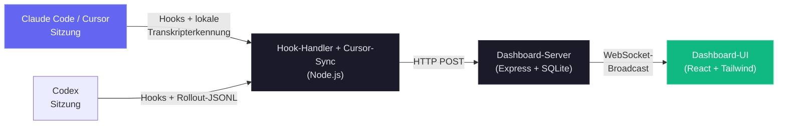

Neben dem Echtzeit-Überwachungsdashboard enthält das Projekt eine lokale MCP-Server-Implementierung in `mcp/`, die einen Tool-Katalog zum Untersuchen und Verwalten des Dashboards selbst bereitstellt, sodass sich Dashboard-Operationen direkt in Ihre Workflows mit Claude Code und Codex einbinden lassen. Außerdem gibt es eine Schicht für Agent-Erweiterungen mit Plugins, Skills und Subagents für Claude Code und Codex zur Interaktion mit dem Dashboard, für Analysen und Workflow-Intelligenz.

### Internationalisierung (i18n)

Die Oberfläche bietet eine integrierte Sprachumschaltung für Englisch (`en`), Chinesisch (`zh`), Vietnamesisch (`vi`), Koreanisch (`ko`), Spanisch (`es`), Französisch (`fr`), Deutsch (`de`), Portugiesisch (`pt`) und Italienisch (`it`). Ein eigenes Sprach-Dropdown verhindert, dass die Auswahl die Seitenleiste überfrachtet, wenn weitere Sprachen hinzukommen. Sprachressourcen werden pro Namespace geladen und im Browserspeicher gehalten, damit die Einstellung über Neuladen hinweg stabil bleibt.

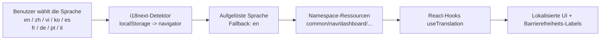

Die vollständige Architektur und Betriebshinweise finden Sie in [docs/I18N.md](./docs/I18N.md).

### Benutzeroberfläche

Die responsive dunkle Oberfläche deckt den gesamten Workflow ab. Jede Vorschau nutzt ein mobilfreundliches Vorschaubild und verlinkt auf das scharfe Original.

<p align="center">
  <a href="images/dashboard.png"></a>
  <br>
  <em>📡 <strong>Dashboard</strong> · Gesamtwerte der Flotte, aktive Agents, letzte Aktivität und Live-Zustandssignale</em>
</p>

<p align="center">
  <a href="images/tasks-overview.png"></a>
  <br>
  <em>📋 <strong>Aufgabenfortschritt</strong> · kompakter Fortschritt und Arbeitsvorschauen nach Verantwortlichen</em>
</p>

<p align="center">
  <a href="images/dashboard-health.png"></a>
  <br>
  <em>🩺 <strong>Systemzustand</strong> · Speicher, Cache, Fehler, Tools, Modelle, Subagents und Compactions</em>
</p>

<p align="center">
  <a href="images/board.png"></a>
  <br>
  <em>📋 <strong>Kanban-Board · Agents</strong> · arbeitende, wartende, abgeschlossene und fehlgeschlagene Agents mit klaren Wartegründen</em>
</p>

<p align="center">
  <a href="images/board-sessions.png"></a>
  <br>
  <em>🗂️ <strong>Kanban-Board · Sitzungen</strong> · aktive, wartende, abgeschlossene, fehlerhafte und abgebrochene Sitzungen</em>
</p>

<p align="center">
  <a href="images/sessions.png"></a>
  <br>
  <em>📂 <strong>Sitzungen</strong> · durchsuchbarer, filterbarer, serverseitig paginierter Verlauf mit Kosten und Aktivität</em>
</p>

<p align="center">
  <a href="images/session-agents.png"></a>
  <br>
  <em>🤖 <strong>Sitzungs-Agents</strong> · Live-Summen, Tool-Nutzung, Token-Fluss und Agent-Hierarchie</em>
</p>

<p align="center">
  <a href="images/tasks-details.png"></a>
  <br>
  <em>✅ <strong>Aufgabendetails</strong> · Fortschrittssegmente, aktive Arbeit, Verantwortliche und paginierte Aufgaben</em>
</p>

<p align="center">
  <a href="images/session-conversation.png"></a>
  <br>
  <em>💬 <strong>Konversation</strong> · gerenderte Transkripte, Code, Tool-Aufrufe, Befehlsausgaben und Sitzungsmarkierungen</em>
</p>

<p align="center">
  <a href="images/session-timeline.png"></a>
  <br>
  <em>🔬 <strong>Zeitleiste</strong> · chronologische Ereignisse, mehrdimensionale Filter und gepaarte Tool-Aktivität</em>
</p>

<p align="center">
  <a href="images/feed.png"></a>
  <br>
  <em>📰 <strong>Aktivitäts-Feed</strong> · pausierbare Live-Ereignisse, Gruppierung, Filter und Sprünge zur Sitzung</em>
</p>

<p align="center">
  <a href="images/analytics.png"></a>
  <br>
  <em>📊 <strong>Analysen</strong> · Tokens nach Modell, Tool-Häufigkeit, Aktivitäts-Heatmaps und Sitzungstrends</em>
</p>

<p align="center">
  <a href="images/workflows.png"></a>
  <br>
  <em>🔀 <strong>Workflows</strong> · Orchestrierungsgraphen, Tool-Fluss, Zusammenarbeit, Delegation und Muster</em>
</p>

<p align="center">
  <a href="images/dynamicworkflows-workflows.png"></a>
  <br>
  <em>🧬 <strong>Workflow-Läufe</strong> · Status, Agents, Tokens, Tools und Dauer aus den Laufjournalen</em>
</p>

<p align="center">
  <a href="images/dynamicworkflows-workflows2.png"></a>
  <br>
  <em>🧬 <strong>Aufgeklappter Lauf</strong> · Phasenfilter, Metriken pro Agent, Prompts und vollständige Ergebnisse</em>
</p>

<p align="center">
  <a href="images/dynamicworkflows-session.png"></a>
  <br>
  <em>🧬 <strong>Sitzungs-Workflows</strong> · verknüpfte dynamische Läufe und eingerechnete Token-Kosten</em>
</p>

<p align="center">
  <a href="images/config.png"></a>
  <br>
  <em>🧰 <strong>Agent-Konfiguration</strong> · unterstützte Konfiguration von Claude Code und Codex einsehen und sicher bearbeiten</em>
</p>

<p align="center">
  <a href="images/config-codex.png"></a>
  <br>
  <em>🧰 <strong>Codex-Konfiguration</strong> · Modelle, Profile, MCP, Projekte, Skills, Hooks, Regeln, Plugins und Anweisungen</em>
</p>

<p align="center">
  <a href="images/config-skills.png"></a>
  <br>
  <em>🧩 <strong>Skills</strong> · durchsuchbare Benutzer-, Projekt- und Plugin-Skills mit Bearbeitung samt Backup</em>
</p>

<p align="center">
  <a href="images/run.png"></a>
  <br>
  <em>▶️ <strong>Agent starten</strong> · Claude Code oder Codex mit den nativen Steuerelementen des jeweiligen Anbieters starten</em>
</p>

<p align="center">
  <a href="images/run-results.png"></a>
  <br>
  <em>💬 <strong>Live-Lauf</strong> · Streaming-Chat, Reasoning, Befehle, Dateiänderungen, Tools und erneutes Verbinden</em>
</p>

<p align="center">
  <a href="images/settings.png"></a>
  <br>
  <em>⚙️ <strong>Einstellungen</strong> · Preise, Hooks, Benachrichtigungen, Daten, entfernte Quellen und Systemstatus</em>
</p>

<p align="center">
  <a href="images/alerts.png"></a>
  <br>
  <em>🔔 <strong>Alarme</strong> · Regeln, Abklingzeiten, Aktivität sowie integrierte oder signierte generische Webhooks</em>
</p>

<p align="center">
  <a href="images/remote.png"></a>
  <br>
  <em>🛰️ <strong>Entfernte Datenquellen</strong> · anbieterbewusste SSH-Synchronisierung und Überwachung nach Quelle</em>
</p>

<p align="center">
  <a href="images/palette.png"></a>
  <br>
  <em>⌘ <strong>Befehlspalette</strong> · ein Tastatur-Starter für Seiten, Sitzungen, Projekte, Filter und Aktionen</em>
</p>

Die Seitenleiste verlinkt Dashboard, Kanban-Board, Sitzungen, Aktivitäts-Feed, Analysen, Workflows, Agent-Konfiguration, Agent starten und Einstellungen. Die folgenden Abschnitte beschreiben das vollständige Verhalten hinter diesen Ansichten.

---

## Funktionen

Das Dashboard deckt den gesamten lokalen Lebenszyklus der Agents ab. Detaillierte Betriebsverträge stehen weiterhin in den verlinkten Abschnitten und in den Referenzen unter `docs/`.

| Funktion | Zusammenfassung |
| --- | --- |
| **Aufgabenfortschritt** | Fortschritt nach Verantwortlichen aus den Aufgaben-Tools von Claude, dem älteren `TodoWrite` und Codex-`update_plan`. Kompakte Vorschauen erscheinen auf Karten und Zeilen; die Sitzungsdetails ergänzen Statussegmente, aktuelle Arbeit, Verantwortliche und Paginierung mit 10 Zeilen. Neue Arbeit der obersten Ebene löscht veralteten unfertigen Zustand, während abgeschlossener Verlauf erhalten bleibt. |
| **Dashboard** | Die gespeicherten Tabs **Überwachung** und **Zustand** vereinen Gesamtwerte der Flotte, aktive Hierarchien, letzte Aktivität, einen gewichteten Zustand aus Erfolg, Cache, Fehlern und Heap, Speicher, Tools, Modelle, Subagent-Effektivität und Compaction-Metriken. Der Zustand wird alle 5 Sekunden aus `/api/settings/info` und `/api/workflows` aktualisiert. |
| **Kanban-Board** | Die Agent-Spalten umfassen Arbeitet, Wartend, Abgeschlossen und Fehler; die Sitzungsspalten ergänzen Aktiv und Abgebrochen. Karten werden zu je 10 paginiert, abonnieren nur die aktive WebSocket-Ansicht, behalten vollständige Titel und erklären Wartegründe wie Berechtigungseingabe, Rundenende, Leerlauf am Prompt oder Unterbrechung. |
| **Sitzungen** | Durchsuchbarer, filterbarer, serverseitig paginierter Verlauf mit Kostenberechnung nur für die sichtbare Seite und einer temporären, im Speicher gehaltenen Codex-Startzeile. Die Suche deckt `id`, `name` und `cwd` mit 300 ms Entprellung ab. Namen ergeben sich aus dem expliziten Titel, dann dem KI-Titel, dann dem ersten aussagekräftigen Benutzer-Prompt. |
| **Sitzungsdetails** | Live-Statistiken, aktuelle Arbeit, Tool-Nutzung, Subagents, Tokens, Hierarchie, gefilterte Ereignis-Zeitleisten, Gruppierung nach `tool_use_id` und tool-spezifische Darstellungen. Die Konversationsansicht stellt eingereihte Runden, Systemhinweise, Markdown, hervorgehobenen Code und gestaltete Tool-Aufrufe dar; Warte-Banner zeigen den Grund und die verstrichene Zeit. |
| **Aktivitäts-Feed** | Pausierbare Echtzeit-Ereignisse mit gemeinsamen Filtern, serverseitiger Paginierung, Gruppierung, Herkunft nach Projekt/Sitzung/Subagent, Links zur Sitzung und einheitlichen Status-Badges für Claude und Codex. |
| **Analysen** | Tokens nach Modell, Tool-Häufigkeit, ab Sonntag ausgerichtete Aktivitäts-Heatmaps, Sitzungstrends, Verbindungsstatus, dem Layout entsprechende Lade-Skeletons und paginierte lange Legenden. |
| **Befehlspalette** | `Cmd/Ctrl+K` durchsucht letzte Befehle, alle Routen, serverseitige Live-Sitzungen, Seitenaktionen, Projektverzeichnisse, Unteransichten, Filter, Einstellungen, Agent-Konfiguration, Präferenzen, Datenbereich und Sprache. Sie unterstützt Ranking nach Teilfolgen, die Bereiche `>`/`@`/`#`, vollständige Tastatursteuerung, übersetzte Bezeichnungen, stilles Scheitern der Suche und reine Navigation bei destruktiven Aktionen. |
| **Ein einziges Tastenkürzel** | `Cmd/Ctrl+K` ist die einzige globale Tastenkombination des Dashboards, auch innerhalb von Feldern. Der Verzicht auf Navigation mit mehreren Tasten vermeidet versteckte Modi; Tabby behält `Cmd/Ctrl+B`. |
| **Live-Updates** | WebSocket-Push aktualisiert die Oberfläche ohne Polling. |
| **Automatische Erkennung** | Anbietersignale erzeugen Sitzungen und Agents automatisch. Claude erscheint beim `SessionStart`; Codex zeigt eine temporäre lokale Wartend-Karte, bevor eine dauerhafte ID existiert, übernimmt fortgesetzte, bereits beendete Threads sicher und schreibt Karten ohne Identität nie in dauerhafte Summen, Analysen, Alarme oder Benachrichtigungen. |
| **Verlaufsimport** | Claude-Transkripte aus `~/.claude/` und Codex-Rollouts aus `~/.codex/sessions` nutzen anbieterspezifische Scan- und Upload-Abläufe, dieselbe Abrechnung wie die Live-Ingestion und idempotente Schreibvorgänge. Externe Codex-Rollouts werden als Snapshot gesichert, damit Konversationen das Entfernen der Quelle überstehen. |
| **Subagent-Hierarchie** | Einklappbare Eltern-Kind-Bäume im Dashboard und in den Sitzungsdetails klappen automatisch auf, solange Kinder aktiv sind. |
| **Hintergrund-Agents** | Subagents im Hintergrund bleiben verfolgt, ohne vorzeitig als abgeschlossen zu gelten. |
| **Tool-Zuordnung der Subagents** | `SubagentStop` und Scans beim Start importieren die Tools aus den JSONL-Dateien der einzelnen Subagents, paaren Ergebnisse über `tool_use_id`, deduplizieren, führen passende Live-Zeilen innerhalb von 30 Sekunden zusammen und rekonstruieren die tatsächlichen verschachtelten Eltern aus den IDs gestarteter Kinder. Das Umhängen ist additiv und löst eine UI-Aktualisierung aus, auch wenn keine Zeile eingefügt wird. |
| **Kostenverfolgung** | Konfigurierbare Preise pro Modell und pro Sitzung unterstützen datierte Einführungspreise, bearbeitbare Aktionskategorien, die eigenen Kosten jedes Subagents und Compaction-sichere Summen. Transkripte werden über zwischengespeicherte inkrementelle Byte-Offsets gelesen. |
| **Transkript-Cache** | Inkrementelles JSONL-Parsing extrahiert Tokens, Compactions, API-Fehler, Rundendauern, Thinking und Nutzungsmetadaten; vollständige Durchläufe reparieren ältere Duplikate, während Tail-Durchläufe nur anhängen. Arrays sind auf `TRANSCRIPT_CACHE_MAX_ARRAY_LEN` begrenzt (Standard `1000`), und Einträge speichern nur Dateimetadaten plus das geparste Ergebnis. |
| **Aufbewahrung von Transkript-Snapshots** | Dauerhafte Snapshots von Claude, Codex und Cursor bewahren die vollständigste Konversation. Claude- und Cursor-Kopien ohne Quelle werden nach verifiziertem Round-Trip mit gzip komprimiert; ein Purge entfernt die Snapshots; optionale Alters- und Größengrenzen können nach einer Probelauf-Vorschau in den Einstellungen auch die einzige alte Kopie löschen. |
| **Benachrichtigungen** | VAPID-Web-Push stellt konfigurierte Ereignisse auch bei Tab im Hintergrund oder geschlossenem Browser zu, mit Tonunterstützung unter macOS und Verwaltung der Abonnements. |
| **Alarme** | Die Einstellungen bieten Regeln, Kanäle und Aktivität für Alarme zu Ereignismustern, Inaktivität, hängenden Agents und Tokens. Ereignisregeln laufen nach der Ingestion; Zeitregeln prüfen alle 60 Sekunden. Gespeicherte Alarme nutzen eine Abklingzeit pro Regel und Sitzung (Standard 300 Sekunden), WebSocket-Zustellung, Bestätigung und ein bereichsbezogenes Webhook-Fan-out an 14 benannte Anbieter oder signiertes generisches JSON, mit maskierten Geheimnissen, Timeouts und begrenzten Wiederholungen. |
| **Update-Benachrichtigung** | Ein nicht blockierendes, geplantes `git fetch` vergleicht den Checkout mit dem kanonischen Remote und zeigt dann den genauen Update-Befehl im Dialog, in der Seitenleiste und im Terminal. CCAM führt niemals selbst einen Pull oder Neustart aus. |
| **Einstellungen** | System- und Hook-Status, Preise pro Anbieter, Benachrichtigungen, Bereinigung, Anbieter-Homes, sofortige Datenaktualisierung und idempotente Wiederherstellung von Export-JSON bis 25 MiB. Die Preise unterstützen anbieterbezogene Standardwerte, Platzhalterregeln, Hinweise zu veröffentlichten Tarifen, die 272K-Grenze bei GPT sowie getrennte Kataloge für Cursor-eigene und Drittanbietermodelle. |
| **Agent starten + Agent-Konfiguration** | `/run` startet Claude Code oder native Codex-App-Server-Threads mit anbieterspezifischen Modellen, Genehmigungen, Sandboxing, Fortsetzen, Stoppen, Streaming und erneutem Verbinden. `/cc-config` kombiniert bearbeitbare Explorer für Claude und Codex; unterstützte Benutzerdateien nutzen abgesicherte atomare Speicherungen und Backups mit Zeitstempel, Vorschauen mit geschwärzten Geheimnissen, exakte Profilbefehle und anbieterspezifische Watcher. |
| **Codex-Agent-Konfiguration** | Zeigt den vollständigen Modellkatalog des Kontos plus Basis- und Profilüberschreibungen, legt Standard-Overlays `<name>.config.toml` an und sichert die Bearbeitung mit kanonischen Eingrenzungs- und Symlink-Prüfungen ab. Profile, Hooks, Regeln, Skills und Anweisungen unterstützen Aktionen für Quelle, Pfad, Bearbeiten und Löschen, mit Backup vor jedem Löschen; `config.toml` kann nur bearbeitet werden. |
| **MCP-Server (lokal)** | Drei Transporte – stdio, HTTP+SSE und REPL – stellen 103 typisierte Tools in 16 Modulen bereit. Ein einziger validierter Katalog erzwingt localhost- oder HTTPS-Ziele, Regeln für Bearer-Tokens, die Ablehnung von Weiterleitungen, Freigabestufen für Änderungen, Uploads bis 50 MiB pro Datei und 100 MiB pro Aufruf, Binärantworten bis 10 MiB und Wiederherstellungen bis 25 MiB. |
| **Workflows** | Elf D3-Abschnitte decken Orchestrierung, Tool-Fluss, Zusammenarbeit, Effektivität, Muster, Delegation, Fehler, Nebenläufigkeit, Komplexität, Compaction und die Detailansicht pro Sitzung ab. Lokalisierte erklärende Tooltips, Kreuzfilterung, JSON-Export, Live-Aktualisierung mit 3 Sekunden Entprellung und aus Journalen rekonstruierte dynamische Läufe bewahren Phase, Tokens, Tools, Dauer, Prompt und Ergebnis pro Agent. |
| **Compaction-Verfolgung** | Transkript-Scans erzeugen Compaction-Agents und -Ereignisse mit Dauer null, reparieren ältere negative Dauern, tragen alte Sitzungen nach und prüfen periodisch nur aktive Sitzungen über zwischengespeicherte Werte von `sessions.transcript_path`. |
| **Untersitzungen / fortgesetzte Sitzungen** | Neue Ereignisse reaktivieren fortgesetzte oder verwaiste Sitzungen; ein Durchlauf alle ¼ von `DASHBOARD_STALE_MINUTES`, begrenzt auf 60 Sekunden bis 5 Minuten, erfasst abgebrochene Sitzungen. |
| **Erkennung bereits laufender Sitzungen** | Der Startimport markiert kürzlich geänderte Transkripte als aktiv, und spätere Stop-Ereignisse reaktivieren importierte abgeschlossene oder abgebrochene Sitzungen, bevor sie aktualisiert werden. |
| **Kontinuierliche Projektsynchronisierung** | Ein sofortiger Durchlauf beim Start, ein entprellter Dateisystem-Watcher und ein Polling über `DASHBOARD_SESSION_SYNC_MS` (Standard 30 Sekunden) teilen sich einen mtime-Cache und einen zusammengefassten Scan. Nur neue oder fortgeschriebene Dateien werden erneut geparst, mit Linux-sicherem Watcher-Umfang und Live-Broadcasts der Sitzungen. |
| **Entfernte Datenquellen** | SSH-Quellen spiegeln Claude- und Codex-Homes unabhängig per `scp` oder WSL-`tar`, setzen `sessions.source`, gleichen den Lebenszyklus ab und bleiben gesund, solange einer der Anbieter funktioniert. Das Polling erfolgt standardmäßig alle 15 Sekunden; der Rückfall auf den Veraltet-Durchlauf betrifft nur den ausgefallenen Anbieter. Zugangsdaten bleiben beim SSH des Hosts. |
| **Entfernte Push-Ingestion** | `POST /api/hooks/ingest-batch` sendet Sitzungssummen und Ereignisse von Rechnern hinter NAT, während `POST /api/hooks/ingest-transcript` das JSONL des Haupt-Agents und der Subagents mit Offset-Prüfung ergänzt, für Titel, Verlauf, Tokens und den Import von Subagents. Beide bleiben deaktiviert, bis `REMOTE_PUSH_TOKEN` oder `REMOTE_PUSH_TOKEN_FILE` konfiguriert ist, und lehnen Zugangsdaten im Query-String sowie lokal verwaltete Sitzungen ab; `ingest-transcript` authentifiziert, bevor sein größerer Parser läuft. |
| **Responsives Design** | Mobile Layouts stapeln Raster, scrollen breite Tabellen und klappen die Navigation ein. |
| **UI-Lokalisierung** | Englisch, Chinesisch, Vietnamesisch, Koreanisch, Spanisch, Französisch, Deutsch, Portugiesisch und Italienisch decken UI-Texte, Barrierefreiheits-Labels, Workflow-Erklärungen und Tooltips, Hinweise zu Modellpreisen, Anbieter-Homes und den Verlaufsimport ab. |
| **Beispieldaten** | Ein integriertes Skript liefert realistische Daten für Demos und Entwicklung. |
| **Statuszeile** | Eine farbige CLI-Leiste zeigt Modell, Kontext, Git-Branch, Tokens pro Richtung und Sitzungskosten in USD. |
| **Formatierung der Modellnamen** | Bezeichner von Claude, GPT und Gemini werden zu lesbaren Namen, indem Anbieter-, Datums- und latest-Zusätze entfernt, numerische Versionen verbunden und Kontext-Tags formatiert werden; die Einstellungen behalten die rohen Preismuster. |
| **Plugin-Marketplace für Claude + Codex** | Ein einziger Baum mit 14 Plugins liefert beide Manifestformate und Kataloge, 66 Plugin-Skills, 18 Claude-Subagents, 34 Claude-Befehle, 3 CLI-Helfer und OpenAI-Metadaten. `npx skills add hoangsonww/Claude-Code-Agent-Monitor --list` findet 77 Skills im Repository. |
| **Claude starten** | Die Modi Konversation und Einmalig unterstützen Fortsetzen und Ansehen des Verlaufs, parallele Hintergrundläufe, transkriptbewusstes erneutes Verbinden, Steuerung von Modell, Aufwand, Berechtigungen und cwd, Glättung von Teilnachrichten, Erhalt der Thinking-Blöcke, Slash-Befehle, `@`-Dateien, Kontext- und Kostenanzeigen sowie Live-Status. Ein Same-Origin-Schutz verhindert Drive-by-Starts; die Nebenläufigkeit hat standardmäßig eine Sicherheitsobergrenze von 10000 und lässt sich mit `RUN_MAX_CONCURRENT` senken. |
| **Claude-Konfigurations-Explorer** | Zwölf Tabs untersuchen Skills, Agents, Befehle, Stile, Plugins, Marketplaces, MCP, Hooks, Einstellungen, Speicher, Tastenbelegungen und Statuszeile. Kanonische Pfade verhindern Ausbrüche über Symlinks; unterstützte Textflächen nutzen atomares Anlegen, Bearbeiten und Löschen mit Backups mit Zeitstempel außerhalb des Baums, während sensible Konfiguration schreibgeschützt bleibt und genaue CLI-Hinweise erhält. Ein `cc-watcher` mit 500 ms Entprellung sendet externe Änderungen per Broadcast. |
| **Tabby** | Ein WebSocket-Maskottchen ohne Abhängigkeiten mit acht aus der Aktivität abgeleiteten Stimmungen, gedrosselten Sprechblasen, Schnellaktionen, lokalen Statusantworten und Übergabe an Claude starten für weitergehende Prompts. Es ist per Tastatur bedienbar, berücksichtigt reduzierte Bewegung, bleibt ohne Verbindung sicher, ist konfigurierbar und lokalisiert. |
| **Tonsignale** | Sieben abhängigkeitsfreie Web-Audio-Signale decken Sitzungen, Fehler, Subagents, Benachrichtigungen, Verbindung und Klicks ab. Abklingzeiten, ein globales Burst-Budget, Tiefpassfilterung, Autoplay-Sicherheit, gespeicherte Lautstärke und Einstellungen pro Signal halten sie unaufdringlich. |
| **Progressive Web App (PWA)** | Dashboard, Landingpage und Wiki haben unabhängige Manifeste und Service Worker. Unveränderliche Vite-Assets kommen zuerst aus dem Cache, Navigation und veränderliche Shell-Dateien zuerst aus dem Netzwerk; Push bleibt intakt; Landingpage und Wiki legen ihre Shells vorab in den Cache und cachen Screenshots bei Bedarf; SVG- und Apple-Metadaten unterstützen die Installation. |
| **Desktop-App (macOS und Windows)** | Electron 35 verpackt macOS-DMGs und Windows-EXEs (Installer und portabel) um denselben In-Process-Express-Server und React-Client. Hinzu kommen native Menüs, Status und Aktionen im Tray, Start bei der Anmeldung, Bestätigung beim Beenden, native Benachrichtigungen, eine Einzelinstanz-Sperre, sicherer Port-Rückfall bzw. Übernahme, sauberes Herunterfahren von SQLite und die Einrichtung von Hooks und Hintergrunddiensten beim ersten Start. |
| **Selbst gehostete Ressourcen (kein CDN)** | Schriften, Skripte, das Mermaid des Wikis und die Rückfalloptionen der Erweiterung sind lokal. App, Landingpage und Wiki funktionieren offline ohne Google Fonts, jsDelivr oder andere Anfragen an Ressourcen von Drittanbietern. |
| **Sitzungs-Startbildschirm** | Eine lokalisierte Begrüßung mit Knotengraph-Animation, einmal pro Browsersitzung, ist ab dem ersten Rendern deckend, dauert etwa 2,5 Sekunden, lässt sich per Klick überspringen und berücksichtigt reduzierte Bewegung. |

> **Anbieterbereich und Homes:** Die Einstellungen halten die Auswahl Claude-kompatibel (Claude Code + Cursor) / Codex / Beide überall konsistent. Die Homes von Claude Code und Codex bleiben bearbeitbar, ohne das Dashboard neu zu starten; Cursor wird automatisch aus `~/.cursor` oder `DASHBOARD_CURSOR_HOME` erkannt.
>
> **Lokale Sicherheitsgrenzen:** Agent starten akzeptiert jedes existierende absolute Arbeitsverzeichnis und kanonisiert es vor der Verwendung, sodass Starts aus dem Home und aus zuletzt genutzten Projekten weiterhin unterstützt werden. Gehostete Webhook-Anbieter erfordern HTTPS; generische und n8n-Ziele dürfen HTTP für lokale/selbst gehostete Empfänger nutzen, und die Zustellung folgt nie Weiterleitungen.

---

## Schnellstart

### Voraussetzungen

- **Node.js** >= 22.22.0 (24 LTS empfohlen)
- **npm** >= 9.0.0

### 1. Installieren

```bash
git clone https://github.com/hoangsonww/Claude-Code-Agent-Monitor.git
cd Claude-Code-Agent-Monitor
npm run setup
```

### 2. Claude-Code-Hooks konfigurieren

```bash
npm run install-hooks
```

Wählen Sie mit den Pfeiltasten, der Leertaste und Enter **Claude Code**, **Codex (Beta)** oder beides. Claude-Hooks werden in `~/.claude/settings.json` gespeichert, Codex-Hooks in `~/.codex/hooks.json`. Eine Neuinstallation ersetzt nur die CCAM-Einträge und erhält fremde Hooks; dieselbe Aktion steht unter **Einstellungen → Hook-Konfiguration** zur Verfügung.

Beim ersten Start prüft CCAM nur die Anbieter, die für den aktuellen Datenbereich ausgewählt sind, und bietet an, fehlende Hooks zu installieren. Eine fehlgeschlagene Bereitschaftsprüfung fällt auf die manuelle Einrichtung zurück, statt das Dashboard zu blockieren.

Die Erkennung der Anbieter läuft nach der Einrichtung weiter:

- **Claude Code und Cursor:** Claude-Hooks liefern Live-Ereignisse. Cursor benötigt keine Hooks; die Auswahl von Claude Code überwacht auch `~/.cursor/chats` und `~/.cursor/projects/*/agent-transcripts`, sichert Konversationen als Snapshot, bevor Cursor aufräumt, und berücksichtigt `DASHBOARD_CURSOR_HOME`.
- **Codex:** Hooks und die inkrementelle Überwachung der Rollouts in `~/.codex/sessions` halten Lebenszyklus, Prompts, Titel, Tools, Tokens, Kosten, Compactions, Konversationen und WebSocket-Zustand aktuell. Fehlerhafte Dateien werden isoliert erneut versucht; die exakte Zuordnung von Rollout und Prozess verhindert aktive Phantom-Karten; native `/rename`-Titel und der per Cursor paginierte Konversationsverlauf bleiben live.
- **Beide:** Karten behalten die letzten zwei unterschiedlichen menschlichen Prompts, zeigen gespeicherte Bildanhänge an und deduplizieren wiederholte Codex-Antworten. Ein reiner Codex-Datenbereich blendet die nur für Claude verfügbaren Journale der dynamischen Workflows aus.

### 3. Starten

```bash
# Development (hot reload on both server and client)
npm run dev

# Production (single process, built client)
npm run build && npm start
```

> [!TIP]
> **Alternative mit Makefile** — alle Befehle sind auch über `make` verfügbar, sofern es auf Ihrem System installiert ist. Führen Sie `make help` aus, um alle Ziele zu sehen, oder nutzen Sie Kurzbefehle wie `make dev`, `make build`, `make test` usw.

### 4. Öffnen

| Modus | URL |
| ----------- | ----------------------- |
| Entwicklung | `http://localhost:5173` |
| Produktion | `http://localhost:4820` |

### 5. Optional: den lokalen MCP-Server starten

```bash
npm run mcp:start              # stdio (default — for MCP host integration)
npm run mcp:start:http         # HTTP + SSE server on port 8819
npm run mcp:start:repl         # interactive CLI with tab completion
ccam mcp stdio                 # stable launcher used by bundled plugins
```

`npm run setup` installiert und baut das MCP-Paket, bevor `ccam` verlinkt wird. Für den stdio-Modus konfigurieren Sie Ihren Host mit dem Befehl `ccam` und den Argumenten `["mcp", "stdio"]`.

Für den HTTP-Modus richten Sie entfernte MCP-Clients auf `http://127.0.0.1:8819/mcp` (Streamable HTTP) oder `http://127.0.0.1:8819/sse` (älteres SSE).

Siehe [mcp/README.md](./mcp/README.md) für die vollständige Host-Konfiguration, Transportdetails, Sicherheitsschalter und den Tool-Katalog.

### Optional: Demodaten einspielen

```bash
npm run seed
```

Erzeugt 8 Beispielsitzungen, 23 Agents und 106 Ereignisse, damit Sie die UI sofort erkunden können.

### Alternative: Desktop-App (macOS und Windows)

Wenn Sie kein Terminal offen halten möchten, installieren Sie die optionale **native Desktop-App**. Sie bettet den Server im selben Prozess ein, fügt ein Symbol in Menüleiste / Infobereich (Tray) hinzu und unterstützt den Autostart bei der Anmeldung (macOS-Anmeldeobjekte / Windows-Autostart).

Am schnellsten ist es, **einen vorgefertigten Installer** aus dem [neuesten GitHub-Release](https://github.com/hoangsonww/Claude-Code-Agent-Monitor/releases/latest) herunterzuladen (die CI veröffentlicht automatisch ein `vX.Y.Z`, sobald die Version in `package.json` auf `master` erhöht wird):

- **macOS** — laden Sie `ClaudeCodeMonitor-<version>-arm64.dmg` (Apple Silicon) oder `-x64.dmg` (Intel) und ziehen Sie **Claude Code Monitor.app** nach `/Applications`.
- **Windows** — laden Sie `ClaudeCodeMonitor-Setup-<version>-x64.exe` (Installer) oder `ClaudeCodeMonitor-<version>-x64-portable.exe` (ohne Installation) und führen Sie ihn aus.

So bauen Sie sie stattdessen selbst:

```bash
npm run desktop:install        # install Electron + electron-builder into desktop/ (preflights native deps; prints setup help on failure)
npm run desktop:dmg:arm64      # macOS: fast single-arch DMG (Apple Silicon)
npm run desktop:win            # Windows: NSIS installer .exe (run on Windows)
```

Die vollständige Beschreibung der Desktop-App — Download, Installation, Tray-/Menüfunktionen, Build-Befehle und Signierung — finden Sie weiter unten im Abschnitt [Desktop-App (macOS und Windows)](#desktop-app-macos-und-windows). Siehe auch [`DESKTOP.md`](./DESKTOP.md) (Benutzerhandbuch) und [`desktop/README.md`](./desktop/README.md) (Architektur).

### Alternative: Docker / Podman

Das OCI-Image und die Compose-Dateien unterstützen Docker und Podman. Die Laufzeit läuft ohne Root, verwirft alle Capabilities, nutzt Tini als PID 1, enthält Git/OpenSSH/SQLite und ist schreibgeschützt bis auf `/app/data`, `/app/config` und `/tmp`.

```bash
# Dashboard only
docker compose up -d --build
# or
podman compose up -d --build

# Complete stack: dashboard + authenticated MCP + Nginx + Prometheus + Grafana
umask 077
openssl rand -hex 32 > deployments/secrets/dashboard-token
openssl rand -hex 32 > deployments/secrets/hook-token
openssl rand -hex 32 > deployments/secrets/mcp-token
openssl rand -base64 32 > deployments/secrets/grafana-admin-password
npm run docker:full:up
```

Alle Host-Ports binden standardmäßig an Loopback: Dashboard `4820`, MCP `8819`, Nginx `8080`, Prometheus `9090` und Grafana `3000`. Die Claude- und Codex-Homes werden schreibgeschützt eingebunden; benannte Volumes erhalten SQLite und die dashboardeigene Konfiguration. Nginx leitet die UI, die authentifizierte REST-API und den WebSocket weiter, während Hooks, Metriken und MCP am Rand gesperrt bleiben, sofern sie nicht explizit aktiviert werden. Das optionale Docker-Ziel `agent-runtime` ergänzt versionsfixierte Claude-Code- und Codex-CLIs für containernative Workflows mit Agent starten.

> [!IMPORTANT]
> Installieren Sie die Claude-Code-/Codex-Hooks nach dem Start des Containers auf dem Host. Für entfernte Cloud-Hooks setzen Sie `CCAM_DASHBOARD_URL=https://...` und ein separates `CCAM_HOOK_TOKEN`; Hook-URLs außerhalb von Loopback erfordern HTTPS. Siehe [DEPLOYMENT.md](DEPLOYMENT.md).

---

## Funktionsweise

Das Dashboard integriert sich über das native Hook-System von Claude Code, um die Agent-Aktivität in Echtzeit zu überwachen. Hier ein Überblick über Architektur und Datenfluss:

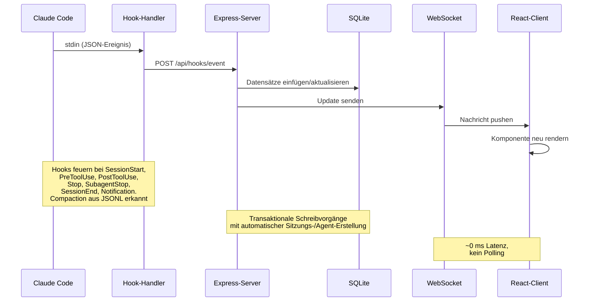

> [!IMPORTANT]
> Siehe [ARCHITECTURE.md](./ARCHITECTURE.md) für einen tiefen Einblick in Serverarchitektur, Datenbankschema, API-Routen, WebSocket-Design, Client-Routing, Ablauf des Hook-Handlers, Deployment-Modi und detaillierte Lebenszyklusdiagramme für Sitzungen und Agents.

### Hook-Lebenszyklus

1. **Claude Code** sendet Hooks für Sitzung, Prompt, Tool, Benachrichtigung, Subagent, Runde und Beenden.
2. **`scripts/hook-handler.js`** liest jedes Ereignis von stdin und findet laufende Dashboards über `~/.claude/.agent-dashboard.json` oder `CLAUDE_DASHBOARD_PORT`. Er sendet einmal pro eindeutigem SQLite-Datenverzeichnis, wählt bei doppelten Listenern den niedrigsten Port und beliefert dennoch Dashboards mit eigenen Datenbanken. Die Zustellung ist ausfallsicher: Jedes Ziel ist isoliert, und der Handler endet innerhalb von 5 Sekunden.
3. **Der Server** schreibt das Ereignis und den zugehörigen Zustand in einer einzigen SQLite-Transaktion fest:
   - Der erste Kontakt legt Sitzung und Haupt-Agent an. `SessionStart` beginnt in **Wartend**; `UserPromptSubmit` oder `PreToolUse` setzt ihn auf **Arbeitet**; `PostToolUse` hält ihn arbeitend.
   - `Stop` setzt den Haupt-Agent zurück auf **Wartend**, während Hintergrund-Agents weiterlaufen. `stop_reason=error` setzt Agent und Sitzung auf **Fehler**. Berechtigungs-Benachrichtigungen warten ebenfalls auf Eingabe; nur ein neuer Prompt oder ein Tool-Start hebt einen Fehler auf.
   - `SubagentStop` schließt dieses Kind ab, ohne den Zustand des Wartens auf den Menschen zu ändern. Ein losgelöster Scan importiert dann dessen JSONL-Tools, paart Aufrufe und Ergebnisse über `tool_use_id`, dedupliziert sie und baut die tatsächlichen verschachtelten Eltern neu auf.
   - `SessionEnd` löscht das Warten und schließt die Sitzung ab, sofern kein Fehler erhalten bleiben muss. Neue Arbeit reaktiviert abgeschlossene, fehlerhafte oder abgebrochene Sitzungen, einschließlich importierter und fortgesetzter Sitzungen.
   - `SessionStart` und die periodische Wartung markieren inaktive Sitzungen nach `DASHBOARD_STALE_MINUTES` (Standard 180) als abgebrochen. Der Durchlauf läuft alle ¼ dieses Werts, begrenzt auf 60 Sekunden bis 5 Minuten.
   - Das gemeinsame inkrementelle Transkript-Parsing erfasst Compactions, API- und Tool-Fehler, Rundendauern, Tokens und Metadaten, ohne unveränderte Bytes erneut zu lesen. Durchläufe über aktive Sitzungen nutzen indizierte Werte von `sessions.transcript_path` und entfernen Cache-Einträge abgebrochener Sitzungen.
   - Ein 15-Sekunden-Watchdog findet API-Fehler im Transkript nach 10 Sekunden ohne Hooks. Er stellt außerdem Esc-Unterbrechungen anhand von Transkriptmarkierungen wieder her oder, wenn keine Markierung existiert, nach `DASHBOARD_WORKING_IDLE_SECONDS` (Standard 120) – nur wenn kein Tool läuft und weder Hooks noch Transkript fortschreiten.
   - Derselbe Watchdog schließt tote lokale Sitzungen über eine Prozess-Lebenszeichenprüfung nach `DASHBOARD_LIVENESS_IDLE_SECONDS` (Standard 60) ab. Prüfungen beim Start laufen sofort und erneut nach etwa 5 Sekunden, ohne diese Leerlaufbedingung. Die Prüfung überspringt Windows, Container, weitergeleitete Nicht-POSIX-Pfade, Sitzungen aus entfernten Quellen, Fehler der Prozesswerkzeuge und `DASHBOARD_LIVENESS_PROBE=0`; ein späterer echter Hook heilt einen falschen Abschluss von selbst.
   - Die kontinuierliche Projektsynchronisierung kombiniert einen sofortigen Durchlauf, ein entprelltes `fs.watch` und ein Polling über `DASHBOARD_SESSION_SYNC_MS` (Standard 30 Sekunden). Ein einziger mtime-Cache parst nur neue oder gewachsene Transkripte erneut und sendet dieselben Sitzungs-Frames wie Hooks.
4. Der **WebSocket** veröffentlicht die festgeschriebene Änderung.
5. **Die UI** aktualisiert die betroffenen Ansichten ohne Polling.

### Zustandsautomat der Agents

Gespeicherte Status: `working | waiting | completed | error`. Die
Spalte `awaiting_input_since` ist ergänzend — sie hält fest, wann der Agent
zu warten begann, und dient der Anzeige der Dauer, doch `waiting` ist inzwischen ein
echter gespeicherter Status.

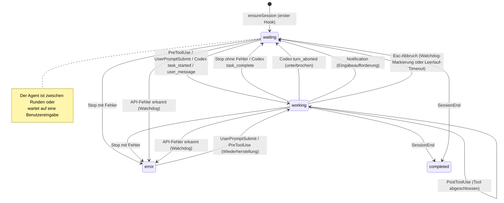

### Zustandsautomat der Sitzungen

Gespeicherte Status: `active | completed | error | abandoned`. Der
Sitzungszustand **Wartend** ist eine UI-Überlagerung (status=`active` mit
gesetztem `awaiting_input_since`).

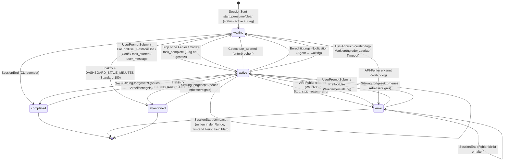

### Ablauf der Kostenberechnung

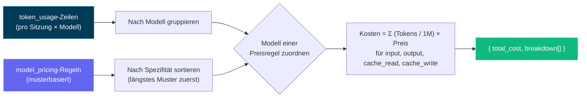

> [!IMPORTANT]
> Der Ablauf der Kostenberechnung basiert auf der Token-Nutzung und den Preisregeln der Modelle. Halten Sie Ihre Preisregeln aktuell, damit die Kosten korrekt sind. Aktualisieren Sie die Preistabelle der Modelle über die Seite Einstellungen, um die Kostenverfolgung genau zu halten — das Dashboard ruft Preisänderungen nicht automatisch aus externen Quellen ab. Sobald Sie die Preisregeln festgelegt haben, wendet das Dashboard sie rückwirkend auf alle Sitzungen an, für eine einheitliche Kostenauswertung.

---

## Konfiguration

| Umgebungsvariable | Standard | Zweck |
| --- | --- | --- |
| `DASHBOARD_PORT` | `4820` | Port des Express-Servers. |
| `CLAUDE_DASHBOARD_PORT` | `4820` | Port, den der Hook-Handler verwendet. |
| `NODE_ENV` | `development` | Mit `production` wird der gebaute Client ausgeliefert. |
| `DASHBOARD_UPDATE_CHECK` | aktiviert | Auf `0`, `false` oder `off` setzen, um die geplanten Upstream-Prüfungen zu deaktivieren. |
| `DASHBOARD_UPDATE_CHECK_INTERVAL_MS` | `300000` | Prüfintervall, mindestens 60.000 ms. **Jetzt prüfen** bleibt manuell verfügbar. |
| `DASHBOARD_STALE_MINUTES` | `180` | Inaktivität, nach der eine aktive oder wartende Sitzung als abgebrochen gilt. Der Watchdog setzt dies durch, und die Wartung läuft alle ¼ dieses Werts, begrenzt auf 60 Sekunden bis 5 Minuten. |
| `DASHBOARD_WORKING_IDLE_SECONDS` | `120` | Stellt einen Esc-Abbruch ohne Markierung wieder her, wenn weder Tool- noch Hook- noch Transkriptaktivität fortschreitet. Niedrigere Werte reagieren schneller, können lange stille Runden aber kurz falsch einordnen; neue Aktivität heilt dies von selbst. Cursor nutzt dieselbe Regel. |
| `DASHBOARD_LIVENESS_PROBE` | `1` | Auf `0` setzen, um den prozessbasierten Abschluss toter lokaler Claude-/Codex-Sitzungen zu deaktivieren. Überspringt automatisch Windows, Container, weitergeleitete Nicht-POSIX-Pfade und entfernte Quellen. |
| `DASHBOARD_LIVENESS_IDLE_SECONDS` | `60` | Leerlaufschwelle (Transkript oder letzter Hook) für die Lebenszeichenprüfungen des Watchdogs. Prüfungen beim Start ignorieren die Schwelle, damit bereits tote Sitzungen sofort bereinigt werden. |
| `DASHBOARD_SESSION_SYNC_MS` | `30000` | Sicherheits-Polling für neue oder geänderte Dateien in `~/.claude/projects`. `fs.watch` bleibt sofort wirksam; `0` deaktiviert nur das Polling. |
| `DASHBOARD_CURSOR_HOME` | `~/.cursor` | Zustandsverzeichnis von Cursor für Chats, Transkripte, Nachtrag und dauerhafte Snapshots. |
| `DASHBOARD_CURSOR_SYNC_MS` | `5000` | Fingerprint-basiertes Sicherheits-Polling für Cursor. Die Watcher bleiben aktiv, wenn `0` das Polling deaktiviert. |
| `DASHBOARD_CODEX_HOME` | `CODEX_HOME` oder `~/.codex` | Zustandsverzeichnis von Codex. Die Einstellungen speichern eine Überschreibung, schalten die Überwachung neu und scannen sofort. |
| `DASHBOARD_CODEX_SYNC_MS` | `4000` | Sicherheits-Polling für Codex-Rollouts. Hooks und Watcher bleiben aktiv, wenn der Wert `0` ist. |
| `DASHBOARD_CODEX_MAX_ATTEMPTS` | `5` | Versuche für einen unveränderten, nicht lesbaren Rollout, einschließlich des ersten. Eine Änderung von Größe oder mtime setzt das Budget zurück; die Erschöpfung wird einmal protokolliert. |
| `DASHBOARD_CODEX_HOOK_IDLE_SECONDS` | `60` | Schließt reine Hook-Sitzungen von Codex wie `codex exec --ephemeral` ab, wenn auf ein als beendet gemeldetes `stop` nie ein `SessionEnd` folgt. Stille allein reicht nie aus. |
| `DASHBOARD_TASK_SUMMARY_TTL_MS` | `2000` | Zeitfenster, in dem veraltete Aufgabenzusammenfassungen und `todo_snapshot` ausgeliefert werden. Anhängungen werden inkrementell geparst; ein Wachstum über 32 MiB beginnt mit einem frischen Tail neu. `0` parst jede Anhängung. |
| `DASHBOARD_SNAPSHOT_COMPRESS` | `1` | Auf `0`, `false` oder `off` setzen, um die verifizierte gzip-Umwandlung von Claude-/Cursor-Snapshots zu stoppen, die seit 24 Stunden ruhen und deren Quelle verschwunden ist. Nicht lesbare Quellbäume und Codex-Snapshots werden übersprungen. |
| `DASHBOARD_SNAPSHOT_MAX_AGE_DAYS` | nicht gesetzt | Optionaler sechsstündlicher Aufbewahrungsdurchlauf für beendete Sitzungen, die älter als dieser Wert sind. Bereinigte Sitzungen erhalten einen Tombstone; fortgesetzte Sitzungen sind geschützt. Prüfen Sie vorab mit `ccam snapshots prune --days N`, da der Snapshot die einzige Kopie sein kann. |
| `DASHBOARD_SNAPSHOT_MAX_BYTES` | nicht gesetzt | Optionale Gesamtobergrenze für Snapshots in Bytes oder Einheiten wie `5GB`. Die ältesten beendeten Sitzungen werden zuerst bereinigt; aktive Sitzungen und solche der letzten 24 Stunden bleiben geschützt. |
| `DASHBOARD_REMOTE_SYNC_MS` | `15000` | SSH-Polling der entfernten Quellen für Claude-Projekte, Codex-Rollouts und Codex-Titelindizes. Neue oder wieder aktivierte Quellen synchronisieren sofort; mit `0` bleibt die manuelle Synchronisierung verfügbar. |
| `DASHBOARD_REMOTE_ACTIVE_WINDOW_MS` | `600000` | Behandelt ein gespiegeltes entferntes Transkript als aktiv, solange sein letztes Ereignis so frisch ist, und gleicht es danach auf abgeschlossen ab. Ausgefallene Anbieter fallen auf die normale Inaktivitätsbehandlung zurück. |
| `DASHBOARD_REMOTE_SYNC_TIMEOUT_MS` | `600000` | Timeout pro Quelle für SSH-Abruf plus Import. |
| `DASHBOARD_REMOTE_TEST_TIMEOUT_MS` | `15000` | Timeout für den SSH-Test einer entfernten Quelle. |
| `DASHBOARD_HOST` | `127.0.0.1` | Bind-Schnittstelle. `0.0.0.0` gibt den Dienst frei und protokolliert eine Warnung. |
| `DASHBOARD_TOKEN` | nicht gesetzt | Schützt `/api/*` und den WebSocket per Bearer-Header, `x-dashboard-token` oder `?token=`. Loopback ist die standardmäßige Vertrauensgrenze. |
| `DASHBOARD_TOKEN_FILE` | nicht gesetzt | Dateibasiertes Dashboard-Token für Docker-/Kubernetes-Secrets; `DASHBOARD_TOKEN` hat Vorrang. |
| `DASHBOARD_HOOK_TOKEN` / `DASHBOARD_HOOK_TOKEN_FILE` | nicht gesetzt | Unabhängiger Schutz für `/api/hooks/event` und `/api/hooks/codex` über Loopback hinaus. |
| `REMOTE_PUSH_TOKEN` / `REMOTE_PUSH_TOKEN_FILE` | nicht gesetzt | Separate Sperre für die öffentlichen Routen `POST /api/hooks/ingest-batch` und `/api/hooks/ingest-transcript`. Beide bleiben standardmäßig deaktiviert und übernehmen nie das lokale Hook-Token. |
| `REMOTE_TRANSCRIPT_MAX_FILE_MB` | `256` | Maximale gespeicherte Größe in MiB für jede von `ingest-transcript` angenommene Datei; jeder Request-Chunk ist separat auf 4 MiB begrenzt. |
| `DASHBOARD_ALLOWED_HOSTS` | Loopback | Zusätzliche kommagetrennte `Host`-Werte für HTTP und WebSocket beim Schutz gegen DNS-Rebinding. |
| `DASHBOARD_ENV_PATH` | `.env` des Repos | Beschreibbare dotenv-Datei zum Speichern von Anbieter-Home-Überschreibungen; Container nutzen standardmäßig `/app/config/.env`. |
| `CCAM_DASHBOARD_URL` | localhost-Erkennung | Entferntes Hook-Ziel. URLs außerhalb von Loopback erfordern HTTPS und ein Hook-Token. |
| `CCAM_HOOK_TOKEN` / `CCAM_HOOK_TOKEN_FILE` | nicht gesetzt | Zugangsdaten des Hook-Clients, gesendet als `x-ccam-hook-token`. |

> [!IMPORTANT]
> Der Server ist standardmäßig nur über Loopback erreichbar. Der Zugriff im LAN erfordert `DASHBOARD_HOST`, `DASHBOARD_TOKEN` und passende Werte in `DASHBOARD_ALLOWED_HOSTS`. Siehe [`.env.example`](./.env.example) und [die Sicherheitsrichtlinie](./.github/SECURITY.md).

Git-Klone rufen regelmäßig das kanonische Remote ab und vergleichen dessen Standard-Branch mit dem aktuellen Checkout. Liegt der Checkout zurück, zeigen Terminal und UI den genauen Befehl für das manuelle Update. CCAM führt niemals selbst einen Pull oder Neustart aus.

---

## `ccam`-CLI

Die **`ccam`**-CLI (`bin/ccam.js` → `cli/`) stellt das Dashboard in jedem Terminal bereit, über einen Befehlsbaum auf Basis von Commander.js mit vererbten Optionen, Validierung, Vorschlägen, generierter Hilfe und Shell-Vervollständigung. `npm run setup` verlinkt sie automatisch. Zur Ermittlung des Servers werden nacheinander `--server` / `CCAM_URL`, konfigurierte Ports, die Registry laufender Server und schließlich `http://127.0.0.1:4820` geprüft.

```bash
# Server
ccam status | health                  # ● running / ○ not running; version + timestamp
ccam start [--port N] | stop | restart  # background production server
ccam logs [-n N] [-f]                 # tail data/ccam-server.log
ccam open [page] [--session id]       # open the dashboard, a page, or a session
ccam repl                             # interactive shell (also: shell, i)

# Monitoring
ccam overview [--watch]               # one-screen live snapshot (alias: top)
ccam stats | kanban                   # totals + status distributions / status lanes
ccam tail [--session id] [--type T] [--tool N]   # live event feed
ccam stream [--type new_event,…]      # raw real-time WebSocket feed
ccam watch -n 5 <command …>           # re-run any command on an interval

# Data
ccam sessions [--status s] [--q text] [--cwd dir] [--sort price] [--limit n]
ccam sessions get|stats|cost|agents|events|transcripts <id>
ccam sessions transcript <id>         # the conversation as a readable chat log
ccam sessions rename <id> <name…> | update <id> | create | facets
ccam agents [list|get|update|create]  # agents; ccam session <id> = sessions get
ccam events [--type T] [--tool N] [--q text] [--from iso] | events facets

# Insights
ccam analytics                        # tokens, cost, top tools, daily sparklines
ccam workflows [session <id>]         # workflow intelligence + patterns
ccam runs [list|get <run-id>]         # Workflow-tool runs
ccam run list|history|start|follow|send|stop …   # dashboard-launched agents
ccam cost [--session id] [--daily]    # per-model cost, surcharges, unpriced models

# Alerts & webhooks
ccam alerts [--unacked] | ack <id> | ack-all
ccam alert-rules list|types|create|update|enable|disable|delete
ccam webhooks list|get|providers|deliveries|create|update|enable|disable|delete|test

# Pricing
ccam pricing [list] | set <pattern> --input N --output N [--fast-* …] [--intro-* …] | delete | reset
ccam pricing gpt|cursor [list|set|delete]   # OpenAI/Codex and Cursor rate cards

# Import & remote sources
ccam import guide|rescan|path <dir>|upload <files…>|reimport
ccam import-data <file.json>          # restore an export (idempotent)
ccam remote-sources list|get|add|update|enable|disable|test|sync|rm

# Administration
ccam doctor | info | export [file|-] | cleanup --hours N --days M
ccam snapshots [status|compress] | snapshots prune --days N   # transcript snapshots; prune dry-runs unless --apply --confirm PRUNE_SNAPSHOTS
ccam hooks [status|install] | reinstall-hooks | config claude|codex …
ccam updates [status|check] | update-check | metrics [--grep re]
ccam home [set claude|codex <path>] | push key|send|subscribe|unsubscribe
ccam api [METHOD] /api/path [--data JSON]   # any endpoint; writes need --yes
ccam mcp [stdio|http|repl] | clear-data --yes

# CLI
ccam help [command…] | commands [--json] | completion bash|zsh|fish | version
```

Gruppen listen standardmäßig auf (`ccam alerts` entspricht `ccam alerts list`); jeder Befehl unterstützt `--help`; `ccam commands` gibt den Baum aus, und `ccam commands --json` liefert dessen maschinenlesbares Schema.

- **Ausgabe:** TTYs erhalten Tabellen, Statussymbole, Diagramme, Sparklines, Agent-Bäume, Transkriptansichten und farbige Hilfe. Pipes erhalten reinen Text. `--json` oder `CCAM_OUTPUT=json` liefert stabiles JSON, mit NDJSON für `tail`, `stream` und `run follow`; Fehler erscheinen als `{"error":{"code":"…","message":"…"}}` auf stderr und enden mit dem Exit-Code `0` oder `1`.
- **Schreibvorgänge:** erfordern eine interaktive Bestätigung `y/N` oder `--yes`; nicht interaktive Schreibvorgänge erfordern `--yes`, und `clear-data` verlangt immer den ausdrücklichen Schalter.
- **Offline-Modus:** Schreibgeschützte Befehle greifen auf `data/dashboard.db` zurück, zeigen ein Banner `⚠ Offline mode` und korrigieren tote aktive Sitzungen über die Lebenszeichenansicht. Befehle, die nur mit dem Server funktionieren, erklären, warum das Dashboard nicht verfügbar ist.
- **REPL und Vervollständigung:** `ccam repl` bietet baumgesteuerte Vervollständigung, dauerhaften Verlauf, einen Live-Prompt sowie die eingebauten Befehle `help`, `json` und `watch`, wobei jede Zeile in einem eigenen Kindprozess läuft. Aktivieren Sie die zsh-Vervollständigung mit `source <(ccam completion zsh)`.

Ist `ccam` nicht in Ihrem `PATH`, führen Sie einmal `npm link` im Stammverzeichnis des Repositorys aus. Den vollständigen Vertrag finden Sie in [docs/CLI.md](./docs/CLI.md).

## npm-Skripte

| Befehl | Beschreibung |
| ----------------------- | ---------------------------------------------------------- |
| `npm run setup` | Installiert die Abhängigkeiten von Wurzel/Client/Erweiterung/MCP, baut MCP und verlinkt `ccam` |
| `npm run update:pull-setup` | `git pull --ff-only`, dann `npm run setup` (manuelles Upgrade) |
| `npm run dev` | Startet Server (Watch-Modus) + Client (Vite-HMR) gleichzeitig |
| `npm run dev:server` | Startet Express mit entprelltem Quell-Watcher und sauberem Neustart |
| `npm run dev:client` | Startet nur den Vite-Entwicklungsserver |
| `npm run build` | Baut den React-Client nach `client/dist/` |
| `npm start` | Startet den Produktionsserver (liefert den gebauten Client aus) |
| `npm test` | Führt die gesamte Suite aus (Server `node --test` + Client Vitest) |
| `npm run verify` | Führt die gesamte lokale Prüfung in einem Befehl aus: Prüfung der Autoren-Header, Prettier-Check, Client-Typecheck, Backend-Tests, Frontend-Tests |
| `npm run check:headers` | Prüft, dass jede betroffene Quelldatei den Autoren-Header trägt |
| `npm run typecheck:client` | Typecheck des Clients (`tsc -b`) — dieselbe Prüfung, die der Produktions-Build vor Vite ausführt |
| `npm run test:server` | Führt die Backend-Tests aus (`node --test server/__tests__/`) |
| `npm run test:client` | Führt die Vitest-Tests des Frontends aus, einschließlich **Render-Snapshots für jeden Bildschirm** (`client/src/pages/__tests__/screens.snapshot.test.tsx`); erzeugen Sie die Referenzen nach beabsichtigten UI-Änderungen mit `cd client && npx vitest run -u` neu |
| `npm run install-hooks` | Konfiguriert die Claude-Code-Hooks in `~/.claude/settings.json` |
| `npm run seed` | Füllt die Datenbank mit Beispieldaten |
| `npm run import-history` | Importiert ältere Sitzungen aus `~/.claude/` (läuft auch beim Start) |
| `npm run reconcile-tokens` | Aktualisiert die Token-Summen importierter Sitzungen (senkt nie eine Summe) |
| `npm run repair-tokens` | Leitet die Token-Summen **ohne Workflows** für jede **Claude**-Sitzung mit Transkript auf der Festplatte neu ab (unter `~/.claude/projects/` oder über den gespeicherten `transcript_path` der Sitzung) und setzt die Compaction-Basiswerte auf null; Workflow- und Codex-Zeilen bleiben erhalten. Einmalige Reparatur für Datenbanken, die von der Summierung pro Datensatz vor v2.0.9 oder von ausgelassener Nutzung flacher Subagents desselben Modells betroffen sind. Stoppen Sie zuerst das Dashboard |
| `DASHBOARD_TOKEN_REPAIR` | Standardmäßig aktiviert (`1`). Einmalige automatische Reparatur historischer Token-Summen, die von Aufblähung pro Datensatz oder ausgelassenen flachen Subagents desselben Modells betroffen sind. Live-Korrekturen können nicht jede abgeschlossene Sitzung erneut aufsuchen, und `replaceTokenUsage` kann einen alten Höchststand nicht senken. Läuft einmal pro Datenbank (per Marker gesteuert, aus dem Startpfad verschoben, übersprungen, solange ein anderes Dashboard das Datenverzeichnis teilt) und sichert die alten Zeilen zuerst in `token_usage_pre_repair_v2`. Auf `0` setzen, um sie zu überspringen und manuell mit `npm run repair-tokens` zu reparieren |
| `npm run clear-data` | Löscht alle Sitzungen, Agents, Ereignisse und Token-Nutzungen |
| `npm run mcp:install` | Installiert die Abhängigkeiten des lokalen MCP-Pakets (`mcp/`) |
| `npm run mcp:build` | Baut das TypeScript des MCP-Servers nach `mcp/build/` |
| `npm run mcp:start` | Startet den MCP-Server (stdio-Transport — für MCP-Hosts) |
| `npm run mcp:start:http` | Startet den MCP-Server (HTTP- + SSE-Transport auf Port 8819) |
| `npm run mcp:start:repl` | Startet den MCP-Server (interaktive REPL mit Tab-Vervollständigung) |
| `npm run mcp:dev` | Führt den MCP-Server im Dev-Modus aus (`tsx`, stdio) |
| `npm run mcp:dev:http` | Führt den MCP-Server im Dev-Modus aus (`tsx`, HTTP + SSE) |
| `npm run mcp:dev:repl` | Führt den MCP-Server im Dev-Modus aus (`tsx`, interaktive REPL) |
| `npm run mcp:typecheck` | Prüft die Typen der MCP-Quellen, ohne Build-Ausgabe zu erzeugen |
| `npm run extensions:sync` | Erzeugt Skill-Namen/OpenAI-Metadaten, Codex-Manifeste und beide Marketplaces neu |
| `npm run extensions:validate` | Validiert alle 14 Plugins im Doppelformat und die 66 gebündelten Skills |
| `npm run mcp:docker:build` | Baut das MCP-Container-Image mit Docker (`agent-dashboard-mcp:local`) |
| `npm run mcp:podman:build` | Baut das MCP-Container-Image mit Podman (`localhost/agent-dashboard-mcp:local`) |
| `npm run desktop:install` | Installiert Electron + electron-builder in den Workspace `desktop/` (baut `better-sqlite3` für die ABI von Electron neu); prüft vorab den nativen Build von `better-sqlite3` und gibt bei einem Fehler konkrete Einrichtungshilfe aus (inkl. einer Alternative ohne Toolchain) |
| `npm run desktop:dev` | Baut und startet die Electron-Desktop-App für die lokale Entwicklung |
| `npm run desktop:build` | Kompiliert die TypeScript-Quellen des Desktops nach `desktop/out/` |
| `npm run desktop:test` | Führt den Smoke-Test des Desktops aus (startet Electron, prüft `/api/health`) |
| `npm run desktop:dmg` | Baut **beide** macOS-DMGs (arm64 + x64) — richtig für ein Release, **langsamer** (paketiert jede Architektur) |
| `npm run desktop:dmg:arm64` | Baut ein DMG nur für Apple Silicon — **schnell**, empfohlen für Ihren eigenen Mac |
| `npm run desktop:dmg:x64` | Baut ein DMG nur für Intel — **schnell** |
| `npm run desktop:dmg:universal` | Baut ein einzelnes zusammengeführtes **universelles** DMG (arm64 + x86_64) — optional, **am langsamsten**, nicht das, was das Release ausliefert |
| `npm run desktop:win` | Baut einen Windows-**NSIS-Installer** `.exe` (x64) — unter Windows ausführen |
| `npm run desktop:win:portable` | Baut eine **portable** Windows-`.exe` (ohne Installation, x64) — unter Windows ausführen |
| `npm run monitoring:install` | Führt `npm install` in `monitoring/` aus — lädt Prometheus + Grafana über `postinstall` herunter |
| `npm run monitoring:setup` | Alias für `monitoring:install` |
| `npm run monitoring:up` | Startet Prometheus (:9090) + Grafana (:3000) im Hintergrund (ohne Docker) |
| `npm run monitoring:down` | Stoppt den per npm verwalteten Monitoring-Stack |
| `npm run monitoring:start` | Monitoring-Stack im Vordergrund (Ctrl+C stoppt beide) |
| `npm run monitoring:docker:up` | Startet Prometheus + Grafana über Docker Compose |
| `npm run monitoring:docker:down` | Baut den Docker-Monitoring-Stack ab |
| `npm run monitoring:verify` | Zustandsprüfung von Dashboard, Prometheus, Grafana und Scrape-Ziel |
| `npm run docker:up` | Startet das Dashboard in Docker (`docker compose up -d --build`) |
| `npm run docker:down` | Stoppt den Dashboard-Container |
| `npm run docker:full:up` | Dashboard + authentifiziertes MCP + rootloses Nginx + Prometheus + Grafana |
| `npm run docker:full:down` | Baut den gesamten Docker-Stack ab |
| `npm run deploy:validate` | Prüft Docker, Compose, Nginx, Helm, Kustomize, Terraform, Abhängigkeitsaudits und die Ein-Schreiber-Invariante. Befunde sind nur Hinweise (Exit-Code 0); `CCAM_DEPLOY_VALIDATE_STRICT=1` macht daraus eine harte Schranke |

---

## Agent-Erweiterungen

Dieses Repository enthält eine umfassende Erweiterungsschicht für Claude Code und Codex:

- Claude Code: `CLAUDE.md`, `.claude/rules/`, `.claude/skills/`
- Claude-Subagents: `.claude/agents/`
- Codex: `AGENTS.md`, `.codex/rules/`, `.codex/agents/`, `.codex/skills/`
- Gemeinsame verteilbare Plugins: `plugins/`, jeweils mit `.claude-plugin/plugin.json` und `.codex-plugin/plugin.json`
- Marketplaces: `.claude-plugin/marketplace.json` für Claude Code und `.agents/plugins/marketplace.json` für Codex
- Open Agent Skills: Alle Plugin-Skills tragen kanonisches Frontmatter sowie `agents/openai.yaml`; `npx skills add hoangsonww/Claude-Code-Agent-Monitor --list` findet 77 Repository-Skills

### Architektur der Erweiterungen

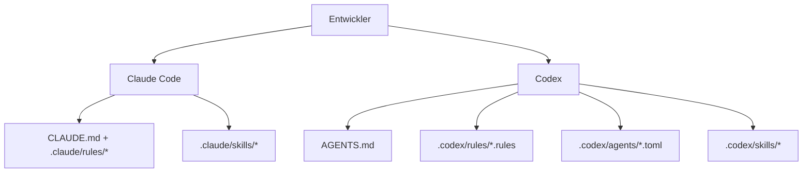

### Claude-Code-Schicht

- Dauerhafter Kontext:
  - [`CLAUDE.md`](./CLAUDE.md)
- Pfadbezogene Regeln:
  - [`.claude/rules/backend-node.md`](./.claude/rules/backend-node.md)
  - [`.claude/rules/frontend-react.md`](./.claude/rules/frontend-react.md)
  - [`.claude/rules/mcp-typescript.md`](./.claude/rules/mcp-typescript.md)
  - [`.claude/rules/docs-markdown.md`](./.claude/rules/docs-markdown.md)
  - [`.claude/rules/file-headers.md`](./.claude/rules/file-headers.md)
  - [`.claude/rules/wiki-i18n.md`](./.claude/rules/wiki-i18n.md)
  - [`.claude/rules/i18n-parity.md`](./.claude/rules/i18n-parity.md)
- Skills:
  - `repo-onboarding`
  - `ship-feature`
  - `version-release`
  - `mcp-operations`
  - `debug-live-issue`
  - `update-project-docs`
  - `file-headers`
  - `push-to-forked-pr`
  - `i18n-parity`
- Subagents:
  - `backend-reviewer`
  - `frontend-reviewer`
  - `mcp-reviewer`

### Codex-Schicht

- Dauerhafter Kontext:
  - [`AGENTS.md`](./AGENTS.md)
- Ausführungsrichtlinie:
  - [`.codex/rules/default.rules`](./.codex/rules/default.rules)
- Vorlagen für eigene Subagents:
  - [`.codex/agents/`](./.codex/agents)
- Skills:
  - [`.codex/skills/`](./.codex/skills)
- Einrichtung:
  - [`.codex/README.md`](./.codex/README.md)

---

## MCP-Integration

Dieses Projekt enthält einen lokalen MCP-Server in `mcp/` mit 103 Tools in 16 Domänenmodulen. Er stellt jede unterstützte App-Aktion bereit, darunter bereichsbezogene Datenabfragen, Transkripte/Bilder, Claude-, Cursor- und GPT-Preise, Workflows, Alarme/Webhooks, Importe und Backup-Wiederherstellung, Claude-/Codex-Konfiguration, Agent starten, entfernte Quellen, Einstellungen, Push und geschützte Wartung. Er unterstützt drei Transportmodi.

### MCP-Transportmodi

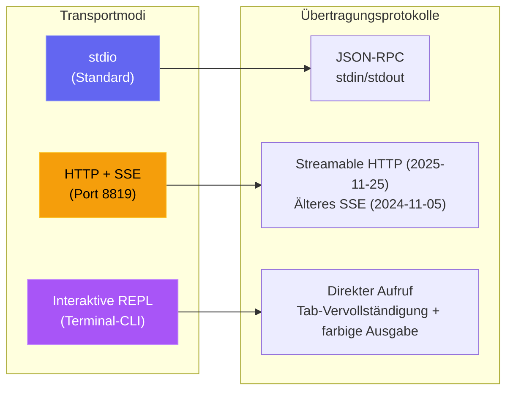

| Modus | Befehl | Einsatzzweck |
| --- | --- | --- |
| **stdio** | `npm run mcp:start` | Claude Code, Claude Desktop, MCP-Hosts in IDEs |
| **HTTP** | `npm run mcp:start:http` | Entfernte MCP-Clients, Web-Integrationen, mehrere Sitzungen |
| **REPL** | `npm run mcp:start:repl` | Betriebs-Debugging, manueller Tool-Aufruf, lokale Administration |

<p align="center">
  <a href="images/mcp.png"></a>
</p>

### MCP-Architektur

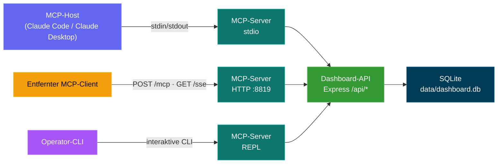

### MCP-Tool-Umfang

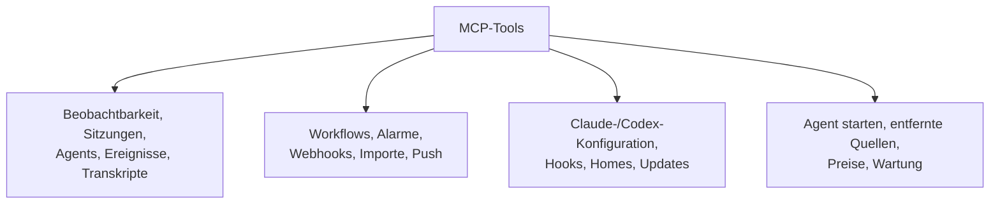

### MCP-Sicherheitsmodell

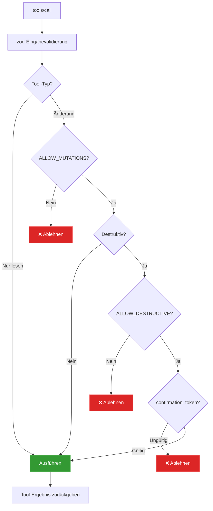

### MCP-Betriebsmodi

- Nur-Lese-Modus (Standard): `MCP_DASHBOARD_ALLOW_MUTATIONS=false`
- Admin-Modus: `MCP_DASHBOARD_ALLOW_MUTATIONS=true`
- Authentifiziertes Dashboard: Setzen Sie `MCP_DASHBOARD_API_TOKEN` / `_FILE` auf das Dashboard-Token
- Authentifizierter HTTP-/SSE-Transport: Setzen Sie `MCP_HTTP_AUTH_TOKEN` / `_FILE`; Clients senden Bearer-Authentifizierung oder `x-mcp-token`
- Transportschranken: Direktes Loopback-HTTP darf das Token tragen; Container-Host-Aliasse erfordern HTTPS; Weiterleitungen werden abgelehnt
- Payload-Schranken: 50 MiB pro hochgeladener Verlaufsdatei, insgesamt 100 MiB pro Aufruf, 10 MiB für binäre Antworten und 25 MiB für die Backup-Wiederherstellung
- Destruktiver Modus: erfordert alle drei:
  - `MCP_DASHBOARD_ALLOW_MUTATIONS=true`
  - `MCP_DASHBOARD_ALLOW_DESTRUCTIVE=true`
  - die Tool-Eingabe `confirmation_token: "CLEAR_ALL_DATA"`

Alle Details: [mcp/README.md](./mcp/README.md)

---

## API-Referenz

Alle Endpunkte geben JSON zurück. Fehlerantworten haben die Form `{ error: { code, message } }`.

### OpenAPI / Swagger / ReDoc

Es gibt drei Wege, die HTTP-API zu erkunden, alle gespeist aus einer einzigen OpenAPI-3.0.3-Spezifikation (Standard-Serverport `4820`):

| Methode | Pfad | Beschreibung |
| ------ | ------------------------------- | ------------------------------------------------------------------------------------------------- |
| `GET` | `/api/openapi.json` | Rohe OpenAPI-3.0.3-Spezifikation als JSON |
| `GET` | `/api/docs` | Interaktive **Swagger UI** — Anfragen direkt ausprobieren |
| `GET` | `/api/redoc` | **ReDoc**-Referenz — eine saubere, leseoptimierte dreispaltige Darstellung derselben Spezifikation |
| `GET` | `/api/redoc/redoc.standalone.js` | Selbst gehostetes ReDoc-Bundle (lokal über die Abhängigkeit `redoc` ausgeliefert, nie über ein CDN — funktioniert offline) |

Das OpenAPI-Dokument wird aus `server/openapi.js` (`createOpenApiSpec()`) erzeugt und mit ergänzenden Fragmenten unter `server/openapi-extra/` zusammengeführt. Swagger UI und ReDoc werden beide direkt vom Backend ausgeliefert; das ReDoc-Bundle wird lokal ausgeliefert (`GET /api/redoc/redoc.standalone.js`), sodass die Referenz vollständig offline / in abgeschotteten Netzen funktioniert, im Einklang mit der Projektregel ohne externe Ressourcen.

Die Abdeckung ist umfassend: Jede Backend-Route ist dokumentiert (82 Pfadeinträge) unter diesen Tags — Health, Sessions, Agents, Events, Stats, Metrics, Analytics, Hooks, Pricing, Workflows, Settings, Updates, Alerts, Webhooks, Push, CcConfig (Claude-Code-Konfigurations-Explorer), Run (vom Dashboard gestartete Läufe) und Documentation —, jeweils mit Parametern, Anfrage-/Antwortschemata, Beschreibungen auf Feldebene und realistischen Beispielen.

Eine versionierte **`openapi.yaml`** im Repo-Stamm spiegelt die Live-Spezifikation. Sie wird aus `server/openapi.js` erzeugt (nie von Hand bearbeitet) — erzeugen Sie sie nach API-Änderungen neu mit:

```bash
npm run openapi:yaml
```


<p align="center">
  <a href="images/swagger.png"></a>
</p>

<p align="center">
  <a href="images/redoc.png"></a>
</p>

### Zustand

| Methode | Pfad | Beschreibung |
| ------ | ------------- | ------------------------------------- |
| `GET` | `/api/health` | Gibt `{ status: "ok", timestamp }` zurück |

### Sitzungen

| Methode | Pfad | Query-Parameter | Beschreibung |
| ------- | ------------------------------- | ---------------------------------------------------------------- | -------------------------------------------------------------------------------------------- |
| `GET` | `/api/sessions` | `status`, `q`, `limit`, `offset` | Listet Sitzungen mit Agent-Anzahl und Kosten pro Sitzung. `q` sucht ohne Beachtung der Groß-/Kleinschreibung über `id` / `name` / `cwd`. `limit` ist standardmäßig 50, maximal 10000. Die Antwort enthält `total` für Paginatoren. |
| `GET` | `/api/sessions/:id` | -- | Sitzungsdetails mit Agents und Ereignissen |
| `GET` | `/api/sessions/:id/stats` | -- | Aggregierte Zählungen für das Übersichtspanel der Sitzungsdetails: Ereignisse, Ereignisse nach Typ, meistgenutzte Tools, Fehleranzahl, Zählungen nach Agent-Typ/-Status, Aufschlüsselung nach Subagent-Typ, Token-Summen, Zeitraum |
| `GET` | `/api/sessions/:id/transcripts` | -- | Listet die verfügbaren JSONL-Transkripte der Sitzung auf (Haupt + Subagents + Compactions) |
| `GET` | `/api/sessions/:id/transcript` | `agent_id`, `limit`, `offset`, `after`, `before` | Streamt Nachrichten aus einem bestimmten Transkript mit Cursor-Paginierung. Das `usage` des Assistants enthält `input_tokens`, `output_tokens`, `cache_read_input_tokens`, `cache_creation_input_tokens`, damit sich die Anzeige der Seite Starten beim Fortsetzen / erneuten Verbinden vollständig füllt |
| `POST` | `/api/sessions` | -- | Legt eine Sitzung an (idempotent auf `id`) |
| `PATCH` | `/api/sessions/:id` | -- | Aktualisiert Status/Metadaten der Sitzung |

### Agents

| Methode | Pfad | Query-Parameter | Beschreibung |
| ------- | ----------------- | ----------------------------------------- | ----------------------------- |
| `GET` | `/api/agents` | `status`, `session_id`, `limit`, `offset` | Listet Agents mit Filtern auf |
| `GET` | `/api/agents/:id` | -- | Details eines Agents |
| `POST` | `/api/agents` | -- | Legt einen Agent an |
| `PATCH` | `/api/agents/:id` | -- | Aktualisiert Status/Aufgabe/Tool des Agents |

### Ereignisse

| Methode | Pfad | Query-Parameter | Beschreibung |
| ------ | ------------- | ------------------------------- | -------------------------- |
| `GET` | `/api/events` | `session_id`, `limit`, `offset` | Listet Ereignisse auf (neueste zuerst) |

### Statistiken

| Methode | Pfad | Beschreibung |
| ------ | ------------ | ------------------------------------------------------ |
| `GET` | `/api/stats` | Aggregierte Zählungen, Statusverteilungen, WS-Verbindungen |

### Analysen

| Methode | Pfad | Beschreibung |
| ------ | ---------------- | ---------------------------------------------------------- |
| `GET` | `/api/analytics` | Aggregate zu Tokens/Tools/Sitzungen für Diagramme und Trendansichten |

### Entfernte Datenquellen

| Methode | Pfad | Query-Parameter | Beschreibung |
| -------- | ------------------------------- | ------------ | ------------------------------------------------------------------------------------------- |
| `GET` | `/api/remote-sources` | -- | Listet konfigurierte entfernte Quellen mit Status, letztem Fehler und Zählungen der letzten Synchronisierung auf |
| `POST` | `/api/remote-sources` | -- | Legt eine Quelle an. Body: `{ label, host, ssh_port?, identity_file?, remote_home?, remote_codex_home?, enabled? }` |
| `PATCH` | `/api/remote-sources/:id` | -- | Aktualisiert eine Quelle (Bezeichnung, Verbindungsfelder, aktiviert) |
| `DELETE` | `/api/remote-sources/:id` | `purge` | Löscht eine Quelle; `?purge=true` löscht auch die aus dieser Quelle importierten Sitzungen |
| `POST` | `/api/remote-sources/:id/test` | -- | Prüft die SSH-Verbindung zur Quelle |
| `POST` | `/api/remote-sources/:id/sync` | -- | Ruft sofort aus der Quelle ab und importiert neu |

`GET /api/sessions`, `/api/events`, `/api/agents`, `/api/stats` und `/api/analytics` akzeptieren außerdem einen optionalen Query-Parameter `sources` (kommagetrennte Quellen-IDs; für alle weglassen), um die Ergebnisse nach Herkunft einzugrenzen, und `GET /api/sessions/facets` liefert ein Array `sources` für die Auswahl des Datenbereichs.

### Hooks

| Methode | Pfad | Beschreibung |
| ------ | ------------------ | -------------------------------------------- |
| `POST` | `/api/hooks/event` | Empfängt und verarbeitet ein Hook-Ereignis von Claude Code |
| `POST` | `/api/hooks/ingest-batch` | Pusht einen Stapel Sitzungsdaten von einem mobilen Rechner/Rechner hinter NAT (standardmäßig deaktiviert; siehe `REMOTE_PUSH_TOKEN` unten und `server/README.md` für die vollständige Payload-Struktur) |
| `POST` | `/api/hooks/ingest-transcript` | Lädt das Transkript-JSONL eines entfernten Rechners in Offset-basierten Chunks hoch (dieselbe `REMOTE_PUSH_TOKEN`-Sperre; die Sitzung muss zuvor über `ingest-batch` registriert sein) |

**Payload eines Hook-Ereignisses:**

```json
{
  "hook_type": "PreToolUse",
  "data": {
    "session_id": "abc-123",
    "tool_name": "Bash",
    "tool_input": { "command": "ls -la" }
  }
}
```

### Preise

| Methode | Pfad | Beschreibung |
| -------- | ------------------------ | ---------------------------------------- |
| `GET` | `/api/pricing` | Listet alle Preisregeln auf |
| `PUT` | `/api/pricing` | Legt eine Preisregel an oder aktualisiert sie |
| `DELETE` | `/api/pricing/:pattern` | Löscht eine Preisregel |
| `GET` | `/api/pricing/cost` | Gesamtkosten über alle Sitzungen |
| `GET` | `/api/pricing/cost/:id` | Kostenaufschlüsselung einer bestimmten Sitzung |

### Workflows

| Methode | Pfad | Beschreibung |
| ------ | ----------------------------- | ------------------------------------------------------- |
| `GET` | `/api/workflows` | Workflow-Daten nach Anbieter/Quelle eingegrenzt (Orchestrierung, aufgezeichnete Tools, Muster, Codex-Compactions). Die optionalen Filter `?status=active\|completed`, `?sources=...` und `?providers=claude\|codex` gelten für alle 11 Datenabschnitte |
| `GET` | `/api/workflows/session/:id` | Detailansicht pro Sitzung, nach Anbieter/Quelle eingegrenzt (Agent-Baum, Zeitleiste der aufgezeichneten Tools, Ereignisse) |

### Alarme

| Methode | Pfad | Beschreibung |
| -------- | ------------------------ | ---------------------------------------------------------------------- |
| `GET` | `/api/alerts` | Feed ausgelöster Alarme, neueste zuerst (`?unacked=true`, `limit`, `offset`) |
| `POST` | `/api/alerts/:id/ack` | Bestätigt einen Alarm |
| `POST` | `/api/alerts/ack-all` | Bestätigt alle unbestätigten Alarme |
| `GET` | `/api/alerts/rules` | Listet Alarmregeln auf |
| `POST` | `/api/alerts/rules` | Legt eine Regel an (`event_pattern` \| `inactivity` \| `status_duration` \| `token_threshold`) |
| `PATCH` | `/api/alerts/rules/:id` | Aktualisiert Name / Konfiguration / Aktivierung / Abklingzeit (der Regeltyp ist unveränderlich) |
| `DELETE` | `/api/alerts/rules/:id` | Löscht eine Regel und den Verlauf ihrer ausgelösten Alarme |

### Webhooks

| Methode | Pfad | Beschreibung |
| -------- | --------------------------------- | ------------------------------------------------------------------------------------ |
| `GET` | `/api/webhooks/providers` | Unterstützte Anbieter + ihre Konfigurationsfelder (steuert das UI-Formular) |
| `GET` | `/api/webhooks` | Listet Webhook-Ziele auf (URLs maskiert, Geheimnisse geschwärzt) |
| `POST` | `/api/webhooks` | Legt ein Ziel an (14 integrierte Anbieter + `generic`) |
| `PATCH` | `/api/webhooks/:id` | Aktualisiert Name / URL / Aktivierung / Geheimnis / Header / Regelbereich (der Typ ist unveränderlich) |
| `DELETE` | `/api/webhooks/:id` | Löscht ein Ziel und sein Zustellprotokoll |
| `POST` | `/api/webhooks/:id/test` | Sendet einen synthetischen Testalarm und meldet das Zustellergebnis |
| `GET` | `/api/webhooks/:id/deliveries` | Protokoll der letzten Zustellungen eines Ziels (`limit`, `offset`) |

Gehostete Anbieter erfordern HTTPS. `generic` und `n8n` dürfen HTTP für lokale oder selbst gehostete Empfänger nutzen. Die Zustellung lehnt Weiterleitungen ab, sodass Zugangsdaten, eigene Header und HMAC-Signaturen nie an eine zweite URL weitergegeben werden.

### Einstellungen

| Methode | Pfad | Beschreibung |
| ------ | ------------------------------ | ------------------------------------------------ |
| `GET` | `/api/settings/info` | Systeminformationen, DB-Statistiken, Hook-Status |
| `POST` | `/api/settings/clear-data` | Löscht alle Sitzungen, Agents, Ereignisse und Token-Nutzungen |
| `POST` | `/api/settings/reimport` | Importiert ältere Sitzungen aus `~/.claude/` neu |
| `POST` | `/api/settings/reinstall-hooks` | Installiert die Claude-Code-Hooks neu |
| `POST` | `/api/settings/reset-pricing` | Setzt die Preistabellen von Claude, Codex oder beiden auf die Standardwerte zurück |
| `GET` | `/api/settings/export` | Exportiert alle Daten (sessions, agents, events, token_usage, workflows, dashboard_runs, alert_rules, model_pricing, cursor_model_pricing, gpt_model_pricing) als einen versionierten JSON-Download |
| `POST` | `/api/settings/import` | Stellt ein Paket bis 25 MiB aus `/export` wieder her (multipart `file` oder JSON `{ path }`). Idempotent + nicht destruktiv — bestehende Sitzungen werden vollständig übersprungen |
| `POST` | `/api/settings/cleanup` | Bricht inaktive Sitzungen ab, bereinigt alte Daten (und die Snapshots der bereinigten Sitzungen) |
| `GET` | `/api/settings/snapshots` | Speicherbelegung der Transkript-Snapshots pro Anbieter + Aufbewahrungsrichtlinie |
| `POST` | `/api/settings/snapshots/compress` | Komprimiert verlustfrei Snapshots, deren ursprüngliches Transkript verschwunden ist |
| `POST` | `/api/settings/snapshots/prune` | Plant (Probelauf, Standard) oder führt eine Bereinigung der Snapshots aus; die Ausführung erfordert `confirm: "PRUNE_SNAPSHOTS"` |

### Claude-Konfigurations-Explorer (`/api/cc-config`)

Schreibgeschützte Einsicht in jede Konfigurationsfläche von Claude Code sowie sorgfältig abgesicherte Änderungen für risikoarme Textdatei-Artefakte. Datei-Lesevorgänge kanonisieren den angeforderten Pfad und die erlaubten Wurzeln, sodass symbolische Links nicht aus den vertrauenswürdigen Claude-Verzeichnissen ausbrechen können. Alle Schreibpfade legen vor jeder Änderung Backups mit Zeitstempel unter `<root>/cc-config-backups/<type>/` an.

| Methode | Pfad | Beschreibung |
| -------- | ----------------------------------- | ----------- |
| `GET` | `/api/cc-config/overview` | Wurzeln (Claude-Home, .claude des Projekts, Projektwurzel, ~/.claude.json) + Zählungen für jede Fläche |
| `GET` | `/api/cc-config/skills` | Skills unter `<scope>/.claude/skills/<name>/SKILL.md` mit geparstem Frontmatter; `?scope=user\|project\|all` |
| `GET` | `/api/cc-config/agents` | Subagents `<scope>/.claude/agents/*.md` |
| `GET` | `/api/cc-config/commands` | Slash-Befehle `<scope>/.claude/commands/*.md` |
| `GET` | `/api/cc-config/output-styles` | Ausgabestile `<scope>/.claude/output-styles/*.md` |
| `GET` | `/api/cc-config/plugins` | Installierte Plugins aus `~/.claude/plugins/installed_plugins.json`, verknüpft mit `enabledPlugins` aus den Einstellungen; jeder Eintrag enthält `contributes` (Anzahl der Skills/Agents/Befehle/Hooks/Ausgabestile im Installationsverzeichnis des Plugins) plus die Metadaten aus `plugin.json` |
| `GET` | `/api/cc-config/marketplaces` | Registrierte Marketplaces aus `known_marketplaces.json`, angereichert mit der eigenen `marketplace.json` jedes Marketplace (Plugin-Anzahl, Besitzer, Beschreibung) |
| `GET` | `/api/cc-config/mcp` | MCP-Server aus `~/.claude.json` (oberste Ebene + pro Projekt) und `settings.json` |
| `GET` | `/api/cc-config/hooks` | Hooks, zusammengeführt aus den `settings.json`-Dateien für Benutzer / Projekt / projektlokal |
| `GET` | `/api/cc-config/hook-scripts` | Dateien in `~/.claude/hooks/` (die von `hooks.<event>.command` referenzierten Hilfsskripte) |
| `GET` | `/api/cc-config/keybindings` | `~/.claude/keybindings.json`, geparst in nach Kontext gruppierte Taste/Aktion-Paare |
| `PUT` | `/api/cc-config/keybindings` | Überschreibt `keybindings.json` anhand von `{ groups: [{ context, bindings: [{ key, action }] }] }`. Sichert zuerst, erhält Metadaten der obersten Ebene (`$schema`/`$docs`), lehnt doppelte Kontexte/Tasten ab. Sicher zu bearbeiten (anders als `settings.json` schreibt die CLI sie nie mitten in einer Sitzung neu) |
| `GET` | `/api/cc-config/statusline` | Konfiguration `settings.json.statusLine` + der tatsächliche Inhalt von `statusline.py` / `statusline-command.sh`, falls vorhanden |
| `GET` | `/api/cc-config/settings` | Einstellungs-JSON für Benutzer / Projekt / projektlokal, wobei geheimnisartige Schlüssel (passend zu `/token\|secret\|password\|api[_-]?key\|auth/i`) durch `"<redacted>"` ersetzt werden |
| `GET` | `/api/cc-config/memory` | `CLAUDE.md`-Dateien auf Benutzer- + Projektebene sowie der dateibasierte Speicher pro Projekt: Einträge `scope:"auto-memory"` (jeweils mit `project`, `name`, `isIndex` und geparstem `frontmatter`) für jede `*.md` unter `~/.claude/projects/<slug>/memory/`. Ändern über `PUT`/`DELETE /api/cc-config/file` mit `{ scope: "auto-memory", type: "auto-memory", project, name }` (Backups landen in `<memory-dir>/.cc-config-backups/auto-memory/`) |
| `GET` | `/api/cc-config/file?path=…` | Inhalt einer einzelnen Datei (Pfad beschränkt auf CLAUDE_HOME / .claude des Projekts / CLAUDE.md des Projekts) |
| `GET` | `/api/cc-config/backups` | Auflistung aller Backups mit Zeitstempel, optional gefiltert mit `?scope=&type=` |
| `PUT` | `/api/cc-config/file` | Legt ein Textdatei-Artefakt an oder überschreibt es. Body: `{ scope, type, name?, content }`. Automatisches Backup, falls die Datei existiert. Atomar per Temp-Datei + Umbenennen. Inhalt auf 256 KB begrenzt, strikte Regex für `name` |
| `DELETE` | `/api/cc-config/file` | Sichert und löscht dann ein Textdatei-Artefakt. Skill-Verzeichnisse werden vor dem rekursiven Entfernen vollständig gesichert (einschließlich gebündelter Ressourcen) |

### Prometheus-Metriken und Grafana

`GET /api/metrics` stellt Prometheus-Textmetriken zum Status von Sitzungen und Agents, zu Ereignissen, Tokens, Echtzeit-Clients, entfernten Quellen, Laufzeit und Speicher des Prozesses sowie zur Build-Version bereit. [`monitoring/`](./monitoring/README.md) liefert Prometheus plus vier automatisch bereitgestellte Grafana-Dashboards, mit **CCAM · Overview** als Standard.

```bash
# Native dashboard and monitoring
npm start
npm run monitoring:install       # one-time binary setup
npm run monitoring:up            # Grafana on :3000

# Containers
npm run docker:up                 # dashboard only
npm run docker:full:up            # dashboard + Prometheus + Grafana

# Mixed native/container setup
DASHBOARD_ALLOWED_HOSTS=host.docker.internal npm start
npm run monitoring:docker:up
npm run monitoring:verify
```

<p align="center">
  <a href="images/grafana.png"></a>
  <br>
  <em>📊 <strong>Grafana · CCAM Overview</strong> · Zustand der Flotte, Datenbanksummen, Aufschlüsselungen und Raten aus Live-Abfragen von <code>/api/metrics</code></em>
</p>

<p align="center">
  <a href="images/prometheus-console.png"></a>
  <br>
  <em>🔥 <strong>Prometheus · CCAM-Konsole</strong> · Scrape-Zustand, Sitzungen, Ereignisse, Tokens und Graph-Links zur Vertiefung</em>
</p>

<p align="center">
  <a href="images/prometheus-query.png"></a>
  <br>
  <em>📈 <strong>Prometheus · Graph</strong> · PromQL gegen die abgefragten CCAM-Metriken ausführen, mit Einstiegslinks aus der Konsole</em>
</p>

Siehe [docs/API.md → Metrics](./docs/API.md#metrics) für Metriknamen, Authentifizierung und Scrape-Konfiguration.

### Claude starten (`/api/run`)

HTTP-Schnittstelle zum Starten und Überwachen von `claude`-Unterprozessen aus dem Dashboard. Same-Origin-Schutz auf jeder Route — Browseranfragen müssen von einem localhost-Ursprung kommen; Anfragen ohne Origin (CLI/curl) werden durchgelassen. Ein angegebenes `cwd` muss ein existierendes absolutes Verzeichnis sein und wird mit `realpath` kanonisiert. Es darf bewusst außerhalb dieses Repositorys liegen, damit Agent starten aus dem Home des Benutzers oder einem beliebigen zuletzt genutzten Projekt starten kann.

| Methode | Pfad | Beschreibung |
| -------- | --------------------------------- | ----------- |
| `GET` | `/api/run` | Listet alle Lauf-Handles im Speicher auf (laufend + kürzlich beendet); gibt außerdem `maxConcurrent` und `activeCount` zurück |
| `GET` | `/api/run/binary` | Prüft, ob `claude` im `PATH` liegt und wo — von der UI genutzt, um vor dem Start einen klaren Fehler anzuzeigen |
| `GET` | `/api/run/cwds` | Vorgeschlagene Arbeitsverzeichnisse: cwd des Dashboard-Servers, `$HOME` und zuletzt genutzte cwds aus der Sitzungstabelle |
| `GET` | `/api/run/files?cwd=…&q=…` | Unscharfe Dateisuche in `cwd` für die `@`-Datei-Autovervollständigung der Seite Starten. Überspringt `node_modules`, `.git`, `dist`, `build`, `.next`, `.cache`, `coverage` usw. Das cwd ist erforderlich und muss existieren; die Ergebnisse sind begrenzt und nach Übereinstimmung mit dem Dateinamen sortiert |
| `POST` | `/api/run` | Startet einen neuen Lauf. Body: `{ prompt, mode: "headless"\|"conversation", cwd?, model?, permissionMode?, resumeSessionId?, effort? }`. Headless übergibt den Prompt per `-p` in argv und schließt stdin. Conversation übergibt den Prompt über stdin als stream-json-Umschlag und hält stdin für Folgerunden offen. `resumeSessionId` (nur conversation) ergänzt `--resume <id>`; ist es gesetzt, darf `prompt` leer sein — der Starter überspringt das anfängliche Schreiben auf stdin, und `claude` wartet in der fortgesetzten Konversation, bis der Benutzer über `POST /api/run/:id/message` nachfasst. `effort` (`low` / `medium` / `high`) wird auf `--effort` abgebildet. Der Starter übergibt immer `--output-format stream-json --verbose --include-partial-messages`, damit die UI Deltas zeichenweise darstellen kann. Die Nebenläufigkeit ist praktisch unbegrenzt (Standardobergrenze 10000 — mit `RUN_MAX_CONCURRENT` überschreibbar) |
| `GET` | `/api/run/:id` | Aktueller Zustand des Handles. `?envelopes=1` enthält das Umschlagprotokoll im Speicher, damit die UI beim erneuten Verbinden den Verlauf wiedergeben kann |
| `POST` | `/api/run/:id/message` | Sendet eine Folgerunde an eine laufende Konversation (nur im Konversationsmodus). Body: `{ text }` |
| `DELETE` | `/api/run/:id` | Stoppt einen Lauf. SIGTERM, nach 5 s eskalierend zu SIGKILL |

Die Ausgabe wird über den vorhandenen Dashboard-WebSocket in drei Nachrichtentypen gestreamt: `run_stream` (geparster stream-json-Umschlag, einschließlich `stream_event`-Deltas aus `--include-partial-messages`), `run_status` (Statuswechsel), `run_input_ack` (Schreiben auf stdin bestätigt). Die Seite des Konfigurations-Explorers abonniert eine vierte Nachricht — `cc_config_changed` —, die von `server/lib/cc-watcher.js` (über `fs.watch` auf `~/.claude/`) und von `routes/cc-config.js` nach jedem erfolgreichen PUT/DELETE gesendet wird, mit der Payload `{ source: "dashboard"|"fs", action?, scope?, type?, name?, paths? }`. Die Sitzungsliste und die Seite SessionDetail fragen `/api/run` ab (und hören auf `run_status`), um jede gerade von einem laufenden Lauf gesteuerte Sitzung mit einer anklickbaren **▶ Run**-Anzeige zu kennzeichnen, die zu `/run` zurückführt.

### Verlaufsimport

**Einstellungen → Verlaufsimport** importiert Claude-Code-Transkripte aus `~/.claude/projects` und Codex-Rollouts aus `~/.codex/sessions` über anbieterspezifische Ordnerscans oder Uploads. Beide nutzen die Live-Ingestion wieder, erhalten Tokens, Kosten, Tools, Compaction-Basiswerte, Lebenszyklus und native Codex-Titel und bleiben idempotent. Hochgeladener Codex-Verlauf wird in den Speicher des Dashboards kopiert, damit seine Konversation das Bereinigen der Quelle übersteht.

**Backup wiederherstellen** akzeptiert einen exportierten Dashboard-Stand als `.json` aus der UI, aus `ccam export` oder aus `GET /api/settings/export`. `POST /api/settings/import` und `ccam import-data <file>` stellen alle Tabellen wieder her, ohne bestehende Sitzungen zu überschreiben, und ermöglichen so das gefahrlose Zusammenführen mehrerer Rechner.

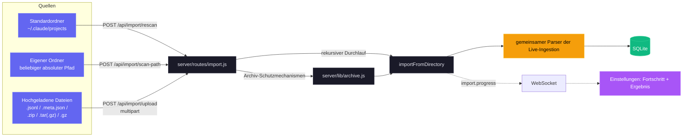

| Methode | Pfad | Zweck |
| --- | --- | --- |
| `GET` | `/api/import/guide` | Anbieterbezogene Pfade, Archivbefehle, Dateiendungen und Anweisungen über `?provider=claude\|codex`. |
| `POST` | `/api/import/rescan` | Durchsucht den ausgewählten Standardort anhand von `{ provider }` erneut. |
| `POST` | `/api/import/scan-path` | Durchsucht einen absoluten Pfad `{ path, provider }` rekursiv. |
| `POST` | `/api/import/upload` | Lädt unterstützte Dateien oder Archive mit `provider` hoch. |

- **Eingaben:** einzelne Dateien `.jsonl`, `.meta.json`, `.zip`, `.tar`, `.tar.gz`/`.tgz` und `.gz` in verschachtelten Strukturen. Claude unterstützt beide kanonischen Subagent-Layouts; Codex erkennt rekursiv `rollout-*.jsonl` oder JSONL mit `session_meta` plus optionale Titel aus `session_index.jsonl`.
- **Genauigkeit:** Die Deduplizierung über UUIDs und Ereignis-Höchststände verhindert Doppelzählungen. Compaction-Basiswerte erhalten frühere Tokens; spätere Aktivität schiebt `ended_at` vor und aktualisiert die Nachrichtenmetadaten.
- **Große Dateien:** Das gemeinsame zeilenweise Parsing in Blöcken von 4 MiB verarbeitet Transkripte jenseits der String-Grenze von V8 (etwa 512 MiB). Wachsende Arrays sind auf `TRANSCRIPT_CACHE_MAX_ARRAY_LEN` begrenzt (Standard `1000`) und werden beim Parsen ab dem Doppelten der Grenze gekürzt.
- **Sicherheit:** Das Entpacken lehnt absolute Pfade und `..`-Pfade ab. Standardmäßig sind entpackte Daten auf 4 GB, jeder Upload auf 1 GB und Anfragen auf 2000 Dateien begrenzt; der Zwischenspeicher jeder Anfrage wird stets wieder freigegeben.
- **Fortschritt:** Gedrosselte WebSocket-Phasen von `import.progress` umfassen `start`, `scan`, `extract`, `parse`, `complete` und `error`. Die UI bietet Hinweise für Drag-and-drop sowie Summen der importierten, angereicherten, übersprungenen und fehlerhaften Einträge.

### WebSocket

Verbinden Sie sich mit `ws://localhost:4820/ws`, um Push-Nachrichten in Echtzeit zu erhalten:

```json
{
  "type": "agent_updated",
  "data": { "id": "...", "status": "working", "current_tool": "Edit" },
  "timestamp": "2026-03-05T15:43:01.800Z"
}
```

**Nachrichtentypen:** `session_created`, `session_updated`, `agent_created`, `agent_updated`, `new_event`, `alert_triggered`, `alert_updated`, `remote_source.status` (Daten `{ id, status: "idle"|"syncing"|"ok"|"error"|"deleted", error?, last_sync_at? }`)

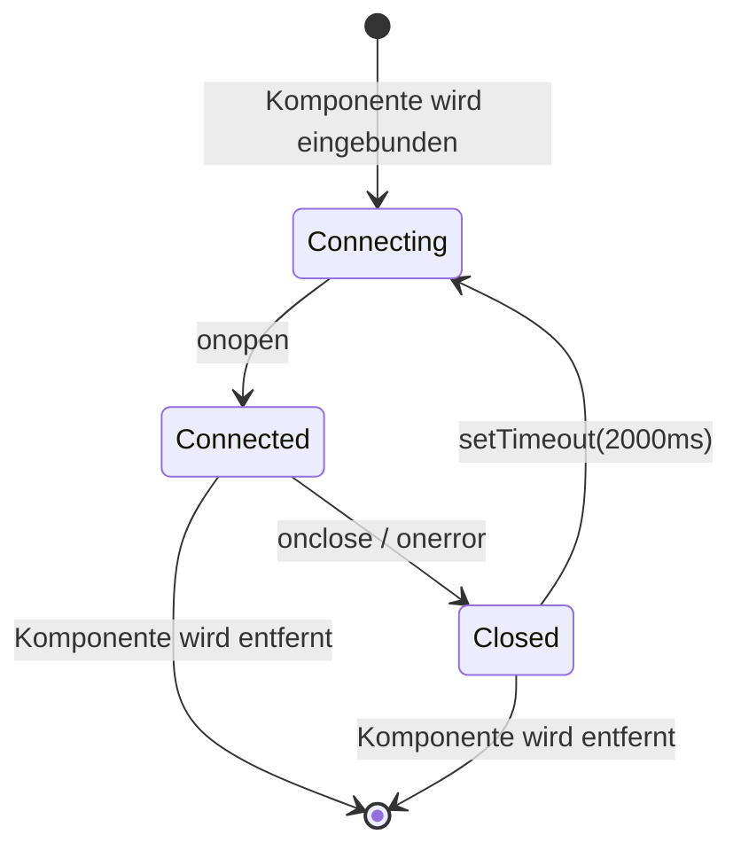

---

## Hook-Ereignisse

Das Dashboard verarbeitet diese Hook-Typen von Claude Code:

| Hook-Typ | Auslöser | Aktion des Dashboards |
| ------------------- | ------------------------------ | -------------------------------------------------------------------------------------------- |
| `SessionStart` | Eine Claude-Code-Sitzung beginnt | Legt Sitzung und Haupt-Agent an. Setzt `awaiting_input_since` (mit `awaiting_reason=session_start`), sodass eine frische Sitzung in **Wartend** landet — außer bei einem SessionStart mit Quelle `compact` (automatische Compaction mitten in der Runde), der das Flag unberührt lässt, damit eine arbeitende Sitzung **Aktiv** bleibt. Reaktiviert fortgesetzte Sitzungen. Bricht verwaiste Sitzungen ohne Aktivität seit `DASHBOARD_STALE_MINUTES` (Standard 180) ab |
| `UserPromptSubmit` | Der Benutzer bestätigt einen Prompt | Löscht das Warte-Flag und setzt den Haupt-Agent auf `working` — das einzige Signal, dass reine Text-Runden des Assistants begonnen haben, da diese kein `PreToolUse` senden |
| `PreToolUse` | Ein Agent beginnt, ein Tool zu nutzen | Löscht das Warte-Flag, setzt den Agent auf `working` und `current_tool`. Ist das Tool `Agent`, wird ein Subagent-Datensatz angelegt |
| `PostToolUse` | Tool-Ausführung abgeschlossen | Löscht das Warte-Flag (behandelt Freigaben von Berechtigungsabfragen, bei denen die Notification es mitten im Tool gesetzt hat). Löscht `current_tool`. Der Agent bleibt `working` |
| `Stop` | Claude hat die Antwort beendet | Ohne Fehler: Haupt-Agent → `waiting` — Claude hat seine Runde beendet, der Ball liegt beim Benutzer. `stop_reason=error`: setzt Agent und Sitzung auf `error`. Hintergrund-Subagents laufen weiter |
| `SubagentStop` | Ein Hintergrund-Agent ist fertig | Ordnet den Subagent über Beschreibung, Typ oder Aufgabe zu und schließt ihn ab. Löscht das Warte-Flag bewusst NICHT — das Ende eines Subagents sagt nichts über den Menschen aus. **Löst ohne Warten einen JSONL-Scan aus** (`scanAndImportSubagents`), der `PreToolUse`- + `PostToolUse`-Ereignisse pro Tool unter der eigenen `agent_id` des Subagents ausgibt, sodass die Zeitleiste jedes vom Subagent ausgeführte Tool zeigt, nicht nur die Startmarkierung |
| `Notification` | Benachrichtigung eines Agents | Protokolliert das Ereignis. Nachrichten zu Berechtigungs-/Eingabeabfragen setzen den Agent auf `waiting` und `awaiting_input_since` (mit `awaiting_reason=notification`, per Muster erkannt: `permission`, `waiting for input`, `needs your approval`, …). Compaction-Benachrichtigungen werden als `Compaction`-Ereignisse markiert. Löst eine Browser-Benachrichtigung aus, falls aktiviert |
| `SessionEnd` | Der CLI-Prozess von Claude Code endet | Entfernt das Warte-Flag. Ist die Sitzung bereits in `error`, bleibt der Fehlerzustand erhalten; andernfalls werden alle Agents und die Sitzung als `completed` markiert |
| `Compaction` | `/compact` im JSONL erkannt | Legt einen Compaction-Subagent (Typ `compaction`) und ein Compaction-Ereignis an. Erkannt über `isCompactSummary`-Einträge im Transkript-JSONL. Für aktive Sitzungen auch vom periodischen Scanner erkannt |
| `APIError` | API-Fehler im JSONL-Transkript | Extrahiert aus `isApiErrorMessage`-Einträgen (Kontingent, Ratenlimit, invalid_request) und rohen `type: "error"`-Antworten. **Setzt Sitzung und Agent jetzt sofort auf `error`** — früher nur als Ereignis ohne Statusänderung erfasst. Als Ereignis mit Fehlerdetails gespeichert |
| `TurnDuration` | Rundendauer im JSONL-Transkript | Extrahiert aus `system`-Nachrichten mit Untertyp `turn_duration` und `durationMs`. Als Ereignis für die Analyse der Rundendauern gespeichert |
| `ToolError` | Fehler im Tool-Ergebnis im JSONL | Extrahiert aus `toolUseResult.is_error`-Einträgen. Verfolgt Fehlschläge auf Tool-Ebene für die Analyse der Fehlerausbreitung |
| `RemoteToolEvent` | Von einem entfernten Rechner gepushter Tool-Aufruf | Von `POST /api/hooks/ingest-batch` für jeden Eintrag in `tool_events[]` geschrieben, den ein mobiler Rechner/Rechner hinter NAT pusht. Dedupliziert nach `(session_id, event_type, uuid)` gegen gespeicherte Zeilen und innerhalb des Stapels, sodass das erneute Senden eines Stapels sicher ist |
| `RemoteTurn` | Von einem entfernten Rechner gepushte Rundendauer | Von `POST /api/hooks/ingest-batch` für jeden Eintrag in `turns[]` geschrieben, mit der `duration_ms` dieser Runde. Dieselbe Deduplizierung nach `(session_id, event_type, uuid)` wie bei `RemoteToolEvent` |
| `Interrupted` | Vom Benutzer abgebrochene Runde (Esc) | Vom Watchdog erzeugt — `Esc` löst keinen Hook aus, daher wird eine in `working` hängende Sitzung über die Markierung `[Request interrupted by user]` im Transkript erkannt oder, wenn Esc vor jeder Ausgabe gedrückt wurde, über das Leerlauf-Timeout im Arbeitszustand (`DASHBOARD_WORKING_IDLE_SECONDS`). Die Sitzung wechselt zu **Wartend** (wie nach einem normalen `Stop`) |

---

## Browser-Benachrichtigungen

Das Dashboard unterstützt dauerhafte Browser-Benachrichtigungen per Web Push (VAPID) für Echtzeit-Alarme, auch wenn der Dashboard-Tab keinen Fokus hat oder der Browser im Hintergrund läuft.

### Funktionsweise

1. **Aktivieren** Sie Benachrichtigungen auf der Seite Einstellungen über den Hauptschalter
2. **Erteilen** Sie die Browserberechtigung, wenn Sie gefragt werden — dadurch wird ein Service Worker registriert und ein Push-Abonnement angelegt
3. **Konfigurieren** Sie, welche Ereignisse Benachrichtigungen auslösen:

| Ereignis | Standard | Beschreibung |
| ---------------------------- | ------- | --------------------------------------------------------------- |
| Neue Sitzung gestartet | An | Wird ausgelöst, wenn eine neue Claude-Code-Sitzung angelegt wird |
| Claude hat die Antwort beendet | Aus | Wird bei `Stop`-Ereignissen ausgelöst, wenn Claude eine Antwortrunde beendet |
| Sitzung geschlossen | Aus | Wird bei `SessionEnd` ausgelöst, wenn der CLI-Prozess endet |
| Sitzungsfehler | An | Wird ausgelöst, wenn eine Sitzung mit einem Fehler endet |
| Subagent gestartet | Aus | Wird ausgelöst, wenn ein Hintergrund-Subagent angelegt wird |

Außerdem löst jedes `Notification`-Hook-Ereignis von Claude Code unabhängig von den Schaltern pro Ereignis eine Browser-Benachrichtigung aus (solange der Hauptschalter aktiviert ist).

### Architektur der Benachrichtigungen

- **VAPID-Pipeline:** Nutzt `web-push` auf dem Server für eine sichere Zustellung der Nachrichten. VAPID-Schlüssel werden automatisch erzeugt und in `data/vapid-keys.json` gespeichert.
- **Service Worker:** Ein eigener Worker (`client/public/sw.js`) verarbeitet eingehende `push`-Ereignisse und zeigt Benachrichtigungen mit `silent: false` an, um die Tonwiedergabe unter macOS sicherzustellen.
- **Abonnements:** Browserspezifische Endpunkte werden in der Tabelle `push_subscriptions` in SQLite gespeichert.
- **Beständigkeit:** Benachrichtigungen kommen auch bei geschlossenem Browser an, da der Service Worker im Hintergrund arbeitet.
- **Testbenachrichtigung:** Eine Schaltfläche in den Einstellungen prüft die VAPID-Pipeline und die Tonwiedergabe.

### PWA und Offline-Unterstützung

Dashboard, Landingpage und Wiki sind getrennt installierbare PWAs mit unabhängigen Manifesten und Service Workern.

| Oberfläche | Manifest | Service Worker | Caching-Strategie |
| --- | --- | --- | --- |
| Dashboard (`client/`) | `client/public/manifest.json` | `client/public/sw.js` | Unveränderliche `/assets/*` werden cache-first ausgeliefert; Navigationen, der Worker, das Manifest, Icons und `/` sind network-first mit Fallback. `/api/*`, `/ws` und Vite-HMR werden nie zwischengespeichert; die Push-Handler bleiben aktiv. Express sendet für Assets einjährige Immutable-Header und für Shell-Dateien Revalidierungs-Header. `controllerchange` lädt bei einem Upgrade einmal neu, nie bei der Erstinstallation. |
| Landingpage (Wurzel) | `manifest.json` | `sw.js` | Cacht die Hülle, das Favicon und das OG-Bild vorab. Screenshots werden beim ersten Aufruf zwischengespeichert; die Navigation ist network-first mit Offline-Fallback. |
| Wiki (`wiki/`) | `wiki/manifest.json` | `wiki/sw.js` | Cacht HTML, CSS, JS, das Manifest und das Favicon vorab. HTML bleibt network-first; CSS und JS sind cache-first, was nach einem Besuch die Offline-Nutzung ermöglicht. |

Alle Worker rufen `skipWaiting()` auf, entfernen bei der Aktivierung veraltete versionierte Caches und aktualisieren sich sauber, wenn sich ihre Cache-Version ändert. Jede HTML-Datei enthält die iOS-Metadaten für den Standalone-Modus; Manifeste und Apple-Touch-Icons nutzen `favicon.svg` mit `sizes="any"`.

---

## Update-Benachrichtigung

Das Dashboard beobachtet seinen eigenen Git-Checkout und zeigt einen Dialog, sobald der kanonische Standardbranch Commits vor HEAD hat. **Branch- und Fork-bewusst:** Gibt es ein Remote `upstream` (die übliche Konvention für Forks), wird es `origin` vorgezogen; `master`/`main`/`HEAD` des gewählten Remotes dient als Vergleichsreferenz. Der `manual_command` passt sich Ihrer Lage an — `git pull --ff-only` nur dann, wenn Ihr Branch die kanonische Referenz tatsächlich verfolgt, sonst ein `git fetch` (und im Fork-Fall ein Fast-Forward-Merge), damit der Befehl nie falsch ist. Benutzer erhalten den genauen Befehl für ein Terminal — der Server führt **nie** selbst einen Pull oder Neustart aus, was den Mechanismus über Dev-Sitzungen, Überwachung durch pm2/systemd/launchd/Docker und entfernte Deployments hinweg portabel hält.

<p align="center">
  <a href="images/update.png"></a>
</p>

### Funktionsweise

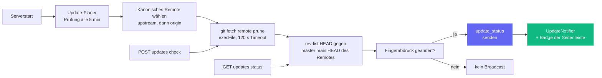

Eine einzelne Prüfung ist günstig (`git fetch <remote> --prune` gegen das kanonische Remote — `upstream`, falls konfiguriert, sonst `origin`), gekapselt in `execFile` (ohne Shell) mit 120 s Timeout. Fehler — Offline-Netz, Installation ohne Git, keine Remotes konfiguriert, nicht auflösbare Upstream-Referenz — liefern alle **weiche Payloads** (z. B. `fetch_error: "..."`), statt eine Ausnahme zu werfen, sodass ein unzuverlässiges Remote das Dashboard nie blockiert.

### UI-Flächen

| Fläche | Verhalten |
| --- | --- |
| **Dialog** (`client/src/components/UpdateNotifier.tsx`) | Öffnet sich bei einem neuen verfügbaren `remote_sha`; zeigt die Anzahl der fehlenden Commits, die verfolgte Referenz, eine optionale Notiz zu Branch/Fork, den genauen Befehl sowie **Befehl kopieren**, **Jetzt prüfen** und **Verwerfen**. Esc oder ein Klick auf den Hintergrund schließt ihn. Das Verwerfen wird in `localStorage` gespeichert, sodass er sich bei einem neueren SHA erneut öffnet. |
| **Schaltfläche der Seitenleiste** (`client/src/components/Sidebar.tsx`) | Stets sichtbar. Grün bedeutet Rückstand, Bernstein einen Fetch-Fehler. Ein Klick löscht das Verwerfen und ruft `POST /api/updates/check` auf. |
| **Serverterminal** | Gibt einen umrahmten Befehl aus, wenn der Status von „aktuell“ zu „im Rückstand“ wechselt, auch für Benutzer ohne UI. |

### API-Schnittstelle

| Endpunkt | Zweck |
| --- | --- |
| `GET /api/updates/status` | Schreibgeschützte Prüfung: führt `git fetch` gegen das kanonische Remote aus, vergleicht HEAD mit dessen Standardbranch und liefert die Payload. |
| `POST /api/updates/check` | Dieselbe Prüfung, sendet aber zusätzlich `update_status` über WebSocket, damit sich alle verbundenen Clients auf einmal aktualisieren. |

Beide Endpunkte liefern dieselbe Payload-Struktur:

```json
{
  "git_repo": true,
  "update_available": true,
  "repo_root": "/Users/you/Claude-Code-Agent-Monitor",
  "remote_ref": "upstream/master",
  "canonical_remote": "upstream",
  "current_branch": "master",
  "tracking_upstream": "origin/master",
  "tracks_canonical": false,
  "situation": "fork_or_diverged_tracking",
  "local_sha": "abc1234...",
  "remote_sha": "def5678...",
  "commits_behind": 3,
  "manual_command": "cd \"/...\" && git fetch upstream && git merge --ff-only upstream/master && npm run setup",
  "situation_note": "You're on 'master' tracking 'origin/master'. This command fast-forwards your branch from upstream/master (the canonical default).",
  "message": "3 commit(s) on upstream/master not in your checkout."
}
```

`situation` ist einer der Werte `tracking_canonical` (typischer Klon auf dem Standardbranch — `git pull --ff-only` funktioniert), `fork_or_diverged_tracking` (der lokale Branchname entspricht dem kanonischen, verfolgt aber ein anderes Remote — `git fetch <remote> && git merge --ff-only <ref>`), `feature_branch` (abseits des Standardbranch — nur Fetch, die Integration bleibt dem Benutzer überlassen) oder `detached_head`.

### Was hier **bewusst fehlt**

Es gibt kein `POST /api/updates/apply` und keinen Selbstneustart-Helfer — mit Absicht. Einen Prozess von innen heraus selbst zu aktualisieren ist ohne externen Supervisor unzuverlässig — `npm run dev` (concurrently), `npm start`, `pm2`, `systemd`, `launchd` und Docker brauchen jeweils eine andere Neustartlogik, und Fehler bei `git pull` / `npm install` auf einem sterbenden Server haben keinen sauberen Rückweg. Die Beschränkung auf die Erkennung hält das Verhalten über jeden Supervisor, jedes Betriebssystem und jeden Branch-Zustand vorhersehbar und schließt dennoch die Informationslücke „wann muss ich pullen?“; die eigentliche Aktualisierung liegt beim Benutzer in seiner eigenen Shell.

### Konfiguration

| Umgebungsvariable | Standard | Hinweise |
| --- | --- | --- |
| `DASHBOARD_UPDATE_CHECK` | aktiviert | Auf `0` / `false` / `off` setzen, um den Planer vollständig zu deaktivieren. |
| `DASHBOARD_UPDATE_CHECK_INTERVAL_MS` | `300000` (5 min) | Intervall zwischen automatischen Prüfungen. Minimum 60 000 ms — kleinere Werte werden angehoben. |

---

## Tabby — schwebende Katzen-Begleiterin

**Tabby** ist eine niedliche schwebende Katzen-Begleiterin, angeheftet an die untere rechte Ecke jeder Seite des Dashboards. Stets präsent, verwandelt sie den Live-Sitzungsstrom in ein reaktives Maskottchen, das Sie mit einem Blick erfassen und mit dem Sie auch sprechen können.

<p align="center">
  <a href="images/tabby.png"></a>
</p>

### Reaktives Maskottchen

Tabby ist eine SVG-Katze, die dem Cursor folgt, mit **acht Stimmungen**, abgeleitet aus dem Live-Sitzungsstrom, jede mit eigener Animation:

| Stimmung | Wann | Animation |
| --- | --- | --- |
| `idle` | Nichts Bemerkenswertes passiert | Ruhiges Schwanzzucken |
| `watching` | Sitzungen sind aktiv | Gespitzte Ohren, Augen folgen dem Cursor |
| `happy` | Eine Sitzung oder ein Lauf wurde sauber beendet | Kopfnicken + Funkeln |
| `worried` | Etwas wirkt nicht in Ordnung | Leichtes Zittern |
| `stuck` | Eine Sitzung scheint blockiert | Alarm „!“ |
| `thinking` | Ein Agent ist mitten in der Arbeit | Langsames Kopfnicken |
| `sleeping` | Eine Weile ruhig | `zzz` |
| `disconnected` | Der WebSocket ist getrennt | Ruhige, stille Haltung |

### Sprechblasen

Tabby zeigt bei bemerkenswerten Ereignissen (Sitzung gestartet/beendet, Fehler, Lauf abgeschlossen) automatisch kurze Sprüche. Die Blasen sind **gedrosselt und zusammengefasst**, damit ein Schwall von Ereignissen den Bildschirm nie überflutet, nutzen `aria-live` für Screenreader und lassen sich im Panel **stummschalten**.

### Panel

Öffnen Sie das Panel per Klick auf die Katze oder mit **⌘B / Ctrl+B** (Esc schließt). Es zeigt:

- Eine Live-**Statuszeile** — `N live · M errored · connection state`.
- **Schnellaktionen** — zu Claude starten, Aktivität, Sitzungen oder fehlerhaften Sitzungen springen; Blasen stummschalten; Alarme löschen.
- Ein **Fragen**-Feld (siehe unten).

### Fragen-Feld → Übergabe an Claude starten

Das Feld **Fragen** beantwortet einfache Statusfragen lokal aus zwischengespeicherten Daten — zum Beispiel „was läuft“, „gibt es Fehler“ oder „Status“. Jede andere Frage wird an die vorhandene Seite **Claude starten** übergeben (Deep-Link zu `/run?prompt=…`), um eine echte Claude-Code-Sitzung zu starten. Tabby ruft nie selbst ein LLM auf; es nutzt für alles, was über eine schnelle Statusabfrage hinausgeht, einfach die Seite Claude starten.

### Barrierefreiheit und sicherer Rückfall

Tabby ist per Tastatur bedienbar, nutzt `aria-live` für ihre Blasen und beachtet `prefers-reduced-motion`. Ist der WebSocket getrennt, fällt sie sicher in einen ruhigen `disconnected`-Zustand zurück, statt einen Fehler zu erzeugen. Sie können Tabby in den **Einstellungen** ein- oder ausschalten (lokalisiert auf Englisch, Chinesisch, Vietnamesisch, Koreanisch, Spanisch, Französisch, Deutsch, Portugiesisch und Italienisch); die Implementierung liegt in `client/src/components/Tabby/`.

---

## Tonsignale

Das Dashboard gibt Ihnen **dezentes akustisches Feedback** zur Live-Aktivität der Sitzungen, sodass Sie es auf einem zweiten Monitor laufen lassen und trotzdem hören, wann ein Lauf endet oder fehlschlägt. Ton ist **standardmäßig aktiv** und lässt sich mit einem Klick vollständig abschalten.

### Synthese ohne Abhängigkeiten

Im Repo gibt es keinerlei `.mp3`- oder `.wav`-Dateien und keine Audiobibliothek in `package.json`. Jedes Signal wird beim Abspielen mit der **Web Audio API** erzeugt: eine kurze Liste von Oszillatoren (Sinus oder Dreieck), jeder mit eigener exponentieller Lautstärke-Hüllkurve, gemischt über einen Master-Gain-Knoten und einen Tiefpassfilter, damit das Ergebnis hinter Ihrer Arbeit bleibt, statt sie zu durchschneiden. Die gesamte Engine ist eine einzige Datei, `client/src/lib/sound.ts`.

### Die Signale

| Signal | Wann es ertönt | Wie es klingt |
| --- | --- | --- |
| `sessionStart` | Eine neue Sitzung erscheint | Steigende reine Quinte (C5 → G5) |
| `sessionComplete` | Eine Sitzung hat die Antwort beendet (`Stop`) oder wird geschlossen (`SessionEnd`) | Auflösendes Dur-Arpeggio (E5 → G5 → C6) |
| `sessionError` | Eine Sitzung geht in den Zustand `error` | Sanft fallende kleine Terz auf einer Dreieckwelle — wahrnehmbar, nicht alarmierend |
| `subagentSpawn` | Ein Subagent wird gestartet | Einzelnes kurzes Zupfen |
| `notification` | Claude Code sendet ein `Notification`-Ereignis | Verstimmtes Paar, das wie eine kleine Glocke klingt |
| `connected` / `disconnected` | Der Dashboard-WebSocket kehrt zurück oder bricht ab | Zwei-Ton-Anstieg / -Abfall |
| `click` | Sie drücken eine Schaltfläche, einen Link, einen Tab oder einen Schalter | Kaum hörbares Ticken |

Die Signale liegen in einem C-Dur-Tonvorrat, damit sich überlagernde Ausklänge nie dissonant klingen, und jede Hüllkurve klingt exponentiell aus, statt abrupt abzubrechen, was das Knacken eines harten Stopps vermeidet.

### Nicht im Weg stehen

Drei Schutzmechanismen verhindern, dass Ton zu Lärm wird:

- **Abklingzeit pro Signal** — dasselbe Signal wiederholt sich nicht innerhalb von ~350 ms (45 ms für das Interaktions-Ticken).
- **Globales Burst-Budget** — höchstens 4 Signale starten innerhalb eines Fensters von 1,2 s, sodass ein Verlaufsimport oder eine Wiederverbindung nach einem Abbruch nie eine Flut von WebSocket-Nachrichten in eine Flut von Pieptönen verwandelt.
- **Autoplay-Richtlinie** — gemäß den Browserregeln ertönt nichts vor Ihrer ersten Interaktion mit der Seite (Zeiger, Taste oder Berührung). Signale davor werden still verworfen, nicht eingereiht.

Unterstützt der Browser Web Audio überhaupt nicht, ist jeder Aufruf eine sichere Nulloperation — das Dashboard bleibt einfach stumm.

### Einstellungen

**Einstellungen → Ton** bietet einen Hauptschalter, einen Lautstärkeregler und einen eigenen Schalter pro Signal. Beim Einschalten eines Schalters ertönt das Signal sofort, damit Sie genau hören, was Sie gerade aktiviert haben, und eine Schaltfläche **Ton anhören** spielt das Abschluss-Glockenspiel bei Bedarf ab. Die Einstellungen werden in `localStorage` unter `agent-monitor-sound` gespeichert und wirken sofort in der gesamten App — ohne Neuladen. Das Panel ist auf Englisch, Chinesisch, Vietnamesisch, Koreanisch, Spanisch, Französisch, Deutsch, Portugiesisch und Italienisch lokalisiert.

Standardmäßig sind Sitzungsstart, Sitzungsabschluss, Sitzungsfehler, Claude-Code-Benachrichtigungen und das Interaktions-Ticken aktiv; Subagent-Starts und Verbindungswechsel sind aus (sie sind am gesprächigsten). Die Implementierung liegt in `client/src/lib/sound.ts` (Engine + Einstellungen) und `client/src/hooks/useSoundCues.ts` (Anbindung an den Ereignisbus), einmalig eingebunden in `client/src/App.tsx`.

---

## Dialog Verbindungsstatus

Klicken Sie auf die Pille **Live** / **Getrennt** in der Fußzeile der Seitenleiste, um ein kleines Detailpanel zum WebSocket-Transport des Dashboards zu öffnen. Es zeigt den aktiven `ws://`-Endpunkt, wie lange der aktuelle Socket schon besteht, die Gesamtzahl empfangener Ereignisse, die häufigsten Ereignistypen als horizontales Balkendiagramm, eine Sparkline des Durchsatzes über 60 Sekunden und die letzten 8 Ereignisse als Liste der jüngsten Aktivität. Kumulierte Statistiken (Summen, Aufschlüsselung nach Typ, jüngste Liste) bleiben über `localStorage` unter `sidebar-connection-stats` über Neuladen hinweg erhalten; die gleitende Sparkline und der Timer „verbunden seit“ sind bewusst flüchtig. Eine Schaltfläche **Zurücksetzen** in der Fußzeile löscht bei Bedarf alles.

<p align="center">
  <a href="images/live.png"></a>
</p>

---

## VS-Code-Erweiterung

Der **Claude Code Agent Monitor** ist als vollwertige VS-Code-Erweiterung verfügbar, sodass Sie Ihre KI-Agents überwachen können, ohne Ihren Editor zu verlassen.

<p align="center">
  <a href="vscode-extension/vscode.png"></a>
</p>

### 🚀 Wichtigste Funktionen
- **Live-Seitenleiste**: Eigene Ansicht in der Aktivitätsleiste mit dem Zustand der Agents in Echtzeit (Arbeitet, Wartend, Abgeschlossen usw.).
- **Nutzungsanalysen**: Verfolgen Sie Token-Summen, Live-Kosten in USD und Ereigniszahlen direkt in der Seitenleiste.
- **Integration in die Statusleiste**: Pulsanzeige auf einen Blick in der unteren Leiste mit aktiven Sitzungen und Agents.
- **Direkte Navigation**: Zugriff mit einem Klick auf bestimmte Dashboard-Ansichten (Kanban, Analysen, Einstellungen) oder zuletzt genutzte Sitzungen.
- **Integrierter Tab**: Öffnet das vollständige Überwachungs-Dashboard als nativen Webview-Tab in VS Code.

### 📦 Installation und Einrichtung
1. Öffnen Sie das Verzeichnis [vscode-extension](./vscode-extension).
2. Installieren Sie die Erweiterung aus dem Marketplace oder paketieren Sie sie selbst mit `vsce package`.
3. Stellen Sie sicher, dass Ihr lokaler Dashboard-Server läuft (`npm run dev`).
4. Klicken Sie auf das **Radar-Symbol** in der Aktivitätsleiste von VS Code, um loszulegen.

Für die detaillierte Konfiguration für Entwickler siehe die Verzeichnisse [.vscode](./.vscode) und [vscode-extension](./vscode-extension).

> [!TIP]
> Erweiterung im VS Code Marketplace: [Claude Code Agent Monitor](https://marketplace.visualstudio.com/items?itemName=hoangsonw.claude-code-agent-monitor)

---

## Desktop-App (macOS und Windows)

Die optionale Desktop-App auf Basis von Electron 35 verpackt dasselbe Dashboard aus dem Workspace `desktop/` als macOS-`.dmg`, Windows-NSIS-Installer oder portable `.exe`.

<p align="center">
  <a href="images/macos.png"></a>
  <br>
  <em>🍎🪟 <strong>Desktop-App</strong> — native Hülle mit Symbol in Menüleiste / Infobereich (Tray), Start bei Anmeldung und Einzelinstanzsperre. Dasselbe Dashboard in einem echten Betriebssystemfenster (hier macOS).</em>
</p>

<p align="center">
  <a href="images/windows_app.png"></a>
  <br>
  <em>🪟 Dasselbe Dashboard als native Windows-App — Symbol im Infobereich (Tray), natives Fenstermenü und Start bei Anmeldung.</em>
</p>

Sie ergänzt dieselbe unter `localhost:4820` ausgelieferte UI um natives Verhalten für Fenster, Tray, Menü, Anmeldung und Herunterfahren.

### Funktionsweise

Anders als beim Start des Dashboards aus einem Terminal braucht die Desktop-App weder `npm start` noch eine offene Shell noch eine zweite Kopie des Servers. Der **Hauptprozess** von Electron hostet den Express-Server **im selben Prozess** — er lädt `server/index.js` direkt per `require()` in derselben Node-Laufzeit, **ohne Kindprozess und ohne IPC** — und richtet ein Chromium-`BrowserWindow` auf den gebauten React-Client.

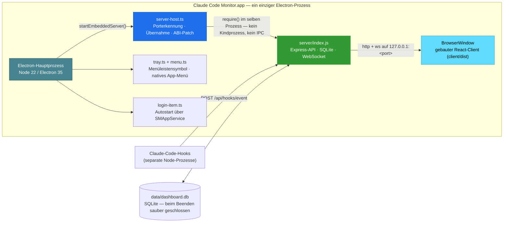

Beim Start führt die App Folgendes aus:

1. Sie wählt einen freien Port — bevorzugt **4820**, sonst **4821–4829**, dann einen zufälligen hohen Port, wenn alle belegt sind.
2. Antwortet bereits ein gesunder Dashboard-Server auf `/api/health` an `4820` (z. B. weil Sie `npm start` in einem Terminal ausgeführt haben), **übernimmt sie diesen Server**, statt doppelt zu binden — kein Portkonflikt, kein SQLite-Konkurrenzzugriff. Ein übernommener Server läuft nach dem Beenden der App weiter.
3. Andernfalls startet sie den eingebetteten Server und installiert beim **ersten Start mit eigenem Server** automatisch die Claude-Code-Hooks und startet die Hintergrunddienste (Update-Planer, `cc-watcher`, Abgleich verwaister Läufe). Wer nur das DMG installiert, erhält Ereignisse also **ohne jede manuelle Einrichtung** — kein Checkout, kein `npm run install-hooks`.
4. **(macOS)** Sie stellt den **`PATH` der Login-Shell** wieder her, damit die Funktion **Claude starten** die `claude`-CLI finden und starten kann — eine aus Finder/Dock gestartete App erbt sonst nur den minimalen `PATH` von launchd und fände CLIs in `~/.local/bin`, `/opt/homebrew/bin`, den Verzeichnissen von Versionsmanagern usw. nicht. (Unter Windows erbt der Prozess den `PATH` des Benutzers bereits.)
5. Sie öffnet das Dashboard-Fenster — außer wenn die App bei der Anmeldung gestartet wurde (unter macOS über die Anmeldeobjekte; unter Windows über den markierten Eintrag `HKCU\…\Run`); dann bleibt sie nur im Tray.
6. Beim Beenden fährt sie den eingebetteten Server sauber herunter und **schließt SQLite sauber** (WAL-Checkpoint).

### Funktionen

- **Tray und Fenster:** Ein Linksklick blendet das Fenster ein oder aus; ein Rechtsklick bietet **Dashboard öffnen**, **Im Browser öffnen**, **Server neu starten**, **Protokolle anzeigen**, **Bei Anmeldung öffnen** und **Beenden**. macOS nutzt ein eingefärbtes Vorlagensymbol im Tray; Windows sowie Fenster und Taskleiste nutzen das farbige App-Symbol, auch bei nicht paketierten Entwicklungsläufen.
- **Natives Menü:** Standard-Anwendungsmenüs und `⌘`- / `Ctrl`-Kürzel. Nur macOS behält **File → Open Dashboard** (`⌘1`), während das Fenster ausgeblendet ist; unter Windows/Linux lässt es sich zuverlässig über den Tray wieder öffnen.
- **Anmeldung und Lebenszyklus:** `SMAppService` registriert die Anmeldeobjekte unter macOS; unter Windows wird der benutzerbezogene Eintrag `HKCU\Software\Microsoft\Windows\CurrentVersion\Run` geschrieben. Schließen blendet das Fenster aus, während Tray und Server weiterlaufen; ein zweiter Start holt die einzige vorhandene Instanz in den Vordergrund.
- **Dauerhafte Daten:** SQLite und VAPID-Schlüssel liegen außerhalb des Bundles in `~/Library/Application Support/Claude Code Monitor/data/` bzw. `%APPDATA%\Claude Code Monitor\data\`. Neuinstallation, Update und die standardmäßige NSIS-Deinstallation erhalten den importierten Verlauf.
- **CLI und Protokolle:** macOS stellt den `PATH` der Login-Shell wieder her, damit aus Finder/Dock gestartete Apps `claude` ausführen können; Windows nutzt den geerbten Benutzer-`PATH`. **Protokolle anzeigen** öffnet `~/Library/Logs/Claude Code Monitor/desktop.log` bzw. `%APPDATA%\Claude Code Monitor\logs\desktop.log`.

### Herunterladen

**Option A — einen vorgefertigten Installer herunterladen (empfohlen).** Unter **[Releases → latest](https://github.com/hoangsonww/Claude-Code-Agent-Monitor/releases/latest)** (öffentlich, ohne GitHub-Anmeldung). Die CI veröffentlicht automatisch ein neues Release `vX.Y.Z`, sobald die Version in `package.json` auf `master` erhöht wird, sodass dieser Link immer den aktuellen Build liefert:

| Plattform | Datei | Hinweise |
| --- | --- | --- |
| macOS (Apple Silicon) | `ClaudeCodeMonitor-<ver>-arm64.dmg` | nach `/Applications` ziehen |
| macOS (Intel) | `ClaudeCodeMonitor-<ver>-x64.dmg` | nach `/Applications` ziehen |
| Windows (Installer) | `ClaudeCodeMonitor-Setup-<ver>-x64.exe` | benutzerbezogene Installation, ohne Adminrechte |
| Windows (portabel) | `ClaudeCodeMonitor-<ver>-x64-portable.exe` | läuft ohne Installation |

Frische Builds pro Commit gibt es auch als CI-Artefakte (Anmeldung erforderlich, 14 Tage Aufbewahrung): `ClaudeCodeMonitor-dmg` aus dem Job `🍎 macOS Desktop (DMG)` und `ClaudeCodeMonitor-win` aus dem Job `🪟 Windows Desktop (EXE)` — nützlich, um `master` vor dem nächsten Release-Tag zu testen.

**Option B — selbst bauen.** Im Repo-Stamm:

```bash
npm run setup                # install root + client deps, build client, install hooks
npm run build                # build the React client (client/dist)
npm run desktop:install      # install Electron + electron-builder into desktop/ (preflights native deps; prints setup help on failure)
npm run desktop:dmg:arm64    # macOS:   fast single-arch DMG → desktop/release/ClaudeCodeMonitor-<ver>-arm64.dmg
npm run desktop:win          # Windows: NSIS installer → desktop/release/ClaudeCodeMonitor-Setup-<ver>-x64.exe
```

> [!NOTE]
> **DMGs werden unter macOS gebaut, Windows-`.exe`-Dateien unter Windows** — electron-builder paketiert für das Host-Betriebssystem. Der macOS-Build `npm run desktop:dmg` paketiert die App **zweimal** (einmal pro Architektur) und erzeugt **beide** DMGs pro Architektur (`arm64` + `x64`) — das ist der Release-Build; er führt sie nicht zu einer universellen Binärdatei zusammen. Für Ihren eigenen Mac nutzen Sie das Einzelarchitektur-Ziel `desktop:dmg:arm64` / `desktop:dmg:x64`. Unter Windows wird `better-sqlite3` von `npm run desktop:install` als vorgefertigte Electron-Binärdatei geladen, sodass im Normalfall keine Visual-Studio-C++-Toolchain nötig ist. Schlägt der Build dennoch fehl (keine vorgefertigte Binärdatei oder fehlende C++-Toolchain), gibt `desktop:install` die genaue Lösung pro Betriebssystem plus eine Alternative ohne Toolchain aus und bricht deutlich ab, statt eine defekte Installation zu hinterlassen.

### Installieren

**macOS:**

1. Doppelklicken Sie auf die `.dmg`, um sie einzubinden.
2. Ziehen Sie **Claude Code Monitor.app** in Ihren Ordner `/Applications`.
3. Das DMG ist standardmäßig **ad hoc signiert**, daher warnt Gatekeeper beim ersten Start (*„Apple konnte nicht überprüfen …“*). Entfernen Sie das Quarantäne-Attribut:

   ```bash
   xattr -cr "/Applications/Claude Code Monitor.app"
   ```

   Oder öffnen Sie **Systemeinstellungen → Datenschutz & Sicherheit** und klicken Sie auf **Dennoch öffnen**.

4. Starten Sie die App. Das Tray-Symbol erscheint und das Dashboard-Fenster öffnet sich.

**Windows:**

Führen Sie `ClaudeCodeMonitor-Setup-<ver>-x64.exe` für eine benutzerbezogene Installation ohne Administratorrechte unter `%LOCALAPPDATA%\Programs\Claude Code Monitor` mit wählbarem Zielort aus, oder verwenden Sie `*-portable.exe` ohne Installation. Der standardmäßig nicht signierte Build kann beim ersten Start SmartScreen auslösen; wählen Sie dann **Weitere Informationen → Trotzdem ausführen**. Starten Sie die App über das Startmenü oder die Desktop-Verknüpfung, um das Dashboard und das Tray-Symbol zu öffnen.

<p align="center">
  <a href="images/setup_win_wizard.png"></a>
  <br>
  <em>🪟 <strong>Installationsoptionen</strong> · Installation pro Benutzer oder für alle Benutzer wählen</em>
</p>

<p align="center">
  <a href="images/setup_win_wizard2.png"></a>
  <br>
  <em>🪟 <strong>Installationsort</strong> · Zielordner bestätigen oder ändern</em>
</p>

<p align="center">
  <a href="images/setup_win_wizard3.png"></a>
  <br>
  <em>🪟 <strong>Windows-Einrichtung abgeschlossen</strong> · Installer beenden und Claude Code Monitor starten</em>
</p>

### Build-Befehle

Alle Befehle werden im **Repo-Stamm** ausgeführt:

| Befehl | Was er tut |
| --------------------------- | ---------------------------------------------------------------------------- |
| `npm run desktop:install` | Installiert Electron + electron-builder in `desktop/`; baut `better-sqlite3` für die ABI von Electron neu; prüft vorab den nativen Build von `better-sqlite3` und gibt bei einem Fehler konkrete Einrichtungshilfe aus (inkl. einer Alternative ohne Toolchain) |
| `npm run desktop:build` | Kompiliert die TypeScript-Quellen des Desktops nach `desktop/out/` |
| `npm run desktop:dev` | Baut und startet die Electron-App für die lokale Entwicklung |
| `npm run desktop:test` | Führt den Smoke-Test aus (startet Electron, prüft `/api/health`, fährt herunter) |
| `npm run desktop:dmg` | **macOS:** baut **beide** DMGs (arm64 + x64) — richtig für ein Release, **langsamer** (paketiert jede Architektur) |
| `npm run desktop:dmg:arm64` | **macOS:** baut ein DMG nur für Apple Silicon — **schnell** (~1 min), empfohlen für Ihren eigenen Mac |
| `npm run desktop:dmg:x64` | **macOS:** baut ein DMG nur für Intel — **schnell** (~1 min) |
| `npm run desktop:dmg:universal` | **macOS:** baut ein einzelnes zusammengeführtes **universelles** DMG (arm64 + x86_64) — optional, **am langsamsten**, nicht das, was das Release ausliefert |
| `npm run desktop:win` | **Windows:** baut den NSIS-Installer `.exe` (x64) |
| `npm run desktop:win:portable` | **Windows:** baut die portable `.exe` ohne Installation (x64) |

Das resultierende macOS-DMG ist **~80 MB** groß (≈ 250 MB auf der Festplatte nach der Installation), der Windows-Installer ist vergleichbar — der übliche Preis eines Electron-Bundles.

### Signierung und Notarisierung

macOS nutzt standardmäßig eine Ad-hoc-Signierung und setzt `CSC_IDENTITY_AUTO_DISCOVERY=false`, damit lokale Zertifikate nie versehentlich gewählt werden. Die Developer-ID-Signierung nutzt `CSC_LINK` plus `CSC_KEY_PASSWORD`; die Notarisierung ergänzt `APPLE_ID`, `APPLE_TEAM_ID` und `APPLE_APP_SPECIFIC_PASSWORD`. Windows ist standardmäßig nicht signiert und aktiviert Authenticode über dieselben Variablen für `CSC_LINK` und das Passwort. Die CI aktiviert jeden der beiden Wege, sobald Zugangsdaten vorhanden sind, ohne Codeänderung.

### Hinweise zur Implementierung

- **Native ABI:** `desktop/` hält ein für Electron gebautes `better-sqlite3` vor und leitet `server/db.js` darauf um; die Kopie im Repo-Stamm bleibt mit dem System-Node und den Servertests kompatibel. Nach architekturspezifischen DMG-Builds repariert der Desktop-Schritt `prebuild` die lokale ABI automatisch und bricht frühzeitig mit Einrichtungshilfe ab, wenn die Binärdatei fehlt.
- **Server-Parität:** Die exportierte Funktion `startBackgroundServices()` gibt dem eingebetteten Server denselben Update-Planer, denselben Konfigurations-Watcher und denselben Abgleich verwaister Läufe wie `node server/index.js`; der eigenständige Pfad und die übrigen Workspaces bleiben im Verhalten unverändert.
- **CI und Releases:** Pfadgefilterte macOS- und Windows-Jobs führen Smoke-Tests aus und laden zwei DMGs mit je einer Architektur sowie NSIS- und portable EXEs hoch. Versionserhöhungen auf `master` hängen alle Assets an `vX.Y.Z` an; erzeugen Sie `desktop/assets/icon.ico` mit `npm run build:win-icon` neu.

Siehe [`DESKTOP.md`](./DESKTOP.md) für Installation und täglichen Gebrauch sowie [`desktop/README.md`](./desktop/README.md) für Prozess, Lebenszyklus, Ports und Builds.

---

## Datenspeicherung

- **Engine:** SQLite 3 über `better-sqlite3` (optional) oder das in Node.js integrierte `node:sqlite`
- **Ort:** `data/dashboard.db`
- **Journal-Modus:** WAL (parallele Lesevorgänge während Schreibvorgängen)
- **Zurücksetzen:** Löschen Sie `data/dashboard.db`, um alle Daten zu entfernen

### Entity-Relationship-Diagramm

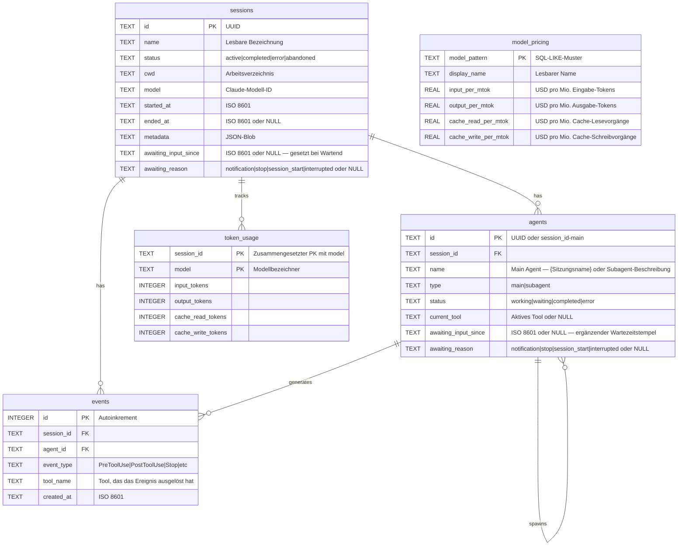

---

## Plugin-Marketplace

CCAM liefert **14 Plugins** aus einem gemeinsamen Quellbaum. Claude Code liest `.claude-plugin/marketplace.json`; Codex liest `.agents/plugins/marketplace.json` sowie die `.codex-plugin/plugin.json` jedes Plugins. Das Paket enthält **66 Plugin-Skills, 18 Claude-Subagents, 34 Claude-Befehle, 3 CLI-Hilfsprogramme, 3 Hook-Konfigurationen und 2 Plugins mit MCP**.

```bash
# Claude Code
claude plugin marketplace add hoangsonww/Claude-Code-Agent-Monitor
claude plugin install ccam-platform@claude-code-agent-monitor-plugins

# Codex
codex plugin marketplace add hoangsonww/Claude-Code-Agent-Monitor
codex plugin add ccam-platform@claude-code-agent-monitor-plugins

# Open Agent Skills / skills.sh-compatible CLI
npx skills add hoangsonww/Claude-Code-Agent-Monitor --list

# Install one skill for Claude Code and Codex in the current project
npx skills add hoangsonww/Claude-Code-Agent-Monitor \
  --skill mcp-server \
  --agent claude-code \
  --agent codex \
  --yes

# Verify, update, and remove the project-scoped skill
npx skills list --json
npx skills update --project --yes
npx skills remove mcp-server --yes

# Add --global to install at user scope, then manage that scope explicitly
npx skills add hoangsonww/Claude-Code-Agent-Monitor \
  --skill mcp-server \
  --agent claude-code \
  --agent codex \
  --global \
  --yes
npx skills list --global --json
npx skills update --global --yes
npx skills remove --global mcp-server --yes
```

Die CLI `skills` findet **insgesamt 77 Repository-Skills**, darunter die 66 Plugin-Skills und die Skills zur Pflege des Repositorys. Projektinstallationen nutzen `.agents/skills/` plus agentenspezifische Links. Globale Claude-Code-Skills liegen standardmäßig in `~/.claude/skills/` oder in `$CLAUDE_CONFIG_DIR/skills/`, falls gesetzt. Globale Codex-Skills liegen standardmäßig in `~/.codex/skills/` oder in `$CODEX_HOME/skills/`, falls gesetzt. Installationen für mehrere Agents können Dateien über einen gemeinsamen Speicher deduplizieren und diese Ziele verlinken. Jede Plugin-Skill hat kanonisches `name`/`description`-Frontmatter und `agents/openai.yaml`-Metadaten. Für die Installation ist kein Upstream-PR an `vercel-labs/skills` nötig. Das öffentliche GitHub-Repository ist die Quelle, und die Sichtbarkeit auf skills.sh folgt der Veröffentlichung und der tatsächlichen Installationstelemetrie.

Neue fokussierte Pakete ergänzen die bestehenden Plugins für Analysen, Produktivität, Qualität, Sitzungen, Workflows, Konfiguration und Dashboard:

- `ccam-runner`: überwachter Start, Nachfassen, Stoppen und Fortsetzen von Claude Code/Codex sowie Laufverlauf
- `ccam-integrations`: Alarmregeln, Webhooks, Push-Benachrichtigungen und entfernte Erfassung per SSH
- `ccam-platform`: Claude-/Codex-Konfigurations-Explorer, anbieterbewusster Import, Backup-Wiederherstellung, Hook-Einrichtung, Updates und MCP-Operationen
- `ccam-reports`: präsentationsfertige Berichte für Führung, Kosten, Zuverlässigkeit und Workflows

Validieren und erzeugen Sie die Distributionsmetadaten neu mit:

```bash
npm run extensions:sync
npm run extensions:validate
```

Vollständiger Katalog, Installationsbefehle, Verhalten von skills.sh, Grenzen der öffentlichen Einreichung und Prüfungen einer sauberen Installation: [docs/PLUGINS.md](docs/PLUGINS.md).

---

## Statuszeile

Ein eigenständiges CLI-Statuszeilenwerkzeug für Claude Code, das Modellname, Benutzer, Arbeitsverzeichnis, Git-Branch, einen Balken der Kontextfensternutzung, Token-Zahlen pro Richtung und die Sitzungskosten anzeigt — alles farbcodiert mit ANSI-Escape-Sequenzen.

```
nguyens6@host ~/agent-dashboard/client | Sonnet 4.6 | main | ████████░░ 79% | 3↑ 2↓ 156586c | $0.4231
```

| Segment | Farbe | Beispiel |
| ----------- | -------------------- | -------------------------------------------------------------- |
| Modell | Cyan | `Sonnet 4.6` |
| Benutzer | Grün | `nguyens6` |
| CWD | Gelb | `~/agent-dashboard` |
| Git-Branch | Magenta | `main` |
| Kontextbalken | Grün / Gelb / Rot | `████████░░ 79%` |
| Tokens | Grün / Cyan / Gedimmt | `3↑ 2↓ 156586c` (grünes `↑` Eingabe, cyanes `↓` Ausgabe, gedimmtes `c` Cache) |
| Kosten (USD) | Grün / Gelb / Rot | `$0.4231` (Sitzungssumme — bei API- und Abo-Plänen angezeigt) |

Farbschwellen der Kosten: grün unter 5 $, gelb 5–20 $, rot ab 20 $.

Siehe [`statusline/README.md`](statusline/README.md) für die Installationsanleitung.

<p align="center">
  <a href="images/statusline.png"></a>
</p>

---

## Serverarchitektur

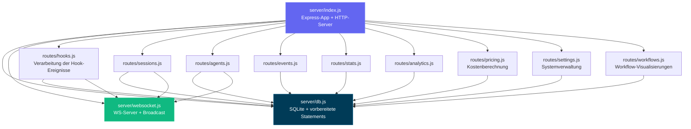

---

## Client-Routing

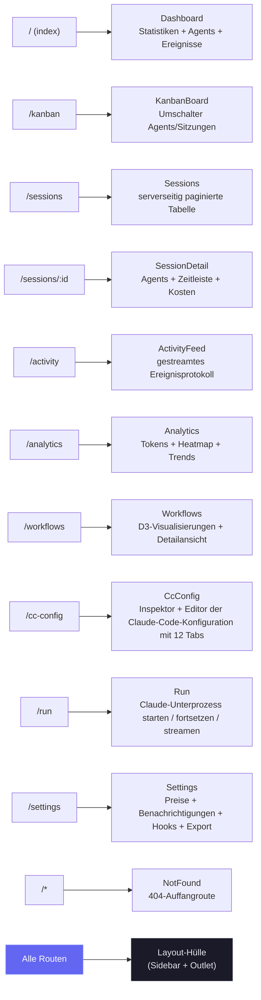

---

## Ablauf des Hook-Handlers

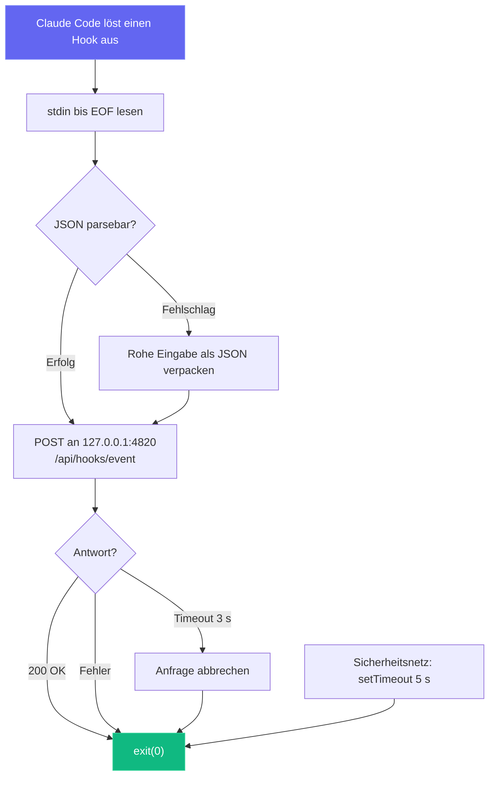

---

## Deployment-Modi

Wir unterstützen Entwicklungs- und Produktions-Deployments mit unterschiedlichen Prozessarchitekturen:

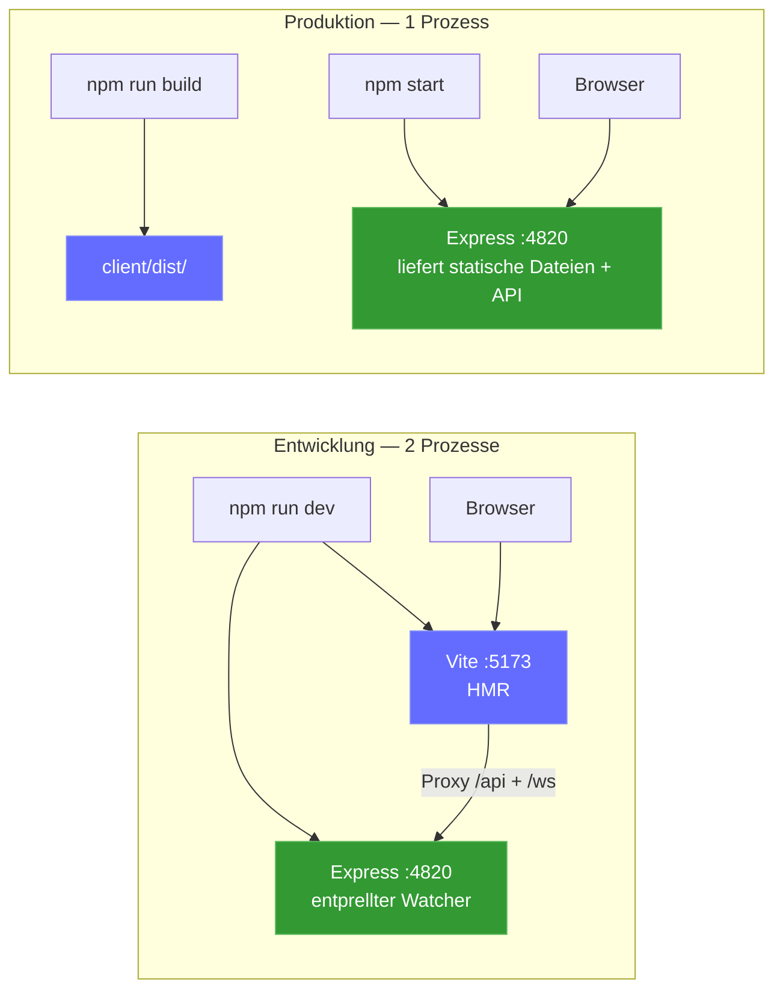

Optionaler lokaler MCP-Sidecar (unterstützt die Transporte stdio, HTTP+SSE und REPL):

```mermaid
graph LR
    subgraph "MCP-Transportoptionen"
        M_STDIO["MCP-Server (stdio)<br/>npm run mcp:start"]
        M_HTTP["MCP-Server (HTTP)<br/>npm run mcp:start:http<br/>:8819"]
        M_REPL["MCP-Server (REPL)<br/>npm run mcp:start:repl"]
    end

    H["MCP-Host"] -->|"stdin/stdout"| M_STDIO
    RC["Entfernter Client"] -->|"POST /mcp · GET /sse"| M_HTTP
    OP["Operator"] -->|"interaktive CLI"| M_REPL

    M_STDIO --> D["Dashboard-Server<br/>:4820"]
    M_HTTP --> D
    M_REPL --> D

    style M_STDIO fill:#0f766e,stroke:#14b8a6,color:#fff
    style M_HTTP fill:#0f766e,stroke:#14b8a6,color:#fff
    style M_REPL fill:#0f766e,stroke:#14b8a6,color:#fff
```

Optionale **Desktop-App (macOS und Windows)** — ein einziger Electron-Prozess, der den Express-Server im selben Prozess hostet (kein Terminal, kein Kindprozess):

```mermaid
flowchart LR
    subgraph desktop["Desktop-App (macOS und Windows) — 1 Electron-Prozess"]
        E_MAIN["Electron-Hauptprozess<br/>(Node 22 / Electron 35)"]
        E_HOST["server-host.ts<br/>require() server/index.js"]
        E_SRV["Eingebettetes Express :4820<br/>API · SQLite · WebSocket"]
        E_WIN["BrowserWindow<br/>gebauter React-Client"]
        E_TRAY["Menüleistensymbol (Tray)<br/>+ natives App-Menü"]
        E_MAIN --> E_HOST
        E_HOST -->|"require() im selben Prozess"| E_SRV
        E_MAIN --> E_TRAY
        E_SRV -->|"http + ws auf 127.0.0.1"| E_WIN
    end

    E_HOOKS["Claude-Code-Hooks"] -->|"POST /api/hooks/event"| E_SRV

    style E_MAIN fill:#47848F,stroke:#2f5a62,color:#fff
    style E_SRV fill:#339933,stroke:#5cb85c,color:#fff
    style E_WIN fill:#61DAFB,stroke:#3aa9c9,color:#000
```

### Cloud-Deployment

Der Stack `deployments/` zielt auf jeden konformen Kubernetes-Dienst, einschließlich EKS, GKE, AKS, OKE und selbst verwalteter Cluster. CCAM nutzt SQLite, daher erzwingt jedes unterstützte Manifest **einen einzigen aktiven Dashboard-Schreiber pro persistentem Volume** mit einem Recreate-Rollout. HPA, Aktiv-Aktiv-Replikate, Blue-Green und Canary werden bewusst nicht unterstützt, solange SQLite das Persistenz-Backend bleibt.

```mermaid
flowchart LR
  CI["CI: testen · validieren · scannen · bescheinigen · signieren"] --> HELM["Helm / Kustomize / Terraform"]
  HELM --> APP["CCAM-Dashboard<br/>genau 1 Replikat"]
  APP --> PVC[("Beibehaltene ReadWriteOnce-PVC")]
  EDGE["Ingress oder Gateway API<br/>TLS + WebSocket"] --> APP
  PROM["Prometheus Operator"] -->|"Bearer /api/metrics"| APP
  MCP["Authentifizierter MCP-Sidecar"] --> APP
```

- **Helm:** per Schema erzwungener einzelner Schreiber, Digest-Unterstützung, beibehaltene PVC, Ingress oder Gateway API, mit External Secrets kompatible Token-Einbindung, NetworkPolicy, optionales MCP und ServiceMonitor.
- **Kustomize:** Basis nach eingeschränktem PSS plus Overlays für Dev/Staging/Produktion und optionale Komponenten für MCP, Monitoring, Gateway API und CSI-Snapshots.
- **Terraform:** stellt das validierte Helm-Chart in einem bestehenden Kubernetes-Cluster bereit. Cloud-Netzwerk, Cluster-Identität, CSI, TLS und die Synchronisierung von Geheimnissen bleiben Sache des Anbieters.
- **Betrieb:** konsistentes Online-Backup von SQLite mit SHA-256, geprüfte Wiederherstellung mit Skalierung auf null, Deploy/Rollback/Abbau jeweils mit vorherigem Backup und authentifizierte Zustandsprüfungen.
- **CI-Lieferkette:** App- und MCP-Images werden gescannt, für amd64/arm64 mit SBOM und SLSA-Herkunftsnachweis veröffentlicht und schlüssellos mit Cosign signiert.

```bash
npm run deploy:validate
REGISTRY="ghcr.io/$(gh repo view --json owner -q .owner.login)"
IMAGE_TAG="$(git rev-parse --short HEAD)"

helm upgrade --install agent-monitor deployments/helm/agent-monitor \
  --namespace agent-monitor-production --create-namespace \
  --values deployments/helm/agent-monitor/values-production.yaml \
  --set image.registry= \
  --set image.repository=${REGISTRY}/claude-code-agent-monitor \
  --set image.tag=${IMAGE_TAG} \
  --atomic --wait --timeout 10m
```

> [!NOTE]
> Vollständige Produktionseinrichtung, Geheimnisse, Docker-/Podman-Stack, Gateway API, Terraform, Backup, Wiederherstellung und Rollback sind in [DEPLOYMENT.md](DEPLOYMENT.md) und [deployments/README.md](deployments/README.md) dokumentiert.

---

## Projektstruktur

```
agent-dashboard/
|-- CLAUDE.md                   # Claude Code project memory and working agreements
|-- AGENTS.md                   # Codex project instructions
|-- package.json                # Root scripts (dashboard + MCP helpers) + server dependencies
|-- .claude/
|   +-- rules/                  # Path-scoped Claude rules
|   +-- skills/                 # Claude reusable project skills
|   +-- agents/                 # Claude custom subagents
|-- .claude-plugin/
|   +-- marketplace.json        # Claude Code marketplace manifest (14 plugins)
|-- .agents/plugins/
|   +-- marketplace.json        # Codex marketplace manifest (same 14 plugins)
|-- plugins/
|   |-- ccam-analytics/         # Analytics: session reports, cost breakdown, usage trends, productivity score
|   |   |-- .claude-plugin/plugin.json
|   |   |-- skills/ (4)         # session-report, cost-breakdown, usage-trends, productivity-score
|   |   |-- agents/             # analytics-advisor (Sonnet model)
|   |   |-- hooks/hooks.json    # Stop + SubagentStop event logging
|   |   +-- bin/ccam-stats      # Terminal dashboard CLI
|   |-- ccam-productivity/      # Productivity: standups, reports, sprints, workflow optimizer
|   |-- ccam-devtools/          # DevTools: debug, diagnostics, export, health checks
|   |   +-- bin/                # ccam-doctor + ccam-export CLIs
|   |-- ccam-insights/          # Insights: patterns, anomalies, optimization, comparison
|   |-- ccam-cost-guard/        # Cost guardrails: budgets, spend forecast, cost alerts, model savings
|   |-- ccam-sessions/          # Session forensics: search, timeline, transcript replay, cwd rollup, cleanup
|   |-- ccam-workflows/         # Workflow orchestration: DAG map, delegation audit, concurrency, fleet runs
|   |-- ccam-quality/           # Reliability & SLOs: error scan, API-error report, hook-failure audit, SLO check
|   |-- ccam-config/            # Config & memory governance: config audit, memory review, skill/MCP/hook inventory
|   +-- ccam-dashboard/         # Dashboard connector: status, quick stats, MCP integration
|       +-- .mcp.json           # MCP server configuration
|-- server/
|   |-- index.js                 # Express app, HTTP server, static serving
|   |-- db.js                    # SQLite schema, migrations, prepared statements
|   |-- websocket.js             # WebSocket server with heartbeat
|   +-- routes/
|       |-- hooks.js             # Hook event processing (transactional)
|       |-- sessions.js          # Session CRUD
|       |-- agents.js            # Agent CRUD
|       |-- events.js            # Event listing
|       |-- stats.js             # Aggregate statistics
|       |-- analytics.js         # Token, tool, and trend analytics
|       |-- workflows.js         # Aggregate workflow data and per-session drill-in
|       |-- pricing.js           # Model pricing CRUD and cost calculation
|       +-- settings.js          # System info, data management, export, cleanup
|   +-- lib/
|       +-- transcript-cache.js  # Stat-based JSONL transcript cache with chunked sync byte-stream reader (4 MiB chunks, line-by-line UTF-8 decode) so files larger than V8's max string length (~512 MiB) parse without aborting Node with "FATAL ERROR: v8::ToLocalChecked Empty MaybeLocal". Extracts tokens, compactions, API errors, turn durations, thinking blocks, and usage extras (service_tier, speed, inference_geo)
|   +-- compat-sqlite.js         # node:sqlite compatibility wrapper (fallback for better-sqlite3)
|-- client/
|   |-- package.json             # Client dependencies
|   |-- index.html               # HTML entry point
|   |-- vite.config.ts           # Vite + proxy config
|   |-- tailwind.config.js       # Custom dark theme
|   |-- tsconfig.json            # Strict TypeScript
|   +-- src/
|       |-- main.tsx             # React entry
|       |-- App.tsx              # Router + WebSocket provider
|       |-- index.css            # Tailwind + custom utilities
|       |-- lib/
|       |   |-- types.ts         # Shared TypeScript interfaces
|       |   |-- api.ts           # Typed fetch client
|       |   |-- format.ts        # Date/time formatting utilities
|       |   +-- eventBus.ts      # Pub/sub for WebSocket distribution
|       |-- hooks/
|       |   |-- useWebSocket.ts      # Auto-reconnecting WebSocket hook
|       |   +-- useNotifications.ts  # Browser notification triggers from WebSocket events
|       |-- components/
|       |   |-- Layout.tsx       # Shell with sidebar + outlet
|       |   |-- Sidebar.tsx      # Navigation + connection indicator
|       |   |-- AgentCard.tsx    # Agent info card with status
|       |   |-- StatCard.tsx     # Metric card
|       |   |-- StatusBadge.tsx  # Color-coded status pills
|       |   |-- EmptyState.tsx   # Placeholder for empty lists
|       |   +-- workflows/       # D3.js workflow visualization components
|       |       |-- OrchestrationDAG.tsx            # Horizontal DAG of agent spawning patterns
|       |       |-- ToolExecutionFlow.tsx           # d3-sankey diagram of tool-to-tool transitions
|       |       |-- AgentCollaborationNetwork.tsx   # Force-directed agent pipeline graph
|       |       |-- SubagentEffectiveness.tsx       # Scorecard grid with SVG success rings
|       |       |-- WorkflowPatterns.tsx            # Auto-detected orchestration sequences
|       |       |-- ModelDelegationFlow.tsx         # Model routing through agent hierarchies
|       |       |-- ErrorPropagationMap.tsx         # Error clustering by hierarchy depth
|       |       |-- ConcurrencyTimeline.tsx         # Swim-lane parallel agent execution
|       |       |-- SessionComplexityScatter.tsx    # D3 bubble chart (duration vs agents vs tokens)
|       |       |-- CompactionImpact.tsx            # Token compression events and recovery
|       |       |-- WorkflowStats.tsx               # Aggregate workflow statistics
|       |       +-- SessionDrillIn.tsx              # Per-session agent tree, tool timeline, events
|       +-- pages/
|           |-- Dashboard.tsx      # Overview page
|           |-- KanbanBoard.tsx    # Agents/Sessions toggle, status columns
|           |-- Sessions.tsx       # Server-paginated sessions table
|           |-- SessionDetail.tsx  # Single session deep dive
|           |-- ActivityFeed.tsx   # Real-time event stream
|           |-- Analytics.tsx      # Token usage, heatmap, trends
|           |-- Workflows.tsx      # D3.js workflow visualizations and session drill-in
|           |-- Settings.tsx       # Model pricing, notifications, hooks, export, cleanup
|           +-- NotFound.tsx       # 404 catch-all page
|-- scripts/
|   |-- hook-handler.js          # Lightweight stdin-to-HTTP forwarder
|   |-- install-hooks.js         # Auto-configures ~/.claude/settings.json
|   |-- import-history.js        # Imports sessions from ~/.claude/ with enhanced JSONL extraction (API errors, turn durations, entrypoint, permission modes, thinking blocks, usage extras, tool errors, subagent JSONL files). Re-import is fully incremental: a per-event-type high-water mark (`MAX(created_at) GROUP BY event_type` per session) is computed up-front and only JSONL entries with `ts > cutoff[type]` are inserted, so long-running sessions whose transcripts grow across multiple days continue to receive Stop / PostToolUse / TurnDuration / ToolError events on every re-run. Also rolls `sessions.ended_at` forward when the JSONL advances past the stored value and refreshes message-count metadata on every pass
|   +-- seed.js                  # Sample data generator
|-- mcp/
|   |-- package.json             # MCP package scripts + dependencies
|   |-- README.md                # MCP setup, host config, tool catalog, safety model
|   |-- src/
|   |   |-- index.ts             # MCP runtime entrypoint (transport router)
|   |   |-- server.ts            # MCP server assembly
|   |   |-- clients/             # Dashboard API client with retry/backoff
|   |   |-- config/              # Environment/CLI config parsing
|   |   |-- core/                # Logger, tool registry, result helpers
|   |   |-- policy/              # Mutation/destructive guards
|   |   |-- tools/               # 16 domain modules registering 103 tools
|   |   |-- transports/          # HTTP+SSE server, REPL, tool collector
|   |   |-- ui/                  # ANSI banner, colors, formatter, tables
|   |   +-- types/               # Shared MCP type definitions
|   +-- build/                   # Built MCP runtime output
|-- desktop/
|   |-- package.json             # Electron + electron-builder dependencies and scripts
|   |-- electron-builder.yml     # DMG packaging config; signing/notarization hooks
|   |-- tsconfig.json            # Strict TypeScript (src/ -> out/)
|   |-- README.md                # Desktop app architecture reference (contributor docs)
|   |-- assets/                  # icon.svg + generated icon.icns + tray PNGs
|   |-- src/
|   |   |-- main.ts              # Electron main process entry — lifecycle, wiring
|   |   |-- server-host.ts       # In-process Express boot, port discovery, adoption, DB close
|   |   |-- window.ts            # BrowserWindow + persisted window geometry
|   |   |-- tray.ts              # Menu-bar (tray) icon + context menu
|   |   |-- menu.ts              # Native application menu (File ▸ Open Dashboard is macOS-only)
|   |   |-- login-item.ts        # macOS Login Items auto-start toggle (SMAppService)
|   |   |-- logger.ts            # File logger -> ~/Library/Logs/Claude Code Monitor/desktop.log
|   |   |-- constants.ts         # App name, ports, timeouts, window size
|   |   +-- preload.ts           # Intentionally empty (zero renderer privilege)
|   |-- scripts/
|   |   |-- install.js           # Preflights native deps for desktop:install; prints setup help + exits non-zero on failure
|   |   |-- preflight.js         # Shared better-sqlite3 binary check + actionable per-OS setup help (incl. no-toolchain alternative)
|   |   |-- prebuild.js          # Ensures root + client are built before tsc; fails fast with setup help if native binary missing
|   |   |-- build-icons.sh       # SVG -> PNG/ICNS via qlmanage/sips/iconutil
|   |   +-- notarize.js          # electron-builder afterSign hook (opt-in notarization)
|   +-- tests/
|       +-- smoke.test.mjs       # Spawn Electron + probe /api/health
|-- deployments/
|   |-- README.md                # Production deployment reference
|   |-- nginx/                   # Rootless Nginx edge and opt-in hook/MCP policies
|   |-- secrets/                 # Ignored Compose token/password files
|   |-- terraform/               # Helm deployment to an existing Kubernetes cluster
|   |-- kubernetes/              # One-writer Kustomize base + environment overlays
|   |   |-- base/                # Restricted PSS, Recreate Deployment, PVC, Service, Ingress
|   |   |-- overlays/            # Dev, staging, production namespaces and resources
|   |   +-- components/          # MCP, ServiceMonitor, Gateway API, VolumeSnapshot
|   |-- helm/agent-monitor/      # Schema-enforced Helm chart and environment values
|   +-- scripts/                 # Validate, deploy, backup, restore, rollback, health, teardown
|-- .codex/
|   |-- config.toml              # Codex runtime configuration
|   |-- README.md                # Codex setup guide for agents and skills
|   |-- rules/                   # Codex execution policy rules
|   |-- agents/                  # Codex custom agent templates
|   +-- skills/                  # Codex project skills
|-- statusline/
|   |-- README.md                # Statusline installation & usage guide
|   |-- statusline.py            # Python script that renders the statusline
|   +-- statusline-command.sh    # Shell wrapper for Claude Code's statusLine config
+-- data/
    +-- dashboard.db             # SQLite database (gitignored)
```

---

## Fehlerbehebung

| Problem | Lösung |
| --------------------------------- | ---------------------------------------------------------------------------------------------------------------------------------------------------------------- |
| Installation von `better-sqlite3` schlägt fehl | Das ist nicht kritisch — der Server greift automatisch auf das in Node.js integrierte `node:sqlite` zurück (Node 22+). Installieren Sie bei älteren Node-Versionen Python 3 und die C++-Build-Werkzeuge und führen Sie dann `npm rebuild better-sqlite3` aus |
| Hooks werden nicht ausgelöst | Führen Sie `npm run install-hooks` aus und starten Sie Claude Code neu. Prüfen Sie, ob die Hooks in `~/.claude/settings.json` stehen |
| Dashboard zeigt keine Daten | Stellen Sie sicher, dass der Server läuft (`npm run dev`), bevor Sie eine Claude-Code-Sitzung starten. Prüfen Sie `http://localhost:4820/api/health` |
| WebSocket getrennt | Der Client verbindet sich alle 2 Sekunden automatisch neu. Prüfen Sie, dass Port 4820 nicht von einer Firewall blockiert wird |
| Veraltete Daten nach Neustart | Die Datenbank bleibt über Neustarts hinweg erhalten. Führen Sie `npm run seed` für frische Demodaten aus oder löschen Sie `data/dashboard.db`, um alles zurückzusetzen |
| MCP-Tools verbinden sich nicht | Prüfen Sie, dass die Dashboard-API unter `MCP_DASHBOARD_BASE_URL` erreichbar ist, und bauen/starten Sie MCP neu (`npm run mcp:build`, `npm run mcp:start`) |

---

## Mitwirken

Beiträge sind willkommen — siehe [`.github/CONTRIBUTING.md`](.github/CONTRIBUTING.md) für den vollständigen Leitfaden.

Alle Beitragenden müssen das [Contributor License Agreement](https://github.com/hoangsonww/Claude-Code-Agent-Monitor/blob/master/CLA.md) unterzeichnen. Dies wird bei jedem Pull Request automatisch von der GitHub Action `🖋️ CLA Assistant` durchgesetzt: Beim ersten Öffnen eines PR bittet Sie ein Bot, mit dem Kommentar `I have read the CLA Document and I hereby sign the CLA` zu unterzeichnen. Die Statusprüfung **CLA Assistant** des PR bleibt rot, bis Sie das getan haben, und eine einmalige Unterzeichnung gilt für alle künftigen Beiträge.

---

## Lizenz

MIT. Details in [LICENSE](LICENSE).
