# Tableau de bord des agents pour Claude Code, Cursor et Codex

### Plateforme de surveillance en temps réel de l'activité des agents Claude Code, Cursor et Codex 🚀

Un tableau de bord professionnel pour suivre et visualiser en temps réel les sessions d'agents Claude Code, Cursor et Codex, l'utilisation des outils, l'historique des conversations, les coûts et l'orchestration des sous-agents. Construit avec Node.js, Express, React et SQLite, il combine les hooks natifs et une découverte locale des transcriptions propre à chaque fournisseur.


> [!TIP]
> Voir aussi : [README-EN.md](./README-EN.md) (English), [README-CN.md](./README-CN.md) (中文版本), [README-VN.md](./README-VN.md) (Phiên bản tiếng Việt), [README-KO.md](./README-KO.md) (한국어 버전), [README-ES.md](./README-ES.md) (versión en español), [README-DE.md](./README-DE.md) (deutsche Version), [README-PT.md](./README-PT.md) (versão em português) et [README-IT.md](./README-IT.md) (versione italiana) pour une documentation localisée avec des conseils et bonnes pratiques propres à chaque région.

> [!NOTE]
> Besoin d'une aide orientée tâches ? Le [Wiki GitHub](https://github.com/hoangsonww/Claude-Code-Agent-Monitor/wiki) est le manuel pratique pour l'usage quotidien, l'exploitation en équipe, le dépannage, l'automatisation CLI/MCP et les recettes de déploiement. Le [Wiki statique localisé](https://hoangsonww.github.io/Claude-Code-Agent-Monitor/wiki/) reste la visite du produit et de l'architecture en anglais, vietnamien, chinois, coréen, espagnol, français, allemand, portugais et italien ; les contrats techniques exacts restent dans [`docs/`](./docs/README.md).

---

## Table des matières

- [Vue d'ensemble](#vue-densemble)
- [Internationalisation (i18n)](#internationalisation-i18n)
- [Fonctionnalités](#fonctionnalités)
- [Démarrage rapide](#démarrage-rapide)
- [Fonctionnement](#fonctionnement)
- [Configuration](#configuration)
- [Scripts npm](#scripts-npm)
- [Marketplace de plugins](#marketplace-de-plugins)
- [Extensions d'agent](#extensions-dagent)
- [Intégration MCP](#intégration-mcp)
- [Référence de l'API](#référence-de-lapi)
- [Événements de hook](#événements-de-hook)
- [Notifications du navigateur](#notifications-du-navigateur)
- [Notificateur de mise à jour](#notification-de-mise-à-jour)
- [Tabby — le chat compagnon flottant](#tabby--chat-compagnon-flottant)
- [Signaux sonores](#signaux-sonores)
- [Fenêtre de statut de connexion](#fenêtre-détat-de-la-connexion)
- [Extension VS Code](#extension-vs-code)
- [Application de bureau (macOS et Windows)](#application-de-bureau-macos-et-windows)
- [Stockage des données](#stockage-des-données)
- [Barre d'état](#ligne-de-statut)
- [Architecture du serveur](#architecture-du-serveur)
- [Routage du client](#routage-du-client)
- [Flux du gestionnaire de hooks](#flux-du-gestionnaire-de-hooks)
- [Modes de déploiement](#modes-de-déploiement)
- [Structure du projet](#structure-du-projet)
- [Dépannage](#dépannage)
- [Contribuer](#contribuer)
- [Licence](#licence)

---

## Vue d'ensemble

Suivez les sessions, surveillez les agents en temps réel, visualisez l'utilisation des outils, rejouez les conversations et observez l'orchestration des sous-agents dans une interface web professionnelle au thème sombre. Claude Code et Codex utilisent leurs hooks natifs ; Cursor est pris en charge d'office grâce à ses événements en direct compatibles et à la découverte native des transcriptions dans `~/.cursor`.

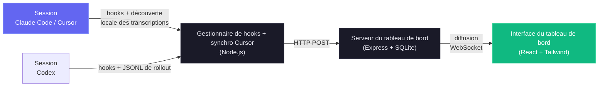

En plus du tableau de bord de surveillance en temps réel, le projet inclut une implémentation de serveur MCP local dans `mcp/` qui expose un catalogue d'outils pour inspecter et gérer le tableau de bord lui-même, ce qui facilite l'intégration de ses opérations directement dans vos workflows Claude Code et Codex. Il comprend aussi une couche d'extensions d'agent, qui fournit des plugins, skills et sous-agents Claude Code et Codex pour interagir avec le tableau de bord, l'analytique et l'intelligence des workflows.

### Internationalisation (i18n)

L'interface intègre le changement de langue pour l'anglais (`en`), le chinois (`zh`), le vietnamien (`vi`), le coréen (`ko`), l'espagnol (`es`), le français (`fr`), l'allemand (`de`), le portugais (`pt`) et l'italien (`it`). Un menu déroulant de langue personnalisé évite que le sélecteur n'encombre la barre latérale à mesure que des langues s'ajoutent. Les ressources linguistiques sont chargées par namespace et conservées dans le stockage du navigateur pour une préférence stable d'un rechargement à l'autre.

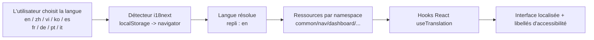

Pour l'architecture complète et les consignes d'exploitation, voir [docs/I18N.md](./docs/I18N.md).

### Interface utilisateur

L'interface sombre et adaptative couvre l'ensemble du workflow. Chaque aperçu utilise une miniature adaptée au mobile et renvoie vers l'original en haute définition.

<p align="center">
  <a href="images/dashboard.png"></a>
  <br>
  <em>📡 <strong>Tableau de bord</strong> · totaux de la flotte, agents actifs, activité récente et signaux de santé en direct</em>
</p>

<p align="center">
  <a href="images/tasks-overview.png"></a>
  <br>
  <em>📋 <strong>Avancement des tâches</strong> · achèvement compact et aperçus du travail par responsable</em>
</p>

<p align="center">
  <a href="images/dashboard-health.png"></a>
  <br>
  <em>🩺 <strong>Santé du système</strong> · stockage, cache, erreurs, outils, modèles, sous-agents et compactions</em>
</p>

<p align="center">
  <a href="images/board.png"></a>
  <br>
  <em>📋 <strong>Tableau Kanban · Agents</strong> · agents en cours, en attente, terminés et en échec, avec des raisons d'attente claires</em>
</p>

<p align="center">
  <a href="images/board-sessions.png"></a>
  <br>
  <em>🗂️ <strong>Tableau Kanban · Sessions</strong> · sessions actives, en attente, terminées, en erreur et abandonnées</em>
</p>

<p align="center">
  <a href="images/sessions.png"></a>
  <br>
  <em>📂 <strong>Sessions</strong> · historique paginé côté serveur, avec recherche et filtres, coûts et activité</em>
</p>

<p align="center">
  <a href="images/session-agents.png"></a>
  <br>
  <em>🤖 <strong>Agents de la session</strong> · totaux en direct, utilisation des outils, flux de tokens et hiérarchie des agents</em>
</p>

<p align="center">
  <a href="images/tasks-details.png"></a>
  <br>
  <em>✅ <strong>Détail des tâches</strong> · segments d'achèvement, travail en cours, responsables et tâches paginées</em>
</p>

<p align="center">
  <a href="images/session-conversation.png"></a>
  <br>
  <em>💬 <strong>Conversation</strong> · transcriptions mises en forme, code, appels d'outils, sorties de commandes et marqueurs de session</em>
</p>

<p align="center">
  <a href="images/session-timeline.png"></a>
  <br>
  <em>🔬 <strong>Chronologie</strong> · événements dans l'ordre chronologique, filtres multidimensionnels et activité des outils appariée</em>
</p>

<p align="center">
  <a href="images/feed.png"></a>
  <br>
  <em>📰 <strong>Flux d'activité</strong> · événements en direct avec pause, regroupement, filtres et accès direct aux sessions</em>
</p>

<p align="center">
  <a href="images/analytics.png"></a>
  <br>
  <em>📊 <strong>Analytique</strong> · tokens par modèle, fréquence des outils, cartes thermiques d'activité et tendances des sessions</em>
</p>

<p align="center">
  <a href="images/workflows.png"></a>
  <br>
  <em>🔀 <strong>Workflows</strong> · graphes d'orchestration, flux des outils, collaboration, délégation et motifs</em>
</p>

<p align="center">
  <a href="images/dynamicworkflows-workflows.png"></a>
  <br>
  <em>🧬 <strong>Exécutions de workflows</strong> · statut, agents, tokens, outils et durée tirés des journaux d'exécution</em>
</p>

<p align="center">
  <a href="images/dynamicworkflows-workflows2.png"></a>
  <br>
  <em>🧬 <strong>Exécution dépliée</strong> · filtres de phase, métriques par agent, prompts et résultats complets</em>
</p>

<p align="center">
  <a href="images/dynamicworkflows-session.png"></a>
  <br>
  <em>🧬 <strong>Workflows de la session</strong> · exécutions dynamiques rattachées et coûts en tokens intégrés</em>
</p>

<p align="center">
  <a href="images/config.png"></a>
  <br>
  <em>🧰 <strong>Configuration des agents</strong> · inspectez et modifiez en toute sécurité la configuration Claude Code et Codex prise en charge</em>
</p>

<p align="center">
  <a href="images/config-codex.png"></a>
  <br>
  <em>🧰 <strong>Configuration Codex</strong> · modèles, profils, MCP, projets, skills, hooks, règles, plugins et instructions</em>
</p>

<p align="center">
  <a href="images/config-skills.png"></a>
  <br>
  <em>🧩 <strong>Skills</strong> · skills utilisateur, projet et plugin, avec recherche et modification sauvegardée</em>
</p>

<p align="center">
  <a href="images/run.png"></a>
  <br>
  <em>▶️ <strong>Lancer un agent</strong> · lancez Claude Code ou Codex avec les contrôles natifs de chaque fournisseur</em>
</p>

<p align="center">
  <a href="images/run-results.png"></a>
  <br>
  <em>💬 <strong>Exécution en direct</strong> · conversation en streaming, raisonnement, commandes, modifications de fichiers, outils et rattachement</em>
</p>

<p align="center">
  <a href="images/settings.png"></a>
  <br>
  <em>⚙️ <strong>Paramètres</strong> · tarification, hooks, notifications, données, sources distantes et état du système</em>
</p>

<p align="center">
  <a href="images/alerts.png"></a>
  <br>
  <em>🔔 <strong>Alertes</strong> · règles, délais de réarmement, activité et webhooks intégrés ou génériques signés</em>
</p>

<p align="center">
  <a href="images/remote.png"></a>
  <br>
  <em>🛰️ <strong>Sources de données distantes</strong> · synchronisation SSH par fournisseur et surveillance filtrée par source</em>
</p>

<p align="center">
  <a href="images/palette.png"></a>
  <br>
  <em>⌘ <strong>Palette de commandes</strong> · un seul lanceur au clavier pour les pages, sessions, projets, filtres et actions</em>
</p>

La barre latérale donne accès au Tableau de bord, au Tableau Kanban, aux Sessions, au Flux d'activité, à l'Analytique, aux Workflows, à la Configuration des agents, à Lancer un agent et aux Paramètres. Les sections ci-dessous décrivent le fonctionnement complet de ces vues.

---

## Fonctionnalités

Le tableau de bord couvre l'intégralité du cycle de vie local des agents. Le détail des contrats de fonctionnement se trouve dans les sections liées et dans les références de `docs/`.

| Fonctionnalité | Résumé |
| --- | --- |
| **Progression des tâches** | Progression par responsable issue des outils de tâches de Claude, de l'ancien `TodoWrite` et du `update_plan` de Codex. Des aperçus compacts apparaissent sur les cartes et les lignes ; le Détail de session ajoute les segments de statut, le travail en cours, les responsables et une pagination par 10 lignes. Un nouveau travail de premier niveau efface l'état inachevé périmé, tandis que l'historique terminé reste visible. |
| **Tableau de bord** | Les onglets persistants **Surveillance** et **Santé** réunissent les totaux de la flotte, les hiérarchies actives, l'activité récente, une santé pondérée (succès, cache, erreurs, tas), le stockage, les outils, les modèles, l'efficacité des sous-agents et les métriques de compaction. La Santé se rafraîchit toutes les 5 secondes à partir de `/api/settings/info` et `/api/workflows`. |
| **Tableau Kanban** | Les colonnes des agents couvrent En cours, En attente, Terminé et Erreur ; celles des sessions ajoutent Actives et Abandonnées. Les cartes se paginent par 10, ne s'abonnent qu'à la vue WebSocket active, conservent leurs titres complets et expliquent les raisons d'attente : demande de permission, fin de tour, inactivité au prompt ou interruption. |
| **Sessions** | Historique recherchable, filtrable et paginé côté serveur, avec un calcul des coûts limité à la page visible et une ligne temporaire en mémoire pour le démarrage de Codex. La recherche porte sur `id`, `name` et `cwd` avec un anti-rebond de 300 ms. Les noms proviennent du titre explicite, puis du titre généré par l'IA, puis du premier prompt utilisateur significatif. |
| **Détail de session** | Statistiques en direct, travail en cours, utilisation des outils, sous-agents, tokens, hiérarchie, chronologie d'événements filtrable, regroupement par `tool_use_id` et rendus propres à chaque outil. La vue Conversation affiche les tours mis en file d'attente, les avis système, le Markdown, le code coloré et les outils stylés ; les bannières d'attente indiquent la raison et le temps écoulé. |
| **Flux d'activité** | Événements en temps réel avec pause, filtres partagés, pagination côté serveur, regroupement, origine projet/session/sous-agent, liens vers les sessions et badges de statut cohérents pour Claude et Codex. |
| **Analytique** | Tokens par modèle, fréquence des outils, cartes thermiques d'activité alignées sur le dimanche, tendances des sessions, état de la connexion, squelettes de chargement calqués sur la mise en page et légendes longues paginées. |
| **Palette de commandes** | `Cmd/Ctrl+K` recherche les commandes récentes, toutes les routes, les sessions en direct côté serveur, les actions de page, les répertoires de projet, les sous-vues, les filtres, les Paramètres, la Configuration des agents, les préférences, la portée et la langue. Elle prend en charge le classement par sous-séquence, les portées `>`/`@`/`#`, le contrôle complet au clavier, les libellés traduits, l'échec silencieux de la recherche et se limite à la navigation pour les actions destructrices. |
| **Un seul raccourci** | `Cmd/Ctrl+K` est le seul raccourci global du tableau de bord, y compris dans les champs de saisie. La suppression de la navigation à plusieurs touches évite les modes cachés ; Tabby conserve `Cmd/Ctrl+B`. |
| **Mises à jour en direct** | Le push WebSocket met à jour l'interface sans polling. |
| **Découverte automatique** | Les signaux des fournisseurs créent automatiquement sessions et agents. Claude apparaît au `SessionStart` ; Codex affiche une carte En attente locale et temporaire avant qu'un ID durable n'existe, adopte en toute sécurité les fils repris déjà terminés et n'écrit jamais les cartes sans identité dans les totaux durables, l'analytique, les alertes ou les notifications. |
| **Import de l'historique** | Les transcriptions Claude de `~/.claude/` et les rollouts Codex de `~/.codex/sessions` passent par des flux d'analyse de dossier et de téléversement propres à chaque fournisseur, la même comptabilité que l'ingestion en direct et des écritures idempotentes. Les rollouts Codex externes sont capturés pour que les conversations survivent à la suppression de la source. |
| **Hiérarchie des sous-agents** | Arbres parent-enfant repliables sur le Tableau de bord et le Détail de session, dépliés automatiquement tant que des enfants sont actifs. |
| **Agents en arrière-plan** | Les sous-agents en arrière-plan restent suivis, sans être marqués terminés trop tôt. |
| **Attribution des outils des sous-agents** | `SubagentStop` et les analyses au démarrage importent les outils des JSONL propres à chaque sous-agent, apparient les résultats par `tool_use_id`, dédupliquent, fusionnent avec les lignes en direct correspondantes à 30 secondes près et reconstituent les vrais parents imbriqués à partir des ID des enfants lancés. Le rattachement est additif et déclenche un rafraîchissement de l'interface même quand aucune ligne n'est insérée. |
| **Suivi des coûts** | Une tarification configurable par modèle et par session prend en charge les tarifs de lancement datés, des catégories promotionnelles modifiables, le coût propre de chaque sous-agent et des totaux qui résistent aux compactions. Les lectures de transcriptions s'appuient sur des offsets d'octets incrémentaux mis en cache. |
| **Cache des transcriptions** | L'analyse incrémentale des JSONL extrait tokens, compactions, erreurs d'API, durées des tours, blocs de réflexion et métadonnées d'usage ; les analyses complètes réparent les anciens doublons tandis que les analyses de fin de fichier restent en ajout seul. Les tableaux sont plafonnés à `TRANSCRIPT_CACHE_MAX_ARRAY_LEN`, `1000` par défaut, et les entrées ne stockent que les métadonnées du fichier et le résultat analysé. |
| **Conservation des instantanés de transcriptions** | Des instantanés durables Claude, Codex et Cursor conservent la conversation la plus complète. Les copies Claude et Cursor dont la source a disparu sont compressées en gzip après vérification d'un aller-retour ; la purge supprime les instantanés ; des plafonds facultatifs d'âge et de taille peuvent élaguer la seule copie ancienne après une simulation prévisualisée dans les Paramètres. |
| **Notifications** | Le Web Push VAPID délivre les événements configurés même quand l'onglet est en arrière-plan ou le navigateur fermé, avec prise en charge du son sous macOS et gestion des abonnements. |
| **Alertes** | Les Paramètres proposent Règles, Canaux et Activité pour les alertes de motif d'événement, d'inactivité, d'agent bloqué et de tokens. Les règles d'événement s'exécutent après l'ingestion ; les règles temporelles balaient toutes les 60 secondes. Les alertes persistées utilisent un délai de réarmement par règle et par session, 300 secondes par défaut, la diffusion WebSocket, l'acquittement et une diffusion par webhook, filtrable par règle, vers 14 fournisseurs nommés ou un JSON générique signé, avec secrets masqués, délais d'expiration et nouvelles tentatives bornées. |
| **Notification de mise à jour** | Un `git fetch` planifié et non bloquant compare le checkout au dépôt distant canonique, puis affiche la commande de mise à jour exacte dans la fenêtre modale, la barre latérale et le terminal. CCAM ne fait jamais de pull et ne redémarre jamais de lui-même. |
| **Paramètres** | État du système et des hooks, tarification par fournisseur, notifications, nettoyage, homes des fournisseurs, rafraîchissement instantané des données et restauration idempotente d'un export JSON jusqu'à 25 Mio. La tarification prend en charge des valeurs par défaut par fournisseur, des règles à jokers, des indications sur les tarifs publiés, la limite GPT de 272K et des catalogues distincts pour les modèles natifs de Cursor et les modèles tiers. |
| **Lancer un agent + Configuration des agents** | `/run` lance Claude Code ou des fils natifs de l'app-server Codex, avec modèles, approbations, sandbox, reprise, arrêt, flux et rattachement propres à chaque fournisseur. `/cc-config` associe des explorateurs Claude et Codex modifiables ; les fichiers utilisateur pris en charge bénéficient d'enregistrements atomiques protégés et de sauvegardes horodatées, d'aperçus aux secrets masqués, des commandes de profil exactes et d'observateurs propres à chaque fournisseur. |
| **Configuration des agents Codex** | Affiche le catalogue complet des modèles du compte ainsi que les surcharges de base et de profil, crée des surcouches standard `<name>.config.toml` et protège la modification par des contrôles de confinement canonique et de liens symboliques. Profils, hooks, règles, skills et instructions proposent les actions source/chemin/modifier/supprimer, avec sauvegarde avant toute suppression ; `config.toml` est en modification seule. |
| **Serveur MCP (local)** | Trois transports, stdio, HTTP+SSE et REPL, exposent 103 outils typés répartis en 16 modules. Un catalogue validé unique impose des cibles localhost ou HTTPS, des règles de jeton bearer, le rejet des redirections, des garde-fous sur les mutations, des téléversements de 50 Mio par fichier et 100 Mio par appel, des réponses binaires de 10 Mio et des restaurations de 25 Mio. |
| **Workflows** | Onze sections D3 couvrent l'orchestration, le flux des outils, la collaboration, l'efficacité, les motifs, la délégation, les erreurs, la concurrence, la complexité, la compaction et l'exploration par session. Des infobulles explicatives localisées, le filtrage croisé, l'export JSON, un rafraîchissement en direct avec anti-rebond de 3 secondes et les exécutions dynamiques reconstituées depuis les journaux conservent le détail par agent : phase, tokens, outils, durée, prompt et résultat. |
| **Suivi des compactions** | L'analyse des transcriptions crée des agents et événements de compaction de durée nulle, répare les anciennes durées négatives, rattrape les anciennes sessions et n'inspecte périodiquement que les sessions actives, via les valeurs `sessions.transcript_path` en cache. |
| **Sous-sessions / sessions reprises** | Les nouveaux événements réactivent les sessions reprises ou orphelines ; un balayage à chaque quart de `DASHBOARD_STALE_MINUTES`, borné entre 60 secondes et 5 minutes, repère les sessions abandonnées. |
| **Détection des sessions préexistantes** | L'import au démarrage marque comme actives les transcriptions modifiées récemment, et les événements Stop ultérieurs réactivent les sessions importées terminées ou abandonnées avant de les mettre à jour. |
| **Synchronisation continue des projets** | Un balayage immédiat au démarrage, un observateur du système de fichiers avec anti-rebond et un sondage `DASHBOARD_SESSION_SYNC_MS`, 30 secondes par défaut, partagent un cache des mtime et un balayage regroupé. Seuls les fichiers nouveaux ou modifiés sont réanalysés, avec une portée d'observation sûre sous Linux et une diffusion en direct des sessions. |
| **Sources de données distantes** | Les sources SSH répliquent indépendamment les homes Claude et Codex via `scp` ou `tar` sous WSL, renseignent `sessions.source`, réconcilient le cycle de vie et restent saines tant qu'un des deux fournisseurs fonctionne. Le sondage a lieu par défaut toutes les 15 secondes ; le repli sur le balayage des sessions périmées ne concerne que le fournisseur en échec. Les identifiants restent gérés par le SSH de l'hôte. |
| **Ingestion par push distant** | `POST /api/hooks/ingest-batch` envoie les totaux et les événements de session depuis des machines situées derrière un NAT, tandis que `POST /api/hooks/ingest-transcript` ajoute, avec contrôle d'offset, le JSONL de l'agent principal et des sous-agents pour les titres, l'historique, les tokens et l'import des sous-agents. Les deux restent désactivées tant que `REMOTE_PUSH_TOKEN` ou `REMOTE_PUSH_TOKEN_FILE` n'est pas configuré, et refusent les identifiants passés dans la query string ainsi que les sessions détenues localement ; `ingest-transcript` s'authentifie avant de lancer son analyseur plus volumineux. |
| **Design adaptatif** | Les mises en page mobiles empilent les grilles, font défiler les tableaux larges et replient la navigation. |
| **Localisation de l'interface** | L'anglais, le chinois, le vietnamien, le coréen, l'espagnol, le français, l'allemand, le portugais et l'italien couvrent les textes de l'interface, les libellés d'accessibilité, les explications et infobulles des workflows, les indications de tarification des modèles, les homes des fournisseurs et l'Import de l'historique. |
| **Données d'exemple** | Un script intégré fournit des données réalistes pour les démos et le développement. |
| **Ligne de statut** | Une barre CLI colorée affiche le modèle, le contexte, la branche Git, les tokens par direction et le coût de la session en USD. |
| **Formatage des noms de modèles** | Les identifiants Claude, GPT et Gemini deviennent des noms lisibles : suppression des préfixes de fournisseur et des suffixes de date ou latest, jonction des numéros de version et mise en forme des balises de contexte ; les Paramètres conservent les motifs bruts pour la tarification. |
| **Marketplace de plugins Claude + Codex** | Une seule arborescence de 14 plugins fournit les deux formats de manifeste et les deux catalogues, 66 skills de plugins, 18 sous-agents Claude, 34 commandes Claude, 3 utilitaires CLI et les métadonnées OpenAI. `npx skills add hoangsonww/Claude-Code-Agent-Monitor --list` découvre 77 skills dans le dépôt. |
| **Lancer Claude** | Les modes Conversation et Ponctuel prennent en charge la reprise et la consultation de l'historique, les exécutions simultanées en arrière-plan, un rattachement qui tient compte de la transcription, les contrôles de modèle, d'effort, de permission et de cwd, le lissage des messages partiels, la conservation des blocs de réflexion, les commandes slash, les fichiers `@`, les compteurs de contexte et de coût, et le statut en direct. Une protection same-origin empêche les lancements déclenchés à l'insu de l'utilisateur ; la concurrence est plafonnée par défaut à 10000 par sécurité et peut être abaissée avec `RUN_MAX_CONCURRENT`. |
| **Explorateur de configuration Claude** | Douze onglets inspectent skills, agents, commandes, styles, plugins, marketplaces, MCP, hooks, paramètres, mémoire, raccourcis clavier et ligne de statut. Les chemins canoniques empêchent toute évasion par lien symbolique ; les surfaces texte prises en charge offrent création, modification et suppression atomiques avec des sauvegardes horodatées hors de l'arborescence, tandis que la configuration sensible reste en lecture seule, accompagnée de la commande CLI exacte. Un `cc-watcher` à 500 ms diffuse les modifications externes. |
| **Tabby** | Une mascotte WebSocket sans dépendance, avec huit humeurs tirées de l'activité, des bulles à fréquence limitée, des actions rapides, des réponses locales sur l'état et un relais vers Lancer Claude pour les questions plus larges. Elle est utilisable au clavier, respecte la réduction des animations, reste sûre en cas de déconnexion, se configure et est localisée. |
| **Signaux sonores** | Sept signaux Web Audio sans dépendance couvrent les sessions, les erreurs, les sous-agents, les notifications, la connexion et les clics. Délais de réarmement, budget global de rafales, filtrage passe-bas, respect de la politique d'autoplay, volume conservé et réglages par signal les gardent discrets. |
| **Progressive Web App (PWA)** | Le tableau de bord, la page d'accueil et le wiki ont chacun leur manifeste et leur service worker. Les ressources Vite immuables sont servies en cache d'abord ; la navigation et les fichiers modifiables de la coquille, en réseau d'abord ; le push reste intact ; la page d'accueil et le wiki pré-cachent leur coquille et mettent les captures d'écran en cache à la demande ; les métadonnées SVG et Apple permettent l'installation. |
| **Application de bureau (macOS et Windows)** | Electron 35 empaquette des DMG macOS et des EXE Windows (installateur et portable) autour du même serveur Express intégré au processus et du même client React. Elle ajoute des menus natifs, l'état et des actions dans la zone de notification, le lancement à l'ouverture de session, une confirmation avant de quitter, les notifications natives, un verrou d'instance unique, un repli et une adoption de port sûrs, un arrêt propre de SQLite et l'installation des hooks et services d'arrière-plan au premier lancement. |
| **Ressources auto-hébergées (sans CDN)** | Polices, scripts, Mermaid du wiki et replis de l'extension sont locaux. L'application, la page d'accueil et le wiki fonctionnent hors ligne, sans requête vers Google Fonts, jsDelivr ni aucun autre hébergeur tiers de ressources. |
| **Écran d'accueil de session** | Une salutation localisée et une animation de graphe de nœuds, affichées une fois par session de navigateur, sont opaques dès le premier rendu, durent environ 2,5 secondes, se passent d'un clic et respectent la réduction des animations. |

> **Portée des fournisseurs et homes :** les Paramètres gardent le choix compatible Claude (Claude Code + Cursor) / Codex / Les deux cohérent partout. Les homes de Claude Code et de Codex restent modifiables sans redémarrer le tableau de bord ; Cursor est découvert automatiquement depuis `~/.cursor` ou `DASHBOARD_CURSOR_HOME`.
>
> **Limites de sécurité locales :** Lancer un agent accepte tout répertoire de travail absolu existant et le canonicalise avant usage, si bien que les lancements depuis le home et les projets récents restent pris en charge. Les fournisseurs de webhooks hébergés exigent HTTPS ; les cibles générique et n8n peuvent utiliser HTTP pour des récepteurs locaux/auto-hébergés, et la livraison ne suit jamais les redirections.

---

## Démarrage rapide

### Prérequis

- **Node.js** >= 22.22.0 (24 LTS recommandé)
- **npm** >= 9.0.0

### 1. Installer

```bash
git clone https://github.com/hoangsonww/Claude-Code-Agent-Monitor.git
cd Claude-Code-Agent-Monitor
npm run setup
```

### 2. Configurer les hooks de Claude Code

```bash
npm run install-hooks
```

Choisissez **Claude Code**, **Codex (bêta)** ou les deux avec les flèches, Espace et Entrée. Les hooks Claude sont stockés dans `~/.claude/settings.json` et les hooks Codex dans `~/.codex/hooks.json`. Une réinstallation ne remplace que les entrées de CCAM et préserve les hooks sans rapport ; la même action est disponible dans **Paramètres → Configuration des hooks**.

Au premier lancement, CCAM ne vérifie que les fournisseurs sélectionnés pour la portée de données actuelle et propose d'installer les hooks manquants. Si cette vérification échoue, l'application se replie sur la configuration manuelle au lieu de bloquer le tableau de bord.

La découverte des fournisseurs se poursuit après la configuration :

- **Claude Code et Cursor :** les hooks Claude alimentent les événements en direct. Cursor n'a besoin d'aucun hook ; sélectionner Claude Code surveille aussi `~/.cursor/chats` et `~/.cursor/projects/*/agent-transcripts`, capture les conversations avant que Cursor ne fasse le ménage et respecte `DASHBOARD_CURSOR_HOME`.
- **Codex :** les hooks et la surveillance incrémentale des rollouts de `~/.codex/sessions` tiennent à jour le cycle de vie, les prompts, les titres, les outils, les tokens, les coûts, les compactions, les conversations et l'état WebSocket. Les fichiers défectueux sont réessayés isolément ; la correspondance exacte entre rollout et processus évite les cartes actives fantômes ; les titres natifs `/rename` et l'historique de conversation paginé par curseur restent à jour en direct.
- **Les deux :** les cartes conservent les deux derniers prompts humains distincts, affichent les images jointes persistées et dédupliquent les réponses Codex répétées. La portée limitée à Codex masque les journaux de workflows dynamiques propres à Claude.

### 3. Démarrer

```bash
# Development (hot reload on both server and client)
npm run dev

# Production (single process, built client)
npm run build && npm start
```

> [!TIP]
> **Alternative avec Makefile** — toutes les commandes sont aussi disponibles via `make` s'il est installé sur votre système. Lancez `make help` pour voir chaque cible, ou utilisez des raccourcis comme `make dev`, `make build`, `make test`, etc.

### 4. Ouvrir

| Mode | URL |
| ----------- | ----------------------- |
| Développement | `http://localhost:5173` |
| Production | `http://localhost:4820` |

### 5. Facultatif : lancer le serveur MCP local

```bash
npm run mcp:start              # stdio (default — for MCP host integration)
npm run mcp:start:http         # HTTP + SSE server on port 8819
npm run mcp:start:repl         # interactive CLI with tab completion
ccam mcp stdio                 # stable launcher used by bundled plugins
```

`npm run setup` installe et compile le paquet MCP avant de lier `ccam`. Pour le mode stdio, configurez votre hôte avec la commande `ccam` et les arguments `["mcp", "stdio"]`.

Pour le mode HTTP, pointez les clients MCP distants vers `http://127.0.0.1:8819/mcp` (Streamable HTTP) ou `http://127.0.0.1:8819/sse` (ancien SSE).

Voir [mcp/README.md](./mcp/README.md) pour la configuration complète de l'hôte, le détail des transports, les options de sécurité et le catalogue d'outils.

### Facultatif : données de démonstration

```bash
npm run seed
```

Crée 8 sessions d'exemple, 23 agents et 106 événements pour explorer l'interface immédiatement.

### Alternative : application de bureau (macOS et Windows)

Si vous préférez ne pas garder un terminal ouvert, installez l'**application de bureau native** facultative. Elle embarque le serveur dans son processus, ajoute une icône dans la barre de menus / zone de notification (tray) et prend en charge le démarrage automatique à l'ouverture de session (éléments d'ouverture macOS / démarrage Windows).

Le plus rapide est de **télécharger un installeur précompilé** depuis la [dernière Release GitHub](https://github.com/hoangsonww/Claude-Code-Agent-Monitor/releases/latest) (la CI publie automatiquement une `vX.Y.Z` chaque fois que `package.json` change de version sur `master`) :

- **macOS** — prenez `ClaudeCodeMonitor-<version>-arm64.dmg` (Apple Silicon) ou `-x64.dmg` (Intel) et faites glisser **Claude Code Monitor.app** dans `/Applications`.
- **Windows** — prenez `ClaudeCodeMonitor-Setup-<version>-x64.exe` (installeur) ou `ClaudeCodeMonitor-<version>-x64-portable.exe` (sans installation) et lancez-le.

Pour la compiler vous-même :

```bash
npm run desktop:install        # install Electron + electron-builder into desktop/ (preflights native deps; prints setup help on failure)
npm run desktop:dmg:arm64      # macOS: fast single-arch DMG (Apple Silicon)
npm run desktop:win            # Windows: NSIS installer .exe (run on Windows)
```

La documentation complète de l'application de bureau — téléchargement, installation, fonctions du tray/menu, commandes de build et signature — se trouve dans la section [Application de bureau (macOS et Windows)](#application-de-bureau-macos-et-windows) plus bas. Voir aussi [`DESKTOP.md`](./DESKTOP.md) (guide utilisateur) et [`desktop/README.md`](./desktop/README.md) (architecture).

### Alternative : Docker / Podman

L'image OCI et les fichiers Compose prennent en charge Docker et Podman. L'environnement d'exécution tourne sans root, abandonne toutes les capabilities, utilise Tini comme PID 1, inclut Git/OpenSSH/SQLite et passe en lecture seule sauf pour `/app/data`, `/app/config` et `/tmp`.

```bash
# Dashboard only
docker compose up -d --build
# or
podman compose up -d --build

# Complete stack: dashboard + authenticated MCP + Nginx + Prometheus + Grafana
umask 077
openssl rand -hex 32 > deployments/secrets/dashboard-token
openssl rand -hex 32 > deployments/secrets/hook-token
openssl rand -hex 32 > deployments/secrets/mcp-token
openssl rand -base64 32 > deployments/secrets/grafana-admin-password
npm run docker:full:up
```

Tous les ports de l'hôte sont liés au loopback par défaut : tableau de bord `4820`, MCP `8819`, Nginx `8080`, Prometheus `9090` et Grafana `3000`. Les homes Claude et Codex sont montés en lecture seule ; des volumes nommés conservent SQLite et la configuration propre au tableau de bord. Nginx sert de proxy à l'interface, à l'API REST authentifiée et au WebSocket, tandis que hooks, métriques et MCP restent bloqués en périphérie sauf activation explicite. La cible Docker facultative `agent-runtime` ajoute des CLI Claude Code et Codex à version figée pour des workflows Lancer un agent natifs au conteneur.

> [!IMPORTANT]
> Installez les hooks Claude Code/Codex sur l'hôte après le démarrage du conteneur. Pour des hooks distants dans le cloud, définissez `CCAM_DASHBOARD_URL=https://...` et un `CCAM_HOOK_TOKEN` distinct ; les URL de hook hors loopback exigent HTTPS. Voir [DEPLOYMENT.md](DEPLOYMENT.md).

---

## Fonctionnement

Le tableau de bord s'intègre à Claude Code via son système de hooks natif pour surveiller en temps réel l'activité des agents. Voici une vue d'ensemble de l'architecture et du flux de données :

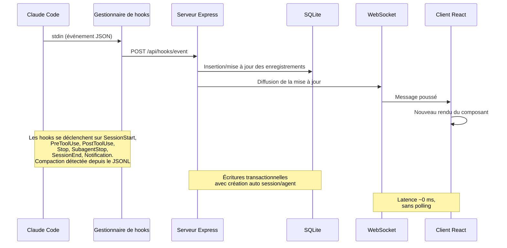

> [!IMPORTANT]
> Voir [ARCHITECTURE.md](./ARCHITECTURE.md) pour une plongée détaillée dans l'architecture du serveur, le schéma de la base de données, les routes d'API, la conception WebSocket, le routage client, le flux du gestionnaire de hooks, les modes de déploiement et les diagrammes détaillés du cycle de vie des sessions et des agents.

### Cycle de vie des hooks

1. **Claude Code** émet des hooks de session, de prompt, d'outil, de notification, de sous-agent, de tour et de sortie.
2. **`scripts/hook-handler.js`** lit chaque événement sur stdin et découvre les tableaux de bord actifs via `~/.claude/.agent-dashboard.json` ou `CLAUDE_DASHBOARD_PORT`. Il n'envoie qu'une fois par répertoire de données SQLite distinct, en choisissant le port le plus bas parmi les écouteurs en double, tout en alimentant les tableaux de bord dotés de bases séparées. La livraison ne bloque jamais : chaque cible est isolée et le gestionnaire se termine en 5 secondes au plus.
3. Le **serveur** valide l'événement et l'état associé dans une seule transaction SQLite :
   - Le premier contact crée la session et l'agent principal. Au `SessionStart`, il démarre **En attente** ; `UserPromptSubmit` ou `PreToolUse` le fait passer **En cours** ; `PostToolUse` l'y maintient.
   - `Stop` ramène l'agent principal **En attente** pendant que les agents en arrière-plan continuent. `stop_reason=error` marque l'agent et la session en **Erreur**. Les notifications de permission mettent aussi en attente de saisie ; seuls un nouveau prompt ou le démarrage d'un outil font sortir de l'erreur.
   - `SubagentStop` termine ce sous-agent sans modifier l'état d'attente de l'humain. Une analyse détachée importe ensuite ses outils JSONL, apparie utilisations et résultats par `tool_use_id`, les déduplique et reconstruit les vrais parents imbriqués.
   - `SessionEnd` efface l'attente et termine la session, sauf si une erreur doit être conservée. Tout nouveau travail réactive les sessions terminées, en erreur ou abandonnées, y compris les sessions importées et reprises.
   - `SessionStart` et la maintenance périodique marquent comme abandonnées les sessions inactives au-delà de `DASHBOARD_STALE_MINUTES`, 180 par défaut. Le balayage s'exécute à chaque quart de cette valeur, borné entre 60 secondes et 5 minutes.
   - L'analyse incrémentale partagée des transcriptions enregistre compactions, erreurs d'API et d'outils, durées des tours, tokens et métadonnées sans relire les octets inchangés. Les balayages des sessions actives utilisent les valeurs indexées de `sessions.transcript_path` et évincent du cache les entrées abandonnées.
   - Un watchdog de 15 secondes détecte les erreurs d'API dans les transcriptions après 10 secondes sans hook. Il rattrape aussi les interruptions par Échap grâce aux marqueurs de la transcription ou, en l'absence de marqueur, après `DASHBOARD_WORKING_IDLE_SECONDS`, 120 par défaut, uniquement si aucun outil n'est en cours et que ni les hooks ni la transcription n'avancent.
   - Le même watchdog termine les sessions locales mortes grâce à une sonde d'activité des processus après `DASHBOARD_LIVENESS_IDLE_SECONDS`, 60 par défaut. Au démarrage, les sondes s'exécutent immédiatement puis à nouveau environ 5 secondes plus tard, sans ce seuil d'inactivité. La sonde ignore Windows, les conteneurs, les chemins transmis non POSIX, les sessions des sources distantes, les échecs des outils système et `DASHBOARD_LIVENESS_PROBE=0` ; un vrai hook ultérieur corrige de lui-même une fausse terminaison.
   - La synchronisation continue des projets combine un balayage immédiat, un `fs.watch` avec anti-rebond et un polling `DASHBOARD_SESSION_SYNC_MS`, 30 secondes par défaut. Un même cache de mtime ne réanalyse que les transcriptions nouvelles ou agrandies et diffuse les mêmes trames de session que les hooks.
4. Le **WebSocket** publie le changement validé.
5. L'**interface** rafraîchit les vues concernées sans polling.

### Machine à états des agents

Statuts persistés : `working | waiting | completed | error`. La
colonne `awaiting_input_since` est complémentaire — elle note le moment où l'agent
a commencé à attendre et sert à afficher la durée, mais `waiting` est désormais un
vrai statut persisté.

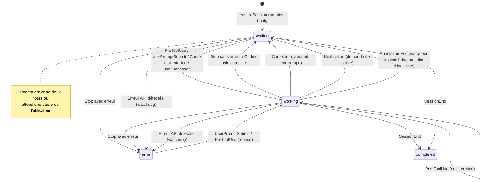

### Machine à états des sessions

Statuts persistés : `active | completed | error | abandoned`. L'état de session
**En attente** est une surcouche d'interface (status=`active` avec
`awaiting_input_since` défini).

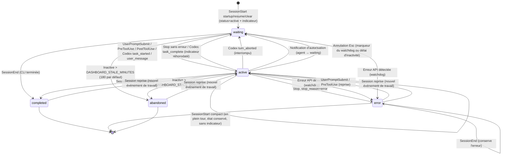

### Flux de calcul des coûts

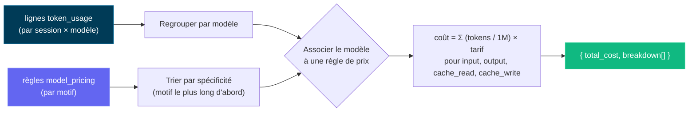

> [!IMPORTANT]
> Le flux de calcul des coûts repose sur l'utilisation des tokens et les règles de tarification des modèles. Gardez vos règles à jour pour refléter des coûts exacts. Mettez à jour la table de tarification des modèles depuis la page Paramètres pour conserver un suivi précis — le tableau de bord ne récupère pas automatiquement les mises à jour de prix depuis des sources externes. Une fois vos règles définies, le tableau de bord les applique rétroactivement à toutes les sessions pour des rapports de coûts cohérents.

---

## Configuration

| Variable d'environnement | Défaut | Rôle |
| --- | --- | --- |
| `DASHBOARD_PORT` | `4820` | Port du serveur Express. |
| `CLAUDE_DASHBOARD_PORT` | `4820` | Port utilisé par le gestionnaire de hooks. |
| `NODE_ENV` | `development` | Utiliser `production` pour servir le client compilé. |
| `DASHBOARD_UPDATE_CHECK` | activé | Mettre à `0`, `false` ou `off` pour désactiver les vérifications planifiées de l'amont. |
| `DASHBOARD_UPDATE_CHECK_INTERVAL_MS` | `300000` | Intervalle entre les vérifications, minimum 60 000 ms. Le bouton manuel **Vérifier maintenant** reste disponible. |
| `DASHBOARD_STALE_MINUTES` | `180` | Inactivité au-delà de laquelle une session active ou En attente devient abandonnée. Le watchdog l'applique et la maintenance s'exécute à chaque quart de cette valeur, bornée entre 60 secondes et 5 minutes. |
| `DASHBOARD_WORKING_IDLE_SECONDS` | `120` | Récupère une annulation par Échap sans marqueur quand aucune activité d'outil, de hook ou de transcription ne progresse. Une valeur plus basse réagit plus vite mais peut brièvement mal classer de longs tours silencieux ; toute nouvelle activité corrige l'erreur. Cursor applique la même règle. |
| `DASHBOARD_LIVENESS_PROBE` | `1` | Mettre à `0` pour désactiver la terminaison, fondée sur les processus, des sessions locales Claude/Codex mortes. Ignore automatiquement Windows, les conteneurs, les chemins transmis non POSIX et les sources distantes. |
| `DASHBOARD_LIVENESS_IDLE_SECONDS` | `60` | Seuil d'inactivité de la transcription ou du dernier hook pour les tests d'activité du watchdog. Les sondes au démarrage ignorent ce seuil pour que les sessions déjà mortes soient nettoyées immédiatement. |
| `DASHBOARD_SESSION_SYNC_MS` | `30000` | Polling de sécurité pour les fichiers nouveaux ou modifiés de `~/.claude/projects`. `fs.watch` reste immédiat ; `0` ne désactive que le polling. |
| `DASHBOARD_CURSOR_HOME` | `~/.cursor` | Racine d'état de Cursor pour les chats, les transcriptions, le rattrapage et les instantanés durables. |
| `DASHBOARD_CURSOR_SYNC_MS` | `5000` | Polling de sécurité de Cursor par empreinte. Les surveillances restent actives quand `0` désactive le polling. |
| `DASHBOARD_CODEX_HOME` | `CODEX_HOME` ou `~/.codex` | Racine d'état de Codex. Les Paramètres persistent une surcharge, réarment la surveillance et lancent une analyse immédiate. |
| `DASHBOARD_CODEX_SYNC_MS` | `4000` | Polling de sécurité des rollouts Codex. Les hooks et les surveillances restent actifs quand il vaut `0`. |
| `DASHBOARD_CODEX_MAX_ATTEMPTS` | `5` | Tentatives pour un même rollout illisible et inchangé, première comprise. Un changement de taille ou de mtime réinitialise le budget ; son épuisement n'est journalisé qu'une fois. |
| `DASHBOARD_CODEX_HOOK_IDLE_SECONDS` | `60` | Termine les sessions Codex uniquement par hooks, comme `codex exec --ephemeral`, quand un `stop` signalé comme terminé ne reçoit jamais de `SessionEnd`. Le silence seul ne suffit jamais. |
| `DASHBOARD_TASK_SUMMARY_TTL_MS` | `2000` | Fenêtre pendant laquelle un résultat périmé est servi pour les résumés de tâches et `todo_snapshot`. Les ajouts sont analysés de façon incrémentale ; une croissance de plus de 32 Mio repart d'une analyse de fin neuve. `0` analyse chaque ajout. |
| `DASHBOARD_SNAPSHOT_COMPRESS` | `1` | Mettre à `0`, `false` ou `off` pour arrêter la conversion gzip vérifiée des instantanés Claude/Cursor inactifs depuis 24 heures dont la source a disparu. Les arborescences sources illisibles et les instantanés Codex sont ignorés. |
| `DASHBOARD_SNAPSHOT_MAX_AGE_DAYS` | non défini | Passe de conservation facultative, toutes les six heures, pour les sessions terminées plus anciennes que cet âge. Les sessions élaguées sont marquées comme supprimées (tombstone) ; les sessions reprises sont protégées. Prévisualisez avec `ccam snapshots prune --days N`, car l'instantané peut être la seule copie. |
| `DASHBOARD_SNAPSHOT_MAX_BYTES` | non défini | Plafond total facultatif des instantanés, en octets ou avec une unité comme `5GB`. Les sessions terminées les plus anciennes sont élaguées en premier ; les sessions actives ou des dernières 24 heures restent protégées. |
| `DASHBOARD_REMOTE_SYNC_MS` | `15000` | Polling SSH des sources distantes pour les projets Claude, les rollouts Codex et les index de titres Codex. Les sources nouvelles ou réactivées se synchronisent immédiatement ; avec `0`, la synchronisation manuelle reste disponible. |
| `DASHBOARD_REMOTE_ACTIVE_WINDOW_MS` | `600000` | Considère une transcription distante répliquée comme active tant que son dernier événement est aussi récent, puis la réconcilie en terminée. Les fournisseurs en échec retombent dans le traitement normal des sessions inactives. |
| `DASHBOARD_REMOTE_SYNC_TIMEOUT_MS` | `600000` | Délai d'expiration par source pour la récupération SSH et l'import. |
| `DASHBOARD_REMOTE_TEST_TIMEOUT_MS` | `15000` | Délai d'expiration du test SSH d'une source distante. |
| `DASHBOARD_HOST` | `127.0.0.1` | Interface d'écoute. `0.0.0.0` expose le service et journalise un avertissement. |
| `DASHBOARD_TOKEN` | non défini | Protège `/api/*` et le WebSocket via l'en-tête Bearer, `x-dashboard-token` ou `?token=`. Le loopback est la frontière de confiance par défaut. |
| `DASHBOARD_TOKEN_FILE` | non défini | Jeton du tableau de bord lu depuis un fichier, pour les secrets Docker/Kubernetes ; `DASHBOARD_TOKEN` l'emporte. |
| `DASHBOARD_HOOK_TOKEN` / `DASHBOARD_HOOK_TOKEN_FILE` | non défini | Protection indépendante de `/api/hooks/event` et `/api/hooks/codex` au-delà du loopback. |
| `REMOTE_PUSH_TOKEN` / `REMOTE_PUSH_TOKEN_FILE` | non défini | Protection distincte des routes publiques `POST /api/hooks/ingest-batch` et `/api/hooks/ingest-transcript`. Les deux restent désactivées par défaut et n'héritent jamais du jeton de hook local. |
| `REMOTE_TRANSCRIPT_MAX_FILE_MB` | `256` | Taille maximale stockée, en Mio, de chaque fichier accepté par `ingest-transcript` ; chaque morceau de requête est plafonné séparément à 4 Mio. |
| `DASHBOARD_ALLOWED_HOSTS` | loopback | Valeurs `Host` HTTP et WebSocket supplémentaires, séparées par des virgules, pour la protection contre le DNS rebinding. |
| `DASHBOARD_ENV_PATH` | `.env` du dépôt | Fichier dotenv inscriptible utilisé pour persister les surcharges des homes des fournisseurs ; en conteneur, `/app/config/.env` par défaut. |
| `CCAM_DASHBOARD_URL` | découverte localhost | Destination de hooks distante. Les URL hors loopback exigent HTTPS et un jeton de hook. |
| `CCAM_HOOK_TOKEN` / `CCAM_HOOK_TOKEN_FILE` | non défini | Identifiant du client de hooks, envoyé dans `x-ccam-hook-token`. |

> [!IMPORTANT]
> Le serveur n'écoute par défaut que sur le loopback. L'accès depuis un réseau local exige `DASHBOARD_HOST`, `DASHBOARD_TOKEN` et des valeurs `DASHBOARD_ALLOWED_HOSTS` correspondantes. Voir [`.env.example`](./.env.example) et [la politique de sécurité](./.github/SECURITY.md).

Les clones git récupèrent périodiquement le dépôt distant canonique et comparent sa branche par défaut au checkout actuel. En cas de retard, le terminal et l'interface affichent la commande exacte de mise à jour manuelle. CCAM ne fait jamais de pull et ne redémarre jamais de lui-même.

---

## CLI `ccam`

La CLI **`ccam`** (`bin/ccam.js` → `cli/`) donne accès au tableau de bord depuis n'importe quel terminal grâce à une arborescence de commandes Commander.js avec options héritées, validation, suggestions, aide générée et complétion du shell. `npm run setup` la lie automatiquement. La résolution du serveur vérifie `--server` / `CCAM_URL`, les ports configurés, le registre des serveurs actifs, puis `http://127.0.0.1:4820`.

```bash
# Server
ccam status | health                  # ● running / ○ not running; version + timestamp
ccam start [--port N] | stop | restart  # background production server
ccam logs [-n N] [-f]                 # tail data/ccam-server.log
ccam open [page] [--session id]       # open the dashboard, a page, or a session
ccam repl                             # interactive shell (also: shell, i)

# Monitoring
ccam overview [--watch]               # one-screen live snapshot (alias: top)
ccam stats | kanban                   # totals + status distributions / status lanes
ccam tail [--session id] [--type T] [--tool N]   # live event feed
ccam stream [--type new_event,…]      # raw real-time WebSocket feed
ccam watch -n 5 <command …>           # re-run any command on an interval

# Data
ccam sessions [--status s] [--q text] [--cwd dir] [--sort price] [--limit n]
ccam sessions get|stats|cost|agents|events|transcripts <id>
ccam sessions transcript <id>         # the conversation as a readable chat log
ccam sessions rename <id> <name…> | update <id> | create | facets
ccam agents [list|get|update|create]  # agents; ccam session <id> = sessions get
ccam events [--type T] [--tool N] [--q text] [--from iso] | events facets

# Insights
ccam analytics                        # tokens, cost, top tools, daily sparklines
ccam workflows [session <id>]         # workflow intelligence + patterns
ccam runs [list|get <run-id>]         # Workflow-tool runs
ccam run list|history|start|follow|send|stop …   # dashboard-launched agents
ccam cost [--session id] [--daily]    # per-model cost, surcharges, unpriced models

# Alerts & webhooks
ccam alerts [--unacked] | ack <id> | ack-all
ccam alert-rules list|types|create|update|enable|disable|delete
ccam webhooks list|get|providers|deliveries|create|update|enable|disable|delete|test

# Pricing
ccam pricing [list] | set <pattern> --input N --output N [--fast-* …] [--intro-* …] | delete | reset
ccam pricing gpt|cursor [list|set|delete]   # OpenAI/Codex and Cursor rate cards

# Import & remote sources
ccam import guide|rescan|path <dir>|upload <files…>|reimport
ccam import-data <file.json>          # restore an export (idempotent)
ccam remote-sources list|get|add|update|enable|disable|test|sync|rm

# Administration
ccam doctor | info | export [file|-] | cleanup --hours N --days M
ccam snapshots [status|compress] | snapshots prune --days N   # transcript snapshots; prune dry-runs unless --apply --confirm PRUNE_SNAPSHOTS
ccam hooks [status|install] | reinstall-hooks | config claude|codex …
ccam updates [status|check] | update-check | metrics [--grep re]
ccam home [set claude|codex <path>] | push key|send|subscribe|unsubscribe
ccam api [METHOD] /api/path [--data JSON]   # any endpoint; writes need --yes
ccam mcp [stdio|http|repl] | clear-data --yes

# CLI
ccam help [command…] | commands [--json] | completion bash|zsh|fish | version
```

Les groupes listent par défaut (`ccam alerts` équivaut à `ccam alerts list`) ; chaque commande prend en charge `--help` ; `ccam commands` affiche l'arborescence et `ccam commands --json` en émet le schéma lisible par machine.

- **Sortie :** les TTY affichent tableaux, icônes de statut, graphiques, sparklines, arbres d'agents, vues de transcription et aide colorée. Les pipes reçoivent du texte brut. `--json` ou `CCAM_OUTPUT=json` renvoie un JSON stable, en NDJSON pour `tail`, `stream` et `run follow` ; les erreurs utilisent `{"error":{"code":"…","message":"…"}}` sur stderr et le code de sortie vaut `0` ou `1`.
- **Écritures :** confirmez par un `y/N` interactif ou par `--yes` ; les écritures non interactives exigent `--yes`, et `clear-data` exige toujours l'option explicite.
- **Mode hors ligne :** les commandes en lecture seule se replient sur `data/dashboard.db`, affichent une bannière `⚠ Offline mode` et corrigent les sessions actives mortes grâce à la vue d'activité des processus. Les commandes réservées au serveur expliquent pourquoi le tableau de bord est indisponible.
- **REPL et complétion :** `ccam repl` ajoute une complétion pilotée par l'arborescence, un historique persistant, un prompt en direct et les commandes intégrées `help`, `json` et `watch`, chaque ligne étant isolée dans un processus enfant. Activez la complétion zsh avec `source <(ccam completion zsh)`.

Si `ccam` n'est pas dans le `PATH`, lancez `npm link` une fois depuis la racine du dépôt. Voir [docs/CLI.md](./docs/CLI.md) pour le contrat complet.

## Scripts npm

| Commande | Description |
| ----------------------- | ---------------------------------------------------------- |
| `npm run setup` | Installe les dépendances racine/client/extension/MCP, compile MCP et lie `ccam` |
| `npm run update:pull-setup` | `git pull --ff-only` puis `npm run setup` (mise à jour manuelle) |
| `npm run dev` | Démarre en parallèle le serveur (mode watch) + le client (HMR Vite) |
| `npm run dev:server` | Démarre Express avec une surveillance des sources à anti-rebond et redémarrage propre |
| `npm run dev:client` | Démarre uniquement le serveur de développement Vite |
| `npm run build` | Compile le client React dans `client/dist/` |
| `npm start` | Démarre le serveur de production (sert le client compilé) |
| `npm test` | Lance toute la suite (serveur `node --test` + client Vitest) |
| `npm run verify` | Lance tout le contrôle local en une commande : audit des en-têtes d'auteur, vérification Prettier, typecheck du client, tests backend, tests frontend |
| `npm run check:headers` | Vérifie que chaque fichier source concerné porte l'en-tête d'auteur |
| `npm run typecheck:client` | Typecheck du client (`tsc -b`) — la même vérification que le build de production avant Vite |
| `npm run test:server` | Lance les tests backend (`node --test server/__tests__/`) |
| `npm run test:client` | Lance les tests Vitest du frontend, dont les **instantanés de rendu de chaque écran** (`client/src/pages/__tests__/screens.snapshot.test.tsx`) ; régénérez les références après des changements d'interface volontaires avec `cd client && npx vitest run -u` |
| `npm run install-hooks` | Configure les hooks de Claude Code dans `~/.claude/settings.json` |
| `npm run seed` | Remplit la base avec des données d'exemple |
| `npm run import-history` | Importe les anciennes sessions depuis `~/.claude/` (s'exécute aussi au démarrage) |
| `npm run reconcile-tokens` | Rafraîchit les totaux de tokens des sessions importées (ne baisse jamais un total) |
| `npm run repair-tokens` | Recalcule les totaux de tokens **hors workflows** de chaque session **Claude** dont la transcription est sur disque (sous `~/.claude/projects/` ou via le `transcript_path` stocké de la session) et remet à zéro les bases de compaction ; les lignes de workflows et de Codex sont préservées. Réparation unique pour les bases touchées par la somme d'usage par enregistrement d'avant v2.0.9 ou par l'omission de l'usage des sous-agents à plat du même modèle. Arrêtez d'abord le tableau de bord |
| `DASHBOARD_TOKEN_REPAIR` | Activé par défaut (`1`). Réparation automatique unique des totaux de tokens historiques touchés par l'inflation par enregistrement ou par l'omission des sous-agents à plat du même modèle. Les correctifs en direct ne peuvent pas revisiter chaque session terminée, et `replaceTokenUsage` ne peut pas abaisser un ancien maximum. S'exécute une fois par base (protégé par un marqueur, différé hors du chemin de démarrage, ignoré quand un autre tableau de bord partage le répertoire de données) et sauvegarde d'abord les anciennes lignes dans `token_usage_pre_repair_v2`. Mettre à `0` pour l'ignorer et réparer à la main avec `npm run repair-tokens` |
| `npm run clear-data` | Supprime toutes les sessions, agents, événements et usages de tokens |
| `npm run mcp:install` | Installe les dépendances du paquet MCP local (`mcp/`) |
| `npm run mcp:build` | Compile le TypeScript du serveur MCP dans `mcp/build/` |
| `npm run mcp:start` | Démarre le serveur MCP (transport stdio — pour les hôtes MCP) |
| `npm run mcp:start:http` | Démarre le serveur MCP (transport HTTP + SSE sur le port 8819) |
| `npm run mcp:start:repl` | Démarre le serveur MCP (REPL interactif avec complétion par tabulation) |
| `npm run mcp:dev` | Lance le serveur MCP en mode dev (`tsx`, stdio) |
| `npm run mcp:dev:http` | Lance le serveur MCP en mode dev (`tsx`, HTTP + SSE) |
| `npm run mcp:dev:repl` | Lance le serveur MCP en mode dev (`tsx`, REPL interactif) |
| `npm run mcp:typecheck` | Vérifie les types des sources MCP sans produire de build |
| `npm run extensions:sync` | Régénère les noms de skills/métadonnées OpenAI, les manifestes Codex et les deux marketplaces |
| `npm run extensions:validate` | Valide les 14 plugins double format et les 66 skills intégrées |
| `npm run mcp:docker:build` | Construit l'image de conteneur MCP avec Docker (`agent-dashboard-mcp:local`) |
| `npm run mcp:podman:build` | Construit l'image de conteneur MCP avec Podman (`localhost/agent-dashboard-mcp:local`) |
| `npm run desktop:install` | Installe Electron + electron-builder dans l'espace de travail `desktop/` (recompile `better-sqlite3` pour l'ABI d'Electron) ; vérifie au préalable la compilation native de `better-sqlite3` et affiche une aide concrète (dont une alternative sans chaîne de compilation) en cas d'échec |
| `npm run desktop:dev` | Compile et lance l'application de bureau Electron pour itérer en local |
| `npm run desktop:build` | Compile les sources TypeScript du bureau dans `desktop/out/` |
| `npm run desktop:test` | Lance le test de fumée du bureau (démarre Electron, sonde `/api/health`) |
| `npm run desktop:dmg` | Construit **les deux** DMG macOS (arm64 + x64) — correct pour une release, **plus lent** (empaquette chaque architecture) |
| `npm run desktop:dmg:arm64` | Construit un DMG Apple Silicon seulement — **rapide**, recommandé pour votre propre Mac |
| `npm run desktop:dmg:x64` | Construit un DMG Intel seulement — **rapide** |
| `npm run desktop:dmg:universal` | Construit un unique DMG **universel** fusionné (arm64 + x86_64) — facultatif, **le plus lent**, et pas ce que publie la release |
| `npm run desktop:win` | Construit un **installeur NSIS** Windows `.exe` (x64) — à lancer sous Windows |
| `npm run desktop:win:portable` | Construit un `.exe` Windows **portable** (sans installation, x64) — à lancer sous Windows |
| `npm run monitoring:install` | Lance `npm install` dans `monitoring/` — télécharge Prometheus + Grafana via `postinstall` |
| `npm run monitoring:setup` | Alias de `monitoring:install` |
| `npm run monitoring:up` | Démarre Prometheus (:9090) + Grafana (:3000) en arrière-plan (sans Docker) |
| `npm run monitoring:down` | Arrête la pile de supervision gérée par npm |
| `npm run monitoring:start` | Pile de supervision au premier plan (Ctrl+C arrête les deux) |
| `npm run monitoring:docker:up` | Démarre Prometheus + Grafana via Docker Compose |
| `npm run monitoring:docker:down` | Démonte la pile de supervision Docker |
| `npm run monitoring:verify` | Contrôle de santé du tableau de bord, de Prometheus, de Grafana et de la cible de collecte |
| `npm run docker:up` | Démarre le tableau de bord dans Docker (`docker compose up -d --build`) |
| `npm run docker:down` | Arrête le conteneur du tableau de bord |
| `npm run docker:full:up` | Tableau de bord + MCP authentifié + Nginx sans root + Prometheus + Grafana |
| `npm run docker:full:down` | Démonte toute la pile Docker |
| `npm run deploy:validate` | Passe en revue Docker, Compose, Nginx, Helm, Kustomize, Terraform, les audits de dépendances et l'invariant d'écrivain unique. Les constats sont indicatifs (code de sortie 0) ; `CCAM_DEPLOY_VALIDATE_STRICT=1` en fait un contrôle bloquant |

---

## Extensions d'agent

Ce dépôt comprend une couche d'extensions complète pour Claude Code comme pour Codex :

- Claude Code : `CLAUDE.md`, `.claude/rules/`, `.claude/skills/`
- Sous-agents Claude : `.claude/agents/`
- Codex : `AGENTS.md`, `.codex/rules/`, `.codex/agents/`, `.codex/skills/`
- Plugins distribuables partagés : `plugins/`, avec à la fois `.claude-plugin/plugin.json` et `.codex-plugin/plugin.json`
- Marketplaces : `.claude-plugin/marketplace.json` pour Claude Code et `.agents/plugins/marketplace.json` pour Codex
- Open Agent Skills : toutes les skills de plugins portent un frontmatter canonique ainsi que `agents/openai.yaml` ; `npx skills add hoangsonww/Claude-Code-Agent-Monitor --list` découvre 77 skills dans le dépôt

### Architecture des extensions

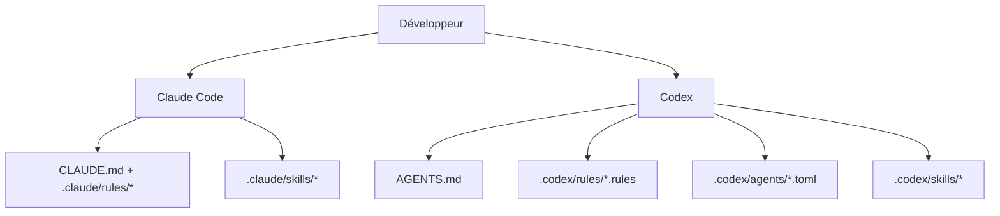

### Couche Claude Code

- Contexte persistant :
  - [`CLAUDE.md`](./CLAUDE.md)
- Règles limitées par chemin :
  - [`.claude/rules/backend-node.md`](./.claude/rules/backend-node.md)
  - [`.claude/rules/frontend-react.md`](./.claude/rules/frontend-react.md)
  - [`.claude/rules/mcp-typescript.md`](./.claude/rules/mcp-typescript.md)
  - [`.claude/rules/docs-markdown.md`](./.claude/rules/docs-markdown.md)
  - [`.claude/rules/file-headers.md`](./.claude/rules/file-headers.md)
  - [`.claude/rules/wiki-i18n.md`](./.claude/rules/wiki-i18n.md)
  - [`.claude/rules/i18n-parity.md`](./.claude/rules/i18n-parity.md)
- Skills :
  - `repo-onboarding`
  - `ship-feature`
  - `version-release`
  - `mcp-operations`
  - `debug-live-issue`
  - `update-project-docs`
  - `file-headers`
  - `push-to-forked-pr`
  - `i18n-parity`
- Sous-agents :
  - `backend-reviewer`
  - `frontend-reviewer`
  - `mcp-reviewer`

### Couche Codex

- Contexte persistant :
  - [`AGENTS.md`](./AGENTS.md)
- Politique d'exécution :
  - [`.codex/rules/default.rules`](./.codex/rules/default.rules)
- Modèles de sous-agents personnalisés :
  - [`.codex/agents/`](./.codex/agents)
- Skills :
  - [`.codex/skills/`](./.codex/skills)
- Mise en place :
  - [`.codex/README.md`](./.codex/README.md)

---

## Intégration MCP

Ce projet comprend un serveur MCP local dans `mcp/`, avec 103 outils répartis en 16 modules de domaine. Il expose chaque action prise en charge par l'application : lectures de données par portée, transcriptions/images, tarification Claude, Cursor et GPT, workflows, alertes/webhooks, imports et restauration de sauvegarde, configuration Claude/Codex, Lancer un agent, sources distantes, paramètres, push et maintenance protégée. Il prend en charge trois modes de transport.

### Modes de transport MCP

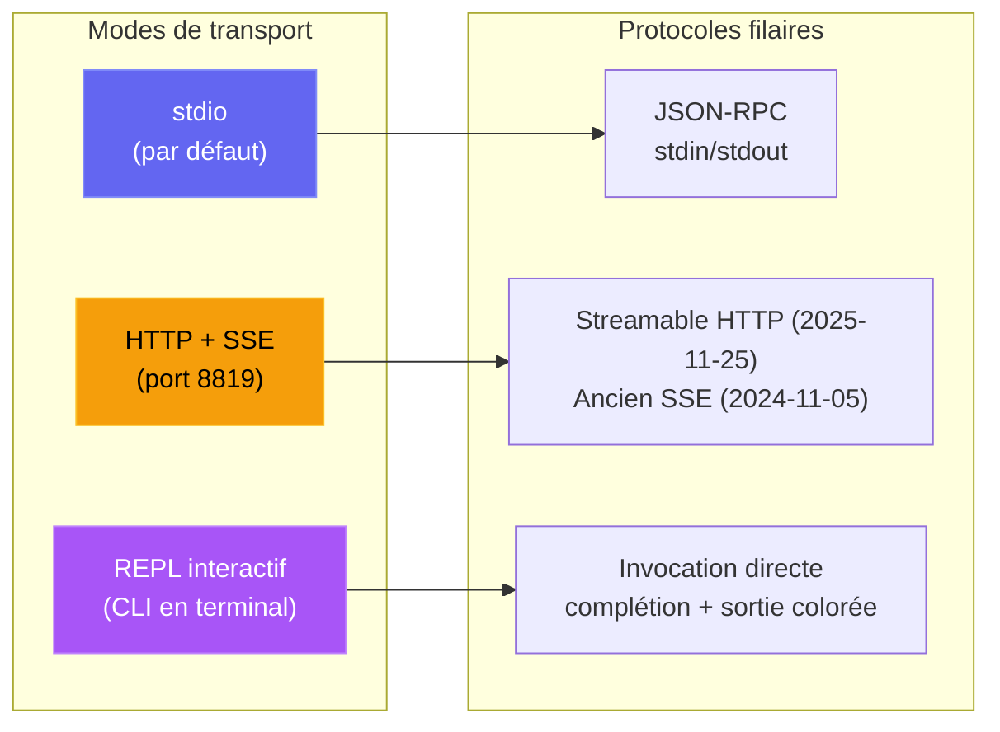

| Mode | Commande | Cas d'usage |
| --- | --- | --- |
| **stdio** | `npm run mcp:start` | Claude Code, Claude Desktop, hôtes MCP des IDE |
| **HTTP** | `npm run mcp:start:http` | Clients MCP distants, intégrations web, multi-session |
| **REPL** | `npm run mcp:start:repl` | Débogage d'exploitation, invocation manuelle d'outils, administration locale |

<p align="center">
  <a href="images/mcp.png"></a>
</p>

### Architecture MCP

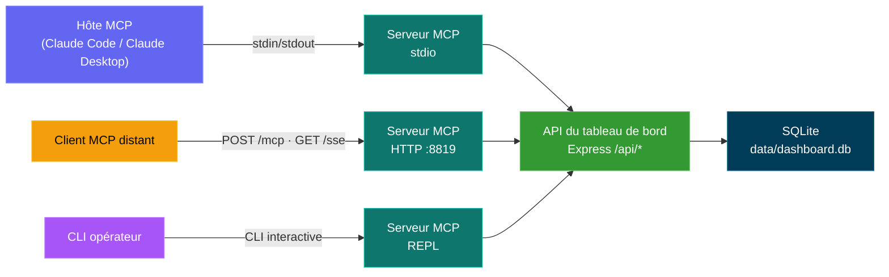

### Surface des outils MCP

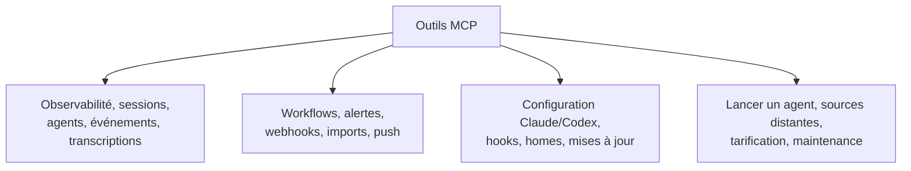

### Modèle de sécurité MCP

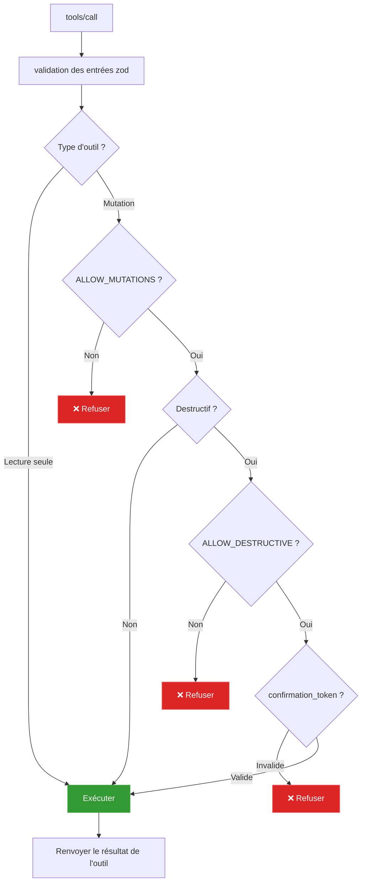

### Modes de fonctionnement MCP

- Mode lecture seule (par défaut) : `MCP_DASHBOARD_ALLOW_MUTATIONS=false`
- Mode administrateur : `MCP_DASHBOARD_ALLOW_MUTATIONS=true`
- Tableau de bord authentifié : définissez `MCP_DASHBOARD_API_TOKEN` / `_FILE` avec le jeton du tableau de bord
- Transport HTTP/SSE authentifié : définissez `MCP_HTTP_AUTH_TOKEN` / `_FILE` ; les clients envoient une authentification bearer ou `x-mcp-token`
- Garde-fous de transport : le HTTP direct en loopback peut porter le jeton ; les alias d'hôte de conteneur exigent HTTPS ; les redirections sont refusées
- Garde-fous de charge utile : 50 Mio par fichier d'historique téléversé, 100 Mio au total par appel, 10 Mio pour les réponses binaires et 25 Mio pour la restauration de sauvegarde
- Mode destructif : exige à la fois :
  - `MCP_DASHBOARD_ALLOW_MUTATIONS=true`
  - `MCP_DASHBOARD_ALLOW_DESTRUCTIVE=true`
  - l'entrée d'outil `confirmation_token: "CLEAR_ALL_DATA"`

Détails complets : [mcp/README.md](./mcp/README.md)

---

## Référence de l'API

Tous les points de terminaison renvoient du JSON. Les réponses d'erreur suivent la forme `{ error: { code, message } }`.

### OpenAPI / Swagger / ReDoc

Il existe trois façons d'explorer l'API HTTP, toutes pilotées par une seule spécification OpenAPI 3.0.3 (port serveur par défaut `4820`) :

| Méthode | Chemin | Description |
| ------ | ------------------------------- | ------------------------------------------------------------------------------------------------- |
| `GET` | `/api/openapi.json` | Spécification OpenAPI 3.0.3 brute en JSON |
| `GET` | `/api/docs` | **Swagger UI** interactif — exécution des requêtes pour les essayer |
| `GET` | `/api/redoc` | Référence **ReDoc** — un rendu propre en trois panneaux, optimisé pour la lecture, de la même spécification |
| `GET` | `/api/redoc/redoc.standalone.js` | Bundle ReDoc auto-hébergé (servi localement via la dépendance `redoc`, jamais par un CDN — fonctionne hors ligne) |

Le document OpenAPI est généré depuis `server/openapi.js` (`createOpenApiSpec()`) et fusionné avec des fragments complémentaires sous `server/openapi-extra/`. Swagger UI et ReDoc sont tous deux servis directement par le backend ; le bundle ReDoc est servi localement (`GET /api/redoc/redoc.standalone.js`), si bien que la référence fonctionne entièrement hors ligne / en réseau isolé, conformément à la politique du projet sans ressources externes.

La couverture est complète : chaque route du backend est documentée (82 entrées de chemins) sous ces étiquettes — Health, Sessions, Agents, Events, Stats, Metrics, Analytics, Hooks, Pricing, Workflows, Settings, Updates, Alerts, Webhooks, Push, CcConfig (explorateur de configuration Claude Code), Run (exécutions lancées depuis le tableau de bord) et Documentation — chacune avec ses paramètres, schémas de requête/réponse, descriptions au niveau des champs et exemples réalistes.

Un **`openapi.yaml`** versionné à la racine du dépôt reflète la spécification en direct. Il est généré depuis `server/openapi.js` (jamais modifié à la main) — régénérez-le après des changements d'API avec :

```bash
npm run openapi:yaml
```


<p align="center">
  <a href="images/swagger.png"></a>
</p>

<p align="center">
  <a href="images/redoc.png"></a>
</p>

### Santé

| Méthode | Chemin | Description |
| ------ | ------------- | ------------------------------------- |
| `GET` | `/api/health` | Renvoie `{ status: "ok", timestamp }` |

### Sessions

| Méthode | Chemin | Paramètres de requête | Description |
| ------- | ------------------------------- | ---------------------------------------------------------------- | -------------------------------------------------------------------------------------------- |
| `GET` | `/api/sessions` | `status`, `q`, `limit`, `offset` | Liste les sessions avec le nombre d'agents et le coût par session. `q` fait une recherche insensible à la casse sur `id` / `name` / `cwd`. `limit` vaut 50 par défaut, 10000 au maximum. La réponse inclut `total` pour les paginateurs. |
| `GET` | `/api/sessions/:id` | -- | Détail d'une session avec agents et événements |
| `GET` | `/api/sessions/:id/stats` | -- | Comptes agrégés qui alimentent le panneau de synthèse du Détail de session : événements, événements par type, outils les plus utilisés, nombre d'erreurs, comptes par type/statut d'agent, répartition par type de sous-agent, totaux de tokens, intervalle de temps |
| `GET` | `/api/sessions/:id/transcripts` | -- | Liste les transcriptions JSONL disponibles pour la session (principale + sous-agents + compactions) |
| `GET` | `/api/sessions/:id/transcript` | `agent_id`, `limit`, `offset`, `after`, `before` | Diffuse les messages d'une transcription donnée avec une pagination par curseur. L'`usage` de l'assistant inclut `input_tokens`, `output_tokens`, `cache_read_input_tokens`, `cache_creation_input_tokens` pour que le compteur de la page Lancer se remplisse entièrement à la reprise / au rattachement |
| `POST` | `/api/sessions` | -- | Crée une session (idempotent sur `id`) |
| `PATCH` | `/api/sessions/:id` | -- | Met à jour le statut/les métadonnées de la session |

### Agents

| Méthode | Chemin | Paramètres de requête | Description |
| ------- | ----------------- | ----------------------------------------- | ----------------------------- |
| `GET` | `/api/agents` | `status`, `session_id`, `limit`, `offset` | Liste les agents avec filtres |
| `GET` | `/api/agents/:id` | -- | Détail d'un agent |
| `POST` | `/api/agents` | -- | Crée un agent |
| `PATCH` | `/api/agents/:id` | -- | Met à jour le statut/la tâche/l'outil de l'agent |

### Événements

| Méthode | Chemin | Paramètres de requête | Description |
| ------ | ------------- | ------------------------------- | -------------------------- |
| `GET` | `/api/events` | `session_id`, `limit`, `offset` | Liste les événements (plus récents d'abord) |

### Statistiques

| Méthode | Chemin | Description |
| ------ | ------------ | ------------------------------------------------------ |
| `GET` | `/api/stats` | Comptes agrégés, répartitions par statut, connexions WS |

### Analyses

| Méthode | Chemin | Description |
| ------ | ---------------- | ---------------------------------------------------------- |
| `GET` | `/api/analytics` | Agrégats de tokens/outils/sessions pour les graphiques et vues de tendances |

### Sources de données distantes

| Méthode | Chemin | Paramètres de requête | Description |
| -------- | ------------------------------- | ------------ | ------------------------------------------------------------------------------------------- |
| `GET` | `/api/remote-sources` | -- | Liste les sources distantes configurées avec leur statut, la dernière erreur et les comptes de la dernière synchronisation |
| `POST` | `/api/remote-sources` | -- | Crée une source. Corps : `{ label, host, ssh_port?, identity_file?, remote_home?, remote_codex_home?, enabled? }` |
| `PATCH` | `/api/remote-sources/:id` | -- | Met à jour une source (libellé, champs de connexion, activation) |
| `DELETE` | `/api/remote-sources/:id` | `purge` | Supprime une source ; `?purge=true` supprime aussi les sessions importées depuis cette source |
| `POST` | `/api/remote-sources/:id/test` | -- | Teste la connectivité SSH vers la source |
| `POST` | `/api/remote-sources/:id/sync` | -- | Récupère et réimporte immédiatement depuis la source |

`GET /api/sessions`, `/api/events`, `/api/agents`, `/api/stats` et `/api/analytics` acceptent aussi un paramètre de requête facultatif `sources` (identifiants de source séparés par des virgules ; à omettre pour toutes) afin de limiter les résultats par origine, et `GET /api/sessions/facets` renvoie un tableau `sources` pour le sélecteur de portée des données.

### Hooks

| Méthode | Chemin | Description |
| ------ | ------------------ | -------------------------------------------- |
| `POST` | `/api/hooks/event` | Reçoit et traite un événement de hook Claude Code |
| `POST` | `/api/hooks/ingest-batch` | Pousse un lot de données de session depuis une machine nomade/derrière un NAT (désactivé par défaut ; voir `REMOTE_PUSH_TOKEN` ci-dessous et `server/README.md` pour la forme complète de la charge utile) |
| `POST` | `/api/hooks/ingest-transcript` | Téléverse le JSONL de transcript d'une machine distante par morceaux à offset (même protection `REMOTE_PUSH_TOKEN` ; la session doit d'abord être enregistrée par `ingest-batch`) |

**Charge utile d'un événement de hook :**

```json
{
  "hook_type": "PreToolUse",
  "data": {
    "session_id": "abc-123",
    "tool_name": "Bash",
    "tool_input": { "command": "ls -la" }
  }
}
```

### Tarification

| Méthode | Chemin | Description |
| -------- | ------------------------ | ---------------------------------------- |
| `GET` | `/api/pricing` | Liste toutes les règles de tarification |
| `PUT` | `/api/pricing` | Crée ou met à jour une règle de tarification |
| `DELETE` | `/api/pricing/:pattern` | Supprime une règle de tarification |
| `GET` | `/api/pricing/cost` | Coût total de toutes les sessions |
| `GET` | `/api/pricing/cost/:id` | Détail des coûts d'une session donnée |

### Workflows

| Méthode | Chemin | Description |
| ------ | ----------------------------- | ------------------------------------------------------- |
| `GET` | `/api/workflows` | Données de workflows limitées par fournisseur/source (orchestration, outils enregistrés, motifs, compactions Codex). Les filtres facultatifs `?status=active\|completed`, `?sources=...` et `?providers=claude\|codex` s'appliquent aux 11 sections de données |
| `GET` | `/api/workflows/session/:id` | Exploration par session limitée par fournisseur/source (arbre des agents, chronologie des outils enregistrés, événements) |

### Alertes

| Méthode | Chemin | Description |
| -------- | ------------------------ | ---------------------------------------------------------------------- |
| `GET` | `/api/alerts` | Flux des alertes déclenchées, plus récentes d'abord (`?unacked=true`, `limit`, `offset`) |
| `POST` | `/api/alerts/:id/ack` | Acquitte une alerte |
| `POST` | `/api/alerts/ack-all` | Acquitte toutes les alertes non acquittées |
| `GET` | `/api/alerts/rules` | Liste les règles d'alerte |
| `POST` | `/api/alerts/rules` | Crée une règle (`event_pattern` \| `inactivity` \| `status_duration` \| `token_threshold`) |
| `PATCH` | `/api/alerts/rules/:id` | Met à jour le nom / la configuration / l'activation / le délai de réarmement (le type de règle est immuable) |
| `DELETE` | `/api/alerts/rules/:id` | Supprime une règle et l'historique de ses alertes déclenchées |

### Webhooks

| Méthode | Chemin | Description |
| -------- | --------------------------------- | ------------------------------------------------------------------------------------ |
| `GET` | `/api/webhooks/providers` | Fournisseurs pris en charge + leurs champs de configuration (pilote le formulaire de l'interface) |
| `GET` | `/api/webhooks` | Liste les cibles de webhook (URL masquées, secrets caviardés) |
| `POST` | `/api/webhooks` | Crée une cible (14 fournisseurs intégrés + `generic`) |
| `PATCH` | `/api/webhooks/:id` | Met à jour le nom / l'url / l'activation / le secret / les en-têtes / la portée par règle (le type est immuable) |
| `DELETE` | `/api/webhooks/:id` | Supprime une cible et son journal de livraison |
| `POST` | `/api/webhooks/:id/test` | Envoie une alerte de test synthétique et rapporte le résultat de la livraison |
| `GET` | `/api/webhooks/:id/deliveries` | Journal des livraisons récentes d'une cible (`limit`, `offset`) |

Les fournisseurs hébergés exigent HTTPS. `generic` et `n8n` peuvent utiliser HTTP pour des récepteurs locaux ou auto-hébergés. La livraison refuse les redirections, si bien que les identifiants, en-têtes personnalisés et signatures HMAC ne sont jamais transmis à une seconde URL.

### Paramètres

| Méthode | Chemin | Description |
| ------ | ------------------------------ | ------------------------------------------------ |
| `GET` | `/api/settings/info` | Informations système, statistiques de la base, état des hooks |
| `POST` | `/api/settings/clear-data` | Supprime toutes les sessions, agents, événements et usages de tokens |
| `POST` | `/api/settings/reimport` | Réimporte les anciennes sessions depuis `~/.claude/` |
| `POST` | `/api/settings/reinstall-hooks` | Réinstalle les hooks de Claude Code |
| `POST` | `/api/settings/reset-pricing` | Réinitialise aux valeurs par défaut les tables de tarification Claude, Codex ou les deux |
| `GET` | `/api/settings/export` | Exporte toutes les données (sessions, agents, events, token_usage, workflows, dashboard_runs, alert_rules, model_pricing, cursor_model_pricing, gpt_model_pricing) en un seul téléchargement JSON versionné |
| `POST` | `/api/settings/import` | Restaure un lot jusqu'à 25 Mio issu de `/export` (`file` multipart ou JSON `{ path }`). Idempotent + non destructif — les sessions existantes sont entièrement ignorées |
| `POST` | `/api/settings/cleanup` | Abandonne les sessions inactives, purge les anciennes données (et les instantanés des sessions purgées) |
| `GET` | `/api/settings/snapshots` | Stockage des instantanés de transcriptions par fournisseur + politique de conservation |
| `POST` | `/api/settings/snapshots/compress` | Compresse sans perte les instantanés dont la transcription d'origine a disparu |
| `POST` | `/api/settings/snapshots/prune` | Planifie (simulation, par défaut) ou applique un élagage des instantanés ; l'application exige `confirm: "PRUNE_SNAPSHOTS"` |

### Explorateur de configuration Claude (`/api/cc-config`)

Inspection en lecture seule de chaque surface de configuration de Claude Code, plus des modifications soigneusement encadrées pour les artefacts texte à faible risque. Les lectures de fichiers canonicalisent le chemin demandé et les racines autorisées, pour que les liens symboliques ne puissent pas sortir des répertoires Claude de confiance. Tous les chemins d'écriture créent des sauvegardes horodatées sous `<root>/cc-config-backups/<type>/` avant de modifier quoi que ce soit.

| Méthode | Chemin | Description |
| -------- | ----------------------------------- | ----------- |
| `GET` | `/api/cc-config/overview` | Racines (home Claude, .claude du projet, racine du projet, ~/.claude.json) + comptes pour chaque surface |
| `GET` | `/api/cc-config/skills` | Skills sous `<scope>/.claude/skills/<name>/SKILL.md` avec frontmatter analysé ; `?scope=user\|project\|all` |
| `GET` | `/api/cc-config/agents` | Sous-agents `<scope>/.claude/agents/*.md` |
| `GET` | `/api/cc-config/commands` | Commandes slash `<scope>/.claude/commands/*.md` |
| `GET` | `/api/cc-config/output-styles` | Styles de sortie `<scope>/.claude/output-styles/*.md` |
| `GET` | `/api/cc-config/plugins` | Plugins installés depuis `~/.claude/plugins/installed_plugins.json`, joints avec `enabledPlugins` des paramètres ; chaque entrée inclut `contributes` (nombre de skills/agents/commandes/hooks/styles de sortie dans le répertoire d'installation du plugin) plus les métadonnées de `plugin.json` |
| `GET` | `/api/cc-config/marketplaces` | Marketplaces enregistrées dans `known_marketplaces.json`, enrichies avec le `marketplace.json` propre à chacune (nombre de plugins, propriétaire, description) |
| `GET` | `/api/cc-config/mcp` | Serveurs MCP de `~/.claude.json` (niveau supérieur + par projet) et de `settings.json` |
| `GET` | `/api/cc-config/hooks` | Hooks agrégés à travers les fichiers `settings.json` utilisateur / projet / projet local |
| `GET` | `/api/cc-config/hook-scripts` | Fichiers de `~/.claude/hooks/` (les scripts utilitaires référencés par `hooks.<event>.command`) |
| `GET` | `/api/cc-config/keybindings` | `~/.claude/keybindings.json` analysé en paires touche/action regroupées par contexte |
| `PUT` | `/api/cc-config/keybindings` | Écrase `keybindings.json` à partir de `{ groups: [{ context, bindings: [{ key, action }] }] }`. Sauvegarde d'abord, préserve les métadonnées de premier niveau (`$schema`/`$docs`), refuse les contextes/touches en double. Modification sans risque (contrairement à `settings.json`, la CLI ne le réécrit jamais en cours de session) |
| `GET` | `/api/cc-config/statusline` | Configuration `settings.json.statusLine` + le contenu réel de `statusline.py` / `statusline-command.sh` s'il existe |
| `GET` | `/api/cc-config/settings` | JSON des paramètres utilisateur / projet / projet local, avec les clés ressemblant à des secrets (correspondant à `/token\|secret\|password\|api[_-]?key\|auth/i`) remplacées par `"<redacted>"` |
| `GET` | `/api/cc-config/memory` | Fichiers `CLAUDE.md` aux portées utilisateur + projet, plus la mémoire par projet à base de fichiers : éléments `scope:"auto-memory"` (chacun portant `project`, `name`, `isIndex` et le `frontmatter` analysé) pour chaque `*.md` sous `~/.claude/projects/<slug>/memory/`. Modification via `PUT`/`DELETE /api/cc-config/file` avec `{ scope: "auto-memory", type: "auto-memory", project, name }` (les sauvegardes arrivent dans `<memory-dir>/.cc-config-backups/auto-memory/`) |
| `GET` | `/api/cc-config/file?path=…` | Contenu d'un fichier (chemin confiné à CLAUDE_HOME / .claude du projet / CLAUDE.md du projet) |
| `GET` | `/api/cc-config/backups` | Liste de toutes les sauvegardes horodatées, filtrable avec `?scope=&type=` |
| `PUT` | `/api/cc-config/file` | Crée ou écrase un artefact texte. Corps : `{ scope, type, name?, content }`. Sauvegarde automatique si le fichier existe. Écriture atomique (fichier temporaire + renommage). Contenu plafonné à 256 Ko, regex stricte sur `name` |
| `DELETE` | `/api/cc-config/file` | Sauvegarde puis supprime un artefact texte. Les répertoires de skills sont sauvegardés en entier (ressources embarquées comprises) avant la suppression récursive |

### Métriques Prometheus et Grafana

`GET /api/metrics` expose au format texte de Prometheus des métriques sur le statut des sessions et des agents, les événements, les tokens, les clients temps réel, les sources distantes, la durée de fonctionnement et la mémoire du processus, ainsi que la version du build. [`monitoring/`](./monitoring/README.md) fournit Prometheus et quatre tableaux de bord Grafana provisionnés automatiquement, **CCAM · Overview** étant celui par défaut.

```bash
# Native dashboard and monitoring
npm start
npm run monitoring:install       # one-time binary setup
npm run monitoring:up            # Grafana on :3000

# Containers
npm run docker:up                 # dashboard only
npm run docker:full:up            # dashboard + Prometheus + Grafana

# Mixed native/container setup
DASHBOARD_ALLOWED_HOSTS=host.docker.internal npm start
npm run monitoring:docker:up
npm run monitoring:verify
```

<p align="center">
  <a href="images/grafana.png"></a>
  <br>
  <em>📊 <strong>Grafana · CCAM Overview</strong> · état de la flotte, totaux de la base, répartitions et débits issus de collectes en direct de <code>/api/metrics</code></em>
</p>

<p align="center">
  <a href="images/prometheus-console.png"></a>
  <br>
  <em>🔥 <strong>Prometheus · console CCAM</strong> · santé de la collecte, sessions, événements, tokens et liens Graph pour approfondir</em>
</p>

<p align="center">
  <a href="images/prometheus-query.png"></a>
  <br>
  <em>📈 <strong>Prometheus · Graph</strong> · exécutez du PromQL sur les métriques CCAM collectées, avec des liens de départ depuis la console</em>
</p>

Voir [docs/API.md → Metrics](./docs/API.md#metrics) pour les noms des métriques, l'authentification et la configuration de la collecte.

### Lancer Claude (`/api/run`)

Surface HTTP pour lancer et superviser des sous-processus `claude` depuis le tableau de bord. Protection same-origin sur chaque route — les requêtes du navigateur doivent venir d'une origine localhost ; les requêtes sans en-tête Origin (CLI/curl) passent. Un `cwd` fourni doit être un répertoire absolu existant et est canonicalisé avec `realpath`. Il peut volontairement se trouver hors de ce dépôt, pour que Lancer un agent puisse démarrer depuis le home de l'utilisateur ou n'importe quel projet récent.

| Méthode | Chemin | Description |
| -------- | --------------------------------- | ----------- |
| `GET` | `/api/run` | Liste tous les descripteurs d'exécution en mémoire (en cours + récemment terminés) ; renvoie aussi `maxConcurrent` et `activeCount` |
| `GET` | `/api/run/binary` | Vérifie si `claude` est dans le `PATH` et où il se trouve — utilisé par l'interface pour afficher une erreur claire avant le lancement |
| `GET` | `/api/run/cwds` | Répertoires de travail suggérés : cwd du serveur du tableau de bord, `$HOME` et cwd récents tirés de la table des sessions |
| `GET` | `/api/run/files?cwd=…&q=…` | Recherche floue de fichiers dans `cwd` pour l'autocomplétion de fichiers `@` de la page Lancer. Ignore `node_modules`, `.git`, `dist`, `build`, `.next`, `.cache`, `coverage`, etc. Le cwd est obligatoire et doit exister ; les résultats sont plafonnés et classés selon la correspondance du nom de fichier |
| `POST` | `/api/run` | Lance une nouvelle exécution. Corps : `{ prompt, mode: "headless"\|"conversation", cwd?, model?, permissionMode?, resumeSessionId?, effort? }`. Le mode headless passe le prompt dans argv via `-p` et ferme stdin. Le mode conversation transmet le prompt sur stdin sous forme d'enveloppe stream-json et garde stdin ouvert pour les relances. `resumeSessionId` (conversation uniquement) ajoute `--resume <id>` ; dans ce cas `prompt` peut être vide — le lanceur n'écrit rien sur stdin au départ et `claude` attend sur la conversation reprise jusqu'à ce que l'utilisateur envoie une relance via `POST /api/run/:id/message`. `effort` (`low` / `medium` / `high`) correspond à `--effort`. Le lanceur passe toujours `--output-format stream-json --verbose --include-partial-messages` pour que l'interface puisse afficher les deltas caractère par caractère. La concurrence est en pratique illimitée (plafond par défaut de 10000 — modifiable avec `RUN_MAX_CONCURRENT`) |
| `GET` | `/api/run/:id` | État actuel du descripteur. `?envelopes=1` inclut le journal d'enveloppes en mémoire pour que l'interface puisse rejouer l'historique lors d'un rattachement |
| `POST` | `/api/run/:id/message` | Envoie un tour de relance à une conversation en cours (mode conversation uniquement). Corps : `{ text }` |
| `DELETE` | `/api/run/:id` | Arrête une exécution. SIGTERM, puis SIGKILL après 5 s |

La sortie est diffusée sur le WebSocket existant du tableau de bord sous trois types de messages : `run_stream` (enveloppe stream-json analysée, y compris les deltas `stream_event` de `--include-partial-messages`), `run_status` (changements de statut), `run_input_ack` (écriture sur stdin confirmée). La page de l'explorateur de configuration s'abonne à un quatrième message — `cc_config_changed` — diffusé par `server/lib/cc-watcher.js` (via `fs.watch` sur `~/.claude/`) et par `routes/cc-config.js` après chaque PUT/DELETE réussi, avec la charge utile `{ source: "dashboard"|"fs", action?, scope?, type?, name?, paths? }`. La liste des Sessions et la page SessionDetail interrogent `/api/run` (et écoutent `run_status`) pour marquer toute session actuellement pilotée par une exécution en cours d'un indicateur cliquable **▶ Run** qui renvoie à `/run`.

### Import de l'historique

**Paramètres → Import de l'historique** importe les transcriptions Claude Code de `~/.claude/projects` et les rollouts Codex de `~/.codex/sessions` par analyse de dossier ou par téléversement, selon un flux propre à chaque fournisseur. Les deux réutilisent l'ingestion en direct, préservent tokens, coûts, outils, bases de compaction, cycle de vie et titres natifs de Codex, et restent idempotents. L'historique Codex téléversé est copié dans le stockage du tableau de bord pour que sa conversation survive au nettoyage de la source.

**Restaurer une sauvegarde** accepte un export `.json` du tableau de bord produit depuis l'interface, `ccam export` ou `GET /api/settings/export`. `POST /api/settings/import` et `ccam import-data <file>` restaurent toutes les tables sans écraser les sessions existantes, ce qui permet de regrouper plusieurs machines sans risque.

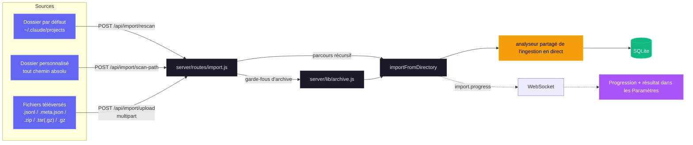

| Méthode | Chemin | Rôle |
| --- | --- | --- |
| `GET` | `/api/import/guide` | Chemins, commandes d'archive, extensions et instructions selon le fournisseur, via `?provider=claude\|codex`. |
| `POST` | `/api/import/rescan` | Analyse à nouveau la racine par défaut sélectionnée à partir de `{ provider }`. |
| `POST` | `/api/import/scan-path` | Analyse récursivement un `{ path, provider }` absolu. |
| `POST` | `/api/import/upload` | Téléverse des fichiers ou archives pris en charge avec `provider`. |

- **Entrées :** fichiers `.jsonl`, `.meta.json`, `.zip`, `.tar`, `.tar.gz`/`.tgz` et `.gz` isolés, dans des arborescences imbriquées. Claude prend en charge ses deux organisations canoniques de sous-agents ; Codex reconnaît récursivement les `rollout-*.jsonl` ou les JSONL contenant `session_meta`, avec des titres facultatifs issus de `session_index.jsonl`.
- **Exactitude :** le dédoublonnage par UUID et par horodatage maximal des événements empêche tout double comptage. Les bases de compaction conservent les tokens antérieurs ; l'activité ultérieure fait avancer `ended_at` et rafraîchit les métadonnées des messages.
- **Gros fichiers :** une analyse partagée, par morceaux de 4 Mio et ligne par ligne, traite les transcriptions qui dépassent la limite d'environ 512 Mio des chaînes de V8. Les tableaux extensibles sont plafonnés à `TRANSCRIPT_CACHE_MAX_ARRAY_LEN`, `1000` par défaut, avec un élagage au double du plafond pendant l'analyse.
- **Sécurité :** l'extraction refuse les chemins absolus et ceux qui contiennent `..`. Par défaut, les données extraites sont plafonnées à 4 Go, chaque téléversement à 1 Go et chaque requête à 2000 fichiers ; les répertoires de préparation de chaque requête sont toujours récupérés.
- **Progression :** les phases WebSocket `import.progress`, limitées en fréquence, couvrent `start`, `scan`, `extract`, `parse`, `complete` et `error`. L'interface propose un guidage par glisser-déposer et les totaux d'éléments importés, enrichis, ignorés et en erreur.

### WebSocket

Connectez-vous à `ws://localhost:4820/ws` pour recevoir des messages poussés en temps réel :

```json
{
  "type": "agent_updated",
  "data": { "id": "...", "status": "working", "current_tool": "Edit" },
  "timestamp": "2026-03-05T15:43:01.800Z"
}
```

**Types de messages :** `session_created`, `session_updated`, `agent_created`, `agent_updated`, `new_event`, `alert_triggered`, `alert_updated`, `remote_source.status` (données `{ id, status: "idle"|"syncing"|"ok"|"error"|"deleted", error?, last_sync_at? }`)

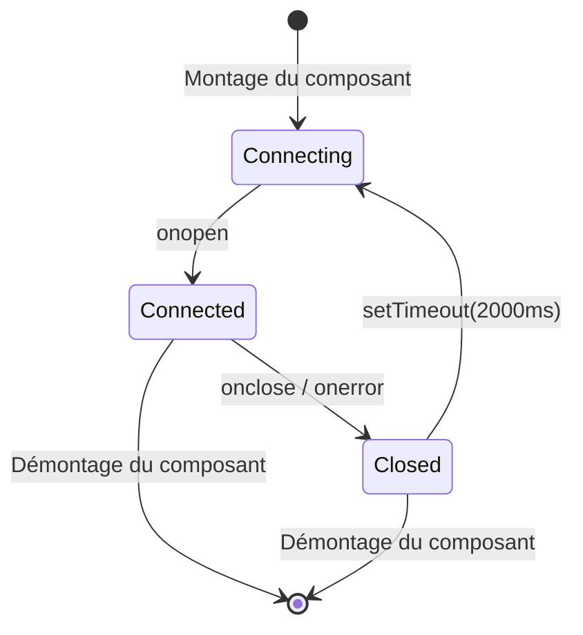

---

## Événements de hook

Le tableau de bord traite ces types de hooks de Claude Code :

| Type de hook | Déclencheur | Action du tableau de bord |
| ------------------- | ------------------------------ | -------------------------------------------------------------------------------------------- |
| `SessionStart` | Début d'une session Claude Code | Crée la session et l'agent principal. Horodate `awaiting_input_since` (avec `awaiting_reason=session_start`) pour qu'une session neuve arrive **En attente** — sauf un SessionStart de source `compact` (auto-compaction en plein tour), qui laisse l'indicateur intact pour qu'une session en cours reste **Active**. Réactive les sessions reprises. Abandonne les sessions orphelines sans activité depuis `DASHBOARD_STALE_MINUTES` (180 par défaut) |
| `UserPromptSubmit` | L'utilisateur valide un prompt | Efface l'indicateur d'attente et fait passer l'agent principal à `working` — seul signal du début des tours de l'assistant purement textuels, puisqu'ils n'émettent pas de `PreToolUse` |
| `PreToolUse` | Un agent commence à utiliser un outil | Efface l'indicateur d'attente, passe l'agent à `working`, définit `current_tool`. Si l'outil est `Agent`, crée un enregistrement de sous-agent |
| `PostToolUse` | Exécution d'outil terminée | Efface l'indicateur d'attente (gère les approbations de demandes d'autorisation où la Notification l'avait posé en plein outil). Efface `current_tool`. L'agent reste `working` |
| `Stop` | Claude a fini de répondre | Sans erreur : agent principal → `waiting` — Claude a terminé son tour, la balle est dans le camp de l'utilisateur. `stop_reason=error` : marque l'agent et la session `error`. Les sous-agents en arrière-plan continuent de tourner |
| `SubagentStop` | Un agent en arrière-plan a terminé | Associe et termine le sous-agent par description, type ou tâche. N'efface volontairement PAS l'indicateur d'attente — la fin d'un sous-agent ne nous apprend rien sur l'humain. **Déclenche sans attendre une analyse JSONL** (`scanAndImportSubagents`) qui émet des événements `PreToolUse` + `PostToolUse` par outil sous l'`agent_id` propre au sous-agent, pour que la Chronologie montre chaque outil exécuté par le sous-agent, et pas seulement le marqueur de lancement |
| `Notification` | Notification d'un agent | Journalise l'événement. Les messages de demande d'autorisation/de saisie passent l'agent à `waiting` et horodatent `awaiting_input_since` (avec `awaiting_reason=notification`, repérés par motif : `permission`, `waiting for input`, `needs your approval`, …). Les notifications de compaction sont marquées comme événements `Compaction`. Déclenche une notification du navigateur si elle est activée |
| `SessionEnd` | Le processus CLI de Claude Code se termine | Retire l'indicateur d'attente. Si la session est déjà en `error`, l'état d'erreur est conservé ; sinon, marque tous les agents et la session `completed` |
| `Compaction` | `/compact` détecté dans le JSONL | Crée un sous-agent de compaction (type `compaction`) et un événement Compaction. Détecté via les entrées `isCompactSummary` du JSONL de transcription. Également détecté par le scanner périodique pour les sessions actives |
| `APIError` | Erreur d'API dans la transcription JSONL | Extrait des entrées `isApiErrorMessage` (quota, limite de débit, invalid_request) et des réponses brutes `type: "error"`. **Marque désormais immédiatement la session et l'agent `error`** — auparavant enregistré comme événement sans changement de statut. Stocké comme événement avec le détail de l'erreur |
| `TurnDuration` | Durée d'un tour dans la transcription JSONL | Extrait des messages `system` de sous-type `turn_duration` portant `durationMs`. Stocké comme événement pour l'analyse des durées par tour |
| `ToolError` | Erreur de résultat d'outil dans le JSONL | Extrait des entrées `toolUseResult.is_error`. Suit les échecs au niveau des outils pour l'analyse de la propagation des erreurs |
| `RemoteToolEvent` | Appel d'outil poussé par une machine distante | Écrit par `POST /api/hooks/ingest-batch` pour chaque élément de `tool_events[]` poussé par une machine nomade/derrière un NAT. Dédoublonné par `(session_id, event_type, uuid)`, contre les lignes validées comme au sein du lot, si bien que renvoyer un lot est sans risque |
| `RemoteTurn` | Durée de tour poussée par une machine distante | Écrit par `POST /api/hooks/ingest-batch` pour chaque élément de `turns[]`, avec le `duration_ms` de ce tour. Même dédoublonnage `(session_id, event_type, uuid)` que `RemoteToolEvent` |
| `Interrupted` | Tour annulé par l'utilisateur (Échap) | Synthétisé par le watchdog — `Esc` ne déclenche aucun hook, une session bloquée en `working` est donc détectée grâce au marqueur `[Request interrupted by user]` de la transcription ou, quand Échap a précédé toute sortie, grâce au délai d'inactivité en travail (`DASHBOARD_WORKING_IDLE_SECONDS`). La session passe **En attente** (comme après un `Stop` normal) |

---

## Notifications du navigateur

Le tableau de bord prend en charge des notifications persistantes du navigateur via Web Push (VAPID), pour des alertes en temps réel même quand l'onglet du tableau de bord n'a pas le focus ou que le navigateur est en arrière-plan.

### Fonctionnement

1. **Activez** les notifications sur la page Paramètres via l'interrupteur général
2. **Accordez** l'autorisation du navigateur quand elle est demandée — cela enregistre un Service Worker et crée un abonnement push
3. **Configurez** les événements qui déclenchent des notifications :

| Événement | Défaut | Description |
| ---------------------------- | ------- | --------------------------------------------------------------- |
| Nouvelle session démarrée | Activé | Se déclenche à la création d'une nouvelle session Claude Code |
| Claude a fini de répondre | Désactivé | Se déclenche sur les événements `Stop` quand Claude termine un tour de réponse |
| Session fermée | Désactivé | Se déclenche sur `SessionEnd` quand le processus CLI se termine |
| Erreurs de session | Activé | Se déclenche quand une session se termine par une erreur |
| Sous-agent lancé | Désactivé | Se déclenche à la création d'un sous-agent en arrière-plan |

De plus, tout événement de hook `Notification` de Claude Code déclenche une notification du navigateur, quels que soient les interrupteurs par événement (tant que l'interrupteur général est activé).

### Architecture des notifications

- **Chaîne VAPID :** utilise `web-push` sur le serveur pour une livraison sécurisée des messages. Les clés VAPID sont générées automatiquement et stockées dans `data/vapid-keys.json`.
- **Service Worker :** un worker dédié (`client/public/sw.js`) gère les événements `push` entrants et affiche les notifications avec `silent: false` pour garantir le son sous macOS.
- **Abonnements :** les points de terminaison propres à chaque navigateur sont stockés dans la table `push_subscriptions` de SQLite.
- **Persistance :** les notifications arrivent même si le navigateur est fermé, car le Service Worker fonctionne en arrière-plan.
- **Notification de test :** un bouton dans les Paramètres permet de vérifier la chaîne VAPID et la lecture du son.

### PWA et prise en charge hors ligne

Le tableau de bord, la page d'accueil et le wiki sont des PWA installables distinctes, chacune avec son propre manifeste et son propre service worker.

| Surface | Manifeste | Service Worker | Stratégie de cache |
| --- | --- | --- | --- |
| Tableau de bord (`client/`) | `client/public/manifest.json` | `client/public/sw.js` | Les `/assets/*` immuables sont servis en cache d'abord ; les navigations, le worker, le manifeste, les icônes et `/` sont servis en réseau d'abord avec repli. `/api/*`, `/ws` et le HMR de Vite ne sont jamais mis en cache ; les gestionnaires push restent actifs. Express envoie des en-têtes immuables d'un an pour les ressources et des en-têtes de revalidation pour les fichiers de la coquille. `controllerchange` recharge une fois lors d'une mise à niveau, jamais à la première installation. |
| Page d'accueil (racine) | `manifest.json` | `sw.js` | Pré-cache la coquille, le favicon et l'image OG. Les captures sont mises en cache à la première consultation ; la navigation est en réseau d'abord avec repli hors ligne. |
| Wiki (`wiki/`) | `wiki/manifest.json` | `wiki/sw.js` | Pré-cache le HTML, le CSS, le JS, le manifeste et le favicon. Le HTML reste en réseau d'abord ; CSS et JS sont en cache d'abord, ce qui permet l'usage hors ligne après une visite. |

Tous les workers appellent `skipWaiting()`, suppriment à l'activation les caches périmés versionnés et se rafraîchissent proprement quand leur version de cache change. Chaque fichier HTML inclut les métadonnées iOS du mode autonome ; les manifestes et les icônes Apple touch utilisent `favicon.svg` avec `sizes="any"`.

---

## Notification de mise à jour

Le tableau de bord surveille son propre checkout git et affiche une fenêtre dès que la branche par défaut canonique a des commits en avance sur HEAD. **Conscient des branches et des forks :** si vous avez un remote `upstream` (la convention habituelle pour les forks), il est préféré à `origin` ; les `master`/`main`/`HEAD` du remote choisi servent de référence de comparaison. La `manual_command` s'adapte à votre situation — `git pull --ff-only` seulement quand votre branche suit réellement la référence canonique, sinon un `git fetch` (et une fusion en avance rapide dans le cas d'un fork), pour que la commande ne mente jamais. Les utilisateurs obtiennent la commande exacte à lancer dans un terminal — le serveur ne tire **jamais** ni ne redémarre de lui-même, ce qui garde le mécanisme portable entre sessions de dev, supervision pm2/systemd/launchd/Docker et déploiements distants.

<p align="center">
  <a href="images/update.png"></a>
</p>

### Fonctionnement

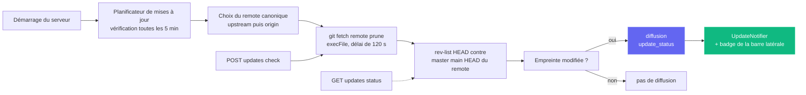

Une vérification est peu coûteuse (`git fetch <remote> --prune` sur le remote canonique — `upstream` s'il est configuré, sinon `origin`), enveloppée dans `execFile` (sans shell) avec un délai de 120 s. Les échecs — réseau hors ligne, installation hors git, aucun remote configuré, référence amont introuvable — renvoient tous des **charges utiles souples** (p. ex. `fetch_error: "..."`) au lieu de lever une exception, si bien qu'un remote capricieux ne bloque jamais le tableau de bord.

### Surfaces d'interface

| Surface | Comportement |
| --- | --- |
| **Fenêtre** (`client/src/components/UpdateNotifier.tsx`) | S'ouvre pour chaque nouveau `remote_sha` disponible ; affiche le nombre de commits de retard, la référence suivie, une note facultative sur la branche ou le fork, la commande exacte et les boutons **Copier la commande**, **Vérifier maintenant** et **Ignorer**. Échap ou un clic sur le fond la ferment. Le rejet est indexé dans `localStorage`, si bien qu'un SHA plus récent la rouvre. |
| **Bouton de la barre latérale** (`client/src/components/Sidebar.tsx`) | Toujours visible. Le vert signale un retard ; l'ambre, un échec de fetch. Un clic efface le rejet et appelle `POST /api/updates/check`. |
| **Terminal du serveur** | Affiche la commande dans un bloc encadré quand le statut passe de « à jour » à « en retard », y compris pour les utilisateurs sans interface. |

### Surface d'API

| Point de terminaison | Rôle |
| --- | --- |
| `GET /api/updates/status` | Vérification en lecture seule : lance `git fetch` sur le remote canonique, compare HEAD à sa branche par défaut et renvoie la charge utile. |
| `POST /api/updates/check` | Même vérification, mais diffuse aussi `update_status` sur le WebSocket pour que tous les clients connectés se mettent à jour d'un coup. |

Les deux points de terminaison renvoient la même forme de charge utile :

```json
{
  "git_repo": true,
  "update_available": true,
  "repo_root": "/Users/you/Claude-Code-Agent-Monitor",
  "remote_ref": "upstream/master",
  "canonical_remote": "upstream",
  "current_branch": "master",
  "tracking_upstream": "origin/master",
  "tracks_canonical": false,
  "situation": "fork_or_diverged_tracking",
  "local_sha": "abc1234...",
  "remote_sha": "def5678...",
  "commits_behind": 3,
  "manual_command": "cd \"/...\" && git fetch upstream && git merge --ff-only upstream/master && npm run setup",
  "situation_note": "You're on 'master' tracking 'origin/master'. This command fast-forwards your branch from upstream/master (the canonical default).",
  "message": "3 commit(s) on upstream/master not in your checkout."
}
```

`situation` vaut `tracking_canonical` (clone classique sur la branche par défaut — `git pull --ff-only` fonctionne), `fork_or_diverged_tracking` (le nom de la branche locale correspond à la branche canonique mais suit un autre remote — `git fetch <remote> && git merge --ff-only <ref>`), `feature_branch` (hors de la branche par défaut — fetch uniquement, l'intégration est laissée à l'utilisateur) ou `detached_head`.

### Ce qui n'est **volontairement pas** là

Il n'y a ni `POST /api/updates/apply` ni utilitaire de redémarrage automatique, et c'est voulu. Mettre à jour un processus depuis lui-même n'est pas fiable sans superviseur externe — `npm run dev` (concurrently), `npm start`, `pm2`, `systemd`, `launchd` et Docker demandent chacun une logique de redémarrage différente, et les échecs de `git pull` / `npm install` sur un serveur en train de s'arrêter n'ont aucun chemin de retour arrière propre. Se limiter à la détection garde un comportement prévisible avec tous les superviseurs, tous les systèmes et tous les états de branche, tout en comblant le manque d'information « quand dois-je tirer ? » ; l'utilisateur garde la main sur la mise à jour réelle, dans son propre shell.

### Configuration

| Variable d'environnement | Défaut | Remarques |
| --- | --- | --- |
| `DASHBOARD_UPDATE_CHECK` | activé | Mettre à `0` / `false` / `off` pour désactiver entièrement le planificateur. |
| `DASHBOARD_UPDATE_CHECK_INTERVAL_MS` | `300000` (5 min) | Intervalle entre les vérifications automatiques. Minimum 60 000 ms — les valeurs inférieures sont ramenées à ce seuil. |

---

## Tabby — chat compagnon flottant

**Tabby** est un adorable chat compagnon flottant, épinglé dans le coin inférieur droit de chaque page du tableau de bord. Toujours présent, il transforme le flux de sessions en direct en une mascotte réactive, lisible d'un coup d'œil, à qui l'on peut aussi parler.

<p align="center">
  <a href="images/tabby.png"></a>
</p>

### Mascotte réactive

Tabby est un chat SVG qui suit le curseur, avec **huit humeurs** dérivées du flux de sessions en direct, chacune avec sa propre animation :

| Humeur | Quand | Animation |
| --- | --- | --- |
| `idle` | Rien de notable ne se passe | Coup de queue au repos |
| `watching` | Des sessions sont actives | Oreilles dressées, les yeux suivent le curseur |
| `happy` | Une session ou une exécution s'est bien terminée | Hochement de tête + étincelles |
| `worried` | Quelque chose semble anormal | Léger tremblement |
| `stuck` | Une session semble bloquée | Alerte « ! » |
| `thinking` | Un agent est en plein travail | Lent hochement de tête |
| `sleeping` | Calme depuis un moment | `zzz` |
| `disconnected` | Le WebSocket est coupé | Pose calme et immobile |

### Bulles de dialogue

Tabby affiche automatiquement de courtes répliques lors des événements notables (session démarrée/terminée, erreurs, exécution achevée). Les bulles sont **limitées et regroupées** pour qu'une rafale d'événements n'inonde jamais l'écran, elles utilisent `aria-live` pour les lecteurs d'écran et peuvent être **coupées** depuis le panneau.

### Panneau

Ouvrez le panneau en cliquant sur le chat ou en appuyant sur **⌘B / Ctrl+B** (Échap ferme). Il affiche :

- Une **ligne de statut** en direct — `N live · M errored · connection state`.
- Des **actions rapides** — aller à Lancer Claude, Activité, Sessions ou aux sessions en erreur ; couper les bulles ; effacer les alertes.
- Une zone **Demander** (voir ci-dessous).

### Zone Demander → relais vers Lancer Claude

La zone **Demander** répond localement aux questions simples de statut à partir des données en cache — par exemple « qu'est-ce qui tourne », « des erreurs ? » ou « statut ». Toute autre question est transmise à la page **Lancer Claude** existante (lien profond vers `/run?prompt=…`) pour lancer une vraie session Claude Code. Tabby n'appelle jamais lui-même un LLM ; il réutilise simplement la page Lancer Claude pour tout ce qui dépasse une rapide consultation de statut.

### Accessibilité et dégradation sûre

Tabby est utilisable au clavier, utilise `aria-live` pour ses bulles et respecte `prefers-reduced-motion`. Si le WebSocket est coupé, il se replie en toute sécurité sur un état calme `disconnected` au lieu de produire une erreur. Vous pouvez activer ou désactiver Tabby dans les **Paramètres** (localisé en anglais, chinois, vietnamien, coréen, espagnol, français, allemand, portugais et italien), et l'implémentation se trouve dans `client/src/components/Tabby/`.

---

## Signaux sonores

Le tableau de bord vous donne un **retour audio discret** sur l'activité des sessions en direct : vous pouvez le laisser sur un second écran et entendre quand une exécution se termine ou échoue. Le son est **activé par défaut** et se coupe entièrement en un clic.

### Synthèse sans dépendance

Il n'y a aucune ressource `.mp3` ou `.wav` dans le dépôt et aucune bibliothèque audio dans `package.json`. Chaque signal est généré à la lecture avec la **Web Audio API** : une courte liste d'oscillateurs (sinusoïde ou triangle), chacun avec sa propre enveloppe de gain exponentielle, mélangés via un nœud de gain principal et un filtre passe-bas pour que le résultat reste en retrait de votre travail au lieu de le couper. Tout le moteur tient dans un seul fichier, `client/src/lib/sound.ts`.

### Les signaux

| Signal | Quand il se déclenche | À quoi il ressemble |
| --- | --- | --- |
| `sessionStart` | Une nouvelle session apparaît | Quinte juste ascendante (Do5 → Sol5) |
| `sessionComplete` | Une session a fini de répondre (`Stop`) ou se ferme (`SessionEnd`) | Arpège majeur conclusif (Mi5 → Sol5 → Do6) |
| `sessionError` | Une session passe à l'état `error` | Douce tierce mineure descendante sur une onde triangulaire — perceptible sans être alarmante |
| `subagentSpawn` | Un sous-agent est lancé | Un unique pincement bref |
| `notification` | Claude Code émet un événement `Notification` | Paire désaccordée qui sonne comme une petite cloche |
| `connected` / `disconnected` | Le WebSocket du tableau de bord revient ou tombe | Montée / descente de deux notes |
| `click` | Vous appuyez sur un bouton, un lien, un onglet ou un interrupteur | Tic à peine audible |

Les signaux s'inscrivent dans une gamme de do majeur pour que des fins de sons qui se chevauchent ne soient jamais dissonantes, et chaque enveloppe décroît de façon exponentielle au lieu de s'interrompre net, ce qui évite le clic d'un arrêt brutal.

### Rester discret

Trois garde-fous empêchent le son de devenir du bruit :

- **Délai par signal** — un même signal ne se répète pas en moins de ~350 ms (45 ms pour le tic d'interaction).
- **Budget global de rafale** — au plus 4 signaux démarrent dans une fenêtre de 1,2 s, si bien qu'importer l'historique ou se reconnecter après une coupure ne transforme jamais un flot de messages WebSocket en flot de bips.
- **Politique de lecture automatique** — rien ne joue avant votre première interaction avec la page (pointeur, clavier ou toucher), conformément aux règles des navigateurs. Les signaux antérieurs sont ignorés en silence, pas mis en file.

Si le navigateur ne prend pas du tout en charge Web Audio, chaque appel est une opération nulle sans risque — le tableau de bord reste simplement silencieux.

### Paramètres

**Paramètres → Son** propose un interrupteur général, un curseur de volume et un interrupteur par signal. Activer un interrupteur joue immédiatement le signal correspondant pour entendre exactement ce que vous venez d'activer, et un bouton **Écouter le son** joue le carillon de fin à la demande. Les préférences sont conservées dans `localStorage` sous `agent-monitor-sound` et s'appliquent instantanément dans toute l'application — sans rechargement. Le panneau est localisé en anglais, chinois, vietnamien, coréen, espagnol, français, allemand, portugais et italien.

Par défaut, le démarrage de session, la fin de session, l'erreur de session, les notifications de Claude Code et le tic d'interaction sont activés ; le lancement de sous-agents et les changements de connexion sont désactivés (ce sont les plus bavards). L'implémentation se trouve dans `client/src/lib/sound.ts` (moteur + préférences) et `client/src/hooks/useSoundCues.ts` (branchement sur le bus d'événements), monté une seule fois dans `client/src/App.tsx`.

---

## Fenêtre d'état de la connexion

Cliquez sur la pastille **En ligne** / **Déconnecté** en bas de la barre latérale pour ouvrir un petit panneau de détails sur le transport WebSocket du tableau de bord. Il affiche le point de terminaison `ws://` actif, depuis combien de temps le socket actuel est ouvert, le nombre total d'événements reçus, les principaux types d'événements sous forme d'histogramme horizontal, une sparkline du débit sur 60 secondes et les 8 derniers événements dans une liste d'activité récente. Les statistiques cumulées (totaux, répartition par type, liste récente) sont conservées d'un rechargement à l'autre via `localStorage` sous `sidebar-connection-stats` ; la sparkline glissante et le minuteur « connecté depuis » sont volontairement éphémères. Un bouton **Réinitialiser** en pied de panneau efface tout à la demande.

<p align="center">
  <a href="images/live.png"></a>
</p>

---

## Extension VS Code

**Claude Code Agent Monitor** est disponible sous forme d'extension VS Code à part entière, pour surveiller vos agents IA sans quitter votre éditeur.

<p align="center">
  <a href="vscode-extension/vscode.png"></a>
</p>

### 🚀 Fonctionnalités clés
- **Barre latérale en direct** : vue dédiée de la barre d'activité affichant en temps réel la santé des agents (En cours, En attente, Terminé, etc.).
- **Analyses d'utilisation** : suivez le total des tokens, les coûts en USD en direct et le nombre d'événements directement dans la barre latérale.
- **Intégration à la barre d'état** : moniteur d'activité d'un coup d'œil dans la barre du bas, avec les sessions et agents actifs.
- **Navigation directe** : accès en un clic à des vues précises du tableau de bord (Kanban, Analyses, Paramètres) ou aux sessions récentes.
- **Onglet intégré** : ouvre le tableau de bord de surveillance complet dans un onglet webview natif de VS Code.

### 📦 Installation et configuration
1. Ouvrez le répertoire [vscode-extension](./vscode-extension).
2. Installez l'extension depuis la Marketplace ou empaquetez-la vous-même avec `vsce package`.
3. Vérifiez que votre serveur de tableau de bord local tourne (`npm run dev`).
4. Cliquez sur l'**icône radar** de la barre d'activité de VS Code pour commencer.

Pour la configuration détaillée côté développeur, voir les répertoires [.vscode](./.vscode) et [vscode-extension](./vscode-extension).

> [!TIP]
> Extension sur la VS Code Marketplace : [Claude Code Agent Monitor](https://marketplace.visualstudio.com/items?itemName=hoangsonw.claude-code-agent-monitor)

---

## Application de bureau (macOS et Windows)

L'application de bureau facultative, construite avec Electron 35, empaquette le même tableau de bord en `.dmg` macOS, en installeur NSIS Windows ou en `.exe` portable, depuis l'espace de travail `desktop/`.

<p align="center">
  <a href="images/macos.png"></a>
  <br>
  <em>🍎🪟 <strong>Application de bureau</strong> — coquille native avec icône dans la barre de menus / zone de notification (tray), ouverture à la connexion et verrou d'instance unique. Le même tableau de bord, dans une vraie fenêtre du système (ici macOS).</em>
</p>

<p align="center">
  <a href="images/windows_app.png"></a>
  <br>
  <em>🪟 Le même tableau de bord en application Windows native — icône dans la zone de notification (tray), menu de fenêtre natif et ouverture à la connexion.</em>
</p>

Elle ajoute le comportement natif de fenêtre, de tray, de menu, de lancement à la connexion et d'arrêt autour de la même interface que celle servie sur `localhost:4820`.

### Fonctionnement

Contrairement au lancement du tableau de bord depuis un terminal, l'application de bureau ne demande ni `npm start`, ni shell ouvert, ni seconde copie du serveur. Le **processus principal** d'Electron héberge le serveur Express **dans le même processus** — il fait directement un `require()` de `server/index.js` dans le même runtime Node, **sans processus enfant ni IPC** — et pointe une `BrowserWindow` Chromium vers le client React compilé.

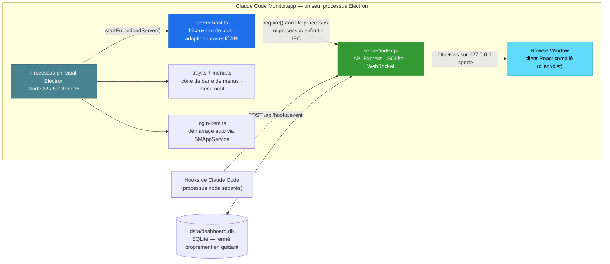

Au lancement, l'application :

1. Choisit un port libre — de préférence **4820**, sinon **4821–4829**, puis un port élevé aléatoire si tous sont pris.
2. Si un serveur de tableau de bord sain répond déjà à `/api/health` sur `4820` (p. ex. vous avez lancé `npm start` dans un terminal), elle **adopte ce serveur** au lieu de s'y lier en double — pas de conflit de port, pas de contention SQLite. Un serveur adopté continue de tourner après la fermeture de l'application.
3. Sinon, elle démarre le serveur embarqué et, au **premier démarrage avec son propre serveur**, installe automatiquement les hooks de Claude Code et démarre les services d'arrière-plan (planificateur de mises à jour, `cc-watcher`, réconciliation des exécutions orphelines). Un utilisateur qui n'installe que le DMG voit donc les événements arriver **sans aucune configuration manuelle** — ni checkout, ni `npm run install-hooks`.
4. **(macOS)** Récupère le **`PATH` du shell de connexion** pour que la fonction **Lancer Claude** puisse trouver et lancer la CLI `claude` — une application lancée depuis le Finder/le Dock n'hérite sinon que du `PATH` minimal de launchd et ne trouverait pas les CLI dans `~/.local/bin`, `/opt/homebrew/bin`, les répertoires des gestionnaires de versions, etc. (Sous Windows, le processus hérite déjà du `PATH` de l'utilisateur.)
5. Ouvre la fenêtre du tableau de bord — sauf si l'application a été lancée à l'ouverture de session (sous macOS via les éléments d'ouverture ; sous Windows via l'entrée balisée `HKCU\…\Run`), auquel cas elle reste dans le tray.
6. En quittant, arrête proprement le serveur embarqué et **ferme SQLite proprement** (checkpoint WAL).

### Fonctionnalités

- **Tray et fenêtre :** un clic gauche affiche ou masque la fenêtre ; un clic droit propose **Ouvrir le tableau de bord**, **Ouvrir dans le navigateur**, **Redémarrer le serveur**, **Afficher les journaux**, **Ouvrir à la connexion** et **Quitter**. macOS utilise un glyphe modèle teinté pour le tray ; Windows, ainsi que la fenêtre et la barre des tâches, utilisent l'icône colorée de l'application, y compris lors des exécutions de développement non empaquetées.
- **Menu natif :** menus d'application standard et raccourcis `⌘` / `Ctrl`. Seul macOS conserve **File → Open Dashboard** (`⌘1`) quand la fenêtre est masquée ; sous Windows/Linux, on la rouvre de façon fiable via le tray.
- **Connexion et cycle de vie :** `SMAppService` inscrit l'application dans les éléments d'ouverture de macOS ; Windows écrit l'entrée par utilisateur `HKCU\Software\Microsoft\Windows\CurrentVersion\Run`. Fermer la fenêtre la masque tandis que le tray et le serveur continuent ; un second lancement met au premier plan l'instance unique existante.
- **Données durables :** SQLite et les clés VAPID restent hors du bundle, dans `~/Library/Application Support/Claude Code Monitor/data/` ou `%APPDATA%\Claude Code Monitor\data\`. La réinstallation, la mise à jour et la désinstallation NSIS par défaut préservent l'historique importé.
- **CLI et journaux :** macOS restaure le `PATH` du shell de connexion pour que les lancements depuis le Finder ou le Dock puissent exécuter `claude` ; Windows utilise le `PATH` utilisateur hérité. **Afficher les journaux** ouvre `~/Library/Logs/Claude Code Monitor/desktop.log` ou `%APPDATA%\Claude Code Monitor\logs\desktop.log`.

### L'obtenir

**Option A — télécharger un installeur précompilé (recommandé).** Depuis **[Releases → latest](https://github.com/hoangsonww/Claude-Code-Agent-Monitor/releases/latest)** (public, sans connexion GitHub). La CI publie automatiquement une nouvelle release `vX.Y.Z` chaque fois que la version de `package.json` change sur `master`, si bien que ce lien sert toujours le build actuel :

| Plateforme | Fichier | Remarques |
| --- | --- | --- |
| macOS (Apple Silicon) | `ClaudeCodeMonitor-<ver>-arm64.dmg` | à glisser dans `/Applications` |
| macOS (Intel) | `ClaudeCodeMonitor-<ver>-x64.dmg` | à glisser dans `/Applications` |
| Windows (installeur) | `ClaudeCodeMonitor-Setup-<ver>-x64.exe` | installation par utilisateur, sans droits d'administrateur |
| Windows (portable) | `ClaudeCodeMonitor-<ver>-x64-portable.exe` | s'exécute sans installation |

Des builds frais par commit existent aussi sous forme d'artefacts de CI (connexion requise, conservés 14 jours) : `ClaudeCodeMonitor-dmg` issu du job `🍎 macOS Desktop (DMG)` et `ClaudeCodeMonitor-win` issu du job `🪟 Windows Desktop (EXE)` — utiles pour tester `master` avant le prochain tag de release.

**Option B — la compiler vous-même.** Depuis la racine du dépôt :

```bash
npm run setup                # install root + client deps, build client, install hooks
npm run build                # build the React client (client/dist)
npm run desktop:install      # install Electron + electron-builder into desktop/ (preflights native deps; prints setup help on failure)
npm run desktop:dmg:arm64    # macOS:   fast single-arch DMG → desktop/release/ClaudeCodeMonitor-<ver>-arm64.dmg
npm run desktop:win          # Windows: NSIS installer → desktop/release/ClaudeCodeMonitor-Setup-<ver>-x64.exe
```

> [!NOTE]
> **Les DMG se compilent sous macOS ; les `.exe` Windows sous Windows** — electron-builder empaquette pour le système hôte. Le build macOS `npm run desktop:dmg` empaquette l'application **deux fois** (une par architecture) et produit **les deux** DMG par architecture (`arm64` + `x64`) — c'est le build de release ; il ne les fusionne pas en un binaire universel. Pour votre propre Mac, utilisez `desktop:dmg:arm64` / `desktop:dmg:x64`, mono-architecture. Sous Windows, `better-sqlite3` est récupéré sous forme de binaire Electron précompilé par `npm run desktop:install`, si bien qu'aucune chaîne de compilation C++ de Visual Studio n'est nécessaire dans le cas courant. Si le build échoue malgré tout (pas de binaire précompilé, ou chaîne de compilation C++ absente), `desktop:install` affiche la correction exacte pour chaque système ainsi qu'une alternative sans chaîne de compilation, et échoue bruyamment au lieu de laisser une installation cassée.

### L'installer

**macOS :**

1. Double-cliquez sur le `.dmg` pour le monter.
2. Faites glisser **Claude Code Monitor.app** dans votre dossier `/Applications`.
3. Le DMG est **signé ad hoc** par défaut, si bien que Gatekeeper avertit au premier lancement (*« Apple n'a pas pu vérifier… »*). Retirez l'attribut de quarantaine :

   ```bash
   xattr -cr "/Applications/Claude Code Monitor.app"
   ```

   Ou ouvrez **Réglages Système → Confidentialité et sécurité** et cliquez sur **Ouvrir quand même**.

4. Lancez l'application. L'icône de tray apparaît et la fenêtre du tableau de bord s'ouvre.

**Windows :**

Lancez `ClaudeCodeMonitor-Setup-<ver>-x64.exe` pour une installation par utilisateur, sans droits administrateur, sous `%LOCALAPPDATA%\Programs\Claude Code Monitor`, avec une destination modifiable, ou utilisez `*-portable.exe` sans installation. Le build par défaut, non signé, peut déclencher SmartScreen au premier lancement ; choisissez **Informations complémentaires → Exécuter quand même**. Lancez l'application depuis le menu Démarrer ou le raccourci du bureau pour ouvrir le tableau de bord et l'icône du tray.

<p align="center">
  <a href="images/setup_win_wizard.png"></a>
  <br>
  <em>🪟 <strong>Options d'installation</strong> · choisissez une installation par utilisateur ou pour tous les utilisateurs</em>
</p>

<p align="center">
  <a href="images/setup_win_wizard2.png"></a>
  <br>
  <em>🪟 <strong>Emplacement d'installation</strong> · confirmez ou modifiez le dossier de destination</em>
</p>

<p align="center">
  <a href="images/setup_win_wizard3.png"></a>
  <br>
  <em>🪟 <strong>Installation Windows terminée</strong> · terminez l'installeur et lancez Claude Code Monitor</em>
</p>

### Commandes de build

Toutes les commandes se lancent depuis la **racine du dépôt** :

| Commande | Ce qu'elle fait |
| --------------------------- | ---------------------------------------------------------------------------- |
| `npm run desktop:install` | Installe Electron + electron-builder dans `desktop/` ; recompile `better-sqlite3` pour l'ABI d'Electron ; vérifie au préalable la compilation native de `better-sqlite3` et affiche une aide concrète (dont une alternative sans chaîne de compilation) en cas d'échec |
| `npm run desktop:build` | Compile les sources TypeScript du bureau dans `desktop/out/` |
| `npm run desktop:dev` | Compile et lance l'application Electron pour itérer en local |
| `npm run desktop:test` | Lance le test de fumée (démarre Electron, sonde `/api/health`, s'arrête) |
| `npm run desktop:dmg` | **macOS :** construit **les deux** DMG (arm64 + x64) — correct pour une release, **plus lent** (empaquette chaque architecture) |
| `npm run desktop:dmg:arm64` | **macOS :** construit un DMG Apple Silicon seulement — **rapide** (~1 min), recommandé pour votre propre Mac |
| `npm run desktop:dmg:x64` | **macOS :** construit un DMG Intel seulement — **rapide** (~1 min) |
| `npm run desktop:dmg:universal` | **macOS :** construit un unique DMG **universel** fusionné (arm64 + x86_64) — facultatif, **le plus lent**, et pas ce que publie la release |
| `npm run desktop:win` | **Windows :** construit l'installeur NSIS `.exe` (x64) |
| `npm run desktop:win:portable` | **Windows :** construit le `.exe` portable sans installation (x64) |

Le DMG macOS obtenu pèse **~80 Mo** (≈ 250 Mo sur disque une fois installé) et l'installeur Windows est comparable — le coût habituel d'un bundle Electron.

### Signature et notarisation

macOS utilise par défaut une signature ad hoc et définit `CSC_IDENTITY_AUTO_DISCOVERY=false`, si bien que les certificats locaux ne sont jamais sélectionnés par accident. La signature Developer ID utilise `CSC_LINK` et `CSC_KEY_PASSWORD` ; la notarisation ajoute `APPLE_ID`, `APPLE_TEAM_ID` et `APPLE_APP_SPECIFIC_PASSWORD`. Windows n'est pas signé par défaut et active Authenticode via les mêmes variables `CSC_LINK` et de mot de passe. La CI active l'une ou l'autre voie dès que les identifiants sont présents, sans modification de code.

### Notes d'implémentation

- **ABI native :** `desktop/` conserve un `better-sqlite3` compilé pour Electron et y redirige `server/db.js` ; la copie à la racine reste compatible avec le Node du système et les tests du serveur. Après un build de DMG propre à une architecture, l'étape `prebuild` du bureau répare automatiquement l'ABI locale et échoue tôt, avec une aide à la configuration, si le binaire est absent.
- **Parité du serveur :** la fonction exportée `startBackgroundServices()` donne au serveur embarqué le même planificateur de mises à jour, le même observateur de configuration et la même réconciliation des exécutions orphelines que `node server/index.js` ; le chemin autonome et les autres espaces de travail gardent un comportement inchangé.
- **CI et versions :** des jobs macOS et Windows filtrés par chemin effectuent un test de fumée et publient deux DMG mono-architecture ainsi que les EXE NSIS et portable. Les changements de version sur `master` joignent tous les fichiers à `vX.Y.Z` ; régénérez `desktop/assets/icon.ico` avec `npm run build:win-icon`.

Voir [`DESKTOP.md`](./DESKTOP.md) pour l'installation et l'usage quotidien, et [`desktop/README.md`](./desktop/README.md) pour le modèle de processus, le cycle de vie, les ports et les builds.

---

## Stockage des données

- **Moteur :** SQLite 3 via `better-sqlite3` (facultatif) ou le module intégré de Node.js `node:sqlite`
- **Emplacement :** `data/dashboard.db`
- **Mode de journal :** WAL (lectures concurrentes pendant les écritures)
- **Réinitialisation :** supprimez `data/dashboard.db` pour effacer toutes les données

### Diagramme entité-relation

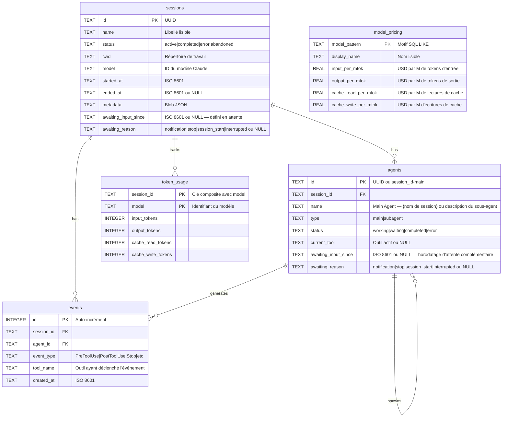

---

## Marketplace de plugins

CCAM fournit **14 plugins** à partir d'une seule arborescence source partagée. Claude Code lit `.claude-plugin/marketplace.json` ; Codex lit `.agents/plugins/marketplace.json` ainsi que le `.codex-plugin/plugin.json` de chaque plugin. L'ensemble contient **66 skills de plugins, 18 sous-agents Claude, 34 commandes Claude, 3 utilitaires CLI, 3 configurations de hooks et 2 plugins avec MCP**.

```bash
# Claude Code
claude plugin marketplace add hoangsonww/Claude-Code-Agent-Monitor
claude plugin install ccam-platform@claude-code-agent-monitor-plugins

# Codex
codex plugin marketplace add hoangsonww/Claude-Code-Agent-Monitor
codex plugin add ccam-platform@claude-code-agent-monitor-plugins

# Open Agent Skills / skills.sh-compatible CLI
npx skills add hoangsonww/Claude-Code-Agent-Monitor --list

# Install one skill for Claude Code and Codex in the current project
npx skills add hoangsonww/Claude-Code-Agent-Monitor \
  --skill mcp-server \
  --agent claude-code \
  --agent codex \
  --yes

# Verify, update, and remove the project-scoped skill
npx skills list --json
npx skills update --project --yes
npx skills remove mcp-server --yes

# Add --global to install at user scope, then manage that scope explicitly
npx skills add hoangsonww/Claude-Code-Agent-Monitor \
  --skill mcp-server \
  --agent claude-code \
  --agent codex \
  --global \
  --yes
npx skills list --global --json
npx skills update --global --yes
npx skills remove --global mcp-server --yes
```

La CLI `skills` découvre **77 skills au total dans le dépôt**, dont les 66 skills de plugins et les skills de maintenance du dépôt. Les installations au niveau projet utilisent `.agents/skills/` plus des liens propres à chaque agent. Les skills globales de Claude Code vont par défaut dans `~/.claude/skills/`, ou `$CLAUDE_CONFIG_DIR/skills/` s'il est défini. Les skills globales de Codex vont par défaut dans `~/.codex/skills/`, ou `$CODEX_HOME/skills/` s'il est défini. Les installations multi-agents peuvent dédoublonner les fichiers via un stockage partagé et lier ces destinations. Chaque skill de plugin a un frontmatter canonique `name`/`description` et des métadonnées `agents/openai.yaml`. Aucune PR en amont vers `vercel-labs/skills` n'est nécessaire pour l'installation. Le dépôt GitHub public est la source, et la visibilité sur skills.sh dépend de la publication et de la télémétrie réelle des installations.

De nouveaux packs ciblés complètent les plugins existants d'analyses, de productivité, de qualité, de sessions, de workflows, de configuration et de tableau de bord :

- `ccam-runner` : lancement surveillé de Claude Code/Codex, relance, arrêt, reprise et historique des exécutions
- `ccam-integrations` : règles d'alerte, webhooks, notifications push et collecte distante via SSH
- `ccam-platform` : explorateur de configuration Claude/Codex, import conscient du fournisseur, restauration de sauvegarde, installation des hooks, mises à jour et opérations MCP
- `ccam-reports` : rapports de direction, de coûts, de fiabilité et de workflows prêts à partager

Validez et régénérez les métadonnées de distribution avec :

```bash
npm run extensions:sync
npm run extensions:validate
```

Catalogue complet, commandes d'installation, comportement de skills.sh, limites de la soumission publique et vérifications d'installation propre : [docs/PLUGINS.md](docs/PLUGINS.md).

---

## Ligne de statut

Un utilitaire autonome de ligne de statut CLI pour Claude Code, qui affiche le nom du modèle, l'utilisateur, le répertoire de travail, la branche git, une barre d'utilisation de la fenêtre de contexte, le nombre de tokens par direction et le coût de la session — le tout coloré avec des séquences d'échappement ANSI.

```
nguyens6@host ~/agent-dashboard/client | Sonnet 4.6 | main | ████████░░ 79% | 3↑ 2↓ 156586c | $0.4231
```

| Segment | Couleur | Exemple |
| ----------- | -------------------- | -------------------------------------------------------------- |
| Modèle | Cyan | `Sonnet 4.6` |
| Utilisateur | Vert | `nguyens6` |
| CWD | Jaune | `~/agent-dashboard` |
| Branche git | Magenta | `main` |
| Barre de contexte | Vert / Jaune / Rouge | `████████░░ 79%` |
| Tokens | Vert / Cyan / Atténué | `3↑ 2↓ 156586c` (`↑` vert en entrée, `↓` cyan en sortie, `c` atténué pour le cache) |
| Coût (USD) | Vert / Jaune / Rouge | `$0.4231` (total de la session — affiché avec les formules API et abonnement) |

Seuils de couleur du coût : vert sous 5 $, jaune de 5 à 20 $, rouge au-delà de 20 $.

Voir [`statusline/README.md`](statusline/README.md) pour les instructions d'installation.

<p align="center">
  <a href="images/statusline.png"></a>
</p>

---

## Architecture du serveur

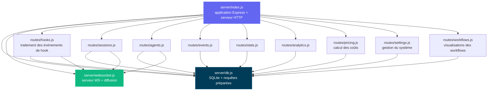

---

## Routage du client

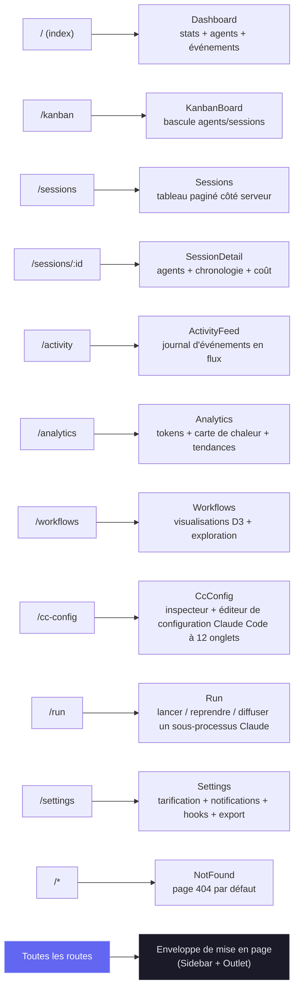

---

## Flux du gestionnaire de hooks

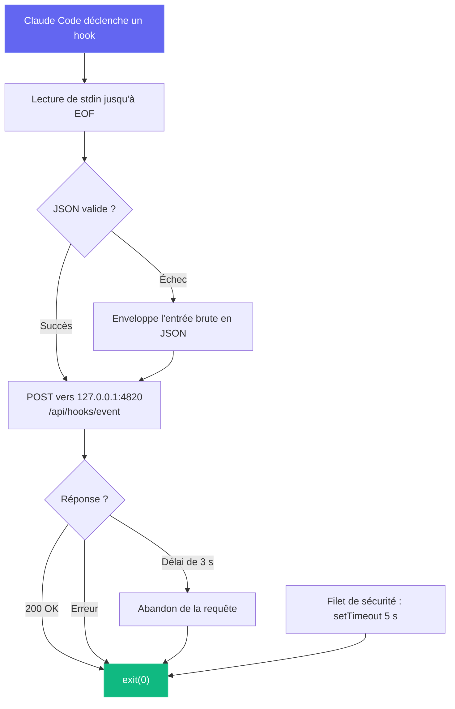

---

## Modes de déploiement

Nous prenons en charge des modes de déploiement de développement et de production, avec des architectures de processus différentes :

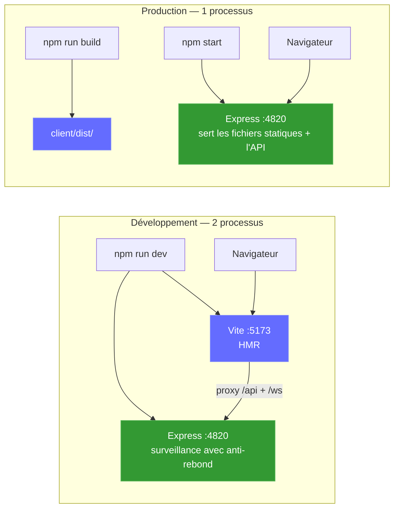

Sidecar MCP local facultatif (prend en charge les transports stdio, HTTP+SSE et REPL) :

```mermaid
graph LR
    subgraph "Options de transport MCP"
        M_STDIO["Serveur MCP (stdio)<br/>npm run mcp:start"]
        M_HTTP["Serveur MCP (HTTP)<br/>npm run mcp:start:http<br/>:8819"]
        M_REPL["Serveur MCP (REPL)<br/>npm run mcp:start:repl"]
    end

    H["Hôte MCP"] -->|"stdin/stdout"| M_STDIO
    RC["Client distant"] -->|"POST /mcp · GET /sse"| M_HTTP
    OP["Opérateur"] -->|"CLI interactive"| M_REPL

    M_STDIO --> D["Serveur du tableau de bord<br/>:4820"]
    M_HTTP --> D
    M_REPL --> D

    style M_STDIO fill:#0f766e,stroke:#14b8a6,color:#fff
    style M_HTTP fill:#0f766e,stroke:#14b8a6,color:#fff
    style M_REPL fill:#0f766e,stroke:#14b8a6,color:#fff
```

**Application de bureau (macOS et Windows)** facultative — un seul processus Electron qui héberge le serveur Express dans son processus (ni terminal, ni processus enfant) :

```mermaid
flowchart LR
    subgraph desktop["Application de bureau (macOS et Windows) — 1 processus Electron"]
        E_MAIN["Processus principal Electron<br/>(Node 22 / Electron 35)"]
        E_HOST["server-host.ts<br/>require() server/index.js"]
        E_SRV["Express embarqué :4820<br/>API · SQLite · WebSocket"]
        E_WIN["BrowserWindow<br/>client React compilé"]
        E_TRAY["Icône de barre de menus (tray)<br/>+ menu d'application natif"]
        E_MAIN --> E_HOST
        E_HOST -->|"require() dans le processus"| E_SRV
        E_MAIN --> E_TRAY
        E_SRV -->|"http + ws sur 127.0.0.1"| E_WIN
    end

    E_HOOKS["Hooks de Claude Code"] -->|"POST /api/hooks/event"| E_SRV

    style E_MAIN fill:#47848F,stroke:#2f5a62,color:#fff
    style E_SRV fill:#339933,stroke:#5cb85c,color:#fff
    style E_WIN fill:#61DAFB,stroke:#3aa9c9,color:#000
```

### Déploiement dans le cloud

La pile `deployments/` cible tout service Kubernetes conforme, y compris EKS, GKE, AKS, OKE et les clusters autogérés. CCAM utilise SQLite : chaque manifeste pris en charge impose donc **un seul écrivain actif du tableau de bord par volume persistant**, avec un déploiement de type Recreate. HPA, les réplicas actif-actif, le blue-green et le canary ne sont volontairement pas pris en charge tant que SQLite reste le moteur de persistance.

```mermaid
flowchart LR
  CI["CI : tests · validation · analyse · attestation · signature"] --> HELM["Helm / Kustomize / Terraform"]
  HELM --> APP["Tableau de bord CCAM<br/>exactement 1 réplica"]
  APP --> PVC[("PVC ReadWriteOnce conservé")]
  EDGE["Ingress ou Gateway API<br/>TLS + WebSocket"] --> APP
  PROM["Prometheus Operator"] -->|"Bearer /api/metrics"| APP
  MCP["Sidecar MCP authentifié"] --> APP
```

- **Helm :** écrivain unique imposé par le schéma, prise en charge des digests, PVC conservé, Ingress ou Gateway API, montage du jeton compatible External Secrets, NetworkPolicy, MCP et ServiceMonitor facultatifs.
- **Kustomize :** base conforme au PSS restreint, plus des surcouches dev/staging/production et des composants facultatifs MCP, supervision, Gateway API et instantanés CSI.
- **Terraform :** déploie le chart Helm validé sur un cluster Kubernetes existant. Le réseau cloud, l'identité du cluster, CSI, TLS et la synchronisation des secrets restent à la charge du fournisseur.
- **Exploitation :** sauvegarde en ligne cohérente de SQLite avec SHA-256, restauration vérifiée avec mise à l'échelle à zéro, déploiement/retour arrière/démontage précédés d'une sauvegarde, et contrôles de santé authentifiés.
- **Chaîne d'approvisionnement CI :** les images de l'application et du MCP sont analysées, publiées pour amd64/arm64 avec SBOM et provenance SLSA, et signées sans clé avec Cosign.

```bash
npm run deploy:validate
REGISTRY="ghcr.io/$(gh repo view --json owner -q .owner.login)"
IMAGE_TAG="$(git rev-parse --short HEAD)"

helm upgrade --install agent-monitor deployments/helm/agent-monitor \
  --namespace agent-monitor-production --create-namespace \
  --values deployments/helm/agent-monitor/values-production.yaml \
  --set image.registry= \
  --set image.repository=${REGISTRY}/claude-code-agent-monitor \
  --set image.tag=${IMAGE_TAG} \
  --atomic --wait --timeout 10m
```

> [!NOTE]
> La mise en place complète en production, les secrets, la pile Docker/Podman, Gateway API, Terraform, la sauvegarde, la restauration et le retour arrière sont documentés dans [DEPLOYMENT.md](DEPLOYMENT.md) et [deployments/README.md](deployments/README.md).

---

## Structure du projet

```
agent-dashboard/
|-- CLAUDE.md                   # Claude Code project memory and working agreements
|-- AGENTS.md                   # Codex project instructions
|-- package.json                # Root scripts (dashboard + MCP helpers) + server dependencies
|-- .claude/
|   +-- rules/                  # Path-scoped Claude rules
|   +-- skills/                 # Claude reusable project skills
|   +-- agents/                 # Claude custom subagents
|-- .claude-plugin/
|   +-- marketplace.json        # Claude Code marketplace manifest (14 plugins)
|-- .agents/plugins/
|   +-- marketplace.json        # Codex marketplace manifest (same 14 plugins)
|-- plugins/
|   |-- ccam-analytics/         # Analytics: session reports, cost breakdown, usage trends, productivity score
|   |   |-- .claude-plugin/plugin.json
|   |   |-- skills/ (4)         # session-report, cost-breakdown, usage-trends, productivity-score
|   |   |-- agents/             # analytics-advisor (Sonnet model)
|   |   |-- hooks/hooks.json    # Stop + SubagentStop event logging
|   |   +-- bin/ccam-stats      # Terminal dashboard CLI
|   |-- ccam-productivity/      # Productivity: standups, reports, sprints, workflow optimizer
|   |-- ccam-devtools/          # DevTools: debug, diagnostics, export, health checks
|   |   +-- bin/                # ccam-doctor + ccam-export CLIs
|   |-- ccam-insights/          # Insights: patterns, anomalies, optimization, comparison
|   |-- ccam-cost-guard/        # Cost guardrails: budgets, spend forecast, cost alerts, model savings
|   |-- ccam-sessions/          # Session forensics: search, timeline, transcript replay, cwd rollup, cleanup
|   |-- ccam-workflows/         # Workflow orchestration: DAG map, delegation audit, concurrency, fleet runs
|   |-- ccam-quality/           # Reliability & SLOs: error scan, API-error report, hook-failure audit, SLO check
|   |-- ccam-config/            # Config & memory governance: config audit, memory review, skill/MCP/hook inventory
|   +-- ccam-dashboard/         # Dashboard connector: status, quick stats, MCP integration
|       +-- .mcp.json           # MCP server configuration
|-- server/
|   |-- index.js                 # Express app, HTTP server, static serving
|   |-- db.js                    # SQLite schema, migrations, prepared statements
|   |-- websocket.js             # WebSocket server with heartbeat
|   +-- routes/
|       |-- hooks.js             # Hook event processing (transactional)
|       |-- sessions.js          # Session CRUD
|       |-- agents.js            # Agent CRUD
|       |-- events.js            # Event listing
|       |-- stats.js             # Aggregate statistics
|       |-- analytics.js         # Token, tool, and trend analytics
|       |-- workflows.js         # Aggregate workflow data and per-session drill-in
|       |-- pricing.js           # Model pricing CRUD and cost calculation
|       +-- settings.js          # System info, data management, export, cleanup
|   +-- lib/
|       +-- transcript-cache.js  # Stat-based JSONL transcript cache with chunked sync byte-stream reader (4 MiB chunks, line-by-line UTF-8 decode) so files larger than V8's max string length (~512 MiB) parse without aborting Node with "FATAL ERROR: v8::ToLocalChecked Empty MaybeLocal". Extracts tokens, compactions, API errors, turn durations, thinking blocks, and usage extras (service_tier, speed, inference_geo)
|   +-- compat-sqlite.js         # node:sqlite compatibility wrapper (fallback for better-sqlite3)
|-- client/
|   |-- package.json             # Client dependencies
|   |-- index.html               # HTML entry point
|   |-- vite.config.ts           # Vite + proxy config
|   |-- tailwind.config.js       # Custom dark theme
|   |-- tsconfig.json            # Strict TypeScript
|   +-- src/
|       |-- main.tsx             # React entry
|       |-- App.tsx              # Router + WebSocket provider
|       |-- index.css            # Tailwind + custom utilities
|       |-- lib/
|       |   |-- types.ts         # Shared TypeScript interfaces
|       |   |-- api.ts           # Typed fetch client
|       |   |-- format.ts        # Date/time formatting utilities
|       |   +-- eventBus.ts      # Pub/sub for WebSocket distribution
|       |-- hooks/
|       |   |-- useWebSocket.ts      # Auto-reconnecting WebSocket hook
|       |   +-- useNotifications.ts  # Browser notification triggers from WebSocket events
|       |-- components/
|       |   |-- Layout.tsx       # Shell with sidebar + outlet
|       |   |-- Sidebar.tsx      # Navigation + connection indicator
|       |   |-- AgentCard.tsx    # Agent info card with status
|       |   |-- StatCard.tsx     # Metric card
|       |   |-- StatusBadge.tsx  # Color-coded status pills
|       |   |-- EmptyState.tsx   # Placeholder for empty lists
|       |   +-- workflows/       # D3.js workflow visualization components
|       |       |-- OrchestrationDAG.tsx            # Horizontal DAG of agent spawning patterns
|       |       |-- ToolExecutionFlow.tsx           # d3-sankey diagram of tool-to-tool transitions
|       |       |-- AgentCollaborationNetwork.tsx   # Force-directed agent pipeline graph
|       |       |-- SubagentEffectiveness.tsx       # Scorecard grid with SVG success rings
|       |       |-- WorkflowPatterns.tsx            # Auto-detected orchestration sequences
|       |       |-- ModelDelegationFlow.tsx         # Model routing through agent hierarchies
|       |       |-- ErrorPropagationMap.tsx         # Error clustering by hierarchy depth
|       |       |-- ConcurrencyTimeline.tsx         # Swim-lane parallel agent execution
|       |       |-- SessionComplexityScatter.tsx    # D3 bubble chart (duration vs agents vs tokens)
|       |       |-- CompactionImpact.tsx            # Token compression events and recovery
|       |       |-- WorkflowStats.tsx               # Aggregate workflow statistics
|       |       +-- SessionDrillIn.tsx              # Per-session agent tree, tool timeline, events
|       +-- pages/
|           |-- Dashboard.tsx      # Overview page
|           |-- KanbanBoard.tsx    # Agents/Sessions toggle, status columns
|           |-- Sessions.tsx       # Server-paginated sessions table
|           |-- SessionDetail.tsx  # Single session deep dive
|           |-- ActivityFeed.tsx   # Real-time event stream
|           |-- Analytics.tsx      # Token usage, heatmap, trends
|           |-- Workflows.tsx      # D3.js workflow visualizations and session drill-in
|           |-- Settings.tsx       # Model pricing, notifications, hooks, export, cleanup
|           +-- NotFound.tsx       # 404 catch-all page
|-- scripts/
|   |-- hook-handler.js          # Lightweight stdin-to-HTTP forwarder
|   |-- install-hooks.js         # Auto-configures ~/.claude/settings.json
|   |-- import-history.js        # Imports sessions from ~/.claude/ with enhanced JSONL extraction (API errors, turn durations, entrypoint, permission modes, thinking blocks, usage extras, tool errors, subagent JSONL files). Re-import is fully incremental: a per-event-type high-water mark (`MAX(created_at) GROUP BY event_type` per session) is computed up-front and only JSONL entries with `ts > cutoff[type]` are inserted, so long-running sessions whose transcripts grow across multiple days continue to receive Stop / PostToolUse / TurnDuration / ToolError events on every re-run. Also rolls `sessions.ended_at` forward when the JSONL advances past the stored value and refreshes message-count metadata on every pass
|   +-- seed.js                  # Sample data generator
|-- mcp/
|   |-- package.json             # MCP package scripts + dependencies
|   |-- README.md                # MCP setup, host config, tool catalog, safety model
|   |-- src/
|   |   |-- index.ts             # MCP runtime entrypoint (transport router)
|   |   |-- server.ts            # MCP server assembly
|   |   |-- clients/             # Dashboard API client with retry/backoff
|   |   |-- config/              # Environment/CLI config parsing
|   |   |-- core/                # Logger, tool registry, result helpers
|   |   |-- policy/              # Mutation/destructive guards
|   |   |-- tools/               # 16 domain modules registering 103 tools
|   |   |-- transports/          # HTTP+SSE server, REPL, tool collector
|   |   |-- ui/                  # ANSI banner, colors, formatter, tables
|   |   +-- types/               # Shared MCP type definitions
|   +-- build/                   # Built MCP runtime output
|-- desktop/
|   |-- package.json             # Electron + electron-builder dependencies and scripts
|   |-- electron-builder.yml     # DMG packaging config; signing/notarization hooks
|   |-- tsconfig.json            # Strict TypeScript (src/ -> out/)
|   |-- README.md                # Desktop app architecture reference (contributor docs)
|   |-- assets/                  # icon.svg + generated icon.icns + tray PNGs
|   |-- src/
|   |   |-- main.ts              # Electron main process entry — lifecycle, wiring
|   |   |-- server-host.ts       # In-process Express boot, port discovery, adoption, DB close
|   |   |-- window.ts            # BrowserWindow + persisted window geometry
|   |   |-- tray.ts              # Menu-bar (tray) icon + context menu
|   |   |-- menu.ts              # Native application menu (File ▸ Open Dashboard is macOS-only)
|   |   |-- login-item.ts        # macOS Login Items auto-start toggle (SMAppService)
|   |   |-- logger.ts            # File logger -> ~/Library/Logs/Claude Code Monitor/desktop.log
|   |   |-- constants.ts         # App name, ports, timeouts, window size
|   |   +-- preload.ts           # Intentionally empty (zero renderer privilege)
|   |-- scripts/
|   |   |-- install.js           # Preflights native deps for desktop:install; prints setup help + exits non-zero on failure
|   |   |-- preflight.js         # Shared better-sqlite3 binary check + actionable per-OS setup help (incl. no-toolchain alternative)
|   |   |-- prebuild.js          # Ensures root + client are built before tsc; fails fast with setup help if native binary missing
|   |   |-- build-icons.sh       # SVG -> PNG/ICNS via qlmanage/sips/iconutil
|   |   +-- notarize.js          # electron-builder afterSign hook (opt-in notarization)
|   +-- tests/
|       +-- smoke.test.mjs       # Spawn Electron + probe /api/health
|-- deployments/
|   |-- README.md                # Production deployment reference
|   |-- nginx/                   # Rootless Nginx edge and opt-in hook/MCP policies
|   |-- secrets/                 # Ignored Compose token/password files
|   |-- terraform/               # Helm deployment to an existing Kubernetes cluster
|   |-- kubernetes/              # One-writer Kustomize base + environment overlays
|   |   |-- base/                # Restricted PSS, Recreate Deployment, PVC, Service, Ingress
|   |   |-- overlays/            # Dev, staging, production namespaces and resources
|   |   +-- components/          # MCP, ServiceMonitor, Gateway API, VolumeSnapshot
|   |-- helm/agent-monitor/      # Schema-enforced Helm chart and environment values
|   +-- scripts/                 # Validate, deploy, backup, restore, rollback, health, teardown
|-- .codex/
|   |-- config.toml              # Codex runtime configuration
|   |-- README.md                # Codex setup guide for agents and skills
|   |-- rules/                   # Codex execution policy rules
|   |-- agents/                  # Codex custom agent templates
|   +-- skills/                  # Codex project skills
|-- statusline/
|   |-- README.md                # Statusline installation & usage guide
|   |-- statusline.py            # Python script that renders the statusline
|   +-- statusline-command.sh    # Shell wrapper for Claude Code's statusLine config
+-- data/
    +-- dashboard.db             # SQLite database (gitignored)
```

---

## Dépannage

| Problème | Solution |
| --------------------------------- | ---------------------------------------------------------------------------------------------------------------------------------------------------------------- |
| L'installation de `better-sqlite3` échoue | Ce n'est pas bloquant — le serveur se replie automatiquement sur le module intégré de Node.js `node:sqlite` (Node 22+). Sur les versions plus anciennes de Node, installez Python 3 et les outils de compilation C++, puis lancez `npm rebuild better-sqlite3` |
| Les hooks ne se déclenchent pas | Lancez `npm run install-hooks` et redémarrez Claude Code. Vérifiez que les hooks figurent dans `~/.claude/settings.json` |
| Le tableau de bord n'affiche aucune donnée | Vérifiez que le serveur tourne (`npm run dev`) avant de démarrer une session Claude Code. Contrôlez `http://localhost:4820/api/health` |
| WebSocket déconnecté | Le client se reconnecte automatiquement toutes les 2 secondes. Vérifiez que le port 4820 n'est pas bloqué par un pare-feu |
| Données périmées après un redémarrage | La base persiste d'un redémarrage à l'autre. Lancez `npm run seed` pour des données de démonstration neuves, ou supprimez `data/dashboard.db` pour tout réinitialiser |
| Les outils MCP ne se connectent pas | Vérifiez que l'API du tableau de bord répond sur `MCP_DASHBOARD_BASE_URL`, puis recompilez/démarrez MCP (`npm run mcp:build`, `npm run mcp:start`) |

---

## Contribuer

Les contributions sont les bienvenues — voir [`.github/CONTRIBUTING.md`](.github/CONTRIBUTING.md) pour le guide complet.

Tous les contributeurs doivent signer le [Contributor License Agreement](https://github.com/hoangsonww/Claude-Code-Agent-Monitor/blob/master/CLA.md). Cette règle est appliquée automatiquement sur chaque pull request par la GitHub Action `🖋️ CLA Assistant` : la première fois que vous ouvrez une PR, un bot vous demande de signer en commentant `I have read the CLA Document and I hereby sign the CLA`. Le contrôle de statut **CLA Assistant** de la PR reste rouge tant que vous ne l'avez pas fait, et une seule signature couvre toutes vos contributions futures.

---

## Licence

MIT. Voir [LICENSE](LICENSE) pour les détails.
