# Dashboard degli agenti per Claude Code, Cursor & Codex

### Piattaforma di monitoraggio in tempo reale per l'attività degli agenti Claude Code, Cursor & Codex 🚀

Una dashboard professionale per tracciare e visualizzare in tempo reale le sessioni degli agenti Claude Code, Cursor e Codex, l'uso degli strumenti, la cronologia delle conversazioni, i costi e l'orchestrazione dei subagenti. Costruita con Node.js, Express, React e SQLite, combina gli hook nativi con la scoperta locale delle transcript in base al provider.


> [!TIP]
> Consulta anche [README-EN.md](./README-EN.md) (English), [README-CN.md](./README-CN.md) (中文), [README-VN.md](./README-VN.md) (Tiếng Việt), [README-KO.md](./README-KO.md) (한국어) e [README-ES.md](./README-ES.md) (español). Questo è il README in italiano.

> [!NOTE]
> Ti serve un aiuto orientato ai task? La [GitHub Wiki](https://github.com/hoangsonww/Claude-Code-Agent-Monitor/wiki) è il manuale pratico per l'uso quotidiano, le operazioni di team, il troubleshooting, l'automazione CLI/MCP e le ricette di deployment. La [Wiki statica localizzata](https://hoangsonww.github.io/Claude-Code-Agent-Monitor/wiki/) resta il tour di prodotto e architettura in inglese, vietnamita, cinese, coreano e spagnolo; i contratti tecnici esatti restano in [`docs/`](./docs/README.md).

---

## Indice dei contenuti

- [Panoramica](#panoramica)
- [Internazionalizzazione (i18n)](#internazionalizzazione-i18n)
- [Funzionalità](#funzionalità)
- [Avvio rapido](#avvio-rapido)
- [Come funziona](#come-funziona)
- [Configurazione](#configurazione)
- [Script npm](#script-npm)
- [Marketplace dei plugin](#marketplace-dei-plugin)
- [Estensioni degli agenti](#estensioni-degli-agenti)
- [Integrazione MCP](#integrazione-mcp)
- [Riferimento API](#riferimento-api)
- [Eventi hook](#eventi-hook)
- [Notifiche del browser](#notifiche-del-browser)
- [Notificatore di aggiornamenti](#notificatore-di-aggiornamenti)
- [Tabby — il gatto compagno fluttuante](#tabby--il-gatto-compagno-fluttuante)
- [Segnali sonori](#segnali-sonori)
- [Modale dello stato di connessione](#modale-dello-stato-di-connessione)
- [Estensione VS Code](#estensione-vs-code)
- [App desktop (macOS e Windows)](#app-desktop-macos-e-windows)
- [Archiviazione dei dati](#archiviazione-dei-dati)
- [Statusline](#statusline)
- [Architettura del server](#architettura-del-server)
- [Routing del client](#routing-del-client)
- [Flusso del gestore degli hook](#flusso-del-gestore-degli-hook)
- [Modalità di deployment](#modalità-di-deployment)
- [Struttura del progetto](#struttura-del-progetto)
- [Risoluzione dei problemi](#risoluzione-dei-problemi)
- [Contribuire](#contribuire)
- [Licenza](#licenza)

---

## Panoramica

Traccia le sessioni, monitora gli agenti in tempo reale, visualizza l'uso degli strumenti, riproduci le conversazioni e osserva l'orchestrazione dei subagenti attraverso un'interfaccia web professionale con tema scuro. Claude Code e Codex usano i loro hook nativi; Cursor è incluso out of the box tramite i suoi eventi live compatibili più la scoperta nativa delle transcript in `~/.cursor`.

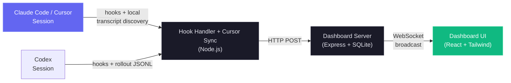

Oltre alla dashboard di monitoraggio in tempo reale, include anche un'implementazione di server MCP locale in `mcp/` che espone un catalogo di strumenti per ispezionare e gestire la dashboard stessa, rendendo facile integrare le operazioni della dashboard direttamente nei tuoi workflow Claude Code & Codex. C'è inoltre un livello di estensione degli agenti, che fornisce plugin, skill e subagenti Claude Code & Codex per l'interazione con la dashboard, le analisi e la workflow intelligence.

### Internazionalizzazione (i18n)

L'interfaccia include il cambio di lingua integrato per inglese (`en`), cinese (`zh`), vietnamita (`vi`), coreano (`ko`), spagnolo (`es`) e italiano (`it`). Un menu a tendina personalizzato evita che il selettore affolli la barra laterale man mano che si aggiungono lingue. Le risorse linguistiche sono caricate per namespace e conservate nello storage del browser per una preferenza utente stabile tra un refresh e l'altro.

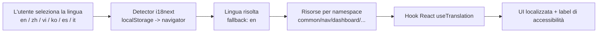

Per l'architettura completa e le indicazioni operative, vedi [docs/I18N.md](./docs/I18N.md).

### Interfaccia utente

L'interfaccia scura e responsive copre l'intero workflow. Ogni anteprima usa una miniatura adatta al mobile e rimanda all'originale ad alta definizione.

<p align="center">
  <a href="images/dashboard.png"></a>
  <br>
  <em>📡 <strong>Dashboard</strong> · totali della flotta, agenti attivi, attività recente e segnali di salute live</em>
</p>

<p align="center">
  <a href="images/tasks-overview.png"></a>
  <br>
  <em>📋 <strong>Avanzamento attività</strong> · completamento compatto e anteprime del lavoro per proprietario</em>
</p>

<p align="center">
  <a href="images/dashboard-health.png"></a>
  <br>
  <em>🩺 <strong>Salute del sistema</strong> · storage, cache, errori, strumenti, modelli, subagenti e compattazioni</em>
</p>

<p align="center">
  <a href="images/board.png"></a>
  <br>
  <em>📋 <strong>Kanban Board · Agenti</strong> · agenti in lavorazione, in attesa, completati e in errore con motivi di attesa chiari</em>
</p>

<p align="center">
  <a href="images/board-sessions.png"></a>
  <br>
  <em>🗂️ <strong>Kanban Board · Sessioni</strong> · sessioni attive, in attesa, completate, in errore e abbandonate</em>
</p>

<p align="center">
  <a href="images/sessions.png"></a>
  <br>
  <em>📂 <strong>Sessioni</strong> · cronologia ricercabile, filtrabile e paginata lato server con costi e attività</em>
</p>

<p align="center">
  <a href="images/session-agents.png"></a>
  <br>
  <em>🤖 <strong>Agenti della sessione</strong> · totali live, uso degli strumenti, flusso dei token e gerarchia degli agenti</em>
</p>

<p align="center">
  <a href="images/tasks-details.png"></a>
  <br>
  <em>✅ <strong>Dettagli attività</strong> · segmenti di completamento, lavoro attivo, proprietari e attività paginate</em>
</p>

<p align="center">
  <a href="images/session-conversation.png"></a>
  <br>
  <em>💬 <strong>Conversazione</strong> · transcript renderizzate, codice, chiamate agli strumenti, output dei comandi e marcatori di sessione</em>
</p>

<p align="center">
  <a href="images/session-timeline.png"></a>
  <br>
  <em>🔬 <strong>Timeline</strong> · eventi cronologici, filtri multidimensionali e attività degli strumenti accoppiate</em>
</p>

<p align="center">
  <a href="images/feed.png"></a>
  <br>
  <em>📰 <strong>Activity Feed</strong> · eventi live con pausa, raggruppamento, filtri e salti alla sessione</em>
</p>

<p align="center">
  <a href="images/analytics.png"></a>
  <br>
  <em>📊 <strong>Analisi</strong> · token per modello, frequenza degli strumenti, heatmap di attività e trend delle sessioni</em>
</p>

<p align="center">
  <a href="images/workflows.png"></a>
  <br>
  <em>🔀 <strong>Workflow</strong> · grafi di orchestrazione, flusso degli strumenti, collaborazione, delega e pattern</em>
</p>

<p align="center">
  <a href="images/dynamicworkflows-workflows.png"></a>
  <br>
  <em>🧬 <strong>Esecuzioni dei workflow</strong> · stato basato su journal, agenti, token, strumenti e durata</em>
</p>

<p align="center">
  <a href="images/dynamicworkflows-workflows2.png"></a>
  <br>
  <em>🧬 <strong>Esecuzione espansa</strong> · filtri di fase, metriche per agente, prompt e risultati completi</em>
</p>

<p align="center">
  <a href="images/dynamicworkflows-session.png"></a>
  <br>
  <em>🧬 <strong>Workflow della sessione</strong> · esecuzioni dinamiche collegate e costi in token integrati</em>
</p>

<p align="center">
  <a href="images/config.png"></a>
  <br>
  <em>🧰 <strong>Config agente</strong> · ispeziona e modifica in sicurezza la configurazione supportata di Claude Code e Codex</em>
</p>

<p align="center">
  <a href="images/config-codex.png"></a>
  <br>
  <em>🧰 <strong>Config Codex</strong> · modelli, profili, MCP, progetti, skill, hook, regole, plugin e istruzioni</em>
</p>

<p align="center">
  <a href="images/config-skills.png"></a>
  <br>
  <em>🧩 <strong>Skill</strong> · skill utente, di progetto e di plugin ricercabili, con modifica dotata di backup</em>
</p>

<p align="center">
  <a href="images/run.png"></a>
  <br>
  <em>▶️ <strong>Esegui agente</strong> · avvia Claude Code o Codex con controlli nativi del provider</em>
</p>

<p align="center">
  <a href="images/run-results.png"></a>
  <br>
  <em>💬 <strong>Esecuzione live</strong> · chat in streaming, ragionamento, comandi, modifiche ai file, strumenti e ri-aggancio</em>
</p>

<p align="center">
  <a href="images/settings.png"></a>
  <br>
  <em>⚙️ <strong>Impostazioni</strong> · prezzi, hook, notifiche, dati, sorgenti remote e stato del sistema</em>
</p>

<p align="center">
  <a href="images/alerts.png"></a>
  <br>
  <em>🔔 <strong>Alert</strong> · regole, cooldown, attività e webhook integrati o generici firmati</em>
</p>

<p align="center">
  <a href="images/remote.png"></a>
  <br>
  <em>🛰️ <strong>Sorgenti dati remote</strong> · sync SSH per provider e monitoraggio con scope per sorgente</em>
</p>

<p align="center">
  <a href="images/palette.png"></a>
  <br>
  <em>⌘ <strong>Command Palette</strong> · un unico launcher da tastiera per pagine, sessioni, progetti, filtri e azioni</em>
</p>

La barra laterale collega Dashboard, Kanban Board, Sessioni, Activity Feed, Analisi, Workflow, Config agente, Esegui agente e Impostazioni. Le sezioni seguenti descrivono il comportamento completo dietro queste viste.

---

## Funzionalità

La dashboard copre l'intero ciclo di vita locale degli agenti. I contratti operativi dettagliati restano nelle sezioni collegate e nei riferimenti in `docs/`.

| Funzionalità | Riepilogo |
| --- | --- |
| **Avanzamento attività** | Avanzamento per proprietario dai task tool di Claude, dal `TodoWrite` legacy e dall'`update_plan` di Codex. Anteprime compatte compaiono su card e righe; il Dettaglio sessione aggiunge segmenti di stato, lavoro attivo, proprietari e paginazione a 10 righe. Nuovo lavoro di livello superiore azzera lo stato incompleto obsoleto, mentre la cronologia completata rimane. |
| **Dashboard** | Le schede persistenti **Monitor** e **Health** combinano totali della flotta, gerarchie attive, attività recente, salute ponderata di successo/cache/errori/heap, storage, strumenti, modelli, efficacia dei subagenti e metriche di compattazione. Health si aggiorna ogni 5 secondi da `/api/settings/info` e `/api/workflows`. |
| **Kanban Board** | Le colonne degli agenti coprono In lavorazione, In attesa, Completato ed Errore; le colonne delle sessioni aggiungono Attiva e Abbandonata. Le card si paginano 10 alla volta, si sottoscrivono solo alla vista WebSocket attiva, preservano i titoli completi e spiegano i motivi di attesa come richiesta di permesso, fine del turno, prompt inattivo o interruzione. |
| **Sessioni** | Cronologia ricercabile, filtrabile e paginata lato server con calcolo del costo sulla pagina visibile e una riga di avvio Codex temporanea in memoria. La ricerca copre `id`, `name` e `cwd` con un debounce di 300 ms. I nomi si risolvono dal titolo esplicito, dal titolo AI e poi dal primo prompt utente significativo. |
| **Dettaglio sessione** | Statistiche live, lavoro attivo, uso degli strumenti, subagenti, token, gerarchia, timeline di eventi filtrate, raggruppamento per `tool_use_id` e renderer specifici per strumento. La vista Conversazione rende i turni in coda, gli avvisi di sistema, il Markdown, il codice evidenziato e gli strumenti con stile dedicato; i banner di attesa mostrano il motivo e il tempo trascorso. |
| **Activity Feed** | Eventi in tempo reale con pausa, filtri condivisi, paginazione lato server, raggruppamento, origine progetto/sessione/subagente, link alle sessioni e badge di stato Claude/Codex coerenti. |
| **Analisi** | Token per modello, frequenza degli strumenti, heatmap di attività allineate alla domenica, trend delle sessioni, stato della connessione, skeleton di caricamento allineati al layout e legende lunghe paginate. |
| **Command Palette** | `Cmd/Ctrl+K` cerca comandi recenti, tutte le route, sessioni live lato server, azioni di pagina, directory di progetto, sottoviste, filtri, Impostazioni, Config agente, preferenze, scope e lingua. Supporta l'ordinamento per sottosequenza, gli scope `>`/`@`/`#`, il controllo completo da tastiera, le label tradotte, il fallimento silenzioso della ricerca e la sola navigazione per le azioni distruttive. |
| **Scorciatoia unica** | `Cmd/Ctrl+K` è l'unica combinazione globale della dashboard, anche dentro i campi. La navigazione multi-tasto rimossa evita modalità nascoste; Tabby mantiene `Cmd/Ctrl+B`. |
| **Aggiornamenti live** | Il push WebSocket aggiorna l'interfaccia senza polling. |
| **Scoperta automatica** | I segnali del provider creano sessioni e agenti automaticamente. Claude compare a `SessionStart`; Codex mostra una card In attesa locale e temporanea prima che esista un ID durevole, adotta in sicurezza i thread conclusi ripresi e non scrive mai card pre-identità nei totali durevoli, nelle analisi, negli alert o nelle notifiche. |
| **Import della cronologia** | Le transcript di Claude da `~/.claude/` e i rollout di Codex da `~/.codex/sessions` usano flussi di scansione e upload specifici per provider, lo stesso conteggio dell'ingestione live e scritture idempotenti. I rollout Codex esterni vengono messi in snapshot così le conversazioni sopravvivono alla rimozione della sorgente. |
| **Gerarchia dei subagenti** | Gli alberi padre-figlio comprimibili su Dashboard e Dettaglio sessione si espandono automaticamente mentre i figli sono attivi. |
| **Agenti in background** | I subagenti in background restano tracciati senza completamento prematuro. |
| **Attribuzione degli strumenti ai subagenti** | `SubagentStop` e le scansioni all'avvio importano gli strumenti dai JSONL per-subagente, accoppiano i risultati per `tool_use_id`, deduplicano, uniscono le righe live corrispondenti entro 30 secondi e ricostruiscono i veri genitori annidati dagli ID dei figli generati. Il ricollegamento del genitore è additivo e attiva il refresh della UI anche quando non viene inserita alcuna riga. |
| **Tracciamento dei costi** | Il pricing configurabile per modello e per sessione supporta tariffe introduttive datate, categorie promo modificabili, il costo proprio di ciascun subagente e totali resistenti alla compattazione. Le letture delle transcript usano offset di byte incrementali in cache. |
| **Cache delle transcript** | Il parsing incrementale JSONL estrae token, compattazioni, errori API, durate dei turni, thinking e metadati d'uso; i parsing completi riparano i duplicati legacy mentre i parsing della coda restano append-only. Gli array sono limitati a `TRANSCRIPT_CACHE_MAX_ARRAY_LEN`, default `1000`, e le voci memorizzano solo i metadati del file più il risultato analizzato. |
| **Conservazione degli snapshot delle transcript** | Gli snapshot durevoli di Claude, Codex e Cursor preservano la conversazione più completa. Le copie Claude e Cursor con sorgente mancante vengono compresse in gzip dopo un round-trip verificato; la purge rimuove gli snapshot; limiti opzionali di età/dimensione possono eliminare l'unica copia vecchia dopo un'anteprima dry-run nelle Impostazioni. |
| **Notifiche** | Il Web Push VAPID consegna gli eventi configurati anche con il browser in background o chiuso, con supporto audio su macOS e controlli di sottoscrizione. |
| **Alert** | Le Impostazioni offrono Regole, Canali e Attività per alert di pattern di evento, inattività, agente bloccato e soglia di token. Le regole su evento girano dopo l'ingestione; le regole temporali vengono valutate ogni 60 secondi. Gli alert persistiti usano cooldown per regola/sessione, default 300 secondi, consegna WebSocket, conferma e fan-out webhook con scope verso 14 provider nominali o JSON generico firmato con segreti mascherati, timeout e retry limitati. |
| **Notificatore di aggiornamenti** | Un `git fetch` pianificato e non bloccante confronta il checkout con il remote canonico, poi mostra il comando di aggiornamento esatto nel modale, nella barra laterale e nel terminale. CCAM non esegue mai pull né si riavvia da solo. |
| **Impostazioni** | Stato di sistema e degli hook, pricing per provider, notifiche, pulizia, home dei provider, refresh istantaneo dei dati e ripristino idempotente di export JSON fino a 25 MiB. Il pricing supporta default per provider, regole con wildcard, indicazioni sulle tariffe pubblicate, la soglia GPT dei 272K e cataloghi separati per modelli nativi Cursor e di terze parti. |
| **Esegui agente + Config agente** | `/run` avvia thread Claude Code o thread app-server nativi di Codex con modelli, approvazioni, sandboxing, resume, stop, stream e ri-aggancio specifici per provider. `/cc-config` affianca esploratori modificabili Claude e Codex; i file utente supportati usano salvataggi atomici protetti e backup con timestamp, anteprime con segreti oscurati, comandi di profilo esatti e watcher specifici per provider. |
| **Config agente Codex** | Mostra il catalogo completo dei modelli dell'account più gli override base/profilo, crea overlay standard `<name>.config.toml` e protegge la modifica con controlli di contenimento canonico e di symlink. Profili, hook, regole, skill e istruzioni supportano le azioni sorgente/percorso/modifica/elimina con eliminazione preceduta da backup; `config.toml` è solo modificabile. |
| **Server MCP (locale)** | Tre trasporti, stdio, HTTP+SSE e REPL, espongono 103 strumenti tipizzati su 16 moduli. Un unico catalogo validato impone target localhost o HTTPS, regole di bearer-token, rifiuto dei redirect, gate sulle mutazioni, upload da 50 MiB per file e 100 MiB per chiamata, risposte binarie da 10 MiB e ripristini da 25 MiB. |
| **Workflow** | Undici sezioni D3 coprono orchestrazione, flusso degli strumenti, collaborazione, efficacia, pattern, delega, errori, concorrenza, complessità, compattazione e drill-in per sessione. Tooltip esplicativi localizzati, filtri incrociati, export JSON, refresh live con debounce di 3 secondi ed esecuzioni dinamiche ricostruite da journal preservano il dettaglio per agente di fase, token, strumento, durata, prompt e risultato. |
| **Tracciamento delle compattazioni** | Le scansioni delle transcript creano agenti/eventi di compattazione a durata zero, riparano le durate negative legacy, riempiono le sessioni vecchie e ispezionano periodicamente solo le sessioni attive tramite i valori `sessions.transcript_path` in cache. |
| **Sottosessioni/Sessioni riprese** | I nuovi eventi riattivano le sessioni riprese o orfane; una scansione ogni quarto di `DASHBOARD_STALE_MINUTES`, limitata tra 60 secondi e 5 minuti, intercetta le sessioni abbandonate. |
| **Rilevamento delle sessioni preesistenti** | L'import all'avvio segna come attive le transcript modificate di recente, e i successivi eventi Stop riattivano le sessioni importate completate o abbandonate prima di aggiornarle. |
| **Sincronizzazione continua dei progetti** | Una scansione immediata all'avvio, un watcher del filesystem con debounce e un poll `DASHBOARD_SESSION_SYNC_MS`, default 30 secondi, condividono una cache di mtime e una scansione unificata. Solo i file nuovi o avanzati vengono rianalizzati, con scope del watcher sicuro su Linux e broadcast delle sessioni in tempo reale. |
| **Sorgenti dati remote** | Le sorgenti SSH rispecchiano in modo indipendente le home di Claude e Codex tramite `scp` o `tar` su WSL, taggano `sessions.source`, riconciliano il ciclo di vita e restano sane se funziona anche solo uno dei provider. Il polling è di default 15 secondi; il fallback stale riguarda solo il provider fallito. Le credenziali restano all'SSH dell'host. |
| **Ingestione via remote push** | `POST /api/hooks/ingest-batch` supporta le macchine dietro NAT. Resta disabilitata finché non si imposta `REMOTE_PUSH_TOKEN`, rifiuta i token in query-string e le sessioni di proprietà locale, limita i lotti a 1000, deduplica `(session_id, event_type, uuid)`, restituisce errori parziali per voce e trasmette solo dopo il commit. |
| **Design responsive** | I layout mobile impilano le griglie, scorrono le tabelle larghe e comprimono la navigazione. |
| **Localizzazione dell'interfaccia** | Inglese, cinese, vietnamita, coreano, spagnolo e italiano coprono i testi dell'interfaccia, le label di accessibilità, le spiegazioni e i tooltip dei workflow, le indicazioni sul pricing dei modelli, le home dei provider e l'Import della cronologia. |
| **Dati di seed** | Uno script integrato fornisce dati realistici per demo e sviluppo. |
| **Statusline** | Una striscia CLI a colori mostra modello, contesto, branch Git, token per direzione e costo della sessione in USD. |
| **Formattazione dei nomi dei modelli** | Gli identificatori Claude, GPT e Gemini diventano nomi leggibili rimuovendo i suffissi provider/data/latest, unendo i numeri di versione e formattando i tag di contesto; le Impostazioni mantengono i pattern grezzi per il pricing. |
| **Marketplace di plugin Claude + Codex** | Un unico albero di 14 plugin distribuisce entrambi i formati di manifest e i cataloghi, 66 skill di plugin, 18 subagenti Claude, 34 comandi Claude, 3 helper CLI e metadati OpenAI. `npx skills add hoangsonww/Claude-Code-Agent-Monitor --list` scopre 77 skill del repository. |
| **Esegui Claude** | Le modalità conversazione e one-shot supportano resume/visualizzazione della cronologia, esecuzioni concorrenti in background, ri-aggancio consapevole della transcript, controlli modello/effort/permessi/cwd, smoothing dei messaggi parziali, conservazione del thinking, comandi slash, file `@`, misuratori di contesto e costo e stato live. La protezione same-origin blocca lo spawn drive-by; la concorrenza ha un tetto di sicurezza di default pari a 10000 e può essere ridotta con `RUN_MAX_CONCURRENT`. |
| **Esploratore di configurazione Claude** | Dodici schede ispezionano skill, agenti, comandi, stili, plugin, marketplace, MCP, hook, impostazioni, memoria, scorciatoie da tastiera e statusline. I percorsi canonici bloccano l'evasione tramite symlink; le superfici di testo supportate usano create/modifica/elimina atomici con backup con timestamp fuori dall'albero, mentre la configurazione sensibile resta in sola lettura con indicazioni CLI esatte. Un `cc-watcher` da 500 ms trasmette le modifiche esterne. |
| **Tabby** | Una mascotte WebSocket senza dipendenze con otto stati d'animo derivati dall'attività, parlato limitato, azioni rapide, risposte di stato locali e passaggio a Esegui Claude per i prompt più ampi. È accessibile da tastiera, consapevole della reduced-motion, sicura quando disconnessa, configurabile e localizzata. |
| **Segnali sonori** | Sette segnali Web Audio senza dipendenze coprono sessioni, errori, subagenti, notifiche, connessione e clic. Cooldown, un budget globale di burst, filtro passa-basso, sicurezza sull'autoplay, volume persistito e impostazioni per singolo segnale li mantengono discreti. |
| **Progressive Web App (PWA)** | Dashboard, landing page e Wiki hanno manifest e service worker indipendenti. Gli asset Vite immutabili sono cache-first; la navigazione e i file dello shell mutabili sono network-first; il push resta intatto; landing e Wiki pre-cacheano i propri shell e cacheano le screenshot in lazy; i metadati SVG e Apple supportano l'installazione. |
| **App desktop (macOS e Windows)** | Electron 35 pacchettizza i DMG per macOS e gli EXE installer/portable per Windows attorno allo stesso server Express in-process e client React. Aggiunge menu nativi, stato/azioni nella tray, avvio al login, conferma di uscita, notifiche native, un lock di istanza singola, fallback/adozione sicura della porta, spegnimento pulito di SQLite e setup di hook/background al primo avvio. |
| **Asset self-hosted (senza CDN)** | Font, script, Mermaid della Wiki e fallback dell'estensione sono locali. L'app, la landing page e la Wiki funzionano offline senza Google Fonts, jsDelivr o altre richieste di asset a terze parti. |
| **Schermata splash della sessione** | Un saluto localizzato, una volta per sessione del browser, e un'animazione a grafo di nodi compaiono opachi dal primo frame, durano circa 2,5 secondi, supportano il clic per saltare e rispettano la reduced-motion. |

> **Scope del provider e home:** Le impostazioni mantengono globalmente coerente la scelta tra Claude-compatibile (Claude Code + Cursor) / Codex / Entrambi. Le home di Claude Code e Codex restano modificabili senza riavviare la dashboard; Cursor viene scoperto automaticamente da `~/.cursor` o `DASHBOARD_CURSOR_HOME`.
>
> **Confini di sicurezza locale:** Esegui agente accetta qualsiasi directory di lavoro assoluta esistente e la normalizza prima dell'uso, quindi gli avvii da home e dai progetti recenti restano supportati. I provider di webhook gestiti richiedono HTTPS; i target generic e n8n possono usare HTTP per ricevitori locali/self-hosted, e la consegna non segue mai i redirect.

---

## Avvio rapido

### Prerequisiti

- **Node.js** >= 22.22.0 (consigliata la 24 LTS)
- **npm** >= 9.0.0

### 1. Installazione

```bash
git clone https://github.com/hoangsonww/Claude-Code-Agent-Monitor.git
cd Claude-Code-Agent-Monitor
npm run setup
```

### 2. Configura gli hook di Claude Code

```bash
npm run install-hooks
```

Scegli **Claude Code**, **Codex (beta)** o entrambi con i tasti freccia, Spazio e Invio. Gli hook di Claude sono salvati in `~/.claude/settings.json` e quelli di Codex in `~/.codex/hooks.json`. La reinstallazione sostituisce solo le voci di CCAM e preserva gli hook non correlati; la stessa azione è disponibile in **Impostazioni → Hook Configuration**.

Al primo avvio, CCAM controlla solo i provider selezionati per lo scope dati corrente e propone di installare gli hook mancanti. Un controllo di prontezza fallito ripiega sulla configurazione manuale invece di bloccare la dashboard.

La scoperta dei provider continua dopo il setup:

- **Claude Code e Cursor:** gli hook di Claude alimentano gli eventi live. Cursor non richiede hook; selezionare Claude Code osserva anche `~/.cursor/chats` e `~/.cursor/projects/*/agent-transcripts`, mette in snapshot le conversazioni prima della pulizia di Cursor e rispetta `DASHBOARD_CURSOR_HOME`.
- **Codex:** gli hook e il watching incrementale dei rollout in `~/.codex/sessions` mantengono aggiornati ciclo di vita, prompt, titoli, strumenti, token, costi, compattazioni, conversazioni e stato WebSocket. I file difettosi vengono ritentati in isolamento; l'esatto matching rollout/processo evita card attive fantasma; i titoli nativi `/rename` e la cronologia della conversazione paginata a cursore restano live.
- **Entrambi:** le card conservano gli ultimi due prompt umani distinti, rendono gli allegati immagine persistiti e deduplicano le risposte Codex ripetute. Lo scope solo-Codex nasconde i journal dei Dynamic Workflow specifici di Claude.

### 3. Avvio

```bash
# Development (hot reload on both server and client)
npm run dev

# Production (single process, built client)
npm run build && npm start
```

> [!TIP]
> **Alternativa con Makefile** — tutti i comandi sono disponibili anche via `make` se lo hai installato sul sistema. Esegui `make help` per vedere ogni target, o usa scorciatoie come `make dev`, `make build`, `make test`, ecc.

### 4. Apertura

| Modalità    | URL                     |
| ----------- | ----------------------- |
| Development | `http://localhost:5173` |
| Production  | `http://localhost:4820` |

### 5. Opzionale: esegui il server MCP locale

```bash
npm run mcp:start              # stdio (default — per l'integrazione con host MCP)
npm run mcp:start:http         # server HTTP + SSE sulla porta 8819
npm run mcp:start:repl         # CLI interattiva con tab completion
ccam mcp stdio                 # launcher stabile usato dai plugin inclusi
```

`npm run setup` installa e compila il pacchetto MCP prima di linkare `ccam`. Per la modalità stdio, configura il tuo host con comando `ccam` e argomenti `["mcp", "stdio"]`.

Per la modalità HTTP, punta i client MCP remoti a `http://127.0.0.1:8819/mcp` (Streamable HTTP) o `http://127.0.0.1:8819/sse` (SSE legacy).

Vedi [mcp/README.md](./mcp/README.md) per la configurazione completa dell'host, i dettagli dei trasporti, i flag di sicurezza e il catalogo degli strumenti.

### Opzionale: dati demo di seed

```bash
npm run seed
```

Crea 8 sessioni di esempio, 23 agenti e 106 eventi così puoi esplorare la UI immediatamente.

### Alternativa: app desktop (macOS e Windows)

Se preferisci non tenere un terminale aperto, installa l'**app desktop nativa** opzionale. Incorpora il server in-process, aggiunge un'icona nella barra dei menu / area di notifica (tray) e supporta l'avvio automatico al login (Login Items su macOS / avvio automatico su Windows).

La via più rapida è **scaricare un installer precompilato** dall'[ultima Release GitHub](https://github.com/hoangsonww/Claude-Code-Agent-Monitor/releases/latest) (la CI pubblica automaticamente una `vX.Y.Z` ogni volta che `package.json` viene incrementato su `master`):

- **macOS** — prendi `ClaudeCodeMonitor-<version>-arm64.dmg` (Apple Silicon) o `-x64.dmg` (Intel) e trascina **Claude Code Monitor.app** in `/Applications`.
- **Windows** — prendi `ClaudeCodeMonitor-Setup-<version>-x64.exe` (installer) o `ClaudeCodeMonitor-<version>-x64-portable.exe` (senza installazione) ed eseguilo.

Per compilarla da te invece:

```bash
npm run desktop:install        # installa Electron + electron-builder in desktop/ (verifica le dipendenze native; stampa aiuto di setup in caso di fallimento)
npm run desktop:dmg:arm64      # macOS: DMG veloce single-arch (Apple Silicon)
npm run desktop:win            # Windows: installer NSIS .exe (da eseguire su Windows)
```

La copertura completa dell'app desktop — download, installazione, funzionalità tray/menu, comandi di build e firma — è nella sezione [App desktop (macOS e Windows)](#app-desktop-macos-e-windows) più sotto. Vedi anche [`DESKTOP.md`](./DESKTOP.md) (guida utente) e [`desktop/README.md`](./desktop/README.md) (architettura).

### Alternativa: Docker / Podman

L'immagine OCI e i file Compose supportano Docker e Podman. Il runtime è non-root, rimuove tutte le capability, usa Tini come PID 1, include Git/OpenSSH/SQLite e diventa read-only tranne che per `/app/data`, `/app/config` e `/tmp`.

```bash
# Dashboard only
docker compose up -d --build
# or
podman compose up -d --build

# Complete stack: dashboard + authenticated MCP + Nginx + Prometheus + Grafana
umask 077
openssl rand -hex 32 > deployments/secrets/dashboard-token
openssl rand -hex 32 > deployments/secrets/hook-token
openssl rand -hex 32 > deployments/secrets/mcp-token
openssl rand -base64 32 > deployments/secrets/grafana-admin-password
npm run docker:full:up
```

Tutte le porte host si bindano al loopback per default: dashboard `4820`, MCP `8819`, Nginx `8080`, Prometheus `9090` e Grafana `3000`. Le home di Claude e Codex sono montate in sola lettura; volumi con nome persistono SQLite e la configurazione di proprietà della dashboard. Nginx fa da proxy per UI, REST API autenticata e WebSocket, mentre hook, metriche e MCP restano bloccati al perimetro se non esplicitamente abilitati. Il target Docker opzionale `agent-runtime` aggiunge CLI Claude Code e Codex a versione bloccata per workflow Run Agent container-native.

> [!IMPORTANT]
> Installa gli hook di Claude Code/Codex sull'host dopo l'avvio del container. Per hook cloud remoti, imposta `CCAM_DASHBOARD_URL=https://...` e un `CCAM_HOOK_TOKEN` separato; gli URL di hook non-loopback richiedono HTTPS. Vedi [DEPLOYMENT.md](DEPLOYMENT.md).

---

## Come funziona

La dashboard si integra con Claude Code tramite il suo sistema di hook nativo per fornire un monitoraggio in tempo reale dell'attività degli agenti. Ecco una panoramica dell'architettura e del flusso dei dati:

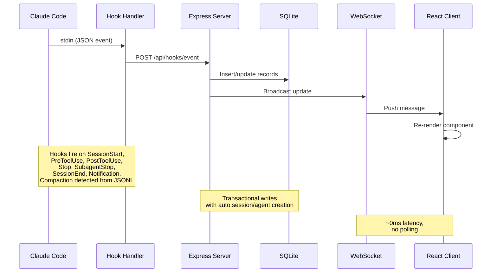

> [!IMPORTANT]
> Vedi [ARCHITECTURE.md](./ARCHITECTURE.md) per un approfondimento sull'architettura del server, lo schema del database, le route API, il design del WebSocket, il routing del client, il flusso del gestore degli hook, le modalità di deployment e i diagrammi dettagliati del ciclo di vita di sessioni e agenti.

### Ciclo di vita degli hook

1. **Claude Code** fa scattare un hook all'avvio della sessione, all'uso di uno strumento, alla fine del turno, al completamento di un subagente e all'uscita dalla sessione
2. Il **gestore degli hook** (`scripts/hook-handler.js`) legge l'evento JSON dallo stdin, risolve le dashboard live via `~/.claude/.agent-dashboard.json` (o `CLAUDE_DASHBOARD_PORT` se impostata) e fa il POST dello stesso payload verso **un target di ingest per ogni directory dati SQLite unica** (vince la porta più bassa quando Docker e `npm run dev` condividono `~/.claude/agent-dashboard`, così gli eventi non vengono mai ingeriti due volte). I server con database **diversi** (es. l'app desktop che usa la propria directory Application Support accanto a `npm run dev`) ricevono comunque ciascuno gli hook. Fallisce silenziosamente con un timeout di sicurezza di 5 s così non blocca mai Claude Code, e le promise per target non vanno mai in reject così un singolo listener morto non può affamare gli altri.
3. Il **server** elabora l'evento dentro una transazione SQLite:
   - Auto-crea sessioni e agenti principali al primo contatto
   - Rileva le chiamate allo strumento `Agent` per tracciare la creazione dei subagenti
   - Al `SessionStart`, marca `awaiting_input_since` della sessione e dell'agente principale così una CLI appena aperta ferma al prompt atterra subito in **Waiting**
   - Al `UserPromptSubmit` (l'utente preme invio), cancella il flag di attesa e promuove l'agente principale a `working` — l'unico segnale affidabile che un turno dell'assistente di solo testo è iniziato, dato che non emette `PreToolUse`
   - Imposta l'agente a "working" al `PreToolUse` (cancellando anche il flag di attesa), lo mantiene working attraverso il `PostToolUse`
   - Allo `Stop` (Claude finisce di rispondere), l'agente principale va in "waiting" — Claude ha finito il suo turno, la palla è all'utente. I subagenti in background continuano a girare. La sessione resta `active`. Uno Stop con `stop_reason=error` marca l'agente `error` e la sessione `error`
   - A una `Notification` di permesso (riconosciuta dal pattern del messaggio: `permission`, `waiting for input`, `needs your approval`, …), imposta l'agente a `waiting` e marca `awaiting_input_since`
   - `SubagentStop` deliberatamente NON cancella il flag di attesa (un subagente in background che finisce non ci dice nulla sull'umano)
   - Marca i subagenti come completati individualmente via `SubagentStop`. Dopo il ritorno di `res.json()`, lancia un passaggio fire-and-forget `scanAndImportSubagents` che percorre i file `subagents/agent-*.jsonl` della sessione, accoppia i blocchi `tool_use` ↔ `tool_result` per `tool_use_id` ed emette eventi `PreToolUse` + `PostToolUse` sotto l'`agent_id` proprio di ciascun subagente — chiudendo il gap per cui le chiamate agli strumenti interne ai subagenti sarebbero altrimenti invisibili alla dashboard
   - Al `SessionEnd` (il processo CLI esce), rimuove il flag di attesa. Se la sessione è in `error`, lo stato di errore viene preservato; altrimenti marca tutti gli agenti + la sessione come `completed`
   - Al `SessionStart`, qualsiasi altra sessione attiva senza attività per `DASHBOARD_STALE_MINUTES` (default 180 = 3 h, sovrascrivibile via env) viene automaticamente marcata "abandoned" con i suoi agenti completati. Questo gestisce `/resume` dentro una sessione, Ctrl+C e altri scenari in cui una sessione resta orfana senza un `SessionEnd` pulito
   - Riattiva le sessioni completed/error/abandoned quando arrivano nuovi eventi di lavoro (sessione ripresa). Anche gli eventi Stop e SubagentStop riattivano le sessioni completed/abandoned — questo gestisce le sessioni preesistenti importate prima dell'avvio del server, dove il primo evento hook può essere uno Stop
   - **Recupero dagli errori**: solo `UserPromptSubmit` e `PreToolUse` possono recuperare una sessione da `error` a `active` — a indicare che l'utente ha riprovato attivamente
   - Rileva la compattazione delle conversazioni (voci `isCompactSummary` nella trascrizione JSONL) e crea agenti + eventi `Compaction`. Le baseline dei token sono preservate attraverso le compattazioni così nessun uso va perso. Le letture delle trascrizioni usano una cache condivisa basata su stat con letture incrementali per offset di byte — vengono analizzati solo i nuovi byte aggiunti dall'ultima lettura, con uno speedup di ~50x per le sessioni lunghe
   - Estrae gli errori API (voci `isApiErrorMessage`: limiti di quota, rate limit, invalid_request) e le risposte grezze `type: "error"` dalle trascrizioni JSONL, salvati come eventi `APIError`. Le durate dei turni (`system` con sottotipo `turn_duration`) sono salvate come eventi `TurnDuration`. Gli errori dei risultati degli strumenti (`toolUseResult.is_error`) sono tracciati come eventi `ToolError`
   - **Watchdog di rilevamento errori** — un timer in background gira ogni 15 secondi, scansionando le sessioni attive senza eventi hook recenti (>10 s di stallo). Rilegge i loro file di trascrizione cercando errori API (fallimenti di autenticazione, rate limit, esaurimento della quota), deriva i percorsi delle trascrizioni dalla `cwd` della sessione per le sessioni importate senza `transcript_path` nei dati degli eventi, e marca sessioni/agenti come `error` quando trova errori API. Questo intercetta i casi in cui la CLI di Claude non fa scattare un hook dopo un errore API (es. errori di autenticazione 401 dove la CLI mostra l'errore e aspetta)
   - **Recupero dall'interruzione utente (Esc)** — annullare un turno con `Esc` non fa scattare **alcun hook** (una limitazione documentata di Claude Code), quindi senza intervento l'agente principale resterebbe bloccato in `working` per sempre. Lo stesso watchdog da 15 s recupera in due modi: (1) quando l'annullamento lascia un marcatore `[Request interrupted by user]` nella trascrizione (Esc *dopo* un po' di output), la cache delle trascrizioni lo segnala via `pendingInterrupt` — derivato puramente dall'ordinamento della trascrizione (ultima interruzione vs ultima attività reale del turno, stesso orologio, quindi funziona anche per un annullamento sotto il secondo) — e la sessione passa a **Waiting** entro ~15 s; (2) quando Esc viene premuto *prima di qualsiasi output*, Claude Code non scrive alcun marcatore, quindi si applica un fallback a timeout di inattività — se l'agente principale è stato `working` **senza strumenti in volo** e **né un evento hook né la trascrizione sono avanzati** per `DASHBOARD_WORKING_IDLE_SECONDS` (default `120`), il turno viene considerato morto e la sessione passa a **Waiting**. Entrambi i percorsi registrano un evento `Interrupted` e portano la sessione nello stesso stato Waiting che produce uno `Stop` normale. L'output in streaming (trascrizione ancora in crescita) e le chiamate agli strumenti in volo (`current_tool` impostato) sono esenti; un raro flip errato si auto-ripara al successivo hook reale
   - **Reap di liveness delle sessioni morte** — uscire da Claude Code (Ctrl+C, chiusura del terminale) fa scattare un hook `SessionEnd`, ma se la dashboard non è in esecuzione in quel momento l'evento è perso per sempre e la sessione resterebbe in **Waiting** fino allo sweep di stallo (3 h per default). Lo stesso watchdog da 15 s chiude il gap con un **probe di liveness dei processi**: elenca i processi CLI `claude` in esecuzione (`ps` + `lsof` su macOS, `/proc` su Linux) e completa qualsiasi sessione `active` la cui `cwd` non ha un processo claude vivo — portandola nello stesso stato `completed` che produce un vero `SessionEnd`, con un evento `SessionEnd` sintetico sulla timeline. Guardie: nei tick del watchdog la trascrizione della sessione non deve essere stata scritta per almeno `DASHBOARD_LIVENESS_IDLE_SECONDS` (default `60`; l'ultima scrittura di hook è l'orologio di fallback quando nessuna trascrizione esiste su disco) — i **passaggi di boot saltano interamente questo gate**, così una sessione chiusa anche un secondo prima del lancio viene ripulita immediatamente — e il probe risponde "nessuna risposta" (senza cambiare nulla) su Windows, dentro i container (i processi host lì sono invisibili), quando `ps`/`lsof` falliscono, o quando esplicitamente disabilitato via `DASHBOARD_LIVENESS_PROBE=0`. In un deployment **misto** il reap salta automaticamente anche qualsiasi sessione la cui `cwd` non è POSIX-assoluta — una sessione inoltrata da un'altra macchina via hook domestici riporta il percorso proprio dell'origine (es. un `D:\Git\ai-deck` Windows) che una scansione locale `ps`/`lsof`/`/proc` non può mai matchare, così le sessioni remote sono protette senza disabilitare il probe per quelle genuinamente locali. Anche le **sessioni da Sorgenti dati remote** (`sessions.source` ≠ `local`) vengono sempre saltate — la loro `cwd` è legittimamente POSIX-assoluta su un'altra macchina, quindi il probe dei processi locale non dice nulla su di loro; il loro ciclo di vita è interamente di proprietà della riconciliazione remote-sync descritta sopra. Un completamento errato si auto-ripara: il successivo evento hook riattiva la sessione. Oltre alla cadenza del watchdog da 15 s, il reap gira **immediatamente all'avvio** (ripulendo le sessioni morte già nel DB da un'esecuzione precedente prima ancora che vengano renderizzate) e **di nuovo ~5 s dopo** (coprendo le sessioni appena importate dalla sincronizzazione di avvio), così una sessione morta mentre la dashboard era giù non appare mai come Waiting
   - Uno sweep periodico del server intercetta le sessioni abbandonate e le nuove compattazioni sfuggite al rilevamento basato sugli eventi (es. `/compact` non fa scattare hook, `/resume` a pochi secondi dalla creazione della sessione). La cadenza è derivata da `DASHBOARD_STALE_MINUTES` (¼ della soglia, limitata tra 60 s e 5 min). Lo sweep legge `transcript_path` direttamente dalla riga di ogni sessione attiva (un piccolo lookup su indice) invece di scansionare la tabella degli eventi; la colonna è popolata dal gestore degli hook la prima volta che vede un percorso di trascrizione ed è backfillata una tantum dagli eventi esistenti dalla migrazione di `db.js`, con un indice parziale `idx_sessions_active_tp` che copre esattamente le righe lette dallo sweep. Lo sweep condivide la cache delle trascrizioni con il gestore degli hook, evitando I/O duplicato. La pulizia delle sessioni abbandonate evice anche la voce della cache delle trascrizioni per limitare la memoria. Le sessioni da **Sorgenti dati remote** (`source` ≠ `local`) restano di proprietà del mirror solo finché il loro provider Claude Code o Codex corrispondente è in salute; se quel provider è indisponibile, in errore o incagliato in `syncing`, la pulizia periodica e di avvio usano la normale regola di stallo così una vecchia card Waiting non può persistere per sempre
   - La **sincronizzazione continua dei progetti** (`startSessionSync`) mantiene `~/.claude/projects` scopribile oltre il backfill di avvio una tantum protetto da marker: un progetto aggiunto in seguito le cui sessioni non passano mai per gli hook resterebbe altrimenti invisibile fino a una scansione manuale. Uno sweep immediato all'avvio, un `fs.watch` con debounce (ricorsivo su macOS/Windows; root + figli immediati su Linux) e un poll `DASHBOARD_SESSION_SYNC_MS` (default 30 s; `0` disabilita il poll, il watcher resta) condividono una sola cache di mtime e uno sweep coalizzato che ri-analizza solo i file il cui mtime è avanzato — e salta una sessione già importata e invariata senza ri-analizzarla, così il costo di riavvio resta O(file nuovi/modificati). Ogni sessione appena scoperta o cresciuta trasmette `session_created`/`session_updated` più il suo agente principale, gli stessi frame emessi dagli hook
4. Il **WebSocket** trasmette il cambiamento a tutti i client connessi
5. La **UI** riceve l'aggiornamento e ri-renderizza i componenti interessati in tempo reale senza polling.

### Macchina a stati degli agenti

Stati persistiti: `working | waiting | completed | error`. La colonna
`awaiting_input_since` è supplementare — traccia quando l'agente
ha iniziato ad attendere ed è usata per mostrare la durata, ma `waiting` è ormai
un vero stato persistito.

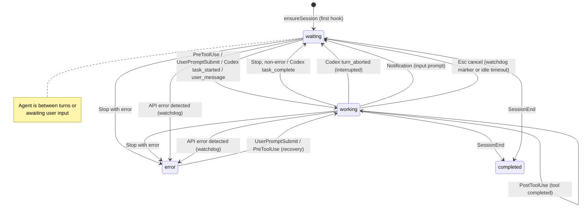

### Macchina a stati delle sessioni

Stati persistiti: `active | completed | error | abandoned`. Lo stato di sessione
**Waiting** è un overlay della UI (status=`active` con
`awaiting_input_since` impostato).

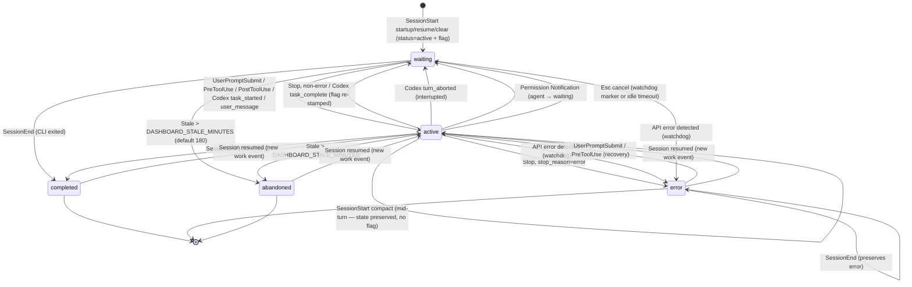

### Flusso di calcolo dei costi

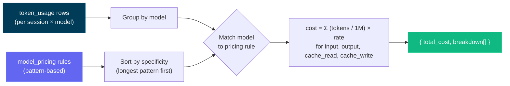

> [!IMPORTANT]
> Il flusso di calcolo dei costi si basa sull'uso dei token e sulle regole di pricing dei modelli. Assicurati che le tue regole di pricing siano aggiornate per riflettere costi accurati. Aggiorna la tabella di pricing dei modelli dalla pagina Impostazioni per mantenere un tracciamento dei costi accurato — la dashboard non recupera automaticamente aggiornamenti di prezzo da sorgenti esterne. Una volta impostate le regole di pricing, la dashboard le applica retroattivamente a tutte le sessioni per una rendicontazione dei costi coerente.

---

## Configurazione

| Variabile d'ambiente | Default | Scopo |
| --- | --- | --- |
| `DASHBOARD_PORT` | `4820` | Porta del server Express. |
| `CLAUDE_DASHBOARD_PORT` | `4820` | Porta usata dal gestore degli hook. |
| `NODE_ENV` | `development` | Usa `production` per servire il client compilato. |
| `DASHBOARD_UPDATE_CHECK` | abilitato | Imposta `0`, `false` o `off` per disabilitare i controlli pianificati sull'upstream. |
| `DASHBOARD_UPDATE_CHECK_INTERVAL_MS` | `300000` | Intervallo di aggiornamento, minimo 60.000 ms. Il **Controlla ora** manuale resta disponibile. |
| `DASHBOARD_STALE_MINUTES` | `180` | Inattività prima che una sessione attiva o In attesa diventi abbandonata. Il watchdog la applica e la manutenzione gira ogni quarto di questo valore, limitata tra 60 secondi e 5 minuti. |
| `DASHBOARD_WORKING_IDLE_SECONDS` | `120` | Recupera una cancellazione con Esc senza marcatore quando nessuna attività di strumento, hook o transcript avanza. Valori più bassi reagiscono più in fretta ma possono classificare male per un attimo i turni lunghi e silenziosi; la nuova attività si auto-corregge. Cursor usa la stessa regola. |
| `DASHBOARD_LIVENESS_PROBE` | `1` | Imposta `0` per disabilitare il completamento basato sul processo per le sessioni locali Claude/Codex morte. Salta automaticamente Windows, i container, i percorsi non POSIX inoltrati e le sorgenti remote. |
| `DASHBOARD_LIVENESS_IDLE_SECONDS` | `60` | Soglia di inattività su transcript o ultimo hook per i controlli di liveness del watchdog. I probe all'avvio ignorano la soglia così le sessioni già morte si chiudono subito. |
| `DASHBOARD_SESSION_SYNC_MS` | `30000` | Poll di sicurezza per i file `~/.claude/projects` nuovi o modificati. `fs.watch` resta immediato; `0` disabilita solo il polling. |
| `DASHBOARD_CURSOR_HOME` | `~/.cursor` | Root dello stato di Cursor per chat, transcript, backfill e snapshot durevoli. |
| `DASHBOARD_CURSOR_SYNC_MS` | `5000` | Poll di sicurezza Cursor con fingerprint. I watcher restano attivi quando `0` disabilita il polling. |
| `DASHBOARD_CODEX_HOME` | `CODEX_HOME` o `~/.codex` | Root dello stato di Codex. Le Impostazioni persistono un override, riarmano il watching e scansionano subito. |
| `DASHBOARD_CODEX_SYNC_MS` | `4000` | Poll di sicurezza dei rollout Codex. Hook e watcher restano attivi quando impostato a `0`. |
| `DASHBOARD_CODEX_MAX_ATTEMPTS` | `5` | Tentativi per un rollout illeggibile invariato, incluso il primo. Un cambio di dimensione o mtime azzera il budget; l'esaurimento viene loggato una volta. |
| `DASHBOARD_CODEX_HOOK_IDLE_SECONDS` | `60` | Completa le sessioni Codex solo-hook, come `codex exec --ephemeral`, quando uno `stop` segnalato come concluso non riceve mai `SessionEnd`. Il solo silenzio non basta mai. |
| `DASHBOARD_TASK_SUMMARY_TTL_MS` | `2000` | Finestra serve-stale per i riepiloghi delle attività e `todo_snapshot`. Gli append vengono analizzati in modo incrementale; una crescita oltre 32 MiB riparte da una coda nuova. `0` analizza ogni append. |
| `DASHBOARD_SNAPSHOT_COMPRESS` | `1` | Imposta `0`, `false` o `off` per fermare la conversione gzip verificata degli snapshot Claude/Cursor inattivi da 24 ore la cui sorgente è scomparsa. Gli alberi sorgente illeggibili e gli snapshot Codex vengono saltati. |
| `DASHBOARD_SNAPSHOT_MAX_AGE_DAYS` | non impostata | Passata di retention opzionale ogni sei ore per le sessioni concluse più vecchie di questa età. Le sessioni eliminate sono marcate con tombstone; le sessioni riprese sono protette. Prova con `ccam snapshots prune --days N` perché lo snapshot può essere l'unica copia. |
| `DASHBOARD_SNAPSHOT_MAX_BYTES` | non impostata | Limite totale opzionale degli snapshot in byte o unità come `5GB`. Vengono eliminate prima le sessioni concluse più vecchie; le sessioni attive o delle ultime 24 ore restano protette. |
| `DASHBOARD_REMOTE_SYNC_MS` | `15000` | Poll delle sorgenti remote SSH per progetti Claude, rollout Codex e indici dei titoli Codex. Le sorgenti nuove o riabilitate sincronizzano subito; `0` lascia disponibile la sync manuale. |
| `DASHBOARD_REMOTE_ACTIVE_WINDOW_MS` | `600000` | Tratta una transcript remota rispecchiata come attiva finché il suo ultimo evento è fresco entro questo limite, poi la riconcilia a completata. I provider falliti ricadono nella normale gestione stale. |
| `DASHBOARD_REMOTE_SYNC_TIMEOUT_MS` | `600000` | Timeout per sorgente per il pull SSH più l'import. |
| `DASHBOARD_REMOTE_TEST_TIMEOUT_MS` | `15000` | Timeout per il test SSH della sorgente remota. |
| `DASHBOARD_HOST` | `127.0.0.1` | Interfaccia di bind. `0.0.0.0` espone il servizio e logga un avviso. |
| `DASHBOARD_TOKEN` | non impostata | Protegge `/api/*` e il WebSocket tramite header Bearer, `x-dashboard-token` o `?token=`. Il loopback è il confine di fiducia predefinito. |
| `DASHBOARD_TOKEN_FILE` | non impostata | Token della dashboard basato su file per i secret Docker/Kubernetes; `DASHBOARD_TOKEN` prevale. |
| `DASHBOARD_HOOK_TOKEN` / `DASHBOARD_HOOK_TOKEN_FILE` | non impostata | Protezione indipendente per `/api/hooks/event` e `/api/hooks/codex` oltre il loopback. |
| `REMOTE_PUSH_TOKEN` / `REMOTE_PUSH_TOKEN_FILE` | non impostata | Gate separato per il pubblico `POST /api/hooks/ingest-batch`. La route resta disabilitata di default e non eredita mai il token hook locale. |
| `DASHBOARD_ALLOWED_HOSTS` | loopback | Valori `Host` HTTP e WebSocket aggiuntivi separati da virgola per la protezione dal DNS-rebinding. |
| `DASHBOARD_ENV_PATH` | `.env` del repo | File dotenv scrivibile usato per persistere gli override delle home dei provider; i container usano di default `/app/config/.env`. |
| `CCAM_DASHBOARD_URL` | scoperta localhost | Destinazione hook remota. Gli URL non-loopback richiedono HTTPS e un token hook. |
| `CCAM_HOOK_TOKEN` / `CCAM_HOOK_TOKEN_FILE` | non impostata | Credenziale del client hook inviata come `x-ccam-hook-token`. |

> [!IMPORTANT]
> Il server è solo-loopback di default. L'accesso dalla LAN richiede `DASHBOARD_HOST`, `DASHBOARD_TOKEN` e valori `DASHBOARD_ALLOWED_HOSTS` corrispondenti. Vedi [`.env.example`](./.env.example) e [la policy di sicurezza](./.github/SECURITY.md).

I clone Git recuperano periodicamente il remote canonico e confrontano il suo branch predefinito con il checkout corrente. Quando è indietro, il terminale e la UI mostrano il comando esatto di aggiornamento manuale. CCAM non esegue mai pull né si riavvia da solo.

---

## CLI `ccam`

La CLI **`ccam`** (`bin/ccam.js` → `cli/`) espone la dashboard da qualsiasi terminale tramite un albero di comandi Commander.js con opzioni ereditate, validazione, suggerimenti, help generato e completamento della shell. `npm run setup` la collega automaticamente. La risoluzione del server controlla `--server` / `CCAM_URL`, le porte configurate, il registro dei server live e infine `http://127.0.0.1:4820`.

```bash
# Server
ccam status | health                  # ● attivo / ○ non attivo; versione + timestamp
ccam start [--port N] | stop | restart  # server di produzione in background
ccam logs [-n N] [-f]                 # tail di data/ccam-server.log
ccam open [page] [--session id]       # apre la dashboard, una pagina o una sessione
ccam repl                             # shell interattiva (anche: shell, i)

# Monitoraggio
ccam overview [--watch]               # snapshot live a schermo intero (alias: top)
ccam stats | kanban                   # totali + distribuzioni di stato / colonne di stato
ccam tail [--session id] [--type T] [--tool N]   # feed live degli eventi
ccam stream [--type new_event,…]      # feed WebSocket grezzo in tempo reale
ccam watch -n 5 <command …>           # riesegue qualsiasi comando a intervalli

# Dati
ccam sessions [--status s] [--q text] [--cwd dir] [--sort price] [--limit n]
ccam sessions get|stats|cost|agents|events|transcripts <id>
ccam sessions transcript <id>         # la conversazione come chat leggibile
ccam sessions rename <id> <name…> | update <id> | create | facets
ccam agents [list|get|update|create]  # agenti; ccam session <id> = sessions get
ccam events [--type T] [--tool N] [--q text] [--from iso] | events facets

# Insight
ccam analytics                        # token, costo, strumenti principali, sparkline giornaliere
ccam workflows [session <id>]         # workflow intelligence + pattern
ccam runs [list|get <run-id>]         # esecuzioni dello strumento Workflow
ccam run list|history|start|follow|send|stop …   # agenti avviati dalla dashboard
ccam cost [--session id] [--daily]    # costo per modello, sovrapprezzi, modelli senza prezzo

# Alert e webhook
ccam alerts [--unacked] | ack <id> | ack-all
ccam alert-rules list|types|create|update|enable|disable|delete
ccam webhooks list|get|providers|deliveries|create|update|enable|disable|delete|test

# Pricing
ccam pricing [list] | set <pattern> --input N --output N [--fast-* …] [--intro-* …] | delete | reset
ccam pricing gpt|cursor [list|set|delete]   # listini OpenAI/Codex e Cursor

# Import e sorgenti remote
ccam import guide|rescan|path <dir>|upload <files…>|reimport
ccam import-data <file.json>          # ripristina un export (idempotente)
ccam remote-sources list|get|add|update|enable|disable|test|sync|rm

# Amministrazione
ccam doctor | info | export [file|-] | cleanup --hours N --days M
ccam snapshots [status|compress] | snapshots prune --days N   # snapshot delle transcript; prune è dry-run salvo --apply --confirm PRUNE_SNAPSHOTS
ccam hooks [status|install] | reinstall-hooks | config claude|codex …
ccam updates [status|check] | update-check | metrics [--grep re]
ccam home [set claude|codex <path>] | push key|send|subscribe|unsubscribe
ccam api [METHOD] /api/path [--data JSON]   # qualsiasi endpoint; le scritture richiedono --yes
ccam mcp [stdio|http|repl] | clear-data --yes

# CLI
ccam help [command…] | commands [--json] | completion bash|zsh|fish | version
```

I gruppi elencano per impostazione predefinita (`ccam alerts` equivale a `ccam alerts list`); ogni comando supporta `--help`; `ccam commands` stampa l'albero e `ccam commands --json` ne emette lo schema leggibile dalle macchine.

- **Output:** TTYs get tables, status icons, charts, sparklines, agent trees, transcript views, and colored help. Pipes get plain text. `--json` or `CCAM_OUTPUT=json` returns stable JSON, with NDJSON for `tail`, `stream`, and `run follow`; errors use `{"error":{"code":"…","message":"…"}}` on stderr and exit `0` or `1`.
- **Writes:** use interactive `y/N` or `--yes`; non-interactive writes require `--yes`, and `clear-data` always requires the literal flag.
- **Offline mode:** read-only commands fall back to `data/dashboard.db`, display an `⚠ Offline mode` banner, and correct dead active sessions through the liveness view. Server-only commands explain why the dashboard is unavailable.
- **REPL and completion:** `ccam repl` adds tree-driven completion, persistent history, a live prompt, and `help`, `json`, and `watch` built-ins, with each line isolated in a child process. Enable zsh completion with `source <(ccam completion zsh)`.

If `ccam` is not on `PATH`, run `npm link` once from the repository root. See [docs/CLI.md](./docs/CLI.md) for the full contract.

## Script npm

| Comando                 | Descrizione                                                |
| ----------------------- | ---------------------------------------------------------- |
| `npm run setup`         | Installa le dipendenze di root/client/estensione/MCP, compila MCP e linka `ccam` |
| `npm run update:pull-setup` | `git pull --ff-only` poi `npm run setup` (upgrade manuale) |
| `npm run dev`           | Avvia server (watch mode) + client (Vite HMR) in parallelo |
| `npm run dev:server`    | Avvia Express con un watcher del codice sorgente con debounce e riavvio controllato |
| `npm run dev:client`    | Avvia solo il dev server di Vite                           |
| `npm run build`         | Compila il client React in `client/dist/`                   |
| `npm start`             | Avvia il server di produzione (serve il client compilato)              |
| `npm test`              | Esegue l'intera suite (server `node --test` + client Vitest)  |
| `npm run verify`        | Esegue l'intero gate locale in un comando: audit degli header di authorship, check Prettier, typecheck del client, test backend, test frontend |
| `npm run check:headers` | Verifica che ogni file sorgente applicabile porti l'header di authorship |
| `npm run typecheck:client` | Typecheck del client (`tsc -b`) — lo stesso check che la build di produzione esegue prima di Vite |
| `npm run test:server`   | Esegue i test backend (`node --test server/__tests__/`)        |
| `npm run test:client`   | Esegue i test frontend Vitest, inclusi gli **snapshot di render per ogni schermata** (`client/src/pages/__tests__/screens.snapshot.test.tsx`); rigenera le baseline dopo modifiche intenzionali alla UI con `cd client && npx vitest run -u` |
| `npm run install-hooks` | Configura gli hook di Claude Code in `~/.claude/settings.json`   |
| `npm run seed`          | Popola il database con dati di esempio                         |
| `npm run import-history`| Importa le sessioni legacy da `~/.claude/` (gira anche all'avvio) |
| `npm run reconcile-tokens`| Aggiorna i totali dei token per le sessioni importate (non abbassa mai un totale) |
| `npm run repair-tokens` | Ri-deriva i totali dei token **non-workflow** per ogni sessione **Claude** con una trascrizione su disco (trovata sotto `~/.claude/projects/` o via il `transcript_path` salvato della sessione) e azzera le baseline delle compattazioni; le righe workflow e Codex sono preservate. Riparazione una tantum per database gonfiati dalla somma di usage per record precedente alla v2.0.9. Ferma prima la dashboard |
| `DASHBOARD_TOKEN_REPAIR` | `1` (abilitato) | Riparazione automatica una tantum dei totali dei token gonfiati prima che l'usage fosse riconciliato per `message.id`. `replaceTokenUsage` è un high-water mark, quindi la sola correzione del parser non può mai abbassare un totale storico — senza questo passaggio ogni sessione pre-upgrade mantiene il suo costo gonfiato per sempre. Gira una volta per database (protetto da marker, differito fuori dal percorso di boot, saltato mentre un'altra dashboard condivide la directory dati) e prima fa uno snapshot delle vecchie righe in `token_usage_pre_repair`. Imposta `0` per saltarla e riparare manualmente con `npm run repair-tokens` |
| `npm run clear-data`    | Elimina tutte le sessioni, gli agenti, gli eventi e l'uso dei token            |
| `npm run mcp:install`   | Installa le dipendenze per il pacchetto MCP locale (`mcp/`)       |
| `npm run mcp:build`     | Compila il TypeScript del server MCP in `mcp/build/`             |
| `npm run mcp:start`     | Avvia il server MCP (trasporto stdio — per host MCP)        |
| `npm run mcp:start:http`| Avvia il server MCP (trasporto HTTP + SSE sulla porta 8819)      |
| `npm run mcp:start:repl`| Avvia il server MCP (REPL interattivo con tab completion)   |
| `npm run mcp:dev`       | Esegue il server MCP in modalità dev (`tsx`, stdio)                 |
| `npm run mcp:dev:http`  | Esegue il server MCP in modalità dev (`tsx`, HTTP + SSE)            |
| `npm run mcp:dev:repl`  | Esegue il server MCP in modalità dev (`tsx`, REPL interattivo)      |
| `npm run mcp:typecheck` | Type-check dei sorgenti MCP senza emettere output di build        |
| `npm run extensions:sync` | Rigenera nomi delle skill/metadata OpenAI, manifest Codex ed entrambi i marketplace |
| `npm run extensions:validate` | Valida tutti i 14 plugin dual-format e le 66 skill incluse |
| `npm run mcp:docker:build` | Compila l'immagine container MCP con Docker (`agent-dashboard-mcp:local`) |
| `npm run mcp:podman:build` | Compila l'immagine container MCP con Podman (`localhost/agent-dashboard-mcp:local`) |
| `npm run desktop:install` | Installa Electron + electron-builder nel workspace `desktop/` (ricompila `better-sqlite3` per l'ABI di Electron); verifica preventivamente la build nativa di `better-sqlite3` e stampa aiuto pratico di setup (incl. un'alternativa senza toolchain) in caso di fallimento |
| `npm run desktop:dev`   | Compila e lancia l'app desktop Electron per l'iterazione locale  |
| `npm run desktop:build` | Compila i sorgenti TypeScript desktop in `desktop/out/`      |
| `npm run desktop:test`  | Esegue lo smoke test desktop (avvia Electron, sonda `/api/health`) |
| `npm run desktop:dmg`   | Compila **entrambi** i DMG macOS (arm64 + x64) — corretto per le release, **più lento** (impacchetta ogni arch) |
| `npm run desktop:dmg:arm64` | Compila un DMG solo Apple Silicon — **veloce**, consigliato per il tuo Mac |
| `npm run desktop:dmg:x64` | Compila un DMG solo Intel — **veloce**                           |
| `npm run desktop:dmg:universal` | Compila un unico DMG **universale** fuso (arm64 + x86_64) — opzionale, **il più lento**, non quello distribuito nelle release |
| `npm run desktop:win`   | Compila un **installer NSIS** Windows `.exe` (x64) — da eseguire su Windows |
| `npm run desktop:win:portable` | Compila un `.exe` Windows **portable** (senza installazione) (x64) — da eseguire su Windows |
| `npm run monitoring:install` | Esegue `npm install` in `monitoring/` — scarica Prometheus + Grafana via `postinstall` |
| `npm run monitoring:setup` | Alias di `monitoring:install` |
| `npm run monitoring:up` | Avvia Prometheus (:9090) + Grafana (:3000) in background (senza Docker) |
| `npm run monitoring:down` | Ferma lo stack di monitoring gestito da npm |
| `npm run monitoring:start` | Stack di monitoring in foreground (Ctrl+C ferma entrambi) |
| `npm run monitoring:docker:up` | Avvia Prometheus + Grafana via Docker Compose |
| `npm run monitoring:docker:down` | Smonta lo stack di monitoring Docker |
| `npm run monitoring:verify` | Health-check di dashboard, Prometheus, Grafana e scrape target |
| `npm run docker:up` | Avvia la dashboard in Docker (`docker compose up -d --build`) |
| `npm run docker:down` | Ferma il container della dashboard |
| `npm run docker:full:up` | Dashboard + MCP autenticato + Nginx rootless + Prometheus + Grafana |
| `npm run docker:full:down` | Smonta l'intero stack Docker |
| `npm run deploy:validate` | Esamina Docker, Compose, Nginx, Helm, Kustomize, Terraform, gli audit delle dipendenze e l'invariante one-writer. I risultati sono advisory (exit 0); `CCAM_DEPLOY_VALIDATE_STRICT=1` li trasforma in un gate rigido |

---

## Estensioni degli agenti

Questo repository include un livello di estensioni completo sia per Claude Code sia per Codex:

- Claude Code: `CLAUDE.md`, `.claude/rules/`, `.claude/skills/`
- Subagenti Claude: `.claude/agents/`
- Codex: `AGENTS.md`, `.codex/rules/`, `.codex/agents/`, `.codex/skills/`
- Plugin distribuibili condivisi: `plugins/`, con sia `.claude-plugin/plugin.json` sia `.codex-plugin/plugin.json`
- Marketplace: `.claude-plugin/marketplace.json` per Claude Code e `.agents/plugins/marketplace.json` per Codex
- Open Agent Skills: tutte le skill dei plugin portano frontmatter canonico più `agents/openai.yaml`; `npx skills add hoangsonww/Claude-Code-Agent-Monitor --list` scopre 77 skill del repository

### Architettura delle estensioni

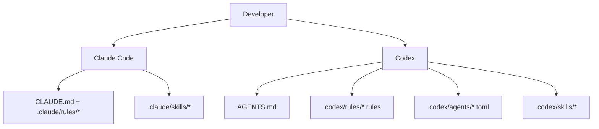

### Livello Claude Code

- Contesto persistente:
  - [`CLAUDE.md`](./CLAUDE.md)
- Regole con scope sui path:
  - [`.claude/rules/backend-node.md`](./.claude/rules/backend-node.md)
  - [`.claude/rules/frontend-react.md`](./.claude/rules/frontend-react.md)
  - [`.claude/rules/mcp-typescript.md`](./.claude/rules/mcp-typescript.md)
  - [`.claude/rules/docs-markdown.md`](./.claude/rules/docs-markdown.md)
  - [`.claude/rules/file-headers.md`](./.claude/rules/file-headers.md)
  - [`.claude/rules/wiki-i18n.md`](./.claude/rules/wiki-i18n.md)
  - [`.claude/rules/i18n-parity.md`](./.claude/rules/i18n-parity.md)
- Skill:
  - `repo-onboarding`
  - `ship-feature`
  - `version-release`
  - `mcp-operations`
  - `debug-live-issue`
  - `update-project-docs`
  - `file-headers`
  - `push-to-forked-pr`
  - `i18n-parity`
- Subagenti:
  - `backend-reviewer`
  - `frontend-reviewer`
  - `mcp-reviewer`

### Livello Codex

- Contesto persistente:
  - [`AGENTS.md`](./AGENTS.md)
- Policy di esecuzione:
  - [`.codex/rules/default.rules`](./.codex/rules/default.rules)
- Template di subagenti personalizzati:
  - [`.codex/agents/`](./.codex/agents)
- Skill:
  - [`.codex/skills/`](./.codex/skills)
- Setup:
  - [`.codex/README.md`](./.codex/README.md)

---

## Integrazione MCP

Questo progetto include un server MCP locale in `mcp/` con 97 strumenti in 16 moduli di dominio. Espone ogni azione dell'app supportata, incluse letture di dati con scope, trascrizioni/immagini, pricing Claude e GPT, workflow, alert/webhook, import e ripristino dei backup, configurazione Claude/Codex, Run Agent, sorgenti remote, impostazioni, push e manutenzione protetta. Supporta tre modalità di trasporto.

### Modalità di trasporto MCP

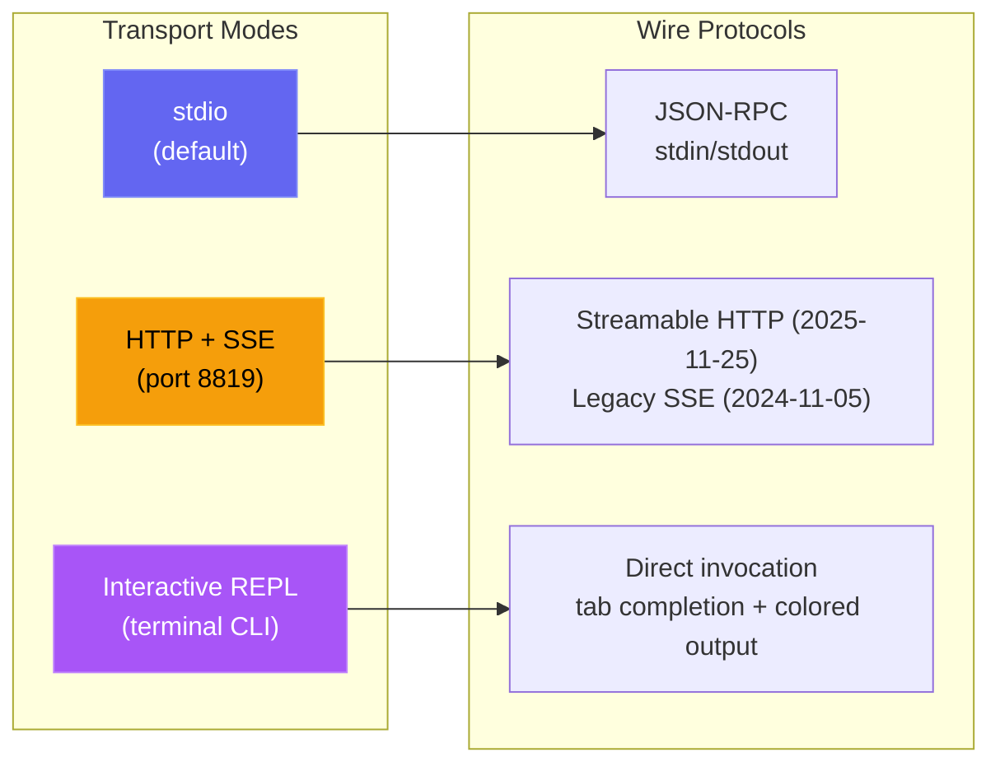

| Modalità | Comando | Caso d'uso |
| --- | --- | --- |
| **stdio** | `npm run mcp:start` | Claude Code, Claude Desktop, host MCP degli IDE |
| **HTTP** | `npm run mcp:start:http` | Client MCP remoti, integrazioni web, multi-sessione |
| **REPL** | `npm run mcp:start:repl` | Debug operativo, invocazione manuale degli strumenti, amministrazione locale |

<p align="center">
  
</p>

### Architettura MCP

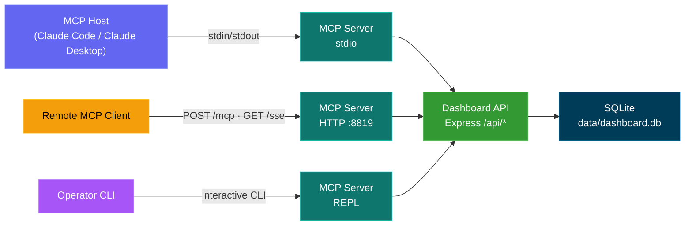

### Superficie degli strumenti MCP

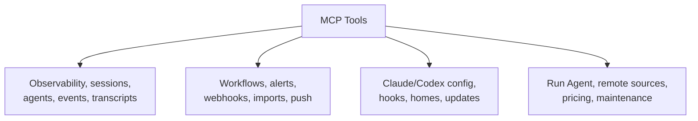

### Modello di sicurezza MCP

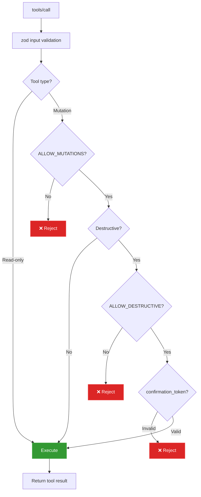

### Modalità operative MCP

- Modalità sola lettura (default): `MCP_DASHBOARD_ALLOW_MUTATIONS=false`
- Modalità admin: `MCP_DASHBOARD_ALLOW_MUTATIONS=true`
- Dashboard autenticata: imposta `MCP_DASHBOARD_API_TOKEN` / `_FILE` al token della dashboard
- Trasporto HTTP/SSE autenticato: imposta `MCP_HTTP_AUTH_TOKEN` / `_FILE`; i client inviano bearer auth o `x-mcp-token`
- Guardrail di trasporto: l'HTTP diretto in loopback può portare il token; gli alias container-host richiedono HTTPS; i redirect sono rifiutati
- Guardrail sui payload: 50 MiB per file di storico caricato, 100 MiB totali per chiamata, 10 MiB per le risposte binarie e 25 MiB per il ripristino dei backup
- Modalità distruttiva: richiede entrambi:
  - `MCP_DASHBOARD_ALLOW_MUTATIONS=true`
  - `MCP_DASHBOARD_ALLOW_DESTRUCTIVE=true`
  - input dello strumento `confirmation_token: "CLEAR_ALL_DATA"`

Dettagli completi: [mcp/README.md](./mcp/README.md)

---

## Riferimento API

Tutti gli endpoint restituiscono JSON. Le risposte di errore seguono la forma `{ error: { code, message } }`.

### OpenAPI / Swagger / ReDoc

Ci sono tre modi per esplorare l'API HTTP, tutti guidati da un'unica spec OpenAPI 3.0.3 (porta del server predefinita `4820`):

| Method | Path                            | Description                                                                                       |
| ------ | ------------------------------- | ------------------------------------------------------------------------------------------------- |
| `GET`  | `/api/openapi.json`             | Spec JSON OpenAPI 3.0.3 grezza |
| `GET`  | `/api/docs`                     | **Swagger UI** interattiva — esecuzione delle richieste try-it-out |
| `GET`  | `/api/redoc`                    | Riferimento **ReDoc** — un rendering a tre pannelli pulito e ottimizzato per la lettura della stessa spec |
| `GET`  | `/api/redoc/redoc.standalone.js`| Bundle ReDoc self-hosted (servito localmente via la dipendenza `redoc`, mai da CDN — funziona offline) |

Il documento OpenAPI è generato da `server/openapi.js` (`createOpenApiSpec()`), unito ai frammenti supplementari sotto `server/openapi-extra/`. Swagger UI e ReDoc sono entrambi serviti direttamente dal backend; il bundle ReDoc è servito localmente (`GET /api/redoc/redoc.standalone.js`) così il riferimento funziona completamente offline / air-gapped, coerentemente con la policy del progetto sugli asset senza fonti esterne.

La copertura è completa: ogni route del backend è documentata (82 voci di path) su questi tag — Health, Sessions, Agents, Events, Stats, Metrics, Analytics, Hooks, Pricing, Workflows, Settings, Updates, Alerts, Webhooks, Push, CcConfig (esploratore di configurazione Claude Code), Run (esecuzioni avviate dalla dashboard) e Documentation — ciascuno con parametri, schemi di request/response, descrizioni a livello di campo ed esempi realistici.

Un **`openapi.yaml`** committato nella root del repo rispecchia la spec live. È generato da `server/openapi.js` (mai modificato a mano) — rigeneralo dopo le modifiche all'API con:

```bash
npm run openapi:yaml
```


<p align="center">
  <a href="images/swagger.png"></a>
</p>

<p align="center">
  <a href="images/redoc.png"></a>
</p>

### Health

| Method | Path          | Description                           |
| ------ | ------------- | ------------------------------------- |
| `GET`  | `/api/health` | Restituisce `{ status: "ok", timestamp }` |

### Sessions

| Method  | Path                            | Query Params                                                     | Description                                                                                  |
| ------- | ------------------------------- | ---------------------------------------------------------------- | -------------------------------------------------------------------------------------------- |
| `GET`   | `/api/sessions`                 | `status`, `q`, `limit`, `offset`                                 | Elenca le sessioni con conteggi degli agenti e costo per sessione. `q` fa una ricerca case-insensitive su `id` / `name` / `cwd`. `limit` è 50 per default, max 10000. La risposta include `total` per i paginatori. |
| `GET`   | `/api/sessions/:id`             | --                                                               | Dettaglio della sessione con agenti ed eventi |
| `GET`   | `/api/sessions/:id/stats`       | --                                                               | Conteggi aggregati che alimentano il pannello di panoramica del Dettaglio sessione: eventi, eventi per tipo, uso degli strumenti principali, conteggio degli errori, conteggi per tipo/stato degli agenti, ripartizione dei tipi di subagente, totali dei token, intervallo temporale |
| `GET`   | `/api/sessions/:id/transcripts` | --                                                               | Elenca le trascrizioni JSONL disponibili per la sessione (principale + subagenti + compattazioni) |
| `GET`   | `/api/sessions/:id/transcript`  | `agent_id`, `limit`, `offset`, `after`, `before`                 | Trasmette i messaggi da una trascrizione specifica con paginazione a cursore. Lo `usage` dell'assistente include `input_tokens`, `output_tokens`, `cache_read_input_tokens`, `cache_creation_input_tokens` così il misuratore della pagina Run può idratarsi completamente su resume / ri-collegamento |
| `POST`  | `/api/sessions`                 | --                                                               | Crea una sessione (idempotente su `id`) |
| `PATCH` | `/api/sessions/:id`             | --                                                               | Aggiorna stato/metadata della sessione |

### Agents

| Method  | Path              | Query Params                              | Description                   |
| ------- | ----------------- | ----------------------------------------- | ----------------------------- |
| `GET`   | `/api/agents`     | `status`, `session_id`, `limit`, `offset` | Elenca gli agenti con filtri |
| `GET`   | `/api/agents/:id` | --                                        | Dettaglio di un singolo agente |
| `POST`  | `/api/agents`     | --                                        | Crea un agente |
| `PATCH` | `/api/agents/:id` | --                                        | Aggiorna stato/task/strumento dell'agente |

### Events

| Method | Path          | Query Params                    | Description                |
| ------ | ------------- | ------------------------------- | -------------------------- |
| `GET`  | `/api/events` | `session_id`, `limit`, `offset` | Elenca gli eventi (più recenti prima) |

### Stats

| Method | Path         | Description                                            |
| ------ | ------------ | ------------------------------------------------------ |
| `GET`  | `/api/stats` | Conteggi aggregati, distribuzioni di stato, connessioni WS |

### Analytics

| Method | Path             | Description                                                |
| ------ | ---------------- | ---------------------------------------------------------- |
| `GET`  | `/api/analytics` | Aggregati di token/strumenti/sessioni per grafici e viste di trend |

### Remote Data Sources

| Method   | Path                            | Query Params | Description                                                                                 |
| -------- | ------------------------------- | ------------ | ------------------------------------------------------------------------------------------- |
| `GET`    | `/api/remote-sources`           | --           | Elenca le sorgenti remote configurate con stato, ultimo errore e conteggi dell'ultima sincronizzazione |
| `POST`   | `/api/remote-sources`           | --           | Crea una sorgente. Body: `{ label, host, ssh_port?, identity_file?, remote_home?, remote_codex_home?, enabled? }` |
| `PATCH`  | `/api/remote-sources/:id`       | --           | Aggiorna una sorgente (label, campi di connessione, enabled) |
| `DELETE` | `/api/remote-sources/:id`       | `purge`      | Elimina una sorgente; `?purge=true` elimina anche le sessioni importate da quella sorgente |
| `POST`   | `/api/remote-sources/:id/test`  | --           | Sonda la connettività SSH verso la sorgente |
| `POST`   | `/api/remote-sources/:id/sync`  | --           | Scarica e re-importa dalla sorgente adesso |

`GET /api/sessions`, `/api/events`, `/api/agents`, `/api/stats` e `/api/analytics` accettano anche un parametro di query `sources` opzionale (id di sorgente separati da virgola; ometti per tutte) per limitare i risultati per origine, e `GET /api/sessions/facets` restituisce un array `sources` per il selettore di scope dei dati.

### Hooks

| Method | Path               | Description                                  |
| ------ | ------------------ | -------------------------------------------- |
| `POST` | `/api/hooks/event` | Riceve ed elabora un evento hook di Claude Code |
| `POST` | `/api/hooks/ingest-batch` | Invia un lotto di dati di sessione da una macchina itinerante o dietro NAT (disabilitato per default; vedi `REMOTE_PUSH_TOKEN` più sotto e `server/README.md` per la forma completa del payload) |

**Payload dell'evento hook:**

```json
{
  "hook_type": "PreToolUse",
  "data": {
    "session_id": "abc-123",
    "tool_name": "Bash",
    "tool_input": { "command": "ls -la" }
  }
}
```

### Pricing

| Method   | Path                     | Description                              |
| -------- | ------------------------ | ---------------------------------------- |
| `GET`    | `/api/pricing`           | Elenca tutte le regole di pricing |
| `PUT`    | `/api/pricing`           | Crea o aggiorna una regola di pricing |
| `DELETE` | `/api/pricing/:pattern`  | Elimina una regola di pricing |
| `GET`    | `/api/pricing/cost`      | Costo totale su tutte le sessioni |
| `GET`    | `/api/pricing/cost/:id`  | Ripartizione dei costi per una sessione specifica |

### Workflows

| Method | Path                          | Description                                             |
| ------ | ----------------------------- | ------------------------------------------------------- |
| `GET`  | `/api/workflows`              | Provider/source-scoped workflow data (orchestration, recorded tools, patterns, Codex compactions). Optional `?status=active\|completed`, `?sources=...`, and `?providers=claude\| codex` si applicano a tutte le 11 sezioni di dati |
| `GET`  | `/api/workflows/session/:id`  | Drill-in per sessione con scope su provider/sorgente (albero degli agenti, timeline degli strumenti registrati, eventi) |

### Alerts

| Method   | Path                     | Description                                                            |
| -------- | ------------------------ | ---------------------------------------------------------------------- |
| `GET`    | `/api/alerts`            | Feed degli alert scattati, più recenti prima (`?unacked=true`, `limit`, `offset`) |
| `POST`   | `/api/alerts/:id/ack`    | Riconosce un alert |
| `POST`   | `/api/alerts/ack-all`    | Riconosce ogni alert non riconosciuto |
| `GET`    | `/api/alerts/rules`      | Elenca le regole di alert |
| `POST`   | `/api/alerts/rules`      | Create a rule (`event_pattern` \| `inactivity` \| `status_duration` \| `token_threshold`) |
| `PATCH`  | `/api/alerts/rules/:id`  | Aggiorna nome / config / enabled / cooldown (il tipo di regola è immutabile) |
| `DELETE` | `/api/alerts/rules/:id`  | Elimina una regola e il suo storico di alert scattati |

### Webhooks

| Method   | Path                              | Description                                                                          |
| -------- | --------------------------------- | ------------------------------------------------------------------------------------ |
| `GET`    | `/api/webhooks/providers`         | Provider supportati + i loro campi di configurazione (guida il form della UI) |
| `GET`    | `/api/webhooks`                   | Elenca i target webhook (URL mascherati, segreti oscurati) |
| `POST`   | `/api/webhooks`                   | Crea un target (14 provider di prima classe + `generic`) |
| `PATCH`  | `/api/webhooks/:id`               | Aggiorna nome / url / enabled / secret / header / scope delle regole (il tipo è immutabile) |
| `DELETE` | `/api/webhooks/:id`               | Elimina un target e il suo log delle consegne |
| `POST`   | `/api/webhooks/:id/test`          | Invia un alert di test sintetico e riporta il risultato della consegna |
| `GET`    | `/api/webhooks/:id/deliveries`    | Log delle consegne recenti per un target (`limit`, `offset`) |

I provider gestiti richiedono HTTPS. `generic` e `n8n` possono usare HTTP per ricevitori locali o self-hosted. La consegna rifiuta i redirect, quindi credenziali, header personalizzati e firme HMAC non vengono mai inoltrati a un secondo URL.

### Settings

| Method | Path                           | Description                                      |
| ------ | ------------------------------ | ------------------------------------------------ |
| `GET`  | `/api/settings/info`           | Informazioni di sistema, statistiche del DB, stato degli hook |
| `POST` | `/api/settings/clear-data`     | Elimina tutte le sessioni, gli agenti, gli eventi e l'uso dei token |
| `POST` | `/api/settings/reimport`       | Re-importa le sessioni legacy da `~/.claude/` |
| `POST` | `/api/settings/reinstall-hooks`| Reinstalla gli hook di Claude Code |
| `POST` | `/api/settings/reset-pricing`  | Ripristina ai default le tabelle di pricing Claude, Codex o entrambe |
| `GET`  | `/api/settings/export`         | Esporta tutti i dati (sessions, agents, events, token_usage, workflows, dashboard_runs, alert_rules, model_pricing, gpt_model_pricing) come un unico download JSON versionato |
| `POST` | `/api/settings/import`         | Ripristina un bundle fino a 25 MiB da `/export` (`file` multipart o JSON `{ path }`). Idempotente + non distruttivo — le sessioni esistenti sono saltate in blocco |
| `POST` | `/api/settings/cleanup`        | Abbandona le sessioni stantie, elimina i dati vecchi |
| `GET`  | `/api/settings/snapshots`      | Storage degli snapshot delle transcript per provider + policy di retention |
| `POST` | `/api/settings/snapshots/compress` | Comprime senza perdita gli snapshot la cui transcript originale è scomparsa |
| `POST` | `/api/settings/snapshots/prune` | Pianifica (dry run, default) o applica una prune degli snapshot; applicare richiede `confirm: "PRUNE_SNAPSHOTS"` |

### Esploratore di configurazione Claude (`/api/cc-config`)

Ispezione in sola lettura di ogni superficie di configurazione di Claude Code, più mutazioni accuratamente protette per gli artefatti di testo a basso rischio. Le letture dei file normalizzano il percorso richiesto e le root consentite, così i symlink non possono evadere dalle directory Claude attendibili. Tutti i percorsi di scrittura creano backup con timestamp sotto `<root>/cc-config-backups/<type>/` prima di mutare.

| Method   | Path                                | Description |
| -------- | ----------------------------------- | ----------- |
| `GET`    | `/api/cc-config/overview`           | Root (home di claude, .claude del progetto, root del progetto, ~/.claude.json) + conteggi per ogni superficie |
| `GET`    | `/api/cc-config/skills`             | Skills under `<scope>/.claude/skills/<name>/SKILL.md` with parsed frontmatter; `?scope=user\|project\|all` |
| `GET`    | `/api/cc-config/agents`             | Subagenti `<scope>/.claude/agents/*.md` |
| `GET`    | `/api/cc-config/commands`           | Slash command `<scope>/.claude/commands/*.md` |
| `GET`    | `/api/cc-config/output-styles`      | Output style `<scope>/.claude/output-styles/*.md` |
| `GET`    | `/api/cc-config/plugins`            | Plugin installati da `~/.claude/plugins/installed_plugins.json`, uniti a `enabledPlugins` dalle impostazioni; ogni voce include `contributes` (conteggio di skill/agenti/comandi/hook/output-style dentro la directory di installazione del plugin) più i metadata di `plugin.json` |
| `GET`    | `/api/cc-config/marketplaces`       | Marketplace registrati da `known_marketplaces.json`, arricchiti con il `marketplace.json` proprio di ciascun marketplace (conteggio dei plugin, owner, descrizione) |
| `GET`    | `/api/cc-config/mcp`                | Server MCP da `~/.claude.json` (top-level + per progetto) e `settings.json` |
| `GET`    | `/api/cc-config/hooks`              | Hook aggregati attraverso i file `settings.json` utente / progetto / progetto-locale |
| `GET`    | `/api/cc-config/hook-scripts`       | File in `~/.claude/hooks/` (gli script helper referenziati da `hooks.<event>.command`) |
| `GET`    | `/api/cc-config/keybindings`        | `~/.claude/keybindings.json` analizzato in coppie chiave/azione raggruppate per contesto |
| `PUT`    | `/api/cc-config/keybindings`        | Sovrascrive `keybindings.json` da `{ groups: [{ context, bindings: [{ key, action }] }] }`. Fa prima il backup, preserva i metadata top-level (`$schema`/`$docs`), rifiuta contesti/chiavi duplicati. Sicuro da modificare (a differenza di `settings.json`, la CLI non lo riscrive mai a metà sessione) |
| `GET`    | `/api/cc-config/statusline`         | Config `settings.json.statusLine` + il contenuto effettivo di `statusline.py` / `statusline-command.sh` se presente |
| `GET`    | `/api/cc-config/settings`           | User / project / project-local settings JSON, with secret-like keys (matching `/token\|secret\|password\|api[_-]?key\| auth/i`) sostituite da `"<redacted>"` |
| `GET`    | `/api/cc-config/memory`             | File `CLAUDE.md` a scope utente + progetto, più la memoria file-based per progetto: voci `scope:"auto-memory"` (ciascuna con `project`, `name`, `isIndex` e `frontmatter` analizzato) per ogni `*.md` sotto `~/.claude/projects/<slug>/memory/`. Muta via `PUT`/`DELETE /api/cc-config/file` con `{ scope: "auto-memory", type: "auto-memory", project, name }` (i backup finiscono in `<memory-dir>/.cc-config-backups/auto-memory/`) |
| `GET`    | `/api/cc-config/file?path=…`        | Corpo di un singolo file (percorso confinato a CLAUDE_HOME / .claude del progetto / CLAUDE.md del progetto) |
| `GET`    | `/api/cc-config/backups`            | Elenco di tutti i backup con timestamp, opzionalmente filtrato con `?scope=&type=` |
| `PUT`    | `/api/cc-config/file`               | Crea o sovrascrive un artefatto di file di testo. Body: `{ scope, type, name?, content }`. Auto-backup se il file esiste. Temp atomico + rename. Limite di 256 KB sul contenuto, regex stretta su `name` |
| `DELETE` | `/api/cc-config/file`               | Backup-poi-elimina un artefatto di file di testo. Le directory delle skill sono backuppate per intero (preservando gli asset inclusi) prima della rimozione ricorsiva |

### Metriche Prometheus e Grafana

`GET /api/metrics` espone metriche testuali Prometheus per lo stato di sessioni e agenti, eventi, token, client in tempo reale, sorgenti remote, uptime e memoria del processo e versione di build. [`monitoring/`](./monitoring/README.md) fornisce Prometheus più quattro dashboard Grafana auto-provisionate, con **CCAM · Overview** come predefinita.

```bash
# Dashboard e monitoring nativi
npm start
npm run monitoring:install       # setup dei binari una tantum
npm run monitoring:up            # Grafana su :3000

# Container
npm run docker:up                 # solo dashboard
npm run docker:full:up            # dashboard + Prometheus + Grafana

# Setup misto nativo/container
DASHBOARD_ALLOWED_HOSTS=host.docker.internal npm start
npm run monitoring:docker:up
npm run monitoring:verify
```

<p align="center">
  <a href="images/grafana.png"></a>
  <br>
  <em>📊 <strong>Grafana · CCAM Overview</strong> · stato della flotta, totali del database, suddivisioni e tassi da scrape live di <code>/api/metrics</code></em>
</p>

<p align="center">
  <a href="images/prometheus-console.png"></a>
  <br>
  <em>🔥 <strong>Prometheus · console CCAM</strong> · salute degli scrape, sessioni, eventi, token e link di drill-down al Graph</em>
</p>

<p align="center">
  <a href="images/prometheus-query.png"></a>
  <br>
  <em>📈 <strong>Prometheus · Graph</strong> · esegui PromQL sulle metriche CCAM raccolte, con link di partenza dalla console</em>
</p>

Vedi [docs/API.md → Metrics](./docs/API.md#metrics) per i nomi delle metriche, l'autenticazione e la configurazione dello scrape.

### Esegui Claude (`/api/run`)

Superficie HTTP per generare e supervisionare sottoprocessi `claude` dalla dashboard. Guardia same-origin su ogni route — le richieste del browser devono provenire da un'origine localhost; le richieste senza Origin (CLI/curl) passano. Un `cwd` fornito deve essere una directory assoluta esistente ed è normalizzato con `realpath`. Intenzionalmente può trovarsi fuori da questo repository così Esegui agente può avviarsi dalla home dell'utente o da qualsiasi progetto recente.

| Method   | Path                              | Description |
| -------- | --------------------------------- | ----------- |
| `GET`    | `/api/run`                        | Elenca tutti gli handle di esecuzione in memoria (live + terminati di recente); restituisce anche `maxConcurrent` e `activeCount` |
| `GET`    | `/api/run/binary`                 | Sonda se `claude` è nel `PATH` e dove vive — usato dalla UI per mostrare un errore chiaro prima dello spawn |
| `GET`    | `/api/run/cwds`                   | Directory di lavoro suggerite: cwd del server della dashboard, `$HOME` e cwd recenti dalla tabella delle sessioni |
| `GET`    | `/api/run/files?cwd=…&q=…`        | Ricerca fuzzy di file dentro `cwd` per l'autocompletamento dei riferimenti `@`-file della pagina Run. Salta `node_modules`, `.git`, `dist`, `build`, `.next`, `.cache`, `coverage`, ecc. La cwd è obbligatoria e deve esistere; i risultati sono limitati e ordinati per match sul basename |
| `POST`   | `/api/run`                        | Spawn a new run. Body: `{ prompt, mode: "headless"\| "conversation", cwd?, model?, permissionMode?, resumeSessionId?, effort? }`. Headless mette il prompt in argv via `-p` e chiude lo stdin. Conversation invia il prompt sullo stdin come envelope stream-json e mantiene lo stdin aperto per i seguiti. `resumeSessionId` (solo conversation) aggiunge `--resume <id>`; quando impostato, `prompt` può essere vuoto — lo spawner salta la scrittura iniziale sullo stdin e `claude` resta in attesa sulla conversazione ripresa finché l'utente non invia un seguito via `POST /api/run/:id/message`. `effort` (`low` / `medium` / `high`) mappa su `--effort`. Lo spawner passa sempre `--output-format stream-json --verbose --include-partial-messages` così la UI può renderizzare i delta carattere per carattere. La concorrenza è di fatto senza limite (tetto di default 10000 — sovrascrivi con `RUN_MAX_CONCURRENT`) |
| `GET`    | `/api/run/:id`                    | Stato corrente dell'handle. `?envelopes=1` include il log degli envelope in memoria così la UI può rigiocare lo storico al ri-collegamento |
| `POST`   | `/api/run/:id/message`            | Invia un turno di seguito a una conversazione in esecuzione (solo modalità conversation). Body: `{ text }` |
| `DELETE` | `/api/run/:id`                    | Ferma un'esecuzione. SIGTERM, con escalation a SIGKILL dopo 5 s |

L'output viene trasmesso sul WebSocket esistente della dashboard con tre tipi di messaggio: `run_stream` (envelope stream-json analizzato, inclusi i delta `stream_event` da `--include-partial-messages`), `run_status` (transizioni di stato), `run_input_ack` (scrittura su stdin confermata). La pagina Esploratore di configurazione si sottoscrive a un quarto messaggio — `cc_config_changed` — trasmesso da `server/lib/cc-watcher.js` (tramite `fs.watch` su `~/.claude/`) e da `routes/cc-config.js` dopo ogni PUT/DELETE riuscito, con payload `{ source: "dashboard"|"fs", action?, scope?, type?, name?, paths? }`. La lista Sessioni e la pagina Dettaglio sessione interrogano `/api/run` (e ascoltano `run_status`) per contrassegnare qualsiasi sessione attualmente guidata da un Run in corso con un indicatore **▶ Run** cliccabile che rimanda a `/run`.

### Import della cronologia

**Impostazioni → Import della cronologia** importa le transcript di Claude Code da `~/.claude/projects` e i rollout di Codex da `~/.codex/sessions` tramite scansioni di cartelle o upload specifici per provider. Entrambi riusano l'ingestione live, preservano token, costi, strumenti, baseline di compattazione, ciclo di vita e titoli nativi di Codex, e restano idempotenti. La cronologia Codex caricata viene copiata nello storage della dashboard così la sua conversazione sopravvive alla pulizia della sorgente.

**Ripristina backup** accetta un `.json` esportato della dashboard dalla UI, da `ccam export` o da `GET /api/settings/export`. `POST /api/settings/import` e `ccam import-data <file>` ripristinano tutte le tabelle senza sovrascrivere le sessioni esistenti, consentendo un consolidamento multi-macchina sicuro.

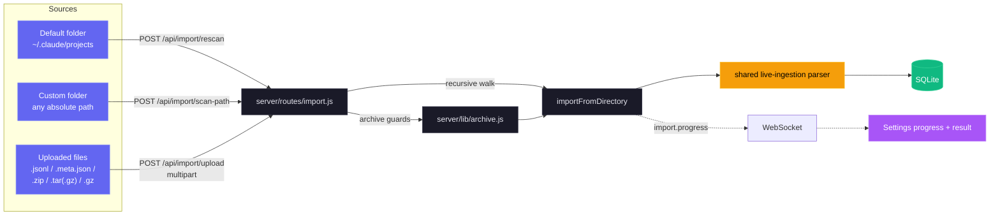

| Method | Path | Purpose |
| --- | --- | --- |
| `GET` | `/api/import/guide` | Provider-aware paths, archive commands, extensions, and instructions via `?provider=claude\| codex`) |
| `POST` | `/api/import/rescan` | Ri-scansiona il default selezionato: `~/.claude/projects` o `~/.codex/sessions` (`{ provider }`) |
| `POST` | `/api/import/scan-path` | Scansiona una directory assoluta con `{ path, provider }`; percorre ricorsivamente |
| `POST` | `/api/import/upload` | Upload multipart di `.jsonl`, `.meta.json`, `.zip`, `.tar(.gz)`, `.gz` con `provider` |

- **Input:** file sparsi `.jsonl`, `.meta.json`, `.zip`, `.tar`, `.tar.gz`/`.tgz` e `.gz` in layout annidati. Claude supporta entrambi i layout canonici dei subagenti; Codex riconosce i `rollout-*.jsonl` ricorsivi o i JSONL con `session_meta` più i titoli opzionali `session_index.jsonl`.
- **Accuratezza:** la deduplica per UUID e per high-water degli eventi evita il doppio conteggio. Le baseline di compattazione preservano i token precedenti; l'attività successiva avanza `ended_at` e aggiorna i metadati dei messaggi.
- **File grandi:** il parsing condiviso a chunk da 4 MiB, una riga alla volta, gestisce transcript oltre il limite di stringa di V8 di circa 512 MiB. Gli array espandibili sono limitati a `TRANSCRIPT_CACHE_MAX_ARRAY_LEN`, default `1000`, con trimming al doppio del limite durante il parsing.
- **Sicurezza:** l'estrazione rifiuta i percorsi assoluti e con `..`. Di default i dati estratti sono limitati a 4 GB, ogni upload a 1 GB e le richieste a 2000 file; lo staging per richiesta viene sempre recuperato.
- **Avanzamento:** le fasi WebSocket `import.progress` limitate coprono `start`, `scan`, `extract`, `parse`, `complete` ed `error`. La UI fornisce indicazioni drag-and-drop e i totali di importati, arricchiti, saltati ed errori.

### WebSocket

Connettiti a `ws://localhost:4820/ws` per ricevere messaggi push in tempo reale:

```json
{
  "type": "agent_updated",
  "data": { "id": "...", "status": "working", "current_tool": "Edit" },
  "timestamp": "2026-03-05T15:43:01.800Z"
}
```

**Tipi di messaggio:** `session_created`, `session_updated`, `agent_created`, `agent_updated`, `new_event`, `alert_triggered`, `alert_updated`, `remote_source.status` (data `{ id, status: "idle"|"syncing"|"ok"|"error"|"deleted", error?, last_sync_at? }`)

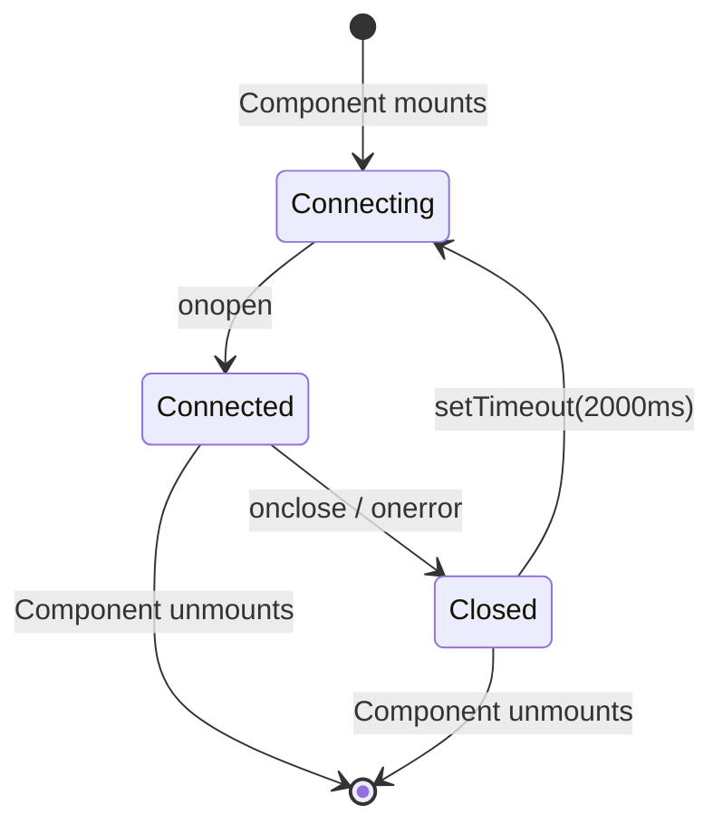

---

## Eventi hook

La dashboard elabora questi tipi di hook di Claude Code:

| Tipo di hook        | Trigger                        | Azione della dashboard                                                                             |
| ------------------- | ------------------------------ | -------------------------------------------------------------------------------------------- |
| `SessionStart`      | Inizia una sessione Claude Code     | Crea la sessione e l'agente principale. Marca `awaiting_input_since` (con `awaiting_reason=session_start`) così una sessione nuova atterra in **Waiting** — tranne un SessionStart con sorgente `compact` (auto-compattazione a metà turno), che lascia il flag intatto così una sessione al lavoro resta **Active**. Riattiva le sessioni riprese. Abbandona le sessioni orfane senza attività per `DASHBOARD_STALE_MINUTES` (default 180) |
| `UserPromptSubmit`  | L'utente preme invio su un prompt    | Cancella il flag di attesa e promuove l'agente principale a `working` — l'unico segnale che i turni dell'assistente di solo testo sono iniziati, dato che non emettono `PreToolUse` |
| `PreToolUse`        | L'agente inizia a usare uno strumento      | Cancella il flag di attesa, imposta l'agente a `working`, imposta `current_tool`. Se lo strumento è `Agent`, crea un record di subagente |
| `PostToolUse`       | Esecuzione dello strumento completata       | Cancella il flag di attesa (gestisce le approvazioni delle richieste di permesso dove la Notification lo aveva marcato a metà strumento). Cancella `current_tool`. L'agente resta `working` |
| `Stop`              | Claude finisce di rispondere     | Senza errore: agente principale → `waiting` — Claude ha finito il suo turno, la palla è all'utente. `stop_reason=error`: marca l'agente e la sessione `error`. I subagenti in background continuano a girare |
| `SubagentStop`      | Un agente in background è terminato      | Trova e completa il subagente per descrizione, tipo o task. Deliberatamente NON cancella il flag di attesa — un subagente che finisce non ci dice nulla sull'umano. **Innesca una scansione JSONL fire-and-forget** (`scanAndImportSubagents`) che emette eventi `PreToolUse` + `PostToolUse` per strumento sotto l'`agent_id` proprio del subagente così la Timeline mostra ogni strumento eseguito dal subagente, non solo il marcatore di spawn |
| `Notification`      | Notifica dell'agente             | Registra l'evento. I messaggi di permesso/richiesta di input impostano l'agente a `waiting` e marcano `awaiting_input_since` (con `awaiting_reason=notification`, riconosciuti dal pattern: `permission`, `waiting for input`, `needs your approval`, …). Le notifiche di compattazione sono taggate come eventi `Compaction`. Innesca una notifica del browser se abilitata |
| `SessionEnd`        | Il processo CLI di Claude Code esce  | Rimuove il flag di attesa. Se la sessione è già in `error`, lo stato di errore viene preservato; altrimenti marca tutti gli agenti e la sessione come `completed` |
| `Compaction`   | `/compact` rilevato nel JSONL   | Crea un subagente di compattazione (tipo `compaction`) e un evento Compaction. Rilevato tramite le voci `isCompactSummary` nella trascrizione JSONL. Rilevato anche dallo scanner periodico per le sessioni attive |
| `APIError`     | Errore API nella trascrizione JSONL  | Estratto dalle voci `isApiErrorMessage` (quota, rate limit, invalid_request) e dalle risposte grezze `type: "error"`. **Ora marca immediatamente la sessione e l'agente come `error`** — in precedenza registrato come evento senza cambiare lo stato. Salvato come evento con i dettagli dell'errore |
| `TurnDuration` | Tempi dei turni nella trascrizione JSONL| Estratto dai messaggi `system` con sottotipo `turn_duration` e `durationMs`. Salvato come evento per l'analisi dei tempi a livello di turno |
| `ToolError`    | Errore nel risultato di uno strumento nel JSONL     | Estratto dalle voci `toolUseResult.is_error`. Traccia i fallimenti a livello di strumento per l'analisi della propagazione degli errori |
| `RemoteToolEvent` | Chiamata a strumento inviata da una macchina remota | Scritto da `POST /api/hooks/ingest-batch` per ogni elemento `tool_events[]` inviato da una macchina itinerante o dietro NAT. Deduplicato su `(session_id, event_type, uuid)` rispetto alle righe già confermate e all'interno del lotto, quindi rinviare un lotto è sicuro |
| `RemoteTurn`   | Durata di turno inviata da una macchina remota | Scritto da `POST /api/hooks/ingest-batch` per ogni elemento `turns[]`, con il `duration_ms` di quel turno. Stessa deduplicazione `(session_id, event_type, uuid)` di `RemoteToolEvent` |
| `Interrupted`  | Turno annullato dall'utente (Esc) | Sintetizzato dal watchdog — `Esc` non fa scattare alcun hook, quindi una sessione bloccata in `working` viene rilevata dal marcatore `[Request interrupted by user]` della trascrizione o, quando Esc ha preceduto qualsiasi output, dal timeout di inattività in working (`DASHBOARD_WORKING_IDLE_SECONDS`). La sessione passa a **Waiting** (come per uno `Stop` normale) |

---

## Notifiche del browser

La dashboard supporta notifiche del browser persistenti via Web Push (VAPID) per avvisi in tempo reale anche quando la scheda della dashboard non è a fuoco o il browser è in background.

### Come funziona

1. **Abilita** le notifiche nella pagina Impostazioni tramite l'interruttore generale
2. **Concedi** il permesso del browser quando richiesto — questo registra un Service Worker e crea una sottoscrizione push
3. **Configura** quali eventi innescano le notifiche:

| Evento                       | Default | Descrizione                                                     |
| ---------------------------- | ------- | --------------------------------------------------------------- |
| Nuova sessione avviata           | On      | Scatta quando viene creata una nuova sessione Claude Code                 |
| Claude ha finito di rispondere   | Off     | Scatta sugli eventi `Stop` quando Claude finisce un turno di risposta     |
| Sessione chiusa               | Off     | Scatta al `SessionEnd` quando il processo CLI esce                |
| Errori di sessione               | On      | Scatta quando una sessione termina con un errore                         |
| Subagente generato             | Off     | Scatta quando viene creato un subagente in background                     |

Inoltre, qualsiasi evento hook `Notification` da Claude Code innesca una notifica del browser indipendentemente dagli interruttori per evento (finché l'interruttore generale è abilitato).

### Architettura delle notifiche

- **Pipeline VAPID:** usa `web-push` sul server per una consegna sicura dei messaggi. Le chiavi VAPID sono auto-generate e salvate in `data/vapid-keys.json`.
- **Service Worker:** un worker dedicato (`client/public/sw.js`) gestisce gli eventi `push` in arrivo e mostra le notifiche con `silent: false` per garantire la riproduzione audio su macOS.
- **Sottoscrizioni:** gli endpoint specifici del browser sono salvati nella tabella `push_subscriptions` di SQLite.
- **Persistenza:** le notifiche arrivano anche se il browser è chiuso, dato che il Service Worker opera in background.
- **Notifica di test:** un pulsante nelle Impostazioni ti permette di verificare la pipeline VAPID e la riproduzione audio.

### PWA e supporto offline

Il progetto include tre Progressive Web App indipendenti — una ciascuna per **dashboard**, **landing page** e **wiki**. Ognuna ha il proprio `manifest.json` e Service Worker così il browser le tratta come applicazioni installabili separate.

| Superficie | Manifest | Service Worker | Strategia di caching |
| --- | --- | --- | --- |
| Dashboard (`client/`) | `client/public/manifest.json` | `client/public/sw.js` | I bundle con hash nel contenuto di Vite sotto `/assets/*` sono serviti cache-first (gli URL sono immutabili per build). Tutto il resto — navigazioni, il SW stesso, `manifest.json`, icone, la root `/` — è network-first con fallback sulla cache, così una rebuild mostra sempre la UI più fresca senza hard refresh. Le richieste API (`/api/*`), WebSocket (`/ws`) e Vite HMR non sono mai cachate. I gestori delle notifiche push sono preservati accanto alla logica di caching. Il middleware statico Express (`server/index.js`) rinforza questo inviando `Cache-Control: public, max-age=31536000, immutable` per `/assets/*` e `Cache-Control: no-cache, must-revalidate` per `index.html`, `sw.js` e `manifest.json`. `client/src/main.tsx` ascolta `controllerchange`: quando un nuovo SW si attiva su una pagina già controllata ricarica esattamente una volta (le prime installazioni no). |
| Landing page (root) | `manifest.json` | `sw.js` | Precache della shell HTML, del favicon e dell'immagine OG. I PNG degli screenshot sono cachati pigramente alla prima vista (cache-first) per evitare un precache iniziale pesante. La navigazione è network-first con fallback offline. |
| Wiki (`wiki/`) | `wiki/manifest.json` | `wiki/sw.js` | Precache di `index.html`, `style.css`, `script.js`, manifest e favicon. Completamente utilizzabile offline dopo una visita. HTML network-first, CSS/JS cache-first. |

**Ciclo di vita della cache:** tutti e tre i SW chiamano `skipWaiting()` all'installazione ed eliminano le cache stantie all'attivazione (con chiavi di versione come `dashboard-v2`, `landing-v1`, `wiki-v1`). Incrementare la costante di versione forza un refresh pulito.

**Supporto iOS:** tutti e tre i file HTML includono `<meta name="apple-mobile-web-app-capable" content="yes">` e `<meta name="apple-mobile-web-app-status-bar-style" content="black-translucent">` per la modalità standalone da home screen su Safari.

**Icone:** i manifest referenziano `favicon.svg` con `sizes="any"` e `type="image/svg+xml"` — supportato in Chrome 107+, Firefox 110+, Edge 107+. Anche le Apple touch icon usano il favicon SVG.

---

## Notificatore di aggiornamenti

La dashboard osserva il proprio checkout git e mostra una modale ogni volta che il branch di default canonico ha commit avanti rispetto a HEAD. **Consapevole di branch e fork:** se hai un remote `upstream` (la convenzione standard per i fork), è preferito a `origin`; il `master`/`main`/`HEAD` del remote scelto è il ref di confronto. Il `manual_command` si adatta alla tua situazione — `git pull --ff-only` solo quando il tuo branch traccia effettivamente il ref canonico, altrimenti un `git fetch` (e un merge fast-forward nel caso del fork) così il comando non mente mai. Gli utenti ricevono il comando esatto da eseguire in un terminale — il server non fa **mai** pull né si riavvia da solo, il che mantiene il meccanismo portabile attraverso sessioni di sviluppo, supervisione pm2/systemd/launchd/Docker e deployment remoti.

<p align="center">
  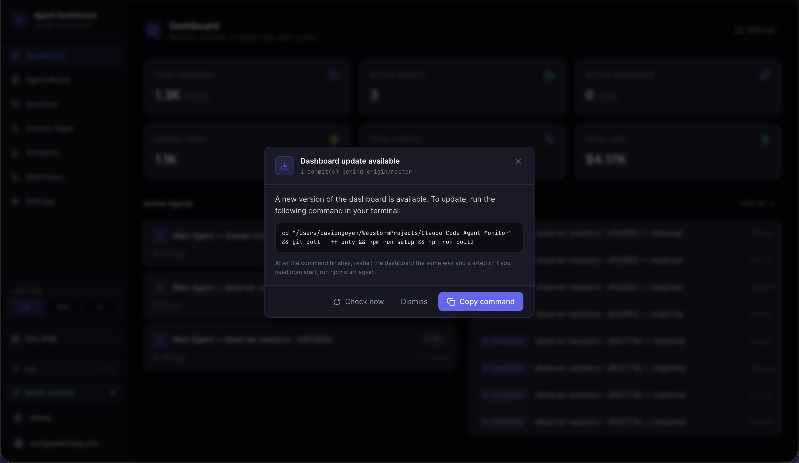
</p>

### Come funziona

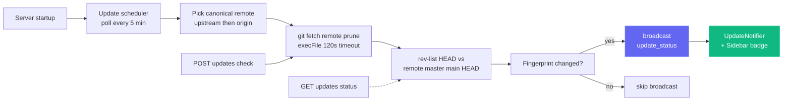

Un singolo controllo è economico (`git fetch <remote> --prune` contro il remote canonico — `upstream` se configurato, altrimenti `origin`), incapsulato con `execFile` (nessuna shell) e un timeout di 120 s. I fallimenti — rete offline, installazione non-git, nessun remote configurato, ref upstream non risolvibile — restituiscono tutti **payload soft** (es. `fetch_error: "..."`) invece di lanciare eccezioni, così un remote instabile non blocca mai la dashboard.

### Superfici UI

| Superficie | Comportamento |
| --- | --- |
| **Modale** (`client/src/components/UpdateNotifier.tsx`) | Appare quando `update_available === true` e l'utente non ha già scartato questo specifico `remote_sha`. Mostra i commit di ritardo, il ref tracciato, una `situation_note` opzionale (quando si è su un feature branch / fork la nota spiega perché il comando differisce), il comando copiabile e tre pulsanti: **Copy command** (primario), **Check now**, **Dismiss**. ESC e i click sul backdrop la chiudono. Con chiave `remote_sha` in `localStorage`, così un commit upstream più recente riapre la modale automaticamente. |
| **Pulsante nella sidebar** (`client/src/components/Sidebar.tsx`) | Pulsante "Check for updates" sempre visibile nel footer. Bordo smeraldo + puntino badge verde quando si è indietro, ambra quando l'ultimo controllo ha incontrato un errore di fetch. Cliccarlo cancella qualsiasi scarto precedente, poi lancia `POST /api/updates/check`. |
| **Terminale del server** | Quando lo scheduler transisce da "aggiornato" a "indietro", stampa un blocco incorniciato su stdout con il comando così anche gli utenti headless lo vedono. |

### Superficie API

| Endpoint | Scopo |
| --- | --- |
| `GET /api/updates/status` | Controllo di sola lettura: esegue `git fetch` contro il remote canonico, confronta HEAD con il suo branch di default, restituisce il payload. |
| `POST /api/updates/check` | Stesso controllo, ma trasmette anche `update_status` sul WebSocket così tutti i client connessi si aggiornano insieme. |

Entrambi gli endpoint restituiscono la stessa forma di payload:

```json
{
  "git_repo": true,
  "update_available": true,
  "repo_root": "/Users/you/Claude-Code-Agent-Monitor",
  "remote_ref": "upstream/master",
  "canonical_remote": "upstream",
  "current_branch": "master",
  "tracking_upstream": "origin/master",
  "tracks_canonical": false,
  "situation": "fork_or_diverged_tracking",
  "local_sha": "abc1234...",
  "remote_sha": "def5678...",
  "commits_behind": 3,
  "manual_command": "cd \"/...\" && git fetch upstream && git merge --ff-only upstream/master && npm run setup",
  "situation_note": "You're on 'master' tracking 'origin/master'. This command fast-forwards your branch from upstream/master (the canonical default).",
  "message": "3 commit(s) on upstream/master not in your checkout."
}
```

`situation` è uno tra `tracking_canonical` (clone tipico sul branch di default — `git pull --ff-only` funziona), `fork_or_diverged_tracking` (il nome del branch locale corrisponde al canonico, ma traccia un remote diverso — `git fetch <remote> && git merge --ff-only <ref>`), `feature_branch` (fuori dal branch di default — solo fetch, l'integrazione è lasciata all'utente) o `detached_head`.

### Cosa **non** c'è, intenzionalmente

Non esiste un `POST /api/updates/apply` né un helper di auto-riavvio, per scelta. Auto-aggiornare un processo dal suo interno è inaffidabile senza un supervisore esterno — `npm run dev` (concurrently), `npm start`, `pm2`, `systemd`, `launchd` e Docker richiedono ciascuno una logica di riavvio diversa, e i fallimenti di `git pull` / `npm install` su un server morente non hanno un percorso di rollback pulito. Il solo rilevamento mantiene il comportamento prevedibile con ogni supervisore, ogni OS e ogni stato del branch, chiudendo comunque il gap informativo del "quando devo fare pull?"; l'aggiornamento vero e proprio è dell'utente, nella sua shell.

### Configurazione

| Variabile d'ambiente | Default | Note |
| --- | --- | --- |
| `DASHBOARD_UPDATE_CHECK` | abilitato | Imposta `0` / `false` / `off` per disabilitare interamente lo scheduler. |
| `DASHBOARD_UPDATE_CHECK_INTERVAL_MS` | `300000` (5 min) | Intervallo tra i controlli automatici. Il minimo è 60 000 ms — i valori inferiori vengono limitati. |

---

## Tabby — Il gatto compagno fluttuante

**Tabby** è un simpatico gatto compagno fluttuante ancorato all'angolo in basso a destra di ogni pagina della dashboard. Sempre presente, trasforma lo stream live delle sessioni in una mascotte reattiva leggibile a colpo d'occhio con cui puoi anche parlare.

<p align="center">
  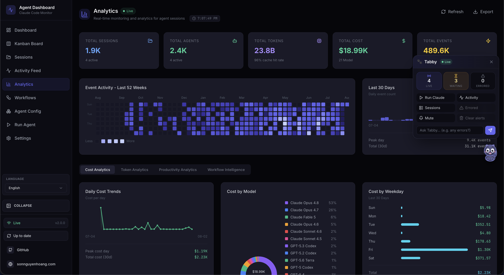
</p>

### Mascotte reattiva

Tabby è un gatto SVG che segue il cursore con **otto stati d'animo** derivati dallo stream live delle sessioni, ognuno con la propria animazione:

| Stato d'animo | Quando | Animazione |
| --- | --- | --- |
| `idle` | Non succede nulla di rilevante | Colpo di coda a riposo |
| `watching` | Ci sono sessioni attive | Orecchie dritte, gli occhi seguono il cursore |
| `happy` | Una sessione o esecuzione è finita pulita | Testa che ondeggia + scintillio |
| `worried` | Qualcosa sembra storto | Scossa sottile |
| `stuck` | Una sessione sembra bloccata | "!" di allerta |
| `thinking` | Un agente è a metà lavoro | Lenta oscillazione della testa |
| `sleeping` | Silenzio da un po' | `zzz` |
| `disconnected` | Il WebSocket è giù | Posa calma e immobile |

### Fumetti

Tabby fa emergere automaticamente brevi battute sugli eventi rilevanti (sessione avviata/terminata, errori, esecuzione completata). I fumetti sono **limitati e coalizzati** così una raffica di eventi non riempie mai lo schermo, usano `aria-live` per gli screen reader e possono essere **silenziati** dal pannello.

### Pannello

Apri il pannello cliccando il gatto o premendo **⌘B / Ctrl+B** (Esc chiude). Mostra:

- Una **riga di stato** live — `N live · M errored · stato della connessione`.
- **Azioni rapide** — salta a Run Claude, Attività, Sessioni o alle sessioni in errore; silenzia i fumetti; cancella gli alert.
- Una casella **Ask** (vedi sotto).

### Casella Ask → passaggio a Run Claude

La casella **Ask** risponde alle semplici domande di stato localmente dai dati in cache — per esempio "what's running", "any errors" o "status". Qualsiasi altra domanda viene passata alla pagina **Run Claude** esistente (con deep-link a `/run?prompt=…`) per avviare una vera sessione Claude Code. Tabby non chiama mai un LLM da solo; riusa semplicemente la pagina Run Claude per qualsiasi cosa oltre un rapido controllo di stato.

### Accessibilità e degradazione sicura

Tabby è utilizzabile da tastiera, usa `aria-live` per i suoi fumetti e rispetta `prefers-reduced-motion`. Se il WebSocket è giù degrada in sicurezza a uno stato calmo `disconnected` invece di andare in errore. Puoi attivare o disattivare Tabby nelle **Impostazioni** (localizzato in inglese, cinese, vietnamita, coreano, spagnolo e italiano), e l'implementazione vive in `client/src/components/Tabby/`.

---

## Segnali sonori

La dashboard ti dà un **feedback audio discreto** per l'attività live delle sessioni, così puoi lasciarla su un secondo monitor e sentire comunque quando un'esecuzione finisce o fallisce. Il suono è **attivo per default** e può essere spento del tutto in un click.

### Sintesi a zero dipendenze

Non ci sono asset `.mp3` o `.wav` da nessuna parte nel repo e nessuna libreria audio in `package.json`. Ogni segnale è generato al momento della riproduzione con la **Web Audio API**: una breve lista di oscillatori (sinusoide o triangolo), ognuno con il proprio inviluppo di gain esponenziale, mixati attraverso un nodo di gain master e un filtro passa-basso così il risultato resta dietro al tuo lavoro invece di tagliarlo. L'intero motore è un solo file, `client/src/lib/sound.ts`.

### I segnali

| Segnale | Quando scatta | Come suona |
| --- | --- | --- |
| `sessionStart` | Appare una nuova sessione | Quinta giusta ascendente (C5 → G5) |
| `sessionComplete` | Una sessione finisce di rispondere (`Stop`) o si chiude (`SessionEnd`) | Arpeggio maggiore risolutivo (E5 → G5 → C6) |
| `sessionError` | Una sessione entra nello stato `error` | Morbida terza minore discendente su un'onda triangolare — udibile, non allarmante |
| `subagentSpawn` | Viene generato un subagente | Singolo pizzicato corto |
| `notification` | Claude Code emette un evento `Notification` | Coppia scordata che risuona come una piccola campana |
| `connected` / `disconnected` | Il WebSocket della dashboard torna o cade | Due note in salita / discesa |
| `click` | Premi un pulsante, link, scheda o interruttore | Tick appena udibile |

I segnali vivono dentro un set in Do maggiore così le code sovrapposte non suonano mai dissonanti, e ogni inviluppo decade esponenzialmente invece di troncarsi, evitando il click di uno stop brusco.

### Restare fuori dai piedi

Tre guardie impediscono all'audio di diventare rumore:

- **Cooldown per segnale** — lo stesso segnale non si ripete entro ~350 ms (45 ms per il tick di interazione).
- **Budget globale di burst** — al massimo 4 segnali partono in una finestra di 1,2 s, così importare lo storico o riconnettersi dopo una caduta non trasforma mai un fiume di messaggi WebSocket in un fiume di bip.
- **Policy di autoplay** — nulla suona fino alla tua prima interazione con la pagina via puntatore, tasto o tocco, come da regole del browser. I segnali precedenti vengono scartati in silenzio, non accodati.

Se il browser non ha alcun supporto Web Audio, ogni chiamata è un no-op sicuro — la dashboard resta semplicemente silenziosa.

### Impostazioni

**Impostazioni → Sound** ha un interruttore generale, uno slider del volume e un interruttore individuale per ogni segnale. Attivare un interruttore riproduce quel segnale immediatamente così senti esattamente cosa hai appena abilitato, e un pulsante **Preview Sound** riproduce il carillon di completamento su richiesta. Le preferenze persistono in `localStorage` sotto `agent-monitor-sound` e hanno effetto istantaneo in tutta l'app — nessun reload. Il pannello è localizzato in inglese, cinese, vietnamita, coreano, spagnolo e italiano.

Per default sono attivi avvio sessione, completamento sessione, errore di sessione, le notifiche di Claude Code e il tick di interazione; gli spawn di subagenti e i cambi di connessione sono spenti (sono i più chiacchieroni). L'implementazione vive in `client/src/lib/sound.ts` (motore + preferenze) e `client/src/hooks/useSoundCues.ts` (collegamento all'event bus), montata una volta in `client/src/App.tsx`.

---

## Modale dello stato di connessione

Clicca la pill **Live** / **Disconnected** nel footer della sidebar per aprire un piccolo pannello di dettagli sul trasporto WebSocket della dashboard. Mostra l'endpoint `ws://` attivo, da quanto tempo il socket corrente è su, il totale degli eventi ricevuti, i tipi di evento principali come grafico a barre orizzontali, una sparkline del throughput a 60 secondi e gli ultimi 8 eventi come lista di attività recente. Le statistiche cumulative (totali, ripartizione per tipo, lista recente) persistono tra i reload via `localStorage` sotto `sidebar-connection-stats`; la sparkline scorrevole e il timer "connected since" sono intenzionalmente effimeri. Un pulsante **Reset** nel footer cancella tutto su richiesta.

<p align="center">
  
</p>

---

## Estensione VS Code

Il **Claude Code Agent Monitor** è disponibile come estensione VS Code di prima classe, che ti permette di monitorare i tuoi agenti AI senza lasciare l'editor.

<p align="center">
  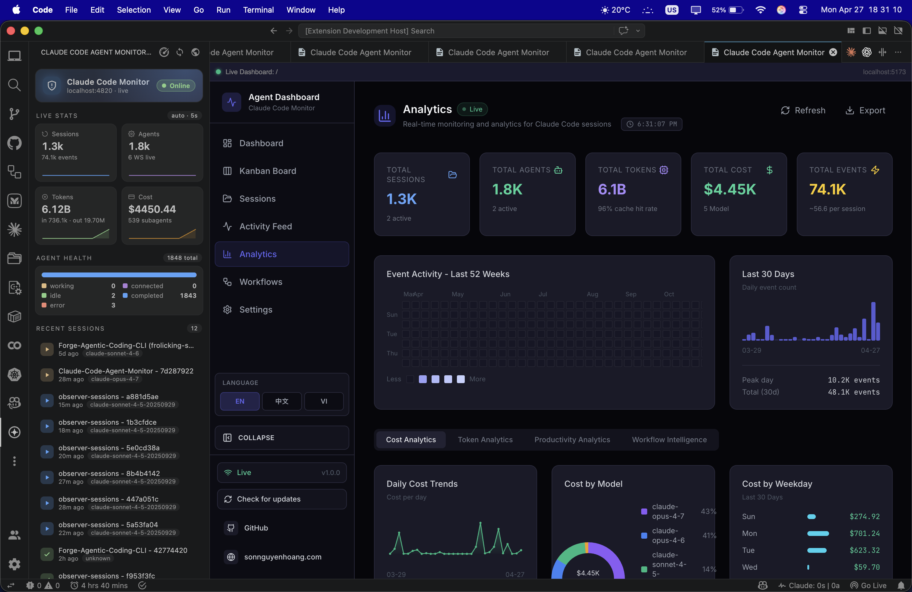
</p>

### 🚀 Funzionalità chiave
- **Sidebar live**: vista dedicata nella Activity Bar che mostra in tempo reale la salute degli agenti (Working, Waiting, Completed, ecc.).
- **Analytics di utilizzo**: traccia i token totali, i costi live in USD e i conteggi degli eventi direttamente nella sidebar.
- **Integrazione con la status bar**: monitor a colpo d'occhio nella barra inferiore con sessioni e agenti attivi.
- **Navigazione profonda**: accesso in un click a viste specifiche della dashboard (Kanban, Analytics, Impostazioni) o alle sessioni recenti.
- **Scheda integrata**: apre l'intera dashboard di monitoraggio come scheda webview nativa di VS Code.

### 📦 Installazione e configurazione
1. Apri la directory [vscode-extension](./vscode-extension).
2. Installa l'estensione dal Marketplace o impacchettala da te con `vsce package`.
3. Assicurati che il server locale della dashboard sia in esecuzione (`npm run dev`).
4. Clicca l'**icona radar** nella Activity Bar di VS Code per iniziare.

Per la configurazione dettagliata per sviluppatori, vedi le directory [.vscode](./.vscode) e [vscode-extension](./vscode-extension).

> [!TIP]
> Estensione sul Marketplace di VS Code: [Claude Code Agent Monitor](https://marketplace.visualstudio.com/items?itemName=hoangsonw.claude-code-agent-monitor)

---

## App desktop (macOS e Windows)

La dashboard è distribuita anche come **applicazione desktop nativa** opzionale che installi una volta e dimentichi — una `.app` macOS (distribuita come `.dmg`) e un `.exe` Windows (un installer NSIS più una build portable senza installazione). Vive nel workspace `desktop/`, fratello di `client/`, `server/`, `mcp/` e `vscode-extension/`, ed è costruita con **Electron 35**.

<p align="center">
  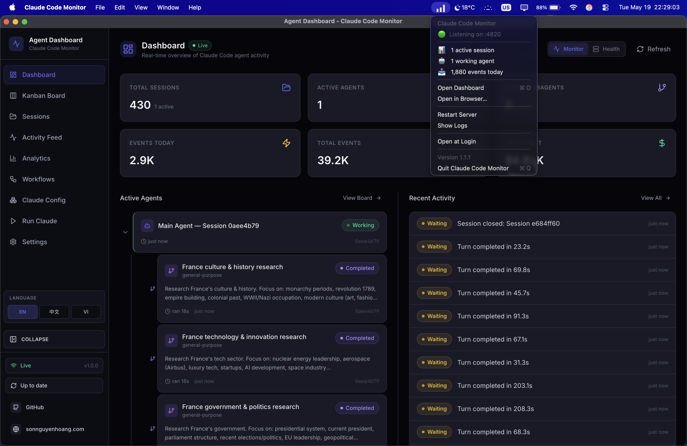
  <br>
  <em>🍎🪟 <strong>App desktop</strong> — shell nativa con icona nella barra dei menu / area di notifica (tray), Open-at-Login e lock a istanza singola. La stessa dashboard, in una vera finestra del sistema operativo (nella foto macOS).</em>
</p>

<p align="center">
  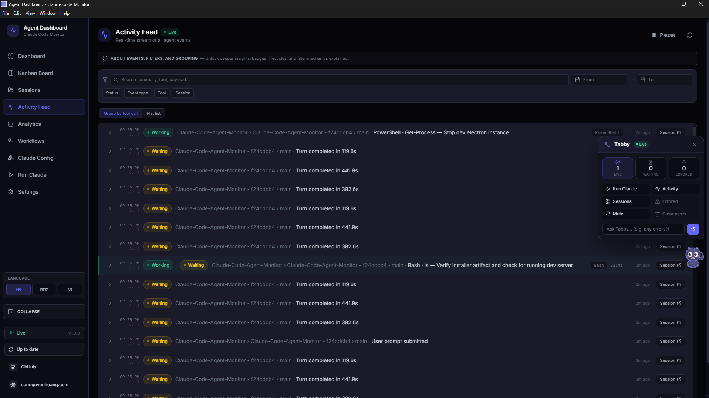
  <br>
  <em>🪟 La stessa dashboard come app nativa Windows — icona nell'area di notifica (tray), menu nativo della finestra e Open-at-Login.</em>
</p>

Tutto quello che vedi nel browser su `localhost:4820` vive dentro questa finestra, con il ciclo di vita nativo del sistema operativo sopra: un'icona tray, un menu applicazione nativo, l'integrazione con l'avvio automatico e un singolo pulsante di uscita che spegne il server in modo pulito.

### Come funziona

A differenza dell'esecuzione della dashboard da un terminale, l'app desktop non richiede `npm start`, nessuna shell aperta e nessuna seconda copia del server. Il **processo main** di Electron ospita il server Express **in-process** — fa `require()` di `server/index.js` direttamente nello stesso runtime Node, **senza processo figlio e senza IPC** — e punta una `BrowserWindow` Chromium al client React compilato.

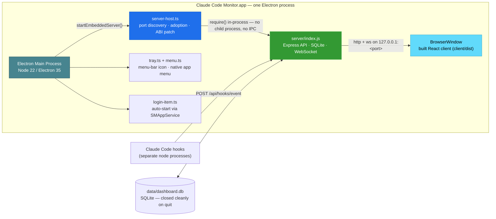

Al lancio l'app:

1. Sceglie una porta libera — preferendo la **4820**, ripiegando su **4821–4829**, poi su una porta alta casuale se sono tutte occupate.
2. Se una dashboard in salute risponde già a `/api/health` sulla `4820` (es. hai eseguito `npm start` in un terminale), **adotta quel server** invece di fare doppio binding — nessuna collisione di porta, nessuna contesa su SQLite. Un server adottato continua a girare dopo che chiudi l'app.
3. Altrimenti avvia il server incorporato, e al **primo boot con server di proprietà** installa automaticamente gli hook di Claude Code e avvia i servizi in background (scheduler degli aggiornamenti, `cc-watcher`, riconciliazione delle esecuzioni orfane). Un utente solo-DMG ottiene quindi il flusso di eventi con **zero configurazione manuale** — nessun checkout, nessun `npm run install-hooks`.
4. **(macOS)** Recupera il **`PATH` della tua shell di login** così la funzionalità **Run Claude** può trovare e avviare la CLI `claude` — un'app lanciata da Finder/Dock altrimenti eredita solo il `PATH` minimale di launchd e mancherebbe le CLI in `~/.local/bin`, `/opt/homebrew/bin`, i bin dei version manager, ecc. (Su Windows il processo eredita già il `PATH` dell'utente.)
5. Apre la finestra della dashboard — a meno che l'app non sia stata lanciata al login (su macOS via Login Items; su Windows via la voce taggata `HKCU\…\Run`), nel qual caso resta solo nel tray.
6. All'uscita, spegne con grazia il server incorporato e **chiude SQLite in modo pulito** (checkpoint WAL).

### Funzionalità

- **Icona tray** — superficie di stato sempre attiva (barra dei menu macOS / area di notifica Windows). Il click sinistro commuta la finestra della dashboard; il click destro apre un menu contestuale con **Open Dashboard**, **Open in Browser**, **Restart Server**, **Show Logs**, **Open at Login** (toggle) e **Quit**. macOS usa un glifo template tinteggiato; Windows usa l'`icon.ico` colorato (un template nero sparirebbe sulla taskbar scura).
- **Icona di finestra e taskbar** — la `BrowserWindow` è collegata al logo colorato dell'app (`icon.ico` su Windows, `icon.png` altrove), così barra del titolo / taskbar mostrano la vera icona di Claude Code Monitor — persino un'esecuzione non impacchettata `npm run desktop:dev` non mostra più l'icona generica di Electron.
- **Menu applicazione nativo** — menu standard `About` / `File` / `Edit` / `View` / `Window` / `Help` con scorciatoie `⌘` / `Ctrl`. La voce **File → Open Dashboard** (`⌘1`) è **solo macOS**: macOS mantiene una barra dei menu globale dopo che la finestra si nasconde, quindi può riaprirla — su Windows/Linux il menu è attaccato alla finestra e non può scattare mentre è nascosta, quindi riaprila dal **Open Dashboard** del tray (che rialza in modo affidabile la finestra anche quando è minimizzata o dietro altre finestre).
- **Avvio automatico al login** — commuta **Open at Login** dal tray o dal menu dell'app. Su macOS si registra tramite la moderna API `SMAppService`, così la voce appare sotto **Impostazioni di Sistema → Generali → Elementi login**; su Windows scrive una voce per utente `HKCU\Software\Microsoft\Windows\CurrentVersion\Run`, visibile in **Gestione attività → Avvio**.
- **La chiusura della finestra nasconde, il server continua a girare** — chiudere la finestra la nasconde soltanto; server e tray restano su. Clicca il tray per far tornare la finestra.
- **Lock a istanza singola** — un doppio lancio si limita a portare a fuoco la finestra esistente; nessun secondo server, nessuna collisione di porta. (Vale su ogni piattaforma.)
- **I dati sopravvivono a reinstallazioni e aggiornamenti** — il database SQLite e le chiavi VAPID vivono nella directory app-data per utente **fuori dal bundle dell'app / directory di installazione** — `~/Library/Application Support/Claude Code Monitor/data/` su macOS, `%APPDATA%\Claude Code Monitor\data\` su Windows. Un bundle impacchettato è read-only, quindi scrivere il database al suo interno romperebbe l'Import History e la persistenza degli eventi; tenerlo in app-data lo risolve e significa che il tuo storico importato resta intatto quando sostituisci o aggiorni l'app. (L'uninstaller NSIS di Windows conserva questi dati per default.)
- **La CLI `claude` nel PATH** — su macOS l'app recupera all'avvio il `PATH` della tua shell di login, così la funzionalità **Run Claude** funziona anche se un'app lanciata da Finder/Dock erediterebbe altrimenti solo il `PATH` minimale di launchd. (Su Windows il `PATH` utente ereditato lo include già.)
- **Log** — il processo main scrive in `~/Library/Logs/Claude Code Monitor/desktop.log` (macOS) o `%APPDATA%\Claude Code Monitor\logs\desktop.log` (Windows); raggiungilo da **Show Logs** nel menu del tray.

### Come ottenerla

**Opzione A — scarica un installer precompilato (consigliato).** Da **[Releases → latest](https://github.com/hoangsonww/Claude-Code-Agent-Monitor/releases/latest)** (pubblico, nessun accesso GitHub richiesto). La CI pubblica automaticamente una nuova release `vX.Y.Z` ogni volta che la versione in `package.json` viene incrementata su `master`, quindi questo link serve sempre la build corrente:

| Piattaforma | Asset | Note |
| --- | --- | --- |
| macOS (Apple Silicon) | `ClaudeCodeMonitor-<ver>-arm64.dmg` | trascina in `/Applications` |
| macOS (Intel) | `ClaudeCodeMonitor-<ver>-x64.dmg` | trascina in `/Applications` |
| Windows (installer) | `ClaudeCodeMonitor-Setup-<ver>-x64.exe` | installazione per utente, niente admin |
| Windows (portable) | `ClaudeCodeMonitor-<ver>-x64-portable.exe` | esegui senza installare |

Build fresche per commit vivono anche come artifact CI (accesso richiesto, retention di 14 giorni): `ClaudeCodeMonitor-dmg` dal job `🍎 macOS Desktop (DMG)` e `ClaudeCodeMonitor-win` dal job `🪟 Windows Desktop (EXE)` — utili per testare `master` prima del prossimo tag di release.

**Opzione B — compilala da te.** Dalla root del repo:

```bash
npm run setup                # install root + client deps, build client, install hooks
npm run build                # build the React client (client/dist)
npm run desktop:install      # install Electron + electron-builder into desktop/ (preflights native deps; prints setup help on failure)
npm run desktop:dmg:arm64    # macOS:   fast single-arch DMG → desktop/release/ClaudeCodeMonitor-<ver>-arm64.dmg
npm run desktop:win          # Windows: NSIS installer → desktop/release/ClaudeCodeMonitor-Setup-<ver>-x64.exe
```

> [!NOTE]
> **I DMG si compilano su macOS; gli `.exe` Windows su Windows** — electron-builder impacchetta per il sistema operativo host. La build macOS `npm run desktop:dmg` impacchetta l'app **due volte** (una per architettura) ed emette **entrambi** i DMG per arch (`arm64` + `x64`) — la build di release; non li fonde in un unico binario universale. Per il tuo Mac usa i single-arch `desktop:dmg:arm64` / `desktop:dmg:x64`. Su Windows, `better-sqlite3` viene scaricato come binario Electron precompilato da `npm run desktop:install`, quindi nel caso comune non serve la toolchain C++ di Visual Studio. Se la build fallisce comunque (nessun binario precompilato, o toolchain C++ mancante), `desktop:install` stampa la correzione esatta per sistema operativo più un'alternativa senza toolchain e fallisce rumorosamente invece di lasciare un'installazione rotta.

### Installazione

**macOS:**

1. Fai doppio click sul `.dmg` per montarlo.
2. Trascina **Claude Code Monitor.app** nella cartella `/Applications`.
3. Il DMG è **firmato ad-hoc** per default, quindi Gatekeeper di macOS avvisa al primo lancio (*"Apple could not verify…"*). Rimuovi l'attributo di quarantena:

   ```bash
   xattr -cr "/Applications/Claude Code Monitor.app"
   ```

   Oppure apri **Impostazioni di Sistema → Privacy e Sicurezza** e clicca **Apri comunque**.

4. Lancia l'app. L'icona tray appare e la finestra della dashboard si apre.

**Windows:**

1. Esegui `ClaudeCodeMonitor-Setup-<ver>-x64.exe`. Si installa **per utente** sotto `%LOCALAPPDATA%\Programs\Claude Code Monitor` (nessuna elevazione ad amministratore) e ti lascia scegliere la directory di installazione; oppure esegui il `*-portable.exe` per lanciare senza installare.
2. L'installer è **non firmato** per default, quindi **SmartScreen** di Windows può mostrare *"Windows protected your PC"* al primo lancio — clicca **More info → Run anyway**.
3. Lancia dal menu Start / collegamento sul desktop. L'icona nell'area di notifica (tray) appare e la finestra della dashboard si apre.

<p align="center">
  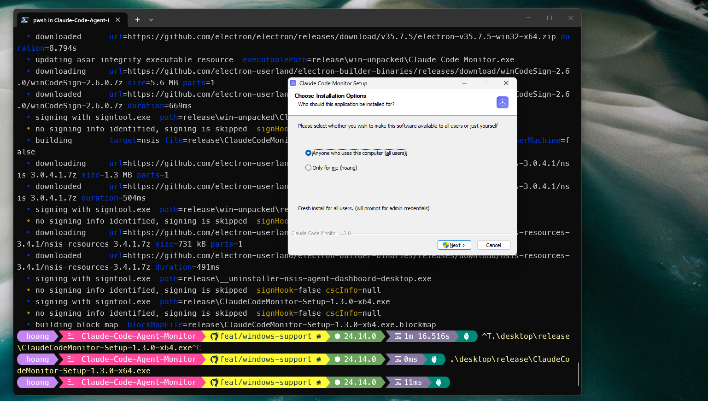
  <br>
  <em>Installer Windows · Passo 1 — <strong>Choose Installation Options</strong> ("Only for me" per utente vs. tutti gli utenti).</em>
</p>

<p align="center">
  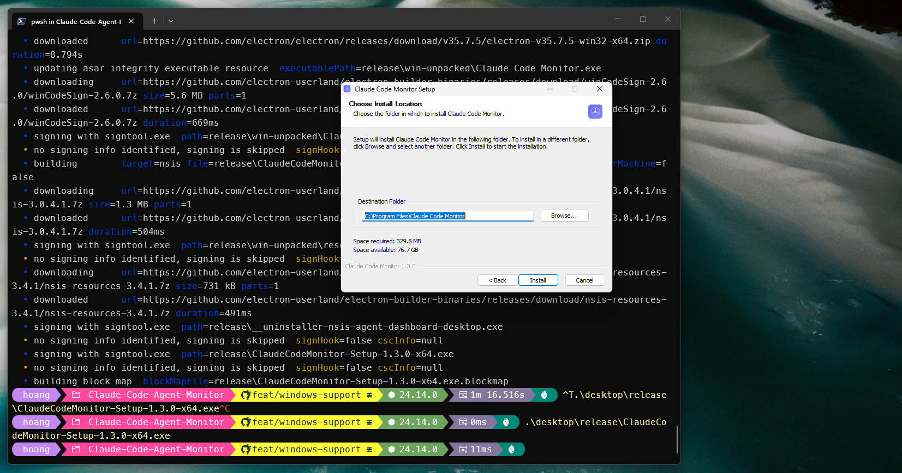
  <br>
  <em>Installer Windows · Passo 2 — <strong>Choose Install Location</strong> (default per utente <code>%LOCALAPPDATA%\Programs</code>).</em>
</p>

<p align="center">
  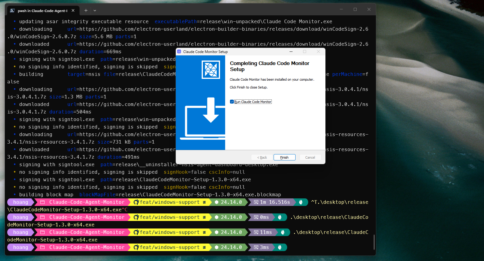
  <br>
  <em>Installer Windows · Passo 3 — <strong>Completing Setup</strong> (termina e lancia l'app).</em>
</p>

### Comandi di build

Tutti i comandi si eseguono dalla **root del repo**:

| Comando                     | Cosa fa                                                                 |
| --------------------------- | ---------------------------------------------------------------------------- |
| `npm run desktop:install`   | Installa Electron + electron-builder in `desktop/`; ricompila `better-sqlite3` per l'ABI di Electron; verifica preventivamente la build nativa di `better-sqlite3` e stampa aiuto pratico di setup (incl. un'alternativa senza toolchain) in caso di fallimento |
| `npm run desktop:build`     | Compila i sorgenti TypeScript desktop in `desktop/out/`                    |
| `npm run desktop:dev`       | Compila e lancia l'app Electron per l'iterazione locale                         |
| `npm run desktop:test`      | Esegue lo smoke test (avvia Electron, sonda `/api/health`, spegne)            |
| `npm run desktop:dmg`       | **macOS:** compila **entrambi** i DMG (arm64 + x64) — corretto per le release, **più lento** (impacchetta ogni arch) |
| `npm run desktop:dmg:arm64` | **macOS:** compila un DMG solo Apple Silicon — **veloce** (~1 min), consigliato per il tuo Mac |
| `npm run desktop:dmg:x64`   | **macOS:** compila un DMG solo Intel — **veloce** (~1 min)                         |
| `npm run desktop:dmg:universal` | **macOS:** compila un unico DMG **universale** fuso (arm64 + x86_64) — opzionale, **il più lento**, non quello distribuito nelle release |
| `npm run desktop:win`       | **Windows:** compila l'installer NSIS `.exe` (x64)                             |
| `npm run desktop:win:portable` | **Windows:** compila il portable senza installazione `.exe` (x64)                     |

Il DMG macOS risultante è di **~80 MB** (≈ 250 MB su disco una volta installato) e l'installer Windows è paragonabile — la classica tassa del bundle Electron.

### Firma e notarizzazione

Il DMG macOS è **firmato ad-hoc** per default così chiunque può compilare una `.app` funzionante senza un account Apple Developer a pagamento — lo script `package` imposta `CSC_IDENTITY_AUTO_DISCOVERY=false` così un certificato di code-signing già nel portachiavi del contributor non viene mai auto-selezionato. La vera **firma Developer ID** è opt-in via `CSC_LINK` (un `.p12` codificato base64) e `CSC_KEY_PASSWORD`; la **notarizzazione Apple** è opt-in via `APPLE_ID`, `APPLE_TEAM_ID` e `APPLE_APP_SPECIFIC_PASSWORD`. La build **Windows** è **non firmata** per default (SmartScreen può avvisare al primo lancio — *More info → Run anyway*); la firma Authenticode si attiva solo quando un certificato esplicito è fornito via `CSC_LINK` + `CSC_KEY_PASSWORD`. La CI li raccoglie tutti automaticamente quando forniti — nessuna modifica al codice richiesta.

### Note di implementazione

- **`better-sqlite3`** è l'unico modulo nativo nell'albero delle dipendenze, e un modulo nativo va compilato contro l'esatta ABI Node su cui gira. Il workspace `desktop/` include la **propria copia** di `better-sqlite3` ricompilata per l'ABI di Electron e usa un redirect di `require` locale al processo per puntare `server/db.js` verso di essa; la copia alla root del repo resta compilata per il Node di sistema (così `npm run test:server` continua a funzionare).
- **Compilare un DMG ricompila `better-sqlite3` per l'architettura target**, il che può lasciare la copia desktop compilata per l'altra arch della CPU e rompere `npm run desktop:dev` / `npm run desktop:test` con `ERR_DLOPEN_FAILED`. Lo step `prebuild` desktop ora **auto-ripara** il modulo nativo per la macchina locale alla build successiva, così i flussi di dev e smoke-test continuano a funzionare dopo una build DMG specifica per arch. Lo step `prebuild` inoltre **fallisce subito con aiuto di setup** quando il binario nativo di `better-sqlite3` manca del tutto, trasformando un crash a runtime in un errore di build copiabile.
- L'**unica modifica fuori da `desktop/`** è un refactor senza cambi di comportamento di `server/index.js`: il suo bootstrap post-listen (scheduler degli aggiornamenti, `cc-watcher`, riconciliazione delle esecuzioni orfane) è stato estratto in una `startBackgroundServices()` esportata così il server incorporato esegue esattamente ciò che esegue `node server/index.js`. Il percorso standalone `node server/index.js` è funzionalmente invariato; `client/`, `scripts/`, `mcp/` e `vscode-extension/` sono intoccati.
- Due job CI desktop filtrati per percorso compilano, testano e impacchettano l'app: **`🍎 macOS Desktop (DMG)`** su `macos-latest` (carica l'artifact `ClaudeCodeMonitor-dmg` — due DMG single-arch) e **`🪟 Windows Desktop (EXE)`** su `windows-latest` (carica l'artifact `ClaudeCodeMonitor-win` — installer NSIS + portable). A un push con incremento di versione su `master`, il job `release` allega **sia** i DMG macOS **sia** gli `.exe` Windows alla Release GitHub `vX.Y.Z` pubblicata. L'icona Windows (`desktop/assets/icon.ico`) è committata nel repo (rigenerala da `icon.png` con `npm run build:win-icon`, PowerShell + .NET, nessun tooling extra).

Per la guida utente completa (download, installazione, Gatekeeper / SmartScreen, menu del tray, avvio automatico) vedi [`DESKTOP.md`](./DESKTOP.md); per il riferimento contributor / architettura (modello di processo, ciclo di vita del boot, discovery della porta, pipeline di build — con diagrammi Mermaid) vedi [`desktop/README.md`](./desktop/README.md).

---

## Archiviazione dei dati

- **Engine:** SQLite 3 via `better-sqlite3` (opzionale) o il `node:sqlite` integrato di Node.js
- **Posizione:** `data/dashboard.db`
- **Journal mode:** WAL (letture concorrenti durante le scritture)
- **Reset:** elimina `data/dashboard.db` per cancellare tutti i dati

### Diagramma entità-relazione

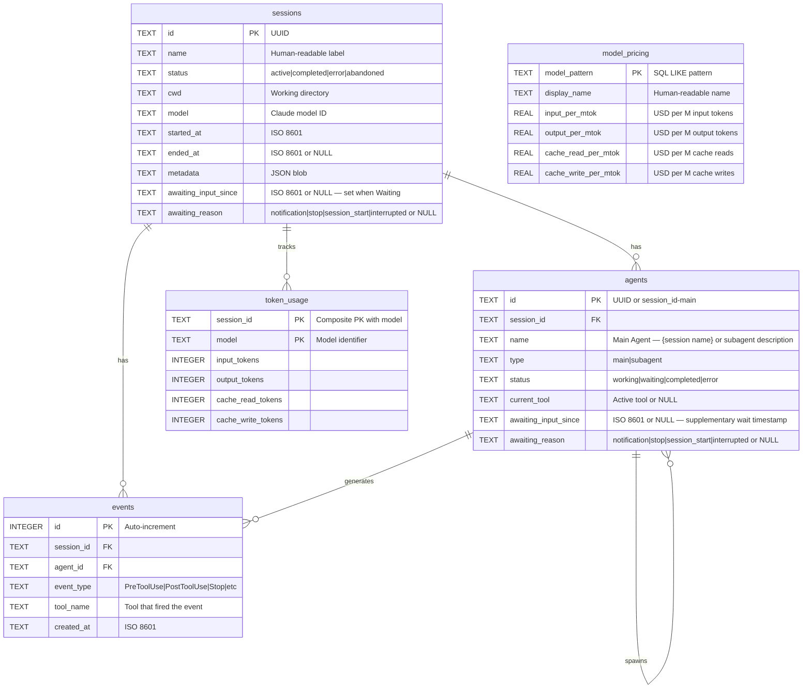

---

## Marketplace dei plugin

CCAM distribuisce **14 plugin** da un unico albero sorgente condiviso. Claude Code legge `.claude-plugin/marketplace.json`; Codex legge `.agents/plugins/marketplace.json` più il `.codex-plugin/plugin.json` di ciascun plugin. Il bundle contiene **66 skill di plugin, 18 subagenti Claude, 34 comandi Claude, 3 helper CLI, 3 configurazioni di hook e 2 plugin abilitati MCP**.

```bash
# Claude Code
claude plugin marketplace add hoangsonww/Claude-Code-Agent-Monitor
claude plugin install ccam-platform@claude-code-agent-monitor-plugins

# Codex
codex plugin marketplace add hoangsonww/Claude-Code-Agent-Monitor
codex plugin add ccam-platform@claude-code-agent-monitor-plugins

# Open Agent Skills / skills.sh-compatible CLI
npx skills add hoangsonww/Claude-Code-Agent-Monitor --list

# Install one skill for Claude Code and Codex in the current project
npx skills add hoangsonww/Claude-Code-Agent-Monitor \
  --skill mcp-server \
  --agent claude-code \
  --agent codex \
  --yes

# Verify, update, and remove the project-scoped skill
npx skills list --json
npx skills update --project --yes
npx skills remove mcp-server --yes

# Add --global to install at user scope, then manage that scope explicitly
npx skills add hoangsonww/Claude-Code-Agent-Monitor \
  --skill mcp-server \
  --agent claude-code \
  --agent codex \
  --global \
  --yes
npx skills list --global --json
npx skills update --global --yes
npx skills remove --global mcp-server --yes
```

La CLI `skills` scopre **77 skill totali del repository**, incluse le 66 skill dei plugin e le skill di manutenzione del repository. Le installazioni di progetto usano `.agents/skills/` più link specifici per agente. Le skill globali di Claude Code vanno per default in `~/.claude/skills/`, o in `$CLAUDE_CONFIG_DIR/skills/` quando impostata. Le skill globali di Codex vanno per default in `~/.codex/skills/`, o in `$CODEX_HOME/skills/` quando impostata. Le installazioni multi-agente possono deduplicare i file tramite uno store condiviso e linkare quelle destinazioni. Ogni skill di plugin ha frontmatter canonico `name`/`description` e metadata `agents/openai.yaml`. Nessuna PR upstream verso `vercel-labs/skills` è necessaria per l'installazione. Il repository GitHub pubblico è la sorgente, e la visibilità su skills.sh segue la pubblicazione e la telemetria di installazioni reali.

Nuovi pacchetti mirati completano i plugin esistenti di analytics, produttività, qualità, sessioni, workflow, configurazione e dashboard:

- `ccam-runner`: lancio monitorato di Claude Code/Codex, seguiti, stop, ripresa e storico delle esecuzioni
- `ccam-integrations`: regole di alert, webhook, notifiche push e raccolta remota via SSH
- `ccam-platform`: Config Explorer di Claude/Codex, import consapevole del provider, ripristino dei backup, configurazione degli hook, aggiornamenti e operazioni MCP
- `ccam-reports`: report executive, di costo, affidabilità e workflow pronti per gli stakeholder

Valida e rigenera i metadata di distribuzione con:

```bash
npm run extensions:sync
npm run extensions:validate
```

Catalogo completo, comandi di installazione, comportamento su skills.sh, confine di pubblicazione e controlli di installazione pulita: [docs/PLUGINS.md](docs/PLUGINS.md).

---

## Statusline

Una utility CLI standalone di statusline per Claude Code che mostra nome del modello, utente, directory di lavoro, branch git, barra di uso della finestra di contesto, conteggi dei token per direzione e costo della sessione -- tutto con codifica a colori tramite sequenze di escape ANSI.

```
nguyens6@host ~/agent-dashboard/client | Sonnet 4.6 | main | ████████░░ 79% | 3↑ 2↓ 156586c | $0.4231
```

| Segmento    | Colore               | Esempio                                                        |
| ----------- | -------------------- | -------------------------------------------------------------- |
| Modello     | Ciano                | `Sonnet 4.6`                                                   |
| Utente      | Verde                | `nguyens6`                                                     |
| CWD         | Giallo               | `~/agent-dashboard`                                            |
| Branch git  | Magenta              | `main`                                                         |
| Barra di contesto | Verde / Giallo / Rosso | `████████░░ 79%`                                               |
| Token       | Verde / Ciano / Attenuato   | `3↑ 2↓ 156586c` (`↑` verde in ingresso, `↓` ciano in uscita, `c` attenuato per la cache)    |
| Costo (USD) | Verde / Giallo / Rosso | `$0.4231` (totale di sessione — mostrato su piani API e in abbonamento)|

Soglie di colore del costo: verde sotto i 5 $, giallo 5–20 $, rosso oltre i 20 $.

Vedi [`statusline/README.md`](statusline/README.md) per le istruzioni di installazione.

<p align="center">
  
</p>

---

## Architettura del server

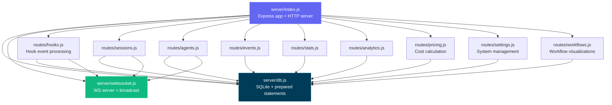

---

## Routing del client

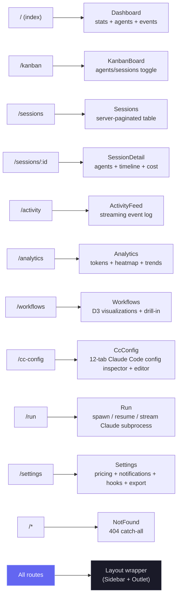

---

## Flusso del gestore degli hook

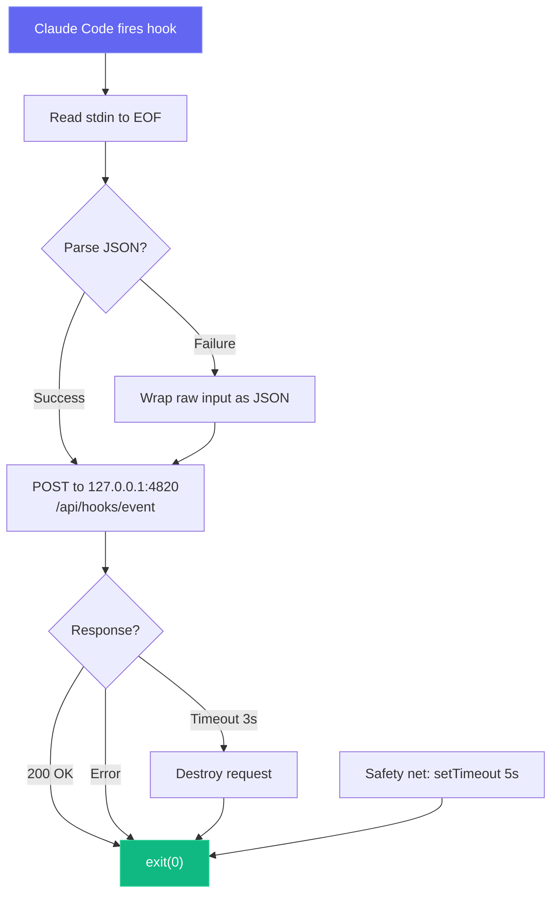

---

## Modalità di deployment

Supportiamo sia la modalità di deployment di sviluppo sia quella di produzione, con architetture di processo diverse:

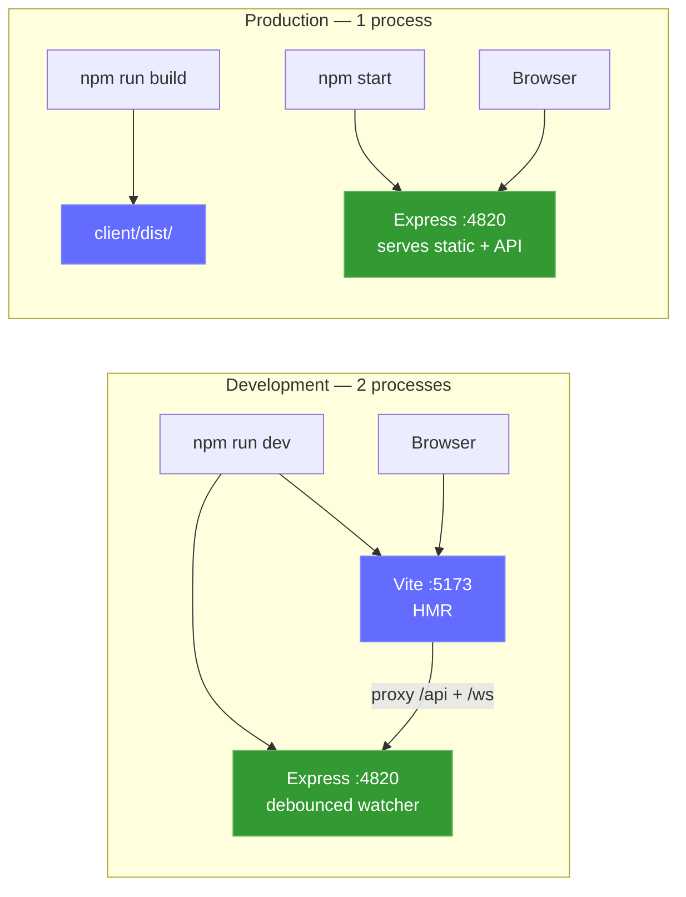

Sidecar MCP locale opzionale (supporta i trasporti stdio, HTTP+SSE e REPL):

```mermaid
graph LR
    subgraph "MCP Transport Options"
        M_STDIO["MCP Server (stdio)<br/>npm run mcp:start"]
        M_HTTP["MCP Server (HTTP)<br/>npm run mcp:start:http<br/>:8819"]
        M_REPL["MCP Server (REPL)<br/>npm run mcp:start:repl"]
    end

    H["MCP Host"] -->|"stdin/stdout"| M_STDIO
    RC["Remote Client"] -->|"POST /mcp · GET /sse"| M_HTTP
    OP["Operator"] -->|"interactive CLI"| M_REPL

    M_STDIO --> D["Dashboard Server<br/>:4820"]
    M_HTTP --> D
    M_REPL --> D

    style M_STDIO fill:#0f766e,stroke:#14b8a6,color:#fff
    style M_HTTP fill:#0f766e,stroke:#14b8a6,color:#fff
    style M_REPL fill:#0f766e,stroke:#14b8a6,color:#fff
```

**App desktop (macOS e Windows)** opzionale — un singolo processo Electron che ospita il server Express in-process (nessun terminale, nessun processo figlio):

```mermaid
flowchart LR
    subgraph desktop["Desktop App (macOS & Windows) — 1 Electron process"]
        E_MAIN["Electron Main Process<br/>(Node 22 / Electron 35)"]
        E_HOST["server-host.ts<br/>require() server/index.js"]
        E_SRV["Embedded Express :4820<br/>API · SQLite · WebSocket"]
        E_WIN["BrowserWindow<br/>built React client"]
        E_TRAY["Menu-bar (tray) icon<br/>+ native app menu"]
        E_MAIN --> E_HOST
        E_HOST -->|"in-process require()"| E_SRV
        E_MAIN --> E_TRAY
        E_SRV -->|"http + ws on 127.0.0.1"| E_WIN
    end

    E_HOOKS["Claude Code hooks"] -->|"POST /api/hooks/event"| E_SRV

    style E_MAIN fill:#47848F,stroke:#2f5a62,color:#fff
    style E_SRV fill:#339933,stroke:#5cb85c,color:#fff
    style E_WIN fill:#61DAFB,stroke:#3aa9c9,color:#000
```

### Deployment in cloud

Lo stack `deployments/` punta a qualsiasi servizio Kubernetes conforme, inclusi EKS, GKE, AKS, OKE e i cluster self-managed. CCAM usa SQLite, quindi ogni manifest supportato impone **un solo writer attivo della dashboard per volume persistente** con un rollout Recreate. HPA, repliche active-active, blue-green e canary sono intenzionalmente non supportati finché SQLite resta il backend di persistenza.

```mermaid
flowchart LR
  CI["CI: test · validate · scan · attest · sign"] --> HELM["Helm / Kustomize / Terraform"]
  HELM --> APP["CCAM dashboard<br/>exactly 1 replica"]
  APP --> PVC[("Retained ReadWriteOnce PVC")]
  EDGE["Ingress or Gateway API<br/>TLS + WebSocket"] --> APP
  PROM["Prometheus Operator"] -->|"Bearer /api/metrics"| APP
  MCP["Authenticated MCP sidecar"] --> APP
```

- **Helm:** un solo writer imposto dallo schema, supporto ai digest, PVC conservato, Ingress o Gateway API, mount del token compatibile con External-Secret, NetworkPolicy, MCP e ServiceMonitor opzionali.
- **Kustomize:** base con PSS restricted più overlay dev/staging/production e componenti opzionali per MCP, monitoring, Gateway API e snapshot CSI.
- **Terraform:** distribuisce il chart Helm validato su un cluster Kubernetes esistente. Networking cloud, identità del cluster, CSI, TLS e sincronizzazione dei segreti restano di competenza del provider.
- **Operazioni:** backup online SQLite coerente con SHA-256, ripristino verificato con scale-to-zero, deploy/rollback/teardown backup-first e health check autenticati.
- **Supply chain CI:** le immagini app e MCP sono scansionate, pubblicate per amd64/arm64 con SBOM e provenance SLSA, e firmate keyless con Cosign.

```bash
npm run deploy:validate
REGISTRY="ghcr.io/$(gh repo view --json owner -q .owner.login)"
IMAGE_TAG="$(git rev-parse --short HEAD)"

helm upgrade --install agent-monitor deployments/helm/agent-monitor \
  --namespace agent-monitor-production --create-namespace \
  --values deployments/helm/agent-monitor/values-production.yaml \
  --set image.registry= \
  --set image.repository=${REGISTRY}/claude-code-agent-monitor \
  --set image.tag=${IMAGE_TAG} \
  --atomic --wait --timeout 10m
```

> [!NOTE]
> La configurazione di produzione completa, i segreti, lo stack Docker/Podman, la Gateway API, Terraform, backup, ripristino e rollback sono documentati in [DEPLOYMENT.md](DEPLOYMENT.md) e [deployments/README.md](deployments/README.md).

---

## Struttura del progetto

```
agent-dashboard/
|-- CLAUDE.md                   # Memoria di progetto e accordi di lavoro per Claude Code
|-- AGENTS.md                   # Istruzioni di progetto per Codex
|-- package.json                # Script di root (dashboard + helper MCP) + dipendenze del server
|-- .claude/
|   +-- rules/                  # Regole Claude con scope sui path
|   +-- skills/                 # Skill di progetto riusabili per Claude
|   +-- agents/                 # Subagenti personalizzati Claude
|-- .claude-plugin/
|   +-- marketplace.json        # Manifest del marketplace Claude Code (14 plugin)
|-- .agents/plugins/
|   +-- marketplace.json        # Manifest del marketplace Codex (gli stessi 14 plugin)
|-- plugins/
|   |-- ccam-analytics/         # Analytics: report di sessione, ripartizione dei costi, trend di utilizzo, punteggio di produttività
|   |   |-- .claude-plugin/plugin.json
|   |   |-- skills/ (4)         # session-report, cost-breakdown, usage-trends, productivity-score
|   |   |-- agents/             # analytics-advisor (modello Sonnet)
|   |   |-- hooks/hooks.json    # Logging degli eventi Stop + SubagentStop
|   |   +-- bin/ccam-stats      # CLI di dashboard da terminale
|   |-- ccam-productivity/      # Produttività: standup, report, sprint, ottimizzatore di workflow
|   |-- ccam-devtools/          # DevTools: debug, diagnostica, export, health check
|   |   +-- bin/                # CLI ccam-doctor + ccam-export
|   |-- ccam-insights/          # Insight: pattern, anomalie, ottimizzazione, confronto
|   |-- ccam-cost-guard/        # Guardrail sui costi: budget, previsione di spesa, alert sui costi, risparmi sui modelli
|   |-- ccam-sessions/          # Forensica delle sessioni: ricerca, timeline, replay delle trascrizioni, rollup per cwd, pulizia
|   |-- ccam-workflows/         # Orchestrazione dei workflow: mappa DAG, audit delle deleghe, concorrenza, esecuzioni di flotte
|   |-- ccam-quality/           # Affidabilità e SLO: scansione degli errori, report degli errori API, audit dei fallimenti degli hook, controllo SLO
|   |-- ccam-config/            # Governance di config e memoria: audit della config, revisione della memoria, inventario di skill/MCP/hook
|   +-- ccam-dashboard/         # Connettore della dashboard: stato, statistiche rapide, integrazione MCP
|       +-- .mcp.json           # Configurazione del server MCP
|-- server/
|   |-- index.js                 # App Express, server HTTP, serving statico
|   |-- db.js                    # Schema SQLite, migrazioni, prepared statement
|   |-- websocket.js             # Server WebSocket con heartbeat
|   +-- routes/
|       |-- hooks.js             # Elaborazione degli eventi hook (transazionale)
|       |-- sessions.js          # CRUD delle sessioni
|       |-- agents.js            # CRUD degli agenti
|       |-- events.js            # Elenco degli eventi
|       |-- stats.js             # Statistiche aggregate
|       |-- analytics.js         # Analytics di token, strumenti e trend
|       |-- workflows.js         # Dati aggregati dei workflow e drill-in per sessione
|       |-- pricing.js           # CRUD del pricing dei modelli e calcolo dei costi
|       +-- settings.js          # Informazioni di sistema, gestione dei dati, export, pulizia
|   +-- lib/
|       +-- transcript-cache.js  # Cache delle trascrizioni JSONL basata su stat con lettore sincrono a chunk di byte-stream (chunk da 4 MiB, decodifica UTF-8 riga per riga) così i file più grandi della lunghezza massima di stringa di V8 (~512 MiB) vengono analizzati senza abortire Node con "FATAL ERROR: v8::ToLocalChecked Empty MaybeLocal". Estrae token, compattazioni, errori API, durate dei turni, blocchi di thinking ed extra di usage (service_tier, speed, inference_geo)
|   +-- compat-sqlite.js         # Wrapper di compatibilità node:sqlite (fallback per better-sqlite3)
|-- client/
|   |-- package.json             # Dipendenze del client
|   |-- index.html               # Entry point HTML
|   |-- vite.config.ts           # Config Vite + proxy
|   |-- tailwind.config.js       # Tema scuro personalizzato
|   |-- tsconfig.json            # TypeScript strict
|   +-- src/
|       |-- main.tsx             # Entry React
|       |-- App.tsx              # Router + provider WebSocket
|       |-- index.css            # Tailwind + utility personalizzate
|       |-- lib/
|       |   |-- types.ts         # Interfacce TypeScript condivise
|       |   |-- api.ts           # Client fetch tipizzato
|       |   |-- format.ts        # Utility di formattazione di date/orari
|       |   +-- eventBus.ts      # Pub/sub per la distribuzione del WebSocket
|       |-- hooks/
|       |   |-- useWebSocket.ts      # Hook WebSocket con auto-riconnessione
|       |   +-- useNotifications.ts  # Trigger di notifiche del browser dagli eventi WebSocket
|       |-- components/
|       |   |-- Layout.tsx       # Shell con sidebar + outlet
|       |   |-- Sidebar.tsx      # Navigazione + indicatore di connessione
|       |   |-- AgentCard.tsx    # Card informativa dell'agente con stato
|       |   |-- StatCard.tsx     # Card di metrica
|       |   |-- StatusBadge.tsx  # Pill di stato con codifica a colori
|       |   |-- EmptyState.tsx   # Placeholder per le liste vuote
|       |   +-- workflows/       # Componenti di visualizzazione dei workflow in D3.js
|       |       |-- OrchestrationDAG.tsx            # DAG orizzontale dei pattern di spawn degli agenti
|       |       |-- ToolExecutionFlow.tsx           # Diagramma d3-sankey delle transizioni strumento-strumento
|       |       |-- AgentCollaborationNetwork.tsx   # Grafo force-directed della pipeline degli agenti
|       |       |-- SubagentEffectiveness.tsx       # Griglia scorecard con anelli di successo SVG
|       |       |-- WorkflowPatterns.tsx            # Sequenze di orchestrazione auto-rilevate
|       |       |-- ModelDelegationFlow.tsx         # Instradamento dei modelli attraverso le gerarchie degli agenti
|       |       |-- ErrorPropagationMap.tsx         # Clustering degli errori per profondità di gerarchia
|       |       |-- ConcurrencyTimeline.tsx         # Esecuzione parallela degli agenti a corsie
|       |       |-- SessionComplexityScatter.tsx    # Grafico a bolle D3 (durata vs agenti vs token)
|       |       |-- CompactionImpact.tsx            # Eventi di compressione dei token e recupero
|       |       |-- WorkflowStats.tsx               # Statistiche aggregate dei workflow
|       |       +-- SessionDrillIn.tsx              # Albero degli agenti, timeline degli strumenti ed eventi per sessione
|       +-- pages/
|           |-- Dashboard.tsx      # Pagina di panoramica
|           |-- KanbanBoard.tsx    # Toggle Agenti/Sessioni, colonne per stato
|           |-- Sessions.tsx       # Tabella delle sessioni paginata lato server
|           |-- SessionDetail.tsx  # Approfondimento di una singola sessione
|           |-- ActivityFeed.tsx   # Stream degli eventi in tempo reale
|           |-- Analytics.tsx      # Uso dei token, heatmap, trend
|           |-- Workflows.tsx      # Visualizzazioni dei workflow in D3.js e drill-in di sessione
|           |-- Settings.tsx       # Pricing dei modelli, notifiche, hook, export, pulizia
|           +-- NotFound.tsx       # Pagina 404 catch-all
|-- scripts/
|   |-- hook-handler.js          # Leggero forwarder da stdin a HTTP
|   |-- install-hooks.js         # Auto-configura ~/.claude/settings.json
|   |-- import-history.js        # Importa le sessioni da ~/.claude/ con estrazione JSONL avanzata (errori API, durate dei turni, entrypoint, modalità di permessi, blocchi di thinking, extra di usage, errori degli strumenti, file JSONL dei subagenti). Il re-import è completamente incrementale: un high-water mark per tipo di evento (`MAX(created_at) GROUP BY event_type` per sessione) è calcolato in anticipo e solo le voci JSONL con `ts > cutoff[type]` vengono inserite, così le sessioni di lunga durata le cui trascrizioni crescono per più giorni continuano a ricevere eventi Stop / PostToolUse / TurnDuration / ToolError a ogni riesecuzione. Fa anche avanzare `sessions.ended_at` quando il JSONL supera il valore salvato e aggiorna i metadata del conteggio dei messaggi a ogni passaggio
|   +-- seed.js                  # Generatore di dati di esempio
|-- mcp/
|   |-- package.json             # Script + dipendenze del pacchetto MCP
|   |-- README.md                # Setup MCP, config degli host, catalogo degli strumenti, modello di sicurezza
|   |-- src/
|   |   |-- index.ts             # Entrypoint del runtime MCP (router dei trasporti)
|   |   |-- server.ts            # Assemblaggio del server MCP
|   |   |-- clients/             # Client dell'API della dashboard con retry/backoff
|   |   |-- config/              # Parsing della config da ambiente/CLI
|   |   |-- core/                # Logger, registro degli strumenti, helper dei risultati
|   |   |-- policy/              # Guardie per mutazioni/azioni distruttive
|   |   |-- tools/               # 16 moduli di dominio che registrano 97 strumenti
|   |   |-- transports/          # Server HTTP+SSE, REPL, collettore degli strumenti
|   |   |-- ui/                  # Banner ANSI, colori, formatter, tabelle
|   |   +-- types/               # Definizioni di tipo MCP condivise
|   +-- build/                   # Output compilato del runtime MCP
|-- desktop/
|   |-- package.json             # Dipendenze e script di Electron + electron-builder
|   |-- electron-builder.yml     # Config di packaging DMG; hook di firma/notarizzazione
|   |-- tsconfig.json            # TypeScript strict (src/ -> out/)
|   |-- README.md                # Riferimento di architettura dell'app desktop (documentazione contributor)
|   |-- assets/                  # icon.svg + icon.icns generato + PNG del tray
|   |-- src/
|   |   |-- main.ts              # Entry del processo main di Electron — ciclo di vita, cablaggio
|   |   |-- server-host.ts       # Boot Express in-process, discovery della porta, adozione, chiusura del DB
|   |   |-- window.ts            # BrowserWindow + geometria della finestra persistita
|   |   |-- tray.ts              # Icona nella barra dei menu (tray) + menu contestuale
|   |   |-- menu.ts              # Menu applicazione nativo (File ▸ Open Dashboard è solo macOS)
|   |   |-- login-item.ts        # Toggle di avvio automatico dei Login Items macOS (SMAppService)
|   |   |-- logger.ts            # Logger su file -> ~/Library/Logs/Claude Code Monitor/desktop.log
|   |   |-- constants.ts         # Nome dell'app, porte, timeout, dimensione della finestra
|   |   +-- preload.ts           # Intenzionalmente vuoto (zero privilegi al renderer)
|   |-- scripts/
|   |   |-- install.js           # Verifica preventiva delle dipendenze native per desktop:install; stampa aiuto di setup + esce non-zero in caso di fallimento
|   |   |-- preflight.js         # Controllo condiviso del binario better-sqlite3 + aiuto di setup pratico per OS (incl. alternativa senza toolchain)
|   |   |-- prebuild.js          # Garantisce che root + client siano compilati prima di tsc; fallisce subito con aiuto di setup se il binario nativo manca
|   |   |-- build-icons.sh       # SVG -> PNG/ICNS via qlmanage/sips/iconutil
|   |   +-- notarize.js          # Hook afterSign di electron-builder (notarizzazione opt-in)
|   +-- tests/
|       +-- smoke.test.mjs       # Avvia Electron + sonda /api/health
|-- deployments/
|   |-- README.md                # Riferimento per il deployment in produzione
|   |-- nginx/                   # Edge Nginx rootless e policy opt-in per hook/MCP
|   |-- secrets/                 # File di token/password Compose ignorati da git
|   |-- terraform/               # Deployment Helm su un cluster Kubernetes esistente
|   |-- kubernetes/              # Base Kustomize one-writer + overlay per ambiente
|   |   |-- base/                # PSS restricted, Deployment Recreate, PVC, Service, Ingress
|   |   |-- overlays/            # Namespace e risorse dev, staging, production
|   |   +-- components/          # MCP, ServiceMonitor, Gateway API, VolumeSnapshot
|   |-- helm/agent-monitor/      # Chart Helm con schema imposto e values per ambiente
|   +-- scripts/                 # Validazione, deploy, backup, ripristino, rollback, health, teardown
|-- .codex/
|   |-- config.toml              # Configurazione del runtime Codex
|   |-- README.md                # Guida di setup Codex per agenti e skill
|   |-- rules/                   # Regole di policy di esecuzione Codex
|   |-- agents/                  # Template di agenti personalizzati Codex
|   +-- skills/                  # Skill di progetto Codex
|-- statusline/
|   |-- README.md                # Guida di installazione e uso della statusline
|   |-- statusline.py            # Script Python che renderizza la statusline
|   +-- statusline-command.sh    # Wrapper shell per la config statusLine di Claude Code
+-- data/
    +-- dashboard.db             # Database SQLite (gitignored)
```

---

## Risoluzione dei problemi

| Problema                          | Soluzione                                                                                                                                                         |
| --------------------------------- | ---------------------------------------------------------------------------------------------------------------------------------------------------------------- |
| `better-sqlite3` non si installa | Non è fatale — il server ripiega automaticamente sul `node:sqlite` integrato di Node.js (Node 22+). Su versioni di Node più vecchie, installa Python 3 e gli strumenti di build C++, poi esegui `npm rebuild better-sqlite3` |
| Gli hook non scattano                  | Esegui `npm run install-hooks` e riavvia Claude Code. Verifica che gli hook esistano in `~/.claude/settings.json`                                                             |
| La dashboard non mostra dati           | Assicurati che il server sia in esecuzione (`npm run dev`) prima di avviare una sessione Claude Code. Controlla `http://localhost:4820/api/health`                                     |
| WebSocket disconnesso            | Il client si riconnette automaticamente ogni 2 secondi. Controlla che la porta 4820 non sia bloccata da un firewall                                                                    |
| Dati stantii dopo un riavvio          | Il database persiste tra i riavvii. Esegui `npm run seed` per dati demo freschi, o elimina `data/dashboard.db` per resettare                                            |
| Gli strumenti MCP non si connettono         | Conferma che l'API della dashboard sia su all'indirizzo `MCP_DASHBOARD_BASE_URL` e ricompila/avvia MCP (`npm run mcp:build`, `npm run mcp:start`)                                         |

---

## Contribuire

I contributi sono benvenuti — vedi [`.github/CONTRIBUTING.md`](.github/CONTRIBUTING.md) per la guida completa.

Tutti i contributor devono firmare il [Contributor License Agreement](https://github.com/hoangsonww/Claude-Code-Agent-Monitor/blob/master/CLA.md). È applicato automaticamente su ogni pull request dalla GitHub Action `🖋️ CLA Assistant`: la prima volta che apri una PR, un bot ti chiede di firmare commentando `I have read the CLA Document and I hereby sign the CLA`. Il check di stato **CLA Assistant** della PR resta rosso finché non lo fai, e firmare una volta copre tutti i contributi futuri.

---

## Licenza

MIT. Vedi [LICENSE](LICENSE) per i dettagli.
