# Dashboard degli agenti per Claude Code, Cursor e Codex

### Piattaforma di monitoraggio in tempo reale dell'attività degli agenti di Claude Code, Cursor e Codex 🚀

Una dashboard professionale per tracciare e visualizzare in tempo reale le sessioni degli agenti di Claude Code, Cursor e Codex, l'uso degli strumenti, la cronologia delle conversazioni, i costi e l'orchestrazione dei subagenti. Realizzata con Node.js, Express, React e SQLite, combina gli hook nativi con un rilevamento locale delle trascrizioni specifico per ciascun provider.


> [!TIP]
> Vedi anche: [README-EN.md](./README-EN.md) (English), [README-CN.md](./README-CN.md) (中文版本), [README-VN.md](./README-VN.md) (Phiên bản tiếng Việt), [README-KO.md](./README-KO.md) (한국어 버전), [README-ES.md](./README-ES.md) (versión en español), [README-FR.md](./README-FR.md) (version française), [README-DE.md](./README-DE.md) (deutsche Version) e [README-PT.md](./README-PT.md) (versão em português) per la documentazione localizzata con consigli e buone pratiche specifici per ogni regione.

> [!NOTE]
> Ti serve un aiuto orientato alle attività? Il [Wiki di GitHub](https://github.com/hoangsonww/Claude-Code-Agent-Monitor/wiki) è il manuale pratico per l'uso quotidiano, le operazioni di team, la risoluzione dei problemi, l'automazione CLI/MCP e le ricette di deploy. Il [Wiki statico localizzato](https://hoangsonww.github.io/Claude-Code-Agent-Monitor/wiki/) resta la presentazione del prodotto e dell'architettura in inglese, vietnamita, cinese, coreano, spagnolo, francese, tedesco, portoghese e italiano; i contratti tecnici esatti restano in [`docs/`](./docs/README.md).

---

## Indice

- [Panoramica](#panoramica)
- [Internazionalizzazione (i18n)](#internazionalizzazione-i18n)
- [Funzionalità](#funzionalità)
- [Avvio rapido](#avvio-rapido)
- [Come funziona](#come-funziona)
- [Configurazione](#configurazione)
- [Script npm](#script-npm)
- [Marketplace dei plugin](#marketplace-dei-plugin)
- [Estensioni degli agenti](#estensioni-degli-agenti)
- [Integrazione MCP](#integrazione-mcp)
- [Riferimento API](#riferimento-api)
- [Eventi hook](#eventi-hook)
- [Notifiche del browser](#notifiche-del-browser)
- [Notifica degli aggiornamenti](#notifica-degli-aggiornamenti)
- [Tabby — il gatto compagno fluttuante](#tabby--il-gatto-compagno-fluttuante)
- [Segnali acustici](#segnali-acustici)
- [Finestra dello stato della connessione](#finestra-dello-stato-della-connessione)
- [Estensione per VS Code](#estensione-per-vs-code)
- [App desktop (macOS e Windows)](#app-desktop-macos-e-windows)
- [Archiviazione dei dati](#archiviazione-dei-dati)
- [Riga di stato](#riga-di-stato)
- [Architettura del server](#architettura-del-server)
- [Routing del client](#routing-del-client)
- [Flusso del gestore degli hook](#flusso-del-gestore-degli-hook)
- [Modalità di deploy](#modalità-di-deploy)
- [Struttura del progetto](#struttura-del-progetto)
- [Risoluzione dei problemi](#risoluzione-dei-problemi)
- [Contribuire](#contribuire)
- [Licenza](#licenza)

---

## Panoramica

Traccia le sessioni, monitora gli agenti in tempo reale, visualizza l'uso degli strumenti, riproduci le conversazioni e osserva l'orchestrazione dei subagenti in un'interfaccia web professionale a tema scuro. Claude Code e Codex usano i loro hook nativi; Cursor è incluso di serie tramite i suoi eventi in diretta compatibili e il rilevamento nativo delle trascrizioni in `~/.cursor`.

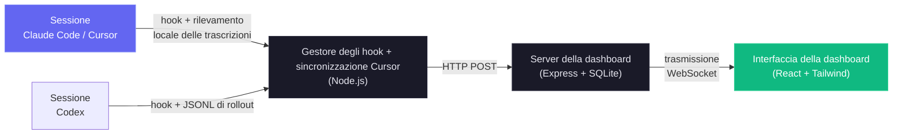

Oltre alla dashboard di monitoraggio in tempo reale, il progetto include un'implementazione di server MCP locale in `mcp/` che espone un catalogo di strumenti per ispezionare e gestire la dashboard stessa, così è facile integrarne le operazioni direttamente nei tuoi flussi di Claude Code e Codex. C'è anche un livello di estensioni degli agenti, che fornisce plugin, skill e subagenti per Claude Code e Codex per interagire con la dashboard, le analisi e l'intelligence dei flussi.

### Internazionalizzazione (i18n)

L'interfaccia include il cambio di lingua integrato per inglese (`en`), cinese (`zh`), vietnamita (`vi`), coreano (`ko`), spagnolo (`es`), francese (`fr`), tedesco (`de`), portoghese (`pt`) e italiano (`it`). Un menu a discesa della lingua personalizzato evita che il selettore affolli la barra laterale man mano che si aggiungono lingue. Le risorse linguistiche vengono caricate per namespace e salvate nello storage del browser, per una preferenza stabile tra un ricaricamento e l'altro.

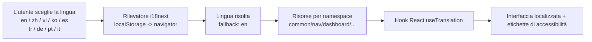

Per l'architettura completa e le indicazioni operative, vedi [docs/I18N.md](./docs/I18N.md).

### Interfaccia utente

L'interfaccia scura e responsive copre l'intero flusso di lavoro. Ogni anteprima usa una miniatura adatta ai dispositivi mobili e rimanda all'originale ad alta definizione.

<p align="center">
  <a href="images/dashboard.png"></a>
  <br>
  <em>📡 <strong>Dashboard</strong> · totali della flotta, agenti attivi, attività recente e segnali di salute in diretta</em>
</p>

<p align="center">
  <a href="images/tasks-overview.png">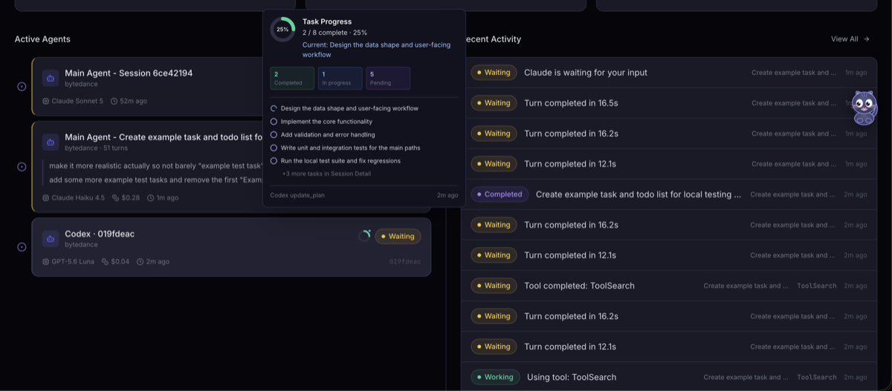</a>
  <br>
  <em>📋 <strong>Avanzamento attività</strong> · completamento compatto e anteprime del lavoro per responsabile</em>
</p>

<p align="center">
  <a href="images/dashboard-health.png"></a>
  <br>
  <em>🩺 <strong>Stato del sistema</strong> · archiviazione, cache, errori, strumenti, modelli, subagenti e compattazioni</em>
</p>

<p align="center">
  <a href="images/board.png"></a>
  <br>
  <em>📋 <strong>Bacheca Kanban · Agenti</strong> · agenti al lavoro, in attesa, completati e in errore, con motivi di attesa chiari</em>
</p>

<p align="center">
  <a href="images/board-sessions.png">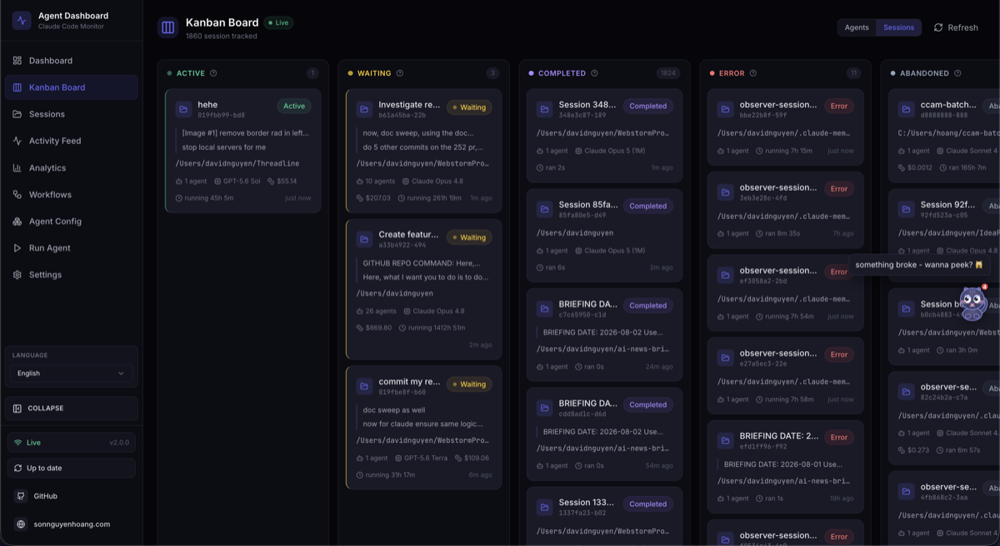</a>
  <br>
  <em>🗂️ <strong>Bacheca Kanban · Sessioni</strong> · sessioni attive, in attesa, completate, in errore e abbandonate</em>
</p>

<p align="center">
  <a href="images/sessions.png">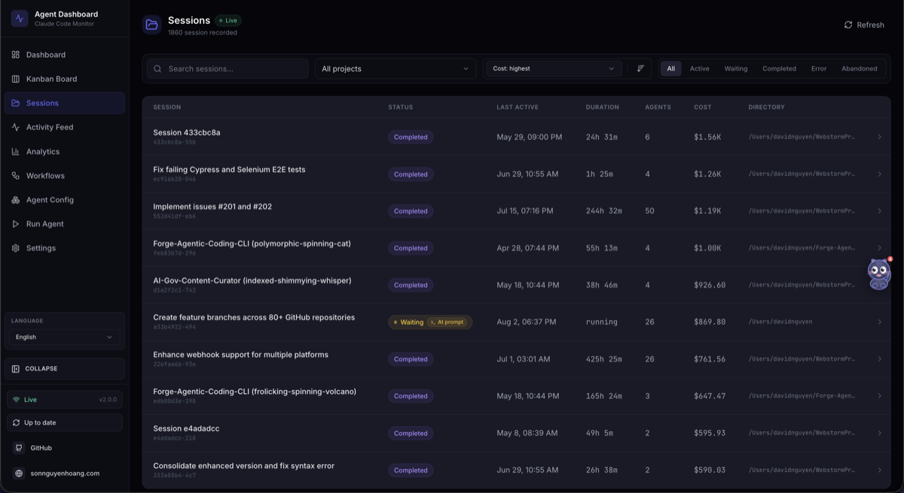</a>
  <br>
  <em>📂 <strong>Sessioni</strong> · cronologia con ricerca, filtri e paginazione lato server, con costi e attività</em>
</p>

<p align="center">
  <a href="images/session-agents.png">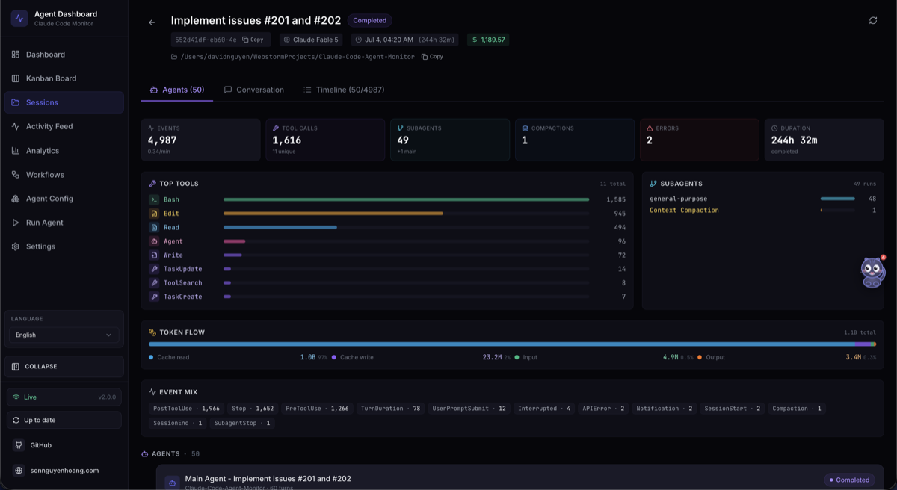</a>
  <br>
  <em>🤖 <strong>Agenti della sessione</strong> · totali in diretta, uso degli strumenti, flusso dei token e gerarchia degli agenti</em>
</p>

<p align="center">
  <a href="images/tasks-details.png"></a>
  <br>
  <em>✅ <strong>Dettagli delle attività</strong> · segmenti di completamento, lavoro in corso, responsabili e attività paginate</em>
</p>

<p align="center">
  <a href="images/session-conversation.png">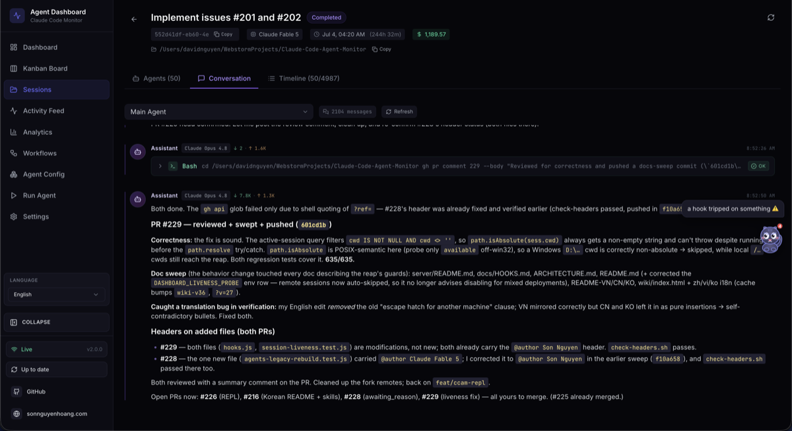</a>
  <br>
  <em>💬 <strong>Conversazione</strong> · trascrizioni con rendering, codice, chiamate agli strumenti, output dei comandi e marcatori di sessione</em>
</p>

<p align="center">
  <a href="images/session-timeline.png"></a>
  <br>
  <em>🔬 <strong>Cronologia</strong> · eventi in ordine cronologico, filtri multidimensionali e attività degli strumenti abbinata</em>
</p>

<p align="center">
  <a href="images/feed.png">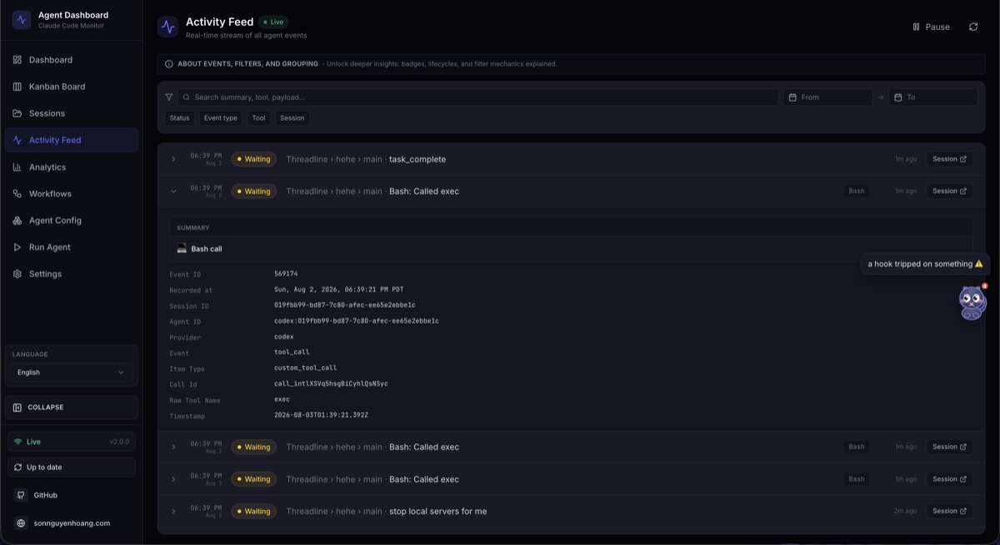</a>
  <br>
  <em>📰 <strong>Feed attività</strong> · eventi in diretta sospendibili, raggruppamento, filtri e salti alla sessione</em>
</p>

<p align="center">
  <a href="images/analytics.png"></a>
  <br>
  <em>📊 <strong>Analisi</strong> · token per modello, frequenza degli strumenti, heatmap dell'attività e tendenze delle sessioni</em>
</p>

<p align="center">
  <a href="images/workflows.png"></a>
  <br>
  <em>🔀 <strong>Flussi</strong> · grafi di orchestrazione, flusso degli strumenti, collaborazione, delega e pattern</em>
</p>

<p align="center">
  <a href="images/dynamicworkflows-workflows.png">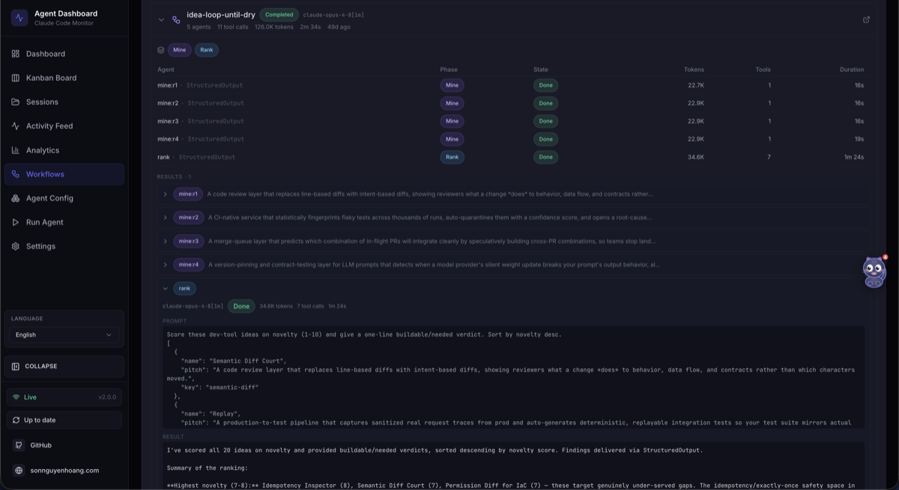</a>
  <br>
  <em>🧬 <strong>Esecuzioni dei flussi</strong> · stato, agenti, token, strumenti e durata ricavati dai diari di esecuzione</em>
</p>

<p align="center">
  <a href="images/dynamicworkflows-workflows2.png">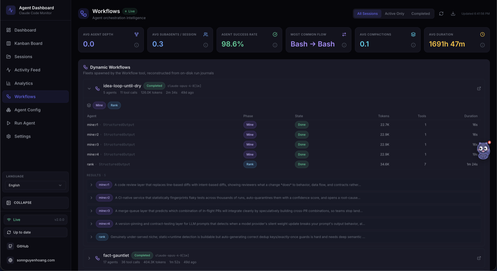</a>
  <br>
  <em>🧬 <strong>Esecuzione espansa</strong> · filtri di fase, metriche per agente, prompt e risultati completi</em>
</p>

<p align="center">
  <a href="images/dynamicworkflows-session.png">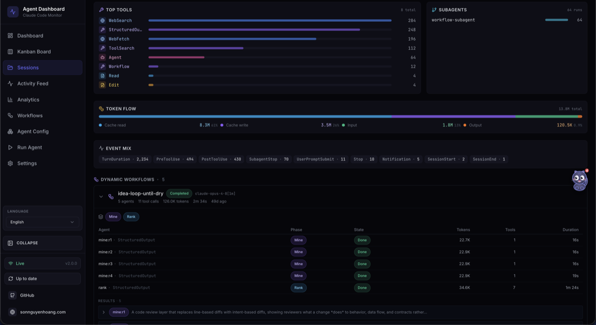</a>
  <br>
  <em>🧬 <strong>Flussi della sessione</strong> · esecuzioni dinamiche collegate e costi in token incorporati</em>
</p>

<p align="center">
  <a href="images/config.png">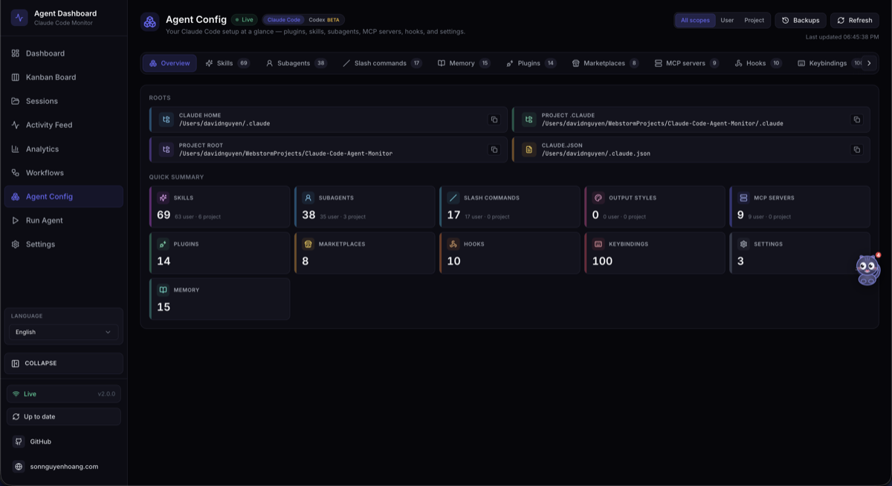</a>
  <br>
  <em>🧰 <strong>Configurazione agenti</strong> · ispeziona e modifica in sicurezza la configurazione supportata di Claude Code e Codex</em>
</p>

<p align="center">
  <a href="images/config-codex.png"></a>
  <br>
  <em>🧰 <strong>Configurazione di Codex</strong> · modelli, profili, MCP, progetti, skill, hook, regole, plugin e istruzioni</em>
</p>

<p align="center">
  <a href="images/config-skills.png">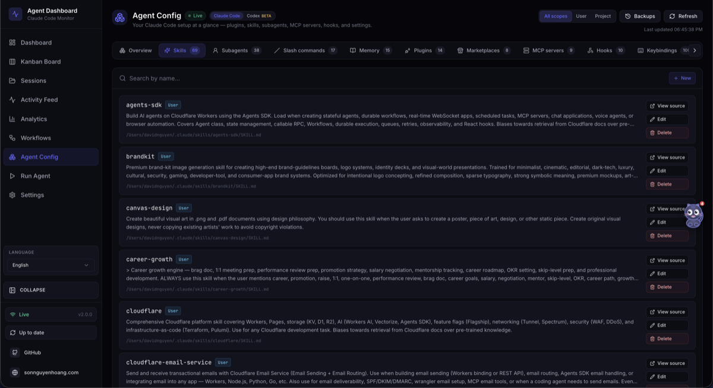</a>
  <br>
  <em>🧩 <strong>Skill</strong> · skill di utente, progetto e plugin, ricercabili e modificabili con backup</em>
</p>

<p align="center">
  <a href="images/run.png"></a>
  <br>
  <em>▶️ <strong>Avvia agente</strong> · avvia Claude Code o Codex con i controlli nativi di ciascun provider</em>
</p>

<p align="center">
  <a href="images/run-results.png">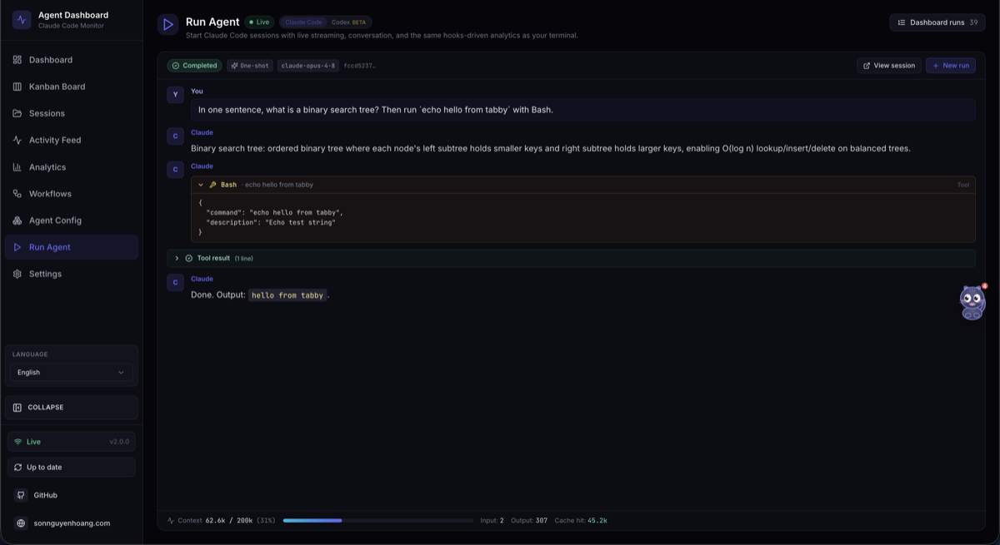</a>
  <br>
  <em>💬 <strong>Esecuzione in diretta</strong> · chat in streaming, ragionamento, comandi, modifiche ai file, strumenti e ricollegamento</em>
</p>

<p align="center">
  <a href="images/settings.png">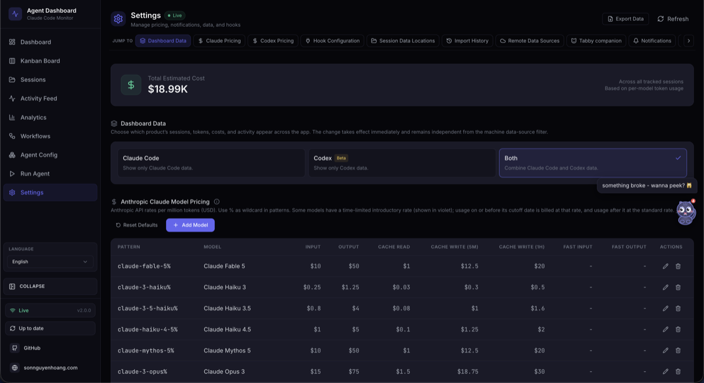</a>
  <br>
  <em>⚙️ <strong>Impostazioni</strong> · prezzi, hook, notifiche, dati, origini remote e stato del sistema</em>
</p>

<p align="center">
  <a href="images/alerts.png"></a>
  <br>
  <em>🔔 <strong>Avvisi</strong> · regole, tempi di attesa, attività e webhook integrati o generici firmati</em>
</p>

<p align="center">
  <a href="images/remote.png"></a>
  <br>
  <em>🛰️ <strong>Origini dati remote</strong> · sincronizzazione SSH consapevole del provider e monitoraggio per origine</em>
</p>

<p align="center">
  <a href="images/palette.png"></a>
  <br>
  <em>⌘ <strong>Tavolozza dei comandi</strong> · un unico launcher da tastiera per pagine, sessioni, progetti, filtri e azioni</em>
</p>

La barra laterale collega Dashboard, Bacheca Kanban, Sessioni, Feed attività, Analisi, Flussi, Configurazione agenti, Avvia agente e Impostazioni. Le sezioni seguenti descrivono nel dettaglio il funzionamento di queste viste.

---

## Funzionalità

La dashboard copre l'intero ciclo di vita locale degli agenti. I contratti operativi dettagliati restano nelle sezioni collegate e nei riferimenti in `docs/`.

| Funzionalità | Riepilogo |
| --- | --- |
| **Avanzamento attività** | Avanzamento per responsabile ricavato dagli strumenti di attività di Claude, dal vecchio `TodoWrite` e dall'`update_plan` di Codex. Anteprime compatte compaiono su schede e righe; il Dettaglio della sessione aggiunge segmenti di stato, lavoro in corso, responsabili e paginazione a 10 righe. Il nuovo lavoro di primo livello azzera lo stato incompiuto obsoleto, mentre la cronologia completata resta. |
| **Dashboard** | Le schede persistenti **Monitoraggio** e **Stato** riuniscono totali della flotta, gerarchie attive, attività recente, salute ponderata su successo/cache/errori/heap, archiviazione, strumenti, modelli, efficacia dei subagenti e metriche di compattazione. Lo stato si aggiorna ogni 5 secondi da `/api/settings/info` e `/api/workflows`. |
| **Bacheca Kanban** | Le colonne degli agenti coprono Al lavoro, In attesa, Completato ed Errore; le colonne delle sessioni aggiungono Attive e Abbandonate. Le schede vengono paginate 10 alla volta, si iscrivono solo alla vista WebSocket attiva, conservano i titoli completi e spiegano i motivi di attesa, come una richiesta di permesso, un turno completato, l'inattività al prompt o un'interruzione. |
| **Sessioni** | Cronologia con ricerca, filtri e paginazione lato server, con calcolo dei costi sulla sola pagina visibile e una riga temporanea in memoria per l'avvio di Codex. La ricerca copre `id`, `name` e `cwd` con un debounce di 300 ms. I nomi si ricavano dal titolo esplicito, poi dal titolo generato dall'IA, poi dal primo prompt significativo dell'utente. |
| **Dettaglio della sessione** | Statistiche in diretta, lavoro in corso, uso degli strumenti, subagenti, token, gerarchia, cronologie degli eventi filtrate, raggruppamento per `tool_use_id` e visualizzazioni specifiche per strumento. La vista Conversazione mostra turni in coda, avvisi di sistema, Markdown, codice evidenziato e strumenti con stile dedicato; i banner di attesa indicano il motivo e il tempo trascorso. |
| **Feed attività** | Eventi in tempo reale sospendibili, con filtri condivisi, paginazione lato server, raggruppamento, origine progetto/sessione/subagente, link alla sessione e badge di stato coerenti per Claude e Codex. |
| **Analisi** | Token per modello, frequenza degli strumenti, heatmap dell'attività allineate alla domenica, tendenze delle sessioni, stato della connessione, scheletri di caricamento fedeli al layout e legende lunghe paginate. |
| **Tavolozza dei comandi** | `Cmd/Ctrl+K` cerca tra comandi recenti, tutte le route, sessioni in diretta lato server, azioni della pagina, directory di progetto, sottoviste, filtri, Impostazioni, Configurazione agenti, preferenze, ambito e lingua. Supporta l'ordinamento per sottosequenza, gli ambiti `>`/`@`/`#`, il controllo completo da tastiera, etichette tradotte, errori di ricerca silenziosi e la sola navigazione verso le azioni distruttive. |
| **Una sola scorciatoia** | `Cmd/Ctrl+K` è l'unica combinazione di tasti globale della dashboard, attiva anche nei campi di testo. La navigazione a più tasti è stata rimossa per evitare modalità nascoste; Tabby mantiene `Cmd/Ctrl+B`. |
| **Aggiornamenti in diretta** | Il push via WebSocket aggiorna l'interfaccia senza polling. |
| **Rilevamento automatico** | I segnali dei provider creano automaticamente sessioni e agenti. Claude compare al `SessionStart`; Codex mostra una scheda In attesa locale e temporanea prima che esista un ID durevole, adotta in sicurezza i thread terminati che vengono ripresi e non scrive mai le schede senza identità nei totali durevoli, nelle analisi, negli avvisi o nelle notifiche. |
| **Importazione della cronologia** | Le trascrizioni di Claude da `~/.claude/` e i rollout di Codex da `~/.codex/sessions` usano flussi di scansione e caricamento specifici per provider, lo stesso conteggio dell'acquisizione in diretta e scritture idempotenti. I rollout di Codex esterni vengono copiati, così le conversazioni sopravvivono alla rimozione dell'origine. |
| **Gerarchia dei subagenti** | Alberi padre-figlio comprimibili in Dashboard e nel Dettaglio della sessione, che si espandono automaticamente finché i figli sono attivi. |
| **Agenti in background** | I subagenti in background restano tracciati senza essere segnati come completati in anticipo. |
| **Attribuzione degli strumenti dei subagenti** | `SubagentStop` e le scansioni all'avvio importano gli strumenti dai JSONL di ciascun subagente, abbinano i risultati per `tool_use_id`, deduplicano, uniscono le righe in diretta corrispondenti entro 30 secondi e ricostruiscono i veri genitori annidati dagli ID dei figli avviati. Il riassegnamento del genitore è additivo e aggiorna l'interfaccia anche quando non viene inserita alcuna riga. |
| **Tracciamento dei costi** | Prezzi configurabili per modello e per sessione, con tariffe di lancio a scadenza, categorie promozionali modificabili, il costo proprio di ogni subagente e totali che resistono alle compattazioni. Le letture delle trascrizioni usano offset di byte incrementali in cache. |
| **Cache delle trascrizioni** | L'analisi JSONL incrementale estrae token, compattazioni, errori API, durate dei turni, ragionamento e metadati di utilizzo; le analisi complete riparano i vecchi duplicati, mentre quelle di coda restano in sola aggiunta. Gli array sono limitati da `TRANSCRIPT_CACHE_MAX_ARRAY_LEN`, predefinito `1000`, e le voci memorizzano solo i metadati del file più il risultato analizzato. |
| **Conservazione degli snapshot delle trascrizioni** | Gli snapshot durevoli di Claude, Codex e Cursor conservano la conversazione più completa. Le copie di Claude e Cursor la cui origine è scomparsa vengono compresse con gzip dopo una verifica di andata e ritorno; l'eliminazione definitiva rimuove gli snapshot; limiti facoltativi di età/dimensione possono eliminare l'unica copia vecchia dopo un'anteprima di prova (dry-run) nelle Impostazioni. |
| **Notifiche** | Il Web Push VAPID consegna gli eventi configurati anche con la scheda in background o il browser chiuso, con supporto audio su macOS e gestione delle sottoscrizioni. |
| **Avvisi** | Le Impostazioni offrono Regole, Canali e Attività per avvisi su pattern di eventi, inattività, agente bloccato e soglia di token. Le regole sugli eventi vengono valutate dopo l'acquisizione; quelle temporali con una scansione ogni 60 secondi. Gli avvisi salvati usano un tempo di attesa per regola/sessione, predefinito 300 secondi, la consegna via WebSocket, la presa visione e l'inoltro, con ambito configurabile, tramite webhook a 14 provider dedicati o a un JSON generico firmato, con segreti mascherati, timeout e tentativi limitati. |
| **Notifica degli aggiornamenti** | Un `git fetch` pianificato e non bloccante confronta il checkout con il remote canonico, poi mostra il comando di aggiornamento esatto nella finestra, nella barra laterale e nel terminale. CCAM non esegue mai pull né si riavvia da solo. |
| **Impostazioni** | Stato del sistema e degli hook, prezzi per provider, notifiche, pulizia, home dei provider, aggiornamento immediato dei dati e ripristino idempotente di JSON esportati fino a 25 MiB. I prezzi supportano valori predefiniti per provider, regole con caratteri jolly, indicazioni sulle tariffe pubblicate, la soglia GPT di 272K e cataloghi separati per i modelli nativi di Cursor e quelli di terze parti. |
| **Avvia agente + Configurazione agenti** | `/run` avvia Claude Code o thread nativi dell'app-server di Codex con modelli, approvazioni, sandbox, ripresa, arresto, streaming e ricollegamento specifici per provider. `/cc-config` affianca explorer modificabili per Claude e Codex; i file utente supportati usano salvataggi atomici protetti e backup con data e ora, anteprime con segreti oscurati, comandi di profilo esatti e watcher specifici per provider. |
| **Configurazione agenti Codex** | Mostra l'intero catalogo dei modelli dell'account più le sovrascritture di base e di profilo, crea overlay standard `<name>.config.toml` e protegge la modifica con controlli di contenimento canonico e dei link simbolici. Profili, hook, regole, skill e istruzioni supportano le azioni origine/percorso/modifica/eliminazione, con backup prima di ogni eliminazione; `config.toml` è in sola modifica. |
| **Server MCP (locale)** | Tre trasporti, stdio, HTTP+SSE e REPL, espongono 103 strumenti tipizzati in 16 moduli. Un unico catalogo convalidato impone destinazioni localhost o HTTPS, regole sui token bearer, il rifiuto dei redirect, protezioni sulle modifiche, caricamenti di 50 MiB per file e 100 MiB per chiamata, risposte binarie di 10 MiB e ripristini di 25 MiB. |
| **Flussi** | Undici sezioni D3 coprono orchestrazione, flusso degli strumenti, collaborazione, efficacia, pattern, delega, errori, concorrenza, complessità, compattazione e approfondimento per sessione. Tooltip esplicativi localizzati, filtri incrociati, esportazione JSON, aggiornamento in diretta con debounce di 3 secondi ed esecuzioni dinamiche ricostruite dai diari conservano per ogni agente il dettaglio di fase, token, strumenti, durata, prompt e risultato. |
| **Tracciamento delle compattazioni** | Le scansioni delle trascrizioni creano agenti/eventi di compattazione di durata zero, riparano le vecchie durate negative, recuperano le sessioni passate e controllano periodicamente solo le sessioni attive tramite i valori `sessions.transcript_path` in cache. |
| **Sottosessioni / sessioni riprese** | I nuovi eventi riattivano le sessioni riprese o orfane; una scansione ogni quarto di `DASHBOARD_STALE_MINUTES`, limitata tra 60 secondi e 5 minuti, intercetta le sessioni abbandonate. |
| **Rilevamento delle sessioni preesistenti** | L'importazione all'avvio segna come attive le trascrizioni modificate di recente, e gli eventi Stop successivi riattivano le sessioni importate completate o abbandonate prima di aggiornarle. |
| **Sincronizzazione continua dei progetti** | Una scansione immediata all'avvio, un watcher del file system con debounce e un polling `DASHBOARD_SESSION_SYNC_MS`, predefinito 30 secondi, condividono una cache degli mtime e una scansione accorpata. Vengono rianalizzati solo i file nuovi o avanzati, con un ambito del watcher sicuro su Linux e trasmissioni in diretta delle sessioni. |
| **Origini dati remote** | Le origini SSH replicano in modo indipendente le home di Claude e Codex tramite `scp` o `tar` in WSL, contrassegnano `sessions.source`, riconciliano il ciclo di vita e restano sane se almeno un provider funziona. Il polling è di 15 secondi per impostazione predefinita; il ripiego per inattività riguarda solo il provider in errore. Le credenziali restano affidate all'SSH dell'host. |
| **Acquisizione tramite push remoto** | `POST /api/hooks/ingest-batch` supporta le macchine dietro NAT. Resta disattivata finché non viene impostato `REMOTE_PUSH_TOKEN`, rifiuta i token nella query string e le sessioni possedute localmente, limita i batch a 1000 elementi, deduplica `(session_id, event_type, uuid)`, restituisce errori parziali per elemento e trasmette solo dopo il commit. |
| **Design responsive** | I layout per dispositivi mobili impilano le griglie, rendono scorrevoli le tabelle larghe e comprimono la navigazione. |
| **Localizzazione dell'interfaccia** | Inglese, cinese, vietnamita, coreano, spagnolo, francese, tedesco, portoghese e italiano coprono testi dell'interfaccia, etichette di accessibilità, spiegazioni e tooltip dei flussi, indicazioni sui prezzi dei modelli, home dei provider e Importazione della cronologia. |
| **Dati di esempio** | Uno script integrato fornisce dati realistici per demo e sviluppo. |
| **Riga di stato** | Una striscia CLI a colori mostra modello, contesto, branch Git, token per direzione e costo della sessione in USD. |
| **Formattazione dei nomi dei modelli** | Gli identificatori di Claude, GPT e Gemini diventano nomi leggibili rimuovendo prefisso del provider e suffissi di data/latest, unendo le versioni numeriche e formattando le etichette di contesto; le Impostazioni mantengono i pattern grezzi per i prezzi. |
| **Marketplace di plugin Claude + Codex** | Un unico albero di 14 plugin fornisce entrambi i formati di manifest e di catalogo, 66 skill di plugin, 18 subagenti Claude, 34 comandi Claude, 3 utility CLI e i metadati OpenAI. `npx skills add hoangsonww/Claude-Code-Agent-Monitor --list` rileva 77 skill del repository. |
| **Avvia Claude** | Le modalità Conversazione e Singola esecuzione supportano ripresa/visualizzazione della cronologia, esecuzioni simultanee in background, ricollegamento basato sulla trascrizione, controlli di modello/impegno/permessi/cwd, smussatura dei messaggi parziali, conservazione del ragionamento, comandi slash, file `@`, indicatori di contesto e di costo e stato in diretta. La protezione same-origin blocca gli avvii drive-by; la concorrenza ha per impostazione predefinita un tetto di sicurezza di 10000 e può essere ridotta con `RUN_MAX_CONCURRENT`. |
| **Explorer della configurazione di Claude** | Dodici schede ispezionano skill, agenti, comandi, stili, plugin, marketplace, MCP, hook, impostazioni, memoria, scorciatoie da tastiera e riga di stato. I percorsi canonici impediscono la fuga tramite link simbolici; le superfici di testo supportate usano creazione/modifica/eliminazione atomiche con backup datati fuori dall'albero, mentre la configurazione sensibile resta in sola lettura con indicazioni CLI esatte. Un `cc-watcher` da 500 ms trasmette le modifiche esterne. |
| **Tabby** | Una mascotte WebSocket senza dipendenze, con otto stati d'animo derivati dall'attività, fumetti limitati, azioni rapide, risposte locali sullo stato e passaggio ad Avvia Claude per le domande più ampie. È accessibile da tastiera, rispetta la riduzione del movimento, resta sicura in caso di disconnessione, è configurabile e localizzata. |
| **Segnali acustici** | Sette segnali Web Audio senza dipendenze coprono sessioni, errori, subagenti, notifiche, connessione e clic. Tempi di attesa, un budget globale per le raffiche, un filtro passa-basso, il rispetto dell'autoplay, il volume salvato e le impostazioni per segnale li rendono discreti. |
| **Progressive Web App (PWA)** | Dashboard, landing page e wiki hanno manifest e service worker indipendenti. Le risorse immutabili di Vite sono cache-first; le navigazioni e i file mutabili della shell sono network-first; il push resta intatto; landing page e wiki mettono in cache in anticipo le proprie shell e, alla prima visualizzazione, gli screenshot; i metadati SVG e Apple supportano l'installazione. |
| **App desktop (macOS e Windows)** | Electron 35 confeziona DMG per macOS ed EXE per Windows (installer e portatile) attorno allo stesso server Express nello stesso processo e allo stesso client React. Aggiunge menu nativi, stato e azioni nel tray, avvio al login, conferma di uscita, notifiche native, un lock a istanza singola, ripiego e adozione sicuri della porta, chiusura pulita di SQLite e configurazione di hook e servizi in background al primo avvio. |
| **Risorse self-hosted (niente CDN)** | Font, script, il Mermaid del wiki e i ripieghi dell'estensione sono locali. App, landing page e wiki funzionano offline senza Google Fonts, jsDelivr o altre richieste di risorse a terze parti. |
| **Schermata iniziale della sessione** | Un saluto localizzato, una volta per sessione del browser, con un'animazione a grafo di nodi: è opaco fin dal primo rendering, dura circa 2,5 secondi, si salta con un clic e rispetta la riduzione del movimento. |

> **Ambito dei provider e home:** le Impostazioni mantengono coerente ovunque la scelta compatibile con Claude (Claude Code + Cursor) / Codex / Entrambi. Le home di Claude Code e Codex restano modificabili senza riavviare la dashboard; Cursor viene rilevato automaticamente da `~/.cursor` o `DASHBOARD_CURSOR_HOME`.
>
> **Limiti di sicurezza locali:** Avvia agente accetta qualsiasi directory di lavoro assoluta esistente e la canonicalizza prima dell'uso, così gli avvii dalla home e dai progetti recenti restano supportati. I provider di webhook ospitati richiedono HTTPS; le destinazioni generiche e n8n possono usare HTTP per ricevitori locali/self-hosted, e la consegna non segue mai i reindirizzamenti.

---

## Avvio rapido

### Prerequisiti

- **Node.js** >= 22.22.0 (consigliata la 24 LTS)
- **npm** >= 9.0.0

### 1. Installare

```bash
git clone https://github.com/hoangsonww/Claude-Code-Agent-Monitor.git
cd Claude-Code-Agent-Monitor
npm run setup
```

### 2. Configurare gli hook di Claude Code

```bash
npm run install-hooks
```

Scegli **Claude Code**, **Codex (beta)** o entrambi con le frecce, Spazio e Invio. Gli hook di Claude vengono salvati in `~/.claude/settings.json` e quelli di Codex in `~/.codex/hooks.json`. Reinstallare sostituisce solo le voci di CCAM e preserva gli hook non correlati; la stessa azione è disponibile in **Impostazioni → Configurazione degli hook**.

Al primo avvio, CCAM verifica solo i provider selezionati per l'ambito dei dati attuale e propone di installare gli hook mancanti. Un controllo di disponibilità fallito ripiega sulla configurazione manuale invece di bloccare la dashboard.

Il rilevamento dei provider continua dopo la configurazione:

- **Claude Code e Cursor:** gli hook di Claude alimentano gli eventi in diretta. Cursor non ha bisogno di hook; selezionare Claude Code osserva anche `~/.cursor/chats` e `~/.cursor/projects/*/agent-transcripts`, salva uno snapshot delle conversazioni prima che Cursor le ripulisca e rispetta `DASHBOARD_CURSOR_HOME`.
- **Codex:** gli hook e l'osservazione incrementale dei rollout in `~/.codex/sessions` mantengono aggiornati ciclo di vita, prompt, titoli, strumenti, token, costi, compattazioni, conversazioni e stato WebSocket. I file difettosi vengono ritentati in isolamento; l'abbinamento esatto tra rollout e processo evita le schede attive fantasma; i titoli nativi `/rename` e la cronologia delle conversazioni paginata a cursore restano in diretta.
- **Entrambi:** le schede conservano gli ultimi due prompt umani distinti, mostrano gli allegati immagine salvati e deduplicano le risposte ripetute di Codex. L'ambito solo Codex nasconde i diari dei flussi dinamici esclusivi di Claude.

### 3. Avviare

```bash
# Development (hot reload on both server and client)
npm run dev

# Production (single process, built client)
npm run build && npm start
```

> [!TIP]
> **Alternativa con Makefile** — tutti i comandi sono disponibili anche tramite `make`, se è installato sul tuo sistema. Esegui `make help` per vedere ogni target, oppure usa scorciatoie come `make dev`, `make build`, `make test` ecc.

### 4. Aprire

| Modalità | URL |
| ----------- | ----------------------- |
| Sviluppo | `http://localhost:5173` |
| Produzione | `http://localhost:4820` |

### 5. Facoltativo: eseguire il server MCP locale

```bash
npm run mcp:start              # stdio (default — for MCP host integration)
npm run mcp:start:http         # HTTP + SSE server on port 8819
npm run mcp:start:repl         # interactive CLI with tab completion
ccam mcp stdio                 # stable launcher used by bundled plugins
```

`npm run setup` installa e compila il pacchetto MCP prima di collegare `ccam`. Per la modalità stdio, configura il tuo host con il comando `ccam` e gli argomenti `["mcp", "stdio"]`.

Per la modalità HTTP, punta i client MCP remoti a `http://127.0.0.1:8819/mcp` (Streamable HTTP) o `http://127.0.0.1:8819/sse` (SSE legacy).

Vedi [mcp/README.md](./mcp/README.md) per la configurazione completa dell'host, i dettagli sul trasporto, le opzioni di sicurezza e il catalogo degli strumenti.

### Facoltativo: dati dimostrativi

```bash
npm run seed
```

Crea 8 sessioni di esempio, 23 agenti e 106 eventi così puoi esplorare subito l'interfaccia.

### Alternativa: app desktop (macOS e Windows)

Se preferisci non tenere aperto un terminale, installa l'**app desktop nativa** facoltativa. Incorpora il server nello stesso processo, aggiunge un'icona nella barra dei menu / area di notifica (tray) e supporta l'avvio automatico all'accesso (elementi di login di macOS / avvio di Windows).

La via più rapida è **scaricare un installer già pronto** dall'[ultima Release su GitHub](https://github.com/hoangsonww/Claude-Code-Agent-Monitor/releases/latest) (la CI pubblica automaticamente una `vX.Y.Z` ogni volta che la versione in `package.json` viene incrementata su `master`):

- **macOS** — scarica `ClaudeCodeMonitor-<version>-arm64.dmg` (Apple Silicon) o `-x64.dmg` (Intel) e trascina **Claude Code Monitor.app** in `/Applications`.
- **Windows** — scarica `ClaudeCodeMonitor-Setup-<version>-x64.exe` (installer) o `ClaudeCodeMonitor-<version>-x64-portable.exe` (senza installazione) ed eseguilo.

Per compilarla da solo:

```bash
npm run desktop:install        # install Electron + electron-builder into desktop/ (preflights native deps; prints setup help on failure)
npm run desktop:dmg:arm64      # macOS: fast single-arch DMG (Apple Silicon)
npm run desktop:win            # Windows: NSIS installer .exe (run on Windows)
```

La documentazione completa dell'app desktop — download, installazione, funzioni del tray/menu, comandi di build e firma — è nella sezione [App desktop (macOS e Windows)](#app-desktop-macos-e-windows) più avanti. Vedi anche [`DESKTOP.md`](./DESKTOP.md) (guida utente) e [`desktop/README.md`](./desktop/README.md) (architettura).

### Alternativa: Docker / Podman

L'immagine OCI e i file Compose supportano Docker e Podman. Il runtime gira senza root, rinuncia a tutte le capability, usa Tini come PID 1, include Git/OpenSSH/SQLite ed è in sola lettura tranne che per `/app/data`, `/app/config` e `/tmp`.

```bash
# Dashboard only
docker compose up -d --build
# or
podman compose up -d --build

# Complete stack: dashboard + authenticated MCP + Nginx + Prometheus + Grafana
umask 077
openssl rand -hex 32 > deployments/secrets/dashboard-token
openssl rand -hex 32 > deployments/secrets/hook-token
openssl rand -hex 32 > deployments/secrets/mcp-token
openssl rand -base64 32 > deployments/secrets/grafana-admin-password
npm run docker:full:up
```

Tutte le porte dell'host sono associate al loopback per impostazione predefinita: dashboard `4820`, MCP `8819`, Nginx `8080`, Prometheus `9090` e Grafana `3000`. Le home di Claude e Codex sono montate in sola lettura; volumi con nome mantengono SQLite e la configurazione propria della dashboard. Nginx fa da proxy per l'interfaccia, l'API REST autenticata e il WebSocket, mentre hook, metriche e MCP restano bloccati al bordo a meno che non vengano abilitati esplicitamente. Il target Docker facoltativo `agent-runtime` aggiunge CLI di Claude Code e Codex con versioni fissate per flussi di Avvia agente nativi del container.

> [!IMPORTANT]
> Installa gli hook di Claude Code/Codex sull'host dopo l'avvio del container. Per hook remoti nel cloud, imposta `CCAM_DASHBOARD_URL=https://...` e un `CCAM_HOOK_TOKEN` separato; gli URL degli hook fuori dal loopback richiedono HTTPS. Vedi [DEPLOYMENT.md](DEPLOYMENT.md).

---

## Come funziona

La dashboard si integra con Claude Code tramite il suo sistema di hook nativo per monitorare in tempo reale l'attività degli agenti. Ecco una panoramica dell'architettura e del flusso dei dati:

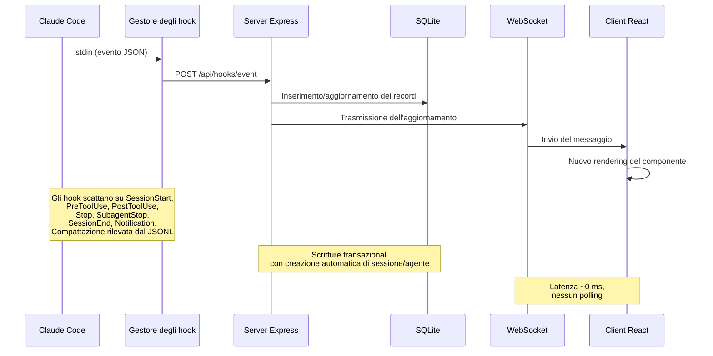

> [!IMPORTANT]
> Vedi [ARCHITECTURE.md](./ARCHITECTURE.md) per un approfondimento sull'architettura del server, lo schema del database, le route dell'API, il design del WebSocket, il routing del client, il flusso del gestore degli hook, le modalità di deploy e i diagrammi dettagliati del ciclo di vita di sessioni e agenti.

### Ciclo di vita degli hook

1. **Claude Code** emette hook di sessione, prompt, strumenti, notifiche, subagenti, turni e uscita.
2. **`scripts/hook-handler.js`** legge ogni evento da stdin e individua le dashboard attive tramite `~/.claude/.agent-dashboard.json` o `CLAUDE_DASHBOARD_PORT`. Invia una sola volta per ogni directory di dati SQLite distinta, scegliendo la porta più bassa tra i listener duplicati e continuando ad alimentare le dashboard con database separati. La consegna è a prova di errore: ogni destinazione è isolata e il gestore termina entro 5 secondi.
3. **Il server** registra l'evento e lo stato correlato in un'unica transazione SQLite:
   - Il primo contatto crea la sessione e l'agente principale. Al `SessionStart` parte **In attesa**; `UserPromptSubmit` o `PreToolUse` lo portano **Al lavoro**; `PostToolUse` lo mantiene al lavoro.
   - `Stop` riporta l'agente principale **In attesa** mentre gli agenti in background continuano. `stop_reason=error` segna l'agente e la sessione come **Errore**. Anche le notifiche di permesso mettono in attesa di un input; solo un nuovo prompt o l'avvio di uno strumento recupera un errore.
   - `SubagentStop` completa quel figlio senza cambiare lo stato di attesa dell'utente. Una scansione separata importa poi i suoi strumenti dal JSONL, abbina usi e risultati per `tool_use_id`, li deduplica e ricostruisce i veri genitori annidati.
   - `SessionEnd` azzera l'attesa e completa la sessione, a meno che non vada preservato un errore. Il nuovo lavoro riattiva le sessioni completate, in errore o abbandonate, comprese quelle importate e riprese.
   - `SessionStart` e la manutenzione periodica abbandonano le sessioni inattive dopo `DASHBOARD_STALE_MINUTES`, predefinito 180. La scansione viene eseguita ogni quarto di quel valore, limitata tra 60 secondi e 5 minuti.
   - L'analisi incrementale condivisa delle trascrizioni registra compattazioni, errori API e degli strumenti, durate dei turni, token e metadati senza rileggere i byte invariati. Le scansioni delle sessioni attive usano i valori indicizzati di `sessions.transcript_path` e rimuovono dalla cache le voci abbandonate.
   - Un watchdog da 15 secondi rileva gli errori API nella trascrizione dopo 10 secondi senza hook. Recupera anche le interruzioni con Esc dai marcatori della trascrizione o, in assenza di marcatore, dopo `DASHBOARD_WORKING_IDLE_SECONDS`, predefinito 120, solo quando nessuno strumento è in esecuzione e né gli hook né la trascrizione avanzano.
   - Lo stesso watchdog completa le sessioni locali morte tramite una sonda di attività dei processi dopo `DASHBOARD_LIVENESS_IDLE_SECONDS`, predefinito 60. Le sonde all'avvio vengono eseguite subito e di nuovo dopo circa 5 secondi, senza quella soglia di inattività. La sonda salta Windows, i container, i percorsi inoltrati non POSIX, le sessioni delle origini remote, i fallimenti degli strumenti di sistema e `DASHBOARD_LIVENESS_PROBE=0`; un successivo hook reale corregge da solo un falso completamento.
   - La sincronizzazione continua dei progetti combina una scansione immediata, un `fs.watch` con debounce e un polling `DASHBOARD_SESSION_SYNC_MS`, predefinito 30 secondi. Un'unica cache degli mtime rianalizza solo le trascrizioni nuove o cresciute e trasmette gli stessi frame di sessione degli hook.
4. Il **WebSocket** pubblica la modifica registrata.
5. L'**interfaccia** aggiorna le viste interessate senza polling.

### Macchina a stati degli agenti

Stati persistiti: `working | waiting | completed | error`. La
colonna `awaiting_input_since` è complementare — registra quando l'agente
ha iniziato ad attendere e serve a mostrare la durata, ma `waiting` è ora un
vero stato persistito.

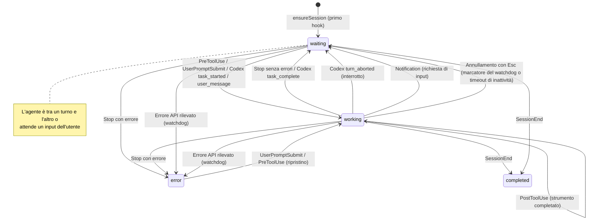

### Macchina a stati delle sessioni

Stati persistiti: `active | completed | error | abandoned`. Lo stato di sessione
**In attesa** è una sovrapposizione dell'interfaccia (status=`active` con
`awaiting_input_since` impostato).

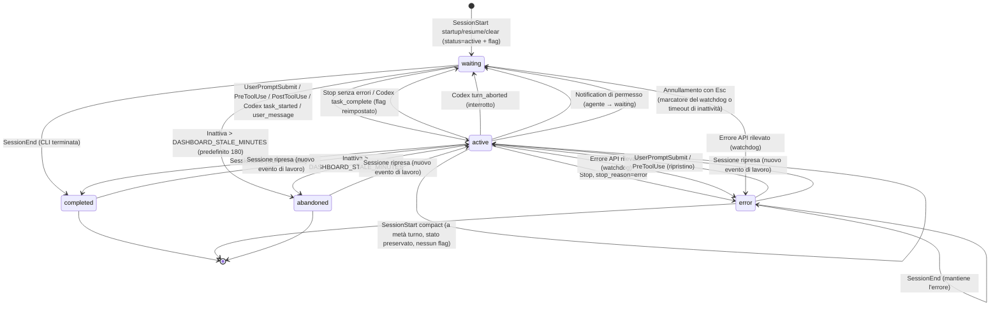

### Flusso del calcolo dei costi

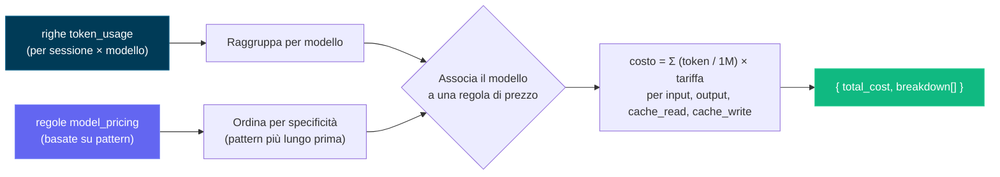

> [!IMPORTANT]
> Il flusso del calcolo dei costi si basa sul consumo di token e sulle regole di prezzo dei modelli. Mantieni aggiornate le regole di prezzo per ottenere costi accurati. Aggiorna la tabella dei prezzi dei modelli dalla pagina Impostazioni per un tracciamento preciso dei costi — la dashboard non recupera automaticamente gli aggiornamenti dei prezzi da fonti esterne. Una volta impostate le regole di prezzo, la dashboard le applica retroattivamente a tutte le sessioni per report sui costi coerenti.

---

## Configurazione

| Variabile d'ambiente | Predefinito | Scopo |
| --- | --- | --- |
| `DASHBOARD_PORT` | `4820` | Porta del server Express. |
| `CLAUDE_DASHBOARD_PORT` | `4820` | Porta usata dal gestore degli hook. |
| `NODE_ENV` | `development` | Usa `production` per servire il client compilato. |
| `DASHBOARD_UPDATE_CHECK` | attivo | Imposta `0`, `false` o `off` per disattivare i controlli pianificati dell'upstream. |
| `DASHBOARD_UPDATE_CHECK_INTERVAL_MS` | `300000` | Intervallo dei controlli, minimo 60 000 ms. Il pulsante manuale **Controlla ora** resta disponibile. |
| `DASHBOARD_STALE_MINUTES` | `180` | Inattività dopo la quale una sessione attiva o In attesa diventa abbandonata. Il watchdog la applica e la manutenzione viene eseguita ogni quarto di questo valore, limitata tra 60 secondi e 5 minuti. |
| `DASHBOARD_WORKING_IDLE_SECONDS` | `120` | Recupera un annullamento con Esc senza marcatore quando non avanza alcuna attività di strumenti, hook o trascrizione. Valori più bassi reagiscono prima ma possono classificare male, per poco, i lunghi turni silenziosi; la nuova attività corregge da sola. Cursor usa la stessa regola. |
| `DASHBOARD_LIVENESS_PROBE` | `1` | Imposta `0` per disattivare il completamento basato sui processi delle sessioni locali morte di Claude/Codex. Salta automaticamente Windows, i container, i percorsi inoltrati non POSIX e le origini remote. |
| `DASHBOARD_LIVENESS_IDLE_SECONDS` | `60` | Soglia di inattività, sulla trascrizione o sull'ultimo hook, per i controlli di attività del watchdog. Le sonde all'avvio ignorano la soglia, così le sessioni già morte vengono pulite subito. |
| `DASHBOARD_SESSION_SYNC_MS` | `30000` | Polling di sicurezza per i file nuovi o modificati in `~/.claude/projects`. `fs.watch` resta immediato; `0` disattiva solo il polling. |
| `DASHBOARD_CURSOR_HOME` | `~/.cursor` | Radice dello stato di Cursor per chat, trascrizioni, recupero e snapshot durevoli. |
| `DASHBOARD_CURSOR_SYNC_MS` | `5000` | Polling di sicurezza di Cursor basato su impronte. I watcher restano attivi quando `0` disattiva il polling. |
| `DASHBOARD_CODEX_HOME` | `CODEX_HOME` o `~/.codex` | Radice dello stato di Codex. Le Impostazioni rendono persistente una sovrascrittura, riattivano l'osservazione e scansionano subito. |
| `DASHBOARD_CODEX_SYNC_MS` | `4000` | Polling di sicurezza dei rollout di Codex. Hook e watcher restano attivi quando è impostato a `0`. |
| `DASHBOARD_CODEX_MAX_ATTEMPTS` | `5` | Tentativi per un singolo rollout illeggibile e invariato, compreso il primo. Una modifica di dimensione o mtime ripristina il budget; all'esaurimento viene registrato un unico messaggio. |
| `DASHBOARD_CODEX_HOOK_IDLE_SECONDS` | `60` | Completa le sessioni di Codex solo tramite hook, come `codex exec --ephemeral`, quando uno `stop` segnalato come terminato non riceve mai `SessionEnd`. Il solo silenzio non basta mai. |
| `DASHBOARD_TASK_SUMMARY_TTL_MS` | `2000` | Finestra in cui vengono serviti risultati non aggiornati per i riepiloghi delle attività e `todo_snapshot`. Le aggiunte vengono analizzate in modo incrementale; una crescita oltre 32 MiB riparte da una nuova coda. `0` analizza ogni aggiunta. |
| `DASHBOARD_SNAPSHOT_COMPRESS` | `1` | Imposta `0`, `false` o `off` per interrompere la conversione verificata in gzip degli snapshot di Claude/Cursor inattivi da 24 ore la cui origine è scomparsa. Gli alberi di origine illeggibili e gli snapshot di Codex vengono saltati. |
| `DASHBOARD_SNAPSHOT_MAX_AGE_DAYS` | non impostato | Passaggio di conservazione facoltativo, ogni sei ore, per le sessioni terminate più vecchie di questa età. Le sessioni eliminate vengono marcate con una tombstone; quelle riprese sono protette. Verifica prima in anteprima con `ccam snapshots prune --days N`, perché lo snapshot può essere l'unica copia. |
| `DASHBOARD_SNAPSHOT_MAX_BYTES` | non impostato | Tetto facoltativo per la dimensione totale degli snapshot, in byte o con unità come `5GB`. Vengono eliminate per prime le sessioni terminate più vecchie; le sessioni attive o delle ultime 24 ore restano protette. |
| `DASHBOARD_REMOTE_SYNC_MS` | `15000` | Polling delle origini remote SSH per i progetti di Claude, i rollout di Codex e gli indici dei titoli di Codex. Le origini nuove o riattivate si sincronizzano subito; con `0` resta disponibile la sincronizzazione manuale. |
| `DASHBOARD_REMOTE_ACTIVE_WINDOW_MS` | `600000` | Considera attiva una trascrizione remota replicata finché il suo ultimo evento è così recente, poi la riconcilia come completata. I provider in errore ripiegano sulla normale gestione dell'inattività. |
| `DASHBOARD_REMOTE_SYNC_TIMEOUT_MS` | `600000` | Timeout per origine per il prelievo SSH più l'importazione. |
| `DASHBOARD_REMOTE_TEST_TIMEOUT_MS` | `15000` | Timeout del test SSH delle origini remote. |
| `DASHBOARD_HOST` | `127.0.0.1` | Interfaccia di ascolto. `0.0.0.0` espone il servizio e registra un avviso. |
| `DASHBOARD_TOKEN` | non impostato | Protegge `/api/*` e il WebSocket tramite intestazione Bearer, `x-dashboard-token` o `?token=`. Il loopback è il confine di fiducia predefinito. |
| `DASHBOARD_TOKEN_FILE` | non impostato | Token della dashboard letto da file, per i segreti di Docker/Kubernetes; `DASHBOARD_TOKEN` ha la precedenza. |
| `DASHBOARD_HOOK_TOKEN` / `DASHBOARD_HOOK_TOKEN_FILE` | non impostato | Protezione indipendente per `/api/hooks/event` e `/api/hooks/codex` oltre il loopback. |
| `REMOTE_PUSH_TOKEN` / `REMOTE_PUSH_TOKEN_FILE` | non impostato | Protezione separata per la route pubblica `POST /api/hooks/ingest-batch`. La route resta disattivata per impostazione predefinita e non eredita mai il token degli hook locali. |
| `DASHBOARD_ALLOWED_HOSTS` | loopback | Valori `Host` aggiuntivi, separati da virgole, per HTTP e WebSocket, usati dalla protezione dal DNS rebinding. |
| `DASHBOARD_ENV_PATH` | `.env` del repository | File dotenv scrivibile usato per rendere persistenti le sovrascritture delle home dei provider; nei container il predefinito è `/app/config/.env`. |
| `CCAM_DASHBOARD_URL` | rilevamento localhost | Destinazione remota degli hook. Gli URL fuori dal loopback richiedono HTTPS e un token di hook. |
| `CCAM_HOOK_TOKEN` / `CCAM_HOOK_TOKEN_FILE` | non impostato | Credenziale del client degli hook, inviata come `x-ccam-hook-token`. |

> [!IMPORTANT]
> Il server ascolta solo in loopback per impostazione predefinita. L'accesso dalla LAN richiede `DASHBOARD_HOST`, `DASHBOARD_TOKEN` e valori corrispondenti in `DASHBOARD_ALLOWED_HOSTS`. Vedi [`.env.example`](./.env.example) e [la politica di sicurezza](./.github/SECURITY.md).

I cloni git recuperano periodicamente il remote canonico e confrontano il suo branch predefinito con il checkout attuale. Quando sei indietro, il terminale e l'interfaccia mostrano il comando esatto per l'aggiornamento manuale. CCAM non esegue mai pull né si riavvia da solo.

---

## CLI `ccam`

La CLI **`ccam`** (`bin/ccam.js` → `cli/`) espone la dashboard da qualsiasi terminale tramite un albero di comandi Commander.js con opzioni ereditate, convalida, suggerimenti, aiuto generato e completamento della shell. `npm run setup` la collega automaticamente. La risoluzione del server controlla `--server` / `CCAM_URL`, le porte configurate, il registro dei server attivi e infine `http://127.0.0.1:4820`.

```bash
# Server
ccam status | health                  # ● running / ○ not running; version + timestamp
ccam start [--port N] | stop | restart  # background production server
ccam logs [-n N] [-f]                 # tail data/ccam-server.log
ccam open [page] [--session id]       # open the dashboard, a page, or a session
ccam repl                             # interactive shell (also: shell, i)

# Monitoring
ccam overview [--watch]               # one-screen live snapshot (alias: top)
ccam stats | kanban                   # totals + status distributions / status lanes
ccam tail [--session id] [--type T] [--tool N]   # live event feed
ccam stream [--type new_event,…]      # raw real-time WebSocket feed
ccam watch -n 5 <command …>           # re-run any command on an interval

# Data
ccam sessions [--status s] [--q text] [--cwd dir] [--sort price] [--limit n]
ccam sessions get|stats|cost|agents|events|transcripts <id>
ccam sessions transcript <id>         # the conversation as a readable chat log
ccam sessions rename <id> <name…> | update <id> | create | facets
ccam agents [list|get|update|create]  # agents; ccam session <id> = sessions get
ccam events [--type T] [--tool N] [--q text] [--from iso] | events facets

# Insights
ccam analytics                        # tokens, cost, top tools, daily sparklines
ccam workflows [session <id>]         # workflow intelligence + patterns
ccam runs [list|get <run-id>]         # Workflow-tool runs
ccam run list|history|start|follow|send|stop …   # dashboard-launched agents
ccam cost [--session id] [--daily]    # per-model cost, surcharges, unpriced models

# Alerts & webhooks
ccam alerts [--unacked] | ack <id> | ack-all
ccam alert-rules list|types|create|update|enable|disable|delete
ccam webhooks list|get|providers|deliveries|create|update|enable|disable|delete|test

# Pricing
ccam pricing [list] | set <pattern> --input N --output N [--fast-* …] [--intro-* …] | delete | reset
ccam pricing gpt|cursor [list|set|delete]   # OpenAI/Codex and Cursor rate cards

# Import & remote sources
ccam import guide|rescan|path <dir>|upload <files…>|reimport
ccam import-data <file.json>          # restore an export (idempotent)
ccam remote-sources list|get|add|update|enable|disable|test|sync|rm

# Administration
ccam doctor | info | export [file|-] | cleanup --hours N --days M
ccam snapshots [status|compress] | snapshots prune --days N   # transcript snapshots; prune dry-runs unless --apply --confirm PRUNE_SNAPSHOTS
ccam hooks [status|install] | reinstall-hooks | config claude|codex …
ccam updates [status|check] | update-check | metrics [--grep re]
ccam home [set claude|codex <path>] | push key|send|subscribe|unsubscribe
ccam api [METHOD] /api/path [--data JSON]   # any endpoint; writes need --yes
ccam mcp [stdio|http|repl] | clear-data --yes

# CLI
ccam help [command…] | commands [--json] | completion bash|zsh|fish | version
```

I gruppi mostrano l'elenco per impostazione predefinita (`ccam alerts` equivale a `ccam alerts list`); ogni comando supporta `--help`; `ccam commands` stampa l'albero e `ccam commands --json` ne emette lo schema leggibile dalle macchine.

- **Output:** sui TTY si ottengono tabelle, icone di stato, grafici, sparkline, alberi di agenti, viste delle trascrizioni e un aiuto a colori. Nelle pipe si ottiene testo semplice. `--json` o `CCAM_OUTPUT=json` restituisce JSON stabile, con NDJSON per `tail`, `stream` e `run follow`; gli errori usano `{"error":{"code":"…","message":"…"}}` su stderr, con codice di uscita `0` o `1`.
- **Scritture:** usa la conferma interattiva `y/N` o `--yes`; le scritture non interattive richiedono `--yes`, e `clear-data` richiede sempre il flag letterale.
- **Modalità offline:** i comandi in sola lettura ripiegano su `data/dashboard.db`, mostrano un banner `⚠ Offline mode` e correggono le sessioni attive morte tramite la verifica di attività. I comandi che richiedono il server spiegano perché la dashboard non è disponibile.
- **REPL e completamento:** `ccam repl` aggiunge il completamento guidato dall'albero dei comandi, la cronologia persistente, un prompt in diretta e i comandi integrati `help`, `json` e `watch`, con ogni riga isolata in un processo figlio. Attiva il completamento per zsh con `source <(ccam completion zsh)`.

Se `ccam` non è nel `PATH`, esegui una volta `npm link` dalla radice del repository. Vedi [docs/CLI.md](./docs/CLI.md) per il contratto completo.

## Script npm

| Comando | Descrizione |
| ----------------------- | ---------------------------------------------------------- |
| `npm run setup` | Installa le dipendenze di radice/client/estensione/MCP, compila MCP e collega `ccam` |
| `npm run update:pull-setup` | `git pull --ff-only` e poi `npm run setup` (aggiornamento manuale) |
| `npm run dev` | Avvia insieme il server (modalità watch) + il client (HMR di Vite) |
| `npm run dev:server` | Avvia Express con un watcher dei sorgenti con debounce e riavvio pulito |
| `npm run dev:client` | Avvia solo il server di sviluppo di Vite |
| `npm run build` | Compila il client React in `client/dist/` |
| `npm start` | Avvia il server di produzione (serve il client compilato) |
| `npm test` | Esegue l'intera suite (server `node --test` + client Vitest) |
| `npm run verify` | Esegue l'intero controllo locale con un solo comando: verifica delle intestazioni d'autore, controllo Prettier, typecheck del client, test backend, test frontend |
| `npm run check:headers` | Verifica che ogni file sorgente interessato contenga l'intestazione d'autore |
| `npm run typecheck:client` | Typecheck del client (`tsc -b`) — lo stesso controllo che la build di produzione esegue prima di Vite |
| `npm run test:server` | Esegue i test backend (`node --test server/__tests__/`) |
| `npm run test:client` | Esegue i test Vitest del frontend, compresi gli **snapshot di rendering di ogni schermata** (`client/src/pages/__tests__/screens.snapshot.test.tsx`); rigenera i riferimenti dopo modifiche volute all'interfaccia con `cd client && npx vitest run -u` |
| `npm run install-hooks` | Configura gli hook di Claude Code in `~/.claude/settings.json` |
| `npm run seed` | Popola il database con dati di esempio |
| `npm run import-history` | Importa le sessioni precedenti da `~/.claude/` (viene eseguito anche all'avvio) |
| `npm run reconcile-tokens` | Aggiorna i totali dei token delle sessioni importate (non abbassa mai un totale) |
| `npm run repair-tokens` | Ricalcola i totali dei token **esclusi i flussi** di ogni sessione **Claude** con trascrizione su disco (in `~/.claude/projects/` o tramite il `transcript_path` salvato della sessione) e azzera le basi di compattazione; le righe dei flussi e di Codex vengono preservate. Riparazione una tantum per i database colpiti dalla somma per record precedente alla v2.0.9 o dall'omissione dell'uso dei subagenti piatti dello stesso modello. Ferma prima la dashboard |
| `DASHBOARD_TOKEN_REPAIR` | Attivo per impostazione predefinita (`1`). Riparazione automatica una tantum dei totali storici dei token colpiti dal gonfiamento per record o dall'omissione dei subagenti piatti dello stesso modello. Le correzioni in diretta non possono rivedere ogni sessione completata, e `replaceTokenUsage` non può abbassare un vecchio valore massimo. Viene eseguita una volta per database (controllata da un marcatore, rinviata fuori dal percorso di avvio, saltata mentre un'altra dashboard condivide la directory dei dati) e salva prima le vecchie righe in `token_usage_pre_repair_v2`. Impostare a `0` per saltarla e riparare manualmente con `npm run repair-tokens` |
| `npm run clear-data` | Elimina tutte le sessioni, gli agenti, gli eventi e i consumi di token |
| `npm run mcp:install` | Installa le dipendenze del pacchetto MCP locale (`mcp/`) |
| `npm run mcp:build` | Compila il TypeScript del server MCP in `mcp/build/` |
| `npm run mcp:start` | Avvia il server MCP (trasporto stdio — per gli host MCP) |
| `npm run mcp:start:http` | Avvia il server MCP (trasporto HTTP + SSE sulla porta 8819) |
| `npm run mcp:start:repl` | Avvia il server MCP (REPL interattiva con completamento con Tab) |
| `npm run mcp:dev` | Esegue il server MCP in modalità dev (`tsx`, stdio) |
| `npm run mcp:dev:http` | Esegue il server MCP in modalità dev (`tsx`, HTTP + SSE) |
| `npm run mcp:dev:repl` | Esegue il server MCP in modalità dev (`tsx`, REPL interattiva) |
| `npm run mcp:typecheck` | Controlla i tipi dei sorgenti MCP senza produrre build |
| `npm run extensions:sync` | Rigenera i nomi delle skill/i metadati OpenAI, i manifest di Codex ed entrambi i marketplace |
| `npm run extensions:validate` | Convalida tutti i 14 plugin a doppio formato e le 66 skill incluse |
| `npm run mcp:docker:build` | Costruisce l'immagine del container MCP con Docker (`agent-dashboard-mcp:local`) |
| `npm run mcp:podman:build` | Costruisce l'immagine del container MCP con Podman (`localhost/agent-dashboard-mcp:local`) |
| `npm run desktop:install` | Installa Electron + electron-builder nello spazio di lavoro `desktop/` (ricompila `better-sqlite3` per l'ABI di Electron); verifica in anticipo la build nativa di `better-sqlite3` e, in caso di errore, mostra un aiuto pratico per la configurazione (inclusa un'alternativa senza toolchain) |
| `npm run desktop:dev` | Compila e avvia l'app desktop Electron per lo sviluppo locale |
| `npm run desktop:build` | Compila i sorgenti TypeScript del desktop in `desktop/out/` |
| `npm run desktop:test` | Esegue lo smoke test del desktop (avvia Electron, interroga `/api/health`) |
| `npm run desktop:dmg` | Costruisce **entrambi** i DMG per macOS (arm64 + x64) — corretto per una release, **più lento** (impacchetta ogni architettura) |
| `npm run desktop:dmg:arm64` | Costruisce un DMG solo per Apple Silicon — **veloce**, consigliato per il tuo Mac |
| `npm run desktop:dmg:x64` | Costruisce un DMG solo per Intel — **veloce** |
| `npm run desktop:dmg:universal` | Costruisce un unico DMG **universale** unificato (arm64 + x86_64) — facoltativo, **il più lento**, non è ciò che distribuisce la release |
| `npm run desktop:win` | Costruisce un **installer NSIS** per Windows `.exe` (x64) — da eseguire su Windows |
| `npm run desktop:win:portable` | Costruisce un `.exe` **portatile** per Windows (senza installazione, x64) — da eseguire su Windows |
| `npm run monitoring:install` | Esegue `npm install` in `monitoring/` — scarica Prometheus + Grafana tramite `postinstall` |
| `npm run monitoring:setup` | Alias di `monitoring:install` |
| `npm run monitoring:up` | Avvia Prometheus (:9090) + Grafana (:3000) in background (senza Docker) |
| `npm run monitoring:down` | Ferma lo stack di monitoraggio gestito da npm |
| `npm run monitoring:start` | Stack di monitoraggio in primo piano (Ctrl+C li ferma entrambi) |
| `npm run monitoring:docker:up` | Avvia Prometheus + Grafana tramite Docker Compose |
| `npm run monitoring:docker:down` | Smonta lo stack di monitoraggio Docker |
| `npm run monitoring:verify` | Controllo di salute di dashboard, Prometheus, Grafana e target di raccolta |
| `npm run docker:up` | Avvia la dashboard in Docker (`docker compose up -d --build`) |
| `npm run docker:down` | Ferma il container della dashboard |
| `npm run docker:full:up` | Dashboard + MCP autenticato + Nginx senza root + Prometheus + Grafana |
| `npm run docker:full:down` | Smonta l'intero stack Docker |
| `npm run deploy:validate` | Esamina Docker, Compose, Nginx, Helm, Kustomize, Terraform, gli audit delle dipendenze e l'invariante di scrittore unico. I risultati sono solo indicativi (codice di uscita 0); `CCAM_DEPLOY_VALIDATE_STRICT=1` li trasforma in un blocco obbligatorio |

---

## Estensioni degli agenti

Questo repository include un livello di estensioni completo sia per Claude Code sia per Codex:

- Claude Code: `CLAUDE.md`, `.claude/rules/`, `.claude/skills/`
- Subagenti Claude: `.claude/agents/`
- Codex: `AGENTS.md`, `.codex/rules/`, `.codex/agents/`, `.codex/skills/`
- Plugin distribuibili condivisi: `plugins/`, con sia `.claude-plugin/plugin.json` sia `.codex-plugin/plugin.json`
- Marketplace: `.claude-plugin/marketplace.json` per Claude Code e `.agents/plugins/marketplace.json` per Codex
- Open Agent Skills: tutte le skill dei plugin hanno un frontmatter canonico più `agents/openai.yaml`; `npx skills add hoangsonww/Claude-Code-Agent-Monitor --list` rileva 77 skill del repository

### Architettura delle estensioni

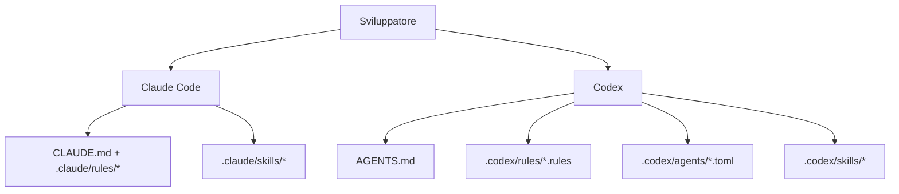

### Livello Claude Code

- Contesto persistente:
  - [`CLAUDE.md`](./CLAUDE.md)
- Regole limitate per percorso:
  - [`.claude/rules/backend-node.md`](./.claude/rules/backend-node.md)
  - [`.claude/rules/frontend-react.md`](./.claude/rules/frontend-react.md)
  - [`.claude/rules/mcp-typescript.md`](./.claude/rules/mcp-typescript.md)
  - [`.claude/rules/docs-markdown.md`](./.claude/rules/docs-markdown.md)
  - [`.claude/rules/file-headers.md`](./.claude/rules/file-headers.md)
  - [`.claude/rules/wiki-i18n.md`](./.claude/rules/wiki-i18n.md)
  - [`.claude/rules/i18n-parity.md`](./.claude/rules/i18n-parity.md)
- Skill:
  - `repo-onboarding`
  - `ship-feature`
  - `version-release`
  - `mcp-operations`
  - `debug-live-issue`
  - `update-project-docs`
  - `file-headers`
  - `push-to-forked-pr`
  - `i18n-parity`
- Subagenti:
  - `backend-reviewer`
  - `frontend-reviewer`
  - `mcp-reviewer`

### Livello Codex

- Contesto persistente:
  - [`AGENTS.md`](./AGENTS.md)
- Politica di esecuzione:
  - [`.codex/rules/default.rules`](./.codex/rules/default.rules)
- Modelli di subagenti personalizzati:
  - [`.codex/agents/`](./.codex/agents)
- Skill:
  - [`.codex/skills/`](./.codex/skills)
- Configurazione:
  - [`.codex/README.md`](./.codex/README.md)

---

## Integrazione MCP

Questo progetto include un server MCP locale in `mcp/` con 103 strumenti in 16 moduli di dominio. Espone ogni azione supportata dall'app, comprese le letture di dati per ambito, trascrizioni/immagini, prezzi di Claude, Cursor e GPT, flussi, avvisi/webhook, importazioni e ripristino dei backup, configurazione di Claude/Codex, Avvia agente, origini remote, impostazioni, push e manutenzione protetta. Supporta tre modalità di trasporto.

### Modalità di trasporto MCP

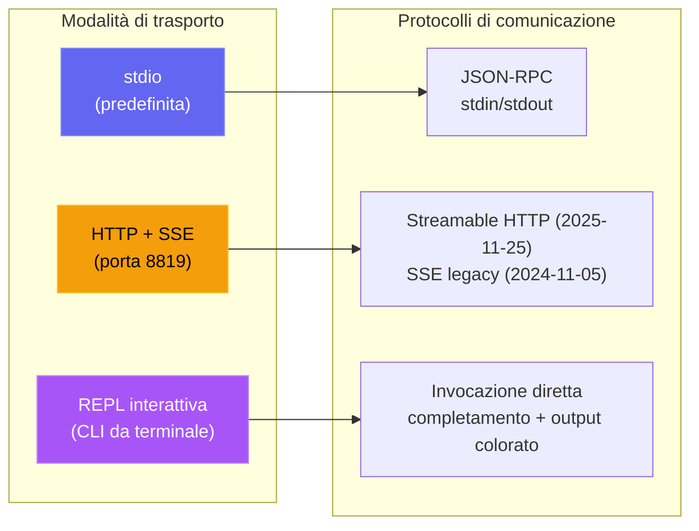

| Modalità | Comando | Caso d'uso |
| --- | --- | --- |
| **stdio** | `npm run mcp:start` | Claude Code, Claude Desktop, host MCP degli IDE |
| **HTTP** | `npm run mcp:start:http` | Client MCP remoti, integrazioni web, più sessioni |
| **REPL** | `npm run mcp:start:repl` | Debug operativo, invocazione manuale degli strumenti, amministrazione locale |

<p align="center">
  <a href="images/mcp.png"></a>
</p>

### Architettura MCP

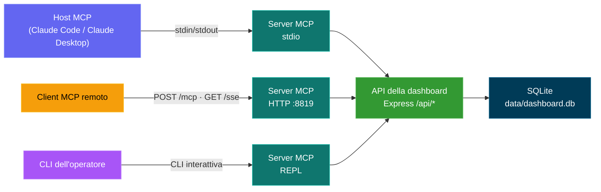

### Superficie degli strumenti MCP

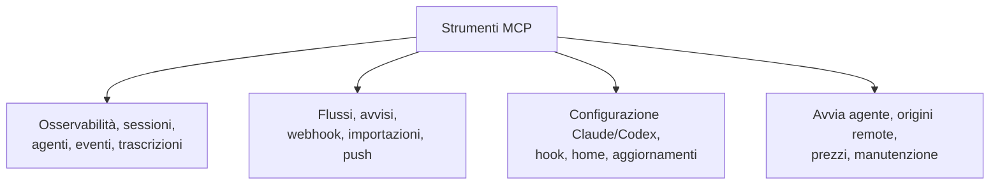

### Modello di sicurezza MCP

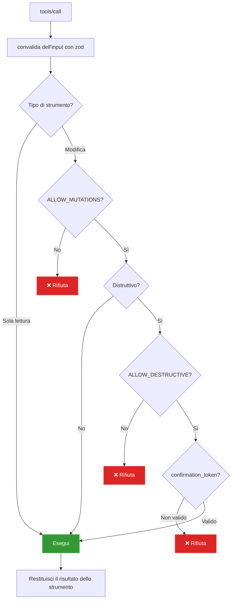

### Modalità operative MCP

- Modalità sola lettura (predefinita): `MCP_DASHBOARD_ALLOW_MUTATIONS=false`
- Modalità amministratore: `MCP_DASHBOARD_ALLOW_MUTATIONS=true`
- Dashboard autenticata: imposta `MCP_DASHBOARD_API_TOKEN` / `_FILE` con il token della dashboard
- Trasporto HTTP/SSE autenticato: imposta `MCP_HTTP_AUTH_TOKEN` / `_FILE`; i client inviano l'autenticazione bearer o `x-mcp-token`
- Protezioni del trasporto: l'HTTP diretto in loopback può portare il token; gli alias host dei container richiedono HTTPS; i reindirizzamenti vengono rifiutati
- Protezioni del payload: 50 MiB per file di cronologia caricato, 100 MiB in totale per chiamata, 10 MiB per le risposte binarie e 25 MiB per il ripristino dei backup
- Modalità distruttiva: richiede tutti e tre:
  - `MCP_DASHBOARD_ALLOW_MUTATIONS=true`
  - `MCP_DASHBOARD_ALLOW_DESTRUCTIVE=true`
  - l'input dello strumento `confirmation_token: "CLEAR_ALL_DATA"`

Dettagli completi: [mcp/README.md](./mcp/README.md)

---

## Riferimento API

Tutti gli endpoint restituiscono JSON. Le risposte di errore hanno la forma `{ error: { code, message } }`.

### OpenAPI / Swagger / ReDoc

Ci sono tre modi per esplorare l'API HTTP, tutti basati su un'unica specifica OpenAPI 3.0.3 (porta predefinita del server `4820`):

| Metodo | Percorso | Descrizione |
| ------ | ------------------------------- | ------------------------------------------------------------------------------------------------- |
| `GET` | `/api/openapi.json` | Specifica OpenAPI 3.0.3 grezza in JSON |
| `GET` | `/api/docs` | **Swagger UI** interattiva — esecuzione delle richieste per provarle |
| `GET` | `/api/redoc` | Riferimento **ReDoc** — una resa pulita su tre pannelli, ottimizzata per la lettura, della stessa specifica |
| `GET` | `/api/redoc/redoc.standalone.js` | Bundle ReDoc self-hosted (servito localmente tramite la dipendenza `redoc`, mai da un CDN — funziona offline) |

Il documento OpenAPI viene generato da `server/openapi.js` (`createOpenApiSpec()`) e unito a frammenti supplementari in `server/openapi-extra/`. Swagger UI e ReDoc sono entrambi serviti direttamente dal backend; il bundle ReDoc viene servito localmente (`GET /api/redoc/redoc.standalone.js`), così il riferimento funziona interamente offline / in reti isolate, in linea con la politica del progetto di non usare risorse esterne.

La copertura è completa: ogni route del backend è documentata (82 voci di percorso) sotto questi tag — Health, Sessions, Agents, Events, Stats, Metrics, Analytics, Hooks, Pricing, Workflows, Settings, Updates, Alerts, Webhooks, Push, CcConfig (explorer della configurazione di Claude Code), Run (esecuzioni avviate dalla dashboard) e Documentation —, ciascuna con parametri, schemi di richiesta/risposta, descrizioni a livello di campo ed esempi realistici.

Un **`openapi.yaml`** versionato nella radice del repository rispecchia la specifica in diretta. Viene generato da `server/openapi.js` (mai modificato a mano) — rigeneralo dopo modifiche all'API con:

```bash
npm run openapi:yaml
```


<p align="center">
  <a href="images/swagger.png">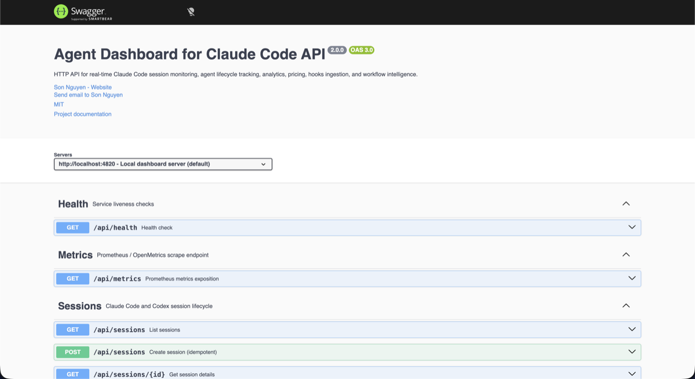</a>
</p>

<p align="center">
  <a href="images/redoc.png"></a>
</p>

### Stato

| Metodo | Percorso | Descrizione |
| ------ | ------------- | ------------------------------------- |
| `GET` | `/api/health` | Restituisce `{ status: "ok", timestamp }` |

### Sessioni

| Metodo | Percorso | Parametri di query | Descrizione |
| ------- | ------------------------------- | ---------------------------------------------------------------- | -------------------------------------------------------------------------------------------- |
| `GET` | `/api/sessions` | `status`, `q`, `limit`, `offset` | Elenca le sessioni con il numero di agenti e il costo per sessione. `q` esegue una ricerca senza distinzione tra maiuscole e minuscole su `id` / `name` / `cwd`. `limit` è 50 per impostazione predefinita, massimo 10000. La risposta include `total` per i paginatori. |
| `GET` | `/api/sessions/:id` | -- | Dettaglio della sessione con agenti ed eventi |
| `GET` | `/api/sessions/:id/stats` | -- | Conteggi aggregati che alimentano il pannello di sintesi del Dettaglio della sessione: eventi, eventi per tipo, strumenti più usati, numero di errori, conteggi per tipo/stato degli agenti, ripartizione per tipo di subagente, totali dei token, intervallo di tempo |
| `GET` | `/api/sessions/:id/transcripts` | -- | Elenca le trascrizioni JSONL disponibili per la sessione (principale + subagenti + compattazioni) |
| `GET` | `/api/sessions/:id/transcript` | `agent_id`, `limit`, `offset`, `after`, `before` | Trasmette i messaggi di una trascrizione specifica con paginazione a cursore. L'`usage` dell'assistente include `input_tokens`, `output_tokens`, `cache_read_input_tokens`, `cache_creation_input_tokens`, così l'indicatore della pagina Avvia si riempie completamente alla ripresa / al ricollegamento |
| `POST` | `/api/sessions` | -- | Crea una sessione (idempotente su `id`) |
| `PATCH` | `/api/sessions/:id` | -- | Aggiorna lo stato/i metadati della sessione |

### Agenti

| Metodo | Percorso | Parametri di query | Descrizione |
| ------- | ----------------- | ----------------------------------------- | ----------------------------- |
| `GET` | `/api/agents` | `status`, `session_id`, `limit`, `offset` | Elenca gli agenti con filtri |
| `GET` | `/api/agents/:id` | -- | Dettaglio di un agente |
| `POST` | `/api/agents` | -- | Crea un agente |
| `PATCH` | `/api/agents/:id` | -- | Aggiorna stato/attività/strumento dell'agente |

### Eventi

| Metodo | Percorso | Parametri di query | Descrizione |
| ------ | ------------- | ------------------------------- | -------------------------- |
| `GET` | `/api/events` | `session_id`, `limit`, `offset` | Elenca gli eventi (più recenti prima) |

### Statistiche

| Metodo | Percorso | Descrizione |
| ------ | ------------ | ------------------------------------------------------ |
| `GET` | `/api/stats` | Conteggi aggregati, distribuzioni per stato, connessioni WS |

### Analisi

| Metodo | Percorso | Descrizione |
| ------ | ---------------- | ---------------------------------------------------------- |
| `GET` | `/api/analytics` | Aggregati di token/strumenti/sessioni per grafici e viste delle tendenze |

### Origini dati remote

| Metodo | Percorso | Parametri di query | Descrizione |
| -------- | ------------------------------- | ------------ | ------------------------------------------------------------------------------------------- |
| `GET` | `/api/remote-sources` | -- | Elenca le origini remote configurate con stato, ultimo errore e conteggi dell'ultima sincronizzazione |
| `POST` | `/api/remote-sources` | -- | Crea un'origine. Corpo: `{ label, host, ssh_port?, identity_file?, remote_home?, remote_codex_home?, enabled? }` |
| `PATCH` | `/api/remote-sources/:id` | -- | Aggiorna un'origine (etichetta, campi di connessione, attivazione) |
| `DELETE` | `/api/remote-sources/:id` | `purge` | Elimina un'origine; `?purge=true` elimina anche le sessioni importate da quell'origine |
| `POST` | `/api/remote-sources/:id/test` | -- | Verifica la connettività SSH verso l'origine |
| `POST` | `/api/remote-sources/:id/sync` | -- | Preleva e reimporta subito dall'origine |

`GET /api/sessions`, `/api/events`, `/api/agents`, `/api/stats` e `/api/analytics` accettano anche un parametro di query facoltativo `sources` (ID delle origini separati da virgole; ometterlo per tutte) per limitare i risultati in base all'origine, e `GET /api/sessions/facets` restituisce un array `sources` per il selettore dell'ambito dei dati.

### Hook

| Metodo | Percorso | Descrizione |
| ------ | ------------------ | -------------------------------------------- |
| `POST` | `/api/hooks/event` | Riceve ed elabora un evento hook di Claude Code |
| `POST` | `/api/hooks/ingest-batch` | Invia un batch di dati di sessione da una macchina in movimento/dietro NAT (disattivato per impostazione predefinita; vedi `REMOTE_PUSH_TOKEN` più avanti e `server/README.md` per la struttura completa del payload) |

**Payload di un evento hook:**

```json
{
  "hook_type": "PreToolUse",
  "data": {
    "session_id": "abc-123",
    "tool_name": "Bash",
    "tool_input": { "command": "ls -la" }
  }
}
```

### Prezzi

| Metodo | Percorso | Descrizione |
| -------- | ------------------------ | ---------------------------------------- |
| `GET` | `/api/pricing` | Elenca tutte le regole di prezzo |
| `PUT` | `/api/pricing` | Crea o aggiorna una regola di prezzo |
| `DELETE` | `/api/pricing/:pattern` | Elimina una regola di prezzo |
| `GET` | `/api/pricing/cost` | Costo totale di tutte le sessioni |
| `GET` | `/api/pricing/cost/:id` | Dettaglio dei costi di una sessione specifica |

### Flussi

| Metodo | Percorso | Descrizione |
| ------ | ----------------------------- | ------------------------------------------------------- |
| `GET` | `/api/workflows` | Dati dei flussi limitati per provider/origine (orchestrazione, strumenti registrati, pattern, compattazioni di Codex). I filtri facoltativi `?status=active\|completed`, `?sources=...` e `?providers=claude\|codex` si applicano a tutte le 11 sezioni di dati |
| `GET` | `/api/workflows/session/:id` | Approfondimento per sessione limitato per provider/origine (albero degli agenti, cronologia degli strumenti registrati, eventi) |

### Avvisi

| Metodo | Percorso | Descrizione |
| -------- | ------------------------ | ---------------------------------------------------------------------- |
| `GET` | `/api/alerts` | Feed degli avvisi scattati, più recenti prima (`?unacked=true`, `limit`, `offset`) |
| `POST` | `/api/alerts/:id/ack` | Conferma un avviso |
| `POST` | `/api/alerts/ack-all` | Conferma tutti gli avvisi non confermati |
| `GET` | `/api/alerts/rules` | Elenca le regole di avviso |
| `POST` | `/api/alerts/rules` | Crea una regola (`event_pattern` \| `inactivity` \| `status_duration` \| `token_threshold`) |
| `PATCH` | `/api/alerts/rules/:id` | Aggiorna nome / configurazione / attivazione / tempo di attesa (il tipo di regola è immutabile) |
| `DELETE` | `/api/alerts/rules/:id` | Elimina una regola e la cronologia dei suoi avvisi scattati |

### Webhook

| Metodo | Percorso | Descrizione |
| -------- | --------------------------------- | ------------------------------------------------------------------------------------ |
| `GET` | `/api/webhooks/providers` | Provider supportati + i loro campi di configurazione (guida il modulo dell'interfaccia) |
| `GET` | `/api/webhooks` | Elenca le destinazioni webhook (URL mascherati, segreti oscurati) |
| `POST` | `/api/webhooks` | Crea una destinazione (14 provider integrati + `generic`) |
| `PATCH` | `/api/webhooks/:id` | Aggiorna nome / url / attivazione / segreto / intestazioni / ambito per regola (il tipo è immutabile) |
| `DELETE` | `/api/webhooks/:id` | Elimina una destinazione e il suo registro delle consegne |
| `POST` | `/api/webhooks/:id/test` | Invia un avviso di prova sintetico e riporta l'esito della consegna |
| `GET` | `/api/webhooks/:id/deliveries` | Registro delle consegne recenti di una destinazione (`limit`, `offset`) |

I provider ospitati richiedono HTTPS. `generic` e `n8n` possono usare HTTP per ricevitori locali o self-hosted. La consegna rifiuta i reindirizzamenti, quindi credenziali, intestazioni personalizzate e firme HMAC non vengono mai inoltrate a un secondo URL.

### Impostazioni

| Metodo | Percorso | Descrizione |
| ------ | ------------------------------ | ------------------------------------------------ |
| `GET` | `/api/settings/info` | Informazioni di sistema, statistiche del DB, stato degli hook |
| `POST` | `/api/settings/clear-data` | Elimina tutte le sessioni, gli agenti, gli eventi e i consumi di token |
| `POST` | `/api/settings/reimport` | Reimporta le sessioni precedenti da `~/.claude/` |
| `POST` | `/api/settings/reinstall-hooks` | Reinstalla gli hook di Claude Code |
| `POST` | `/api/settings/reset-pricing` | Ripristina ai valori predefiniti le tabelle dei prezzi di Claude, Codex o entrambi |
| `GET` | `/api/settings/export` | Esporta tutti i dati (sessions, agents, events, token_usage, workflows, dashboard_runs, alert_rules, model_pricing, cursor_model_pricing, gpt_model_pricing) come un unico download JSON versionato |
| `POST` | `/api/settings/import` | Ripristina un pacchetto fino a 25 MiB da `/export` (`file` multipart o JSON `{ path }`). Idempotente + non distruttivo — le sessioni esistenti vengono saltate per intero |
| `POST` | `/api/settings/cleanup` | Abbandona le sessioni inattive, elimina i dati vecchi (e gli snapshot delle sessioni eliminate) |
| `GET` | `/api/settings/snapshots` | Spazio occupato dagli snapshot delle trascrizioni per provider + politica di conservazione |
| `POST` | `/api/settings/snapshots/compress` | Comprime senza perdita gli snapshot la cui trascrizione originale non esiste più |
| `POST` | `/api/settings/snapshots/prune` | Pianifica (simulazione, predefinita) o applica un'eliminazione degli snapshot; l'applicazione richiede `confirm: "PRUNE_SNAPSHOTS"` |

### Explorer della configurazione di Claude (`/api/cc-config`)

Ispezione in sola lettura di ogni superficie di configurazione di Claude Code, più modifiche attentamente controllate per gli artefatti di testo a basso rischio. Le letture dei file canonicalizzano il percorso richiesto e le radici consentite, così i link simbolici non possono uscire dalle directory attendibili di Claude. Tutti i percorsi di scrittura creano backup con data e ora in `<root>/cc-config-backups/<type>/` prima di modificare qualsiasi cosa.

| Metodo | Percorso | Descrizione |
| -------- | ----------------------------------- | ----------- |
| `GET` | `/api/cc-config/overview` | Radici (home di Claude, .claude del progetto, radice del progetto, ~/.claude.json) + conteggi per ogni superficie |
| `GET` | `/api/cc-config/skills` | Skill in `<scope>/.claude/skills/<name>/SKILL.md` con frontmatter analizzato; `?scope=user\|project\|all` |
| `GET` | `/api/cc-config/agents` | Subagenti `<scope>/.claude/agents/*.md` |
| `GET` | `/api/cc-config/commands` | Comandi slash `<scope>/.claude/commands/*.md` |
| `GET` | `/api/cc-config/output-styles` | Stili di output `<scope>/.claude/output-styles/*.md` |
| `GET` | `/api/cc-config/plugins` | Plugin installati da `~/.claude/plugins/installed_plugins.json`, uniti a `enabledPlugins` delle impostazioni; ogni voce include `contributes` (numero di skill/agenti/comandi/hook/stili di output nella directory di installazione del plugin) più i metadati di `plugin.json` |
| `GET` | `/api/cc-config/marketplaces` | Marketplace registrati da `known_marketplaces.json`, arricchiti con il `marketplace.json` di ciascuno (numero di plugin, proprietario, descrizione) |
| `GET` | `/api/cc-config/mcp` | Server MCP da `~/.claude.json` (livello superiore + per progetto) e da `settings.json` |
| `GET` | `/api/cc-config/hooks` | Hook aggregati dai file `settings.json` di utente / progetto / progetto locale |
| `GET` | `/api/cc-config/hook-scripts` | File in `~/.claude/hooks/` (gli script di supporto richiamati da `hooks.<event>.command`) |
| `GET` | `/api/cc-config/keybindings` | `~/.claude/keybindings.json` analizzato in coppie tasto/azione raggruppate per contesto |
| `PUT` | `/api/cc-config/keybindings` | Sovrascrive `keybindings.json` a partire da `{ groups: [{ context, bindings: [{ key, action }] }] }`. Esegue prima un backup, preserva i metadati di livello superiore (`$schema`/`$docs`) e rifiuta contesti/tasti duplicati. Sicuro da modificare (a differenza di `settings.json`, la CLI non lo riscrive mai a metà sessione) |
| `GET` | `/api/cc-config/statusline` | Configurazione `settings.json.statusLine` + il contenuto effettivo di `statusline.py` / `statusline-command.sh`, se presente |
| `GET` | `/api/cc-config/settings` | JSON delle impostazioni di utente / progetto / progetto locale, con le chiavi simili a segreti (che corrispondono a `/token\|secret\|password\|api[_-]?key\|auth/i`) sostituite da `"<redacted>"` |
| `GET` | `/api/cc-config/memory` | File `CLAUDE.md` negli ambiti utente + progetto, più la memoria per progetto basata su file: elementi `scope:"auto-memory"` (ciascuno con `project`, `name`, `isIndex` e il `frontmatter` analizzato) per ogni `*.md` in `~/.claude/projects/<slug>/memory/`. Modifica tramite `PUT`/`DELETE /api/cc-config/file` con `{ scope: "auto-memory", type: "auto-memory", project, name }` (i backup finiscono in `<memory-dir>/.cc-config-backups/auto-memory/`) |
| `GET` | `/api/cc-config/file?path=…` | Contenuto di un singolo file (percorso limitato a CLAUDE_HOME / .claude del progetto / CLAUDE.md del progetto) |
| `GET` | `/api/cc-config/backups` | Elenco di tutti i backup con data e ora, filtrabile facoltativamente con `?scope=&type=` |
| `PUT` | `/api/cc-config/file` | Crea o sovrascrive un artefatto di testo. Corpo: `{ scope, type, name?, content }`. Backup automatico se il file esiste. Scrittura atomica (file temporaneo + rinomina). Contenuto limitato a 256 KB, regex rigorosa su `name` |
| `DELETE` | `/api/cc-config/file` | Esegue il backup e poi elimina un artefatto di testo. Le directory delle skill vengono salvate per intero (comprese le risorse incluse) prima della rimozione ricorsiva |

### Metriche Prometheus e Grafana

`GET /api/metrics` espone metriche testuali Prometheus per lo stato di sessioni e agenti, eventi, token, client in tempo reale, origini remote, uptime e memoria del processo e versione della build. [`monitoring/`](./monitoring/README.md) fornisce Prometheus più quattro dashboard Grafana predisposte automaticamente, con **CCAM · Overview** come predefinita.

```bash
# Native dashboard and monitoring
npm start
npm run monitoring:install       # one-time binary setup
npm run monitoring:up            # Grafana on :3000

# Containers
npm run docker:up                 # dashboard only
npm run docker:full:up            # dashboard + Prometheus + Grafana

# Mixed native/container setup
DASHBOARD_ALLOWED_HOSTS=host.docker.internal npm start
npm run monitoring:docker:up
npm run monitoring:verify
```

<p align="center">
  <a href="images/grafana.png"></a>
  <br>
  <em>📊 <strong>Grafana · CCAM Overview</strong> · stato della flotta, totali del database, ripartizioni e tassi da raccolte in diretta di <code>/api/metrics</code></em>
</p>

<p align="center">
  <a href="images/prometheus-console.png"></a>
  <br>
  <em>🔥 <strong>Prometheus · console CCAM</strong> · stato della raccolta, sessioni, eventi, token e link Graph per approfondire</em>
</p>

<p align="center">
  <a href="images/prometheus-query.png"></a>
  <br>
  <em>📈 <strong>Prometheus · Graph</strong> · esegui PromQL sulle metriche CCAM raccolte, con link di partenza dalla console</em>
</p>

Vedi [docs/API.md → Metrics](./docs/API.md#metrics) per i nomi delle metriche, l'autenticazione e la configurazione della raccolta.

### Avvia Claude (`/api/run`)

Superficie HTTP per avviare e supervisionare sottoprocessi `claude` dalla dashboard. Protezione same-origin su ogni route — le richieste del browser devono provenire da un'origine localhost; le richieste senza Origin (CLI/curl) passano. Un `cwd` fornito deve essere una directory assoluta esistente e viene canonicalizzato con `realpath`. Può volutamente trovarsi fuori da questo repository, così Avvia agente può partire dalla home dell'utente o da qualsiasi progetto recente.

| Metodo | Percorso | Descrizione |
| -------- | --------------------------------- | ----------- |
| `GET` | `/api/run` | Elenca tutti gli handle di esecuzione in memoria (in corso + terminati di recente); restituisce anche `maxConcurrent` e `activeCount` |
| `GET` | `/api/run/binary` | Verifica se `claude` è nel `PATH` e dove si trova — usato dall'interfaccia per mostrare un errore chiaro prima dell'avvio |
| `GET` | `/api/run/cwds` | Directory di lavoro suggerite: cwd del server della dashboard, `$HOME` e cwd recenti dalla tabella delle sessioni |
| `GET` | `/api/run/files?cwd=…&q=…` | Ricerca approssimata di file in `cwd` per il completamento automatico dei file con `@` della pagina Avvia. Salta `node_modules`, `.git`, `dist`, `build`, `.next`, `.cache`, `coverage` ecc. Il cwd è obbligatorio e deve esistere; i risultati sono limitati e ordinati per corrispondenza con il nome del file |
| `POST` | `/api/run` | Avvia una nuova esecuzione. Corpo: `{ prompt, mode: "headless"\|"conversation", cwd?, model?, permissionMode?, resumeSessionId?, effort? }`. La modalità headless passa il prompt in argv tramite `-p` e chiude stdin. La modalità conversation invia il prompt su stdin come busta stream-json e tiene stdin aperto per i seguiti. `resumeSessionId` (solo conversation) aggiunge `--resume <id>`; se impostato, `prompt` può essere vuoto — il launcher salta la scrittura iniziale su stdin e `claude` resta in attesa sulla conversazione ripresa finché l'utente non invia un seguito tramite `POST /api/run/:id/message`. `effort` (`low` / `medium` / `high`) corrisponde a `--effort`. Il launcher passa sempre `--output-format stream-json --verbose --include-partial-messages` così l'interfaccia può mostrare i delta carattere per carattere. La concorrenza è in pratica illimitata (tetto predefinito di 10000 — sovrascrivibile con `RUN_MAX_CONCURRENT`) |
| `GET` | `/api/run/:id` | Stato attuale dell'handle. `?envelopes=1` include il registro delle buste in memoria così l'interfaccia può riprodurre la cronologia al ricollegamento |
| `POST` | `/api/run/:id/message` | Invia un turno di seguito a una conversazione in corso (solo modalità conversation). Corpo: `{ text }` |
| `DELETE` | `/api/run/:id` | Ferma un'esecuzione. SIGTERM, che passa a SIGKILL dopo 5 s |

L'output viene trasmesso sul WebSocket esistente della dashboard con tre tipi di messaggio: `run_stream` (busta stream-json analizzata, compresi i delta `stream_event` di `--include-partial-messages`), `run_status` (transizioni di stato), `run_input_ack` (scrittura su stdin confermata). La pagina dell'explorer della configurazione si iscrive a un quarto messaggio — `cc_config_changed` — trasmesso da `server/lib/cc-watcher.js` (tramite `fs.watch` su `~/.claude/`) e da `routes/cc-config.js` dopo ogni PUT/DELETE riuscito, con il payload `{ source: "dashboard"|"fs", action?, scope?, type?, name?, paths? }`. L'elenco delle Sessioni e la pagina SessionDetail interrogano `/api/run` (e ascoltano `run_status`) per contrassegnare ogni sessione attualmente pilotata da un'esecuzione in corso con un indicatore cliccabile **▶ Run** che riporta a `/run`.

### Importazione della cronologia

**Impostazioni → Importazione della cronologia** importa le trascrizioni di Claude Code da `~/.claude/projects` e i rollout di Codex da `~/.codex/sessions` tramite scansioni di cartelle o caricamenti specifici per provider. Entrambi riusano l'acquisizione in diretta, preservano token, costi, strumenti, basi di compattazione, ciclo di vita e titoli nativi di Codex, e restano idempotenti. La cronologia di Codex caricata viene copiata nello storage della dashboard, così la sua conversazione sopravvive alla pulizia dell'origine.

**Ripristina backup** accetta un `.json` esportato dalla dashboard tramite l'interfaccia, `ccam export` o `GET /api/settings/export`. `POST /api/settings/import` e `ccam import-data <file>` ripristinano tutte le tabelle senza sovrascrivere le sessioni esistenti, così puoi riunire in sicurezza i dati di più macchine.

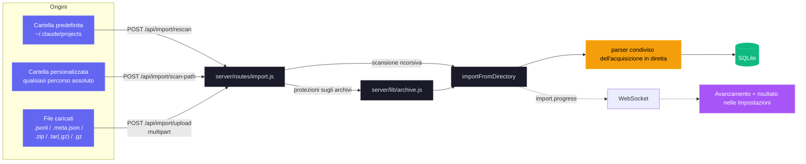

| Metodo | Percorso | Scopo |
| --- | --- | --- |
| `GET` | `/api/import/guide` | Percorsi, comandi di archiviazione, estensioni e istruzioni in base al provider tramite `?provider=claude\|codex`. |
| `POST` | `/api/import/rescan` | Riscansiona la radice predefinita selezionata da `{ provider }`. |
| `POST` | `/api/import/scan-path` | Scansiona ricorsivamente un percorso assoluto `{ path, provider }`. |
| `POST` | `/api/import/upload` | Carica file o archivi supportati con `provider`. |

- **Input:** file singoli `.jsonl`, `.meta.json`, `.zip`, `.tar`, `.tar.gz`/`.tgz` e `.gz` in strutture annidate. Claude supporta entrambe le strutture canoniche dei subagenti; Codex riconosce ricorsivamente i `rollout-*.jsonl` o i JSONL con `session_meta`, più i titoli facoltativi di `session_index.jsonl`.
- **Accuratezza:** la deduplicazione per UUID e per valore massimo degli eventi evita i doppi conteggi. Le basi di compattazione conservano i token precedenti; l'attività successiva fa avanzare `ended_at` e aggiorna i metadati dei messaggi.
- **File di grandi dimensioni:** l'analisi condivisa a blocchi di 4 MiB, una riga alla volta, gestisce trascrizioni oltre il limite di circa 512 MiB delle stringhe di V8. Gli array crescenti sono limitati da `TRANSCRIPT_CACHE_MAX_ARRAY_LEN`, predefinito `1000`, con un taglio al doppio del limite durante l'analisi.
- **Sicurezza:** l'estrazione rifiuta i percorsi assoluti e quelli con `..`. Per impostazione predefinita i dati estratti sono limitati a 4 GB, ogni caricamento a 1 GB e le richieste a 2000 file; lo spazio temporaneo di ogni richiesta viene sempre liberato.
- **Avanzamento:** le fasi WebSocket `import.progress`, limitate in frequenza, coprono `start`, `scan`, `extract`, `parse`, `complete` ed `error`. L'interfaccia offre indicazioni per il trascinamento e i totali di elementi importati, arricchiti, saltati e in errore.

### WebSocket

Collegati a `ws://localhost:4820/ws` per ricevere messaggi push in tempo reale:

```json
{
  "type": "agent_updated",
  "data": { "id": "...", "status": "working", "current_tool": "Edit" },
  "timestamp": "2026-03-05T15:43:01.800Z"
}
```

**Tipi di messaggio:** `session_created`, `session_updated`, `agent_created`, `agent_updated`, `new_event`, `alert_triggered`, `alert_updated`, `remote_source.status` (dati `{ id, status: "idle"|"syncing"|"ok"|"error"|"deleted", error?, last_sync_at? }`)

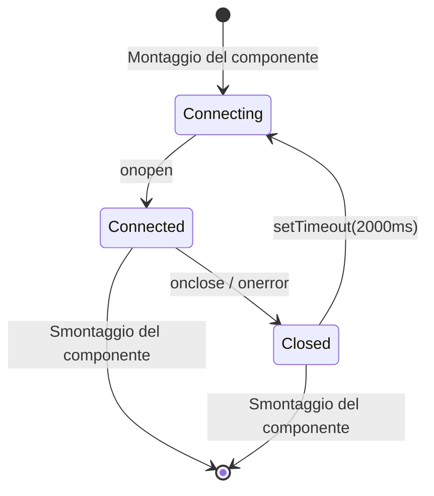

---

## Eventi hook

La dashboard elabora questi tipi di hook di Claude Code:

| Tipo di hook | Attivazione | Azione della dashboard |
| ------------------- | ------------------------------ | -------------------------------------------------------------------------------------------- |
| `SessionStart` | Inizia una sessione di Claude Code | Crea la sessione e l'agente principale. Imposta `awaiting_input_since` (con `awaiting_reason=session_start`) così una sessione nuova finisce in **In attesa** — tranne un SessionStart con origine `compact` (compattazione automatica a metà turno), che lascia intatto il flag così una sessione al lavoro resta **Attiva**. Riattiva le sessioni riprese. Abbandona le sessioni orfane senza attività da `DASHBOARD_STALE_MINUTES` (predefinito 180) |
| `UserPromptSubmit` | L'utente invia un prompt | Azzera il flag di attesa e porta l'agente principale a `working` — l'unico segnale dell'inizio dei turni dell'assistente di solo testo, dato che non emettono `PreToolUse` |
| `PreToolUse` | Un agente inizia a usare uno strumento | Azzera il flag di attesa, imposta l'agente su `working` e `current_tool`. Se lo strumento è `Agent`, crea un record di subagente |
| `PostToolUse` | Esecuzione dello strumento completata | Azzera il flag di attesa (gestisce le approvazioni delle richieste di permesso in cui la Notification lo aveva impostato a metà strumento). Azzera `current_tool`. L'agente resta `working` |
| `Stop` | Claude ha finito di rispondere | Senza errori: agente principale → `waiting` — Claude ha terminato il suo turno, la palla passa all'utente. `stop_reason=error`: imposta l'agente e la sessione su `error`. I subagenti in background continuano a funzionare |
| `SubagentStop` | Un agente in background ha terminato | Associa e completa il subagente per descrizione, tipo o attività. Volutamente NON azzera il flag di attesa — la fine di un subagente non dice nulla sulla persona. **Avvia senza attendere una scansione JSONL** (`scanAndImportSubagents`) che emette eventi `PreToolUse` + `PostToolUse` per ogni strumento sotto l'`agent_id` del subagente, così la Cronologia mostra ogni strumento eseguito dal subagente, non solo il marcatore di avvio |
| `Notification` | Notifica di un agente | Registra l'evento. I messaggi di richiesta di permesso/input impostano l'agente su `waiting` e registrano `awaiting_input_since` (con `awaiting_reason=notification`, riconosciuti tramite pattern: `permission`, `waiting for input`, `needs your approval`, …). Le notifiche di compattazione vengono contrassegnate come eventi `Compaction`. Attiva una notifica del browser se abilitata |
| `SessionEnd` | Il processo della CLI di Claude Code termina | Rimuove il flag di attesa. Se la sessione è già in `error`, lo stato di errore viene mantenuto; altrimenti tutti gli agenti e la sessione vengono segnati come `completed` |
| `Compaction` | `/compact` rilevato nel JSONL | Crea un subagente di compattazione (tipo `compaction`) e un evento Compaction. Rilevato tramite le voci `isCompactSummary` nel JSONL della trascrizione. Rilevato anche dallo scanner periodico per le sessioni attive |
| `APIError` | Errore API nella trascrizione JSONL | Estratto dalle voci `isApiErrorMessage` (quota, limite di frequenza, invalid_request) e dalle risposte grezze `type: "error"`. **Ora imposta subito la sessione e l'agente su `error`** — in precedenza veniva registrato come evento senza cambiare stato. Salvato come evento con i dettagli dell'errore |
| `TurnDuration` | Durata del turno nella trascrizione JSONL | Estratto dai messaggi `system` con sottotipo `turn_duration` e `durationMs`. Salvato come evento per l'analisi delle durate dei turni |
| `ToolError` | Errore nel risultato di uno strumento nel JSONL | Estratto dalle voci `toolUseResult.is_error`. Traccia i fallimenti a livello di strumento per l'analisi della propagazione degli errori |
| `RemoteToolEvent` | Chiamata a uno strumento inviata da una macchina remota | Scritto da `POST /api/hooks/ingest-batch` per ogni elemento di `tool_events[]` inviato da una macchina in movimento/dietro NAT. Deduplicato per `(session_id, event_type, uuid)` rispetto alle righe salvate e all'interno del batch, quindi reinviare un batch è sicuro |
| `RemoteTurn` | Durata del turno inviata da una macchina remota | Scritto da `POST /api/hooks/ingest-batch` per ogni elemento di `turns[]`, con il `duration_ms` di quel turno. Stessa deduplicazione per `(session_id, event_type, uuid)` di `RemoteToolEvent` |
| `Interrupted` | Turno annullato dall'utente (Esc) | Generato dal watchdog — `Esc` non attiva alcun hook, quindi una sessione bloccata in `working` viene rilevata dal marcatore `[Request interrupted by user]` della trascrizione oppure, se Esc è stato premuto prima di qualsiasi output, dal timeout di inattività in lavorazione (`DASHBOARD_WORKING_IDLE_SECONDS`). La sessione passa a **In attesa** (come dopo un normale `Stop`) |

---

## Notifiche del browser

La dashboard supporta notifiche persistenti del browser tramite Web Push (VAPID) per avvisi in tempo reale anche quando la scheda della dashboard non ha il focus o il browser è in background.

### Come funziona

1. **Attiva** le notifiche nella pagina Impostazioni tramite l'interruttore generale
2. **Concedi** il permesso del browser quando richiesto — questo registra un Service Worker e crea una sottoscrizione push
3. **Configura** quali eventi attivano le notifiche:

| Evento | Predefinito | Descrizione |
| ---------------------------- | ------- | --------------------------------------------------------------- |
| Nuova sessione avviata | Attivo | Scatta quando viene creata una nuova sessione di Claude Code |
| Claude ha finito di rispondere | Disattivo | Scatta sugli eventi `Stop` quando Claude termina un turno di risposta |
| Sessione chiusa | Disattivo | Scatta su `SessionEnd` quando il processo della CLI termina |
| Errori di sessione | Attivo | Scatta quando una sessione termina con un errore |
| Subagente avviato | Disattivo | Scatta quando viene creato un subagente in background |

Inoltre, qualsiasi evento hook `Notification` di Claude Code attiva una notifica del browser indipendentemente dagli interruttori per evento (purché l'interruttore generale sia attivo).

### Architettura delle notifiche

- **Pipeline VAPID:** usa `web-push` sul server per una consegna sicura dei messaggi. Le chiavi VAPID vengono generate automaticamente e salvate in `data/vapid-keys.json`.
- **Service Worker:** un worker dedicato (`client/public/sw.js`) gestisce gli eventi `push` in arrivo e mostra le notifiche con `silent: false` per garantire la riproduzione audio su macOS.
- **Sottoscrizioni:** gli endpoint specifici di ogni browser vengono salvati nella tabella `push_subscriptions` di SQLite.
- **Persistenza:** le notifiche arrivano anche con il browser chiuso, perché il Service Worker opera in background.
- **Notifica di prova:** un pulsante nelle Impostazioni permette di verificare la pipeline VAPID e la riproduzione audio.

### PWA e supporto offline

Dashboard, landing page e wiki sono PWA installabili separate, con manifest e service worker indipendenti.

| Superficie | Manifest | Service Worker | Strategia di cache |
| --- | --- | --- | --- |
| Dashboard (`client/`) | `client/public/manifest.json` | `client/public/sw.js` | Le risorse immutabili in `/assets/*` sono cache-first; navigazioni, il worker, il manifest, le icone e `/` sono network-first con ripiego sulla cache. `/api/*`, `/ws` e l'HMR di Vite non vengono mai messi in cache; i gestori push restano attivi. Express invia intestazioni immutabili di un anno per le risorse e intestazioni di riconvalida per i file della shell. `controllerchange` ricarica una sola volta a un aggiornamento, mai alla prima installazione. |
| Landing page (radice) | `manifest.json` | `sw.js` | Mette in cache in anticipo la shell, la favicon e l'immagine OG. Gli screenshot vengono messi in cache alla prima visualizzazione; la navigazione è network-first con ripiego offline. |
| Wiki (`wiki/`) | `wiki/manifest.json` | `wiki/sw.js` | Mette in cache in anticipo HTML, CSS, JS, manifest e favicon. L'HTML resta network-first; CSS e JS sono cache-first, così il wiki è utilizzabile offline dopo una visita. |

Tutti i worker chiamano `skipWaiting()`, rimuovono all'attivazione le cache obsolete identificate dalla versione e si aggiornano in modo pulito quando cambia la versione della loro cache. Ogni file HTML include i metadati iOS per la modalità standalone; i manifest e le icone Apple touch usano `favicon.svg` con `sizes="any"`.

---

## Notifica degli aggiornamenti

La dashboard osserva il proprio checkout git e mostra una finestra ogni volta che il branch predefinito canonico ha commit più avanti di HEAD. **Consapevole di branch e fork:** se hai un remote `upstream` (la convenzione standard per i fork), viene preferito a `origin`; `master`/`main`/`HEAD` del remote scelto fa da riferimento per il confronto. Il `manual_command` si adatta alla tua situazione — `git pull --ff-only` solo quando il tuo branch segue davvero il riferimento canonico, altrimenti un `git fetch` (e un merge fast-forward nel caso di un fork), così il comando non mente mai. Gli utenti ottengono il comando esatto da eseguire in un terminale — il server non esegue **mai** pull né si riavvia da solo, e questo mantiene il meccanismo portabile tra sessioni di sviluppo, supervisione con pm2/systemd/launchd/Docker e deploy remoti.

<p align="center">
  <a href="images/update.png"></a>
</p>

### Come funziona

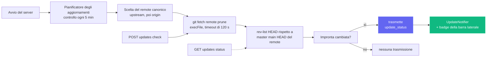

Un singolo controllo è economico (`git fetch <remote> --prune` sul remote canonico — `upstream` se configurato, altrimenti `origin`), racchiuso in `execFile` (senza shell) con un timeout di 120 s. Gli errori — rete offline, installazione senza git, nessun remote configurato, riferimento upstream non risolvibile — restituiscono tutti **payload morbidi** (ad es. `fetch_error: "..."`) invece di sollevare un'eccezione, così un remote instabile non blocca mai la dashboard.

### Superfici dell'interfaccia

| Superficie | Comportamento |
| --- | --- |
| **Finestra** (`client/src/components/UpdateNotifier.tsx`) | Si apre per ogni nuovo `remote_sha` disponibile; mostra quanti commit mancano, il riferimento seguito, una nota facoltativa su branch/fork, il comando esatto e i pulsanti **Copia comando**, **Controlla ora** e **Ignora**. Esc o un clic sullo sfondo la chiudono. Il rifiuto è indicizzato in `localStorage`, quindi uno SHA più recente la riapre. |
| **Pulsante della barra laterale** (`client/src/components/Sidebar.tsx`) | Sempre visibile. Il verde indica che sei indietro; l'ambra un errore di fetch. Un clic cancella il rifiuto e chiama `POST /api/updates/check`. |
| **Terminale del server** | Stampa un riquadro con il comando quando lo stato passa da aggiornato a indietro, anche per chi usa il server senza interfaccia. |

### Superficie dell'API

| Endpoint | Scopo |
| --- | --- |
| `GET /api/updates/status` | Controllo in sola lettura: esegue `git fetch` sul remote canonico, confronta HEAD con il suo branch predefinito e restituisce il payload. |
| `POST /api/updates/check` | Stesso controllo, ma trasmette anche `update_status` via WebSocket così tutti i client connessi si aggiornano in una volta. |

Entrambi gli endpoint restituiscono la stessa struttura di payload:

```json
{
  "git_repo": true,
  "update_available": true,
  "repo_root": "/Users/you/Claude-Code-Agent-Monitor",
  "remote_ref": "upstream/master",
  "canonical_remote": "upstream",
  "current_branch": "master",
  "tracking_upstream": "origin/master",
  "tracks_canonical": false,
  "situation": "fork_or_diverged_tracking",
  "local_sha": "abc1234...",
  "remote_sha": "def5678...",
  "commits_behind": 3,
  "manual_command": "cd \"/...\" && git fetch upstream && git merge --ff-only upstream/master && npm run setup",
  "situation_note": "You're on 'master' tracking 'origin/master'. This command fast-forwards your branch from upstream/master (the canonical default).",
  "message": "3 commit(s) on upstream/master not in your checkout."
}
```

`situation` è uno fra `tracking_canonical` (clone tipico sul branch predefinito — `git pull --ff-only` funziona), `fork_or_diverged_tracking` (il nome del branch locale coincide con quello canonico, ma segue un altro remote — `git fetch <remote> && git merge --ff-only <ref>`), `feature_branch` (fuori dal branch predefinito — solo fetch, l'integrazione è lasciata all'utente) o `detached_head`.

### Cosa **volutamente non** c'è

Non esiste un `POST /api/updates/apply` né un helper di riavvio automatico, per scelta progettuale. Aggiornare un processo dall'interno non è affidabile senza un supervisore esterno — `npm run dev` (concurrently), `npm start`, `pm2`, `systemd`, `launchd` e Docker richiedono ciascuno una logica di riavvio diversa, e i fallimenti di `git pull` / `npm install` su un server che si sta chiudendo non hanno un percorso di rollback pulito. Limitarsi al rilevamento mantiene il comportamento prevedibile con qualsiasi supervisore, sistema operativo e stato del branch, colmando comunque la lacuna informativa "quando devo fare pull?"; l'aggiornamento vero e proprio resta all'utente, nella sua shell.

### Configurazione

| Variabile d'ambiente | Predefinito | Note |
| --- | --- | --- |
| `DASHBOARD_UPDATE_CHECK` | attivo | Impostare a `0` / `false` / `off` per disattivare completamente il pianificatore. |
| `DASHBOARD_UPDATE_CHECK_INTERVAL_MS` | `300000` (5 min) | Intervallo tra i controlli automatici. Il minimo è 60 000 ms — i valori inferiori vengono riportati a questa soglia. |

---

## Tabby — il gatto compagno fluttuante

**Tabby** è un simpatico gatto compagno fluttuante fissato nell'angolo in basso a destra di ogni pagina della dashboard. Sempre presente, trasforma il flusso delle sessioni in diretta in una mascotte reattiva, leggibile a colpo d'occhio, con cui puoi anche parlare.

<p align="center">
  <a href="images/tabby.png">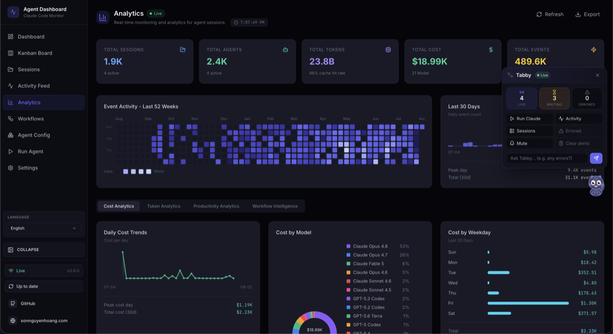</a>
</p>

### Mascotte reattiva

Tabby è un gatto SVG che segue il cursore, con **otto stati d'animo** derivati dal flusso delle sessioni in diretta, ciascuno con la propria animazione:

| Stato d'animo | Quando | Animazione |
| --- | --- | --- |
| `idle` | Non succede nulla di rilevante | Colpo di coda a riposo |
| `watching` | Ci sono sessioni attive | Orecchie dritte, occhi che seguono il cursore |
| `happy` | Una sessione o un'esecuzione è terminata senza problemi | Cenno del capo + scintille |
| `worried` | Qualcosa non sembra a posto | Leggero tremore |
| `stuck` | Una sessione sembra bloccata | Avviso "!" |
| `thinking` | Un agente è al lavoro | Lento cenno del capo |
| `sleeping` | Tutto tranquillo da un po' | `zzz` |
| `disconnected` | Il WebSocket è giù | Posa calma e immobile |

### Fumetti

Tabby mostra automaticamente brevi battute sugli eventi rilevanti (sessione avviata/terminata, errori, esecuzione completata). I fumetti sono **limitati e accorpati** così una raffica di eventi non intasa mai lo schermo, usano `aria-live` per gli screen reader e si possono **silenziare** dal pannello.

### Pannello

Apri il pannello cliccando sul gatto o premendo **⌘B / Ctrl+B** (Esc chiude). Mostra:

- Una **riga di stato** in diretta — `N live · M errored · connection state`.
- **Azioni rapide** — vai ad Avvia Claude, Attività, Sessioni o alle sessioni con errori; silenzia i fumetti; cancella gli avvisi.
- Una casella **Chiedi** (vedi sotto).

### Casella Chiedi → passaggio ad Avvia Claude

La casella **Chiedi** risponde localmente alle domande semplici sullo stato usando i dati in cache — per esempio "cosa è in esecuzione", "ci sono errori" o "stato". Qualsiasi altra domanda viene passata alla pagina **Avvia Claude** esistente (con link diretto a `/run?prompt=…`) per avviare una vera sessione di Claude Code. Tabby non chiama mai un LLM da solo; riusa semplicemente la pagina Avvia Claude per tutto ciò che va oltre una rapida consultazione dello stato.

### Accessibilità e degradazione sicura

Tabby è utilizzabile da tastiera, usa `aria-live` per i fumetti e rispetta `prefers-reduced-motion`. Se il WebSocket è giù, ripiega in sicurezza su uno stato tranquillo `disconnected` invece di generare errori. Puoi attivare o disattivare Tabby nelle **Impostazioni** (localizzato in inglese, cinese, vietnamita, coreano, spagnolo, francese, tedesco, portoghese e italiano), e l'implementazione si trova in `client/src/components/Tabby/`.

---

## Segnali acustici

La dashboard ti offre un **riscontro sonoro discreto** sull'attività delle sessioni in diretta, così puoi lasciarla su un secondo monitor e sentire comunque quando un'esecuzione termina o fallisce. Il suono è **attivo per impostazione predefinita** e si disattiva completamente con un clic.

### Sintesi senza dipendenze

Nel repository non c'è alcun file `.mp3` o `.wav` e nessuna libreria audio in `package.json`. Ogni segnale viene generato al momento con la **Web Audio API**: un breve elenco di oscillatori (sinusoidali o triangolari), ciascuno con il proprio inviluppo di guadagno esponenziale, mixati attraverso un nodo di guadagno principale e un filtro passa-basso così il risultato resta in secondo piano rispetto al tuo lavoro invece di interromperlo. L'intero motore è un solo file, `client/src/lib/sound.ts`.

### I segnali

| Segnale | Quando scatta | Come suona |
| --- | --- | --- |
| `sessionStart` | Compare una nuova sessione | Quinta giusta ascendente (Do5 → Sol5) |
| `sessionComplete` | Una sessione finisce di rispondere (`Stop`) o si chiude (`SessionEnd`) | Arpeggio maggiore risolutivo (Mi5 → Sol5 → Do6) |
| `sessionError` | Una sessione entra nello stato `error` | Morbida terza minore discendente su un'onda triangolare — percepibile, non allarmante |
| `subagentSpawn` | Viene avviato un subagente | Un singolo pizzico breve |
| `notification` | Claude Code emette un evento `Notification` | Coppia stonata che suona come una piccola campana |
| `connected` / `disconnected` | Il WebSocket della dashboard torna o cade | Salita / discesa di due note |
| `click` | Premi un pulsante, un link, una scheda o un interruttore | Tic appena udibile |

I segnali stanno all'interno di una scala di do maggiore, così le code che si sovrappongono non suonano mai dissonanti, e ogni inviluppo decade in modo esponenziale invece di interrompersi di colpo, evitando il clic di un arresto brusco.

### Senza disturbare

Tre protezioni evitano che il suono diventi rumore:

- **Tempo di attesa per segnale** — lo stesso segnale non si ripete entro ~350 ms (45 ms per il tic di interazione).
- **Budget globale di raffica** — al massimo 4 segnali partono in una finestra di 1,2 s, così importare la cronologia o riconnettersi dopo una caduta non trasforma mai una marea di messaggi WebSocket in una marea di bip.
- **Politica di riproduzione automatica** — nulla suona prima della tua prima interazione con la pagina (puntatore, tasto o tocco), secondo le regole dei browser. I segnali precedenti vengono scartati in silenzio, non messi in coda.

Se il browser non supporta affatto Web Audio, ogni chiamata è un'operazione nulla sicura — la dashboard resta semplicemente in silenzio.

### Impostazioni

**Impostazioni → Suono** offre un interruttore generale, un cursore del volume e un interruttore per ogni segnale. Attivando un interruttore il segnale suona subito, così senti esattamente cosa hai appena abilitato, e un pulsante **Ascolta il suono** riproduce su richiesta il suono di completamento. Le preferenze vengono salvate in `localStorage` sotto `agent-monitor-sound` e hanno effetto immediato in tutta l'app — senza ricaricare. Il pannello è localizzato in inglese, cinese, vietnamita, coreano, spagnolo, francese, tedesco, portoghese e italiano.

Per impostazione predefinita sono attivi avvio della sessione, completamento della sessione, errore della sessione, notifiche di Claude Code e il tic di interazione; l'avvio dei subagenti e i cambi di connessione sono disattivati (sono i più loquaci). L'implementazione si trova in `client/src/lib/sound.ts` (motore + preferenze) e `client/src/hooks/useSoundCues.ts` (collegamento al bus degli eventi), montato una sola volta in `client/src/App.tsx`.

---

## Finestra dello stato della connessione

Clicca sulla pillola **In diretta** / **Disconnesso** nel piè di pagina della barra laterale per aprire un piccolo pannello di dettagli sul trasporto WebSocket della dashboard. Mostra l'endpoint `ws://` attivo, da quanto tempo è aperto il socket corrente, il totale degli eventi ricevuti, i principali tipi di evento come grafico a barre orizzontali, una sparkline della portata sugli ultimi 60 secondi e gli ultimi 8 eventi in un elenco dell'attività recente. Le statistiche cumulative (totali, ripartizione per tipo, elenco recente) restano tra un ricaricamento e l'altro tramite `localStorage` sotto `sidebar-connection-stats`; la sparkline mobile e il timer "connesso da" sono volutamente effimeri. Un pulsante **Reimposta** nel piè di pagina cancella tutto su richiesta.

<p align="center">
  <a href="images/live.png">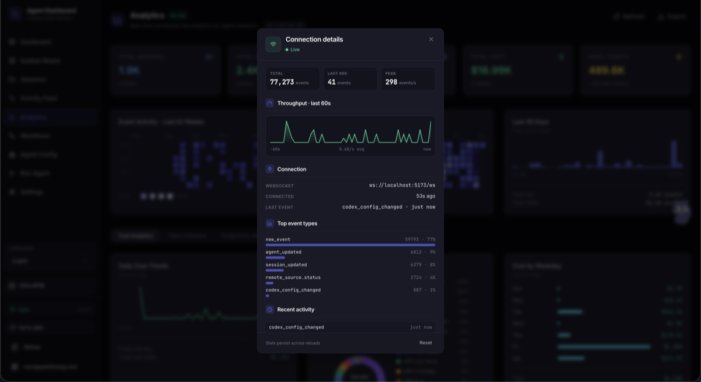</a>
</p>

---

## Estensione per VS Code

**Claude Code Agent Monitor** è disponibile come estensione per VS Code a tutti gli effetti, così puoi monitorare i tuoi agenti di IA senza lasciare l'editor.

<p align="center">
  <a href="vscode-extension/vscode.png"></a>
</p>

### 🚀 Funzionalità principali
- **Barra laterale in diretta**: vista dedicata nella barra delle attività che mostra in tempo reale lo stato degli agenti (Al lavoro, In attesa, Completato, ecc.).
- **Analisi dell'utilizzo**: tieni traccia del totale dei token, dei costi in USD in diretta e del numero di eventi direttamente nella barra laterale.
- **Integrazione nella barra di stato**: monitor dell'attività a colpo d'occhio nella barra inferiore, con sessioni e agenti attivi.
- **Navigazione diretta**: accesso con un clic a viste specifiche della dashboard (Kanban, Analisi, Impostazioni) o alle sessioni recenti.
- **Scheda integrata**: apre l'intera dashboard di monitoraggio come scheda webview nativa di VS Code.

### 📦 Installazione e configurazione
1. Apri la directory [vscode-extension](./vscode-extension).
2. Installa l'estensione dal Marketplace o impacchettala tu stesso con `vsce package`.
3. Assicurati che il server locale della dashboard sia in esecuzione (`npm run dev`).
4. Clicca sull'**icona del radar** nella barra delle attività di VS Code per iniziare.

Per la configurazione dettagliata per gli sviluppatori, vedi le directory [.vscode](./.vscode) e [vscode-extension](./vscode-extension).

> [!TIP]
> Estensione sul VS Code Marketplace: [Claude Code Agent Monitor](https://marketplace.visualstudio.com/items?itemName=hoangsonw.claude-code-agent-monitor)

---

## App desktop (macOS e Windows)

L'app desktop facoltativa basata su Electron 35 confeziona la stessa dashboard come `.dmg` per macOS, installer NSIS per Windows o `.exe` portatile, a partire dallo spazio di lavoro `desktop/`.

<p align="center">
  <a href="images/macos.png">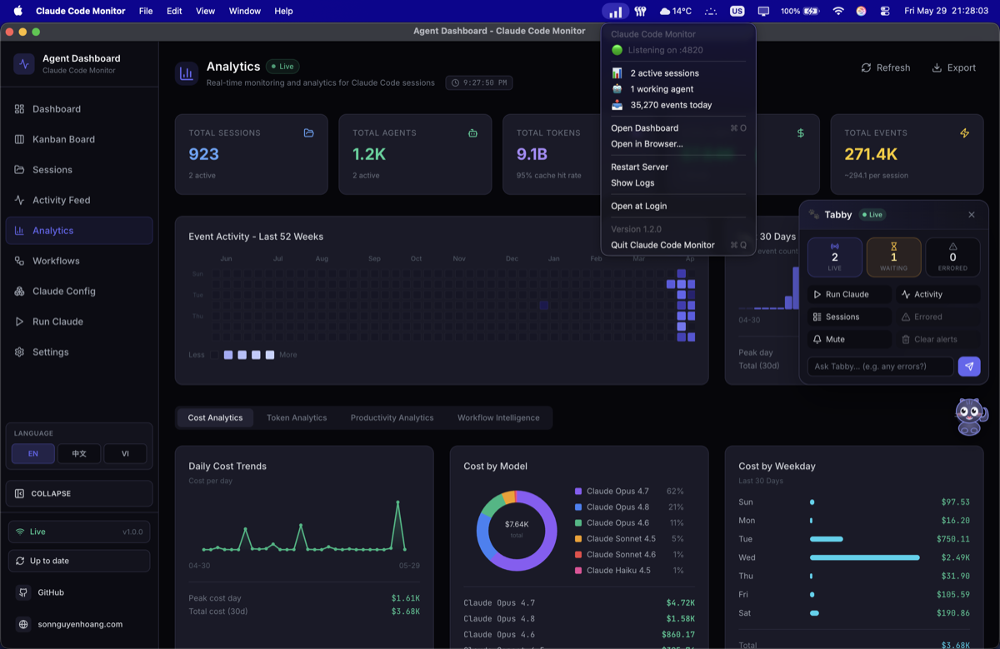</a>
  <br>
  <em>🍎🪟 <strong>App desktop</strong> — shell nativa con icona nella barra dei menu / area di notifica (tray), apertura all'accesso e blocco di istanza singola. La stessa dashboard, in una vera finestra del sistema (qui macOS).</em>
</p>

<p align="center">
  <a href="images/windows_app.png"></a>
  <br>
  <em>🪟 La stessa dashboard come app nativa di Windows — icona nell'area di notifica (tray), menu della finestra nativo e apertura all'accesso.</em>
</p>

Aggiunge il comportamento nativo di finestra, tray, menu, avvio all'accesso e arresto attorno alla stessa interfaccia servita su `localhost:4820`.

### Come funziona

A differenza dell'avvio della dashboard da un terminale, l'app desktop non richiede `npm start`, né una shell aperta, né una seconda copia del server. Il **processo principale** di Electron ospita il server Express **nello stesso processo** — fa `require()` di `server/index.js` direttamente nello stesso runtime Node, **senza processi figli né IPC** — e punta una `BrowserWindow` di Chromium al client React compilato.

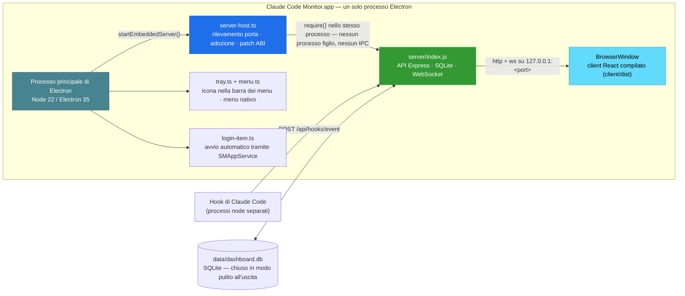

All'avvio l'app:

1. Sceglie una porta libera — preferibilmente la **4820**, altrimenti **4821–4829**, poi una porta alta casuale se sono tutte occupate.
2. Se un server della dashboard sano risponde già a `/api/health` sulla `4820` (ad es. hai eseguito `npm start` in un terminale), **adotta quel server** invece di effettuare un doppio bind — nessun conflitto di porta, nessuna contesa su SQLite. Un server adottato continua a funzionare dopo la chiusura dell'app.
3. Altrimenti avvia il server incorporato e, al **primo avvio con server proprio**, installa automaticamente gli hook di Claude Code e avvia i servizi in background (pianificatore degli aggiornamenti, `cc-watcher`, riconciliazione delle esecuzioni orfane). Chi installa solo il DMG vede quindi arrivare gli eventi **senza alcuna configurazione manuale** — niente checkout, niente `npm run install-hooks`.
4. **(macOS)** Recupera il **`PATH` della shell di login** così la funzione **Avvia Claude** può trovare e avviare la CLI `claude` — un'app aperta da Finder/Dock eredita altrimenti solo il `PATH` minimo di launchd e non troverebbe le CLI in `~/.local/bin`, `/opt/homebrew/bin`, nelle directory dei gestori di versione, ecc. (Su Windows il processo eredita già il `PATH` dell'utente.)
5. Apre la finestra della dashboard — a meno che l'app non sia stata avviata all'accesso (su macOS tramite gli elementi di login; su Windows tramite la voce contrassegnata `HKCU\…\Run`), nel qual caso resta solo nel tray.
6. All'uscita arresta in modo ordinato il server incorporato e **chiude SQLite in modo pulito** (checkpoint del WAL).

### Funzionalità

- **Tray e finestra:** il clic sinistro mostra/nasconde la finestra; il clic destro offre **Apri dashboard**, **Apri nel browser**, **Riavvia il server**, **Mostra i log**, **Apri all'accesso** ed **Esci**. macOS usa un glifo modello colorato nel tray; Windows e la finestra/barra delle applicazioni usano l'icona a colori dell'app, anche nelle esecuzioni di sviluppo non impacchettate.
- **Menu nativo:** menu applicativi standard e scorciatoie `⌘` / `Ctrl`. Solo macOS mantiene **File → Open Dashboard** (`⌘1`) quando la finestra è nascosta; Windows/Linux la riaprono in modo affidabile dal tray.
- **Accesso e ciclo di vita:** `SMAppService` registra gli Elementi login di macOS; Windows scrive la voce per utente `HKCU\Software\Microsoft\Windows\CurrentVersion\Run`. Chiudere la finestra la nasconde mentre tray e server continuano; un secondo avvio porta in primo piano l'unica istanza esistente.
- **Dati durevoli:** SQLite e le chiavi VAPID restano fuori dal bundle, in `~/Library/Application Support/Claude Code Monitor/data/` o `%APPDATA%\Claude Code Monitor\data\`. Reinstallazioni, aggiornamenti e la disinstallazione NSIS predefinita preservano la cronologia importata.
- **CLI e log:** macOS ripristina il `PATH` della shell di login, così le app avviate da Finder/Dock possono eseguire `claude`; Windows usa il `PATH` utente ereditato. **Mostra i log** apre `~/Library/Logs/Claude Code Monitor/desktop.log` o `%APPDATA%\Claude Code Monitor\logs\desktop.log`.

### Scaricarla

**Opzione A — scaricare un installer già pronto (consigliato).** Da **[Releases → latest](https://github.com/hoangsonww/Claude-Code-Agent-Monitor/releases/latest)** (pubblico, senza accesso a GitHub). La CI pubblica automaticamente una nuova release `vX.Y.Z` ogni volta che la versione in `package.json` viene incrementata su `master`, quindi questo link fornisce sempre la build attuale:

| Piattaforma | File | Note |
| --- | --- | --- |
| macOS (Apple Silicon) | `ClaudeCodeMonitor-<ver>-arm64.dmg` | trascina in `/Applications` |
| macOS (Intel) | `ClaudeCodeMonitor-<ver>-x64.dmg` | trascina in `/Applications` |
| Windows (installer) | `ClaudeCodeMonitor-Setup-<ver>-x64.exe` | installazione per utente, senza amministratore |
| Windows (portatile) | `ClaudeCodeMonitor-<ver>-x64-portable.exe` | si esegue senza installazione |

Build aggiornate per ogni commit sono disponibili anche come artefatti della CI (accesso richiesto, conservazione di 14 giorni): `ClaudeCodeMonitor-dmg` dal job `🍎 macOS Desktop (DMG)` e `ClaudeCodeMonitor-win` dal job `🪟 Windows Desktop (EXE)` — utili per provare `master` prima del prossimo tag di release.

**Opzione B — compilarla da solo.** Dalla radice del repository:

```bash
npm run setup                # install root + client deps, build client, install hooks
npm run build                # build the React client (client/dist)
npm run desktop:install      # install Electron + electron-builder into desktop/ (preflights native deps; prints setup help on failure)
npm run desktop:dmg:arm64    # macOS:   fast single-arch DMG → desktop/release/ClaudeCodeMonitor-<ver>-arm64.dmg
npm run desktop:win          # Windows: NSIS installer → desktop/release/ClaudeCodeMonitor-Setup-<ver>-x64.exe
```

> [!NOTE]
> **I DMG si compilano su macOS; gli `.exe` di Windows su Windows** — electron-builder impacchetta per il sistema operativo host. La build macOS `npm run desktop:dmg` impacchetta l'app **due volte** (una per architettura) e produce **entrambi** i DMG per architettura (`arm64` + `x64`) — è la build di release; non li unisce in un binario universale. Per il tuo Mac usa i target a singola architettura `desktop:dmg:arm64` / `desktop:dmg:x64`. Su Windows, `better-sqlite3` viene scaricato come binario Electron precompilato da `npm run desktop:install`, quindi nel caso comune non serve la toolchain C++ di Visual Studio. Se la build fallisce comunque (nessun binario precompilato o toolchain C++ mancante), `desktop:install` stampa la correzione esatta per ciascun sistema più un'alternativa senza toolchain e fallisce in modo esplicito invece di lasciare un'installazione rotta.

### Installarla

**macOS:**

1. Fai doppio clic sul `.dmg` per montarlo.
2. Trascina **Claude Code Monitor.app** nella cartella `/Applications`.
3. Il DMG è **firmato ad hoc** per impostazione predefinita, quindi Gatekeeper avvisa al primo avvio (*"Apple non ha potuto verificare…"*). Rimuovi l'attributo di quarantena:

   ```bash
   xattr -cr "/Applications/Claude Code Monitor.app"
   ```

   Oppure apri **Impostazioni di Sistema → Privacy e sicurezza** e clicca **Apri comunque**.

4. Avvia l'app. Compare l'icona nel tray e si apre la finestra della dashboard.

**Windows:**

Esegui `ClaudeCodeMonitor-Setup-<ver>-x64.exe` per un'installazione per utente, senza privilegi di amministratore, in `%LOCALAPPDATA%\Programs\Claude Code Monitor`, con una destinazione selezionabile, oppure usa `*-portable.exe` senza installare nulla. La build predefinita non firmata può attivare SmartScreen al primo avvio; scegli **Ulteriori informazioni → Esegui comunque**. Avviala dal menu Start o dal collegamento sul desktop per aprire la dashboard e l'icona nel tray.

<p align="center">
  <a href="images/setup_win_wizard.png"></a>
  <br>
  <em>🪟 <strong>Opzioni di installazione</strong> · scegli un'installazione per utente o per tutti gli utenti</em>
</p>

<p align="center">
  <a href="images/setup_win_wizard2.png"></a>
  <br>
  <em>🪟 <strong>Posizione di installazione</strong> · conferma o cambia la cartella di destinazione</em>
</p>

<p align="center">
  <a href="images/setup_win_wizard3.png"></a>
  <br>
  <em>🪟 <strong>Installazione di Windows completata</strong> · termina l'installer e avvia Claude Code Monitor</em>
</p>

### Comandi di build

Tutti i comandi si eseguono dalla **radice del repository**:

| Comando | Cosa fa |
| --------------------------- | ---------------------------------------------------------------------------- |
| `npm run desktop:install` | Installa Electron + electron-builder in `desktop/`; ricompila `better-sqlite3` per l'ABI di Electron; verifica in anticipo la build nativa di `better-sqlite3` e, in caso di errore, mostra un aiuto pratico per la configurazione (inclusa un'alternativa senza toolchain) |
| `npm run desktop:build` | Compila i sorgenti TypeScript del desktop in `desktop/out/` |
| `npm run desktop:dev` | Compila e avvia l'app Electron per lo sviluppo locale |
| `npm run desktop:test` | Esegue lo smoke test (avvia Electron, interroga `/api/health`, chiude) |
| `npm run desktop:dmg` | **macOS:** costruisce **entrambi** i DMG (arm64 + x64) — corretto per una release, **più lento** (impacchetta ogni architettura) |
| `npm run desktop:dmg:arm64` | **macOS:** costruisce un DMG solo per Apple Silicon — **veloce** (~1 min), consigliato per il tuo Mac |
| `npm run desktop:dmg:x64` | **macOS:** costruisce un DMG solo per Intel — **veloce** (~1 min) |
| `npm run desktop:dmg:universal` | **macOS:** costruisce un unico DMG **universale** unificato (arm64 + x86_64) — facoltativo, **il più lento**, non è ciò che distribuisce la release |
| `npm run desktop:win` | **Windows:** costruisce l'installer NSIS `.exe` (x64) |
| `npm run desktop:win:portable` | **Windows:** costruisce il `.exe` portatile senza installazione (x64) |

Il DMG per macOS risultante pesa **~80 MB** (≈ 250 MB su disco una volta installato) e l'installer di Windows è simile — il costo abituale di un bundle Electron.

### Firma e notarizzazione

macOS usa per impostazione predefinita la firma ad hoc e imposta `CSC_IDENTITY_AUTO_DISCOVERY=false`, così i certificati locali non vengono mai scelti per errore. La firma Developer ID usa `CSC_LINK` più `CSC_KEY_PASSWORD`; la notarizzazione aggiunge `APPLE_ID`, `APPLE_TEAM_ID` e `APPLE_APP_SPECIFIC_PASSWORD`. Windows non è firmato per impostazione predefinita e attiva Authenticode tramite le stesse variabili `CSC_LINK` e della password. La CI attiva l'uno o l'altro percorso quando le credenziali sono presenti, senza modifiche al codice.

### Note di implementazione

- **ABI nativa:** `desktop/` mantiene un `better-sqlite3` compilato per Electron e vi reindirizza `server/db.js`; la copia nella radice resta compatibile con il Node di sistema e con i test del server. Dopo le build del DMG specifiche per un'architettura, il `prebuild` del desktop ripara automaticamente l'ABI locale e fallisce subito con un aiuto per la configurazione se il binario manca.
- **Parità del server:** la funzione esportata `startBackgroundServices()` dà al server incorporato lo stesso pianificatore degli aggiornamenti, lo stesso watcher della configurazione e la stessa riconciliazione delle esecuzioni orfane di `node server/index.js`; il percorso autonomo e gli altri spazi di lavoro restano invariati nel comportamento.
- **CI e release:** job macOS e Windows filtrati per percorso eseguono gli smoke test e caricano due DMG a singola architettura più gli EXE NSIS e portatile. Gli incrementi di versione su `master` allegano tutti gli artefatti a `vX.Y.Z`; rigenera `desktop/assets/icon.ico` con `npm run build:win-icon`.

Vedi [`DESKTOP.md`](./DESKTOP.md) per l'installazione e l'uso quotidiano, e [`desktop/README.md`](./desktop/README.md) per processi, ciclo di vita, porte e build.

---

## Archiviazione dei dati

- **Motore:** SQLite 3 tramite `better-sqlite3` (facoltativo) o il modulo integrato di Node.js `node:sqlite`
- **Posizione:** `data/dashboard.db`
- **Modalità di journal:** WAL (letture concorrenti durante le scritture)
- **Azzeramento:** elimina `data/dashboard.db` per cancellare tutti i dati

### Diagramma entità-relazione

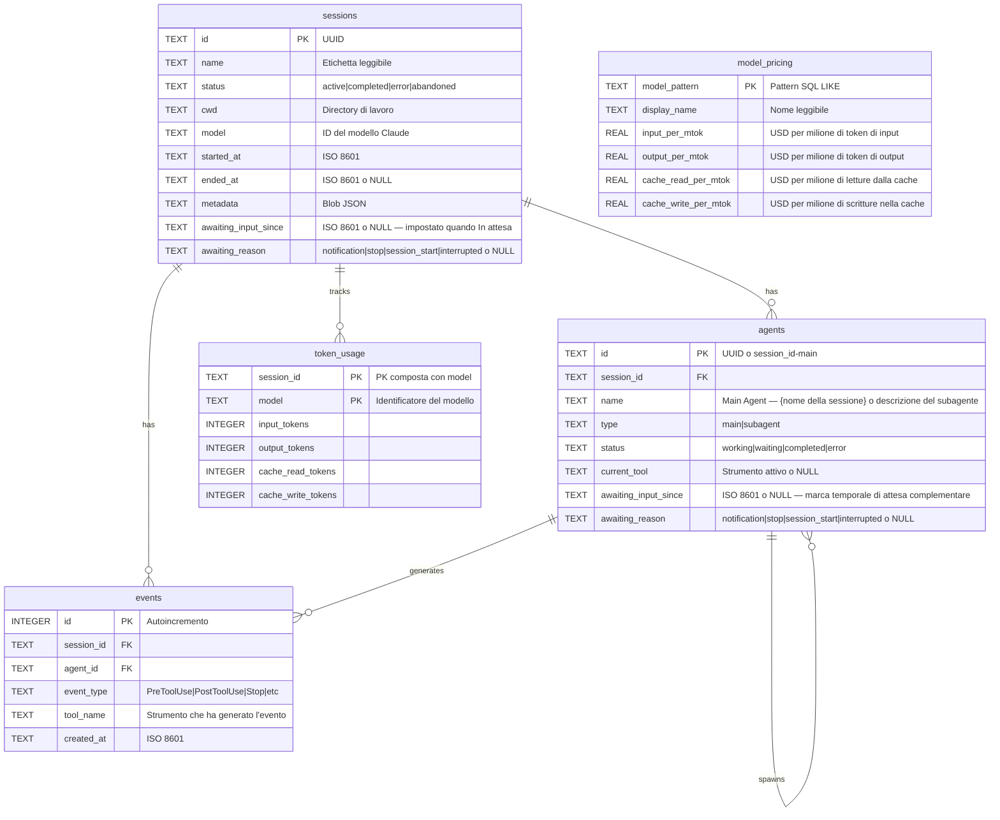

---

## Marketplace dei plugin

CCAM fornisce **14 plugin** da un unico albero sorgente condiviso. Claude Code legge `.claude-plugin/marketplace.json`; Codex legge `.agents/plugins/marketplace.json` più il `.codex-plugin/plugin.json` di ciascun plugin. Il pacchetto contiene **66 skill di plugin, 18 subagenti Claude, 34 comandi Claude, 3 utility CLI, 3 configurazioni di hook e 2 plugin con MCP**.

```bash
# Claude Code
claude plugin marketplace add hoangsonww/Claude-Code-Agent-Monitor
claude plugin install ccam-platform@claude-code-agent-monitor-plugins

# Codex
codex plugin marketplace add hoangsonww/Claude-Code-Agent-Monitor
codex plugin add ccam-platform@claude-code-agent-monitor-plugins

# Open Agent Skills / skills.sh-compatible CLI
npx skills add hoangsonww/Claude-Code-Agent-Monitor --list

# Install one skill for Claude Code and Codex in the current project
npx skills add hoangsonww/Claude-Code-Agent-Monitor \
  --skill mcp-server \
  --agent claude-code \
  --agent codex \
  --yes

# Verify, update, and remove the project-scoped skill
npx skills list --json
npx skills update --project --yes
npx skills remove mcp-server --yes

# Add --global to install at user scope, then manage that scope explicitly
npx skills add hoangsonww/Claude-Code-Agent-Monitor \
  --skill mcp-server \
  --agent claude-code \
  --agent codex \
  --global \
  --yes
npx skills list --global --json
npx skills update --global --yes
npx skills remove --global mcp-server --yes
```

La CLI `skills` rileva in totale **77 skill del repository**, comprese le 66 skill dei plugin e le skill di manutenzione del repository. Le installazioni di progetto usano `.agents/skills/` più link specifici per ogni agente. Le skill globali di Claude Code vanno per impostazione predefinita in `~/.claude/skills/`, oppure in `$CLAUDE_CONFIG_DIR/skills/` se impostato. Le skill globali di Codex vanno per impostazione predefinita in `~/.codex/skills/`, oppure in `$CODEX_HOME/skills/` se impostato. Le installazioni per più agenti possono deduplicare i file tramite uno storage condiviso e collegare quelle destinazioni. Ogni skill di plugin ha un frontmatter canonico `name`/`description` e metadati `agents/openai.yaml`. Per l'installazione non serve alcuna PR upstream verso `vercel-labs/skills`. Il repository pubblico su GitHub è l'origine, e la visibilità su skills.sh dipende dalla pubblicazione e dalla telemetria reale delle installazioni.

Nuovi pacchetti mirati completano i plugin esistenti di analisi, produttività, qualità, sessioni, flussi, configurazione e dashboard:

- `ccam-runner`: avvio monitorato, seguito, arresto e ripresa di Claude Code/Codex, e cronologia delle esecuzioni
- `ccam-integrations`: regole di avviso, webhook, notifiche push e raccolta remota via SSH
- `ccam-platform`: explorer della configurazione di Claude/Codex, importazione consapevole del provider, ripristino dei backup, configurazione degli hook, aggiornamenti e operazioni MCP
- `ccam-reports`: report pronti da presentare per direzione, costi, affidabilità e flussi

Convalida e rigenera i metadati di distribuzione con:

```bash
npm run extensions:sync
npm run extensions:validate
```

Catalogo completo, comandi di installazione, comportamento di skills.sh, limiti della pubblicazione e verifiche di installazione pulita: [docs/PLUGINS.md](docs/PLUGINS.md).

---

## Riga di stato

Un'utility autonoma di riga di stato della CLI per Claude Code che mostra nome del modello, utente, directory di lavoro, branch git, una barra di utilizzo della finestra di contesto, i conteggi dei token per direzione e il costo della sessione — il tutto con codici colore tramite sequenze di escape ANSI.

```
nguyens6@host ~/agent-dashboard/client | Sonnet 4.6 | main | ████████░░ 79% | 3↑ 2↓ 156586c | $0.4231
```

| Segmento | Colore | Esempio |
| ----------- | -------------------- | -------------------------------------------------------------- |
| Modello | Ciano | `Sonnet 4.6` |
| Utente | Verde | `nguyens6` |
| CWD | Giallo | `~/agent-dashboard` |
| Branch git | Magenta | `main` |
| Barra del contesto | Verde / Giallo / Rosso | `████████░░ 79%` |
| Token | Verde / Ciano / Attenuato | `3↑ 2↓ 156586c` (`↑` verde in input, `↓` ciano in output, `c` attenuato per la cache) |
| Costo (USD) | Verde / Giallo / Rosso | `$0.4231` (totale della sessione — mostrato con i piani API e in abbonamento) |

Soglie di colore del costo: verde sotto i 5 $, giallo da 5 a 20 $, rosso oltre i 20 $.

Vedi [`statusline/README.md`](statusline/README.md) per le istruzioni di installazione.

<p align="center">
  <a href="images/statusline.png">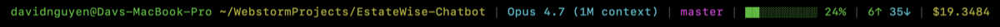</a>
</p>

---

## Architettura del server

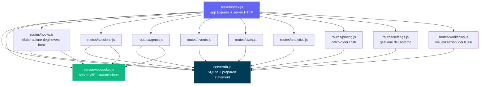

---

## Routing del client

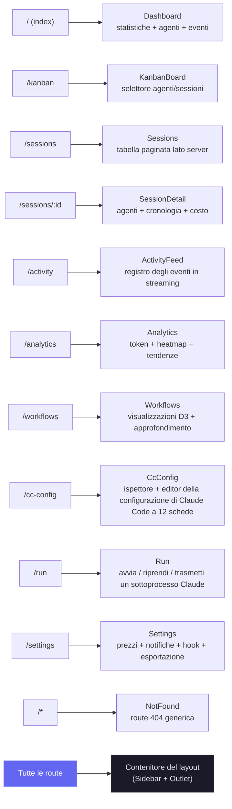

---

## Flusso del gestore degli hook

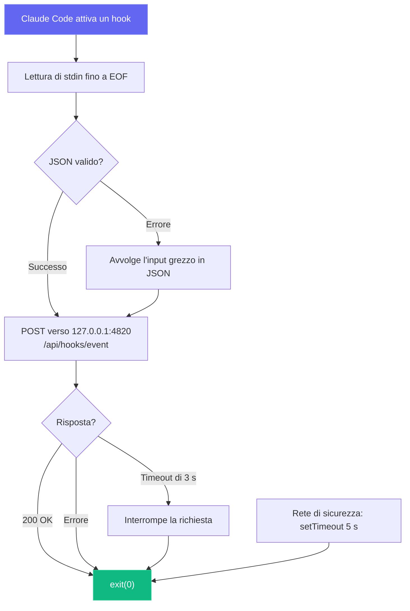

---

## Modalità di deploy

Supportiamo modalità di deploy per sviluppo e produzione, con architetture dei processi diverse:

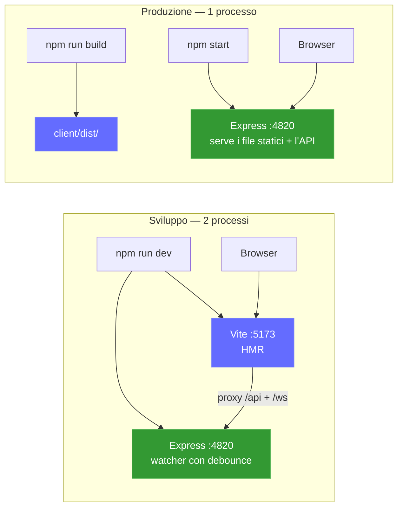

Sidecar MCP locale facoltativo (supporta i trasporti stdio, HTTP+SSE e REPL):

```mermaid
graph LR
    subgraph "Opzioni di trasporto MCP"
        M_STDIO["Server MCP (stdio)<br/>npm run mcp:start"]
        M_HTTP["Server MCP (HTTP)<br/>npm run mcp:start:http<br/>:8819"]
        M_REPL["Server MCP (REPL)<br/>npm run mcp:start:repl"]
    end

    H["Host MCP"] -->|"stdin/stdout"| M_STDIO
    RC["Client remoto"] -->|"POST /mcp · GET /sse"| M_HTTP
    OP["Operatore"] -->|"CLI interattiva"| M_REPL

    M_STDIO --> D["Server della dashboard<br/>:4820"]
    M_HTTP --> D
    M_REPL --> D

    style M_STDIO fill:#0f766e,stroke:#14b8a6,color:#fff
    style M_HTTP fill:#0f766e,stroke:#14b8a6,color:#fff
    style M_REPL fill:#0f766e,stroke:#14b8a6,color:#fff
```

**App desktop (macOS e Windows)** facoltativa — un unico processo Electron che ospita il server Express nello stesso processo (nessun terminale, nessun processo figlio):

```mermaid
flowchart LR
    subgraph desktop["App desktop (macOS e Windows) — 1 processo Electron"]
        E_MAIN["Processo principale di Electron<br/>(Node 22 / Electron 35)"]
        E_HOST["server-host.ts<br/>require() server/index.js"]
        E_SRV["Express incorporato :4820<br/>API · SQLite · WebSocket"]
        E_WIN["BrowserWindow<br/>client React compilato"]
        E_TRAY["Icona nella barra dei menu (tray)<br/>+ menu applicativo nativo"]
        E_MAIN --> E_HOST
        E_HOST -->|"require() nello stesso processo"| E_SRV
        E_MAIN --> E_TRAY
        E_SRV -->|"http + ws su 127.0.0.1"| E_WIN
    end

    E_HOOKS["Hook di Claude Code"] -->|"POST /api/hooks/event"| E_SRV

    style E_MAIN fill:#47848F,stroke:#2f5a62,color:#fff
    style E_SRV fill:#339933,stroke:#5cb85c,color:#fff
    style E_WIN fill:#61DAFB,stroke:#3aa9c9,color:#000
```

### Deploy nel cloud

Lo stack `deployments/` è pensato per qualsiasi servizio Kubernetes conforme, compresi EKS, GKE, AKS, OKE e i cluster autogestiti. CCAM usa SQLite, quindi ogni manifest supportato impone **un solo scrittore attivo della dashboard per volume persistente**, con un rollout di tipo Recreate. HPA, repliche attivo-attivo, blue-green e canary volutamente non sono supportati finché SQLite resta il backend di persistenza.

```mermaid
flowchart LR
  CI["CI: test · convalida · scansione · attestazione · firma"] --> HELM["Helm / Kustomize / Terraform"]
  HELM --> APP["Dashboard CCAM<br/>esattamente 1 replica"]
  APP --> PVC[("PVC ReadWriteOnce mantenuto")]
  EDGE["Ingress o Gateway API<br/>TLS + WebSocket"] --> APP
  PROM["Prometheus Operator"] -->|"Bearer /api/metrics"| APP
  MCP["Sidecar MCP autenticato"] --> APP
```

- **Helm:** scrittore unico imposto dallo schema, supporto dei digest, PVC mantenuto, Ingress o Gateway API, montaggio del token compatibile con External Secrets, NetworkPolicy, MCP e ServiceMonitor facoltativi.
- **Kustomize:** base con PSS ristretto più overlay dev/staging/produzione e componenti facoltativi per MCP, monitoraggio, Gateway API e snapshot CSI.
- **Terraform:** distribuisce il chart Helm convalidato su un cluster Kubernetes esistente. Rete cloud, identità del cluster, CSI, TLS e sincronizzazione dei segreti restano a carico del provider.
- **Operatività:** backup online coerente di SQLite con SHA-256, ripristino verificato con scalatura a zero, deploy/rollback/smantellamento preceduti sempre da un backup e controlli di salute autenticati.
- **Supply chain della CI:** le immagini dell'app e del MCP vengono scansionate, pubblicate per amd64/arm64 con SBOM e provenienza SLSA e firmate senza chiave con Cosign.

```bash
npm run deploy:validate
REGISTRY="ghcr.io/$(gh repo view --json owner -q .owner.login)"
IMAGE_TAG="$(git rev-parse --short HEAD)"

helm upgrade --install agent-monitor deployments/helm/agent-monitor \
  --namespace agent-monitor-production --create-namespace \
  --values deployments/helm/agent-monitor/values-production.yaml \
  --set image.registry= \
  --set image.repository=${REGISTRY}/claude-code-agent-monitor \
  --set image.tag=${IMAGE_TAG} \
  --atomic --wait --timeout 10m
```

> [!NOTE]
> La configurazione completa di produzione, i segreti, lo stack Docker/Podman, Gateway API, Terraform, backup, ripristino e rollback sono documentati in [DEPLOYMENT.md](DEPLOYMENT.md) e [deployments/README.md](deployments/README.md).

---

## Struttura del progetto

```
agent-dashboard/
|-- CLAUDE.md                   # Claude Code project memory and working agreements
|-- AGENTS.md                   # Codex project instructions
|-- package.json                # Root scripts (dashboard + MCP helpers) + server dependencies
|-- .claude/
|   +-- rules/                  # Path-scoped Claude rules
|   +-- skills/                 # Claude reusable project skills
|   +-- agents/                 # Claude custom subagents
|-- .claude-plugin/
|   +-- marketplace.json        # Claude Code marketplace manifest (14 plugins)
|-- .agents/plugins/
|   +-- marketplace.json        # Codex marketplace manifest (same 14 plugins)
|-- plugins/
|   |-- ccam-analytics/         # Analytics: session reports, cost breakdown, usage trends, productivity score
|   |   |-- .claude-plugin/plugin.json
|   |   |-- skills/ (4)         # session-report, cost-breakdown, usage-trends, productivity-score
|   |   |-- agents/             # analytics-advisor (Sonnet model)
|   |   |-- hooks/hooks.json    # Stop + SubagentStop event logging
|   |   +-- bin/ccam-stats      # Terminal dashboard CLI
|   |-- ccam-productivity/      # Productivity: standups, reports, sprints, workflow optimizer
|   |-- ccam-devtools/          # DevTools: debug, diagnostics, export, health checks
|   |   +-- bin/                # ccam-doctor + ccam-export CLIs
|   |-- ccam-insights/          # Insights: patterns, anomalies, optimization, comparison
|   |-- ccam-cost-guard/        # Cost guardrails: budgets, spend forecast, cost alerts, model savings
|   |-- ccam-sessions/          # Session forensics: search, timeline, transcript replay, cwd rollup, cleanup
|   |-- ccam-workflows/         # Workflow orchestration: DAG map, delegation audit, concurrency, fleet runs
|   |-- ccam-quality/           # Reliability & SLOs: error scan, API-error report, hook-failure audit, SLO check
|   |-- ccam-config/            # Config & memory governance: config audit, memory review, skill/MCP/hook inventory
|   +-- ccam-dashboard/         # Dashboard connector: status, quick stats, MCP integration
|       +-- .mcp.json           # MCP server configuration
|-- server/
|   |-- index.js                 # Express app, HTTP server, static serving
|   |-- db.js                    # SQLite schema, migrations, prepared statements
|   |-- websocket.js             # WebSocket server with heartbeat
|   +-- routes/
|       |-- hooks.js             # Hook event processing (transactional)
|       |-- sessions.js          # Session CRUD
|       |-- agents.js            # Agent CRUD
|       |-- events.js            # Event listing
|       |-- stats.js             # Aggregate statistics
|       |-- analytics.js         # Token, tool, and trend analytics
|       |-- workflows.js         # Aggregate workflow data and per-session drill-in
|       |-- pricing.js           # Model pricing CRUD and cost calculation
|       +-- settings.js          # System info, data management, export, cleanup
|   +-- lib/
|       +-- transcript-cache.js  # Stat-based JSONL transcript cache with chunked sync byte-stream reader (4 MiB chunks, line-by-line UTF-8 decode) so files larger than V8's max string length (~512 MiB) parse without aborting Node with "FATAL ERROR: v8::ToLocalChecked Empty MaybeLocal". Extracts tokens, compactions, API errors, turn durations, thinking blocks, and usage extras (service_tier, speed, inference_geo)
|   +-- compat-sqlite.js         # node:sqlite compatibility wrapper (fallback for better-sqlite3)
|-- client/
|   |-- package.json             # Client dependencies
|   |-- index.html               # HTML entry point
|   |-- vite.config.ts           # Vite + proxy config
|   |-- tailwind.config.js       # Custom dark theme
|   |-- tsconfig.json            # Strict TypeScript
|   +-- src/
|       |-- main.tsx             # React entry
|       |-- App.tsx              # Router + WebSocket provider
|       |-- index.css            # Tailwind + custom utilities
|       |-- lib/
|       |   |-- types.ts         # Shared TypeScript interfaces
|       |   |-- api.ts           # Typed fetch client
|       |   |-- format.ts        # Date/time formatting utilities
|       |   +-- eventBus.ts      # Pub/sub for WebSocket distribution
|       |-- hooks/
|       |   |-- useWebSocket.ts      # Auto-reconnecting WebSocket hook
|       |   +-- useNotifications.ts  # Browser notification triggers from WebSocket events
|       |-- components/
|       |   |-- Layout.tsx       # Shell with sidebar + outlet
|       |   |-- Sidebar.tsx      # Navigation + connection indicator
|       |   |-- AgentCard.tsx    # Agent info card with status
|       |   |-- StatCard.tsx     # Metric card
|       |   |-- StatusBadge.tsx  # Color-coded status pills
|       |   |-- EmptyState.tsx   # Placeholder for empty lists
|       |   +-- workflows/       # D3.js workflow visualization components
|       |       |-- OrchestrationDAG.tsx            # Horizontal DAG of agent spawning patterns
|       |       |-- ToolExecutionFlow.tsx           # d3-sankey diagram of tool-to-tool transitions
|       |       |-- AgentCollaborationNetwork.tsx   # Force-directed agent pipeline graph
|       |       |-- SubagentEffectiveness.tsx       # Scorecard grid with SVG success rings
|       |       |-- WorkflowPatterns.tsx            # Auto-detected orchestration sequences
|       |       |-- ModelDelegationFlow.tsx         # Model routing through agent hierarchies
|       |       |-- ErrorPropagationMap.tsx         # Error clustering by hierarchy depth
|       |       |-- ConcurrencyTimeline.tsx         # Swim-lane parallel agent execution
|       |       |-- SessionComplexityScatter.tsx    # D3 bubble chart (duration vs agents vs tokens)
|       |       |-- CompactionImpact.tsx            # Token compression events and recovery
|       |       |-- WorkflowStats.tsx               # Aggregate workflow statistics
|       |       +-- SessionDrillIn.tsx              # Per-session agent tree, tool timeline, events
|       +-- pages/
|           |-- Dashboard.tsx      # Overview page
|           |-- KanbanBoard.tsx    # Agents/Sessions toggle, status columns
|           |-- Sessions.tsx       # Server-paginated sessions table
|           |-- SessionDetail.tsx  # Single session deep dive
|           |-- ActivityFeed.tsx   # Real-time event stream
|           |-- Analytics.tsx      # Token usage, heatmap, trends
|           |-- Workflows.tsx      # D3.js workflow visualizations and session drill-in
|           |-- Settings.tsx       # Model pricing, notifications, hooks, export, cleanup
|           +-- NotFound.tsx       # 404 catch-all page
|-- scripts/
|   |-- hook-handler.js          # Lightweight stdin-to-HTTP forwarder
|   |-- install-hooks.js         # Auto-configures ~/.claude/settings.json
|   |-- import-history.js        # Imports sessions from ~/.claude/ with enhanced JSONL extraction (API errors, turn durations, entrypoint, permission modes, thinking blocks, usage extras, tool errors, subagent JSONL files). Re-import is fully incremental: a per-event-type high-water mark (`MAX(created_at) GROUP BY event_type` per session) is computed up-front and only JSONL entries with `ts > cutoff[type]` are inserted, so long-running sessions whose transcripts grow across multiple days continue to receive Stop / PostToolUse / TurnDuration / ToolError events on every re-run. Also rolls `sessions.ended_at` forward when the JSONL advances past the stored value and refreshes message-count metadata on every pass
|   +-- seed.js                  # Sample data generator
|-- mcp/
|   |-- package.json             # MCP package scripts + dependencies
|   |-- README.md                # MCP setup, host config, tool catalog, safety model
|   |-- src/
|   |   |-- index.ts             # MCP runtime entrypoint (transport router)
|   |   |-- server.ts            # MCP server assembly
|   |   |-- clients/             # Dashboard API client with retry/backoff
|   |   |-- config/              # Environment/CLI config parsing
|   |   |-- core/                # Logger, tool registry, result helpers
|   |   |-- policy/              # Mutation/destructive guards
|   |   |-- tools/               # 16 domain modules registering 103 tools
|   |   |-- transports/          # HTTP+SSE server, REPL, tool collector
|   |   |-- ui/                  # ANSI banner, colors, formatter, tables
|   |   +-- types/               # Shared MCP type definitions
|   +-- build/                   # Built MCP runtime output
|-- desktop/
|   |-- package.json             # Electron + electron-builder dependencies and scripts
|   |-- electron-builder.yml     # DMG packaging config; signing/notarization hooks
|   |-- tsconfig.json            # Strict TypeScript (src/ -> out/)
|   |-- README.md                # Desktop app architecture reference (contributor docs)
|   |-- assets/                  # icon.svg + generated icon.icns + tray PNGs
|   |-- src/
|   |   |-- main.ts              # Electron main process entry — lifecycle, wiring
|   |   |-- server-host.ts       # In-process Express boot, port discovery, adoption, DB close
|   |   |-- window.ts            # BrowserWindow + persisted window geometry
|   |   |-- tray.ts              # Menu-bar (tray) icon + context menu
|   |   |-- menu.ts              # Native application menu (File ▸ Open Dashboard is macOS-only)
|   |   |-- login-item.ts        # macOS Login Items auto-start toggle (SMAppService)
|   |   |-- logger.ts            # File logger -> ~/Library/Logs/Claude Code Monitor/desktop.log
|   |   |-- constants.ts         # App name, ports, timeouts, window size
|   |   +-- preload.ts           # Intentionally empty (zero renderer privilege)
|   |-- scripts/
|   |   |-- install.js           # Preflights native deps for desktop:install; prints setup help + exits non-zero on failure
|   |   |-- preflight.js         # Shared better-sqlite3 binary check + actionable per-OS setup help (incl. no-toolchain alternative)
|   |   |-- prebuild.js          # Ensures root + client are built before tsc; fails fast with setup help if native binary missing
|   |   |-- build-icons.sh       # SVG -> PNG/ICNS via qlmanage/sips/iconutil
|   |   +-- notarize.js          # electron-builder afterSign hook (opt-in notarization)
|   +-- tests/
|       +-- smoke.test.mjs       # Spawn Electron + probe /api/health
|-- deployments/
|   |-- README.md                # Production deployment reference
|   |-- nginx/                   # Rootless Nginx edge and opt-in hook/MCP policies
|   |-- secrets/                 # Ignored Compose token/password files
|   |-- terraform/               # Helm deployment to an existing Kubernetes cluster
|   |-- kubernetes/              # One-writer Kustomize base + environment overlays
|   |   |-- base/                # Restricted PSS, Recreate Deployment, PVC, Service, Ingress
|   |   |-- overlays/            # Dev, staging, production namespaces and resources
|   |   +-- components/          # MCP, ServiceMonitor, Gateway API, VolumeSnapshot
|   |-- helm/agent-monitor/      # Schema-enforced Helm chart and environment values
|   +-- scripts/                 # Validate, deploy, backup, restore, rollback, health, teardown
|-- .codex/
|   |-- config.toml              # Codex runtime configuration
|   |-- README.md                # Codex setup guide for agents and skills
|   |-- rules/                   # Codex execution policy rules
|   |-- agents/                  # Codex custom agent templates
|   +-- skills/                  # Codex project skills
|-- statusline/
|   |-- README.md                # Statusline installation & usage guide
|   |-- statusline.py            # Python script that renders the statusline
|   +-- statusline-command.sh    # Shell wrapper for Claude Code's statusLine config
+-- data/
    +-- dashboard.db             # SQLite database (gitignored)
```

---

## Risoluzione dei problemi

| Problema | Soluzione |
| --------------------------------- | ---------------------------------------------------------------------------------------------------------------------------------------------------------------- |
| L'installazione di `better-sqlite3` fallisce | Non è bloccante — il server ripiega automaticamente sul modulo integrato di Node.js `node:sqlite` (Node 22+). Con versioni di Node più vecchie, installa Python 3 e gli strumenti di compilazione C++, poi esegui `npm rebuild better-sqlite3` |
| Gli hook non scattano | Esegui `npm run install-hooks` e riavvia Claude Code. Verifica che gli hook siano presenti in `~/.claude/settings.json` |
| La dashboard non mostra dati | Assicurati che il server sia in esecuzione (`npm run dev`) prima di avviare una sessione di Claude Code. Controlla `http://localhost:4820/api/health` |
| WebSocket disconnesso | Il client si riconnette automaticamente ogni 2 secondi. Verifica che la porta 4820 non sia bloccata da un firewall |
| Dati non aggiornati dopo il riavvio | Il database persiste tra un riavvio e l'altro. Esegui `npm run seed` per nuovi dati dimostrativi, oppure elimina `data/dashboard.db` per azzerare tutto |
| Gli strumenti MCP non si connettono | Verifica che l'API della dashboard risponda su `MCP_DASHBOARD_BASE_URL` e ricompila/avvia MCP (`npm run mcp:build`, `npm run mcp:start`) |

---

## Contribuire

I contributi sono benvenuti — vedi [`.github/CONTRIBUTING.md`](.github/CONTRIBUTING.md) per la guida completa.

Tutti i contributori devono firmare il [Contributor License Agreement](https://github.com/hoangsonww/Claude-Code-Agent-Monitor/blob/master/CLA.md). Viene applicato automaticamente su ogni pull request dalla GitHub Action `🖋️ CLA Assistant`: la prima volta che apri una PR, un bot ti chiede di firmare commentando `I have read the CLA Document and I hereby sign the CLA`. Il controllo di stato **CLA Assistant** della PR resta rosso finché non lo fai, e una sola firma vale per tutti i contributi futuri.

---

## Licenza

MIT. Vedi [LICENSE](LICENSE) per i dettagli.
