# Painel de agentes para Claude Code, Cursor e Codex

### Plataforma de monitoramento em tempo real da atividade dos agentes do Claude Code, Cursor e Codex 🚀

Um painel profissional para acompanhar e visualizar em tempo real as sessões de agentes do Claude Code, Cursor e Codex, o uso de ferramentas, o histórico de conversas, os custos e a orquestração de subagentes. Construído com Node.js, Express, React e SQLite, ele combina hooks nativos com a descoberta local de transcrições específica de cada provedor.


> [!TIP]
> Veja também: [README-EN.md](./README-EN.md) (English), [README-CN.md](./README-CN.md) (中文版本), [README-VN.md](./README-VN.md) (Phiên bản tiếng Việt), [README-KO.md](./README-KO.md) (한국어 버전), [README-ES.md](./README-ES.md) (versión en español), [README-FR.md](./README-FR.md) (version française), [README-DE.md](./README-DE.md) (deutsche Version) e [README-IT.md](./README-IT.md) (versione italiana) para documentação localizada com dicas e boas práticas específicas de cada região.

> [!NOTE]
> Precisa de ajuda orientada a tarefas? O [Wiki do GitHub](https://github.com/hoangsonww/Claude-Code-Agent-Monitor/wiki) é o manual prático para o uso diário, a operação em equipe, a solução de problemas, a automação via CLI/MCP e as receitas de implantação. O [Wiki estático localizado](https://hoangsonww.github.io/Claude-Code-Agent-Monitor/wiki/) continua sendo o tour do produto e da arquitetura em inglês, vietnamita, chinês, coreano, espanhol, francês, alemão, português e italiano; os contratos técnicos exatos ficam em [`docs/`](./docs/README.md).

---

## Índice

- [Visão geral](#visão-geral)
- [Internacionalização (i18n)](#internacionalização-i18n)
- [Recursos](#recursos)
- [Início rápido](#início-rápido)
- [Como funciona](#como-funciona)
- [Configuração](#configuração)
- [Scripts npm](#scripts-npm)
- [Marketplace de plugins](#marketplace-de-plugins)
- [Extensões de agente](#extensões-de-agente)
- [Integração MCP](#integração-mcp)
- [Referência da API](#referência-da-api)
- [Eventos de hook](#eventos-de-hook)
- [Notificações do navegador](#notificações-do-navegador)
- [Notificador de atualizações](#notificador-de-atualizações)
- [Tabby — o gato companheiro flutuante](#tabby--o-gato-companheiro-flutuante)
- [Sinais sonoros](#sinais-sonoros)
- [Janela de status da conexão](#janela-de-status-da-conexão)
- [Extensão do VS Code](#extensão-do-vs-code)
- [App de desktop (macOS e Windows)](#app-de-desktop-macos-e-windows)
- [Armazenamento de dados](#armazenamento-de-dados)
- [Linha de status](#linha-de-status)
- [Arquitetura do servidor](#arquitetura-do-servidor)
- [Roteamento do cliente](#roteamento-do-cliente)
- [Fluxo do manipulador de hooks](#fluxo-do-manipulador-de-hooks)
- [Modos de implantação](#modos-de-implantação)
- [Estrutura do projeto](#estrutura-do-projeto)
- [Solução de problemas](#solução-de-problemas)
- [Como contribuir](#como-contribuir)
- [Licença](#licença)

---

## Visão geral

Acompanhe sessões, monitore agentes em tempo real, visualize o uso de ferramentas, reproduza conversas e observe a orquestração de subagentes em uma interface web profissional com tema escuro. O Claude Code e o Codex usam seus hooks nativos; o Cursor vem incluído por meio de seus eventos ao vivo compatíveis e da descoberta nativa de transcrições em `~/.cursor`.

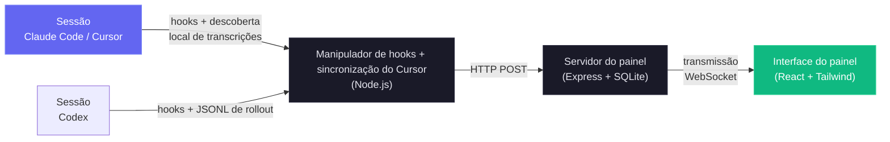

Além do painel de monitoramento em tempo real, o projeto inclui uma implementação de servidor MCP local em `mcp/` que expõe um catálogo de ferramentas para inspecionar e gerenciar o próprio painel, facilitando integrar suas operações diretamente aos seus fluxos no Claude Code e no Codex. Há também uma camada de extensões de agente, que oferece plugins, skills e subagentes do Claude Code e do Codex para interação com o painel, análises e inteligência de fluxos.

### Internacionalização (i18n)

A interface traz troca de idioma integrada para inglês (`en`), chinês (`zh`), vietnamita (`vi`), coreano (`ko`), espanhol (`es`), francês (`fr`), alemão (`de`), português (`pt`) e italiano (`it`). Um menu suspenso de idioma personalizado evita que o seletor sobrecarregue a barra lateral à medida que novos idiomas são adicionados. Os recursos de idioma são carregados por namespace e mantidos no armazenamento do navegador, para uma preferência estável entre recarregamentos.

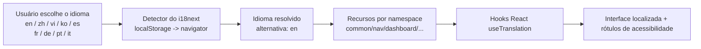

Para a arquitetura completa e as orientações operacionais, veja [docs/I18N.md](./docs/I18N.md).

### Interface do usuário

A interface escura e responsiva cobre todo o fluxo de trabalho. Cada prévia usa uma miniatura adequada a dispositivos móveis e leva à imagem original em alta resolução.

<p align="center">
  <a href="images/dashboard.png"></a>
  <br>
  <em>📡 <strong>Painel</strong> · totais da frota, agentes ativos, atividade recente e sinais de saúde ao vivo</em>
</p>

<p align="center">
  <a href="images/tasks-overview.png"></a>
  <br>
  <em>📋 <strong>Progresso das tarefas</strong> · conclusão compacta e prévias do trabalho por responsável</em>
</p>

<p align="center">
  <a href="images/dashboard-health.png"></a>
  <br>
  <em>🩺 <strong>Saúde do sistema</strong> · armazenamento, cache, erros, ferramentas, modelos, subagentes e compactações</em>
</p>

<p align="center">
  <a href="images/board.png"></a>
  <br>
  <em>📋 <strong>Quadro Kanban · Agentes</strong> · agentes trabalhando, em espera, concluídos e com falha, com motivos de espera claros</em>
</p>

<p align="center">
  <a href="images/board-sessions.png"></a>
  <br>
  <em>🗂️ <strong>Quadro Kanban · Sessões</strong> · sessões ativas, em espera, concluídas, com erro e abandonadas</em>
</p>

<p align="center">
  <a href="images/sessions.png"></a>
  <br>
  <em>📂 <strong>Sessões</strong> · histórico pesquisável, filtrável e paginado no servidor, com custos e atividade</em>
</p>

<p align="center">
  <a href="images/session-agents.png"></a>
  <br>
  <em>🤖 <strong>Agentes da sessão</strong> · totais ao vivo, uso de ferramentas, fluxo de tokens e hierarquia dos agentes</em>
</p>

<p align="center">
  <a href="images/tasks-details.png"></a>
  <br>
  <em>✅ <strong>Detalhes das tarefas</strong> · segmentos de conclusão, trabalho ativo, responsáveis e tarefas paginadas</em>
</p>

<p align="center">
  <a href="images/session-conversation.png"></a>
  <br>
  <em>💬 <strong>Conversa</strong> · transcrições renderizadas, código, chamadas de ferramentas, saída de comandos e marcadores da sessão</em>
</p>

<p align="center">
  <a href="images/session-timeline.png"></a>
  <br>
  <em>🔬 <strong>Linha do tempo</strong> · eventos cronológicos, filtros multidimensionais e atividade de ferramentas agrupada em pares</em>
</p>

<p align="center">
  <a href="images/feed.png"></a>
  <br>
  <em>📰 <strong>Feed de atividade</strong> · eventos ao vivo com pausa, agrupamento, filtros e saltos para a sessão</em>
</p>

<p align="center">
  <a href="images/analytics.png"></a>
  <br>
  <em>📊 <strong>Análises</strong> · tokens por modelo, frequência de ferramentas, mapas de calor de atividade e tendências das sessões</em>
</p>

<p align="center">
  <a href="images/workflows.png"></a>
  <br>
  <em>🔀 <strong>Fluxos</strong> · grafos de orquestração, fluxo de ferramentas, colaboração, delegação e padrões</em>
</p>

<p align="center">
  <a href="images/dynamicworkflows-workflows.png"></a>
  <br>
  <em>🧬 <strong>Execuções de fluxos</strong> · status, agentes, tokens, ferramentas e duração a partir dos diários de execução</em>
</p>

<p align="center">
  <a href="images/dynamicworkflows-workflows2.png"></a>
  <br>
  <em>🧬 <strong>Execução expandida</strong> · filtros de fase, métricas por agente, prompts e resultados completos</em>
</p>

<p align="center">
  <a href="images/dynamicworkflows-session.png"></a>
  <br>
  <em>🧬 <strong>Fluxos da sessão</strong> · execuções dinâmicas vinculadas e custos em tokens incorporados</em>
</p>

<p align="center">
  <a href="images/config.png"></a>
  <br>
  <em>🧰 <strong>Configuração do agente</strong> · inspecione e edite com segurança a configuração suportada do Claude Code e do Codex</em>
</p>

<p align="center">
  <a href="images/config-codex.png"></a>
  <br>
  <em>🧰 <strong>Configuração do Codex</strong> · modelos, perfis, MCP, projetos, skills, hooks, regras, plugins e instruções</em>
</p>

<p align="center">
  <a href="images/config-skills.png"></a>
  <br>
  <em>🧩 <strong>Skills</strong> · skills de usuário, de projeto e de plugin pesquisáveis, com edição protegida por backup</em>
</p>

<p align="center">
  <a href="images/run.png"></a>
  <br>
  <em>▶️ <strong>Executar agente</strong> · inicie o Claude Code ou o Codex com os controles nativos de cada provedor</em>
</p>

<p align="center">
  <a href="images/run-results.png"></a>
  <br>
  <em>💬 <strong>Execução ao vivo</strong> · chat em streaming, raciocínio, comandos, alterações de arquivos, ferramentas e reconexão</em>
</p>

<p align="center">
  <a href="images/settings.png"></a>
  <br>
  <em>⚙️ <strong>Configurações</strong> · preços, hooks, notificações, dados, fontes remotas e status do sistema</em>
</p>

<p align="center">
  <a href="images/alerts.png"></a>
  <br>
  <em>🔔 <strong>Alertas</strong> · regras, tempos de espera, atividade e webhooks nativos ou genéricos assinados</em>
</p>

<p align="center">
  <a href="images/remote.png"></a>
  <br>
  <em>🛰️ <strong>Fontes de dados remotas</strong> · sincronização SSH por provedor e monitoramento por escopo de origem</em>
</p>

<p align="center">
  <a href="images/palette.png"></a>
  <br>
  <em>⌘ <strong>Paleta de comandos</strong> · um único lançador por teclado para páginas, sessões, projetos, filtros e ações</em>
</p>

A barra lateral leva a Painel, Quadro Kanban, Sessões, Feed de atividade, Análises, Fluxos, Configuração do agente, Executar agente e Configurações. As seções abaixo descrevem o comportamento completo por trás dessas visões.

---

## Recursos

O painel cobre todo o ciclo de vida local dos agentes. Os contratos operacionais detalhados continuam nas seções vinculadas e nas referências em `docs/`.

| Recurso | Resumo |
| --- | --- |
| **Progresso das tarefas** | Progresso por responsável a partir das ferramentas de tarefas do Claude, do antigo `TodoWrite` e do `update_plan` do Codex. Prévias compactas aparecem nos cartões e nas linhas; o Detalhe da sessão acrescenta segmentos de status, trabalho ativo, responsáveis e paginação de 10 linhas. Um novo trabalho de nível superior limpa o estado inacabado obsoleto, enquanto o histórico concluído permanece. |
| **Painel** | As abas persistentes **Monitoramento** e **Saúde** reúnem totais da frota, hierarquias ativas, atividade recente, saúde ponderada (sucesso/cache/erros/heap), armazenamento, ferramentas, modelos, eficácia dos subagentes e métricas de compactação. A aba Saúde é atualizada a cada 5 segundos a partir de `/api/settings/info` e `/api/workflows`. |
| **Quadro Kanban** | As colunas de agentes cobrem Trabalhando, Em espera, Concluído e Erro; as colunas de sessões acrescentam Ativas e Abandonadas. Os cartões são paginados de 10 em 10, assinam apenas a visão WebSocket ativa, preservam os títulos completos e explicam os motivos de espera, como pedido de permissão, fim de turno, ociosidade no prompt ou interrupção. |
| **Sessões** | Histórico pesquisável, filtrável e paginado no servidor, com cálculo de custos apenas da página visível e uma linha temporária, em memória, para a inicialização do Codex. A busca cobre `id`, `name` e `cwd` com debounce de 300 ms. Os nomes vêm do título explícito, depois do título gerado por IA e, por fim, do primeiro prompt significativo do usuário. |
| **Detalhe da sessão** | Estatísticas ao vivo, trabalho ativo, uso de ferramentas, subagentes, tokens, hierarquia, linhas do tempo de eventos filtradas, agrupamento por `tool_use_id` e renderizações específicas por ferramenta. A visão Conversa renderiza turnos enfileirados, avisos do sistema, Markdown, código com realce e ferramentas estilizadas; as faixas de espera mostram o motivo e o tempo decorrido. |
| **Feed de atividade** | Eventos em tempo real com pausa, filtros compartilhados, paginação no servidor, agrupamento, origem projeto/sessão/subagente, links para a sessão e badges de status consistentes para Claude/Codex. |
| **Análises** | Tokens por modelo, frequência de ferramentas, mapas de calor de atividade alinhados a partir de domingo, tendências das sessões, estado da conexão, esqueletos de carregamento que reproduzem o layout e legendas longas paginadas. |
| **Paleta de comandos** | `Cmd/Ctrl+K` busca comandos recentes, todas as rotas, sessões ao vivo no servidor, ações da página, diretórios de projetos, subvisões, filtros, Configurações, Configuração do agente, preferências, escopo e idioma. Oferece classificação por subsequência, escopos `>`/`@`/`#`, controle total pelo teclado, rótulos traduzidos, falha silenciosa da busca e tratamento só por navegação para ações destrutivas. |
| **Um único atalho** | `Cmd/Ctrl+K` é o único atalho global do painel, inclusive dentro de campos. A navegação por várias teclas foi removida para evitar modos ocultos; o Tabby mantém `Cmd/Ctrl+B`. |
| **Atualizações ao vivo** | O push via WebSocket atualiza a interface sem polling. |
| **Descoberta automática** | Os sinais dos provedores criam sessões e agentes automaticamente. O Claude aparece no `SessionStart`; o Codex mostra um cartão Em espera local e temporário antes de existir um ID durável, adota com segurança threads concluídas que foram retomadas e nunca grava cartões sem identidade nos totais duráveis, nas análises, nos alertas ou nas notificações. |
| **Importação de histórico** | As transcrições do Claude de `~/.claude/` e os rollouts do Codex de `~/.codex/sessions` usam fluxos de varredura e envio específicos de cada provedor, a mesma contabilização da ingestão ao vivo e gravações idempotentes. Os rollouts externos do Codex são guardados em instantâneos, para que as conversas sobrevivam à remoção da origem. |
| **Hierarquia de subagentes** | Árvores pai-filho recolhíveis no Painel e no Detalhe da sessão se expandem automaticamente enquanto há filhos ativos. |
| **Agentes em segundo plano** | Os subagentes em segundo plano continuam acompanhados, sem conclusão prematura. |
| **Atribuição de ferramentas dos subagentes** | O `SubagentStop` e as varreduras na inicialização importam as ferramentas do JSONL de cada subagente, pareiam os resultados por `tool_use_id`, eliminam duplicatas, mesclam as linhas ao vivo correspondentes em até 30 segundos e reconstroem os verdadeiros pais aninhados a partir dos IDs dos filhos iniciados. A reatribuição de pais é aditiva e dispara a atualização da interface mesmo quando nenhuma linha é inserida. |
| **Acompanhamento de custos** | Preços configuráveis por modelo e por sessão, com suporte a preços de lançamento com data, categorias promocionais editáveis, o custo próprio de cada subagente e totais que resistem às compactações. As leituras de transcrições usam deslocamentos de bytes incrementais em cache. |
| **Cache de transcrições** | A análise incremental do JSONL extrai tokens, compactações, erros de API, durações de turnos, raciocínio e metadados de uso; as análises completas corrigem duplicatas antigas, enquanto as análises do final do arquivo só acrescentam. Os arrays são limitados por `TRANSCRIPT_CACHE_MAX_ARRAY_LEN` (padrão `1000`), e as entradas guardam apenas os metadados do arquivo e o resultado analisado. |
| **Retenção de instantâneos de transcrições** | Instantâneos duráveis do Claude, do Codex e do Cursor preservam a conversa mais completa. As cópias do Claude e do Cursor cuja origem sumiu são compactadas com gzip após uma verificação de ida e volta; a limpeza remove os instantâneos; limites opcionais de idade/tamanho podem podar a única cópia antiga após uma prévia de simulação nas Configurações. |
| **Notificações** | O Web Push com VAPID entrega os eventos configurados com a aba em segundo plano ou o navegador fechado, com suporte a som no macOS e controles de assinatura. |
| **Alertas** | As Configurações oferecem Regras, Canais e Atividade para alertas de padrão de evento, inatividade, agente travado e tokens. As regras de evento rodam após a ingestão; as regras de tempo fazem uma varredura a cada 60 segundos. Os alertas persistidos usam tempo de espera por regra/sessão (padrão de 300 segundos), entrega via WebSocket, confirmação e distribuição por escopo para webhooks de 14 provedores nomeados ou JSON genérico assinado, com segredos mascarados, timeouts e novas tentativas limitadas. |
| **Notificador de atualizações** | Um `git fetch` agendado e não bloqueante compara o checkout com o remoto canônico e mostra o comando exato de atualização na janela, na barra lateral e no terminal. O CCAM nunca faz pull nem se reinicia sozinho. |
| **Configurações** | Status do sistema e dos hooks, preços por provedor, notificações, limpeza, homes dos provedores, atualização instantânea dos dados e restauração idempotente de JSON exportado de até 25 MiB. Os preços suportam padrões por provedor, regras com curinga, orientações sobre os preços publicados, o limite de 272K do GPT e catálogos separados para os modelos nativos do Cursor e de terceiros. |
| **Executar agente + Configuração do agente** | `/run` inicia o Claude Code ou threads nativas do app-server do Codex, com modelos, aprovações, sandbox, retomada, parada, streaming e reconexão específicos de cada provedor. `/cc-config` reúne exploradores editáveis do Claude e do Codex; os arquivos de usuário suportados usam gravações atômicas protegidas e backups com carimbo de data/hora, prévias com segredos ocultos, comandos exatos de perfil e observadores específicos de cada provedor. |
| **Configuração do agente do Codex** | Mostra o catálogo completo de modelos da conta, mais as substituições de base/perfil, cria sobreposições padrão `<name>.config.toml` e protege a edição com verificações de contenção canônica e de links simbólicos. Perfis, hooks, regras, skills e instruções oferecem ações de origem/caminho/edição/exclusão, com backup antes de cada exclusão; `config.toml` é somente para edição. |
| **Servidor MCP (local)** | Três transportes, stdio, HTTP+SSE e REPL, expõem 103 ferramentas tipadas em 16 módulos. Um único catálogo validado impõe destinos localhost ou HTTPS, regras de token bearer, rejeição de redirecionamentos, travas de mutação, uploads de 50 MiB por arquivo e 100 MiB por chamada, respostas binárias de 10 MiB e restaurações de 25 MiB. |
| **Fluxos** | Onze seções D3 cobrem orquestração, fluxo de ferramentas, colaboração, eficácia, padrões, delegação, erros, concorrência, complexidade, compactação e detalhamento por sessão. Dicas explicativas localizadas, filtragem cruzada, exportação JSON, atualização ao vivo com debounce de 3 segundos e execuções dinâmicas reconstruídas a partir dos diários preservam fase, tokens, ferramentas, duração, prompt e resultado de cada agente. |
| **Acompanhamento de compactações** | As varreduras de transcrições criam agentes/eventos de compactação com duração zero, corrigem durações negativas antigas, preenchem sessões antigas e inspecionam periodicamente apenas as sessões ativas, usando os valores em cache de `sessions.transcript_path`. |
| **Subsessões / sessões retomadas** | Novos eventos reativam sessões retomadas ou órfãs; uma varredura a cada ¼ de `DASHBOARD_STALE_MINUTES`, limitada entre 60 segundos e 5 minutos, captura as sessões abandonadas. |
| **Detecção de sessões preexistentes** | A importação na inicialização marca como ativas as transcrições modificadas recentemente, e eventos Stop posteriores reativam sessões importadas concluídas ou abandonadas antes de atualizá-las. |
| **Sincronização contínua de projetos** | Uma varredura imediata na inicialização, um observador do sistema de arquivos com debounce e o polling de `DASHBOARD_SESSION_SYNC_MS` (padrão de 30 segundos) compartilham um cache de mtime e uma varredura unificada. Só arquivos novos ou que avançaram são reanalisados, com escopo de observação seguro no Linux e transmissão das sessões ao vivo. |
| **Fontes de dados remotas** | As fontes SSH espelham de forma independente os homes do Claude e do Codex via `scp` ou `tar` no WSL, marcam `sessions.source`, reconciliam o ciclo de vida e continuam saudáveis se qualquer um dos provedores funcionar. O polling é de 15 segundos por padrão; a reserva com dados obsoletos afeta apenas o provedor que falhou. As credenciais ficam com o SSH do host. |
| **Ingestão por push remoto** | `POST /api/hooks/ingest-batch` atende máquinas atrás de NAT. Fica desativada até que `REMOTE_PUSH_TOKEN` seja definido, rejeita tokens na query string e sessões pertencentes à máquina local, limita os lotes a 1000, elimina duplicatas por `(session_id, event_type, uuid)`, retorna erros parciais por item e só transmite após o commit. |
| **Design responsivo** | Os layouts móveis empilham as grades, rolam as tabelas largas e recolhem a navegação. |
| **Localização da interface** | Inglês, chinês, vietnamita, coreano, espanhol, francês, alemão, português e italiano cobrem os textos da interface, os rótulos de acessibilidade, as explicações e dicas dos fluxos, as orientações de preços dos modelos, os homes dos provedores e a Importação de histórico. |
| **Dados de exemplo** | Um script integrado fornece dados realistas para demonstração e desenvolvimento. |
| **Linha de status** | Uma faixa colorida na CLI mostra modelo, contexto, branch Git, tokens por direção e custo da sessão em USD. |
| **Formatação dos nomes de modelos** | Os identificadores de Claude, GPT e Gemini viram nomes legíveis: os sufixos de provedor/data/latest são removidos, as versões numéricas são unidas e as tags de contexto são formatadas; as Configurações mantêm os padrões brutos de preço. |
| **Marketplace de plugins Claude + Codex** | Uma única árvore de 14 plugins entrega os dois formatos de manifesto e os dois catálogos, 66 skills de plugins, 18 subagentes do Claude, 34 comandos do Claude, 3 utilitários de CLI e metadados da OpenAI. `npx skills add hoangsonww/Claude-Code-Agent-Monitor --list` descobre 77 skills do repositório. |
| **Executar Claude** | Os modos Conversa e execução única suportam retomar/ver o histórico, execuções simultâneas em segundo plano, reconexão ciente da transcrição, controles de modelo/esforço/permissão/cwd, suavização de mensagens parciais, preservação do raciocínio, comandos de barra, arquivos com `@`, medidores de contexto e de custo e status ao vivo. A proteção de mesma origem bloqueia inicializações disparadas por outros sites; a concorrência tem por padrão um teto de segurança de 10000 e pode ser reduzida com `RUN_MAX_CONCURRENT`. |
| **Explorador de configuração do Claude** | Doze abas inspecionam skills, agentes, comandos, estilos, plugins, marketplaces, MCP, hooks, configurações, memória, atalhos de teclado e linha de status. Caminhos canônicos impedem a fuga por links simbólicos; as superfícies de texto suportadas usam criação/edição/exclusão atômicas com backups com carimbo de data/hora fora da árvore, enquanto a configuração sensível fica somente leitura, com orientações exatas da CLI. Um `cc-watcher` de 500 ms transmite as alterações externas. |
| **Tabby** | Um mascote WebSocket sem dependências, com oito humores derivados da atividade, falas com frequência limitada, ações rápidas, respostas locais sobre o status e passagem para Executar Claude em perguntas mais amplas. É acessível pelo teclado, respeita a preferência por movimento reduzido, é seguro quando desconectado, configurável e localizado. |
| **Sinais sonoros** | Sete sinais Web Audio sem dependências cobrem sessões, erros, subagentes, notificações, conexão e cliques. Tempos de espera, um orçamento global de rajadas, filtragem passa-baixa, segurança de reprodução automática, volume persistido e configurações por sinal os mantêm discretos. |
| **Progressive Web App (PWA)** | O painel, a página inicial e o wiki têm manifestos e service workers independentes. Os assets imutáveis do Vite usam cache primeiro; a navegação e os arquivos mutáveis do shell usam rede primeiro; o push continua intacto; a página inicial e o wiki pré-armazenam seus shells e guardam as capturas de tela em cache sob demanda; metadados SVG e da Apple permitem a instalação. |
| **App de desktop (macOS e Windows)** | O Electron 35 empacota DMGs para macOS e EXEs de instalador/portáteis para Windows em torno do mesmo servidor Express em processo e do mesmo cliente React. Ele acrescenta menus nativos, status/ações no tray, abertura no login, confirmação ao sair, notificações nativas, bloqueio de instância única, reserva/adoção segura de porta, desligamento limpo do SQLite e configuração de hooks/segundo plano na primeira execução. |
| **Recursos auto-hospedados (sem CDN)** | Fontes, scripts, o Mermaid do wiki e os recursos de reserva da extensão são locais. O app, a página inicial e o wiki funcionam offline, sem requisições ao Google Fonts, ao jsDelivr ou a outros hosts de assets de terceiros. |
| **Tela de abertura da sessão** | Uma saudação localizada, exibida uma vez por sessão do navegador com uma animação de grafo de nós, aparece opaca desde a primeira pintura, dura cerca de 2,5 segundos, pode ser pulada com um clique e respeita a preferência por movimento reduzido. |

> **Escopo de provedores e homes:** as Configurações mantêm a escolha compatível com Claude (Claude Code + Cursor) / Codex / Ambos consistente em todo o painel. Os homes do Claude Code e do Codex continuam editáveis sem reiniciar o painel; o Cursor é descoberto automaticamente a partir de `~/.cursor` ou `DASHBOARD_CURSOR_HOME`.
>
> **Limites de segurança locais:** Executar agente aceita qualquer diretório de trabalho absoluto existente e o canonicaliza antes do uso, então inícios a partir do home e de projetos recentes continuam suportados. Provedores de webhook hospedados exigem HTTPS; destinos genéricos e n8n podem usar HTTP para receptores locais/auto-hospedados, e a entrega nunca segue redirecionamentos.

---

## Início rápido

### Pré-requisitos

- **Node.js** >= 22.22.0 (24 LTS recomendado)
- **npm** >= 9.0.0

### 1. Instalar

```bash
git clone https://github.com/hoangsonww/Claude-Code-Agent-Monitor.git
cd Claude-Code-Agent-Monitor
npm run setup
```

### 2. Configurar os hooks do Claude Code

```bash
npm run install-hooks
```

Escolha **Claude Code**, **Codex (beta)** ou ambos com as setas, Espaço e Enter. Os hooks do Claude ficam em `~/.claude/settings.json` e os do Codex em `~/.codex/hooks.json`. Reinstalar substitui apenas as entradas do CCAM e preserva hooks não relacionados; a mesma ação está disponível em **Configurações → Configuração de hooks**.

Na primeira execução, o CCAM verifica apenas os provedores selecionados para o escopo de dados atual e oferece instalar os hooks que faltam. Uma verificação de prontidão que falhe recorre à configuração manual em vez de bloquear o painel.

A descoberta dos provedores continua após a configuração:

- **Claude Code e Cursor:** os hooks do Claude alimentam os eventos ao vivo. O Cursor não precisa de hooks; selecionar Claude Code também observa `~/.cursor/chats` e `~/.cursor/projects/*/agent-transcripts`, guarda instantâneos das conversas antes da limpeza do Cursor e respeita `DASHBOARD_CURSOR_HOME`.
- **Codex:** os hooks e a observação incremental dos rollouts em `~/.codex/sessions` mantêm em dia o ciclo de vida, os prompts, os títulos, as ferramentas, os tokens, os custos, as compactações, as conversas e o estado do WebSocket. Arquivos com problema são tentados de novo isoladamente; a associação exata entre rollout e processo evita cartões ativos fantasmas; os títulos nativos de `/rename` e o histórico da conversa paginado por cursor continuam ao vivo.
- **Ambos:** os cartões mantêm os dois últimos prompts humanos distintos, exibem os anexos de imagem persistidos e eliminam respostas repetidas do Codex. O escopo apenas com Codex oculta os diários de fluxos dinâmicos exclusivos do Claude.

### 3. Iniciar

```bash
# Development (hot reload on both server and client)
npm run dev

# Production (single process, built client)
npm run build && npm start
```

> [!TIP]
> **Alternativa com Makefile** — todos os comandos também estão disponíveis via `make`, se ele estiver instalado no seu sistema. Execute `make help` para ver todos os alvos ou use atalhos como `make dev`, `make build`, `make test` etc.

### 4. Abrir

| Modo | URL |
| ----------- | ----------------------- |
| Desenvolvimento | `http://localhost:5173` |
| Produção | `http://localhost:4820` |

### 5. Opcional: executar o servidor MCP local

```bash
npm run mcp:start              # stdio (default — for MCP host integration)
npm run mcp:start:http         # HTTP + SSE server on port 8819
npm run mcp:start:repl         # interactive CLI with tab completion
ccam mcp stdio                 # stable launcher used by bundled plugins
```

`npm run setup` instala e compila o pacote MCP antes de vincular o `ccam`. Para o modo stdio, configure seu host com o comando `ccam` e os argumentos `["mcp", "stdio"]`.

Para o modo HTTP, aponte os clientes MCP remotos para `http://127.0.0.1:8819/mcp` (Streamable HTTP) ou `http://127.0.0.1:8819/sse` (SSE legado).

Veja [mcp/README.md](./mcp/README.md) para a configuração completa do host, detalhes de transporte, flags de segurança e o catálogo de ferramentas.

### Opcional: dados de demonstração

```bash
npm run seed
```

Cria 8 sessões de exemplo, 23 agentes e 106 eventos para você explorar a interface imediatamente.

### Alternativa: app de desktop (macOS e Windows)

Se preferir não manter um terminal aberto, instale o **app de desktop nativo** opcional. Ele incorpora o servidor no mesmo processo, adiciona um ícone na barra de menus / área de notificação (tray) e suporta início automático no login (itens de login do macOS / inicialização do Windows).

O caminho mais rápido é **baixar um instalador pronto** da [última Release no GitHub](https://github.com/hoangsonww/Claude-Code-Agent-Monitor/releases/latest) (a CI publica automaticamente uma `vX.Y.Z` sempre que a versão em `package.json` é incrementada no `master`):

- **macOS** — baixe `ClaudeCodeMonitor-<version>-arm64.dmg` (Apple Silicon) ou `-x64.dmg` (Intel) e arraste **Claude Code Monitor.app** para `/Applications`.
- **Windows** — baixe `ClaudeCodeMonitor-Setup-<version>-x64.exe` (instalador) ou `ClaudeCodeMonitor-<version>-x64-portable.exe` (sem instalação) e execute-o.

Para compilar você mesmo:

```bash
npm run desktop:install        # install Electron + electron-builder into desktop/ (preflights native deps; prints setup help on failure)
npm run desktop:dmg:arm64      # macOS: fast single-arch DMG (Apple Silicon)
npm run desktop:win            # Windows: NSIS installer .exe (run on Windows)
```

A documentação completa do app de desktop — download, instalação, recursos do tray/menu, comandos de build e assinatura — está na seção [App de desktop (macOS e Windows)](#app-de-desktop-macos-e-windows) mais abaixo. Veja também [`DESKTOP.md`](./DESKTOP.md) (guia do usuário) e [`desktop/README.md`](./desktop/README.md) (arquitetura).

### Alternativa: Docker / Podman

A imagem OCI e os arquivos Compose suportam Docker e Podman. O runtime roda sem root, descarta todas as capabilities, usa o Tini como PID 1, inclui Git/OpenSSH/SQLite e fica somente leitura, exceto por `/app/data`, `/app/config` e `/tmp`.

```bash
# Dashboard only
docker compose up -d --build
# or
podman compose up -d --build

# Complete stack: dashboard + authenticated MCP + Nginx + Prometheus + Grafana
umask 077
openssl rand -hex 32 > deployments/secrets/dashboard-token
openssl rand -hex 32 > deployments/secrets/hook-token
openssl rand -hex 32 > deployments/secrets/mcp-token
openssl rand -base64 32 > deployments/secrets/grafana-admin-password
npm run docker:full:up
```

Todas as portas do host fazem bind no loopback por padrão: painel `4820`, MCP `8819`, Nginx `8080`, Prometheus `9090` e Grafana `3000`. Os homes do Claude e do Codex são montados somente leitura; volumes nomeados persistem o SQLite e a configuração própria do painel. O Nginx faz proxy da interface, da API REST autenticada e do WebSocket, enquanto hooks, métricas e MCP ficam bloqueados na borda, a menos que sejam habilitados explicitamente. O alvo Docker opcional `agent-runtime` adiciona CLIs do Claude Code e do Codex com versões fixadas para fluxos de Executar agente nativos do contêiner.

> [!IMPORTANT]
> Instale os hooks do Claude Code/Codex no host depois que o contêiner iniciar. Para hooks remotos na nuvem, defina `CCAM_DASHBOARD_URL=https://...` e um `CCAM_HOOK_TOKEN` separado; URLs de hook fora do loopback exigem HTTPS. Veja [DEPLOYMENT.md](DEPLOYMENT.md).

---

## Como funciona

O painel se integra ao Claude Code por meio do sistema de hooks nativo dele para monitorar a atividade dos agentes em tempo real. Esta é uma visão geral da arquitetura e do fluxo de dados:

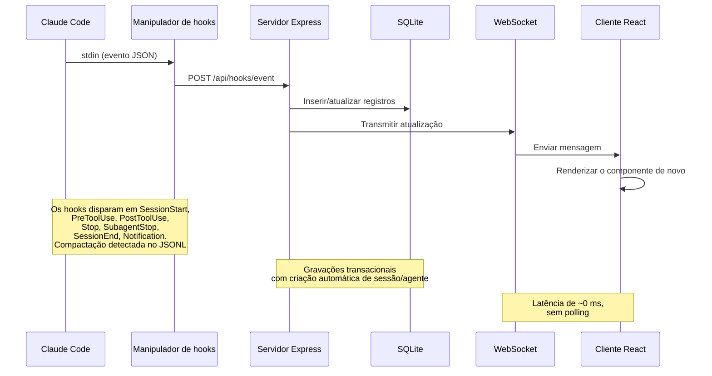

> [!IMPORTANT]
> Veja [ARCHITECTURE.md](./ARCHITECTURE.md) para um mergulho profundo na arquitetura do servidor, no esquema do banco, nas rotas da API, no design do WebSocket, no roteamento do cliente, no fluxo do manipulador de hooks, nos modos de implantação e nos diagramas detalhados do ciclo de vida de sessões e agentes.

### Ciclo de vida dos hooks

1. O **Claude Code** emite hooks de sessão, prompt, ferramenta, notificação, subagente, turno e saída.
2. O **`scripts/hook-handler.js`** lê cada evento do stdin e descobre os painéis ativos via `~/.claude/.agent-dashboard.json` ou `CLAUDE_DASHBOARD_PORT`. Ele envia uma vez por diretório de dados SQLite distinto, escolhendo a porta mais baixa entre listeners duplicados e ainda alimentando os painéis com bancos separados. A entrega é à prova de falhas: cada destino é isolado e o manipulador termina em até 5 segundos.
3. O **servidor** confirma o evento e o estado relacionado em uma única transação SQLite:
   - O primeiro contato cria a sessão e o agente principal. O `SessionStart` começa em **Em espera**; `UserPromptSubmit` ou `PreToolUse` o leva para **Trabalhando**; `PostToolUse` o mantém trabalhando.
   - O `Stop` devolve o agente principal para **Em espera** enquanto os agentes em segundo plano continuam. `stop_reason=error` marca o agente e a sessão como **Erro**. As notificações de permissão também aguardam entrada; só um novo prompt ou o início de uma ferramenta recupera um erro.
   - O `SubagentStop` conclui esse filho sem alterar o estado de espera pela pessoa. Uma varredura desacoplada então importa as ferramentas do JSONL dele, pareia usos/resultados por `tool_use_id`, elimina duplicatas e reconstrói os verdadeiros pais aninhados.
   - O `SessionEnd` limpa a espera e conclui a sessão, a menos que um erro precise ser preservado. Novo trabalho reativa sessões concluídas, com erro ou abandonadas, incluindo sessões importadas e retomadas.
   - O `SessionStart` e a manutenção periódica abandonam as sessões inativas após `DASHBOARD_STALE_MINUTES` (padrão 180). A varredura roda a cada ¼ desse valor, limitada entre 60 segundos e 5 minutos.
   - A análise incremental e compartilhada das transcrições registra compactações, erros de API e de ferramentas, durações de turnos, tokens e metadados sem reler bytes inalterados. As varreduras das sessões ativas usam os valores indexados de `sessions.transcript_path` e removem do cache as entradas abandonadas.
   - Um vigia de 15 segundos encontra erros de API nas transcrições após 10 segundos sem hooks. Ele também recupera interrupções por Esc a partir dos marcadores da transcrição ou, quando não há marcador, após `DASHBOARD_WORKING_IDLE_SECONDS` (padrão 120), apenas quando nenhuma ferramenta está rodando e nem os hooks nem a transcrição avançam.
   - O mesmo vigia conclui sessões locais mortas por meio de uma sonda de atividade de processos após `DASHBOARD_LIVENESS_IDLE_SECONDS` (padrão 60). As sondas de inicialização rodam imediatamente e de novo após cerca de 5 segundos, sem essa condição de ociosidade. A sonda ignora o Windows, contêineres, caminhos encaminhados não POSIX, sessões de fontes remotas, falhas das ferramentas e `DASHBOARD_LIVENESS_PROBE=0`; um hook real posterior corrige sozinho uma conclusão falsa.
   - A sincronização contínua de projetos combina uma varredura imediata, um `fs.watch` com debounce e o polling de `DASHBOARD_SESSION_SYNC_MS` (padrão de 30 segundos). Um único cache de mtime reanalisa apenas as transcrições novas ou que cresceram e transmite os mesmos quadros de sessão que os hooks.
4. O **WebSocket** publica a mudança confirmada.
5. A **interface** atualiza as visões afetadas sem polling.

### Máquina de estados dos agentes

Status persistidos: `working | waiting | completed | error`. A
coluna `awaiting_input_since` é complementar — ela registra quando o agente
começou a esperar e serve para exibir a duração, mas `waiting` agora é um
status persistido de verdade.

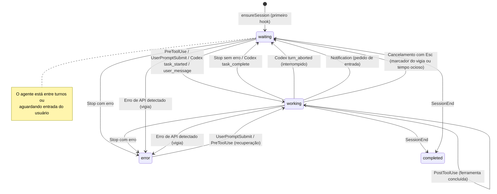

### Máquina de estados das sessões

Status persistidos: `active | completed | error | abandoned`. O estado de sessão
**Em espera** é uma sobreposição da interface (status=`active` com
`awaiting_input_since` definido).

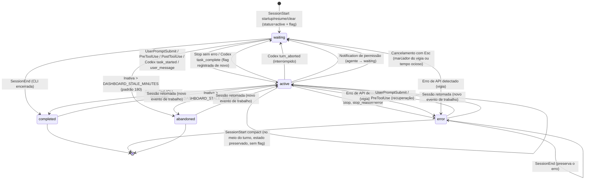

### Fluxo de cálculo de custos

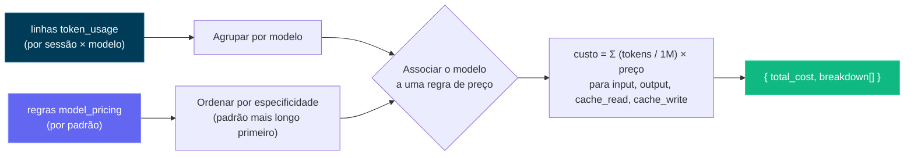

> [!IMPORTANT]
> O fluxo de cálculo de custos se baseia no uso de tokens e nas regras de preços dos modelos. Mantenha suas regras de preços atualizadas para refletir custos precisos. Atualize a tabela de preços dos modelos pela página de Configurações para manter o acompanhamento de custos preciso — o painel não busca automaticamente atualizações de preços em fontes externas. Depois que você define as regras de preços, o painel as aplica retroativamente a todas as sessões, para relatórios de custos consistentes.

---

## Configuração

| Variável de ambiente | Padrão | Finalidade |
| --- | --- | --- |
| `DASHBOARD_PORT` | `4820` | Porta do servidor Express. |
| `CLAUDE_DASHBOARD_PORT` | `4820` | Porta usada pelo manipulador de hooks. |
| `NODE_ENV` | `development` | Use `production` para servir o cliente compilado. |
| `DASHBOARD_UPDATE_CHECK` | ativado | Defina como `0`, `false` ou `off` para desativar as verificações agendadas do upstream. |
| `DASHBOARD_UPDATE_CHECK_INTERVAL_MS` | `300000` | Intervalo de verificação de atualizações, mínimo de 60.000 ms. O botão manual **Verificar agora** continua disponível. |
| `DASHBOARD_STALE_MINUTES` | `180` | Inatividade após a qual uma sessão ativa ou Em espera passa a abandonada. O vigia aplica esse limite, e a manutenção roda a cada ¼ desse valor, limitada entre 60 segundos e 5 minutos. |
| `DASHBOARD_WORKING_IDLE_SECONDS` | `120` | Recupera um cancelamento por Esc sem marcador quando nenhuma atividade de ferramenta, hook ou transcrição avança. Valores menores reagem mais rápido, mas podem classificar errado, por um instante, turnos silenciosos longos; nova atividade corrige sozinha. O Cursor usa a mesma regra. |
| `DASHBOARD_LIVENESS_PROBE` | `1` | Defina como `0` para desativar a conclusão, baseada em processos, de sessões locais mortas do Claude/Codex. Ignora automaticamente o Windows, contêineres, caminhos encaminhados não POSIX e fontes remotas. |
| `DASHBOARD_LIVENESS_IDLE_SECONDS` | `60` | Condição de ociosidade (pela transcrição ou pelo último hook) para as verificações de atividade do vigia. As sondas de inicialização ignoram essa condição, para que sessões já mortas sejam limpas imediatamente. |
| `DASHBOARD_SESSION_SYNC_MS` | `30000` | Polling de segurança para arquivos novos ou alterados em `~/.claude/projects`. O `fs.watch` continua imediato; `0` desativa apenas o polling. |
| `DASHBOARD_CURSOR_HOME` | `~/.cursor` | Raiz de estado do Cursor para chats, transcrições, preenchimento retroativo e instantâneos duráveis. |
| `DASHBOARD_CURSOR_SYNC_MS` | `5000` | Polling de segurança do Cursor baseado em impressões digitais. Os observadores continuam ativos quando `0` desativa o polling. |
| `DASHBOARD_CODEX_HOME` | `CODEX_HOME` ou `~/.codex` | Raiz de estado do Codex. As Configurações persistem uma substituição, reativam a observação e fazem a varredura imediatamente. |
| `DASHBOARD_CODEX_SYNC_MS` | `4000` | Polling de segurança dos rollouts do Codex. Os hooks e os observadores continuam ativos quando definido como `0`. |
| `DASHBOARD_CODEX_MAX_ATTEMPTS` | `5` | Tentativas para um mesmo rollout ilegível e inalterado, incluindo a primeira. Uma mudança de tamanho ou de mtime redefine o limite; ao esgotá-lo, um único log é registrado. |
| `DASHBOARD_CODEX_HOOK_IDLE_SECONDS` | `60` | Conclui sessões do Codex só com hooks, como `codex exec --ephemeral`, quando um `stop` informado como concluído nunca recebe o `SessionEnd`. O silêncio sozinho nunca basta. |
| `DASHBOARD_TASK_SUMMARY_TTL_MS` | `2000` | Janela em que dados ligeiramente antigos são servidos para os resumos de tarefas e o `todo_snapshot`. Os acréscimos são analisados de forma incremental; um crescimento acima de 32 MiB recomeça com uma nova leitura do final. `0` analisa cada acréscimo. |
| `DASHBOARD_SNAPSHOT_COMPRESS` | `1` | Defina como `0`, `false` ou `off` para interromper a conversão gzip verificada de instantâneos do Claude/Cursor ociosos há 24 horas cuja origem desapareceu. Árvores de origem ilegíveis e instantâneos do Codex são ignorados. |
| `DASHBOARD_SNAPSHOT_MAX_AGE_DAYS` | não definido | Passada opcional de retenção, a cada seis horas, para sessões concluídas mais antigas que essa idade. As sessões podadas recebem uma lápide; as sessões retomadas ficam protegidas. Faça uma prévia com `ccam snapshots prune --days N`, porque o instantâneo pode ser a única cópia. |
| `DASHBOARD_SNAPSHOT_MAX_BYTES` | não definido | Limite total opcional dos instantâneos, em bytes ou em unidades como `5GB`. As sessões concluídas mais antigas são podadas primeiro; as sessões ativas ou das últimas 24 horas continuam protegidas. |
| `DASHBOARD_REMOTE_SYNC_MS` | `15000` | Polling SSH das fontes remotas para os projetos do Claude, os rollouts do Codex e os índices de títulos do Codex. Fontes novas ou reativadas sincronizam imediatamente; com `0`, a sincronização manual continua disponível. |
| `DASHBOARD_REMOTE_ACTIVE_WINDOW_MS` | `600000` | Trata uma transcrição remota espelhada como ativa enquanto seu último evento estiver dentro dessa janela e depois a reconcilia como concluída. Provedores com falha recorrem ao tratamento normal de inatividade. |
| `DASHBOARD_REMOTE_SYNC_TIMEOUT_MS` | `600000` | Timeout por fonte para a busca via SSH mais a importação. |
| `DASHBOARD_REMOTE_TEST_TIMEOUT_MS` | `15000` | Timeout do teste SSH das fontes remotas. |
| `DASHBOARD_HOST` | `127.0.0.1` | Interface de bind. `0.0.0.0` expõe o serviço e registra um aviso. |
| `DASHBOARD_TOKEN` | não definido | Protege `/api/*` e o WebSocket via cabeçalho Bearer, `x-dashboard-token` ou `?token=`. O loopback é a fronteira de confiança padrão. |
| `DASHBOARD_TOKEN_FILE` | não definido | Token do painel lido de arquivo, para segredos do Docker/Kubernetes; `DASHBOARD_TOKEN` tem prioridade. |
| `DASHBOARD_HOOK_TOKEN` / `DASHBOARD_HOOK_TOKEN_FILE` | não definido | Proteção independente para `/api/hooks/event` e `/api/hooks/codex` além do loopback. |
| `REMOTE_PUSH_TOKEN` / `REMOTE_PUSH_TOKEN_FILE` | não definido | Proteção separada para a rota pública `POST /api/hooks/ingest-batch`. A rota fica desativada por padrão e nunca herda o token dos hooks locais. |
| `DASHBOARD_ALLOWED_HOSTS` | loopback | Valores extras de `Host` para HTTP e WebSocket, separados por vírgula, para a proteção contra DNS rebinding. |
| `DASHBOARD_ENV_PATH` | `.env` do repositório | Arquivo dotenv gravável usado para persistir as substituições dos homes dos provedores; nos contêineres, o padrão é `/app/config/.env`. |
| `CCAM_DASHBOARD_URL` | descoberta em localhost | Destino remoto dos hooks. URLs fora do loopback exigem HTTPS e um token de hook. |
| `CCAM_HOOK_TOKEN` / `CCAM_HOOK_TOKEN_FILE` | não definido | Credencial do cliente de hooks, enviada como `x-ccam-hook-token`. |

> [!IMPORTANT]
> Por padrão, o servidor só escuta no loopback. O acesso pela rede local exige `DASHBOARD_HOST`, `DASHBOARD_TOKEN` e valores correspondentes em `DASHBOARD_ALLOWED_HOSTS`. Veja [`.env.example`](./.env.example) e [a política de segurança](./.github/SECURITY.md).

Em clones git, o servidor busca periodicamente o remoto canônico e compara sua branch padrão com o checkout atual. Quando você está atrás, o terminal e a interface mostram o comando exato de atualização manual. O CCAM nunca faz pull nem se reinicia sozinho.

---

## CLI `ccam`

A CLI **`ccam`** (`bin/ccam.js` → `cli/`) expõe o painel em qualquer terminal por meio de uma árvore de comandos Commander.js com opções herdadas, validação, sugestões, ajuda gerada e autocompletar no shell. O `npm run setup` a vincula automaticamente. A resolução do servidor verifica `--server` / `CCAM_URL`, as portas configuradas, o registro de servidores ativos e, por fim, `http://127.0.0.1:4820`.

```bash
# Server
ccam status | health                  # ● running / ○ not running; version + timestamp
ccam start [--port N] | stop | restart  # background production server
ccam logs [-n N] [-f]                 # tail data/ccam-server.log
ccam open [page] [--session id]       # open the dashboard, a page, or a session
ccam repl                             # interactive shell (also: shell, i)

# Monitoring
ccam overview [--watch]               # one-screen live snapshot (alias: top)
ccam stats | kanban                   # totals + status distributions / status lanes
ccam tail [--session id] [--type T] [--tool N]   # live event feed
ccam stream [--type new_event,…]      # raw real-time WebSocket feed
ccam watch -n 5 <command …>           # re-run any command on an interval

# Data
ccam sessions [--status s] [--q text] [--cwd dir] [--sort price] [--limit n]
ccam sessions get|stats|cost|agents|events|transcripts <id>
ccam sessions transcript <id>         # the conversation as a readable chat log
ccam sessions rename <id> <name…> | update <id> | create | facets
ccam agents [list|get|update|create]  # agents; ccam session <id> = sessions get
ccam events [--type T] [--tool N] [--q text] [--from iso] | events facets

# Insights
ccam analytics                        # tokens, cost, top tools, daily sparklines
ccam workflows [session <id>]         # workflow intelligence + patterns
ccam runs [list|get <run-id>]         # Workflow-tool runs
ccam run list|history|start|follow|send|stop …   # dashboard-launched agents
ccam cost [--session id] [--daily]    # per-model cost, surcharges, unpriced models

# Alerts & webhooks
ccam alerts [--unacked] | ack <id> | ack-all
ccam alert-rules list|types|create|update|enable|disable|delete
ccam webhooks list|get|providers|deliveries|create|update|enable|disable|delete|test

# Pricing
ccam pricing [list] | set <pattern> --input N --output N [--fast-* …] [--intro-* …] | delete | reset
ccam pricing gpt|cursor [list|set|delete]   # OpenAI/Codex and Cursor rate cards

# Import & remote sources
ccam import guide|rescan|path <dir>|upload <files…>|reimport
ccam import-data <file.json>          # restore an export (idempotent)
ccam remote-sources list|get|add|update|enable|disable|test|sync|rm

# Administration
ccam doctor | info | export [file|-] | cleanup --hours N --days M
ccam snapshots [status|compress] | snapshots prune --days N   # transcript snapshots; prune dry-runs unless --apply --confirm PRUNE_SNAPSHOTS
ccam hooks [status|install] | reinstall-hooks | config claude|codex …
ccam updates [status|check] | update-check | metrics [--grep re]
ccam home [set claude|codex <path>] | push key|send|subscribe|unsubscribe
ccam api [METHOD] /api/path [--data JSON]   # any endpoint; writes need --yes
ccam mcp [stdio|http|repl] | clear-data --yes

# CLI
ccam help [command…] | commands [--json] | completion bash|zsh|fish | version
```

Os grupos listam por padrão (`ccam alerts` equivale a `ccam alerts list`); todo comando aceita `--help`; `ccam commands` imprime a árvore e `ccam commands --json` emite seu esquema legível por máquina.

- **Saída:** em TTYs, há tabelas, ícones de status, gráficos, sparklines, árvores de agentes, visualizações de transcrições e ajuda colorida. Em pipes, texto simples. `--json` ou `CCAM_OUTPUT=json` retorna JSON estável, com NDJSON para `tail`, `stream` e `run follow`; os erros usam `{"error":{"code":"…","message":"…"}}` no stderr e terminam com código `0` ou `1`.
- **Gravações:** use o `y/N` interativo ou `--yes`; gravações não interativas exigem `--yes`, e `clear-data` sempre exige a flag literal.
- **Modo offline:** os comandos somente leitura recorrem a `data/dashboard.db`, exibem a faixa `⚠ Offline mode` e corrigem as sessões ativas mortas pela visão de atividade dos processos. Os comandos que dependem do servidor explicam por que o painel está indisponível.
- **REPL e autocompletar:** `ccam repl` acrescenta autocompletar guiado pela árvore de comandos, histórico persistente, um prompt ao vivo e os comandos embutidos `help`, `json` e `watch`, com cada linha isolada em um processo filho. Ative o autocompletar do zsh com `source <(ccam completion zsh)`.

Se `ccam` não estiver no `PATH`, rode `npm link` uma vez na raiz do repositório. Veja [docs/CLI.md](./docs/CLI.md) para o contrato completo.

## Scripts npm

| Comando | Descrição |
| ----------------------- | ---------------------------------------------------------- |
| `npm run setup` | Instala as dependências da raiz/cliente/extensão/MCP, compila o MCP e vincula o `ccam` |
| `npm run update:pull-setup` | `git pull --ff-only` e depois `npm run setup` (atualização manual) |
| `npm run dev` | Inicia o servidor (modo watch) + o cliente (HMR do Vite) ao mesmo tempo |
| `npm run dev:server` | Inicia o Express com um observador de código com debounce e reinício limpo |
| `npm run dev:client` | Inicia só o servidor de desenvolvimento do Vite |
| `npm run build` | Compila o cliente React em `client/dist/` |
| `npm start` | Inicia o servidor de produção (serve o cliente compilado) |
| `npm test` | Executa a suíte completa (servidor `node --test` + cliente Vitest) |
| `npm run verify` | Executa toda a verificação local em um só comando: auditoria dos cabeçalhos de autoria, checagem do Prettier, typecheck do cliente, testes de backend, testes de frontend |
| `npm run check:headers` | Verifica se cada arquivo-fonte aplicável tem o cabeçalho de autoria |
| `npm run typecheck:client` | Typecheck do cliente (`tsc -b`) — a mesma verificação que o build de produção roda antes do Vite |
| `npm run test:server` | Executa os testes de backend (`node --test server/__tests__/`) |
| `npm run test:client` | Executa os testes Vitest do frontend, incluindo **snapshots de renderização de cada tela** (`client/src/pages/__tests__/screens.snapshot.test.tsx`); regenere as referências depois de mudanças intencionais na interface com `cd client && npx vitest run -u` |
| `npm run install-hooks` | Configura os hooks do Claude Code em `~/.claude/settings.json` |
| `npm run seed` | Preenche o banco com dados de exemplo |
| `npm run import-history` | Importa sessões antigas de `~/.claude/` (também roda na inicialização) |
| `npm run reconcile-tokens` | Atualiza os totais de tokens das sessões importadas (nunca reduz um total) |
| `npm run repair-tokens` | Recalcula os totais de tokens **fora de fluxos** de cada sessão do **Claude** com transcrição em disco (em `~/.claude/projects/` ou pelo `transcript_path` armazenado da sessão) e zera as bases de compactação; as linhas de fluxos e do Codex são preservadas. Reparo único para bancos afetados pela soma de uso por registro anterior à v2.0.9 ou pela omissão do uso de subagentes planos do mesmo modelo. Pare o painel antes |
| `DASHBOARD_TOKEN_REPAIR` | Ativado por padrão (`1`). Reparo automático único dos totais históricos de tokens afetados pela inflação por registro ou pela omissão de subagentes planos do mesmo modelo. Correções ao vivo não conseguem revisitar cada sessão concluída, e `replaceTokenUsage` não consegue reduzir um valor máximo antigo. Roda uma vez por banco (controlado por marcador, adiado para fora do caminho de inicialização, ignorado enquanto outro painel compartilha o diretório de dados) e salva antes as linhas antigas em `token_usage_pre_repair_v2`. Defina como `0` para ignorá-lo e reparar manualmente com `npm run repair-tokens` |
| `npm run clear-data` | Exclui todas as sessões, agentes, eventos e usos de tokens |
| `npm run mcp:install` | Instala as dependências do pacote MCP local (`mcp/`) |
| `npm run mcp:build` | Compila o TypeScript do servidor MCP em `mcp/build/` |
| `npm run mcp:start` | Inicia o servidor MCP (transporte stdio — para hosts MCP) |
| `npm run mcp:start:http` | Inicia o servidor MCP (transporte HTTP + SSE na porta 8819) |
| `npm run mcp:start:repl` | Inicia o servidor MCP (REPL interativo com autocompletar por tab) |
| `npm run mcp:dev` | Executa o servidor MCP em modo dev (`tsx`, stdio) |
| `npm run mcp:dev:http` | Executa o servidor MCP em modo dev (`tsx`, HTTP + SSE) |
| `npm run mcp:dev:repl` | Executa o servidor MCP em modo dev (`tsx`, REPL interativo) |
| `npm run mcp:typecheck` | Verifica os tipos do código MCP sem gerar build |
| `npm run extensions:sync` | Regenera nomes de skills/metadados da OpenAI, manifestos do Codex e os dois marketplaces |
| `npm run extensions:validate` | Valida os 14 plugins em formato duplo e as 66 skills incluídas |
| `npm run mcp:docker:build` | Constrói a imagem de contêiner do MCP com Docker (`agent-dashboard-mcp:local`) |
| `npm run mcp:podman:build` | Constrói a imagem de contêiner do MCP com Podman (`localhost/agent-dashboard-mcp:local`) |
| `npm run desktop:install` | Instala Electron + electron-builder no workspace `desktop/` (recompila o `better-sqlite3` para a ABI do Electron); verifica antes o build nativo do `better-sqlite3` e mostra ajuda prática de configuração (incluindo uma alternativa sem toolchain) em caso de falha |
| `npm run desktop:dev` | Compila e abre o app de desktop Electron para iterar localmente |
| `npm run desktop:build` | Compila o código TypeScript do desktop em `desktop/out/` |
| `npm run desktop:test` | Executa o teste de fumaça do desktop (inicia o Electron, sonda `/api/health`) |
| `npm run desktop:dmg` | Constrói **os dois** DMGs de macOS (arm64 + x64) — o certo para uma release, **mais lento** (empacota cada arquitetura) |
| `npm run desktop:dmg:arm64` | Constrói um DMG só para Apple Silicon — **rápido**, recomendado para o seu próprio Mac |
| `npm run desktop:dmg:x64` | Constrói um DMG só para Intel — **rápido** |
| `npm run desktop:dmg:universal` | Constrói um único DMG **universal** combinado (arm64 + x86_64) — opcional, **o mais lento**, e não é o que a release distribui |
| `npm run desktop:win` | Constrói um **instalador NSIS** do Windows `.exe` (x64) — execute no Windows |
| `npm run desktop:win:portable` | Constrói um `.exe` **portátil** do Windows (sem instalação, x64) — execute no Windows |
| `npm run monitoring:install` | Executa `npm install` em `monitoring/` — baixa Prometheus + Grafana via `postinstall` |
| `npm run monitoring:setup` | Alias de `monitoring:install` |
| `npm run monitoring:up` | Inicia Prometheus (:9090) + Grafana (:3000) em segundo plano (sem Docker) |
| `npm run monitoring:down` | Para a pilha de monitoramento gerenciada pelo npm |
| `npm run monitoring:start` | Pilha de monitoramento em primeiro plano (Ctrl+C para as duas) |
| `npm run monitoring:docker:up` | Inicia Prometheus + Grafana via Docker Compose |
| `npm run monitoring:docker:down` | Desmonta a pilha de monitoramento do Docker |
| `npm run monitoring:verify` | Verificação de saúde do painel, do Prometheus, do Grafana e do alvo de coleta |
| `npm run docker:up` | Inicia o painel no Docker (`docker compose up -d --build`) |
| `npm run docker:down` | Para o contêiner do painel |
| `npm run docker:full:up` | Painel + MCP autenticado + Nginx sem root + Prometheus + Grafana |
| `npm run docker:full:down` | Desmonta toda a pilha do Docker |
| `npm run deploy:validate` | Revisa Docker, Compose, Nginx, Helm, Kustomize, Terraform, auditorias de dependências e a invariante de escritor único. Os achados são apenas indicativos (código de saída 0); `CCAM_DEPLOY_VALIDATE_STRICT=1` os transforma em uma trava obrigatória |

---

## Extensões de agente

Este repositório inclui uma camada de extensões completa tanto para o Claude Code quanto para o Codex:

- Claude Code: `CLAUDE.md`, `.claude/rules/`, `.claude/skills/`
- Subagentes do Claude: `.claude/agents/`
- Codex: `AGENTS.md`, `.codex/rules/`, `.codex/agents/`, `.codex/skills/`
- Plugins distribuíveis compartilhados: `plugins/`, com `.claude-plugin/plugin.json` e `.codex-plugin/plugin.json`
- Marketplaces: `.claude-plugin/marketplace.json` para o Claude Code e `.agents/plugins/marketplace.json` para o Codex
- Open Agent Skills: todas as skills de plugins trazem frontmatter canônico mais `agents/openai.yaml`; `npx skills add hoangsonww/Claude-Code-Agent-Monitor --list` descobre 77 skills do repositório

### Arquitetura das extensões

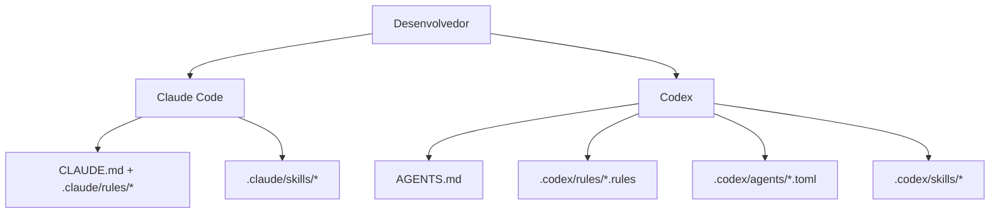

### Camada do Claude Code

- Contexto persistente:
  - [`CLAUDE.md`](./CLAUDE.md)
- Regras por caminho:
  - [`.claude/rules/backend-node.md`](./.claude/rules/backend-node.md)
  - [`.claude/rules/frontend-react.md`](./.claude/rules/frontend-react.md)
  - [`.claude/rules/mcp-typescript.md`](./.claude/rules/mcp-typescript.md)
  - [`.claude/rules/docs-markdown.md`](./.claude/rules/docs-markdown.md)
  - [`.claude/rules/file-headers.md`](./.claude/rules/file-headers.md)
  - [`.claude/rules/wiki-i18n.md`](./.claude/rules/wiki-i18n.md)
  - [`.claude/rules/i18n-parity.md`](./.claude/rules/i18n-parity.md)
- Skills:
  - `repo-onboarding`
  - `ship-feature`
  - `version-release`
  - `mcp-operations`
  - `debug-live-issue`
  - `update-project-docs`
  - `file-headers`
  - `push-to-forked-pr`
  - `i18n-parity`
- Subagentes:
  - `backend-reviewer`
  - `frontend-reviewer`
  - `mcp-reviewer`

### Camada do Codex

- Contexto persistente:
  - [`AGENTS.md`](./AGENTS.md)
- Política de execução:
  - [`.codex/rules/default.rules`](./.codex/rules/default.rules)
- Modelos de subagentes personalizados:
  - [`.codex/agents/`](./.codex/agents)
- Skills:
  - [`.codex/skills/`](./.codex/skills)
- Configuração:
  - [`.codex/README.md`](./.codex/README.md)

---

## Integração MCP

Este projeto inclui um servidor MCP local em `mcp/` com 103 ferramentas em 16 módulos de domínio. Ele expõe todas as ações suportadas pelo app, incluindo leituras de dados por escopo, transcrições/imagens, preços de Claude, Cursor e GPT, fluxos, alertas/webhooks, importações e restauração de backup, configuração de Claude/Codex, Executar agente, fontes remotas, configurações, push e manutenção protegida. Ele suporta três modos de transporte.

### Modos de transporte do MCP

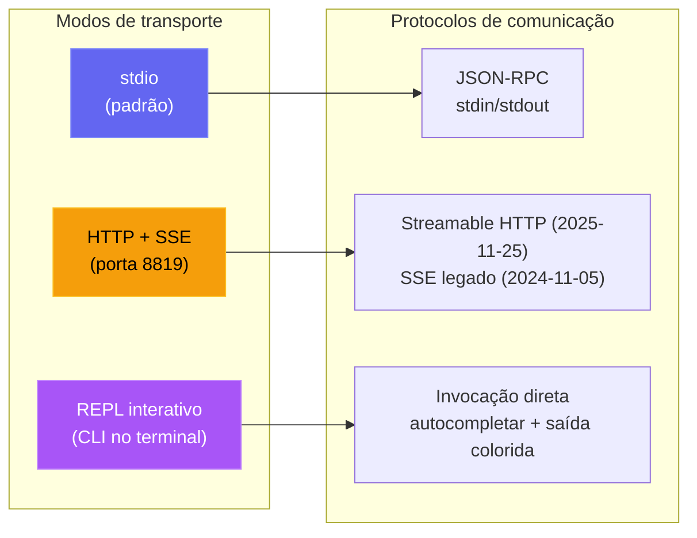

| Modo | Comando | Caso de uso |
| --- | --- | --- |
| **stdio** | `npm run mcp:start` | Claude Code, Claude Desktop, hosts MCP de IDEs |
| **HTTP** | `npm run mcp:start:http` | Clientes MCP remotos, integrações web, várias sessões |
| **REPL** | `npm run mcp:start:repl` | Depuração operacional, invocação manual de ferramentas, administração local |

<p align="center">
  <a href="images/mcp.png"></a>
</p>

### Arquitetura do MCP

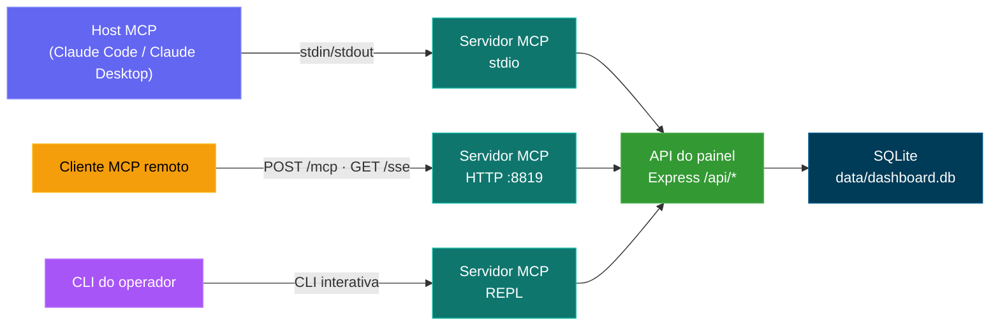

### Superfície de ferramentas do MCP

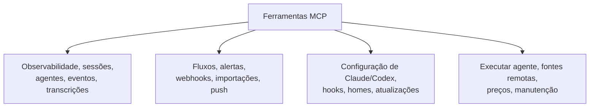

### Modelo de segurança do MCP

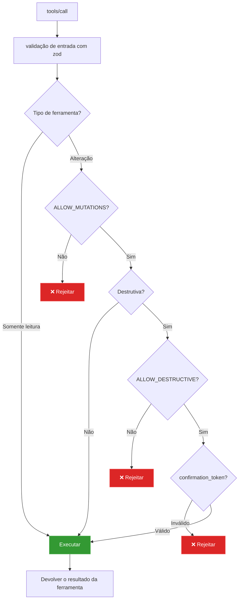

### Modos de operação do MCP

- Modo somente leitura (padrão): `MCP_DASHBOARD_ALLOW_MUTATIONS=false`
- Modo administrador: `MCP_DASHBOARD_ALLOW_MUTATIONS=true`
- Painel autenticado: defina `MCP_DASHBOARD_API_TOKEN` / `_FILE` com o token do painel
- Transporte HTTP/SSE autenticado: defina `MCP_HTTP_AUTH_TOKEN` / `_FILE`; os clientes enviam autenticação bearer ou `x-mcp-token`
- Proteções de transporte: HTTP direto em loopback pode levar o token; aliases de host de contêiner exigem HTTPS; redirecionamentos são rejeitados
- Proteções de payload: 50 MiB por arquivo de histórico enviado, 100 MiB no total por chamada, 10 MiB para respostas binárias e 25 MiB para restauração de backup
- Modo destrutivo: exige todos estes:
  - `MCP_DASHBOARD_ALLOW_MUTATIONS=true`
  - `MCP_DASHBOARD_ALLOW_DESTRUCTIVE=true`
  - a entrada de ferramenta `confirmation_token: "CLEAR_ALL_DATA"`

Detalhes completos: [mcp/README.md](./mcp/README.md)

---

## Referência da API

Todos os endpoints retornam JSON. As respostas de erro seguem o formato `{ error: { code, message } }`.

### OpenAPI / Swagger / ReDoc

Há três formas de explorar a API HTTP, todas baseadas em uma única especificação OpenAPI 3.0.3 (porta padrão do servidor `4820`):

| Método | Caminho | Descrição |
| ------ | ------------------------------- | ------------------------------------------------------------------------------------------------- |
| `GET` | `/api/openapi.json` | Especificação OpenAPI 3.0.3 bruta em JSON |
| `GET` | `/api/docs` | **Swagger UI** interativo — execute requisições para testá-las |
| `GET` | `/api/redoc` | Referência **ReDoc** — uma renderização limpa em três painéis, otimizada para leitura, da mesma especificação |
| `GET` | `/api/redoc/redoc.standalone.js` | Bundle do ReDoc auto-hospedado (servido localmente pela dependência `redoc`, nunca por CDN — funciona offline) |

O documento OpenAPI é gerado a partir de `server/openapi.js` (`createOpenApiSpec()`) e mesclado com fragmentos complementares em `server/openapi-extra/`. O Swagger UI e o ReDoc são servidos diretamente pelo backend; o bundle do ReDoc é servido localmente (`GET /api/redoc/redoc.standalone.js`), então a referência funciona totalmente offline / em rede isolada, de acordo com a política do projeto de não usar recursos externos.

A cobertura é completa: toda rota do backend está documentada (82 entradas de caminhos) sob estas tags — Health, Sessions, Agents, Events, Stats, Metrics, Analytics, Hooks, Pricing, Workflows, Settings, Updates, Alerts, Webhooks, Push, CcConfig (explorador de configuração do Claude Code), Run (execuções iniciadas pelo painel) e Documentation —, cada uma com parâmetros, esquemas de requisição/resposta, descrições por campo e exemplos realistas.

Um **`openapi.yaml`** versionado na raiz do repositório espelha a especificação ao vivo. Ele é gerado a partir de `server/openapi.js` (nunca editado à mão) — regenere-o depois de mudanças na API com:

```bash
npm run openapi:yaml
```


<p align="center">
  <a href="images/swagger.png"></a>
</p>

<p align="center">
  <a href="images/redoc.png"></a>
</p>

### Saúde

| Método | Caminho | Descrição |
| ------ | ------------- | ------------------------------------- |
| `GET` | `/api/health` | Retorna `{ status: "ok", timestamp }` |

### Sessões

| Método | Caminho | Parâmetros de consulta | Descrição |
| ------- | ------------------------------- | ---------------------------------------------------------------- | -------------------------------------------------------------------------------------------- |
| `GET` | `/api/sessions` | `status`, `q`, `limit`, `offset` | Lista as sessões com contagem de agentes e custo por sessão. `q` faz uma busca sem distinção de maiúsculas em `id` / `name` / `cwd`. `limit` tem padrão 50, máximo 10000. A resposta inclui `total` para paginadores. |
| `GET` | `/api/sessions/:id` | -- | Detalhe da sessão com agentes e eventos |
| `GET` | `/api/sessions/:id/stats` | -- | Contagens agregadas que alimentam o painel de visão geral do Detalhe da sessão: eventos, eventos por tipo, ferramentas mais usadas, número de erros, contagens por tipo/status de agente, divisão por tipo de subagente, totais de tokens, intervalo de tempo |
| `GET` | `/api/sessions/:id/transcripts` | -- | Lista as transcrições JSONL disponíveis da sessão (principal + subagentes + compactações) |
| `GET` | `/api/sessions/:id/transcript` | `agent_id`, `limit`, `offset`, `after`, `before` | Transmite as mensagens de uma transcrição específica com paginação por cursor. O `usage` do assistente inclui `input_tokens`, `output_tokens`, `cache_read_input_tokens`, `cache_creation_input_tokens`, para que o medidor da página Executar seja preenchido por completo ao retomar / reconectar |
| `POST` | `/api/sessions` | -- | Cria uma sessão (idempotente em `id`) |
| `PATCH` | `/api/sessions/:id` | -- | Atualiza o status/os metadados da sessão |

### Agentes

| Método | Caminho | Parâmetros de consulta | Descrição |
| ------- | ----------------- | ----------------------------------------- | ----------------------------- |
| `GET` | `/api/agents` | `status`, `session_id`, `limit`, `offset` | Lista os agentes com filtros |
| `GET` | `/api/agents/:id` | -- | Detalhe de um agente |
| `POST` | `/api/agents` | -- | Cria um agente |
| `PATCH` | `/api/agents/:id` | -- | Atualiza o status/a tarefa/a ferramenta do agente |

### Eventos

| Método | Caminho | Parâmetros de consulta | Descrição |
| ------ | ------------- | ------------------------------- | -------------------------- |
| `GET` | `/api/events` | `session_id`, `limit`, `offset` | Lista os eventos (mais recentes primeiro) |

### Estatísticas

| Método | Caminho | Descrição |
| ------ | ------------ | ------------------------------------------------------ |
| `GET` | `/api/stats` | Contagens agregadas, distribuições por status, conexões WS |

### Análises

| Método | Caminho | Descrição |
| ------ | ---------------- | ---------------------------------------------------------- |
| `GET` | `/api/analytics` | Agregados de tokens/ferramentas/sessões para gráficos e visões de tendência |

### Fontes de dados remotas

| Método | Caminho | Parâmetros de consulta | Descrição |
| -------- | ------------------------------- | ------------ | ------------------------------------------------------------------------------------------- |
| `GET` | `/api/remote-sources` | -- | Lista as fontes remotas configuradas com status, último erro e contagens da última sincronização |
| `POST` | `/api/remote-sources` | -- | Cria uma fonte. Corpo: `{ label, host, ssh_port?, identity_file?, remote_home?, remote_codex_home?, enabled? }` |
| `PATCH` | `/api/remote-sources/:id` | -- | Atualiza uma fonte (rótulo, campos de conexão, ativação) |
| `DELETE` | `/api/remote-sources/:id` | `purge` | Exclui uma fonte; `?purge=true` também exclui as sessões importadas dessa fonte |
| `POST` | `/api/remote-sources/:id/test` | -- | Testa a conectividade SSH com a fonte |
| `POST` | `/api/remote-sources/:id/sync` | -- | Busca e reimporta da fonte agora |

`GET /api/sessions`, `/api/events`, `/api/agents`, `/api/stats` e `/api/analytics` também aceitam um parâmetro de consulta opcional `sources` (IDs de fonte separados por vírgula; omita para todas) para limitar os resultados pela origem, e `GET /api/sessions/facets` retorna um array `sources` para o seletor de escopo de dados.

### Hooks

| Método | Caminho | Descrição |
| ------ | ------------------ | -------------------------------------------- |
| `POST` | `/api/hooks/event` | Recebe e processa um evento de hook do Claude Code |
| `POST` | `/api/hooks/ingest-batch` | Envia um lote de dados de sessão de uma máquina itinerante/atrás de NAT (desativado por padrão; veja `REMOTE_PUSH_TOKEN` abaixo e `server/README.md` para o formato completo do payload) |

**Payload de um evento de hook:**

```json
{
  "hook_type": "PreToolUse",
  "data": {
    "session_id": "abc-123",
    "tool_name": "Bash",
    "tool_input": { "command": "ls -la" }
  }
}
```

### Preços

| Método | Caminho | Descrição |
| -------- | ------------------------ | ---------------------------------------- |
| `GET` | `/api/pricing` | Lista todas as regras de preços |
| `PUT` | `/api/pricing` | Cria ou atualiza uma regra de preço |
| `DELETE` | `/api/pricing/:pattern` | Exclui uma regra de preço |
| `GET` | `/api/pricing/cost` | Custo total de todas as sessões |
| `GET` | `/api/pricing/cost/:id` | Detalhamento de custos de uma sessão específica |

### Fluxos

| Método | Caminho | Descrição |
| ------ | ----------------------------- | ------------------------------------------------------- |
| `GET` | `/api/workflows` | Dados de fluxos limitados por provedor/fonte (orquestração, ferramentas registradas, padrões, compactações do Codex). Os filtros opcionais `?status=active\|completed`, `?sources=...` e `?providers=claude\|codex` se aplicam às 11 seções de dados |
| `GET` | `/api/workflows/session/:id` | Detalhamento por sessão limitado por provedor/fonte (árvore de agentes, linha do tempo das ferramentas registradas, eventos) |

### Alertas

| Método | Caminho | Descrição |
| -------- | ------------------------ | ---------------------------------------------------------------------- |
| `GET` | `/api/alerts` | Feed de alertas disparados, mais recentes primeiro (`?unacked=true`, `limit`, `offset`) |
| `POST` | `/api/alerts/:id/ack` | Reconhece um alerta |
| `POST` | `/api/alerts/ack-all` | Reconhece todos os alertas não reconhecidos |
| `GET` | `/api/alerts/rules` | Lista as regras de alerta |
| `POST` | `/api/alerts/rules` | Cria uma regra (`event_pattern` \| `inactivity` \| `status_duration` \| `token_threshold`) |
| `PATCH` | `/api/alerts/rules/:id` | Atualiza nome / configuração / ativação / tempo de espera (o tipo de regra é imutável) |
| `DELETE` | `/api/alerts/rules/:id` | Exclui uma regra e o histórico dos alertas disparados por ela |

### Webhooks

| Método | Caminho | Descrição |
| -------- | --------------------------------- | ------------------------------------------------------------------------------------ |
| `GET` | `/api/webhooks/providers` | Provedores suportados + seus campos de configuração (conduz o formulário da interface) |
| `GET` | `/api/webhooks` | Lista os destinos de webhook (URLs mascaradas, segredos ocultados) |
| `POST` | `/api/webhooks` | Cria um destino (14 provedores nativos + `generic`) |
| `PATCH` | `/api/webhooks/:id` | Atualiza nome / url / ativação / segredo / cabeçalhos / escopo por regra (o tipo é imutável) |
| `DELETE` | `/api/webhooks/:id` | Exclui um destino e seu log de entregas |
| `POST` | `/api/webhooks/:id/test` | Envia um alerta de teste sintético e informa o resultado da entrega |
| `GET` | `/api/webhooks/:id/deliveries` | Log das entregas recentes de um destino (`limit`, `offset`) |

Provedores hospedados exigem HTTPS. `generic` e `n8n` podem usar HTTP para receptores locais ou auto-hospedados. A entrega rejeita redirecionamentos, então credenciais, cabeçalhos personalizados e assinaturas HMAC nunca são repassados a uma segunda URL.

### Configurações

| Método | Caminho | Descrição |
| ------ | ------------------------------ | ------------------------------------------------ |
| `GET` | `/api/settings/info` | Informações do sistema, estatísticas do banco, status dos hooks |
| `POST` | `/api/settings/clear-data` | Exclui todas as sessões, agentes, eventos e usos de tokens |
| `POST` | `/api/settings/reimport` | Reimporta sessões antigas de `~/.claude/` |
| `POST` | `/api/settings/reinstall-hooks` | Reinstala os hooks do Claude Code |
| `POST` | `/api/settings/reset-pricing` | Restaura os padrões das tabelas de preços do Claude, do Codex ou de ambos |
| `GET` | `/api/settings/export` | Exporta todos os dados (sessions, agents, events, token_usage, workflows, dashboard_runs, alert_rules, model_pricing, cursor_model_pricing, gpt_model_pricing) como um único download JSON versionado |
| `POST` | `/api/settings/import` | Restaura um pacote de até 25 MiB vindo de `/export` (`file` multipart ou JSON `{ path }`). Idempotente + não destrutivo — sessões existentes são ignoradas por inteiro |
| `POST` | `/api/settings/cleanup`        | Abandona sessões inativas, apaga dados antigos (e os instantâneos das sessões apagadas) |
| `GET`  | `/api/settings/snapshots`      | Armazenamento de instantâneos de transcrições por provedor + política de retenção |
| `POST` | `/api/settings/snapshots/compress` | Compacta sem perdas os instantâneos cuja transcrição original não existe mais |
| `POST` | `/api/settings/snapshots/prune` | Planeja (simulação, o padrão) ou aplica uma poda de instantâneos; aplicar exige `confirm: "PRUNE_SNAPSHOTS"` |

### Explorador de configuração do Claude (`/api/cc-config`)

Inspeção somente leitura de cada superfície de configuração do Claude Code, mais alterações cuidadosamente controladas para artefatos de texto de baixo risco. As leituras de arquivos canonicalizam o caminho solicitado e as raízes permitidas, para que links simbólicos não possam escapar dos diretórios confiáveis do Claude. Todos os caminhos de gravação criam backups com carimbo de data/hora em `<root>/cc-config-backups/<type>/` antes de alterar qualquer coisa.

| Método | Caminho | Descrição |
| -------- | ----------------------------------- | ----------- |
| `GET` | `/api/cc-config/overview` | Raízes (home do Claude, .claude do projeto, raiz do projeto, ~/.claude.json) + contagens de cada superfície |
| `GET` | `/api/cc-config/skills` | Skills em `<scope>/.claude/skills/<name>/SKILL.md` com frontmatter analisado; `?scope=user\|project\|all` |
| `GET` | `/api/cc-config/agents` | Subagentes `<scope>/.claude/agents/*.md` |
| `GET` | `/api/cc-config/commands` | Comandos de barra `<scope>/.claude/commands/*.md` |
| `GET` | `/api/cc-config/output-styles` | Estilos de saída `<scope>/.claude/output-styles/*.md` |
| `GET` | `/api/cc-config/plugins` | Plugins instalados de `~/.claude/plugins/installed_plugins.json`, unidos com `enabledPlugins` das configurações; cada entrada inclui `contributes` (contagem de skills/agentes/comandos/hooks/estilos de saída no diretório de instalação do plugin) mais os metadados de `plugin.json` |
| `GET` | `/api/cc-config/marketplaces` | Marketplaces registrados em `known_marketplaces.json`, enriquecidos com o `marketplace.json` de cada um (número de plugins, dono, descrição) |
| `GET` | `/api/cc-config/mcp` | Servidores MCP de `~/.claude.json` (nível superior + por projeto) e de `settings.json` |
| `GET` | `/api/cc-config/hooks` | Hooks agregados dos arquivos `settings.json` de usuário / projeto / projeto local |
| `GET` | `/api/cc-config/hook-scripts` | Arquivos em `~/.claude/hooks/` (os scripts auxiliares referenciados por `hooks.<event>.command`) |
| `GET` | `/api/cc-config/keybindings` | `~/.claude/keybindings.json` analisado em pares tecla/ação agrupados por contexto |
| `PUT` | `/api/cc-config/keybindings` | Sobrescreve `keybindings.json` a partir de `{ groups: [{ context, bindings: [{ key, action }] }] }`. Faz backup antes, preserva os metadados de nível superior (`$schema`/`$docs`) e rejeita contextos/teclas duplicados. Seguro de editar (ao contrário de `settings.json`, a CLI nunca o reescreve no meio de uma sessão) |
| `GET` | `/api/cc-config/statusline` | Configuração `settings.json.statusLine` + o conteúdo real de `statusline.py` / `statusline-command.sh`, se existir |
| `GET` | `/api/cc-config/settings` | JSON de configurações de usuário / projeto / projeto local, com as chaves que parecem segredos (que casam com `/token\|secret\|password\|api[_-]?key\|auth/i`) substituídas por `"<redacted>"` |
| `GET` | `/api/cc-config/memory` | Arquivos `CLAUDE.md` nos escopos de usuário + projeto, mais a memória por projeto baseada em arquivos: itens `scope:"auto-memory"` (cada um com `project`, `name`, `isIndex` e o `frontmatter` analisado) para cada `*.md` em `~/.claude/projects/<slug>/memory/`. Altere via `PUT`/`DELETE /api/cc-config/file` com `{ scope: "auto-memory", type: "auto-memory", project, name }` (os backups vão para `<memory-dir>/.cc-config-backups/auto-memory/`) |
| `GET` | `/api/cc-config/file?path=…` | Conteúdo de um único arquivo (caminho restrito a CLAUDE_HOME / .claude do projeto / CLAUDE.md do projeto) |
| `GET` | `/api/cc-config/backups` | Lista de todos os backups com carimbo de data/hora, com filtro opcional `?scope=&type=` |
| `PUT` | `/api/cc-config/file` | Cria ou sobrescreve um artefato de texto. Corpo: `{ scope, type, name?, content }`. Faz backup automático se o arquivo existir. Gravação atômica (arquivo temporário + renomeação). Conteúdo limitado a 256 KB, regex estrita para `name` |
| `DELETE` | `/api/cc-config/file` | Faz backup e depois exclui um artefato de texto. Diretórios de skills têm backup completo (preservando os recursos incluídos) antes da remoção recursiva |

### Métricas do Prometheus e Grafana

`GET /api/metrics` expõe métricas em texto do Prometheus para o status de sessões e agentes, eventos, tokens, clientes em tempo real, fontes remotas, tempo de atividade e memória do processo e versão do build. [`monitoring/`](./monitoring/README.md) fornece o Prometheus e quatro dashboards do Grafana provisionados automaticamente, com **CCAM · Overview** como padrão.

```bash
# Native dashboard and monitoring
npm start
npm run monitoring:install       # one-time binary setup
npm run monitoring:up            # Grafana on :3000

# Containers
npm run docker:up                 # dashboard only
npm run docker:full:up            # dashboard + Prometheus + Grafana

# Mixed native/container setup
DASHBOARD_ALLOWED_HOSTS=host.docker.internal npm start
npm run monitoring:docker:up
npm run monitoring:verify
```

<p align="center">
  <a href="images/grafana.png"></a>
  <br>
  <em>📊 <strong>Grafana · CCAM Overview</strong> · estado da frota, totais do banco, distribuições e taxas a partir de coletas ao vivo de <code>/api/metrics</code></em>
</p>

<p align="center">
  <a href="images/prometheus-console.png"></a>
  <br>
  <em>🔥 <strong>Prometheus · console CCAM</strong> · saúde da coleta, sessões, eventos, tokens e links do Graph para aprofundar</em>
</p>

<p align="center">
  <a href="images/prometheus-query.png"></a>
  <br>
  <em>📈 <strong>Prometheus · Graph</strong> · execute PromQL sobre as métricas coletadas do CCAM com links iniciais a partir do console</em>
</p>

Veja [docs/API.md → Metrics](./docs/API.md#metrics) para os nomes das métricas, a autenticação e a configuração da coleta.

### Executar Claude (`/api/run`)

Superfície HTTP para iniciar e supervisionar subprocessos `claude` a partir do painel. Proteção same-origin em todas as rotas — as requisições do navegador precisam vir de uma origem localhost; requisições sem Origin (CLI/curl) passam. Um `cwd` informado precisa ser um diretório absoluto existente e é canonicalizado com `realpath`. Ele pode, de propósito, ficar fora deste repositório, para que Executar agente possa iniciar a partir do home do usuário ou de qualquer projeto recente.

| Método | Caminho | Descrição |
| -------- | --------------------------------- | ----------- |
| `GET` | `/api/run` | Lista todos os handles de execução em memória (em andamento + concluídos recentemente); também retorna `maxConcurrent` e `activeCount` |
| `GET` | `/api/run/binary` | Verifica se o `claude` está no `PATH` e onde fica — usado pela interface para mostrar um erro claro antes de iniciar |
| `GET` | `/api/run/cwds` | Diretórios de trabalho sugeridos: cwd do servidor do painel, `$HOME` e cwds recentes da tabela de sessões |
| `GET` | `/api/run/files?cwd=…&q=…` | Busca aproximada de arquivos dentro de `cwd` para o autocompletar de arquivos com `@` da página Executar. Ignora `node_modules`, `.git`, `dist`, `build`, `.next`, `.cache`, `coverage` etc. O cwd é obrigatório e precisa existir; os resultados são limitados e ordenados pela correspondência com o nome do arquivo |
| `POST` | `/api/run` | Inicia uma nova execução. Corpo: `{ prompt, mode: "headless"\|"conversation", cwd?, model?, permissionMode?, resumeSessionId?, effort? }`. O modo headless coloca o prompt no argv via `-p` e fecha o stdin. O modo conversation envia o prompt pelo stdin como um envelope stream-json e mantém o stdin aberto para continuações. `resumeSessionId` (só conversation) acrescenta `--resume <id>`; quando definido, `prompt` pode ficar vazio — o lançador pula a gravação inicial no stdin e o `claude` aguarda na conversa retomada até o usuário enviar uma continuação via `POST /api/run/:id/message`. `effort` (`low` / `medium` / `high`) corresponde a `--effort`. O lançador sempre passa `--output-format stream-json --verbose --include-partial-messages` para que a interface possa renderizar os deltas caractere por caractere. A concorrência é, na prática, ilimitada (teto padrão de 10000 — substitua com `RUN_MAX_CONCURRENT`) |
| `GET` | `/api/run/:id` | Estado atual do handle. `?envelopes=1` inclui o log de envelopes em memória para que a interface possa reproduzir o histórico ao reconectar |
| `POST` | `/api/run/:id/message` | Envia um turno de continuação para uma conversa em andamento (só no modo conversation). Corpo: `{ text }` |
| `DELETE` | `/api/run/:id` | Para uma execução. SIGTERM, passando para SIGKILL após 5 s |

A saída é transmitida pelo WebSocket existente do painel em três tipos de mensagem: `run_stream` (envelope stream-json analisado, incluindo os deltas `stream_event` de `--include-partial-messages`), `run_status` (transições de status), `run_input_ack` (gravação no stdin confirmada). A página do explorador de configuração assina uma quarta mensagem — `cc_config_changed` — transmitida por `server/lib/cc-watcher.js` (via `fs.watch` em `~/.claude/`) e por `routes/cc-config.js` após cada PUT/DELETE bem-sucedido, com o payload `{ source: "dashboard"|"fs", action?, scope?, type?, name?, paths? }`. A lista de Sessões e a página SessionDetail consultam `/api/run` (e escutam `run_status`) para marcar qualquer sessão que esteja sendo conduzida por uma execução em andamento com um indicador clicável **▶ Run** que leva de volta a `/run`.

### Importação de histórico

**Configurações → Importação de histórico** importa as transcrições do Claude Code de `~/.claude/projects` e os rollouts do Codex de `~/.codex/sessions` por meio de varreduras de pasta ou envios específicos de cada provedor. Ambos reutilizam a ingestão ao vivo, preservam tokens, custos, ferramentas, bases de compactação, ciclo de vida e os títulos nativos do Codex, e continuam idempotentes. O histórico do Codex enviado é copiado para o armazenamento do painel, para que sua conversa sobreviva à limpeza da origem.

**Restaurar backup** aceita um `.json` exportado do painel pela interface, por `ccam export` ou por `GET /api/settings/export`. `POST /api/settings/import` e `ccam import-data <file>` restauram todas as tabelas sem sobrescrever as sessões existentes, permitindo consolidar várias máquinas com segurança.

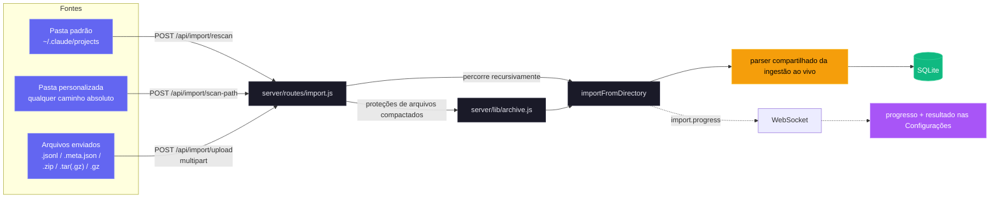

| Método | Caminho | Finalidade |
| --- | --- | --- |
| `GET` | `/api/import/guide` | Caminhos por provedor, comandos de arquivos compactados, extensões e instruções via `?provider=claude\|codex`. |
| `POST` | `/api/import/rescan` | Varre de novo a raiz padrão selecionada a partir de `{ provider }`. |
| `POST` | `/api/import/scan-path` | Varre recursivamente um `{ path, provider }` absoluto. |
| `POST` | `/api/import/upload` | Envia arquivos ou arquivos compactados suportados com `provider`. |

- **Entradas:** arquivos `.jsonl`, `.meta.json`, `.zip`, `.tar`, `.tar.gz`/`.tgz` e `.gz` soltos, em estruturas aninhadas. O Claude suporta os dois layouts canônicos de subagentes; o Codex reconhece `rollout-*.jsonl` de forma recursiva ou JSONL com `session_meta`, além de títulos opcionais de `session_index.jsonl`.
- **Precisão:** a deduplicação por UUID e pela marca d'água máxima dos eventos evita contagem dupla. As bases de compactação preservam os tokens anteriores; a atividade posterior avança `ended_at` e atualiza os metadados das mensagens.
- **Arquivos grandes:** a análise compartilhada, em blocos de 4 MiB e linha por linha, lida com transcrições além do limite de strings do V8, de cerca de 512 MiB. Os arrays expansíveis são limitados por `TRANSCRIPT_CACHE_MAX_ARRAY_LEN` (padrão `1000`), com corte ao dobro do limite durante a análise.
- **Segurança:** a extração rejeita caminhos absolutos e com `..`. Por padrão, os dados extraídos são limitados a 4 GB, cada envio a 1 GB e as requisições a 2000 arquivos; a área de preparação de cada requisição é sempre liberada.
- **Progresso:** as fases do WebSocket `import.progress`, com frequência limitada, cobrem `start`, `scan`, `extract`, `parse`, `complete` e `error`. A interface oferece orientações de arrastar e soltar e os totais de importados, enriquecidos, ignorados e com erro.

### WebSocket

Conecte-se a `ws://localhost:4820/ws` para receber mensagens em tempo real:

```json
{
  "type": "agent_updated",
  "data": { "id": "...", "status": "working", "current_tool": "Edit" },
  "timestamp": "2026-03-05T15:43:01.800Z"
}
```

**Tipos de mensagem:** `session_created`, `session_updated`, `agent_created`, `agent_updated`, `new_event`, `alert_triggered`, `alert_updated`, `remote_source.status` (dados `{ id, status: "idle"|"syncing"|"ok"|"error"|"deleted", error?, last_sync_at? }`)

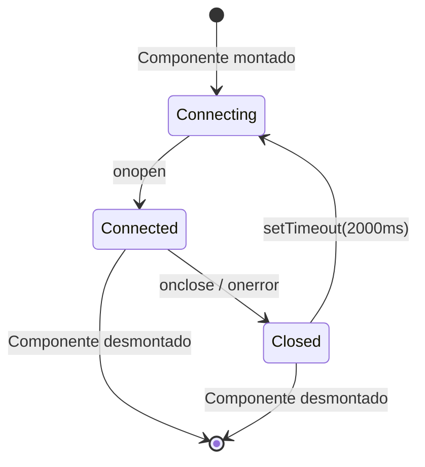

---

## Eventos de hook

O painel processa estes tipos de hook do Claude Code:

| Tipo de hook | Gatilho | Ação do painel |
| ------------------- | ------------------------------ | -------------------------------------------------------------------------------------------- |
| `SessionStart` | Início de uma sessão do Claude Code | Cria a sessão e o agente principal. Registra `awaiting_input_since` (com `awaiting_reason=session_start`) para que uma sessão nova caia em **Em espera** — exceto um SessionStart de origem `compact` (compactação automática no meio do turno), que deixa a flag intacta para que uma sessão em trabalho continue **Ativa**. Reativa sessões retomadas. Abandona sessões órfãs sem atividade há `DASHBOARD_STALE_MINUTES` (padrão 180) |
| `UserPromptSubmit` | O usuário confirma um prompt | Limpa a flag de espera e promove o agente principal para `working` — o único sinal de que turnos do assistente só de texto começaram, já que eles não emitem `PreToolUse` |
| `PreToolUse` | Um agente começa a usar uma ferramenta | Limpa a flag de espera, coloca o agente em `working` e define `current_tool`. Se a ferramenta for `Agent`, cria um registro de subagente |
| `PostToolUse` | Execução da ferramenta concluída | Limpa a flag de espera (trata aprovações de pedidos de permissão em que a Notification a registrou no meio da ferramenta). Limpa `current_tool`. O agente continua `working` |
| `Stop` | O Claude terminou de responder | Sem erro: agente principal → `waiting` — o Claude terminou seu turno, a bola está com o usuário. `stop_reason=error`: marca o agente e a sessão como `error`. Subagentes em segundo plano continuam rodando |
| `SubagentStop` | Um agente em segundo plano terminou | Associa e conclui o subagente pela descrição, tipo ou tarefa. Propositalmente NÃO limpa a flag de espera — um subagente terminando não diz nada sobre a pessoa. **Dispara, sem aguardar, uma varredura do JSONL** (`scanAndImportSubagents`) que emite eventos `PreToolUse` + `PostToolUse` por ferramenta sob o próprio `agent_id` do subagente, para que a Linha do tempo mostre cada ferramenta que o subagente executou, e não só o marcador de início |
| `Notification` | Notificação de um agente | Registra o evento. Mensagens de pedido de permissão/entrada colocam o agente em `waiting` e registram `awaiting_input_since` (com `awaiting_reason=notification`, identificadas por padrão: `permission`, `waiting for input`, `needs your approval`, …). Notificações de compactação são marcadas como eventos `Compaction`. Dispara uma notificação do navegador, se ativada |
| `SessionEnd` | O processo da CLI do Claude Code termina | Remove a flag de espera. Se a sessão já estiver em `error`, o estado de erro é preservado; caso contrário, marca todos os agentes e a sessão como `completed` |
| `Compaction` | `/compact` detectado no JSONL | Cria um subagente de compactação (tipo `compaction`) e um evento Compaction. Detectado pelas entradas `isCompactSummary` no JSONL da transcrição. Também detectado pelo scanner periódico nas sessões ativas |
| `APIError` | Erro de API na transcrição JSONL | Extraído das entradas `isApiErrorMessage` (cota, limite de taxa, invalid_request) e das respostas brutas `type: "error"`. **Agora marca imediatamente a sessão e o agente como `error`** — antes era registrado como evento sem mudar o status. Armazenado como evento com os detalhes do erro |
| `TurnDuration` | Duração do turno na transcrição JSONL | Extraído das mensagens `system` com subtipo `turn_duration` e `durationMs`. Armazenado como evento para análise da duração por turno |
| `ToolError` | Erro em resultado de ferramenta no JSONL | Extraído das entradas `toolUseResult.is_error`. Acompanha falhas no nível das ferramentas para a análise de propagação de erros |
| `RemoteToolEvent` | Chamada de ferramenta enviada por uma máquina remota | Gravado por `POST /api/hooks/ingest-batch` para cada item de `tool_events[]` que uma máquina itinerante/atrás de NAT envia. Deduplicado por `(session_id, event_type, uuid)` em relação às linhas gravadas e dentro do lote, então reenviar um lote é seguro |
| `RemoteTurn` | Duração de turno enviada por uma máquina remota | Gravado por `POST /api/hooks/ingest-batch` para cada item de `turns[]`, levando o `duration_ms` daquele turno. Mesma deduplicação por `(session_id, event_type, uuid)` que `RemoteToolEvent` |
| `Interrupted` | Turno cancelado pelo usuário (Esc) | Sintetizado pelo vigia — o `Esc` não dispara hook, então uma sessão presa em `working` é detectada pelo marcador `[Request interrupted by user]` da transcrição ou, quando o Esc veio antes de qualquer saída, pelo tempo ocioso em trabalho (`DASHBOARD_WORKING_IDLE_SECONDS`). A sessão passa para **Em espera** (como depois de um `Stop` normal) |

---

## Notificações do navegador

O painel suporta notificações persistentes do navegador via Web Push (VAPID), para alertas em tempo real mesmo quando a aba do painel não está em foco ou o navegador está em segundo plano.

### Como funciona

1. **Ative** as notificações na página de Configurações pela chave geral
2. **Conceda** a permissão do navegador quando solicitado — isso registra um Service Worker e cria uma assinatura push
3. **Configure** quais eventos disparam notificações:

| Evento | Padrão | Descrição |
| ---------------------------- | ------- | --------------------------------------------------------------- |
| Nova sessão iniciada | Ligado | Dispara quando uma nova sessão do Claude Code é criada |
| O Claude terminou de responder | Desligado | Dispara nos eventos `Stop`, quando o Claude termina um turno de resposta |
| Sessão encerrada | Desligado | Dispara no `SessionEnd`, quando o processo da CLI termina |
| Erros de sessão | Ligado | Dispara quando uma sessão termina com erro |
| Subagente iniciado | Desligado | Dispara quando um subagente em segundo plano é criado |

Além disso, qualquer evento de hook `Notification` do Claude Code dispara uma notificação do navegador, independentemente das chaves por evento (desde que a chave geral esteja ativada).

### Arquitetura das notificações

- **Pipeline VAPID:** usa `web-push` no servidor para uma entrega segura das mensagens. As chaves VAPID são geradas automaticamente e armazenadas em `data/vapid-keys.json`.
- **Service Worker:** um worker dedicado (`client/public/sw.js`) trata os eventos `push` recebidos e exibe as notificações com `silent: false` para garantir o som no macOS.
- **Assinaturas:** os endpoints específicos de cada navegador ficam na tabela `push_subscriptions` do SQLite.
- **Persistência:** as notificações chegam mesmo com o navegador fechado, pois o Service Worker opera em segundo plano.
- **Notificação de teste:** um botão nas Configurações permite verificar o pipeline VAPID e a reprodução do som.

### PWA e suporte offline

O painel, a página inicial e o wiki são PWAs instaláveis separados, com manifestos e service workers independentes.

| Superfície | Manifesto | Service Worker | Estratégia de cache |
| --- | --- | --- | --- |
| Painel (`client/`) | `client/public/manifest.json` | `client/public/sw.js` | Os `/assets/*` imutáveis usam cache primeiro; as navegações, o worker, o manifesto, os ícones e `/` usam rede primeiro com fallback. `/api/*`, `/ws` e o HMR do Vite nunca vão para o cache; os manipuladores de push continuam ativos. O Express envia cabeçalhos imutáveis de um ano para os assets e cabeçalhos de revalidação para os arquivos do shell. `controllerchange` recarrega uma vez em uma atualização, nunca na primeira instalação. |
| Página inicial (raiz) | `manifest.json` | `sw.js` | Pré-armazena em cache o shell, o favicon e a imagem OG. As capturas de tela vão para o cache na primeira visualização; a navegação usa rede primeiro com fallback offline. |
| Wiki (`wiki/`) | `wiki/manifest.json` | `wiki/sw.js` | Pré-armazena em cache o HTML, o CSS, o JS, o manifesto e o favicon. O HTML continua com rede primeiro; CSS e JS usam cache primeiro, permitindo o uso offline depois de uma visita. |

Todos os workers chamam `skipWaiting()`, removem os caches versionados desatualizados na ativação e se atualizam de forma limpa quando a versão do cache muda. Cada arquivo HTML inclui os metadados do modo independente do iOS; os manifestos e os ícones Apple touch usam `favicon.svg` com `sizes="any"`.

---

## Notificador de atualizações

O painel observa seu próprio checkout git e mostra uma janela sempre que o branch padrão canônico tem commits à frente do HEAD. **Ciente de branches e forks:** se você tiver um remote `upstream` (a convenção padrão para forks), ele tem preferência sobre `origin`; o `master`/`main`/`HEAD` do remote escolhido é a referência de comparação. O `manual_command` se adapta à sua situação — `git pull --ff-only` só quando seu branch realmente acompanha a referência canônica; caso contrário, um `git fetch` (e um merge fast-forward no caso de fork), para que o comando nunca engane. Os usuários recebem o comando exato para rodar em um terminal — o servidor **nunca** faz pull nem se reinicia sozinho, o que mantém o mecanismo portátil entre sessões de desenvolvimento, supervisão por pm2/systemd/launchd/Docker e implantações remotas.

<p align="center">
  <a href="images/update.png"></a>
</p>

### Como funciona

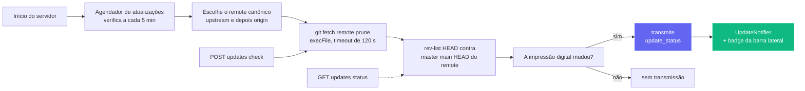

Uma verificação é barata (`git fetch <remote> --prune` no remote canônico — `upstream`, se configurado; senão `origin`), envolvida em `execFile` (sem shell) com timeout de 120 s. Falhas — rede offline, instalação fora do git, nenhum remote configurado, referência upstream que não se resolve — retornam todas **payloads suaves** (p. ex. `fetch_error: "..."`) em vez de lançar exceção, então um remote instável nunca bloqueia o painel.

### Superfícies da interface

| Superfície | Comportamento |
| --- | --- |
| **Janela** (`client/src/components/UpdateNotifier.tsx`) | Abre para um novo `remote_sha` disponível; mostra quantos commits faltam, a referência acompanhada, uma nota opcional sobre branch/fork, o comando exato e os botões **Copiar comando**, **Verificar agora** e **Dispensar**. Esc ou um clique no fundo a dispensam. A dispensa é indexada em `localStorage`, então um SHA mais novo a abre de novo. |
| **Botão da barra lateral** (`client/src/components/Sidebar.tsx`) | Sempre visível. Verde indica que está atrás; âmbar indica falha no fetch. Clicar nele limpa a dispensa e chama `POST /api/updates/check`. |
| **Terminal do servidor** | Imprime o comando em um bloco com moldura quando o status passa de atualizado para atrás, inclusive para usuários sem interface. |

### Superfície da API

| Endpoint | Finalidade |
| --- | --- |
| `GET /api/updates/status` | Verificação somente leitura: executa `git fetch` no remote canônico, compara o HEAD com o branch padrão dele e retorna o payload. |
| `POST /api/updates/check` | A mesma verificação, mas também transmite `update_status` via WebSocket, para que todos os clientes conectados se atualizem de uma vez. |

Os dois endpoints retornam o mesmo formato de payload:

```json
{
  "git_repo": true,
  "update_available": true,
  "repo_root": "/Users/you/Claude-Code-Agent-Monitor",
  "remote_ref": "upstream/master",
  "canonical_remote": "upstream",
  "current_branch": "master",
  "tracking_upstream": "origin/master",
  "tracks_canonical": false,
  "situation": "fork_or_diverged_tracking",
  "local_sha": "abc1234...",
  "remote_sha": "def5678...",
  "commits_behind": 3,
  "manual_command": "cd \"/...\" && git fetch upstream && git merge --ff-only upstream/master && npm run setup",
  "situation_note": "You're on 'master' tracking 'origin/master'. This command fast-forwards your branch from upstream/master (the canonical default).",
  "message": "3 commit(s) on upstream/master not in your checkout."
}
```

`situation` é um destes valores: `tracking_canonical` (clone típico no branch padrão — `git pull --ff-only` funciona), `fork_or_diverged_tracking` (o nome do branch local coincide com o canônico, mas acompanha outro remote — `git fetch <remote> && git merge --ff-only <ref>`), `feature_branch` (fora do branch padrão — só fetch, a integração fica a cargo do usuário) ou `detached_head`.

### O que **propositalmente não** existe aqui

Não há `POST /api/updates/apply` nem um auxiliar de reinício automático, por design. Atualizar um processo de dentro dele mesmo não é confiável sem um supervisor externo — `npm run dev` (concurrently), `npm start`, `pm2`, `systemd`, `launchd` e Docker precisam, cada um, de uma lógica de reinício diferente, e falhas de `git pull` / `npm install` em um servidor que está parando não têm um caminho limpo de reversão. Ficar só na detecção mantém o comportamento previsível com qualquer supervisor, qualquer sistema operacional e qualquer estado de branch, e ainda fecha a lacuna de informação "quando preciso fazer pull?"; a atualização de fato fica com o usuário, no próprio shell.

### Configuração

| Variável de ambiente | Padrão | Observações |
| --- | --- | --- |
| `DASHBOARD_UPDATE_CHECK` | ativado | Defina como `0` / `false` / `off` para desativar o agendador por completo. |
| `DASHBOARD_UPDATE_CHECK_INTERVAL_MS` | `300000` (5 min) | Intervalo entre as verificações automáticas. O mínimo é 60 000 ms — valores menores são elevados a esse limite. |

---

## Tabby — o gato companheiro flutuante

**Tabby** é um gato companheiro flutuante e fofo, fixado no canto inferior direito de todas as páginas do painel. Sempre presente, ele transforma o fluxo de sessões ao vivo em um mascote reativo, que se entende num relance e com quem você também pode conversar.

<p align="center">
  <a href="images/tabby.png"></a>
</p>

### Mascote reativo

Tabby é um gato em SVG que segue o cursor, com **oito humores** derivados do fluxo de sessões ao vivo, cada um com sua própria animação:

| Humor | Quando | Animação |
| --- | --- | --- |
| `idle` | Nada de relevante acontecendo | Balanço do rabo em repouso |
| `watching` | Há sessões ativas | Orelhas em pé, olhos seguindo o cursor |
| `happy` | Uma sessão ou execução terminou bem | Aceno de cabeça + brilhos |
| `worried` | Algo parece errado | Tremida sutil |
| `stuck` | Uma sessão parece travada | Alerta "!" |
| `thinking` | Um agente está no meio do trabalho | Aceno de cabeça lento |
| `sleeping` | Tudo quieto há um tempo | `zzz` |
| `disconnected` | O WebSocket caiu | Postura calma e parada |

### Balões de fala

O Tabby mostra automaticamente frases curtas em eventos relevantes (sessão iniciada/concluída, erros, execução finalizada). Os balões são **limitados e agrupados**, para que uma rajada de eventos nunca encha a tela, usam `aria-live` para leitores de tela e podem ser **silenciados** pelo painel.

### Painel

Abra o painel clicando no gato ou pressionando **⌘B / Ctrl+B** (Esc fecha). Ele mostra:

- Uma **linha de status** ao vivo — `N live · M errored · connection state`.
- **Ações rápidas** — ir para Executar Claude, Atividade, Sessões ou sessões com erro; silenciar balões; limpar alertas.
- Uma caixa **Perguntar** (veja abaixo).

### Caixa Perguntar → passagem para Executar Claude

A caixa **Perguntar** responde localmente a perguntas simples de status a partir dos dados em cache — por exemplo "o que está rodando", "algum erro" ou "status". Qualquer outra pergunta é encaminhada à página **Executar Claude** existente (com link direto para `/run?prompt=…`) para iniciar uma sessão real do Claude Code. O Tabby nunca chama um LLM por conta própria; ele simplesmente reutiliza a página Executar Claude para tudo o que vai além de uma consulta rápida de status.

### Acessibilidade e degradação segura

O Tabby é operável pelo teclado, usa `aria-live` nos balões e respeita `prefers-reduced-motion`. Se o WebSocket cair, ele recua com segurança para um estado calmo `disconnected` em vez de gerar erro. Você pode ativar ou desativar o Tabby nas **Configurações** (localizado em inglês, chinês, vietnamita, coreano, espanhol, francês, alemão, português e italiano), e a implementação fica em `client/src/components/Tabby/`.

---

## Sinais sonoros

O painel dá a você um **retorno sonoro sutil** da atividade das sessões ao vivo, para que você possa deixá-lo em um segundo monitor e ainda ouvir quando uma execução termina ou falha. O som vem **ativado por padrão** e pode ser desligado por completo com um clique.

### Síntese sem dependências

Não há nenhum arquivo `.mp3` ou `.wav` no repositório nem biblioteca de áudio no `package.json`. Cada sinal é gerado na hora com a **Web Audio API**: uma lista curta de osciladores (senoidal ou triangular), cada um com seu próprio envelope de ganho exponencial, mixados por um nó de ganho principal e um filtro passa-baixa para que o resultado fique em segundo plano em relação ao seu trabalho, em vez de interrompê-lo. O mecanismo inteiro é um único arquivo, `client/src/lib/sound.ts`.

### Os sinais

| Sinal | Quando toca | Como soa |
| --- | --- | --- |
| `sessionStart` | Uma nova sessão aparece | Quinta justa ascendente (Dó5 → Sol5) |
| `sessionComplete` | Uma sessão termina de responder (`Stop`) ou é encerrada (`SessionEnd`) | Arpejo maior conclusivo (Mi5 → Sol5 → Dó6) |
| `sessionError` | Uma sessão entra no estado `error` | Terça menor suave e descendente em onda triangular — perceptível, sem alarmar |
| `subagentSpawn` | Um subagente é iniciado | Um único dedilhado curto |
| `notification` | O Claude Code emite um evento `Notification` | Par desafinado que soa como um pequeno sino |
| `connected` / `disconnected` | O WebSocket do painel volta ou cai | Subida / descida de duas notas |
| `click` | Você pressiona um botão, link, aba ou chave | Tique quase inaudível |

Os sinais ficam dentro de uma escala de dó maior, para que finais sobrepostos nunca soem dissonantes, e cada envelope decai de forma exponencial em vez de ser cortado, o que evita o estalo de uma parada brusca.

### Sem atrapalhar

Três salvaguardas impedem que o som vire ruído:

- **Tempo de espera por sinal** — o mesmo sinal não se repete em menos de ~350 ms (45 ms para o tique de interação).
- **Orçamento global de rajadas** — no máximo 4 sinais começam em qualquer janela de 1,2 s, então importar o histórico ou reconectar depois de uma queda nunca transforma uma enxurrada de mensagens WebSocket em uma enxurrada de bipes.
- **Política de reprodução automática** — nada toca antes da sua primeira interação com a página (ponteiro, tecla ou toque), conforme as regras do navegador. Sinais anteriores são descartados em silêncio, não enfileirados.

Se o navegador não tiver nenhum suporte a Web Audio, cada chamada é uma operação nula segura — o painel simplesmente fica em silêncio.

### Configurações

**Configurações → Som** tem uma chave geral, um controle de volume e uma chave individual para cada sinal. Ligar uma chave toca o sinal na hora, para você ouvir exatamente o que acabou de ativar, e um botão **Ouvir o som** toca o som de conclusão sob demanda. As preferências ficam em `localStorage` sob `agent-monitor-sound` e valem instantaneamente em todo o app — sem recarregar. O painel está localizado em inglês, chinês, vietnamita, coreano, espanhol, francês, alemão, português e italiano.

Por padrão, início de sessão, conclusão de sessão, erro de sessão, notificações do Claude Code e o tique de interação estão ligados; início de subagentes e mudanças de conexão estão desligados (são os mais falantes). A implementação fica em `client/src/lib/sound.ts` (mecanismo + preferências) e `client/src/hooks/useSoundCues.ts` (ligação ao barramento de eventos), montado uma única vez em `client/src/App.tsx`.

---

## Janela de status da conexão

Clique na pílula **Ao vivo** / **Desconectado** no rodapé da barra lateral para abrir um pequeno painel de detalhes sobre o transporte WebSocket do painel. Ele mostra o endpoint `ws://` ativo, há quanto tempo o socket atual está aberto, o total de eventos recebidos, os principais tipos de evento como gráfico de barras horizontais, uma sparkline da vazão em 60 segundos e os últimos 8 eventos em uma lista de atividade recente. As estatísticas acumuladas (totais, divisão por tipo, lista recente) persistem entre recargas via `localStorage` sob `sidebar-connection-stats`; a sparkline móvel e o cronômetro "conectado desde" são efêmeros de propósito. Um botão **Redefinir** no rodapé limpa tudo sob demanda.

<p align="center">
  <a href="images/live.png"></a>
</p>

---

## Extensão do VS Code

O **Claude Code Agent Monitor** está disponível como uma extensão completa do VS Code, permitindo monitorar seus agentes de IA sem sair do editor.

<p align="center">
  <a href="vscode-extension/vscode.png"></a>
</p>

### 🚀 Principais recursos
- **Barra lateral ao vivo**: visão dedicada na Barra de Atividades mostrando em tempo real a saúde dos agentes (Trabalhando, Em espera, Concluído etc.).
- **Análises de uso**: acompanhe o total de tokens, os custos em USD ao vivo e a contagem de eventos direto na barra lateral.
- **Integração com a barra de status**: monitor de pulso de relance na barra inferior, com sessões e agentes ativos.
- **Navegação direta**: acesso com um clique a visões específicas do painel (Kanban, Análises, Configurações) ou a sessões recentes.
- **Aba integrada**: abre o painel de monitoramento completo como uma aba webview nativa do VS Code.

### 📦 Instalação e configuração
1. Abra o diretório [vscode-extension](./vscode-extension).
2. Instale a extensão pelo Marketplace ou empacote-a você mesmo com `vsce package`.
3. Garanta que o servidor local do painel esteja rodando (`npm run dev`).
4. Clique no **ícone de radar** na Barra de Atividades do VS Code para começar.

Para a configuração detalhada de desenvolvimento, veja os diretórios [.vscode](./.vscode) e [vscode-extension](./vscode-extension).

> [!TIP]
> Extensão no VS Code Marketplace: [Claude Code Agent Monitor](https://marketplace.visualstudio.com/items?itemName=hoangsonw.claude-code-agent-monitor)

---

## App de desktop (macOS e Windows)

O app de desktop opcional, feito com Electron 35, empacota o mesmo painel como `.dmg` para macOS, instalador NSIS para Windows ou `.exe` portátil, a partir do workspace `desktop/`.

<p align="center">
  <a href="images/macos.png"></a>
  <br>
  <em>🍎🪟 <strong>App de desktop</strong> — shell nativo com ícone na barra de menus / área de notificação (tray), abertura no login e bloqueio de instância única. O mesmo painel, em uma janela de verdade do sistema (macOS na imagem).</em>
</p>

<p align="center">
  <a href="images/windows_app.png"></a>
  <br>
  <em>🪟 O mesmo painel como app nativo do Windows — ícone na área de notificação (tray), menu de janela nativo e abertura no login.</em>
</p>

Ele acrescenta janela, tray, menu, início no login e encerramento nativos em torno da mesma interface servida em `localhost:4820`.

### Como funciona

Ao contrário de rodar o painel a partir de um terminal, o app de desktop não precisa de `npm start`, de um shell aberto nem de uma segunda cópia do servidor. O **processo principal** do Electron hospeda o servidor Express **no mesmo processo** — ele faz `require()` de `server/index.js` diretamente no mesmo runtime Node, **sem processo filho nem IPC** — e aponta uma `BrowserWindow` do Chromium para o cliente React compilado.

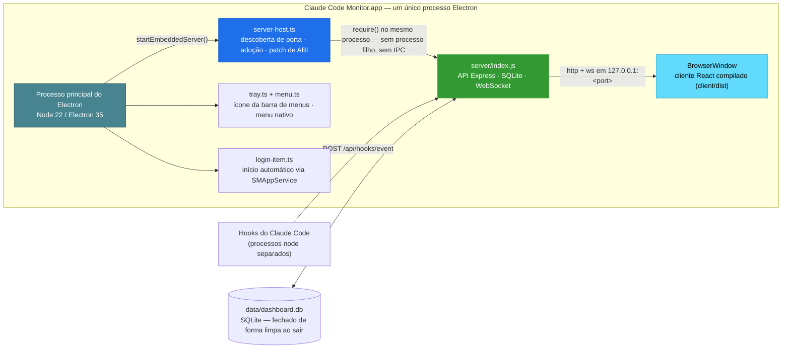

Ao iniciar, o app:

1. Escolhe uma porta livre — de preferência **4820**, depois **4821–4829** e, por fim, uma porta alta aleatória se todas estiverem ocupadas.
2. Se um servidor de painel saudável já responder a `/api/health` na `4820` (p. ex. você rodou `npm start` em um terminal), ele **adota esse servidor** em vez de fazer um bind duplicado — sem conflito de porta, sem disputa pelo SQLite. Um servidor adotado continua rodando depois que você sai do app.
3. Caso contrário, inicia o servidor embutido e, na **primeira inicialização com servidor próprio**, instala automaticamente os hooks do Claude Code e inicia os serviços em segundo plano (agendador de atualizações, `cc-watcher`, reconciliação de execuções órfãs). Quem instala só o DMG já vê os eventos chegando **sem nenhuma configuração manual** — sem checkout, sem `npm run install-hooks`.
4. **(macOS)** Recupera o **`PATH` do shell de login** para que o recurso **Executar Claude** consiga encontrar e iniciar a CLI `claude` — um app aberto pelo Finder/Dock herda apenas o `PATH` mínimo do launchd e não encontraria CLIs em `~/.local/bin`, `/opt/homebrew/bin`, nos diretórios de gerenciadores de versão etc. (No Windows, o processo já herda o `PATH` do usuário.)
5. Abre a janela do painel — a menos que o app tenha sido iniciado no login (no macOS via itens de login; no Windows via a entrada marcada `HKCU\…\Run`), caso em que ele fica só no tray.
6. Ao sair, encerra o servidor embutido de forma ordenada e **fecha o SQLite de forma limpa** (checkpoint do WAL).

### Recursos

- **Tray e janela:** o clique esquerdo mostra/oculta a janela; o clique direito oferece **Abrir painel**, **Abrir no navegador**, **Reiniciar servidor**, **Mostrar logs**, **Abrir no login** e **Sair**. O macOS usa um glifo modelo tingido no tray; o Windows e a janela/barra de tarefas usam o ícone colorido do app, inclusive em execuções de desenvolvimento não empacotadas.
- **Menu nativo:** menus de aplicativo padrão e atalhos `⌘` / `Ctrl`. Só o macOS mantém **File → Open Dashboard** (`⌘1`) com a janela oculta; no Windows/Linux, a janela é reaberta de forma confiável pelo tray.
- **Login e ciclo de vida:** o `SMAppService` registra os Itens de Início do macOS; o Windows grava a entrada por usuário `HKCU\Software\Microsoft\Windows\CurrentVersion\Run`. Fechar a janela a oculta enquanto o tray e o servidor continuam; uma segunda abertura coloca em foco a única instância existente.
- **Dados duráveis:** o SQLite e as chaves VAPID ficam fora do bundle, em `~/Library/Application Support/Claude Code Monitor/data/` ou `%APPDATA%\Claude Code Monitor\data\`. Reinstalações, atualizações e a desinstalação NSIS padrão preservam o histórico importado.
- **CLI e logs:** o macOS restaura o `PATH` do shell de login para que apps abertos pelo Finder/Dock possam executar `claude`; o Windows usa o `PATH` do usuário herdado. **Mostrar logs** abre `~/Library/Logs/Claude Code Monitor/desktop.log` ou `%APPDATA%\Claude Code Monitor\logs\desktop.log`.

### Obter

**Opção A — baixar um instalador pronto (recomendado).** Em **[Releases → latest](https://github.com/hoangsonww/Claude-Code-Agent-Monitor/releases/latest)** (público, sem login no GitHub). A CI publica automaticamente uma nova release `vX.Y.Z` sempre que a versão em `package.json` é incrementada no `master`, então este link sempre entrega o build atual:

| Plataforma | Arquivo | Observações |
| --- | --- | --- |
| macOS (Apple Silicon) | `ClaudeCodeMonitor-<ver>-arm64.dmg` | arraste para `/Applications` |
| macOS (Intel) | `ClaudeCodeMonitor-<ver>-x64.dmg` | arraste para `/Applications` |
| Windows (instalador) | `ClaudeCodeMonitor-Setup-<ver>-x64.exe` | instalação por usuário, sem admin |
| Windows (portátil) | `ClaudeCodeMonitor-<ver>-x64-portable.exe` | roda sem instalar |

Builds novos por commit também ficam disponíveis como artefatos da CI (exige login, retenção de 14 dias): `ClaudeCodeMonitor-dmg` do job `🍎 macOS Desktop (DMG)` e `ClaudeCodeMonitor-win` do job `🪟 Windows Desktop (EXE)` — úteis para testar o `master` antes da próxima tag de release.

**Opção B — compilar você mesmo.** Na raiz do repositório:

```bash
npm run setup                # install root + client deps, build client, install hooks
npm run build                # build the React client (client/dist)
npm run desktop:install      # install Electron + electron-builder into desktop/ (preflights native deps; prints setup help on failure)
npm run desktop:dmg:arm64    # macOS:   fast single-arch DMG → desktop/release/ClaudeCodeMonitor-<ver>-arm64.dmg
npm run desktop:win          # Windows: NSIS installer → desktop/release/ClaudeCodeMonitor-Setup-<ver>-x64.exe
```

> [!NOTE]
> **DMGs são compilados no macOS; `.exe`s do Windows, no Windows** — o electron-builder empacota para o sistema operacional hospedeiro. O build de macOS `npm run desktop:dmg` empacota o app **duas vezes** (uma por arquitetura) e gera **os dois** DMGs por arquitetura (`arm64` + `x64`) — é o build de release; ele não os une em um binário universal. Para o seu próprio Mac, use o `desktop:dmg:arm64` / `desktop:dmg:x64` de arquitetura única. No Windows, o `better-sqlite3` é baixado como binário Electron pré-compilado por `npm run desktop:install`, então nenhuma toolchain C++ do Visual Studio é necessária no caso comum. Se o build falhar mesmo assim (sem binário pré-compilado ou sem toolchain C++), o `desktop:install` mostra a correção exata para cada sistema e uma alternativa sem toolchain, e falha de forma explícita em vez de deixar uma instalação quebrada.

### Instalar

**macOS:**

1. Dê um duplo clique no `.dmg` para montá-lo.
2. Arraste **Claude Code Monitor.app** para a sua pasta `/Applications`.
3. O DMG é **assinado ad hoc** por padrão, então o Gatekeeper avisa na primeira abertura (*"A Apple não pôde verificar…"*). Remova o atributo de quarentena:

   ```bash
   xattr -cr "/Applications/Claude Code Monitor.app"
   ```

   Ou abra **Ajustes do Sistema → Privacidade e Segurança** e clique em **Abrir Mesmo Assim**.

4. Abra o app. O ícone do tray aparece e a janela do painel se abre.

**Windows:**

Execute `ClaudeCodeMonitor-Setup-<ver>-x64.exe` para uma instalação por usuário, sem privilégios de administrador, em `%LOCALAPPDATA%\Programs\Claude Code Monitor`, com destino selecionável, ou use o `*-portable.exe` sem instalar. O build padrão não assinado pode acionar o SmartScreen na primeira execução; escolha **Mais informações → Executar assim mesmo**. Abra pelo menu Iniciar ou pelo atalho da área de trabalho para abrir o painel e o ícone do tray.

<p align="center">
  <a href="images/setup_win_wizard.png"></a>
  <br>
  <em>🪟 <strong>Opções de instalação</strong> · escolha uma instalação por usuário ou para todos os usuários</em>
</p>

<p align="center">
  <a href="images/setup_win_wizard2.png"></a>
  <br>
  <em>🪟 <strong>Local de instalação</strong> · confirme ou altere a pasta de destino</em>
</p>

<p align="center">
  <a href="images/setup_win_wizard3.png"></a>
  <br>
  <em>🪟 <strong>Instalação do Windows concluída</strong> · finalize o instalador e abra o Claude Code Monitor</em>
</p>

### Comandos de build

Todos os comandos rodam a partir da **raiz do repositório**:

| Comando | O que faz |
| --------------------------- | ---------------------------------------------------------------------------- |
| `npm run desktop:install` | Instala Electron + electron-builder em `desktop/`; recompila o `better-sqlite3` para a ABI do Electron; verifica antes o build nativo do `better-sqlite3` e mostra ajuda prática de configuração (incluindo uma alternativa sem toolchain) em caso de falha |
| `npm run desktop:build` | Compila o código TypeScript do desktop em `desktop/out/` |
| `npm run desktop:dev` | Compila e abre o app Electron para iterar localmente |
| `npm run desktop:test` | Executa o teste de fumaça (inicia o Electron, sonda `/api/health`, encerra) |
| `npm run desktop:dmg` | **macOS:** constrói **os dois** DMGs (arm64 + x64) — o certo para uma release, **mais lento** (empacota cada arquitetura) |
| `npm run desktop:dmg:arm64` | **macOS:** constrói um DMG só para Apple Silicon — **rápido** (~1 min), recomendado para o seu próprio Mac |
| `npm run desktop:dmg:x64` | **macOS:** constrói um DMG só para Intel — **rápido** (~1 min) |
| `npm run desktop:dmg:universal` | **macOS:** constrói um único DMG **universal** combinado (arm64 + x86_64) — opcional, **o mais lento**, e não é o que a release distribui |
| `npm run desktop:win` | **Windows:** constrói o instalador NSIS `.exe` (x64) |
| `npm run desktop:win:portable` | **Windows:** constrói o `.exe` portátil sem instalação (x64) |

O DMG de macOS resultante tem **~80 MB** (≈ 250 MB em disco depois de instalado) e o instalador do Windows é parecido — o custo normal de um bundle Electron.

### Assinatura e notarização

O macOS usa assinatura ad hoc por padrão e define `CSC_IDENTITY_AUTO_DISCOVERY=false`, para que certificados locais nunca sejam escolhidos por acidente. A assinatura Developer ID usa `CSC_LINK` mais `CSC_KEY_PASSWORD`; a notarização acrescenta `APPLE_ID`, `APPLE_TEAM_ID` e `APPLE_APP_SPECIFIC_PASSWORD`. O Windows não é assinado por padrão e ativa o Authenticode pelas mesmas variáveis `CSC_LINK` e de senha. A CI ativa qualquer um dos caminhos quando as credenciais estão presentes, sem mudar o código.

### Notas de implementação

- **ABI nativa:** o `desktop/` mantém um `better-sqlite3` compilado para o Electron e redireciona `server/db.js` para ele; a cópia da raiz continua compatível com o Node do sistema e com os testes do servidor. Após builds de DMG específicos de uma arquitetura, o `prebuild` do desktop corrige automaticamente a ABI local e falha cedo, com ajuda de configuração, se o binário estiver ausente.
- **Paridade do servidor:** a função exportada `startBackgroundServices()` dá ao servidor embutido o mesmo agendador de atualizações, observador de configuração e reconciliação de execuções órfãs que `node server/index.js`; o caminho independente e os outros workspaces mantêm o mesmo comportamento.
- **CI e releases:** jobs de macOS e Windows filtrados por caminho fazem testes de fumaça e enviam dois DMGs de arquitetura única, além dos EXEs NSIS e portátil. Incrementos de versão no `master` anexam todos os assets a `vX.Y.Z`; regenere `desktop/assets/icon.ico` com `npm run build:win-icon`.

Veja [`DESKTOP.md`](./DESKTOP.md) para a instalação e o uso no dia a dia, e [`desktop/README.md`](./desktop/README.md) para processos, ciclo de vida, portas e builds.

---

## Armazenamento de dados

- **Mecanismo:** SQLite 3 via `better-sqlite3` (opcional) ou o módulo nativo do Node.js `node:sqlite`
- **Local:** `data/dashboard.db`
- **Modo de journal:** WAL (leituras concorrentes durante as gravações)
- **Redefinir:** exclua `data/dashboard.db` para apagar todos os dados

### Diagrama entidade-relacionamento

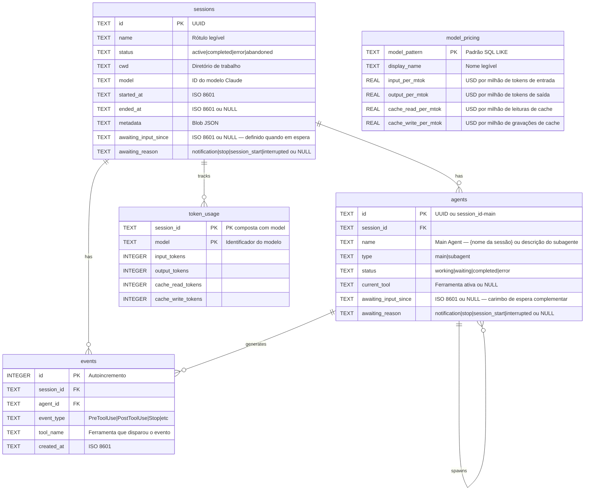

---

## Marketplace de plugins

O CCAM traz **14 plugins** a partir de uma única árvore de código compartilhada. O Claude Code lê `.claude-plugin/marketplace.json`; o Codex lê `.agents/plugins/marketplace.json` mais o `.codex-plugin/plugin.json` de cada plugin. O pacote contém **66 skills de plugins, 18 subagentes do Claude, 34 comandos do Claude, 3 utilitários de CLI, 3 configurações de hooks e 2 plugins com MCP**.

```bash
# Claude Code
claude plugin marketplace add hoangsonww/Claude-Code-Agent-Monitor
claude plugin install ccam-platform@claude-code-agent-monitor-plugins

# Codex
codex plugin marketplace add hoangsonww/Claude-Code-Agent-Monitor
codex plugin add ccam-platform@claude-code-agent-monitor-plugins

# Open Agent Skills / skills.sh-compatible CLI
npx skills add hoangsonww/Claude-Code-Agent-Monitor --list

# Install one skill for Claude Code and Codex in the current project
npx skills add hoangsonww/Claude-Code-Agent-Monitor \
  --skill mcp-server \
  --agent claude-code \
  --agent codex \
  --yes

# Verify, update, and remove the project-scoped skill
npx skills list --json
npx skills update --project --yes
npx skills remove mcp-server --yes

# Add --global to install at user scope, then manage that scope explicitly
npx skills add hoangsonww/Claude-Code-Agent-Monitor \
  --skill mcp-server \
  --agent claude-code \
  --agent codex \
  --global \
  --yes
npx skills list --global --json
npx skills update --global --yes
npx skills remove --global mcp-server --yes
```

A CLI `skills` descobre **77 skills no total no repositório**, incluindo as 66 skills de plugins e as skills de manutenção do repositório. Instalações de projeto usam `.agents/skills/` mais links específicos de cada agente. As skills globais do Claude Code ficam por padrão em `~/.claude/skills/`, ou em `$CLAUDE_CONFIG_DIR/skills/` quando definido. As skills globais do Codex ficam por padrão em `~/.codex/skills/`, ou em `$CODEX_HOME/skills/` quando definido. Instalações para vários agentes podem deduplicar os arquivos por um armazenamento compartilhado e vincular esses destinos. Toda skill de plugin tem frontmatter canônico `name`/`description` e metadados `agents/openai.yaml`. Não é preciso nenhum PR upstream para `vercel-labs/skills` para instalar. O repositório público no GitHub é a origem, e a visibilidade no skills.sh acompanha a publicação e a telemetria real de instalações.

Novos pacotes focados complementam os plugins existentes de análises, produtividade, qualidade, sessões, fluxos, configuração e painel:

- `ccam-runner`: início monitorado, continuação, parada e retomada do Claude Code/Codex, e histórico de execuções
- `ccam-integrations`: regras de alerta, webhooks, notificações push e coleta remota via SSH
- `ccam-platform`: explorador de configuração do Claude/Codex, importação ciente do provedor, restauração de backup, configuração de hooks, atualizações e operações do MCP
- `ccam-reports`: relatórios executivos, de custos, de confiabilidade e de fluxos prontos para apresentar

Valide e regenere os metadados de distribuição com:

```bash
npm run extensions:sync
npm run extensions:validate
```

Catálogo completo, comandos de instalação, comportamento do skills.sh, limites da submissão pública e verificações de instalação limpa: [docs/PLUGINS.md](docs/PLUGINS.md).

---

## Linha de status

Um utilitário independente de linha de status da CLI para o Claude Code que mostra o nome do modelo, o usuário, o diretório de trabalho, o branch git, uma barra de uso da janela de contexto, a contagem de tokens por direção e o custo da sessão — tudo com cores via sequências de escape ANSI.

```
nguyens6@host ~/agent-dashboard/client | Sonnet 4.6 | main | ████████░░ 79% | 3↑ 2↓ 156586c | $0.4231
```

| Segmento | Cor | Exemplo |
| ----------- | -------------------- | -------------------------------------------------------------- |
| Modelo | Ciano | `Sonnet 4.6` |
| Usuário | Verde | `nguyens6` |
| CWD | Amarelo | `~/agent-dashboard` |
| Branch git | Magenta | `main` |
| Barra de contexto | Verde / Amarelo / Vermelho | `████████░░ 79%` |
| Tokens | Verde / Ciano / Esmaecido | `3↑ 2↓ 156586c` (`↑` verde de entrada, `↓` ciano de saída, `c` esmaecido de cache) |
| Custo (USD) | Verde / Amarelo / Vermelho | `$0.4231` (total da sessão — mostrado nos planos de API e de assinatura) |

Faixas de cor do custo: verde abaixo de US$ 5, amarelo de US$ 5 a US$ 20, vermelho a partir de US$ 20.

Veja [`statusline/README.md`](statusline/README.md) para as instruções de instalação.

<p align="center">
  <a href="images/statusline.png"></a>
</p>

---

## Arquitetura do servidor

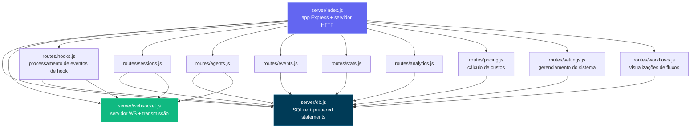

---

## Roteamento do cliente

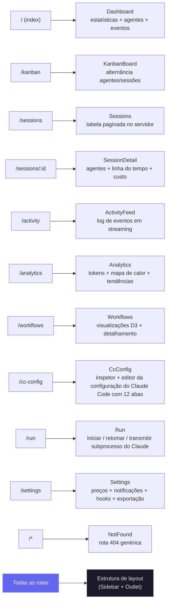

---

## Fluxo do manipulador de hooks

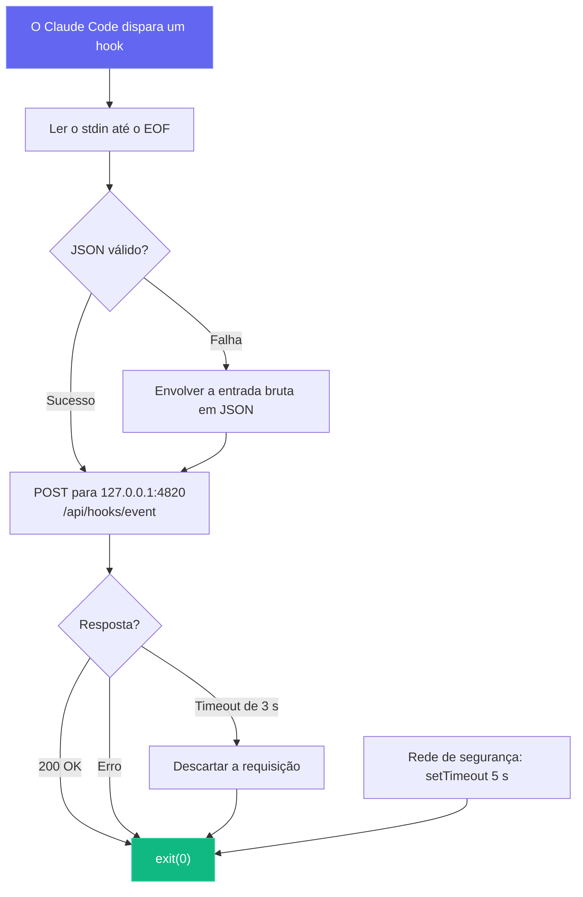

---

## Modos de implantação

Suportamos modos de implantação de desenvolvimento e de produção, com arquiteturas de processos diferentes:

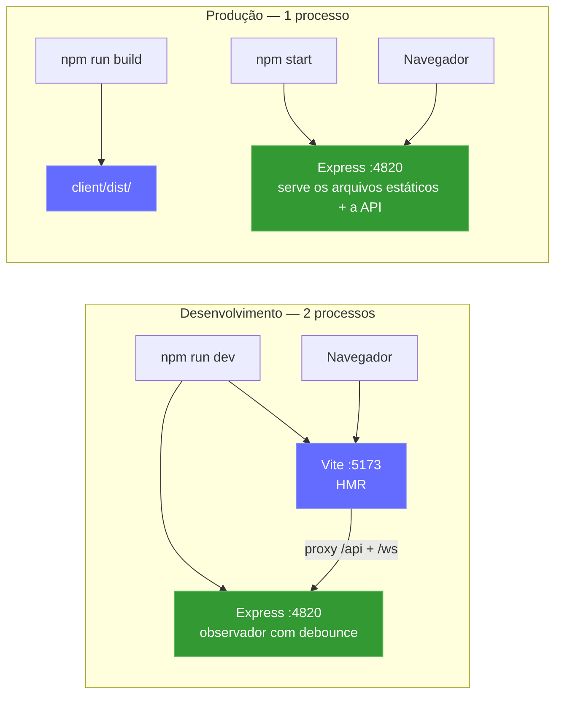

Sidecar MCP local opcional (suporta os transportes stdio, HTTP+SSE e REPL):

```mermaid
graph LR
    subgraph "Opções de transporte do MCP"
        M_STDIO["Servidor MCP (stdio)<br/>npm run mcp:start"]
        M_HTTP["Servidor MCP (HTTP)<br/>npm run mcp:start:http<br/>:8819"]
        M_REPL["Servidor MCP (REPL)<br/>npm run mcp:start:repl"]
    end

    H["Host MCP"] -->|"stdin/stdout"| M_STDIO
    RC["Cliente remoto"] -->|"POST /mcp · GET /sse"| M_HTTP
    OP["Operador"] -->|"CLI interativa"| M_REPL

    M_STDIO --> D["Servidor do painel<br/>:4820"]
    M_HTTP --> D
    M_REPL --> D

    style M_STDIO fill:#0f766e,stroke:#14b8a6,color:#fff
    style M_HTTP fill:#0f766e,stroke:#14b8a6,color:#fff
    style M_REPL fill:#0f766e,stroke:#14b8a6,color:#fff
```

**App de desktop (macOS e Windows)** opcional — um único processo Electron que hospeda o servidor Express no mesmo processo (sem terminal, sem processo filho):

```mermaid
flowchart LR
    subgraph desktop["App de desktop (macOS e Windows) — 1 processo Electron"]
        E_MAIN["Processo principal do Electron<br/>(Node 22 / Electron 35)"]
        E_HOST["server-host.ts<br/>require() server/index.js"]
        E_SRV["Express embutido :4820<br/>API · SQLite · WebSocket"]
        E_WIN["BrowserWindow<br/>cliente React compilado"]
        E_TRAY["Ícone da barra de menus (tray)<br/>+ menu de aplicativo nativo"]
        E_MAIN --> E_HOST
        E_HOST -->|"require() no mesmo processo"| E_SRV
        E_MAIN --> E_TRAY
        E_SRV -->|"http + ws em 127.0.0.1"| E_WIN
    end

    E_HOOKS["Hooks do Claude Code"] -->|"POST /api/hooks/event"| E_SRV

    style E_MAIN fill:#47848F,stroke:#2f5a62,color:#fff
    style E_SRV fill:#339933,stroke:#5cb85c,color:#fff
    style E_WIN fill:#61DAFB,stroke:#3aa9c9,color:#000
```

### Implantação na nuvem

A pilha `deployments/` atende qualquer serviço Kubernetes compatível, incluindo EKS, GKE, AKS, OKE e clusters autogerenciados. O CCAM usa SQLite, então todo manifesto suportado impõe **um único escritor ativo do painel por volume persistente**, com rollout do tipo Recreate. HPA, réplicas ativo-ativo, blue-green e canary propositalmente não são suportados enquanto o SQLite for o backend de persistência.

```mermaid
flowchart LR
  CI["CI: testar · validar · varrer · atestar · assinar"] --> HELM["Helm / Kustomize / Terraform"]
  HELM --> APP["Painel do CCAM<br/>exatamente 1 réplica"]
  APP --> PVC[("PVC ReadWriteOnce retido")]
  EDGE["Ingress ou Gateway API<br/>TLS + WebSocket"] --> APP
  PROM["Prometheus Operator"] -->|"Bearer /api/metrics"| APP
  MCP["Sidecar MCP autenticado"] --> APP
```

- **Helm:** escritor único imposto pelo schema, suporte a digests, PVC retido, Ingress ou Gateway API, montagem de token compatível com External Secrets, NetworkPolicy, MCP e ServiceMonitor opcionais.
- **Kustomize:** base com PSS restrito, mais overlays de dev/staging/produção e componentes opcionais de MCP, monitoramento, Gateway API e snapshots CSI.
- **Terraform:** implanta o chart Helm validado em um cluster Kubernetes existente. A rede da nuvem, a identidade do cluster, o CSI, o TLS e a sincronização de segredos continuam por conta do provedor.
- **Operação:** backup online consistente do SQLite com SHA-256, restauração verificada com escala para zero, implantação/rollback/desmontagem sempre precedidos de backup e verificações de saúde autenticadas.
- **Cadeia de suprimentos da CI:** as imagens do app e do MCP são varridas, publicadas para amd64/arm64 com SBOM e procedência SLSA e assinadas sem chave com o Cosign.

```bash
npm run deploy:validate
REGISTRY="ghcr.io/$(gh repo view --json owner -q .owner.login)"
IMAGE_TAG="$(git rev-parse --short HEAD)"

helm upgrade --install agent-monitor deployments/helm/agent-monitor \
  --namespace agent-monitor-production --create-namespace \
  --values deployments/helm/agent-monitor/values-production.yaml \
  --set image.registry= \
  --set image.repository=${REGISTRY}/claude-code-agent-monitor \
  --set image.tag=${IMAGE_TAG} \
  --atomic --wait --timeout 10m
```

> [!NOTE]
> A configuração completa de produção, segredos, pilha Docker/Podman, Gateway API, Terraform, backup, restauração e rollback estão documentados em [DEPLOYMENT.md](DEPLOYMENT.md) e [deployments/README.md](deployments/README.md).

---

## Estrutura do projeto

```
agent-dashboard/
|-- CLAUDE.md                   # Claude Code project memory and working agreements
|-- AGENTS.md                   # Codex project instructions
|-- package.json                # Root scripts (dashboard + MCP helpers) + server dependencies
|-- .claude/
|   +-- rules/                  # Path-scoped Claude rules
|   +-- skills/                 # Claude reusable project skills
|   +-- agents/                 # Claude custom subagents
|-- .claude-plugin/
|   +-- marketplace.json        # Claude Code marketplace manifest (14 plugins)
|-- .agents/plugins/
|   +-- marketplace.json        # Codex marketplace manifest (same 14 plugins)
|-- plugins/
|   |-- ccam-analytics/         # Analytics: session reports, cost breakdown, usage trends, productivity score
|   |   |-- .claude-plugin/plugin.json
|   |   |-- skills/ (4)         # session-report, cost-breakdown, usage-trends, productivity-score
|   |   |-- agents/             # analytics-advisor (Sonnet model)
|   |   |-- hooks/hooks.json    # Stop + SubagentStop event logging
|   |   +-- bin/ccam-stats      # Terminal dashboard CLI
|   |-- ccam-productivity/      # Productivity: standups, reports, sprints, workflow optimizer
|   |-- ccam-devtools/          # DevTools: debug, diagnostics, export, health checks
|   |   +-- bin/                # ccam-doctor + ccam-export CLIs
|   |-- ccam-insights/          # Insights: patterns, anomalies, optimization, comparison
|   |-- ccam-cost-guard/        # Cost guardrails: budgets, spend forecast, cost alerts, model savings
|   |-- ccam-sessions/          # Session forensics: search, timeline, transcript replay, cwd rollup, cleanup
|   |-- ccam-workflows/         # Workflow orchestration: DAG map, delegation audit, concurrency, fleet runs
|   |-- ccam-quality/           # Reliability & SLOs: error scan, API-error report, hook-failure audit, SLO check
|   |-- ccam-config/            # Config & memory governance: config audit, memory review, skill/MCP/hook inventory
|   +-- ccam-dashboard/         # Dashboard connector: status, quick stats, MCP integration
|       +-- .mcp.json           # MCP server configuration
|-- server/
|   |-- index.js                 # Express app, HTTP server, static serving
|   |-- db.js                    # SQLite schema, migrations, prepared statements
|   |-- websocket.js             # WebSocket server with heartbeat
|   +-- routes/
|       |-- hooks.js             # Hook event processing (transactional)
|       |-- sessions.js          # Session CRUD
|       |-- agents.js            # Agent CRUD
|       |-- events.js            # Event listing
|       |-- stats.js             # Aggregate statistics
|       |-- analytics.js         # Token, tool, and trend analytics
|       |-- workflows.js         # Aggregate workflow data and per-session drill-in
|       |-- pricing.js           # Model pricing CRUD and cost calculation
|       +-- settings.js          # System info, data management, export, cleanup
|   +-- lib/
|       +-- transcript-cache.js  # Stat-based JSONL transcript cache with chunked sync byte-stream reader (4 MiB chunks, line-by-line UTF-8 decode) so files larger than V8's max string length (~512 MiB) parse without aborting Node with "FATAL ERROR: v8::ToLocalChecked Empty MaybeLocal". Extracts tokens, compactions, API errors, turn durations, thinking blocks, and usage extras (service_tier, speed, inference_geo)
|   +-- compat-sqlite.js         # node:sqlite compatibility wrapper (fallback for better-sqlite3)
|-- client/
|   |-- package.json             # Client dependencies
|   |-- index.html               # HTML entry point
|   |-- vite.config.ts           # Vite + proxy config
|   |-- tailwind.config.js       # Custom dark theme
|   |-- tsconfig.json            # Strict TypeScript
|   +-- src/
|       |-- main.tsx             # React entry
|       |-- App.tsx              # Router + WebSocket provider
|       |-- index.css            # Tailwind + custom utilities
|       |-- lib/
|       |   |-- types.ts         # Shared TypeScript interfaces
|       |   |-- api.ts           # Typed fetch client
|       |   |-- format.ts        # Date/time formatting utilities
|       |   +-- eventBus.ts      # Pub/sub for WebSocket distribution
|       |-- hooks/
|       |   |-- useWebSocket.ts      # Auto-reconnecting WebSocket hook
|       |   +-- useNotifications.ts  # Browser notification triggers from WebSocket events
|       |-- components/
|       |   |-- Layout.tsx       # Shell with sidebar + outlet
|       |   |-- Sidebar.tsx      # Navigation + connection indicator
|       |   |-- AgentCard.tsx    # Agent info card with status
|       |   |-- StatCard.tsx     # Metric card
|       |   |-- StatusBadge.tsx  # Color-coded status pills
|       |   |-- EmptyState.tsx   # Placeholder for empty lists
|       |   +-- workflows/       # D3.js workflow visualization components
|       |       |-- OrchestrationDAG.tsx            # Horizontal DAG of agent spawning patterns
|       |       |-- ToolExecutionFlow.tsx           # d3-sankey diagram of tool-to-tool transitions
|       |       |-- AgentCollaborationNetwork.tsx   # Force-directed agent pipeline graph
|       |       |-- SubagentEffectiveness.tsx       # Scorecard grid with SVG success rings
|       |       |-- WorkflowPatterns.tsx            # Auto-detected orchestration sequences
|       |       |-- ModelDelegationFlow.tsx         # Model routing through agent hierarchies
|       |       |-- ErrorPropagationMap.tsx         # Error clustering by hierarchy depth
|       |       |-- ConcurrencyTimeline.tsx         # Swim-lane parallel agent execution
|       |       |-- SessionComplexityScatter.tsx    # D3 bubble chart (duration vs agents vs tokens)
|       |       |-- CompactionImpact.tsx            # Token compression events and recovery
|       |       |-- WorkflowStats.tsx               # Aggregate workflow statistics
|       |       +-- SessionDrillIn.tsx              # Per-session agent tree, tool timeline, events
|       +-- pages/
|           |-- Dashboard.tsx      # Overview page
|           |-- KanbanBoard.tsx    # Agents/Sessions toggle, status columns
|           |-- Sessions.tsx       # Server-paginated sessions table
|           |-- SessionDetail.tsx  # Single session deep dive
|           |-- ActivityFeed.tsx   # Real-time event stream
|           |-- Analytics.tsx      # Token usage, heatmap, trends
|           |-- Workflows.tsx      # D3.js workflow visualizations and session drill-in
|           |-- Settings.tsx       # Model pricing, notifications, hooks, export, cleanup
|           +-- NotFound.tsx       # 404 catch-all page
|-- scripts/
|   |-- hook-handler.js          # Lightweight stdin-to-HTTP forwarder
|   |-- install-hooks.js         # Auto-configures ~/.claude/settings.json
|   |-- import-history.js        # Imports sessions from ~/.claude/ with enhanced JSONL extraction (API errors, turn durations, entrypoint, permission modes, thinking blocks, usage extras, tool errors, subagent JSONL files). Re-import is fully incremental: a per-event-type high-water mark (`MAX(created_at) GROUP BY event_type` per session) is computed up-front and only JSONL entries with `ts > cutoff[type]` are inserted, so long-running sessions whose transcripts grow across multiple days continue to receive Stop / PostToolUse / TurnDuration / ToolError events on every re-run. Also rolls `sessions.ended_at` forward when the JSONL advances past the stored value and refreshes message-count metadata on every pass
|   +-- seed.js                  # Sample data generator
|-- mcp/
|   |-- package.json             # MCP package scripts + dependencies
|   |-- README.md                # MCP setup, host config, tool catalog, safety model
|   |-- src/
|   |   |-- index.ts             # MCP runtime entrypoint (transport router)
|   |   |-- server.ts            # MCP server assembly
|   |   |-- clients/             # Dashboard API client with retry/backoff
|   |   |-- config/              # Environment/CLI config parsing
|   |   |-- core/                # Logger, tool registry, result helpers
|   |   |-- policy/              # Mutation/destructive guards
|   |   |-- tools/               # 16 domain modules registering 103 tools
|   |   |-- transports/          # HTTP+SSE server, REPL, tool collector
|   |   |-- ui/                  # ANSI banner, colors, formatter, tables
|   |   +-- types/               # Shared MCP type definitions
|   +-- build/                   # Built MCP runtime output
|-- desktop/
|   |-- package.json             # Electron + electron-builder dependencies and scripts
|   |-- electron-builder.yml     # DMG packaging config; signing/notarization hooks
|   |-- tsconfig.json            # Strict TypeScript (src/ -> out/)
|   |-- README.md                # Desktop app architecture reference (contributor docs)
|   |-- assets/                  # icon.svg + generated icon.icns + tray PNGs
|   |-- src/
|   |   |-- main.ts              # Electron main process entry — lifecycle, wiring
|   |   |-- server-host.ts       # In-process Express boot, port discovery, adoption, DB close
|   |   |-- window.ts            # BrowserWindow + persisted window geometry
|   |   |-- tray.ts              # Menu-bar (tray) icon + context menu
|   |   |-- menu.ts              # Native application menu (File ▸ Open Dashboard is macOS-only)
|   |   |-- login-item.ts        # macOS Login Items auto-start toggle (SMAppService)
|   |   |-- logger.ts            # File logger -> ~/Library/Logs/Claude Code Monitor/desktop.log
|   |   |-- constants.ts         # App name, ports, timeouts, window size
|   |   +-- preload.ts           # Intentionally empty (zero renderer privilege)
|   |-- scripts/
|   |   |-- install.js           # Preflights native deps for desktop:install; prints setup help + exits non-zero on failure
|   |   |-- preflight.js         # Shared better-sqlite3 binary check + actionable per-OS setup help (incl. no-toolchain alternative)
|   |   |-- prebuild.js          # Ensures root + client are built before tsc; fails fast with setup help if native binary missing
|   |   |-- build-icons.sh       # SVG -> PNG/ICNS via qlmanage/sips/iconutil
|   |   +-- notarize.js          # electron-builder afterSign hook (opt-in notarization)
|   +-- tests/
|       +-- smoke.test.mjs       # Spawn Electron + probe /api/health
|-- deployments/
|   |-- README.md                # Production deployment reference
|   |-- nginx/                   # Rootless Nginx edge and opt-in hook/MCP policies
|   |-- secrets/                 # Ignored Compose token/password files
|   |-- terraform/               # Helm deployment to an existing Kubernetes cluster
|   |-- kubernetes/              # One-writer Kustomize base + environment overlays
|   |   |-- base/                # Restricted PSS, Recreate Deployment, PVC, Service, Ingress
|   |   |-- overlays/            # Dev, staging, production namespaces and resources
|   |   +-- components/          # MCP, ServiceMonitor, Gateway API, VolumeSnapshot
|   |-- helm/agent-monitor/      # Schema-enforced Helm chart and environment values
|   +-- scripts/                 # Validate, deploy, backup, restore, rollback, health, teardown
|-- .codex/
|   |-- config.toml              # Codex runtime configuration
|   |-- README.md                # Codex setup guide for agents and skills
|   |-- rules/                   # Codex execution policy rules
|   |-- agents/                  # Codex custom agent templates
|   +-- skills/                  # Codex project skills
|-- statusline/
|   |-- README.md                # Statusline installation & usage guide
|   |-- statusline.py            # Python script that renders the statusline
|   +-- statusline-command.sh    # Shell wrapper for Claude Code's statusLine config
+-- data/
    +-- dashboard.db             # SQLite database (gitignored)
```

---

## Solução de problemas

| Problema | Solução |
| --------------------------------- | ---------------------------------------------------------------------------------------------------------------------------------------------------------------- |
| A instalação do `better-sqlite3` falha | Não é fatal — o servidor recorre automaticamente ao módulo nativo do Node.js `node:sqlite` (Node 22+). Em versões mais antigas do Node, instale o Python 3 e as ferramentas de compilação C++ e depois rode `npm rebuild better-sqlite3` |
| Os hooks não disparam | Rode `npm run install-hooks` e reinicie o Claude Code. Verifique se os hooks estão em `~/.claude/settings.json` |
| O painel não mostra dados | Garanta que o servidor esteja rodando (`npm run dev`) antes de iniciar uma sessão do Claude Code. Confira `http://localhost:4820/api/health` |
| WebSocket desconectado | O cliente reconecta automaticamente a cada 2 segundos. Verifique se a porta 4820 não está bloqueada por um firewall |
| Dados antigos após reiniciar | O banco persiste entre reinicializações. Rode `npm run seed` para ter dados de demonstração novos ou exclua `data/dashboard.db` para redefinir tudo |
| As ferramentas MCP não conectam | Confirme se a API do painel está no ar em `MCP_DASHBOARD_BASE_URL` e recompile/inicie o MCP (`npm run mcp:build`, `npm run mcp:start`) |

---

## Como contribuir

Contribuições são bem-vindas — veja [`.github/CONTRIBUTING.md`](.github/CONTRIBUTING.md) para o guia completo.

Todas as pessoas que contribuem precisam assinar o [Contributor License Agreement](https://github.com/hoangsonww/Claude-Code-Agent-Monitor/blob/master/CLA.md). Isso é aplicado automaticamente em todo pull request pela GitHub Action `🖋️ CLA Assistant`: na primeira vez que você abre um PR, um bot pede que você assine comentando `I have read the CLA Document and I hereby sign the CLA`. A verificação de status **CLA Assistant** do PR fica vermelha até você fazer isso, e assinar uma vez cobre todas as contribuições futuras.

---

## Licença

MIT. Veja [LICENSE](LICENSE) para os detalhes.
