# Agent Dashboard para Claude Code, Cursor e Codex

### Plataforma de monitoramento em tempo real da atividade dos agentes do Claude Code, Cursor e Codex 🚀

Um painel profissional para acompanhar e visualizar em tempo real as sessões dos agentes do Claude Code, Cursor e Codex: uso de ferramentas, histórico de conversas, custo e orquestração de subagentes. Feito com Node.js, Express, React e SQLite, ele combina hooks nativos com a descoberta local de transcrições específica de cada provedor.


> [!TIP]
> Veja também [README-EN.md](./README-EN.md) (English), [README-CN.md](./README-CN.md) (中文), [README-VN.md](./README-VN.md) (Tiếng Việt), [README-KO.md](./README-KO.md) (한국어) e [README-ES.md](./README-ES.md) (Español). Este é o README em português do Brasil.

> [!NOTE]
> Precisa de ajuda focada em tarefas? A [Wiki do GitHub](https://github.com/hoangsonww/Claude-Code-Agent-Monitor/wiki) é o manual prático para o uso do dia a dia, operação em equipe, solução de problemas, automação com CLI/MCP e receitas de implantação. A [Wiki estática localizada](https://hoangsonww.github.io/Claude-Code-Agent-Monitor/wiki/) continua sendo o tour do produto e da arquitetura em inglês, vietnamita, chinês, coreano, espanhol e português; os contratos técnicos exatos ficam em [`docs/`](./docs/README.md).

---

## Índice

- [Visão geral](#visão-geral)
- [Internacionalização (i18n)](#internacionalização-i18n)
- [Funcionalidades](#funcionalidades)
- [Início rápido](#início-rápido)
- [Como funciona](#como-funciona)
- [Configuração](#configuração)
- [Scripts npm](#scripts-npm)
- [Marketplace de plugins](#marketplace-de-plugins)
- [Extensões de agente](#extensões-de-agente)
- [Integração MCP](#integração-mcp)
- [Referência da API](#referência-da-api)
- [Eventos de hook](#eventos-de-hook)
- [Notificações do navegador](#notificações-do-navegador)
- [Aviso de atualização](#aviso-de-atualização)
- [Tabby — Gato companheiro flutuante](#tabby--gato-companheiro-flutuante)
- [Sinais sonoros](#sinais-sonoros)
- [Janela de status da conexão](#janela-de-status-da-conexão)
- [Extensão do VS Code](#extensão-do-vs-code)
- [App de desktop (macOS e Windows)](#app-de-desktop-macos-e-windows)
- [Armazenamento de dados](#armazenamento-de-dados)
- [Statusline](#statusline)
- [Arquitetura do servidor](#arquitetura-do-servidor)
- [Roteamento do cliente](#roteamento-do-cliente)
- [Fluxo do manipulador de hooks](#fluxo-do-manipulador-de-hooks)
- [Modos de implantação](#modos-de-implantação)
- [Estrutura do projeto](#estrutura-do-projeto)
- [Solução de problemas](#solução-de-problemas)
- [Contribuindo](#contribuindo)
- [Licença](#licença)

---

## Visão geral

Acompanhe sessões, monitore agentes em tempo real, visualize o uso de ferramentas, reveja conversas e observe a orquestração de subagentes por uma interface web profissional com tema escuro. O Claude Code e o Codex usam seus hooks nativos; o Cursor vem incluído de fábrica por meio de eventos ao vivo compatíveis e da descoberta nativa de transcrições em `~/.cursor`.


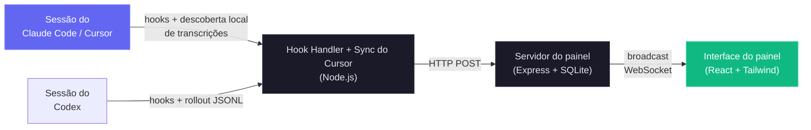

Além do painel de monitoramento em tempo real, o projeto inclui uma implementação local de servidor MCP em `mcp/` que expõe um catálogo de ferramentas para inspecionar e gerenciar o próprio painel, facilitando integrar as operações do painel direto nos seus fluxos do Claude Code e do Codex. Há também uma camada de extensões de agente, com plugins, skills e subagentes do Claude Code e do Codex para interagir com o painel, fazer análises e obter inteligência de fluxos.

### Internacionalização (i18n)

A interface vem com troca de idioma embutida para inglês (`en`), chinês (`zh`), vietnamita (`vi`), coreano (`ko`), espanhol (`es`) e português do Brasil (`pt`). Um menu de idiomas próprio evita que o seletor aperte a barra lateral conforme mais idiomas são adicionados. Os recursos de idioma são carregados por namespace e guardados no armazenamento do navegador, para a preferência do usuário se manter entre recarregamentos.

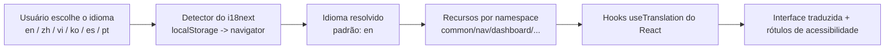

Para a arquitetura completa e a orientação de operação, veja [docs/I18N.md](./docs/I18N.md).

### Interface do usuário

A interface escura e responsiva cobre o fluxo inteiro. Cada prévia usa uma miniatura que funciona no celular e leva ao original em alta resolução.

<p align="center">
  <a href="images/dashboard.png">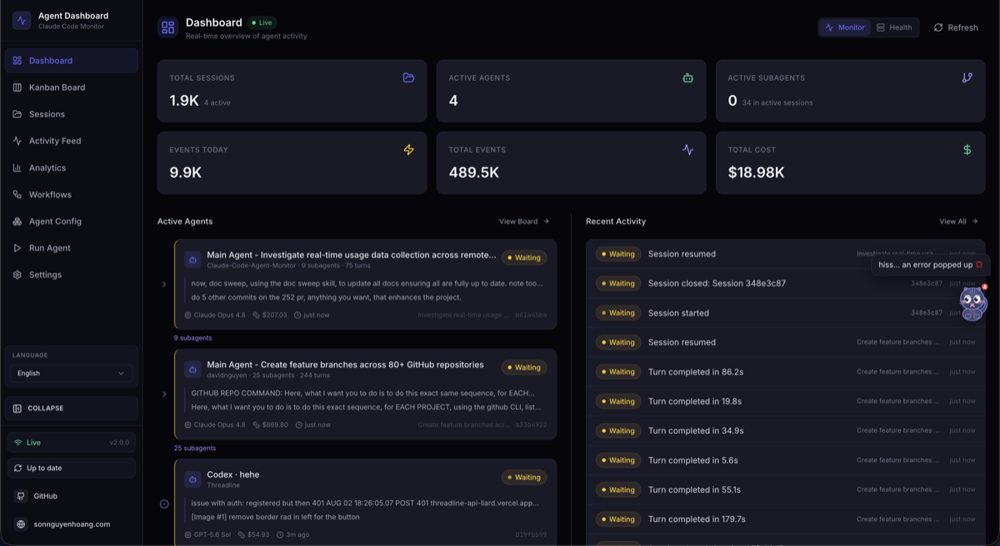</a>
  <br>
  <em>📡 <strong>Painel</strong> · totais da frota, agentes ativos, atividade recente e sinais de saúde ao vivo</em>
</p>

<p align="center">
  <a href="images/tasks-overview.png">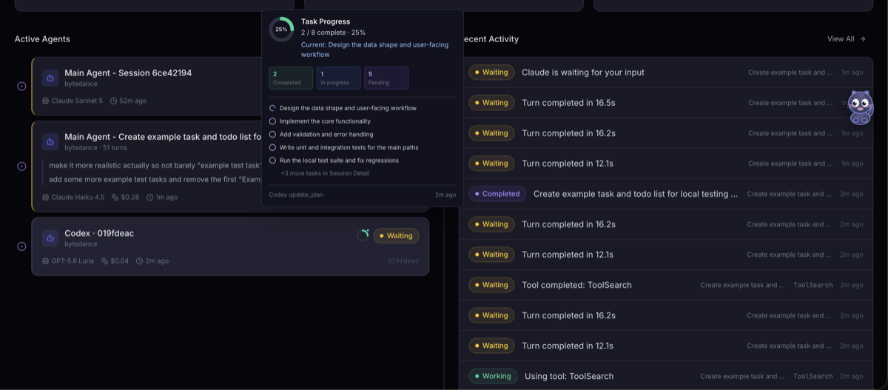</a>
  <br>
  <em>📋 <strong>Progresso das tarefas</strong> · prévias compactas de conclusão e do trabalho com seus responsáveis</em>
</p>

<p align="center">
  <a href="images/dashboard-health.png">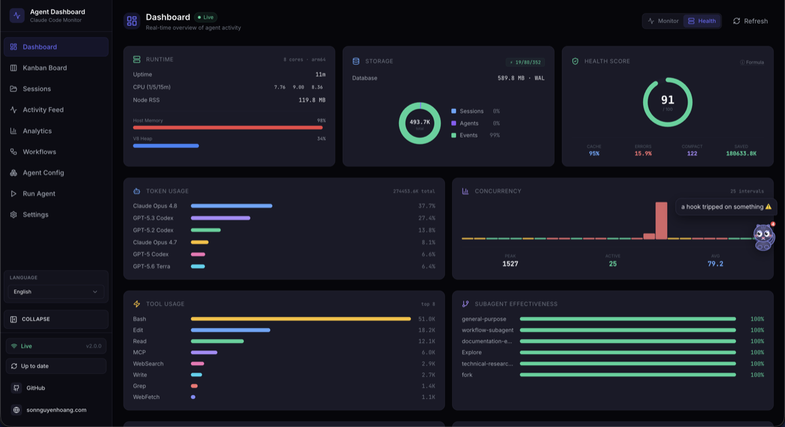</a>
  <br>
  <em>🩺 <strong>Saúde do sistema</strong> · armazenamento, cache, erros, ferramentas, modelos, subagentes e compactações</em>
</p>

<p align="center">
  <a href="images/board.png">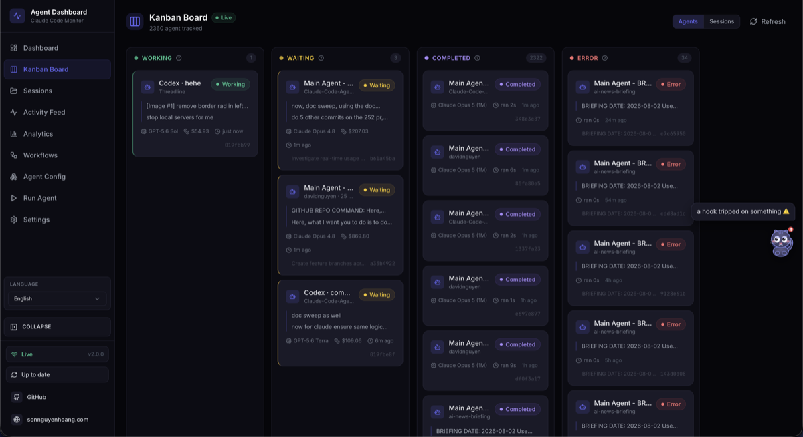</a>
  <br>
  <em>📋 <strong>Quadro Kanban · Agentes</strong> · agentes trabalhando, aguardando, concluídos e com falha, com o motivo da espera bem claro</em>
</p>

<p align="center">
  <a href="images/board-sessions.png">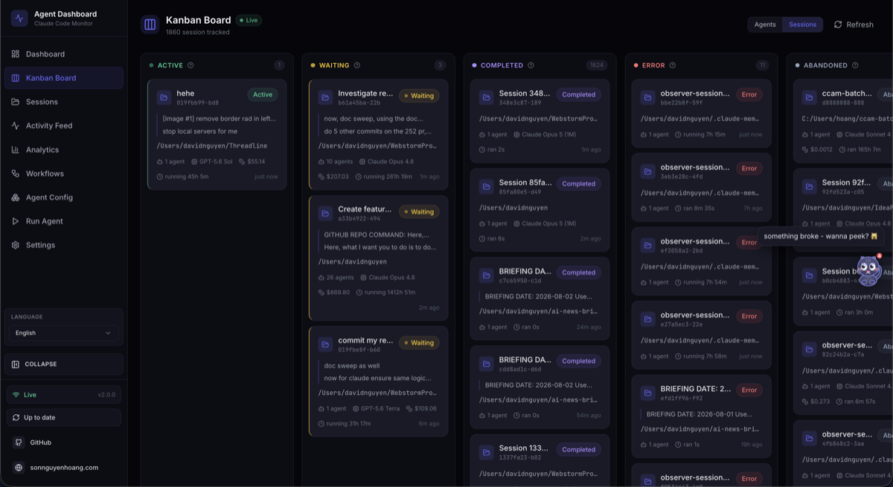</a>
  <br>
  <em>🗂️ <strong>Quadro Kanban · Sessões</strong> · sessões ativas, aguardando, concluídas, com erro e abandonadas</em>
</p>

<p align="center">
  <a href="images/sessions.png">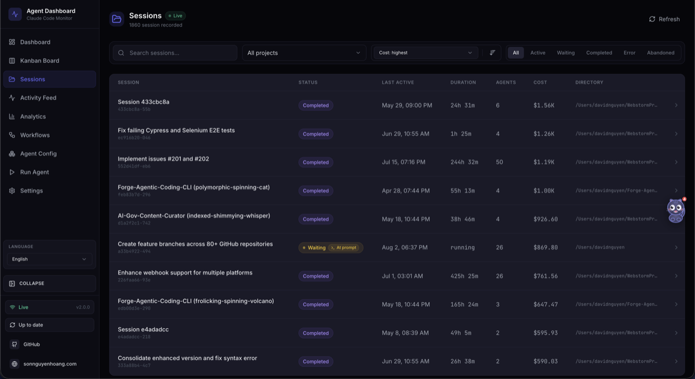</a>
  <br>
  <em>📂 <strong>Sessões</strong> · histórico com busca, filtros e paginação no servidor, com custos e atividade</em>
</p>

<p align="center">
  <a href="images/session-agents.png">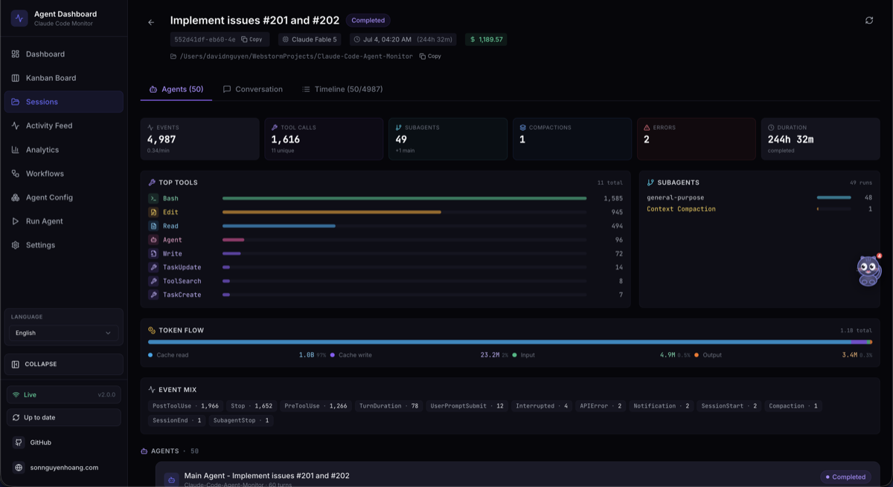</a>
  <br>
  <em>🤖 <strong>Agentes da sessão</strong> · totais ao vivo, uso de ferramentas, fluxo de tokens e hierarquia de agentes</em>
</p>

<p align="center">
  <a href="images/tasks-details.png">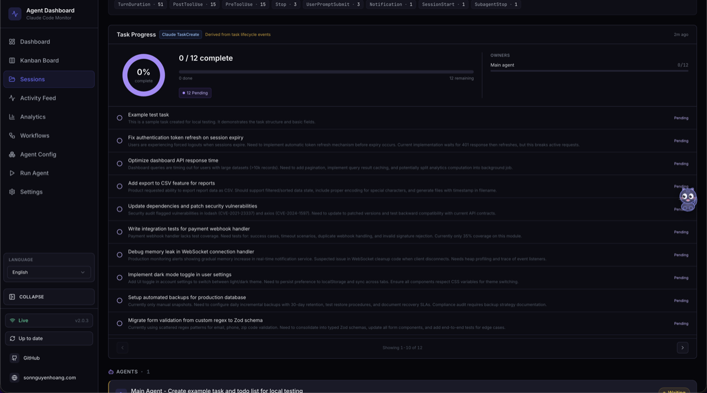</a>
  <br>
  <em>✅ <strong>Detalhes das tarefas</strong> · segmentos de conclusão, trabalho ativo, responsáveis e tarefas paginadas</em>
</p>

<p align="center">
  <a href="images/session-conversation.png">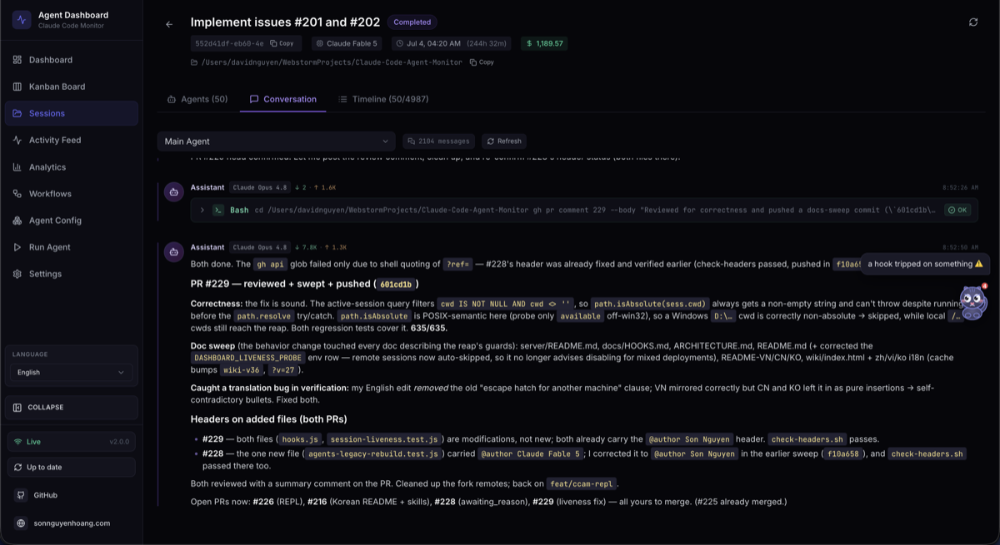</a>
  <br>
  <em>💬 <strong>Conversa</strong> · transcrições renderizadas, código, chamadas de ferramenta, saída de comandos e marcadores da sessão</em>
</p>

<p align="center">
  <a href="images/session-timeline.png">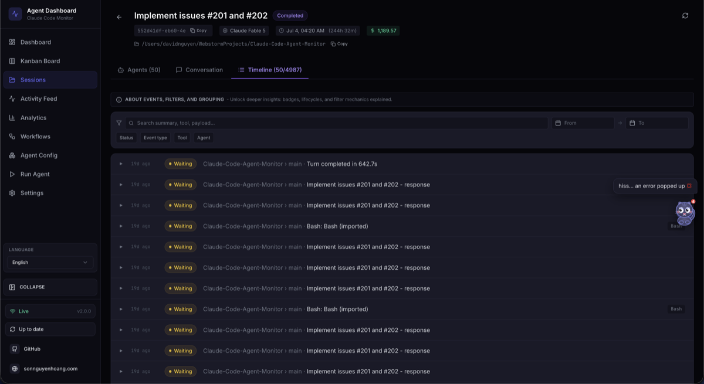</a>
  <br>
  <em>🔬 <strong>Linha do tempo</strong> · eventos em ordem cronológica, filtros multidimensionais e atividade de ferramentas em pares</em>
</p>

<p align="center">
  <a href="images/feed.png">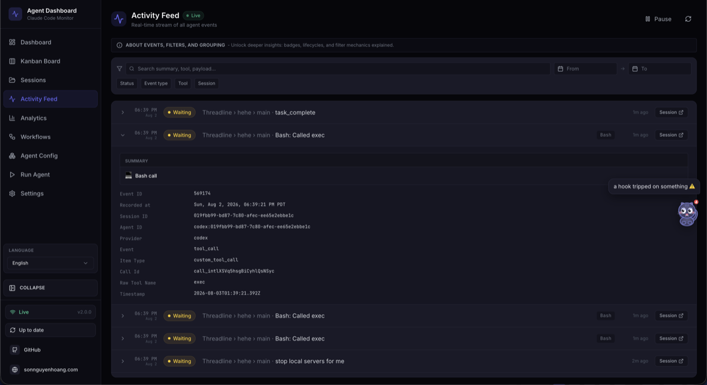</a>
  <br>
  <em>📰 <strong>Feed de atividade</strong> · eventos ao vivo que podem ser pausados, agrupamento, filtros e atalhos para a sessão</em>
</p>

<p align="center">
  <a href="images/analytics.png">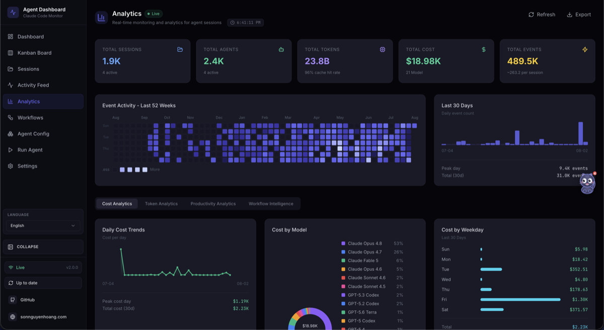</a>
  <br>
  <em>📊 <strong>Análises</strong> · tokens por modelo, frequência de ferramentas, mapas de calor de atividade e tendências de sessões</em>
</p>

<p align="center">
  <a href="images/workflows.png">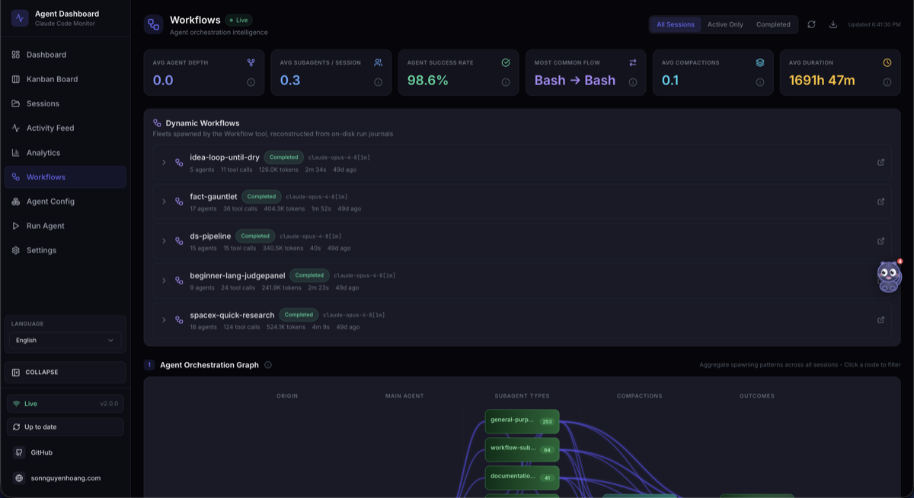</a>
  <br>
  <em>🔀 <strong>Fluxos</strong> · grafos de orquestração, fluxo de ferramentas, colaboração, delegação e padrões</em>
</p>

<p align="center">
  <a href="images/dynamicworkflows-workflows.png">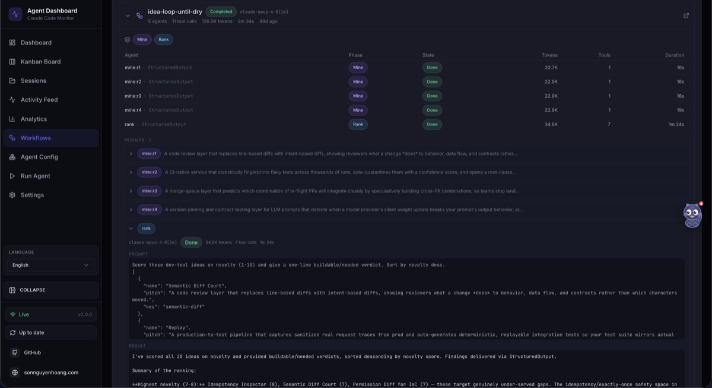</a>
  <br>
  <em>🧬 <strong>Execuções de workflow</strong> · status vindo do diário, agentes, tokens, ferramentas e duração</em>
</p>

<p align="center">
  <a href="images/dynamicworkflows-workflows2.png">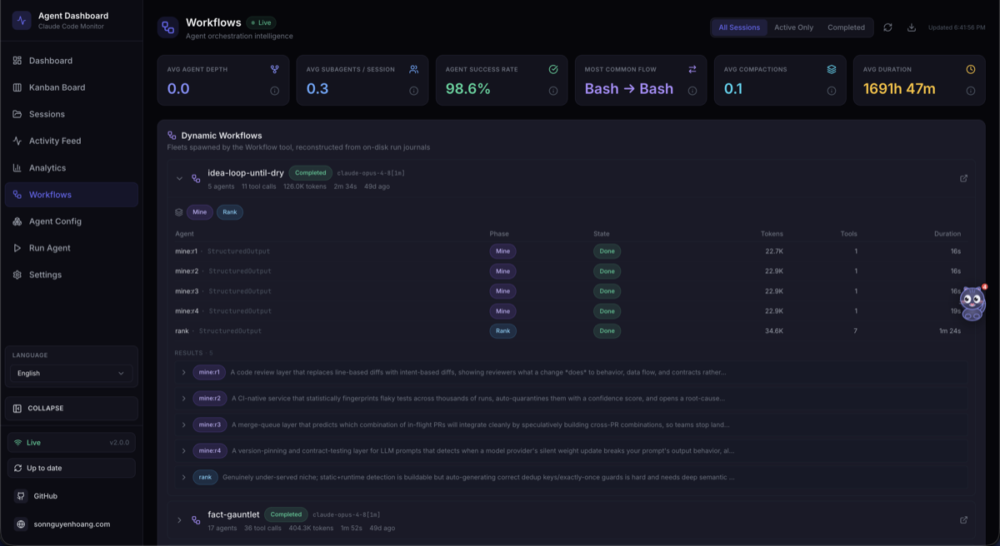</a>
  <br>
  <em>🧬 <strong>Execução expandida</strong> · filtros por fase, métricas por agente, prompts e resultados completos</em>
</p>

<p align="center">
  <a href="images/dynamicworkflows-session.png">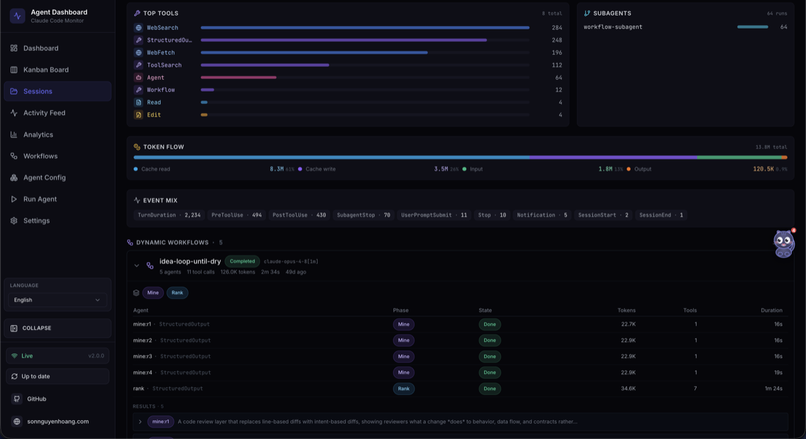</a>
  <br>
  <em>🧬 <strong>Workflows da sessão</strong> · execuções dinâmicas vinculadas e custos de tokens somados</em>
</p>

<p align="center">
  <a href="images/config.png">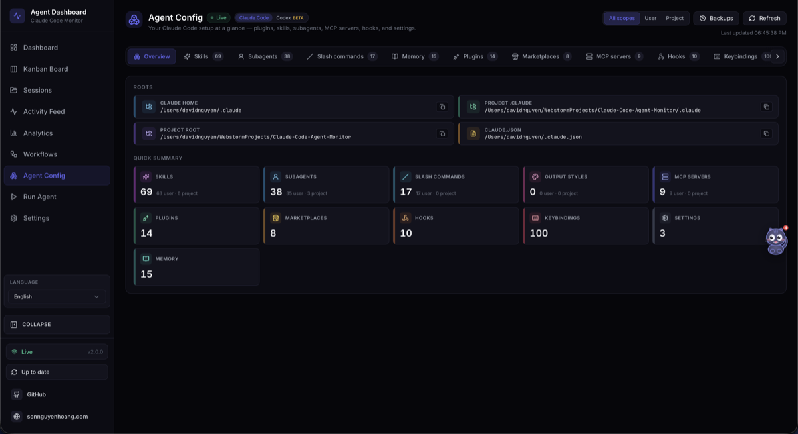</a>
  <br>
  <em>🧰 <strong>Config. do agente</strong> · inspecione e edite com segurança a configuração suportada do Claude Code e do Codex</em>
</p>

<p align="center">
  <a href="images/config-codex.png">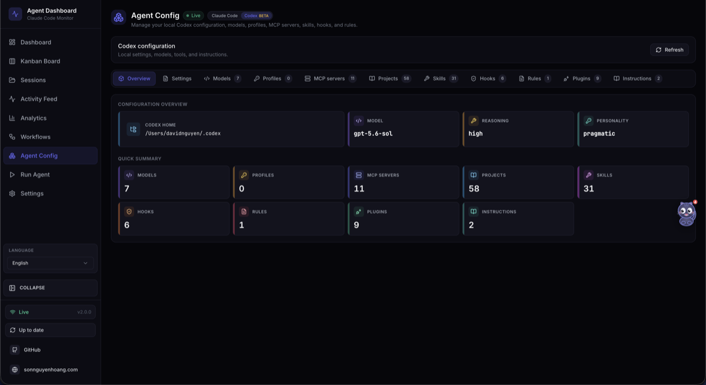</a>
  <br>
  <em>🧰 <strong>Configuração do Codex</strong> · modelos, perfis, MCP, projetos, skills, hooks, regras, plugins e instruções</em>
</p>

<p align="center">
  <a href="images/config-skills.png">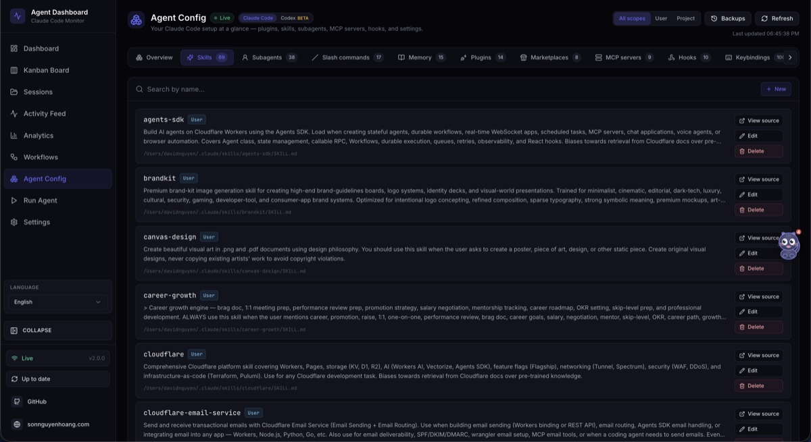</a>
  <br>
  <em>🧩 <strong>Skills</strong> · skills do usuário, do projeto e de plugins com busca e edição com backup</em>
</p>

<p align="center">
  <a href="images/run.png">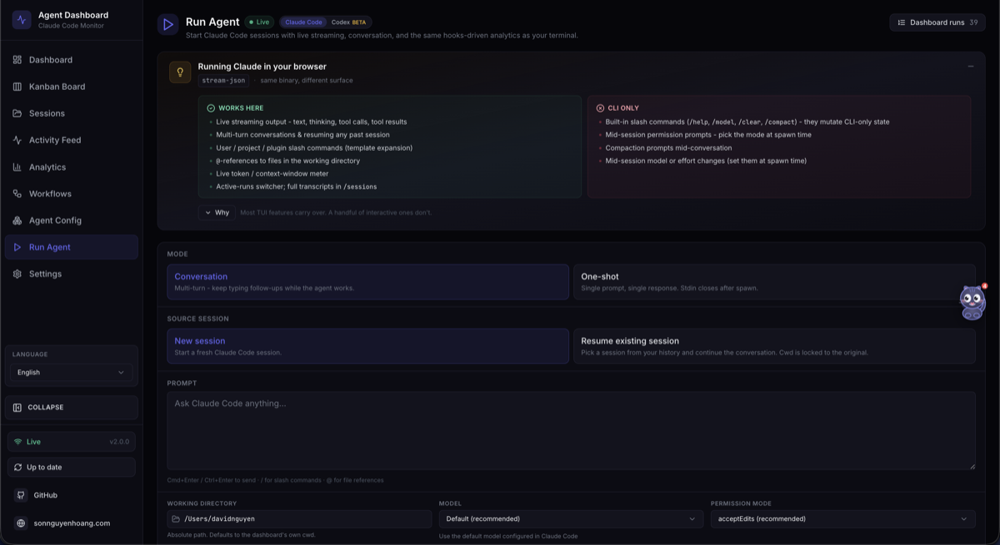</a>
  <br>
  <em>▶️ <strong>Executar agente</strong> · inicie o Claude Code ou o Codex com os controles nativos de cada provedor</em>
</p>

<p align="center">
  <a href="images/run-results.png">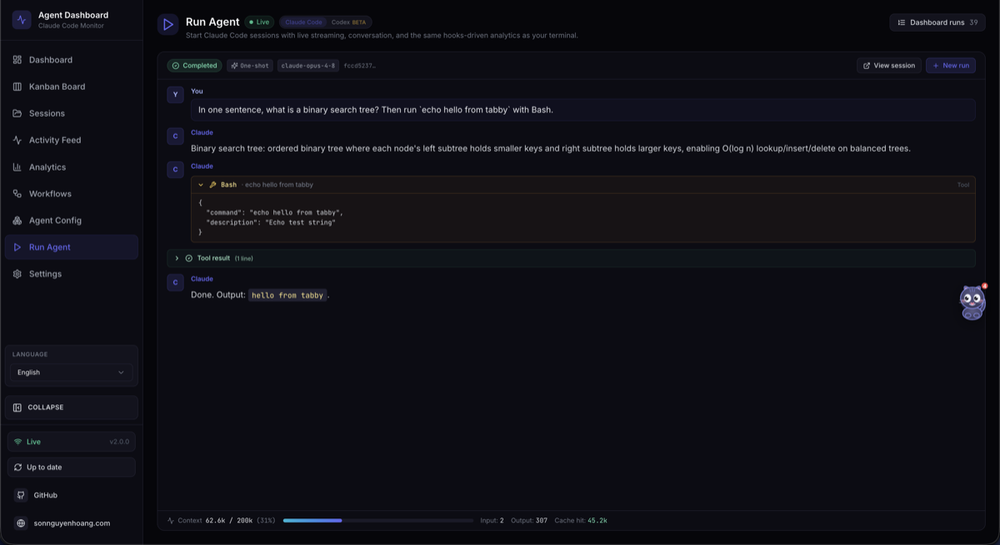</a>
  <br>
  <em>💬 <strong>Execução ao vivo</strong> · chat em streaming, raciocínio, comandos, alterações de arquivos, ferramentas e reconexão</em>
</p>

<p align="center">
  <a href="images/settings.png">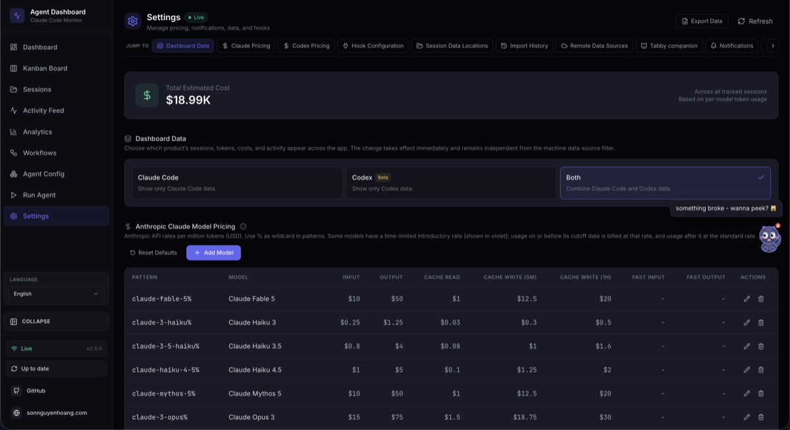</a>
  <br>
  <em>⚙️ <strong>Configurações</strong> · preços, hooks, notificações, dados, fontes remotas e status do sistema</em>
</p>

<p align="center">
  <a href="images/alerts.png">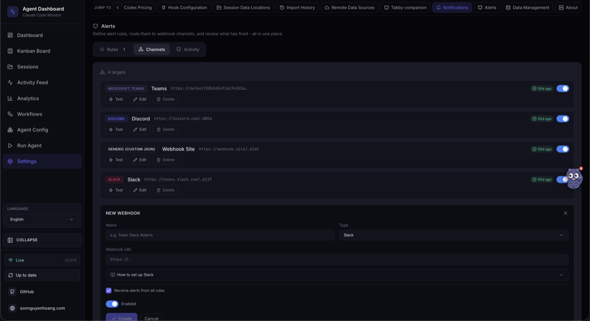</a>
  <br>
  <em>🔔 <strong>Alertas</strong> · regras, intervalos mínimos, atividade e webhooks prontos ou genéricos com assinatura</em>
</p>

<p align="center">
  <a href="images/remote.png">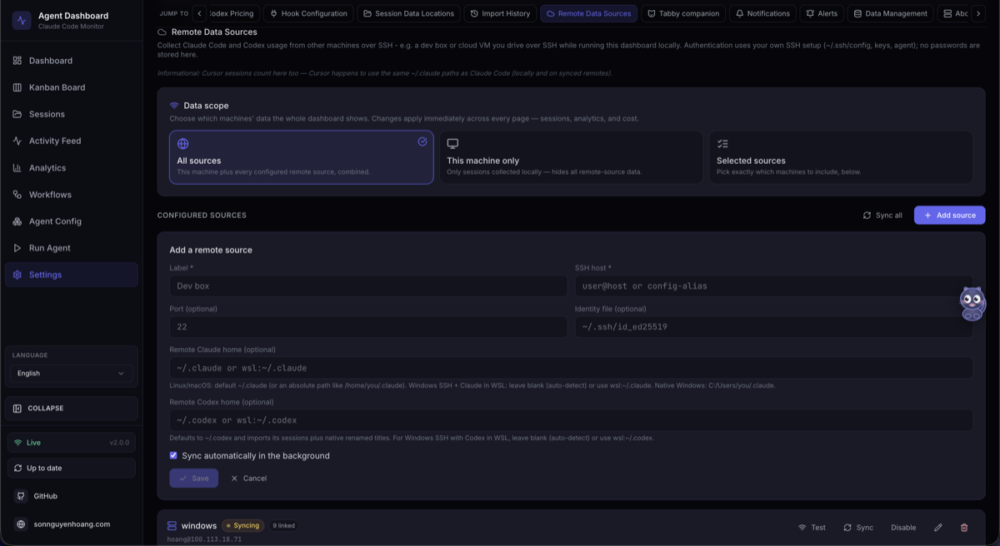</a>
  <br>
  <em>🛰️ <strong>Fontes de dados remotas</strong> · sincronização por SSH ciente do provedor e monitoramento por fonte</em>
</p>

<p align="center">
  <a href="images/palette.png">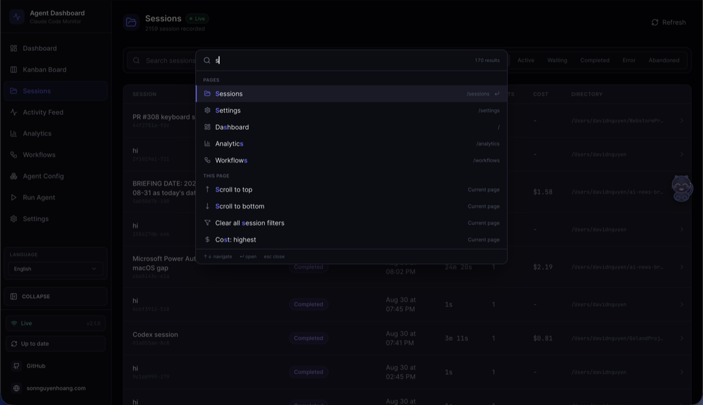</a>
  <br>
  <em>⌘ <strong>Paleta de comandos</strong> · um lançador de teclado para páginas, sessões, projetos, filtros e ações</em>
</p>

A barra lateral leva a Painel, Quadro Kanban, Sessões, Feed de atividade, Análises, Fluxos, Config. do agente, Executar agente e Configurações. As seções abaixo descrevem o comportamento completo por trás dessas telas.

---

## Funcionalidades


O painel cobre o ciclo de vida completo dos agentes locais. Os contratos detalhados de operação ficam nas seções indicadas e nas referências de `docs/`.

| Funcionalidade | Resumo |
| --- | --- |
| **Progresso das tarefas** | Progresso com responsáveis vindo das ferramentas de tarefa do Claude, do antigo `TodoWrite` e do `update_plan` do Codex. Prévias compactas aparecem em cartões e linhas; os Detalhes da sessão adicionam segmentos de status, trabalho ativo, responsáveis e paginação de 10 linhas. Trabalho novo de nível superior limpa o estado inacabado antigo, enquanto o histórico concluído fica. |
| **Painel** | As abas persistentes **Monitor** e **Saúde** juntam totais da frota, hierarquias ativas, atividade recente, saúde ponderada de sucesso/cache/erros/heap, armazenamento, ferramentas, modelos, eficácia dos subagentes e métricas de compactação. A Saúde atualiza a cada 5 segundos a partir de `/api/settings/info` e `/api/workflows`. |
| **Quadro Kanban** | As colunas de agentes cobrem Trabalhando, Aguardando, Concluído e Erro; as de sessões adicionam Ativas e Abandonadas. Os cartões paginam de 10 em 10, assinam só a visão WebSocket ativa, mantêm os títulos completos e explicam os motivos de espera, como pedido de permissão, fim do turno, prompt parado ou interrupção. |
| **Sessões** | Histórico com busca, filtros e paginação no servidor, com cálculo de custo da página visível e uma linha temporária em memória para o início do Codex. O seletor de provedor filtra Claude Code, Cursor ou Codex respeitando o escopo de produto escolhido na primeira execução ou em Configurações. A busca cobre `id`, `name` e `cwd` com espera de 300 ms. Os nomes vêm do título explícito, do título da IA e, por fim, do primeiro prompt relevante do usuário. O Cursor troca um nome provisório tirado do primeiro prompt pelo título nativo gerado só quando os metadados de coleta provam que o CCAM é dono do nome atual; nomes manuais e nomes antigos ambíguos ficam como estão. |
| **Detalhes da sessão** | Estatísticas ao vivo, trabalho ativo, uso de ferramentas, subagentes, tokens, hierarquia, linhas do tempo de eventos filtradas, agrupamento por `tool_use_id` e renderizadores específicos de cada ferramenta. A visão de conversa mostra turnos em fila, avisos do sistema, Markdown, código destacado e ferramentas estilizadas; as faixas de espera mostram o motivo e o tempo decorrido. |
| **Feed de atividade** | Eventos em tempo real que podem ser pausados, com filtros compartilhados, paginação no servidor, agrupamento, origem por projeto/sessão/subagente, links para a sessão e selos de status consistentes entre Claude e Codex. |
| **Análises** | Tokens por modelo, frequência de ferramentas, mapas de calor de atividade alinhados ao domingo, tendências de sessões, estado da conexão, esqueletos de carregamento no mesmo layout e legendas longas paginadas. |
| **Paleta de comandos** | `Cmd/Ctrl+K` busca comandos recentes, todas as rotas, sessões ao vivo no servidor, ações da página, pastas de projeto, subvisões, filtros, Configurações, Config. do agente, preferências, escopo e idioma. Ela tem ranking por subsequência, escopos `>`/`@`/`#`, controle total pelo teclado, rótulos traduzidos, falha silenciosa da busca e só navega (não executa) em ações destrutivas. |
| **Um só atalho** | `Cmd/Ctrl+K` é o único atalho global do painel, inclusive dentro de campos. A navegação por várias teclas foi removida para evitar modos escondidos; o Tabby mantém `Cmd/Ctrl+B`. |
| **Atualizações ao vivo** | O push por WebSocket atualiza a interface sem polling. |
| **Descoberta automática** | Os sinais dos provedores criam sessões e agentes automaticamente. O Claude aparece no `SessionStart`; o Codex mostra um cartão local temporário em Aguardando antes de existir um ID durável, adota com segurança threads concluídas retomadas e nunca grava cartões sem identidade nos totais duráveis, análises, alertas ou notificações. |
| **Importação de histórico** | As transcrições do Claude em `~/.claude/` e os rollouts do Codex em `~/.codex/sessions` usam fluxos de leitura e envio específicos de cada provedor, a mesma contabilidade da coleta ao vivo e gravações idempotentes. Rollouts externos do Codex ganham uma cópia para as conversas sobreviverem à remoção da origem. |
| **Hierarquia de subagentes** | Árvores pai-filho recolhíveis no Painel e nos Detalhes da sessão se expandem sozinhas enquanto os filhos estão ativos. |
| **Agentes em segundo plano** | Subagentes em segundo plano continuam acompanhados sem conclusão antecipada. |
| **Atribuição de ferramentas a subagentes** | O `SubagentStop` e as leituras na inicialização importam as ferramentas do JSONL de cada subagente, pareiam resultados por `tool_use_id`, removem duplicatas, juntam linhas ao vivo correspondentes dentro de 30 segundos e reconstroem os pais aninhados reais a partir dos IDs dos filhos criados. A troca de pai é aditiva e atualiza a interface mesmo quando nenhuma linha é inserida. |
| **Controle de custos** | Estimativas equivalentes à API—não cobranças de assinatura—usam tarifas configuráveis por modelo, incluindo o modelo nativo concreto do Cursor e um registro de uso por geração. Um ícone de informação acessível ao lado de cada rótulo de custo no Painel e nas Análises mostra o escopo escolhido e cada tarifa que falta; o tooltip do valor nas Análises traz só o valor exato, e as Configurações mostram os mesmos detalhes de cobertura na própria tela. |
| **Cache de transcrições** | A leitura incremental de JSONL extrai tokens, compactações, erros de API, duração dos turnos, raciocínio e metadados de uso; leituras completas consertam duplicatas antigas, enquanto as leituras do final só acrescentam. As listas são limitadas por `TRANSCRIPT_CACHE_MAX_ARRAY_LEN`, padrão `1000`, e as entradas guardam só os metadados do arquivo mais o resultado processado. |
| **Retenção de cópias de transcrições** | Cópias duráveis do Claude, Codex e Cursor preservam a conversa mais completa. As cópias do armazenamento nativo do Cursor mantêm a raiz ao vivo, as referências só antigas e os blobs brutos exatos delas, deixando de fora o histórico inalcançável. Um worker isolado migra no máximo quatro armazenamentos só antigos por sincronização; os armazenamentos de origem abrem só para leitura, uma trava por sessão serializa as instalações e uma leitura agendada vazia espera cinco minutos antes de checar de novo. Depois de cinco falhas para a mesma marca de origem num processo, o arquivo fica para conserto posterior. Só as cópias JSONL elegíveis do Claude/Cursor cuja origem sumiu são compactadas com gzip depois de uma ida e volta verificada; as cópias do Codex ficam sem compactar. A limpeza remove cópias, e limites opcionais de idade/tamanho podem apagar a única cópia antiga depois de uma prévia em Configurações. |
| **Notificações** | O Web Push com VAPID entrega os eventos configurados com o navegador em segundo plano ou fechado, com suporte a áudio no macOS e controles de assinatura. |
| **Alertas** | As Configurações têm Regras, Canais e Atividade para alertas de padrão de evento, inatividade, agente travado e tokens. As regras de evento rodam depois da coleta; as regras de tempo varrem a cada 60 segundos. Os alertas gravados usam intervalo mínimo por regra/sessão, padrão 300 segundos, entrega por WebSocket, reconhecimento e envio por webhook com escopo para 14 provedores com nome ou JSON genérico assinado, com segredos mascarados, tempos limite e novas tentativas limitadas. |
| **Aviso de atualização** | Um `git fetch` agendado que não bloqueia compara o checkout com o remoto oficial e mostra o comando exato de atualização na janela, na barra lateral e no terminal. O CCAM nunca faz pull nem se reinicia sozinho. |
| **Configurações** | Status do sistema e dos hooks, preços por provedor, notificações, limpeza, pastas dos provedores, atualização instantânea dos dados e restauração idempotente de JSON exportado de até 25 MiB. Os preços têm padrões por provedor, regras com curinga, orientação sobre tarifas publicadas, o limite de 272K do GPT e catálogos separados de modelos nativos do Cursor e de terceiros. |
| **Executar agente + Config. do agente** | `/run` inicia o Claude Code ou threads nativas do app-server do Codex com modelos, aprovações, sandbox, retomada, parada, streaming e reconexão específicos de cada provedor. `/cc-config` junta exploradores editáveis do Claude e do Codex; os arquivos de usuário suportados usam gravações atômicas protegidas e backups com data e hora, prévias com segredos ocultos, comandos de perfil exatos e observadores por provedor. |
| **Config. do agente do Codex** | Mostra o catálogo completo de modelos da conta mais os ajustes da base/dos perfis, cria sobreposições padrão `<name>.config.toml` e protege a edição com checagens canônicas de contenção e de links simbólicos. Perfis, hooks, regras, skills e instruções têm ações de origem/caminho/edição/exclusão com backup antes de excluir; o `config.toml` só pode ser editado. |
| **Servidor MCP (local)** | Três transportes, stdio, HTTP+SSE e REPL, expõem 103 ferramentas tipadas em 16 módulos. Um único catálogo validado exige alvos localhost ou HTTPS, regras de bearer token, recusa de redirecionamentos, travas de alteração, envios de 50 MiB por arquivo e 100 MiB por chamada, respostas binárias de 10 MiB e restaurações de 25 MiB. |
| **Fluxos** | Onze seções em D3 cobrem orquestração, fluxo de ferramentas, colaboração, eficácia, padrões, delegação, erros, concorrência, complexidade, compactação e detalhe da sessão. Tooltips explicativos traduzidos, filtro cruzado, exportação JSON, atualização ao vivo com espera de 3 segundos e execuções dinâmicas reconstruídas dos diários preservam fase, tokens, ferramentas, duração, prompt e resultado de cada agente. |
| **Acompanhamento de compactações** | As leituras de transcrições criam agentes/eventos de compactação com duração zero, consertam durações negativas antigas, completam sessões antigas e inspecionam periodicamente só as sessões ativas pelos valores em cache de `sessions.transcript_path`. |
| **Subsessões/Sessões retomadas** | A correlação pelo `generation_id` do Cursor liga uma sessão de shell do `/resume` à conversa oficial dela, redireciona links de sessão antigos e remove hooks de conclusão repetidos. Outros eventos novos reativam sessões retomadas ou órfãs; a varredura limitada de sessões paradas continua pegando as abandonadas. |
| **Detecção de sessões preexistentes** | A importação na inicialização marca como ativas as transcrições modificadas recentemente, e eventos Stop posteriores reativam sessões importadas concluídas ou abandonadas antes de atualizá-las. |
| **Sincronização contínua de projetos** | Uma varredura imediata na inicialização, um observador do sistema de arquivos com espera e o polling `DASHBOARD_SESSION_SYNC_MS`, padrão 30 segundos, compartilham um cache de mtime e uma leitura combinada. Só arquivos novos ou que avançaram são reprocessados, com escopo de observador seguro no Linux e broadcasts das sessões ao vivo. |
| **Fontes de dados remotas** | Fontes SSH espelham de forma independente as pastas do Claude e do Codex por `scp` ou `tar` no WSL, marcam `sessions.source`, reconciliam o ciclo de vida e continuam saudáveis se qualquer um dos provedores funcionar. O polling padrão é de 15 segundos; o plano B para dados velhos afeta só o provedor que falhou. As credenciais ficam com o SSH da máquina. |
| **Coleta remota por push** | `POST /api/hooks/ingest-batch` envia totais de sessão e eventos de máquinas atrás de NAT, enquanto `POST /api/hooks/ingest-transcript` adiciona JSONL principal e de subagentes com checagem de offset, para títulos, histórico, tokens e importação de subagentes. Os dois ficam desligados até `REMOTE_PUSH_TOKEN` ou `REMOTE_PUSH_TOKEN_FILE` ser configurado, e recusam credenciais na query string e sessões que pertencem à máquina local; o `ingest-transcript` autentica antes de rodar o processador maior. |
| **Design responsivo** | Layouts de celular empilham grades, rolam tabelas largas e recolhem a navegação. |
| **Tradução da interface** | Inglês, chinês, vietnamita, coreano, espanhol e português do Brasil cobrem os textos da interface, rótulos de acessibilidade, explicações e tooltips dos fluxos, orientação sobre preços dos modelos, pastas dos provedores e Importar histórico. |
| **Dados de exemplo** | Um script embutido fornece dados realistas de demonstração e desenvolvimento. |
| **Statusline** | Uma faixa colorida na CLI mostra modelo, contexto, branch do Git, tokens por direção e o custo da sessão em USD. |
| **Formatação dos nomes de modelo** | Identificadores do Claude, GPT e Gemini viram nomes legíveis removendo sufixos de provedor/data/latest, juntando versões numéricas e formatando marcas de contexto; as Configurações mantêm os padrões de preço brutos. |
| **Marketplace de plugins do Claude + Codex** | Uma única árvore de 14 plugins traz os dois formatos de manifesto e catálogo, 66 skills de plugin, 18 subagentes do Claude, 34 comandos do Claude, 3 auxiliares de CLI e metadados da OpenAI. `npx skills add hoangsonww/Claude-Code-Agent-Monitor --list` encontra 77 skills no repositório. |
| **Executar o Claude** | Os modos conversa e tarefa única têm retomada/visualização de histórico, execuções simultâneas em segundo plano, reconexão ciente da transcrição, controles de modelo/esforço/permissão/cwd, suavização de mensagens parciais, preservação do raciocínio, comandos de barra, arquivos com `@`, medidores de contexto e custo e status ao vivo. A proteção de mesma origem impede execuções disparadas por sites de fora; o limite de concorrência padrão é um teto de segurança de 10000 e pode ser reduzido com `RUN_MAX_CONCURRENT`. |
| **Explorador de configuração do Claude** | Doze abas inspecionam skills, agentes, comandos, estilos, plugins, marketplaces, MCP, hooks, configurações, memória, atalhos de teclado e statusline. Caminhos canônicos impedem fugas por links simbólicos; as superfícies de texto suportadas usam criar/editar/excluir atômicos com backups com data e hora fora da árvore, enquanto a configuração sensível fica só leitura com orientação exata de CLI. Um `cc-watcher` de 500 ms transmite mudanças externas. |
| **Tabby** | Um mascote por WebSocket sem dependências, com oito humores derivados da atividade, falas com limite de frequência, ações rápidas, respostas locais de status e repasse para Executar o Claude em pedidos mais amplos. Ele é acessível pelo teclado, respeita movimento reduzido, é seguro quando desconectado, configurável e traduzido. |
| **Sinais sonoros** | Sete sinais Web Audio sem dependências cobrem sessões, erros, subagentes, notificações, conexão e cliques. Intervalos mínimos, um orçamento global de rajadas, filtro passa-baixa, segurança de autoplay, volume guardado e ajustes por sinal os mantêm discretos. |
| **Progressive Web App (PWA)** | O painel, a página inicial e a Wiki têm manifestos e service workers independentes. Os assets imutáveis do Vite são cache-first; a navegação e os arquivos mutáveis da casca são network-first; o push continua intacto; a página inicial e a Wiki pré-carregam as cascas e guardam as capturas de tela sob demanda; metadados SVG e da Apple permitem a instalação. |
| **App de desktop (macOS e Windows)** | O Electron 35 empacota DMGs para macOS e instalador/EXE portátil para Windows em volta do mesmo servidor Express no processo e do mesmo client React. Ele adiciona menus nativos, status/ações na bandeja, abertura no login, confirmação ao sair, notificações nativas, trava de instância única, troca/adoção segura de porta, desligamento limpo do SQLite e configuração de hooks/segundo plano na primeira execução. |
| **Assets próprios (sem CDN)** | Fontes, scripts, o Mermaid da Wiki e os planos B das extensões são locais. O app, a página inicial e a Wiki funcionam offline sem Google Fonts, jsDelivr ou outros pedidos de assets a terceiros. |
| **Tela de abertura da sessão** | Uma saudação traduzida, uma vez por sessão do navegador, com animação de grafo de nós aparece opaca desde a primeira pintura, dura cerca de 2,5 segundos, pode ser pulada com um clique e respeita movimento reduzido. |

> **Escopo de provedor e pastas:** as Configurações mantêm a escolha compatível com Claude (Claude Code + Cursor) / Codex / Ambos consistente em todo o app. As pastas do Claude Code e do Codex podem ser editadas sem reiniciar o painel; o Cursor é encontrado automaticamente em `~/.cursor` ou `DASHBOARD_CURSOR_HOME`.
>
> **Limites de segurança locais:** Executar agente aceita qualquer diretório de trabalho absoluto existente e o canonicaliza antes de usar, então iniciar na pasta pessoal ou em projetos recentes continua funcionando. Provedores de webhook hospedados exigem HTTPS; alvos genéricos e do n8n podem usar HTTP para receptores locais/próprios, e a entrega nunca segue redirecionamentos.

---

## Início rápido

### Pré-requisitos

- **Node.js** >= 22.22.0 (recomendado 24 LTS)
- **npm** >= 9.0.0

### 1. Instalar

```bash
git clone https://github.com/hoangsonww/Claude-Code-Agent-Monitor.git
cd Claude-Code-Agent-Monitor
npm run setup
```

### 2. Configurar os hooks do Claude Code

```bash
npm run install-hooks
```

Escolha **Claude Code**, **Codex (beta)** ou os dois com as setas, Espaço e Enter. Por padrão, os hooks do Claude ficam em `~/.claude/settings.json` e os do Codex em `~/.codex/hooks.json`. Reinstalar substitui só as entradas do CCAM e preserva os outros hooks; a mesma ação está em **Configurações → Configuração dos hooks**.

A pasta do Claude segue `CLAUDE_HOME || CLAUDE_CONFIG_DIR || ~/.claude`, então os hooks e as transcrições usam a pasta realocada. Com `CLAUDE_CONFIG_DIR`, a Config. do agente lê `$CLAUDE_CONFIG_DIR/.claude.json`. A descoberta usa os dados de app locais da máquina sempre que a pasta do Claude é realocada. Para os dados do painel, uma pasta local da máquina que já existe vence; senão, uma `<CLAUDE_HOME>/agent-dashboard` ou `~/.claude/agent-dashboard` existente é reaproveitada, e dados novos usam os dados de app locais da máquina. `DASHBOARD_DATA_DIR` permite escolher outro caminho local. `CCAM_NO_AUTO_HOOKS=1` pula a instalação na inicialização e deixa as entradas antigas como estão; a instalação manual continua funcionando, e uma entrada antiga com handler faltando deve ser reinstalada ou removida. Caminhos de hook instalados pela versão atual saem em silêncio e aparecem como não instalados se o handler sumir. Nas Configurações do app de desktop empacotado, os ajustes de pasta são salvos no `userData/.env` do Electron quando ele é dono do servidor; um servidor adotado usa o próprio arquivo de ambiente. Em desenvolvimento vale o `.env` do repositório.

Na primeira execução, o CCAM verifica só os provedores escolhidos no escopo de dados atual e oferece instalar os hooks que faltam. Se a verificação falhar, ele volta para a configuração manual em vez de bloquear o painel.

A descoberta dos provedores continua depois da configuração:

- **Claude Code e Cursor:** os hooks do Claude alimentam os eventos ao vivo. O CCAM junta automaticamente os comandos `stop` e `afterAgentResponse` dele no `~/.cursor/hooks.json` sem substituir nem quebrar cadeias de comandos de terceiros; rode `npm run install-cursor-hooks` para consertá-los à mão. O armazenamento de chat nativo e o observador de transcrições do Cursor continuam como plano B offline, correlacionam IDs de shell do `/resume` com as conversas oficiais, juntam o histórico de prompts do armazenamento nativo, do JSONL e dos apelidos, adotam títulos gerados só para nomes que pertencem à coleta, resolvem `default` só quando há uma resposta correspondente em algum armazenamento nativo da família de apelidos e respeitam `DASHBOARD_CURSOR_HOME`.
- **Codex:** os hooks e o acompanhamento incremental dos rollouts em `~/.codex/sessions` mantêm atualizados o ciclo de vida, prompts, títulos, ferramentas, tokens, custos, compactações, conversas e o estado do WebSocket. Arquivos com problema são tentados de novo isoladamente; a correspondência exata entre rollout e processo evita cartões ativos fantasmas; os títulos nativos do `/rename` e o histórico de conversa paginado por cursor continuam ao vivo.
- **Ambos:** os cartões mantêm os dois últimos prompts humanos distintos, mostram anexos de imagem gravados e removem respostas repetidas do Codex. O escopo só Codex esconde os diários de Workflows dinâmicos que são só do Claude.

### 3. Iniciar

```bash
# Development (hot reload on both server and client)
npm run dev

# Production (single process, built client)
npm run build && npm start
```

> [!TIP]
> **Alternativa com Makefile** — todos os comandos também estão disponíveis pelo `make`, se ele estiver instalado no seu sistema. Rode `make help` para ver todos os alvos, ou use atalhos como `make dev`, `make build`, `make test` etc.

### 4. Abrir

| Modo            | URL                     |
| --------------- | ----------------------- |
| Desenvolvimento | `http://localhost:5173` |
| Produção        | `http://localhost:4820` |

### 5. Opcional: rodar o servidor MCP local

```bash
npm run mcp:start              # stdio (default — for MCP host integration)
npm run mcp:start:http         # HTTP + SSE server on port 8819
npm run mcp:start:repl         # interactive CLI with tab completion
ccam mcp stdio                 # stable launcher used by bundled plugins
```

`npm run setup` instala e compila o pacote MCP antes de vincular o `ccam`. No modo stdio, configure seu host com o comando `ccam` e os argumentos `["mcp", "stdio"]`.

No modo HTTP, aponte os clientes MCP remotos para `http://127.0.0.1:8819/mcp` (Streamable HTTP) ou `http://127.0.0.1:8819/sse` (SSE legado).

Veja [mcp/README.md](./mcp/README.md) para a configuração completa do host, detalhes de transporte, flags de segurança e o catálogo de ferramentas.

### Opcional: dados de demonstração

```bash
npm run seed
```

Cria 8 sessões de exemplo, 23 agentes e 106 eventos para você explorar a interface na hora.

### Alternativa: app de desktop (macOS e Windows)

Se você prefere não deixar um terminal aberto, instale o **app de desktop nativo** opcional. Ele roda o servidor dentro do próprio processo, adiciona um ícone na barra de menus / área de notificação (bandeja) e pode abrir sozinho no login (Itens de login do macOS / inicialização do Windows).

O caminho mais rápido é **baixar um instalador pronto** da [última Release no GitHub](https://github.com/hoangsonww/Claude-Code-Agent-Monitor/releases/latest) (o CI publica automaticamente uma `vX.Y.Z` sempre que o `package.json` muda de versão no `master`):

- **macOS** — baixe `ClaudeCodeMonitor-<version>-arm64.dmg` (Apple Silicon) ou `-x64.dmg` (Intel) e arraste o **Claude Code Monitor.app** para `/Applications`.
- **Windows** — baixe `ClaudeCodeMonitor-Setup-<version>-x64.exe` (instalador) ou `ClaudeCodeMonitor-<version>-x64-portable.exe` (sem instalar) e rode.

Para compilar você mesmo:

```bash
npm run desktop:install        # install Electron + electron-builder into desktop/ (preflights native deps; prints setup help on failure)
npm run desktop:dmg:arm64      # macOS: fast single-arch DMG (Apple Silicon)
npm run desktop:win            # Windows: NSIS installer .exe (run on Windows)
```

A cobertura completa do app de desktop — download, instalação, recursos da bandeja/menu, comandos de build e assinatura — está na seção [App de desktop (macOS e Windows)](#app-de-desktop-macos-e-windows) abaixo. Veja também [`DESKTOP.md`](./DESKTOP.md) (guia do usuário) e [`desktop/README.md`](./desktop/README.md) (arquitetura).

### Alternativa: Docker / Podman

A imagem OCI e os arquivos Compose funcionam com Docker e Podman. O runtime não roda como root, descarta todas as capabilities, usa o Tini como PID 1, inclui Git/OpenSSH/SQLite e fica só leitura, exceto `/app/data`, `/app/config` e `/tmp`.

```bash
# Dashboard only
docker compose up -d --build
# or
podman compose up -d --build

# Complete stack: dashboard + authenticated MCP + Nginx + Prometheus + Grafana
umask 077
openssl rand -hex 32 > deployments/secrets/dashboard-token
openssl rand -hex 32 > deployments/secrets/hook-token
openssl rand -hex 32 > deployments/secrets/mcp-token
openssl rand -base64 32 > deployments/secrets/grafana-admin-password
npm run docker:full:up
```

Todas as portas do host ficam presas ao loopback por padrão: painel `4820`, MCP `8819`, Nginx `8080`, Prometheus `9090` e Grafana `3000`. As pastas do Claude e do Codex são montadas só leitura; volumes nomeados guardam o SQLite e a configuração própria do painel. O Nginx faz proxy da interface, da API REST autenticada e do WebSocket, enquanto hooks, métricas e MCP ficam bloqueados na borda, a menos que sejam ligados explicitamente. O alvo Docker opcional `agent-runtime` adiciona as CLIs do Claude Code e do Codex em versões fixas para fluxos de Executar agente dentro do contêiner.

> [!IMPORTANT]
> Instale os hooks do Claude Code/Codex no host depois que o contêiner subir, com `npm run install-hooks -- --both --dashboard-port 4820` (troque `4820` se publicou outra porta no host). O instalador grava esse alvo verificado porque o contêiner só leitura não consegue publicar uma entrada de descoberta visível no host. Quem já usa o Compose deve rodar este comando uma vez depois de atualizar, para as entradas de hook antigas do painel receberem o alvo explícito. Para hooks remotos na nuvem, defina `CCAM_DASHBOARD_URL=https://...` e um `CCAM_HOOK_TOKEN` separado; URLs de hook fora do loopback exigem HTTPS. Veja [DEPLOYMENT.md](DEPLOYMENT.md).

---

## Como funciona


O painel se integra ao Claude Code pelo sistema de hooks nativo dele para monitorar a atividade dos agentes em tempo real. Esta é uma visão geral da arquitetura e do fluxo de dados:

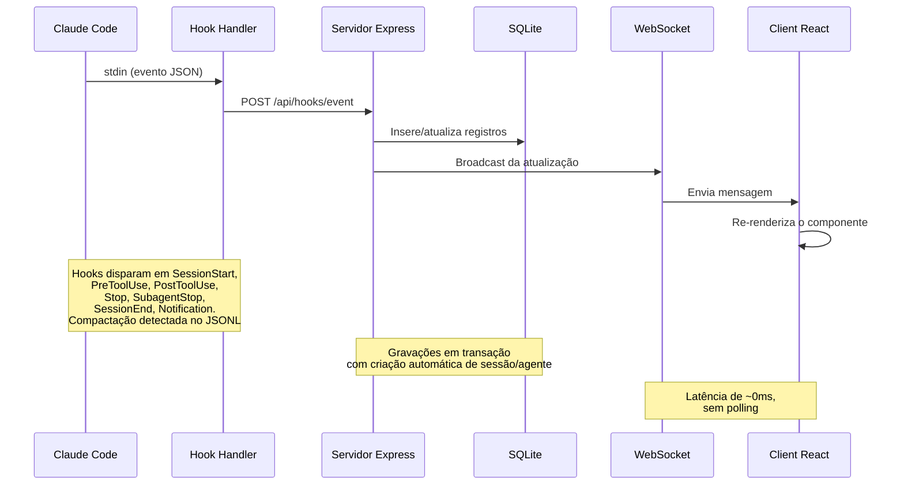

> [!IMPORTANT]
> Veja [ARCHITECTURE.md](./ARCHITECTURE.md) para um mergulho na arquitetura do servidor, esquema do banco, rotas da API, design do WebSocket, roteamento do cliente, fluxo do hook handler, modos de implantação e diagramas detalhados do ciclo de vida de sessões e agentes.

### Ciclo de vida dos hooks

1. **O Claude Code** emite hooks de sessão, prompt, ferramenta, notificação, subagente, turno e saída.
2. **`scripts/hook-handler.js`** lê cada evento do stdin e mira primeiro em `CCAM_DASHBOARD_URL`, depois num `CLAUDE_DASHBOARD_PORT` explícito e então nos painéis vivos do registro local `.agent-dashboard.json`. Para uma pasta do Claude realocada por `CLAUDE_HOME` ou `CLAUDE_CONFIG_DIR`, o registro fica nos dados de app locais da máquina; para a pasta padrão, fica em `~/.claude`. Ele filtra pela pasta oficial do Claude e envia uma vez para cada diretório de dados SQLite distinto, escolhendo a menor porta quando há listeners duplicados, mas ainda alimentando painéis correspondentes com bancos separados. A entrega é à prova de falhas: cada alvo é isolado e o handler sai em até 2,5 segundos.
3. **O servidor** grava o evento e o estado relacionado numa única transação SQLite:
   - O primeiro contato cria a sessão e o agente principal. `SessionStart` começa em **Aguardando**; `UserPromptSubmit` ou `PreToolUse` passam para **Trabalhando**; `PostToolUse` mantém trabalhando.
   - `Stop` devolve o agente principal para **Aguardando** enquanto os agentes em segundo plano continuam. `stop_reason=error` marca o agente e a sessão como **Erro**. Notificações de permissão também esperam entrada; só um prompt novo ou o início de uma ferramenta recupera um erro.
   - `SubagentStop` conclui aquele filho sem mudar o estado de espera humana. Uma leitura separada importa então as ferramentas do JSONL dele, pareia usos/resultados por `tool_use_id`, remove duplicatas e reconstrói os pais aninhados reais.
   - `SessionEnd` limpa a espera e conclui a sessão, a menos que um erro precise ser preservado. Trabalho novo reativa sessões concluídas, com erro ou abandonadas, inclusive importadas e retomadas.
   - `SessionStart` e a manutenção periódica abandonam sessões inativas depois de `DASHBOARD_STALE_MINUTES`, padrão 180. A varredura roda a cada um quarto desse valor, limitada entre 60 segundos e 5 minutos.
   - A leitura incremental compartilhada das transcrições registra compactações, erros de API e de ferramentas, duração dos turnos, tokens e metadados sem reler bytes que não mudaram. As varreduras de sessões ativas usam os valores indexados de `sessions.transcript_path` e descartam entradas de cache abandonadas.
   - Um vigia de 15 segundos acha erros de API na transcrição depois de 10 segundos sem hooks. Ele também recupera interrupções com Esc pelos marcadores da transcrição ou, quando não há marcador, depois de `DASHBOARD_WORKING_IDLE_SECONDS`, padrão 120, só quando nenhuma ferramenta está rodando e nem os hooks nem a transcrição avançam.
   - O mesmo vigia conclui sessões locais mortas por uma checagem de vida do processo depois de `DASHBOARD_LIVENESS_IDLE_SECONDS`, padrão 60. As checagens da inicialização rodam na hora e de novo depois de uns 5 segundos, sem essa espera. A checagem pula Windows, contêineres, caminhos encaminhados não POSIX, sessões de fontes remotas, falhas de ferramenta e `DASHBOARD_LIVENESS_PROBE=0`; um hook real depois corrige sozinho uma conclusão errada.
   - A sincronização contínua de projetos combina uma varredura imediata, `fs.watch` com espera e polling `DASHBOARD_SESSION_SYNC_MS`, padrão 30 segundos. Um cache de mtime reprocessa só transcrições novas ou que cresceram e transmite os mesmos frames de sessão que os hooks.
4. **O WebSocket** publica a mudança gravada.
5. **A interface** atualiza as telas afetadas sem polling.

### Máquina de estados do agente

Status gravados: `working | waiting | completed | error`. A coluna
`awaiting_input_since` é complementar — ela marca quando o agente
começou a esperar e é usada para mostrar a duração, mas `waiting` agora é um
status gravado de verdade.

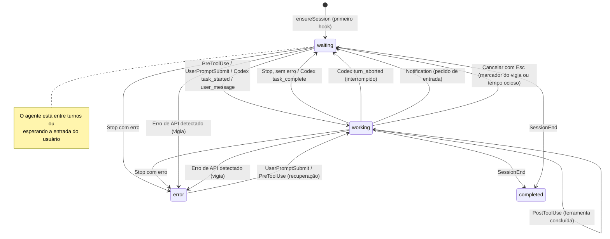

### Máquina de estados da sessão

Status gravados: `active | completed | error | abandoned`. O estado de
sessão **Aguardando** é uma camada da interface (status=`active` com
`awaiting_input_since` preenchido).

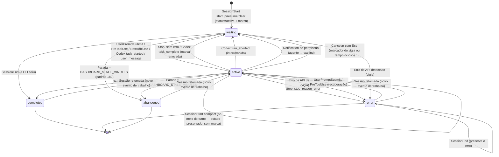

### Fluxo do cálculo de custo

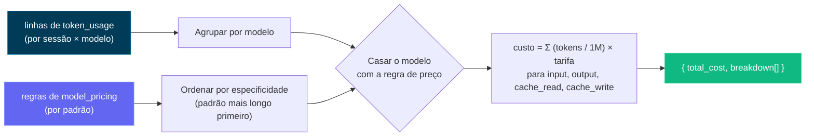

> [!IMPORTANT]
> O cálculo de custo se baseia no uso de tokens e nas regras de preço dos modelos. Mantenha as regras de preço atualizadas para os custos saírem certos. Atualize a tabela de preços dos modelos na página de Configurações para manter o controle de custos preciso - o painel não busca atualizações de preço de fontes externas sozinho. Depois que você define as regras de preço, o painel as aplica retroativamente a todas as sessões, para os relatórios de custo ficarem consistentes.

---

## Configuração

| Variável de ambiente | Padrão | Para que serve |
| --- | --- | --- |
| `DASHBOARD_PORT` | `4820` | Porta do servidor Express. |
| `CLAUDE_DASHBOARD_PORT` | não definida (descoberta) | Porta explícita usada pelo hook handler; grave-a na instalação com `--dashboard-port N`. |
| `NODE_ENV` | `development` | Use `production` para servir o client compilado. |
| `DASHBOARD_UPDATE_CHECK` | ligado | Defina `0`, `false` ou `off` para desligar as verificações agendadas no upstream. |
| `DASHBOARD_UPDATE_CHECK_INTERVAL_MS` | `300000` | Intervalo de verificação de atualização, mínimo de 60.000 ms. O **Verificar agora** manual continua disponível. |
| `DASHBOARD_STALE_MINUTES` | `180` | Tempo de inatividade antes de uma sessão ativa ou em Aguardando virar abandonada. O vigia aplica a regra e a manutenção roda a cada um quarto desse valor, limitada entre 60 segundos e 5 minutos. |
| `DASHBOARD_WORKING_IDLE_SECONDS` | `120` | Recupera um cancelamento com Esc sem marcador quando nenhuma ferramenta, hook ou atividade de transcrição avança. Valores menores reagem mais rápido, mas podem classificar errado por um tempo turnos longos e silenciosos; atividade nova corrige sozinha. O Cursor usa a mesma regra. |
| `DASHBOARD_LIVENESS_PROBE` | `1` | Defina `0` para desligar a conclusão por processo de sessões locais mortas do Claude/Codex. Pula automaticamente Windows, contêineres, caminhos encaminhados não POSIX e fontes remotas. |
| `DASHBOARD_LIVENESS_IDLE_SECONDS` | `60` | Espera de inatividade da transcrição ou do último hook para as checagens de vida do vigia. As checagens da inicialização ignoram a espera, para sessões já mortas sumirem na hora. |
| `DASHBOARD_SESSION_SYNC_MS` | `30000` | Polling de segurança para arquivos novos ou alterados em `~/.claude/projects`. O `fs.watch` continua imediato; `0` desliga só o polling. |
| `DASHBOARD_CURSOR_HOME` | `~/.cursor` | Raiz do estado do Cursor para chats, transcrições, preenchimento retroativo e cópias duráveis. |
| `DASHBOARD_CURSOR_SYNC_MS` | `5000` | Polling de segurança do Cursor com impressão digital. Os observadores continuam ativos quando `0` desliga o polling. |
| `DASHBOARD_CODEX_HOME` | `CODEX_HOME` ou `~/.codex` | Raiz do estado do Codex. As Configurações gravam uma substituição, religam a observação e leem na hora. |
| `DASHBOARD_CODEX_SYNC_MS` | `4000` | Polling de segurança dos rollouts do Codex. Hooks e observadores continuam ativos quando definido como `0`. |
| `DASHBOARD_CODEX_MAX_ATTEMPTS` | `5` | Tentativas para um rollout ilegível que não mudou, contando a primeira. Uma mudança de tamanho ou mtime reinicia a cota; ao esgotar, registra no log uma vez. |
| `DASHBOARD_CODEX_HOOK_IDLE_SECONDS` | `60` | Conclui sessões do Codex só com hooks, como `codex exec --ephemeral`, quando um `stop` que informou fim nunca recebe `SessionEnd`. Só o silêncio nunca basta. |
| `DASHBOARD_TASK_SUMMARY_TTL_MS` | `2000` | Janela de reaproveitamento de dados antigos para resumos de tarefas e `todo_snapshot`. Acréscimos são processados de forma incremental; crescimento acima de 32 MiB recomeça de um final novo. `0` processa cada acréscimo. |
| `DASHBOARD_SNAPSHOT_COMPRESS` | `1` | Defina `0`, `false` ou `off` para parar a conversão gzip verificada de cópias do Claude/Cursor paradas há 24 horas cuja origem sumiu. Árvores de origem ilegíveis e cópias do Codex são puladas. |
| `DASHBOARD_SNAPSHOT_MAX_AGE_DAYS` | não definida | Passada opcional de retenção a cada seis horas para sessões terminadas mais velhas que essa idade. Sessões apagadas ficam marcadas; sessões retomadas ficam protegidas. Veja a prévia com `ccam snapshots prune --days N`, porque a cópia pode ser a única. |
| `DASHBOARD_SNAPSHOT_MAX_BYTES` | não definida | Limite opcional do total de cópias em bytes ou em unidades como `5GB`. As sessões terminadas mais antigas são apagadas primeiro; sessões ativas ou das últimas 24 horas ficam protegidas. |
| `DASHBOARD_REMOTE_SYNC_MS` | `15000` | Polling das fontes remotas por SSH para projetos do Claude, rollouts do Codex e índices de títulos do Codex. Fontes novas ou religadas sincronizam na hora; `0` deixa só a sincronização manual. |
| `DASHBOARD_REMOTE_ACTIVE_WINDOW_MS` | `600000` | Considera ativa uma transcrição remota espelhada enquanto o último evento dela estiver dentro dessa janela, e depois a reconcilia como concluída. Provedores que falham voltam para o tratamento normal de sessões paradas. |
| `DASHBOARD_REMOTE_SYNC_TIMEOUT_MS` | `600000` | Tempo limite por fonte para o pull por SSH mais a importação. |
| `DASHBOARD_REMOTE_TEST_TIMEOUT_MS` | `15000` | Tempo limite do teste de SSH da fonte remota. |
| `DASHBOARD_HOST` | `127.0.0.1` | Interface de escuta. `0.0.0.0` expõe o serviço e registra um aviso. |
| `DASHBOARD_TOKEN` | não definida | Protege `/api/*` e o WebSocket por cabeçalho Bearer, `x-dashboard-token` ou `?token=`. O loopback é o limite de confiança padrão. |
| `DASHBOARD_TOKEN_FILE` | não definida | Token do painel vindo de arquivo, para segredos do Docker/Kubernetes; `DASHBOARD_TOKEN` tem prioridade. |
| `DASHBOARD_HOOK_TOKEN` / `DASHBOARD_HOOK_TOKEN_FILE` | não definida | Proteção independente para `/api/hooks/event` e `/api/hooks/codex` além do loopback. |
| `REMOTE_PUSH_TOKEN` / `REMOTE_PUSH_TOKEN_FILE` | não definida | Trava separada para os públicos `POST /api/hooks/ingest-batch` e `/api/hooks/ingest-transcript`. Os dois ficam desligados por padrão e nunca herdam o token de hook local. |
| `REMOTE_TRANSCRIPT_MAX_FILE_MB` | `256` | Tamanho máximo gravado, em MiB, de cada arquivo aceito pelo `ingest-transcript`; cada parte do pedido tem limite próprio de 4 MiB. |
| `DASHBOARD_ALLOWED_HOSTS` | loopback | Valores extras de `Host` HTTP e WebSocket, separados por vírgula, para a proteção contra DNS rebinding. |
| `DASHBOARD_ENV_PATH` | `.env` do repositório | Arquivo dotenv gravável usado para guardar as substituições de pasta dos provedores; em contêineres o padrão é `/app/config/.env`. |
| `CCAM_DASHBOARD_URL` | descoberta no localhost | Destino remoto dos hooks. URLs fora do loopback exigem HTTPS e um token de hook. |
| `CCAM_HOOK_TOKEN` / `CCAM_HOOK_TOKEN_FILE` | não definida | Credencial do cliente de hook enviada como `x-ccam-hook-token`. |

> [!IMPORTANT]
> Por padrão o servidor só escuta no loopback. Acesso pela rede local exige `DASHBOARD_HOST`, `DASHBOARD_TOKEN` e valores correspondentes em `DASHBOARD_ALLOWED_HOSTS`. Veja [`.env.example`](./.env.example) e [a política de segurança](./.github/SECURITY.md).

Clones do Git buscam periodicamente o remoto oficial e comparam o branch padrão dele com o checkout atual. Quando estiver atrás, o terminal e a interface mostram o comando exato de atualização manual. O CCAM nunca faz pull nem se reinicia sozinho.

---

## CLI `ccam`


A CLI **`ccam`** (`bin/ccam.js` → `cli/`) dá acesso ao painel de qualquer terminal por uma árvore de comandos Commander.js com opções herdadas, validação, sugestões, ajuda gerada e autocompletar no shell. `npm run setup` a vincula automaticamente. Para achar o servidor, ela confere `--server` / `CCAM_URL`, as portas configuradas, o registro de servidores vivos e, por fim, `http://127.0.0.1:4820`.

```bash
# Server
ccam status | health                  # ● running / ○ not running; version + timestamp
ccam start [--port N] | stop | restart  # background production server
ccam logs [-n N] [-f]                 # tail data/ccam-server.log
ccam open [page] [--session id]       # open the dashboard, a page, or a session
ccam repl                             # interactive shell (also: shell, i)

# Monitoring
ccam overview [--watch]               # one-screen live snapshot (alias: top)
ccam stats | kanban                   # totals + status distributions / status lanes
ccam tail [--session id] [--type T] [--tool N]   # live event feed
ccam stream [--type new_event,…]      # raw real-time WebSocket feed
ccam watch -n 5 <command …>           # re-run any command on an interval

# Data
ccam sessions [--status s] [--q text] [--cwd dir] [--sort price] [--limit n]
ccam sessions get|stats|cost|agents|events|transcripts <id>
ccam sessions transcript <id>         # the conversation as a readable chat log
ccam sessions rename <id> <name…> | update <id> | create | facets
ccam agents [list|get|update|create]  # agents; ccam session <id> = sessions get
ccam events [--type T] [--tool N] [--q text] [--from iso] | events facets

# Insights
ccam analytics                        # tokens, cost, top tools, daily sparklines
ccam workflows [session <id>]         # workflow intelligence + patterns
ccam runs [list|get <run-id>]         # Workflow-tool runs
ccam run list|history|start|follow|send|stop …   # dashboard-launched agents
ccam cost [--session id] [--daily]    # per-model cost, surcharges, unpriced models

# Alerts & webhooks
ccam alerts [--unacked] | ack <id> | ack-all
ccam alert-rules list|types|create|update|enable|disable|delete
ccam webhooks list|get|providers|deliveries|create|update|enable|disable|delete|test

# Pricing
ccam pricing [list] | set <pattern> --input N --output N [--fast-* …] [--intro-* …] | delete | reset
ccam pricing gpt|cursor [list|set|delete]   # OpenAI/Codex and Cursor rate cards

# Import & remote sources
ccam import guide|rescan|path <dir>|upload <files…>|reimport
ccam import-data <file.json>          # restore an export (idempotent)
ccam remote-sources list|get|add|update|enable|disable|test|sync|rm

# Administration
ccam doctor | info | export [file|-] | cleanup --hours N --days M
ccam snapshots [status|compress] | snapshots prune --days N   # transcript snapshots; prune dry-runs unless --apply --confirm PRUNE_SNAPSHOTS
ccam hooks [status|install] | reinstall-hooks | config claude|codex …
ccam updates [status|check] | update-check | metrics [--grep re]
ccam home [set claude|codex <path>] | push key|send|subscribe|unsubscribe
ccam api [METHOD] /api/path [--data JSON]   # any endpoint; writes need --yes
ccam mcp [stdio|http|repl] | clear-data --yes

# CLI
ccam help [command…] | commands [--json] | completion bash|zsh|fish | version
```

Os grupos listam por padrão (`ccam alerts` é igual a `ccam alerts list`); todo comando aceita `--help`; `ccam commands` mostra a árvore, e `ccam commands --json` emite o esquema legível por máquina.

- **Saída:** terminais (TTY) recebem tabelas, ícones de status, gráficos, minigráficos, árvores de agentes, visões de transcrição e ajuda colorida. Pipes recebem texto simples. `--json` ou `CCAM_OUTPUT=json` devolvem JSON estável, com NDJSON para `tail`, `stream` e `run follow`; erros usam `{"error":{"code":"…","message":"…"}}` no stderr e saem com `0` ou `1`.
- **Gravações:** use o `y/N` interativo ou `--yes`; gravações não interativas exigem `--yes`, e `clear-data` sempre exige a flag literal.
- **Modo offline:** comandos só de leitura recorrem a `data/dashboard.db`, mostram uma faixa `⚠ Offline mode` e corrigem sessões ativas mortas pela visão de vida dos processos. Comandos que só funcionam com o servidor explicam por que o painel não está disponível.
- **REPL e autocompletar:** `ccam repl` adiciona autocompletar guiado pela árvore, histórico persistente, um prompt ao vivo e os comandos embutidos `help`, `json` e `watch`, com cada linha isolada num processo filho. Ative o autocompletar do zsh com `source <(ccam completion zsh)`.

Se o `ccam` não estiver no `PATH`, rode `npm link` uma vez na raiz do repositório. Veja [docs/CLI.md](./docs/CLI.md) para o contrato completo.

## Scripts npm

| Comando                 | Descrição                                                  |
| ----------------------- | ---------------------------------------------------------- |
| `npm run setup`         | Instala as dependências da raiz/client/extensões/MCP, compila o MCP e vincula o `ccam` |
| `npm run update:pull-setup` | `git pull --ff-only` e depois `npm run setup` (atualização manual) |
| `npm run dev`           | Inicia o servidor (modo watch) + o client (Vite HMR) ao mesmo tempo |
| `npm run dev:server`    | Inicia o Express com um observador de código com espera e reinício suave |
| `npm run dev:client`    | Inicia só o servidor de desenvolvimento do Vite            |
| `npm run build`         | Compila o client React em `client/dist/`                   |
| `npm start`             | Inicia o servidor de produção (serve o client compilado)   |
| `npm test`              | Roda a suíte completa (servidor `node --test` + client Vitest) |
| `npm run verify`        | Roda toda a checagem local num comando só: auditoria do cabeçalho de autoria, checagem do Prettier, typecheck do client, testes do backend e do frontend |
| `npm run check:headers` | Confere se todo arquivo de código aplicável tem o cabeçalho de autoria |
| `npm run typecheck:client` | Typecheck do client (`tsc -b`) — a mesma checagem que o build de produção roda antes do Vite |
| `npm run test:server`   | Roda os testes do backend (`node --test server/__tests__/`) |
| `npm run test:client`   | Roda os testes Vitest do frontend, incluindo **snapshots de renderização de todas as telas** (`client/src/pages/__tests__/screens.snapshot.test.tsx`); gere as bases de novo depois de mudanças intencionais na interface com `cd client && npx vitest run -u` |
| `npm run install-hooks` | Configura os hooks do Claude Code em `~/.claude/settings.json` |
| `npm run seed`          | Preenche o banco com dados de exemplo                      |
| `npm run import-history`| Importa sessões antigas de `~/.claude/` (também roda na inicialização) |
| `npm run reconcile-tokens`| Atualiza os totais de tokens das sessões importadas (nunca diminui um total) |
| `npm run repair-tokens` | Recalcula os totais de tokens **fora de workflows** de toda sessão do **Claude** com transcrição em disco (achada em `~/.claude/projects/` ou pelo `transcript_path` gravado da sessão) e zera as bases de compactação; as linhas de workflow e do Codex são preservadas. Conserto único para bancos afetados pela soma de uso por registro anterior à v2.0.9 ou pelo uso omitido de subagentes simples do mesmo modelo. Pare o painel antes |
| `node scripts/repair-codex-output.js --db /path/to/dashboard.db --out plan.json` | Prévia do conserto da saída do Codex: o raciocínio já está incluído na saída. Pare o painel antes de aplicar com `--apply --journal new-backup.json`. Arquivos existentes nunca são sobrescritos; históricos ambíguos são preservados. Transcrições em texto puro, gzip e Zstd são lidas como streams. |
| `DASHBOARD_TOKEN_REPAIR` | Ligado por padrão (`1`). Conserto automático único dos totais históricos de tokens afetados pela inflação por registro ou por subagentes simples do mesmo modelo omitidos. Os consertos ao vivo não conseguem revisitar toda sessão concluída, e `replaceTokenUsage` não pode baixar uma marca máxima antiga. Roda uma vez por banco (controlado por marcador, adiado para fora da inicialização, pulado enquanto outro painel compartilha o diretório de dados) e copia antes as linhas antigas para `token_usage_pre_repair_v2`. Defina `0` para pular e consertar à mão com `npm run repair-tokens` |
| `npm run clear-data`    | Apaga todas as sessões, agentes, eventos e uso de tokens   |
| `npm run mcp:install`   | Instala as dependências do pacote MCP local (`mcp/`)       |
| `npm run mcp:build`     | Compila o TypeScript do servidor MCP em `mcp/build/`       |
| `npm run mcp:start`     | Inicia o servidor MCP (transporte stdio — para hosts MCP)  |
| `npm run mcp:start:http`| Inicia o servidor MCP (transporte HTTP + SSE na porta 8819) |
| `npm run mcp:start:repl`| Inicia o servidor MCP (REPL interativo com autocompletar)  |
| `npm run mcp:dev`       | Roda o servidor MCP em modo dev (`tsx`, stdio)             |
| `npm run mcp:dev:http`  | Roda o servidor MCP em modo dev (`tsx`, HTTP + SSE)        |
| `npm run mcp:dev:repl`  | Roda o servidor MCP em modo dev (`tsx`, REPL interativo)   |
| `npm run mcp:typecheck` | Checa os tipos do código MCP sem gerar saída de build      |
| `npm run extensions:sync` | Gera de novo os nomes de skills/metadados da OpenAI, os manifestos do Codex e os dois marketplaces |
| `npm run extensions:validate` | Valida os 14 plugins de formato duplo e as 66 skills incluídas |
| `npm run mcp:docker:build` | Compila a imagem de contêiner do MCP com Docker (`agent-dashboard-mcp:local`) |
| `npm run mcp:podman:build` | Compila a imagem de contêiner do MCP com Podman (`localhost/agent-dashboard-mcp:local`) |
| `npm run desktop:install` | Instala o Electron + electron-builder no workspace `desktop/` (recompila o `better-sqlite3` para a ABI do Electron); testa antes o build nativo do `better-sqlite3` e mostra ajuda prática de configuração (incl. uma alternativa sem toolchain) se falhar |
| `npm run desktop:dev`   | Compila e abre o app de desktop Electron para testar localmente |
| `npm run desktop:build` | Compila o código TypeScript do desktop em `desktop/out/`   |
| `npm run desktop:test`  | Roda o teste rápido do desktop (abre o Electron, testa `/api/health`) |
| `npm run desktop:dmg`   | Gera **os dois** DMGs do macOS (arm64 + x64) — o certo para release, **mais lento** (empacota cada arquitetura) |
| `npm run desktop:dmg:arm64` | Gera um DMG só para Apple Silicon — **rápido**, recomendado para o seu próprio Mac |
| `npm run desktop:dmg:x64` | Gera um DMG só para Intel — **rápido**                   |
| `npm run desktop:dmg:universal` | Gera um único DMG **universal** combinado (arm64 + x86_64) — opcional, **o mais lento**, não é o que a release publica |
| `npm run desktop:win`   | Gera um **instalador NSIS** `.exe` do Windows (x64) — rode no Windows |
| `npm run desktop:win:portable` | Gera um `.exe` **portátil** (sem instalar) do Windows (x64) — rode no Windows |
| `npm run monitoring:install` | Roda `npm install` em `monitoring/` — baixa Prometheus + Grafana pelo `postinstall` |
| `npm run monitoring:setup` | Apelido de `monitoring:install` |
| `npm run monitoring:up` | Inicia Prometheus (:9090) + Grafana (:3000) em segundo plano (sem Docker) |
| `npm run monitoring:down` | Para a pilha de monitoramento gerenciada pelo npm |
| `npm run monitoring:start` | Pilha de monitoramento em primeiro plano (Ctrl+C para os dois) |
| `npm run monitoring:docker:up` | Inicia Prometheus + Grafana pelo Docker Compose |
| `npm run monitoring:docker:down` | Derruba a pilha de monitoramento do Docker |
| `npm run monitoring:verify` | Checa a saúde do painel, do Prometheus, do Grafana e do alvo de coleta |
| `npm run docker:up` | Inicia o painel no Docker (`docker compose up -d --build`) |
| `npm run docker:down` | Para o contêiner do painel |
| `npm run docker:full:up` | Painel + MCP autenticado + Nginx sem root + Prometheus + Grafana |
| `npm run docker:full:down` | Derruba a pilha Docker completa |
| `npm run deploy:validate` | Revisa Docker, Compose, Nginx, Helm, Kustomize, Terraform, auditorias de dependências e a regra de um só gravador. Os achados são só avisos (saída 0); `CCAM_DEPLOY_VALIDATE_STRICT=1` os transforma numa trava de verdade |

---

As estimativas de custo usam as tarifas de API configuradas, não cobranças de assinatura. O Painel e as Análises colocam o escopo de máquina/produto escolhido e a lista completa de tarifas que faltam atrás de um ícone de informação acessível pelo teclado, ao lado do rótulo de custo; o tooltip do valor nas Análises traz só o valor sem abreviar, enquanto as Configurações mostram os mesmos detalhes de cobertura na própria tela. Os padrões Standard/Fast Short/Long do GPT-6.1 Sol seguem a tabela publicada da OpenAI sem esconder uma regra personalizada correspondente que já exista.

### Fotos de custo antes de uma atualização

Antes de uma atualização que pode recontar o uso, tire uma foto de base só leitura, atualize e reinicie o CCAM, deixe a manutenção de inicialização terminar e então tire uma segunda foto num caminho novo e compare as duas. Mantenha os arquivos TSV privados: eles contêm identificadores de sessão e metadados de dono. A checagem sai com status 1 se a entrada, saída, leitura de cache, escrita de cache, escrita de cache de uma hora, busca na web, fetch na web, execução de código ou custo de uma sessão local existente mudar; se o dono mudar entre local e outra fonte ou provedor; ou se uma sessão local sumir. Sessões remotas e recém-adicionadas são relatadas à parte.

```bash
node scripts/cost-snapshot.js snapshot --out before.tsv
# Upgrade CCAM, restart it, and let startup maintenance finish.
node scripts/cost-snapshot.js snapshot --out after.tsv
node scripts/cost-snapshot.js compare before.tsv after.tsv --fail-on-local-change
```

Uma sincronização remota interrompida aparece como erro depois de reiniciar; o recibo da importação anterior continua disponível. A recuperação na inicialização só roda quando marcadores de vida por processo no diretório de dados SQLite compartilhado provam que este é o único painel vivo, mesmo quando os processos usam valores diferentes de `CLAUDE_HOME`; dono ausente, malformado ou concorrente adia a recuperação. Um banco ocupado é tentado de novo de forma independente, então a recuperação não consegue desligar o polling remoto. As novas tentativas remotas mantêm o erro mais recente visível enquanto checam de novo; uma sincronização bem-sucedida o limpa.

---

## Extensões de agente

Este repositório inclui uma camada completa de extensões para o Claude Code e para o Codex:

- Claude Code: `CLAUDE.md`, `.claude/rules/`, `.claude/skills/`
- Subagentes do Claude: `.claude/agents/`
- Codex: `AGENTS.md`, `.codex/rules/`, `.codex/agents/`, `.codex/skills/`
- Plugins distribuíveis compartilhados: `plugins/`, com `.claude-plugin/plugin.json` e `.codex-plugin/plugin.json`
- Marketplaces: `.claude-plugin/marketplace.json` para o Claude Code e `.agents/plugins/marketplace.json` para o Codex
- Open Agent Skills: todas as skills de plugin têm frontmatter canônico mais `agents/openai.yaml`; `npx skills add hoangsonww/Claude-Code-Agent-Monitor --list` encontra 77 skills no repositório

### Arquitetura das extensões

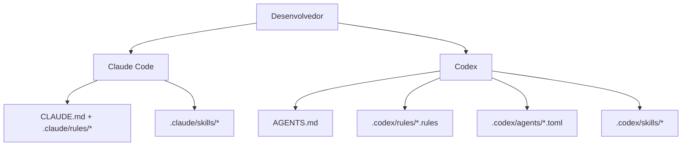

### Camada do Claude Code

- Contexto persistente:
  - [`CLAUDE.md`](./CLAUDE.md)
- Regras por caminho:
  - [`.claude/rules/backend-node.md`](./.claude/rules/backend-node.md)
  - [`.claude/rules/frontend-react.md`](./.claude/rules/frontend-react.md)
  - [`.claude/rules/mcp-typescript.md`](./.claude/rules/mcp-typescript.md)
  - [`.claude/rules/docs-markdown.md`](./.claude/rules/docs-markdown.md)
  - [`.claude/rules/file-headers.md`](./.claude/rules/file-headers.md)
  - [`.claude/rules/wiki-i18n.md`](./.claude/rules/wiki-i18n.md)
  - [`.claude/rules/i18n-parity.md`](./.claude/rules/i18n-parity.md)
- Skills:
  - `repo-onboarding`
  - `ship-feature`
  - `version-release`
  - `mcp-operations`
  - `debug-live-issue`
  - `update-project-docs`
  - `file-headers`
  - `push-to-forked-pr`
  - `i18n-parity`
- Subagentes:
  - `backend-reviewer`
  - `frontend-reviewer`
  - `mcp-reviewer`

### Camada do Codex

- Contexto persistente:
  - [`AGENTS.md`](./AGENTS.md)
- Política de execução:
  - [`.codex/rules/default.rules`](./.codex/rules/default.rules)
- Modelos de subagentes personalizados:
  - [`.codex/agents/`](./.codex/agents)
- Skills:
  - [`.codex/skills/`](./.codex/skills)
- Configuração:
  - [`.codex/README.md`](./.codex/README.md)

---

## Integração MCP


Este projeto inclui um servidor MCP local em `mcp/` com 103 ferramentas em 16 módulos de domínio. Ele expõe toda ação suportada do app, incluindo leituras de dados com escopo, transcrições/imagens, preços do Claude, Cursor e GPT, fluxos, alertas/webhooks, importações e restauração de backup, configuração do Claude/Codex, Executar agente, fontes remotas, configurações, push e manutenção protegida. Ele tem três modos de transporte.

### Modos de transporte do MCP

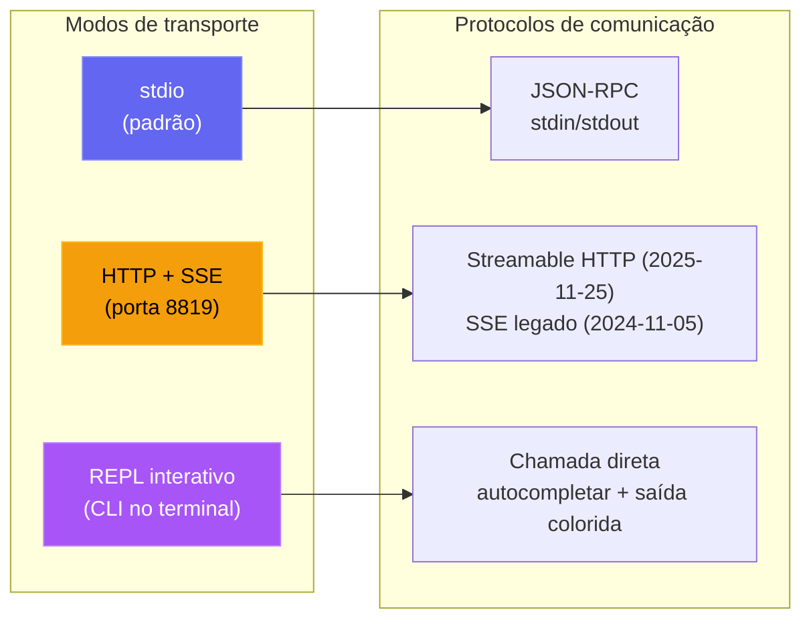

| Modo | Comando | Caso de uso |
| --- | --- | --- |
| **stdio** | `npm run mcp:start` | Claude Code, Claude Desktop, hosts MCP de IDEs |
| **HTTP** | `npm run mcp:start:http` | Clientes MCP remotos, integrações web, várias sessões |
| **REPL** | `npm run mcp:start:repl` | Depuração de operação, chamada manual de ferramentas, administração local |

<p align="center">
  <a href="images/mcp.png">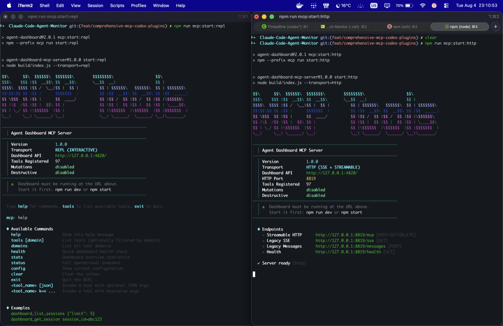</a>
</p>

### Arquitetura do MCP

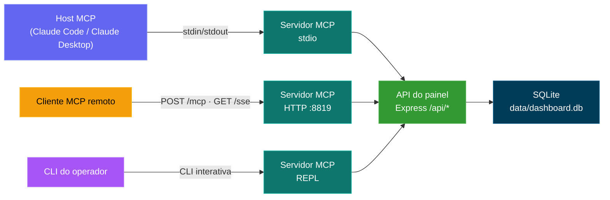

### Ferramentas do MCP

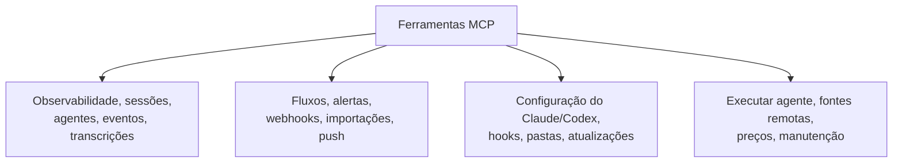

### Modelo de segurança do MCP

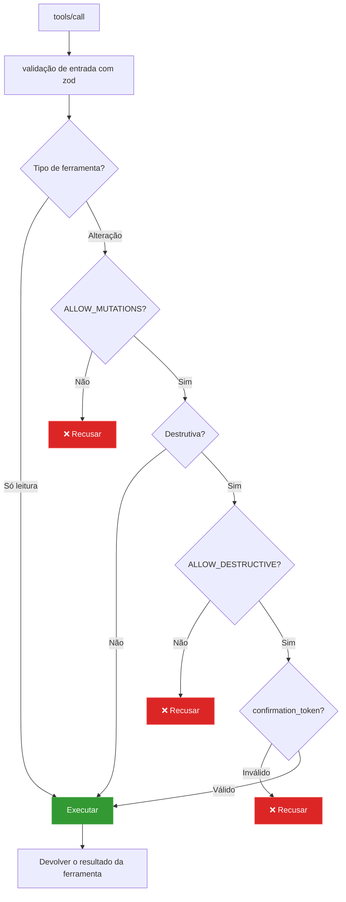

### Modos de operação do MCP

- Modo só leitura (padrão): `MCP_DASHBOARD_ALLOW_MUTATIONS=false`
- Modo administrador: `MCP_DASHBOARD_ALLOW_MUTATIONS=true`
- Painel autenticado: defina `MCP_DASHBOARD_API_TOKEN` / `_FILE` com o token do painel
- Transporte HTTP/SSE autenticado: defina `MCP_HTTP_AUTH_TOKEN` / `_FILE`; os clientes mandam autenticação bearer ou `x-mcp-token`
- Proteções de transporte: HTTP direto no loopback pode levar o token; apelidos de host de contêiner exigem HTTPS; redirecionamentos são recusados
- Proteções de payload: 50 MiB por arquivo de histórico enviado, 100 MiB no total por chamada, respostas binárias de 10 MiB e restauração de backup de 25 MiB
- Modo destrutivo: exige os dois:
  - `MCP_DASHBOARD_ALLOW_MUTATIONS=true`
  - `MCP_DASHBOARD_ALLOW_DESTRUCTIVE=true`
  - entrada da ferramenta `confirmation_token: "CLEAR_ALL_DATA"`

Detalhes completos: [mcp/README.md](./mcp/README.md)

---

## Referência da API

Todos os endpoints devolvem JSON. As respostas de erro seguem o formato `{ error: { code, message } }`.

### OpenAPI / Swagger / ReDoc


Há três jeitos de explorar a API HTTP, todos movidos por uma única especificação OpenAPI 3.0.3 (porta padrão do servidor `4820`):

| Método | Caminho                         | Descrição                                                                                         |
| ------ | ------------------------------- | ------------------------------------------------------------------------------------------------- |
| `GET`  | `/api/openapi.json`             | Especificação OpenAPI 3.0.3 bruta em JSON                                                          |
| `GET`  | `/api/docs`                     | **Swagger UI** interativo — execute os pedidos direto pela página                                  |
| `GET`  | `/api/redoc`                    | Referência **ReDoc** — uma renderização limpa em três painéis, feita para leitura, da mesma especificação |
| `GET`  | `/api/redoc/redoc.standalone.js`| Pacote ReDoc servido localmente (pela dependência `redoc`, nunca por CDN — funciona offline)      |

O documento OpenAPI é gerado a partir de `server/openapi.js` (`createOpenApiSpec()`), junto com fragmentos complementares em `server/openapi-extra/`. O Swagger UI e o ReDoc são servidos direto pelo backend; o pacote do ReDoc é servido localmente (`GET /api/redoc/redoc.standalone.js`), então a referência funciona totalmente offline / em rede isolada, de acordo com a política do projeto de não usar assets externos.

A cobertura é completa: toda rota do backend está documentada (82 entradas de caminho) nestas tags — Health, Sessions, Agents, Events, Stats, Metrics, Analytics, Hooks, Pricing, Workflows, Settings, Updates, Alerts, Webhooks, Push, CcConfig (explorador de configuração do Claude Code), Run (execuções iniciadas pelo painel) e Documentation — cada uma com parâmetros, esquemas de pedido/resposta, descrições por campo e exemplos realistas.

Um **`openapi.yaml`** versionado na raiz do repositório espelha a especificação ao vivo. Ele é gerado a partir de `server/openapi.js` (nunca editado à mão) — gere de novo depois de mudanças na API com:

```bash
npm run openapi:yaml
```


<p align="center">
  <a href="images/swagger.png">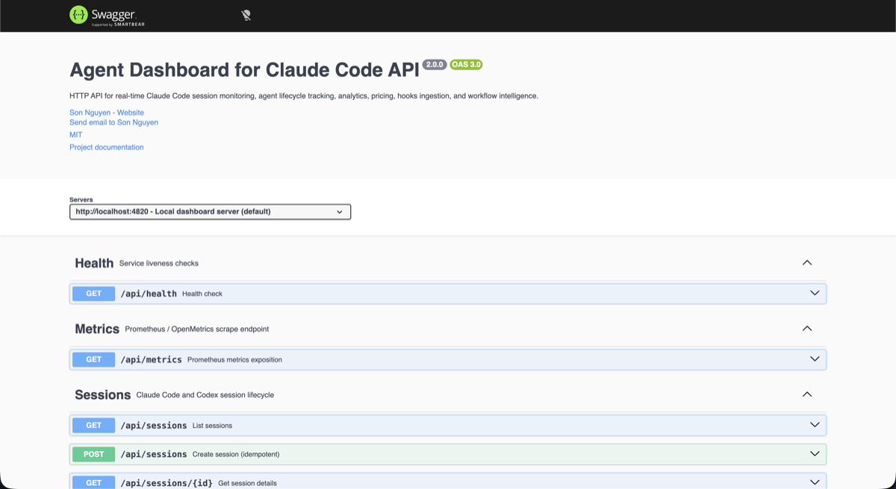</a>
</p>

<p align="center">
  <a href="images/redoc.png">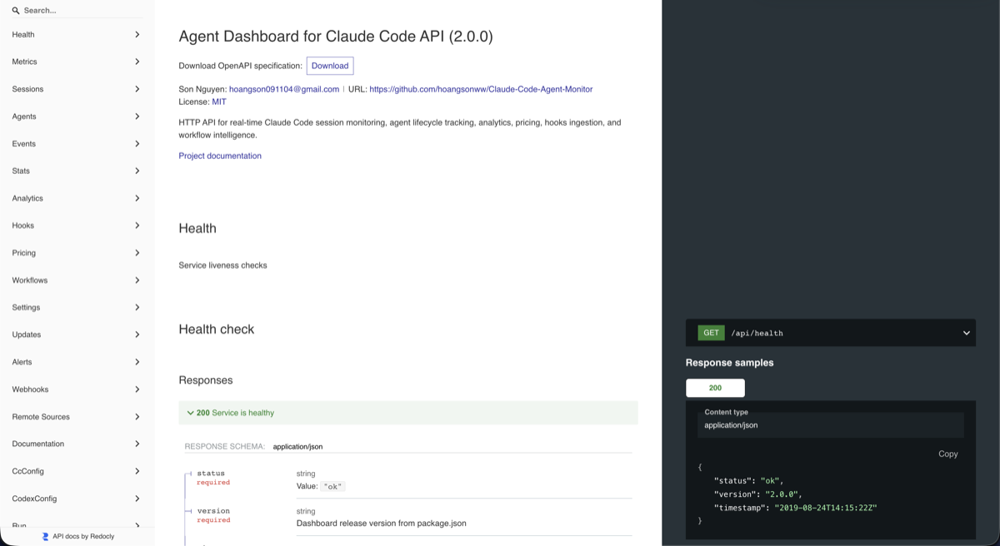</a>
</p>

### Saúde

| Método | Caminho       | Descrição                             |
| ------ | ------------- | ------------------------------------- |
| `GET`  | `/api/health` | Devolve `{ status: "ok", timestamp }` |

### Sessões

| Método  | Caminho                         | Parâmetros de query                                              | Descrição                                                                                    |
| ------- | ------------------------------- | ---------------------------------------------------------------- | -------------------------------------------------------------------------------------------- |
| `GET`   | `/api/sessions`                 | `status`, `q`, `limit`, `offset`                                 | Lista as sessões com contagem de agentes e custo por sessão. `q` faz busca sem diferenciar maiúsculas em `id` / `name` / `cwd`. `limit` tem padrão 50, máximo 10000. A resposta inclui `total` para os paginadores. |
| `GET`   | `/api/sessions/:id`             | --                                                               | Detalhe da sessão com agentes e eventos                                                      |
| `GET`   | `/api/sessions/:id/stats`       | --                                                               | Contagens agregadas que alimentam o painel de visão geral dos Detalhes da sessão: eventos, eventos por tipo, ferramentas mais usadas, contagem de erros, contagens por tipo/status de agente, divisão por tipo de subagente, totais de tokens, intervalo de tempo |
| `GET`   | `/api/sessions/:id/transcripts` | --                                                               | Lista as transcrições JSONL disponíveis da sessão (principal + subagentes + compactações)    |
| `GET`   | `/api/sessions/:id/transcript`  | `agent_id`, `limit`, `offset`, `after`, `before`                 | Envia as mensagens de uma transcrição específica com paginação por cursor. O `usage` do assistente inclui `input_tokens`, `output_tokens`, `cache_read_input_tokens`, `cache_creation_input_tokens`, para o medidor da página Executar se preencher por completo ao retomar / reconectar |
| `POST`  | `/api/sessions`                 | --                                                               | Cria uma sessão (idempotente no `id`)                                                        |
| `PATCH` | `/api/sessions/:id`             | --                                                               | Atualiza status/metadados da sessão                                                          |

### Agentes

| Método  | Caminho           | Parâmetros de query                       | Descrição                     |
| ------- | ----------------- | ----------------------------------------- | ----------------------------- |
| `GET`   | `/api/agents`     | `status`, `session_id`, `limit`, `offset` | Lista agentes com filtros     |
| `GET`   | `/api/agents/:id` | --                                        | Detalhe de um agente          |
| `POST`  | `/api/agents`     | --                                        | Cria um agente                |
| `PATCH` | `/api/agents/:id` | --                                        | Atualiza status/tarefa/ferramenta do agente |

### Eventos

| Método | Caminho       | Parâmetros de query             | Descrição                  |
| ------ | ------------- | ------------------------------- | -------------------------- |
| `GET`  | `/api/events` | `session_id`, `limit`, `offset` | Lista eventos (mais novos primeiro) |

### Estatísticas

| Método | Caminho      | Descrição                                              |
| ------ | ------------ | ------------------------------------------------------ |
| `GET`  | `/api/stats` | Contagens agregadas, distribuição por status, conexões WS |

### Análises

| Método | Caminho          | Descrição                                                  |
| ------ | ---------------- | ---------------------------------------------------------- |
| `GET`  | `/api/analytics` | Agregados de tokens/ferramentas/sessões para gráficos e tendências |

### Fontes de dados remotas

| Método   | Caminho                         | Parâmetros de query | Descrição                                                                            |
| -------- | ------------------------------- | ------------------- | ------------------------------------------------------------------------------------ |
| `GET`    | `/api/remote-sources`           | --                  | Lista as fontes remotas configuradas com status, último erro e contagens da última sincronização |
| `POST`   | `/api/remote-sources`           | --                  | Cria uma fonte. Corpo: `{ label, host, ssh_port?, identity_file?, remote_home?, remote_codex_home?, enabled? }` |
| `PATCH`  | `/api/remote-sources/:id`       | --                  | Atualiza uma fonte (rótulo, campos de conexão, enabled)                              |
| `DELETE` | `/api/remote-sources/:id`       | `purge`             | Exclui uma fonte; `?purge=true` também apaga as sessões importadas dela              |
| `POST`   | `/api/remote-sources/:id/test`  | --                  | Testa a conectividade SSH com a fonte                                                |
| `POST`   | `/api/remote-sources/:id/sync`  | --                  | Puxa e reimporta da fonte agora                                                      |

`GET /api/sessions`, `/api/events`, `/api/agents`, `/api/stats` e `/api/analytics` também aceitam um parâmetro de query opcional `sources` (ids de fonte separados por vírgula; omita para todas) para limitar os resultados pela origem, e `GET /api/sessions/facets` devolve uma lista `sources` para o seletor de escopo de dados.

### Hooks

| Método | Caminho            | Descrição                                    |
| ------ | ------------------ | -------------------------------------------- |
| `POST` | `/api/hooks/event` | Recebe e processa um evento de hook do Claude Code |
| `POST` | `/api/hooks/ingest-batch` | Envia um lote de dados de sessão de uma máquina em trânsito/atrás de NAT (desligado por padrão; veja `REMOTE_PUSH_TOKEN` abaixo e `server/README.md` para o formato completo do payload) |
| `POST` | `/api/hooks/ingest-transcript` | Envia o JSONL de transcrição de uma máquina remota em partes por offset (mesma trava `REMOTE_PUSH_TOKEN`; a sessão precisa ser registrada antes pelo `ingest-batch`) |

**Payload do evento de hook:**

```json
{
  "hook_type": "PreToolUse",
  "data": {
    "session_id": "abc-123",
    "tool_name": "Bash",
    "tool_input": { "command": "ls -la" }
  }
}
```

### Preços

| Método   | Caminho                  | Descrição                                |
| -------- | ------------------------ | ---------------------------------------- |
| `GET`    | `/api/pricing`           | Lista todas as regras de preço           |
| `PUT`    | `/api/pricing`           | Cria ou atualiza uma regra de preço      |
| `DELETE` | `/api/pricing/:pattern`  | Exclui uma regra de preço                |
| `GET`    | `/api/pricing/cost`      | Custo total de todas as sessões          |
| `GET`    | `/api/pricing/cost/:id`  | Detalhamento do custo de uma sessão      |

### Fluxos

| Método | Caminho                       | Descrição                                               |
| ------ | ----------------------------- | ------------------------------------------------------- |
| `GET`  | `/api/workflows`              | Dados de fluxos com escopo por provedor/fonte (orquestração, ferramentas registradas, padrões, compactações do Codex). Os filtros opcionais `?status=active\|completed`, `?sources=...` e `?providers=claude\|codex` valem para as 11 seções de dados |
| `GET`  | `/api/workflows/session/:id`  | Detalhe por sessão com escopo por provedor/fonte (árvore de agentes, linha do tempo de ferramentas registradas, eventos) |

### Alertas

| Método   | Caminho                  | Descrição                                                              |
| -------- | ------------------------ | ---------------------------------------------------------------------- |
| `GET`    | `/api/alerts`            | Feed de alertas disparados, mais novos primeiro (`?unacked=true`, `limit`, `offset`) |
| `POST`   | `/api/alerts/:id/ack`    | Reconhece um alerta                                                    |
| `POST`   | `/api/alerts/ack-all`    | Reconhece todos os alertas não reconhecidos                            |
| `GET`    | `/api/alerts/rules`      | Lista as regras de alerta                                              |
| `POST`   | `/api/alerts/rules`      | Cria uma regra (`event_pattern` \| `inactivity` \| `status_duration` \| `token_threshold`) |
| `PATCH`  | `/api/alerts/rules/:id`  | Atualiza nome / config / enabled / cooldown (o tipo da regra não muda) |
| `DELETE` | `/api/alerts/rules/:id`  | Exclui uma regra e o histórico de alertas disparados dela              |

### Webhooks

| Método   | Caminho                           | Descrição                                                                            |
| -------- | --------------------------------- | ------------------------------------------------------------------------------------ |
| `GET`    | `/api/webhooks/providers`         | Provedores suportados + os campos de configuração deles (alimenta o formulário da interface) |
| `GET`    | `/api/webhooks`                   | Lista os destinos de webhook (URLs mascaradas, segredos ocultos)                     |
| `POST`   | `/api/webhooks`                   | Cria um destino (14 provedores de primeira classe + `generic`)                       |
| `PATCH`  | `/api/webhooks/:id`               | Atualiza nome / url / enabled / segredo / cabeçalhos / escopo de regras (o tipo não muda) |
| `DELETE` | `/api/webhooks/:id`               | Exclui um destino e o log de entregas dele                                           |
| `POST`   | `/api/webhooks/:id/test`          | Envia um alerta de teste sintético e informa o resultado da entrega                  |
| `GET`    | `/api/webhooks/:id/deliveries`    | Log recente de entregas de um destino (`limit`, `offset`)                            |

Provedores hospedados exigem HTTPS. `generic` e `n8n` podem usar HTTP para receptores locais ou próprios. A entrega recusa redirecionamentos, então credenciais, cabeçalhos próprios e assinaturas HMAC nunca são repassados para uma segunda URL.

### Configurações

| Método | Caminho                        | Descrição                                        |
| ------ | ------------------------------ | ------------------------------------------------ |
| `GET`  | `/api/settings/info`           | Informações do sistema, estatísticas do banco, status dos hooks |
| `POST` | `/api/settings/clear-data`     | Apaga todas as sessões, agentes, eventos e uso de tokens |
| `POST` | `/api/settings/reimport`       | Reimporta sessões antigas de `~/.claude/`        |
| `POST` | `/api/settings/reinstall-hooks`| Reinstala os hooks do Claude Code                |
| `POST` | `/api/settings/reset-pricing`  | Restaura os padrões das tabelas de preço do Claude, do Codex ou das duas |
| `GET`  | `/api/settings/export`         | Exporta todos os dados (sessions, agents, events, token_usage, workflows, dashboard_runs, alert_rules, model_pricing, cursor_model_pricing, gpt_model_pricing) num único download JSON versionado |
| `POST` | `/api/settings/import`         | Restaura um pacote de até 25 MiB vindo de `/export` (multipart `file` ou JSON `{ path }`). Idempotente + não destrutivo — sessões existentes são puladas inteiras |
| `POST` | `/api/settings/cleanup`        | Abandona sessões paradas, apaga dados antigos (e as cópias das sessões apagadas) |
| `GET`  | `/api/settings/snapshots`      | Armazenamento das cópias de transcrição por provedor + política de retenção |
| `POST` | `/api/settings/snapshots/compress` | Compacta sem perda as cópias cuja transcrição original sumiu |
| `POST` | `/api/settings/snapshots/prune` | Planeja (simulação, padrão) ou aplica uma limpeza de cópias; aplicar exige `confirm: "PRUNE_SNAPSHOTS"` |

### Explorador de configuração do Claude (`/api/cc-config`)

Inspeção só leitura de toda superfície de configuração do Claude Code, mais alterações bem protegidas em artefatos de texto de baixo risco. As leituras de arquivo canonicalizam o caminho pedido e as raízes permitidas, então links simbólicos não conseguem fugir das pastas confiáveis do Claude. Todos os caminhos de gravação criam backups com data e hora em `<root>/cc-config-backups/<type>/` antes de alterar.

| Método   | Caminho                             | Descrição |
| -------- | ----------------------------------- | ----------- |
| `GET`    | `/api/cc-config/overview`           | Raízes (pasta do Claude, .claude do projeto, raiz do projeto, ~/.claude.json) + contagens de cada superfície |
| `GET`    | `/api/cc-config/skills`             | Skills em `<scope>/.claude/skills/<name>/SKILL.md` com frontmatter processado; `?scope=user\|project\|all` |
| `GET`    | `/api/cc-config/agents`             | Subagentes `<scope>/.claude/agents/*.md` |
| `GET`    | `/api/cc-config/commands`           | Comandos de barra `<scope>/.claude/commands/*.md` |
| `GET`    | `/api/cc-config/output-styles`      | Estilos de saída `<scope>/.claude/output-styles/*.md` |
| `GET`    | `/api/cc-config/plugins`            | Plugins instalados vindos de `~/.claude/plugins/installed_plugins.json`, cruzados com `enabledPlugins` das configurações; cada item inclui `contributes` (contagem de skills/agents/commands/hooks/output-styles dentro da pasta de instalação do plugin) mais os metadados do `plugin.json` |
| `GET`    | `/api/cc-config/marketplaces`       | Marketplaces registrados vindos de `known_marketplaces.json`, enriquecidos com o próprio `marketplace.json` de cada um (contagem de plugins, dono, descrição) |
| `GET`    | `/api/cc-config/mcp`                | Servidores MCP de `~/.claude.json` (nível superior + por projeto) e do `settings.json` |
| `GET`    | `/api/cc-config/hooks`              | Hooks agregados dos arquivos `settings.json` do usuário / projeto / projeto local |
| `GET`    | `/api/cc-config/hook-scripts`       | Arquivos em `~/.claude/hooks/` (os scripts auxiliares citados por `hooks.<event>.command`) |
| `GET`    | `/api/cc-config/keybindings`        | `~/.claude/keybindings.json` processado em pares tecla/ação agrupados por contexto |
| `PUT`    | `/api/cc-config/keybindings`        | Sobrescreve o `keybindings.json` a partir de `{ groups: [{ context, bindings: [{ key, action }] }] }`. Faz backup antes, preserva os metadados de nível superior (`$schema`/`$docs`), recusa contextos/teclas duplicados. É seguro editar (diferente do `settings.json`, a CLI nunca o reescreve no meio da sessão) |
| `GET`    | `/api/cc-config/statusline`         | Configuração `settings.json.statusLine` + o conteúdo real do `statusline.py` / `statusline-command.sh`, se existir |
| `GET`    | `/api/cc-config/settings`           | JSON de configurações do usuário / projeto / projeto local, com chaves que parecem segredo (que batem com `/token\|secret\|password\|api[_-]?key\|auth/i`) trocadas por `"<redacted>"` |
| `GET`    | `/api/cc-config/memory`             | Arquivos `CLAUDE.md` nos escopos de usuário + projeto, mais a memória em arquivos por projeto: itens `scope:"auto-memory"` (cada um com `project`, `name`, `isIndex` e `frontmatter` processado) para todo `*.md` em `~/.claude/projects/<slug>/memory/`. Altere por `PUT`/`DELETE /api/cc-config/file` com `{ scope: "auto-memory", type: "auto-memory", project, name }` (os backups vão para `<memory-dir>/.cc-config-backups/auto-memory/`) |
| `GET`    | `/api/cc-config/file?path=…`        | Conteúdo de um arquivo (caminho contido em CLAUDE_HOME / .claude do projeto / CLAUDE.md do projeto) |
| `GET`    | `/api/cc-config/backups`            | Lista de todos os backups com data e hora, opcionalmente filtrada por `?scope=&type=` |
| `PUT`    | `/api/cc-config/file`               | Cria ou sobrescreve um artefato de texto. Corpo: `{ scope, type, name?, content }`. Faz backup automático se o arquivo existir. Temporário atômico + rename. Conteúdo limitado a 256 KB, regex rígida para `name` |
| `DELETE` | `/api/cc-config/file`               | Faz backup e depois exclui um artefato de texto. Pastas de skill ganham backup inteiro (preservando os arquivos incluídos) antes da remoção recursiva |

### Métricas do Prometheus e Grafana

`GET /api/metrics` expõe métricas em texto do Prometheus para status de sessões e agentes, eventos, tokens, clientes em tempo real, fontes remotas, tempo no ar e memória do processo e versão do build. [`monitoring/`](./monitoring/README.md) fornece o Prometheus mais quatro painéis do Grafana configurados automaticamente, com o **CCAM · Overview** como padrão.

```bash
# Native dashboard and monitoring
npm start
npm run monitoring:install       # one-time binary setup
npm run monitoring:up            # Grafana on :3000

# Containers
npm run docker:up                 # dashboard only
npm run docker:full:up            # dashboard + Prometheus + Grafana

# Mixed native/container setup
DASHBOARD_ALLOWED_HOSTS=host.docker.internal npm start
npm run monitoring:docker:up
npm run monitoring:verify
```

<p align="center">
  <a href="images/grafana.png">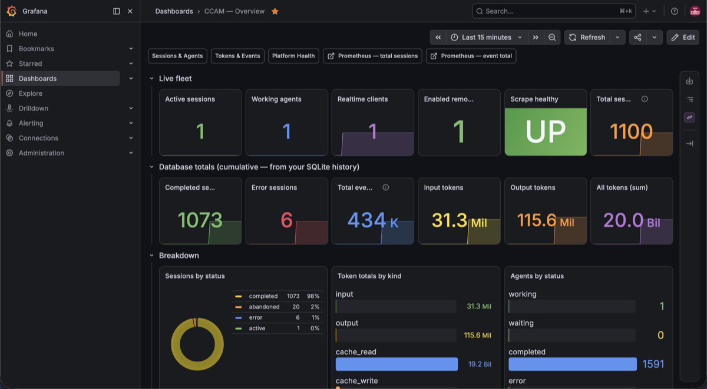</a>
  <br>
  <em>📊 <strong>Grafana · CCAM Overview</strong> · estado da frota, totais do banco, divisões e taxas a partir das coletas ao vivo de <code>/api/metrics</code></em>
</p>

<p align="center">
  <a href="images/prometheus-console.png">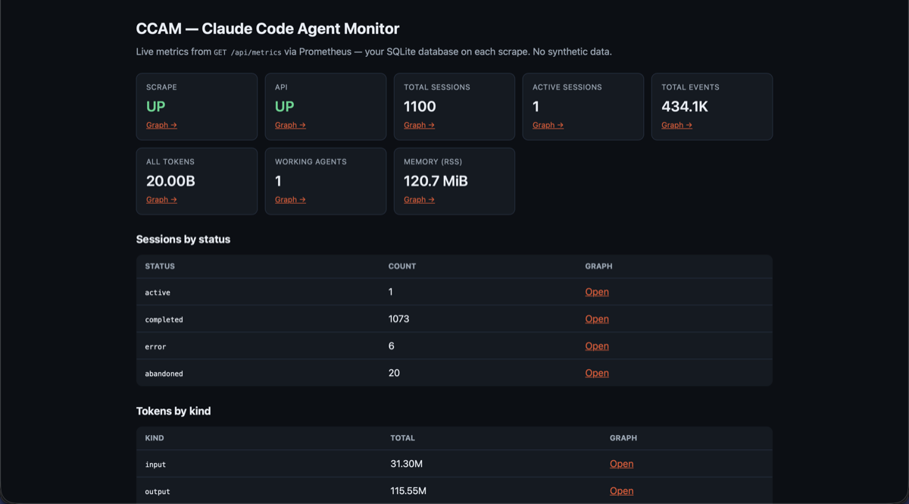</a>
  <br>
  <em>🔥 <strong>Prometheus · Console CCAM</strong> · saúde da coleta, sessões, eventos, tokens e links para detalhar no Graph</em>
</p>

<p align="center">
  <a href="images/prometheus-query.png">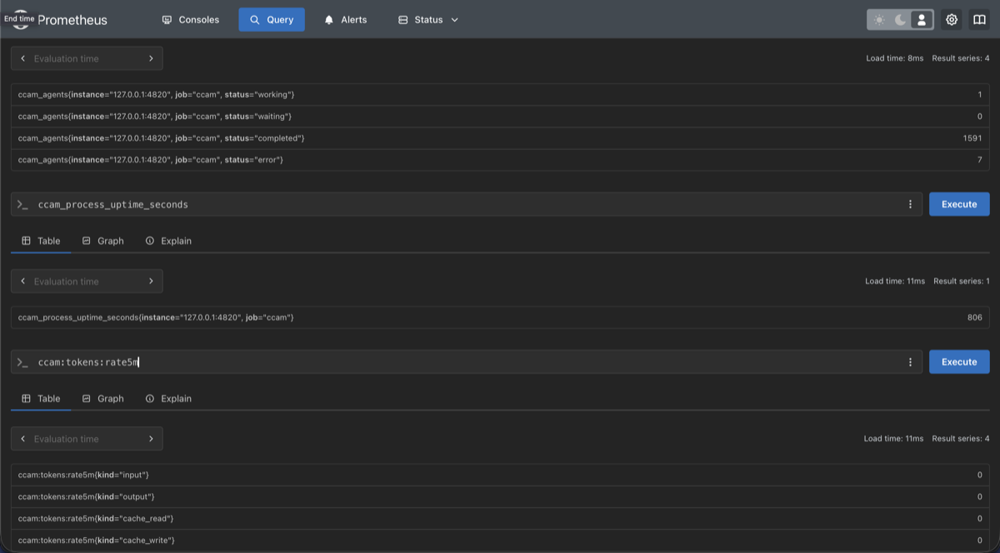</a>
  <br>
  <em>📈 <strong>Prometheus · Graph</strong> · rode PromQL sobre as métricas coletadas do CCAM com links prontos a partir do console</em>
</p>

Veja [docs/API.md → Metrics](./docs/API.md#metrics) para nomes das métricas, autenticação e configuração da coleta.

### Executar o Claude (`/api/run`)

Superfície HTTP para iniciar e supervisionar subprocessos `claude` a partir do painel. Proteção de mesma origem em toda rota — pedidos do navegador precisam vir de uma origem localhost; pedidos sem Origin (CLI/curl) passam. Um `cwd` informado precisa ser uma pasta absoluta existente e é canonicalizado com `realpath`. Ele pode estar fora deste repositório de propósito, para o Executar agente poder iniciar na pasta pessoal do usuário ou em qualquer projeto recente.

| Método   | Caminho                           | Descrição |
| -------- | --------------------------------- | ----------- |
| `GET`    | `/api/run`                        | Lista todas as execuções em memória (vivas + terminadas há pouco); devolve também `maxConcurrent` e `activeCount` |
| `GET`    | `/api/run/binary`                 | Confere se o `claude` está no `PATH` e onde fica — usado pela interface para mostrar um erro claro antes de iniciar |
| `GET`    | `/api/run/cwds`                   | Pastas de trabalho sugeridas: cwd do servidor do painel, `$HOME` e cwds recentes da tabela de sessões |
| `GET`    | `/api/run/files?cwd=…&q=…`        | Busca aproximada de arquivos dentro do `cwd` para o autocompletar de `@`-arquivo da página Executar. Pula `node_modules`, `.git`, `dist`, `build`, `.next`, `.cache`, `coverage` etc. O cwd é obrigatório e precisa existir; os resultados têm limite e são ordenados pela semelhança com o nome do arquivo |
| `POST`   | `/api/run`                        | Inicia uma nova execução. Corpo: `{ prompt, mode: "headless"\|"conversation", cwd?, model?, permissionMode?, resumeSessionId?, effort? }`. O modo headless põe o prompt no argv via `-p` e fecha o stdin. O modo conversa manda o prompt pelo stdin como um envelope stream-json e mantém o stdin aberto para continuações. `resumeSessionId` (só no modo conversa) adiciona `--resume <id>`; quando definido, `prompt` pode ser vazio — o iniciador pula a primeira escrita no stdin e o `claude` fica parado na conversa retomada até o usuário mandar uma continuação por `POST /api/run/:id/message`. `effort` (`low` / `medium` / `high`) vira `--effort`. O iniciador sempre passa `--output-format stream-json --verbose --include-partial-messages` para a interface mostrar as mudanças caractere a caractere. Na prática não há limite de concorrência (teto padrão 10000 — mude com `RUN_MAX_CONCURRENT`) |
| `GET`    | `/api/run/:id`                    | Estado atual da execução. `?envelopes=1` inclui o log de envelopes em memória para a interface reproduzir o histórico ao reconectar |
| `POST`   | `/api/run/:id/message`            | Manda um turno de continuação para uma conversa em andamento (só no modo conversa). Corpo: `{ text }` |
| `DELETE` | `/api/run/:id`                    | Para uma execução. SIGTERM, subindo para SIGKILL depois de 5 s |

A saída vai pelo WebSocket já existente do painel em três tipos de mensagem: `run_stream` (envelope stream-json processado, incluindo as mudanças `stream_event` do `--include-partial-messages`), `run_status` (mudanças de status), `run_input_ack` (escrita no stdin confirmada). A página do Explorador de configuração assina uma quarta mensagem — `cc_config_changed` — transmitida por `server/lib/cc-watcher.js` (via `fs.watch` em `~/.claude/`) e por `routes/cc-config.js` depois de todo PUT/DELETE bem-sucedido, com payload `{ source: "dashboard"|"fs", action?, scope?, type?, name?, paths? }`. A lista de Sessões e a página SessionDetail consultam `/api/run` (e escutam `run_status`) para marcar qualquer sessão sendo conduzida por uma execução em andamento com um indicador clicável **▶ Run** que leva de volta a `/run`.

### Importar histórico

**Configurações → Importar histórico** importa transcrições do Claude Code de `~/.claude/projects` e rollouts do Codex de `~/.codex/sessions` por leituras de pasta ou envios específicos de cada provedor. Os dois reaproveitam a coleta ao vivo, preservam tokens, custos, ferramentas, bases de compactação, ciclo de vida e títulos nativos do Codex, e são idempotentes. O histórico do Codex enviado é copiado para o armazenamento do painel, para a conversa sobreviver à limpeza da origem.

**Restaurar backup** aceita um `.json` exportado do painel pela interface, por `ccam export` ou por `GET /api/settings/export`. `POST /api/settings/import` e `ccam import-data <file>` restauram todas as tabelas sem sobrescrever sessões existentes, permitindo juntar várias máquinas com segurança.

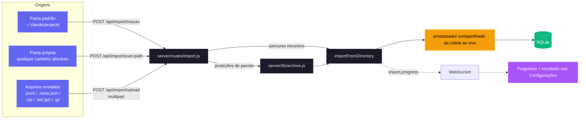

| Método | Caminho | Para que serve |
| --- | --- | --- |
| `GET` | `/api/import/guide` | Caminhos, comandos de empacotamento, extensões e instruções por provedor via `?provider=claude\|codex`. |
| `POST` | `/api/import/rescan` | Relê a raiz padrão escolhida a partir de `{ provider }`. |
| `POST` | `/api/import/scan-path` | Lê recursivamente um `{ path, provider }` absoluto. |
| `POST` | `/api/import/upload` | Envia arquivos ou pacotes suportados com `provider`. |

- **Entradas:** arquivos soltos `.jsonl`, `.meta.json`, `.zip`, `.tar`, `.tar.gz`/`.tgz` e `.gz` em estruturas aninhadas. O Claude aceita os dois layouts oficiais de subagentes; o Codex reconhece `rollout-*.jsonl` recursivos ou JSONL com `session_meta`, mais títulos opcionais do `session_index.jsonl`.
- **Precisão:** a deduplicação por UUID e por marca máxima de eventos evita contagem em dobro. As bases de compactação preservam tokens anteriores; atividade posterior avança o `ended_at` e atualiza os metadados das mensagens.
- **Arquivos grandes:** a leitura compartilhada em partes de 4 MiB, uma linha por vez, dá conta de transcrições além do limite de string do V8, de cerca de 512 MiB. As listas que crescem são limitadas por `TRANSCRIPT_CACHE_MAX_ARRAY_LEN`, padrão `1000`, com corte ao dobro do limite durante a leitura.
- **Segurança:** a extração recusa caminhos absolutos e com `..`. Os padrões limitam os dados extraídos a 4 GB, cada envio a 1 GB e os pedidos a 2000 arquivos; a área temporária de cada pedido é sempre liberada.
- **Progresso:** fases `import.progress` com limite de frequência pelo WebSocket cobrem `start`, `scan`, `extract`, `parse`, `complete` e `error`. A interface traz orientação para arrastar e soltar e os totais de importados, enriquecidos, pulados e com erro.

### WebSocket

Conecte em `ws://localhost:4820/ws` para receber mensagens em tempo real:

```json
{
  "type": "agent_updated",
  "data": { "id": "...", "status": "working", "current_tool": "Edit" },
  "timestamp": "2026-03-05T15:43:01.800Z"
}
```

**Tipos de mensagem:** `session_created`, `session_updated`, `agent_created`, `agent_updated`, `new_event`, `alert_triggered`, `alert_updated`, `remote_source.status` (dados `{ id, status: "idle"|"syncing"|"ok"|"error"|"deleted", error?, last_sync_at? }`)

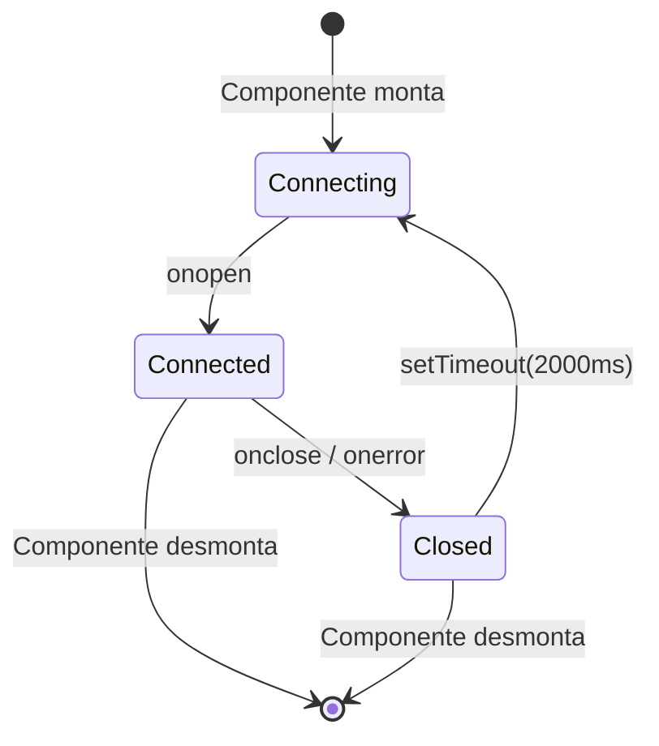

---

## Eventos de hook

O painel processa estes tipos de hook do Claude Code:


| Tipo de hook        | Quando dispara                 | O que o painel faz                                                                           |
| ------------------- | ------------------------------ | -------------------------------------------------------------------------------------------- |
| `SessionStart`      | Uma sessão do Claude Code começa | Cria a sessão e o agente principal. Marca `awaiting_input_since` (com `awaiting_reason=session_start`) para uma sessão nova cair em **Aguardando** — exceto um SessionStart de origem `compact` (compactação automática no meio do turno), que deixa a marca como está para uma sessão trabalhando continuar **Ativa**. Reativa sessões retomadas. Abandona sessões órfãs sem atividade por `DASHBOARD_STALE_MINUTES` (padrão 180) |
| `UserPromptSubmit`  | O usuário aperta enter num prompt | Limpa a marca de espera e promove o agente principal a `working` — o único sinal de que turnos do assistente só com texto começaram, já que eles não emitem `PreToolUse` |
| `PreToolUse`        | O agente começa a usar uma ferramenta | Limpa a marca de espera, põe o agente em `working` e define `current_tool`. Se a ferramenta for `Agent`, cria um registro de subagente |
| `PostToolUse`       | A execução da ferramenta terminou | Limpa a marca de espera (cobre aprovações de permissão em que a Notification a marcou no meio da ferramenta). Limpa `current_tool`. O agente continua `working` |
| `Stop`              | O Claude termina de responder  | Sem erro: agente principal → `waiting` — o Claude terminou o turno, a vez é do usuário. `stop_reason=error`: marca o agente e a sessão como `error`. Subagentes em segundo plano continuam rodando |
| `SubagentStop`      | Um agente em segundo plano terminou | Encontra e conclui o subagente pela descrição, tipo ou tarefa. De propósito NÃO limpa a marca de espera — um subagente terminar não diz nada sobre o humano. **Dispara uma leitura do JSONL sem esperar resposta** (`scanAndImportSubagents`) que emite eventos `PreToolUse` + `PostToolUse` por ferramenta com o próprio `agent_id` do subagente, para a Linha do tempo mostrar toda ferramenta que o subagente rodou, não só o marcador de criação |
| `Notification`      | Notificação do agente          | Registra o evento. Mensagens de permissão/pedido de entrada põem o agente em `waiting` e marcam `awaiting_input_since` (com `awaiting_reason=notification`, reconhecidas por padrão: `permission`, `waiting for input`, `needs your approval`, …). Notificações de compactação viram eventos `Compaction`. Dispara uma notificação do navegador, se ativada |
| `SessionEnd`        | O processo da CLI do Claude Code sai | Remove a marca de espera. Se a sessão já estiver em `error`, o erro é preservado; senão marca todos os agentes e a sessão como `completed` |
| `Compaction`   | `/compact` detectado no JSONL  | Cria um subagente de compactação (tipo `compaction`) e um evento Compaction. Detectado pelas entradas `isCompactSummary` no JSONL da transcrição. Também detectado pela leitura periódica das sessões ativas |
| `APIError`     | Erro de API na transcrição JSONL | Extraído das entradas `isApiErrorMessage` (cota, limite de taxa, invalid_request) e de respostas brutas `type: "error"`. **Agora marca na hora a sessão e o agente como `error`** — antes era registrado como evento sem mudar o status. Gravado como evento com os detalhes do erro |
| `TurnDuration` | Tempo do turno na transcrição JSONL | Extraído de mensagens `system` do subtipo `turn_duration` com `durationMs`. Gravado como evento para análise de tempo por turno |
| `ToolError`    | Erro no resultado de ferramenta no JSONL | Extraído das entradas `toolUseResult.is_error`. Acompanha falhas por ferramenta para a análise de propagação de erros |
| `RemoteToolEvent` | Chamada de ferramenta enviada por uma máquina remota | Gravado por `POST /api/hooks/ingest-batch` para cada item de `tool_events[]` que uma máquina em trânsito/atrás de NAT envia. Deduplicado por `(session_id, event_type, uuid)` contra as linhas já gravadas e dentro do lote, então reenviar um lote é seguro |
| `RemoteTurn`   | Duração de turno enviada por uma máquina remota | Gravado por `POST /api/hooks/ingest-batch` para cada item de `turns[]`, com o `duration_ms` daquele turno. Mesma deduplicação por `(session_id, event_type, uuid)` do `RemoteToolEvent` |
| `Interrupted`  | Turno cancelado pelo usuário (Esc) | Sintetizado pelo vigia — o `Esc` não dispara hook, então uma sessão presa em `working` é detectada pelo marcador `[Request interrupted by user]` da transcrição ou, quando o Esc veio antes de qualquer saída, pelo tempo limite de ociosidade trabalhando (`DASHBOARD_WORKING_IDLE_SECONDS`). A sessão vai para **Aguardando** (igual a um `Stop` normal) |

---

## Notificações do navegador

O painel suporta notificações persistentes do navegador via Web Push (VAPID) para alertas em tempo real mesmo quando a aba do painel não está em foco ou o navegador está em segundo plano.

### Como funciona

1. **Ative** as notificações na página de Configurações pelo botão principal
2. **Conceda** a permissão do navegador quando pedida — isso registra um Service Worker e cria uma assinatura de push
3. **Configure** quais eventos disparam notificações:

| Evento                       | Padrão  | Descrição                                                       |
| ---------------------------- | ------- | --------------------------------------------------------------- |
| Nova sessão começa           | Ligado  | Dispara quando uma nova sessão do Claude Code é criada          |
| O Claude terminou de responder | Desligado | Dispara em eventos `Stop`, quando o Claude termina um turno de resposta |
| Sessão encerrada             | Desligado | Dispara no `SessionEnd`, quando o processo da CLI sai           |
| Sessão dá erro               | Ligado  | Dispara quando uma sessão termina com erro                      |
| Subagente criado             | Desligado | Dispara quando um subagente em segundo plano é criado           |

Além disso, qualquer evento de hook `Notification` do Claude Code dispara uma notificação do navegador, independentemente das opções por evento (desde que o botão principal esteja ligado).

### Arquitetura das notificações

- **Fluxo VAPID:** usa `web-push` no servidor para entregar as mensagens com segurança. As chaves VAPID são geradas automaticamente e guardadas em `data/vapid-keys.json`.
- **Service Worker:** um worker dedicado (`client/public/sw.js`) trata os eventos `push` que chegam e mostra as notificações com `silent: false` para garantir o som no macOS.
- **Assinaturas:** os endpoints de cada navegador ficam na tabela `push_subscriptions` do SQLite.
- **Persistência:** as notificações chegam mesmo com o navegador fechado, porque o Service Worker roda em segundo plano.
- **Notificação de teste:** um botão nas Configurações permite conferir o fluxo VAPID e o som.

### PWA e suporte offline

O painel, a página inicial e a Wiki são PWAs instaláveis separados, com manifestos e service workers independentes.

| Superfície | Manifesto | Service Worker | Estratégia de cache |
| --- | --- | --- | --- |
| Painel (`client/`) | `client/public/manifest.json` | `client/public/sw.js` | `/assets/*` imutáveis são cache-first; navegações, o worker, o manifesto, os ícones e `/` são network-first com plano B. `/api/*`, `/ws` e o HMR do Vite nunca entram no cache; os handlers de push continuam ativos. O Express manda cabeçalhos imutáveis de um ano para os assets e cabeçalhos de revalidação para os arquivos da casca. O `controllerchange` recarrega uma vez numa atualização, nunca na primeira instalação. |
| Página inicial (raiz) | `manifest.json` | `sw.js` | Pré-carrega a casca, o favicon e a imagem OG. As capturas de tela entram no cache na primeira visualização; a navegação é network-first com plano B offline. |
| Wiki (`wiki/`) | `wiki/manifest.json` | `wiki/sw.js` | Pré-carrega o HTML, CSS, JS, manifesto e favicon. O HTML fica network-first; CSS e JS são cache-first, permitindo uso offline depois de uma visita. |

Todos os workers chamam `skipWaiting()`, removem caches antigos versionados ao ativar e atualizam de forma limpa quando a versão do cache muda. Cada arquivo HTML inclui os metadados de modo standalone do iOS; os manifestos e os ícones touch da Apple usam `favicon.svg` com `sizes="any"`.

---

## Aviso de atualização

O painel observa o próprio checkout do git e mostra uma janela sempre que o branch padrão oficial tem commits à frente do HEAD. **Ciente de branch e de fork:** se você tem um remoto `upstream` (a convenção padrão para forks), ele tem preferência sobre o `origin`; o `master`/`main`/`HEAD` do remoto escolhido é a referência de comparação. O `manual_command` se adapta à sua situação — `git pull --ff-only` só quando seu branch realmente segue a referência oficial, senão um `git fetch` (e um merge fast-forward no caso de fork), para o comando nunca mentir. O usuário recebe o comando exato para rodar num terminal — o servidor **nunca** faz pull nem se reinicia sozinho, o que mantém o mecanismo portável entre sessões de desenvolvimento, supervisão por pm2/systemd/launchd/Docker e implantações remotas.

<p align="center">
  <a href="images/update.png">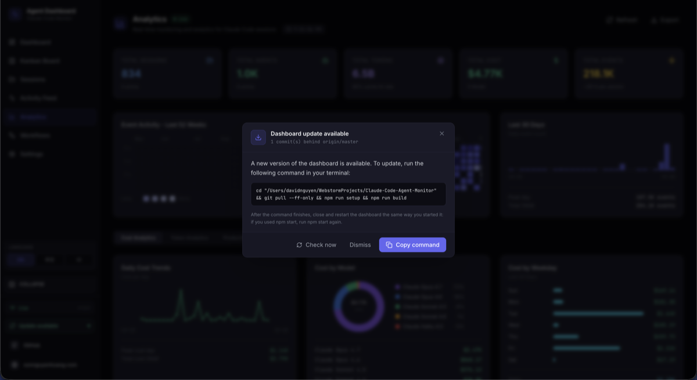</a>
</p>

### Como funciona

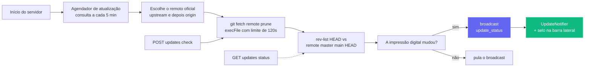

Uma checagem é barata (`git fetch <remote> --prune` contra o remoto oficial — `upstream` se configurado, senão `origin`), envolvida em `execFile` (sem shell) com limite de 120s. As falhas — rede offline, instalação fora do git, nenhum remoto configurado, referência upstream que não se resolve — devolvem **payloads suaves** (ex.: `fetch_error: "..."`) em vez de lançar erro, então um remoto instável nunca trava o painel.

### Onde aparece na interface

| Superfície | Comportamento |
| --- | --- |
| **Janela** (`client/src/components/UpdateNotifier.tsx`) | Abre para um novo `remote_sha` disponível; mostra os commits de atraso, a referência seguida, uma nota opcional de branch/fork, o comando exato e os botões **Copiar comando**, **Verificar agora** e **Dispensar**. Esc ou clicar no fundo dispensa. A dispensa fica guardada no `localStorage` por SHA, então um SHA mais novo abre de novo. |
| **Botão da barra lateral** (`client/src/components/Sidebar.tsx`) | Sempre visível. Verde significa atrás; âmbar significa falha no fetch. Clicar limpa a dispensa e chama `POST /api/updates/check`. |
| **Terminal do servidor** | Imprime um comando emoldurado quando o status muda de atualizado para atrás, inclusive para quem usa sem interface. |

### API

| Endpoint | Para que serve |
| --- | --- |
| `GET /api/updates/status` | Checagem só leitura: roda `git fetch` contra o remoto oficial, compara o HEAD com o branch padrão dele e devolve o payload. |
| `POST /api/updates/check` | A mesma checagem, mas também transmite `update_status` pelo WebSocket para todos os clientes conectados atualizarem de uma vez. |

Os dois endpoints devolvem o mesmo formato de payload:

```json
{
  "git_repo": true,
  "update_available": true,
  "repo_root": "/Users/you/Claude-Code-Agent-Monitor",
  "remote_ref": "upstream/master",
  "canonical_remote": "upstream",
  "current_branch": "master",
  "tracking_upstream": "origin/master",
  "tracks_canonical": false,
  "situation": "fork_or_diverged_tracking",
  "local_sha": "abc1234...",
  "remote_sha": "def5678...",
  "commits_behind": 3,
  "manual_command": "cd \"/...\" && git fetch upstream && git merge --ff-only upstream/master && npm run setup",
  "situation_note": "You're on 'master' tracking 'origin/master'. This command fast-forwards your branch from upstream/master (the canonical default).",
  "message": "3 commit(s) on upstream/master not in your checkout."
}
```

`situation` é um destes: `tracking_canonical` (clone típico no branch padrão — `git pull --ff-only` funciona), `fork_or_diverged_tracking` (o nome do branch local bate com o oficial, mas segue outro remoto — `git fetch <remote> && git merge --ff-only <ref>`), `feature_branch` (fora do branch padrão — só fetch, a integração fica com o usuário) ou `detached_head`.

### O que **não** está aqui de propósito

Não existe `POST /api/updates/apply` nem auxiliar de autorreinício, por decisão de projeto. Um processo se atualizar de dentro de si mesmo não é confiável sem um supervisor externo — `npm run dev` (concurrently), `npm start`, `pm2`, `systemd`, `launchd` e Docker precisam cada um de uma lógica de reinício diferente, e falhas de `git pull` / `npm install` num servidor morrendo não têm caminho limpo de volta. Só detectar mantém o comportamento previsível em todo supervisor, todo sistema operacional e todo estado de branch, e ainda fecha a lacuna de "quando eu preciso dar pull?"; o usuário cuida da atualização em si no próprio shell.

### Configuração

| Variável de ambiente | Padrão | Observações |
| --- | --- | --- |
| `DASHBOARD_UPDATE_CHECK` | ligado | Defina `0` / `false` / `off` para desligar o agendador por completo. |
| `DASHBOARD_UPDATE_CHECK_INTERVAL_MS` | `300000` (5 min) | Intervalo entre as checagens automáticas. O mínimo é 60 000 ms — valores menores são ajustados. |

---

## Tabby — Gato companheiro flutuante

O **Tabby** é um gatinho companheiro flutuante preso no canto inferior direito de toda página do painel. Sempre presente, ele transforma o fluxo de sessões ao vivo num mascote reativo que dá para entender num relance — e com quem dá para conversar.

<p align="center">
  <a href="images/tabby.png">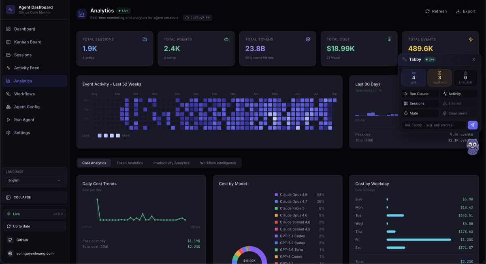</a>
</p>

### Mascote reativo

O Tabby é um gato em SVG que segue o cursor, com **oito humores** derivados do fluxo de sessões ao vivo, cada um com a própria animação:

| Humor | Quando | Animação |
| --- | --- | --- |
| `idle` | Nada de importante acontecendo | Rabo balançando em repouso |
| `watching` | Há sessões ativas | Orelhas em pé, olhos seguem o cursor |
| `happy` | Uma sessão ou execução terminou bem | Balança a cabeça + brilho |
| `worried` | Algo parece errado | Tremidinha discreta |
| `stuck` | Uma sessão parece travada | Alerta "!" |
| `thinking` | Um agente está trabalhando | Balança a cabeça devagar |
| `sleeping` | Tudo quieto há um tempo | `zzz` |
| `disconnected` | O WebSocket caiu | Pose calma e parada |

### Balões de fala

O Tabby mostra sozinho frases curtas em eventos importantes (sessão começou/terminou, erros, execução concluída). Os balões têm **limite de frequência e são agrupados**, então uma rajada de eventos nunca enche a tela; eles usam `aria-live` para leitores de tela e podem ser **silenciados** pelo painel.

### Painel

Abra o painel clicando no gato ou apertando **⌘B / Ctrl+B** (Esc fecha). Ele mostra:

- Uma **linha de status** ao vivo — `N ao vivo · M com erro · estado da conexão`.
- **Ações rápidas** — ir para Executar o Claude, Atividade, Sessões ou sessões com erro; silenciar os balões; limpar alertas.
- Uma caixa **Perguntar** (veja abaixo).

### Caixa Perguntar → repasse para Executar o Claude

A caixa **Perguntar** responde perguntas simples de status localmente, com os dados em cache — por exemplo "o que está rodando", "algum erro" ou "status". Qualquer outra pergunta é repassada para a página **Executar o Claude** que já existe (com um link direto para `/run?prompt=…`) para iniciar uma sessão real do Claude Code. O Tabby nunca chama um LLM sozinho; ele só reaproveita a página Executar o Claude para tudo que vai além de uma consulta rápida de status.

### Acessibilidade e degradação segura

O Tabby funciona pelo teclado, usa `aria-live` nos balões e respeita `prefers-reduced-motion`. Se o WebSocket cair, ele passa com segurança para um estado calmo `disconnected` em vez de dar erro. Dá para ligar ou desligar o Tabby em **Configurações** (traduzido em inglês, chinês, vietnamita, coreano, espanhol e português do Brasil), e a implementação fica em `client/src/components/Tabby/`.

---

## Sinais sonoros

O painel dá um **retorno sonoro discreto** da atividade das sessões ao vivo, então você pode deixá-lo num segundo monitor e ainda ouvir quando uma execução termina ou falha. O som vem **ligado por padrão** e pode ser desligado por completo com um clique.

### Síntese sem dependências

Não há assets `.mp3` ou `.wav` em lugar nenhum do repositório nem biblioteca de áudio no `package.json`. Cada sinal é gerado na hora com a **Web Audio API**: uma lista curta de osciladores (seno ou triângulo), cada um com o próprio envelope de ganho exponencial, mixados por um nó de ganho principal e um filtro passa-baixa, para o resultado ficar ao fundo do seu trabalho em vez de cortar através dele. O motor inteiro é um arquivo só, `client/src/lib/sound.ts`.

### Os sinais

| Sinal | Quando toca | Como soa |
| --- | --- | --- |
| `sessionStart` | Uma nova sessão aparece | Quinta justa subindo (C5 → G5) |
| `sessionComplete` | Uma sessão termina de responder (`Stop`) ou fecha (`SessionEnd`) | Arpejo maior resolvendo (E5 → G5 → C6) |
| `sessionError` | Uma sessão entra no estado `error` | Terça menor descendo suave numa onda triangular — perceptível, sem assustar |
| `subagentSpawn` | Um subagente é criado | Um dedilhado curto |
| `notification` | O Claude Code emite um evento `Notification` | Um par levemente desafinado soando como um sininho |
| `connected` / `disconnected` | O WebSocket do painel volta ou cai | Duas notas subindo / descendo |
| `click` | Você aperta um botão, link, aba ou chave | Um tique quase inaudível |

Os sinais ficam num conjunto em dó maior, então caudas sobrepostas nunca soam dissonantes, e todo envelope decai de forma exponencial em vez de cortar, o que evita o estalo de uma parada brusca.

### Sem atrapalhar

Três proteções impedem o áudio de virar barulho:

- **Intervalo por sinal** — o mesmo sinal não se repete em ~350 ms (45 ms para o tique de interação).
- **Orçamento global de rajadas** — no máximo 4 sinais começam em qualquer janela de 1,2 s, então importar histórico ou reconectar depois de uma queda nunca transforma uma enxurrada de mensagens do WebSocket numa enxurrada de bipes.
- **Política de autoplay** — nada toca antes da sua primeira interação de mouse, tecla ou toque com a página, pelas regras do navegador. Sinais antes disso são descartados em silêncio, não enfileirados.

Se o navegador não tiver suporte nenhum a Web Audio, toda chamada vira uma operação vazia segura — o painel só fica em silêncio.

### Configurações

**Configurações → Som** tem um botão principal, um controle de volume e uma chave para cada sinal. Ligar uma chave toca aquele sinal na hora, para você ouvir exatamente o que acabou de ativar, e um botão **Testar som** toca o sinal de conclusão quando quiser. As preferências ficam no `localStorage` em `agent-monitor-sound` e valem na hora em todo o app — sem recarregar. O painel é traduzido em inglês, chinês, vietnamita, coreano, espanhol e português do Brasil.

Por padrão, início de sessão, sessão concluída, erro de sessão, notificações do Claude Code e o tique de interação vêm ligados; criação de subagentes e mudanças de conexão vêm desligadas (são os mais falantes). A implementação fica em `client/src/lib/sound.ts` (motor + preferências) e `client/src/hooks/useSoundCues.ts` (ligação com o barramento de eventos), montados uma vez em `client/src/App.tsx`.

---

## Janela de status da conexão

Clique na pílula **Ao vivo** / **Desconectado** no rodapé da barra lateral para abrir um pequeno painel de detalhes sobre o transporte WebSocket do painel. Ele mostra o endpoint `ws://` ativo, há quanto tempo o socket atual está no ar, o total de eventos recebidos, os tipos de evento mais comuns num gráfico de barras horizontal, um minigráfico de vazão dos últimos 60 segundos e os últimos 8 eventos numa lista de atividade recente. As estatísticas acumuladas (totais, divisão por tipo, lista recente) sobrevivem a recarregamentos pelo `localStorage` em `sidebar-connection-stats`; o minigráfico móvel e o contador "conectado desde" são passageiros de propósito. Um botão **Zerar** no rodapé limpa tudo quando você quiser.

<p align="center">
  <a href="images/live.png">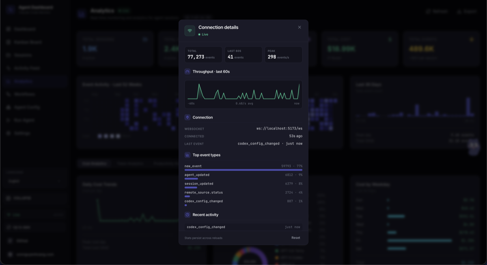</a>
</p>

---

## Extensão do VS Code

O **Claude Code Agent Monitor** está disponível como uma extensão de primeira classe do VS Code, para você monitorar seus agentes de IA sem sair do editor.

<p align="center">
  <a href="vscode-extension/vscode.png">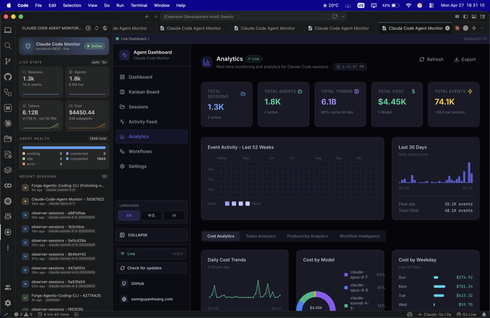</a>
</p>

### 🚀 Principais recursos
- **Barra lateral ao vivo**: visão dedicada na Activity Bar mostrando a saúde dos agentes em tempo real (Trabalhando, Aguardando, Concluído etc.).
- **Análise de uso**: acompanhe o total de tokens, o custo em USD ao vivo e a contagem de eventos direto na barra lateral.
- **Integração com a barra de status**: um monitor rápido na barra de baixo mostrando sessões e agentes ativos.
- **Navegação direta**: acesso em um clique a telas específicas do painel (Kanban, Análises, Configurações) ou a sessões recentes.
- **Aba integrada**: abre o painel de monitoramento completo como uma aba webview nativa do VS Code.

### 📦 Instalação e configuração
1. Abra a pasta [vscode-extension](./vscode-extension).
2. Instale a extensão pelo Marketplace ou empacote você mesmo com `vsce package`.
3. Garanta que o servidor local do painel esteja rodando (`npm run dev`).
4. Clique no **ícone de radar** na Activity Bar do VS Code para começar.

Para a configuração detalhada de desenvolvimento, veja as pastas [.vscode](./.vscode) e [vscode-extension](./vscode-extension).

> [!TIP]
> Extensão no VS Code Marketplace: [Claude Code Agent Monitor](https://marketplace.visualstudio.com/items?itemName=hoangsonw.claude-code-agent-monitor)

---

## App de desktop (macOS e Windows)


O app de desktop opcional em Electron 35 empacota o mesmo painel como `.dmg` para macOS, instalador NSIS para Windows ou `.exe` portátil, a partir do workspace `desktop/`.

<p align="center">
  <a href="images/macos.png">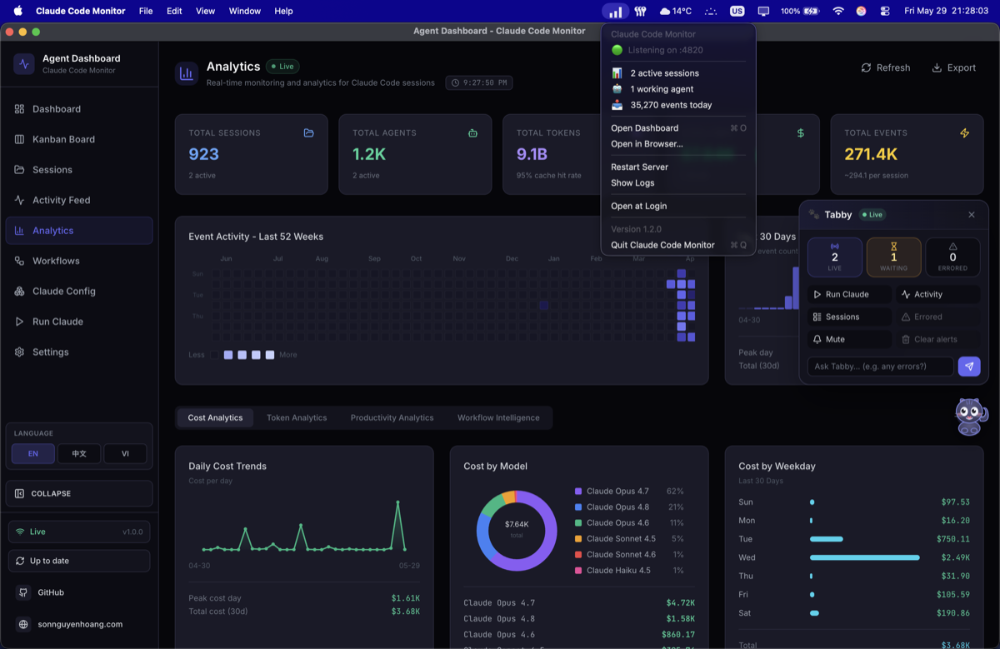</a>
  <br>
  <em>🍎🪟 <strong>App de desktop</strong> — casca nativa com ícone na barra de menus / área de notificação (bandeja), Abrir no login e trava de instância única. O mesmo painel, numa janela de verdade do sistema (mostrado no macOS).</em>
</p>

<p align="center">
  <a href="images/windows_app.png"></a>
  <br>
  <em>🪟 O mesmo painel como app nativo do Windows — ícone na área de notificação (bandeja), menu nativo da janela e Abrir no login.</em>
</p>

Ele adiciona comportamento nativo de janela, bandeja, menu, login e desligamento em volta da mesma interface servida em `localhost:4820`.

### Como funciona

Diferente de rodar o painel por um terminal, o app de desktop não precisa de `npm start`, de shell aberto nem de uma segunda cópia do servidor. O **processo principal** do Electron hospeda o servidor Express **dentro do próprio processo** — ele faz `require()` de `server/index.js` direto no mesmo runtime Node, **sem processo filho e sem IPC** — e aponta uma `BrowserWindow` do Chromium para o client React compilado.


Ao abrir, o app:

1. Escolhe uma porta livre — preferindo **4820**, depois **4821–4829** e, se todas estiverem ocupadas, uma porta alta aleatória.
2. Se um servidor do painel saudável já responde a `/api/health` na `4820` (ex.: você rodou `npm start` num terminal), ele **adota esse servidor** em vez de abrir a porta de novo — sem colisão de porta, sem disputa pelo SQLite. Um servidor adotado continua rodando depois que você fecha o app.
3. Senão, ele sobe o servidor embutido e, na **primeira subida de um servidor próprio**, instala automaticamente os hooks do Claude Code e inicia os serviços em segundo plano (agendador de atualização, `cc-watcher`, reconciliação de execuções órfãs). Quem só instala o DMG já recebe eventos com **zero configuração manual** — sem checkout, sem `npm run install-hooks`.
4. **(macOS)** Recupera o **`PATH` do shell de login** para o recurso **Executar o Claude** achar e iniciar a CLI `claude` — senão um app aberto pelo Finder/Dock herda só o `PATH` mínimo do launchd e não acharia CLIs em `~/.local/bin`, `/opt/homebrew/bin`, pastas de gerenciadores de versão etc. (No Windows o processo já herda o `PATH` do usuário.)
5. Abre a janela do painel — a menos que o app tenha sido aberto no login (no macOS pelos Itens de login; no Windows pela entrada marcada em `HKCU\…\Run`), caso em que ele fica só na bandeja.
6. Ao sair, desliga o servidor embutido com calma e **fecha o SQLite de forma limpa** (checkpoint do WAL).

### Recursos

- **Bandeja e janela:** clique esquerdo mostra/esconde a janela; clique direito oferece **Abrir o painel**, **Abrir no navegador**, **Reiniciar servidor**, **Mostrar logs**, **Abrir no login** e **Sair**. O macOS usa um glifo de bandeja modelo colorido pelo sistema; o Windows e a janela/barra de tarefas usam o ícone colorido do app, inclusive em execuções de desenvolvimento não empacotadas.
- **Menu nativo:** menus padrão do aplicativo e atalhos com `⌘` / `Ctrl`. Só o macOS mantém **File → Open Dashboard** (`⌘1`) enquanto escondido; Windows/Linux reabrem de forma confiável pela bandeja.
- **Login e ciclo de vida:** o `SMAppService` registra os Itens de login do macOS; o Windows grava a entrada por usuário em `HKCU\Software\Microsoft\Windows\CurrentVersion\Run`. Fechar esconde a janela enquanto a bandeja e o servidor continuam; abrir uma segunda vez foca a instância única que já existe.
- **Dados duráveis:** o SQLite e as chaves VAPID ficam fora do pacote, em `~/Library/Application Support/Claude Code Monitor/data/` ou `%APPDATA%\Claude Code Monitor\data\`. Reinstalar, atualizar e a desinstalação NSIS padrão preservam o histórico importado.
- **CLI e logs:** o macOS restaura o `PATH` do shell de login para aberturas pelo Finder/Dock conseguirem rodar o `claude`; o Windows usa o `PATH` herdado do usuário. **Mostrar logs** abre `~/Library/Logs/Claude Code Monitor/desktop.log` ou `%APPDATA%\Claude Code Monitor\logs\desktop.log`.

### Como obter

**Opção A — baixar um instalador pronto (recomendado).** Em **[Releases → latest](https://github.com/hoangsonww/Claude-Code-Agent-Monitor/releases/latest)** (público, sem login no GitHub). O CI publica automaticamente uma nova release `vX.Y.Z` sempre que a versão no `package.json` muda no `master`, então esse link sempre entrega o build atual:

| Plataforma | Arquivo | Observações |
| --- | --- | --- |
| macOS (Apple Silicon) | `ClaudeCodeMonitor-<ver>-arm64.dmg` | arraste para `/Applications` |
| macOS (Intel) | `ClaudeCodeMonitor-<ver>-x64.dmg` | arraste para `/Applications` |
| Windows (instalador) | `ClaudeCodeMonitor-Setup-<ver>-x64.exe` | instalação por usuário, sem admin |
| Windows (portátil) | `ClaudeCodeMonitor-<ver>-x64-portable.exe` | roda sem instalar |

Builds novos por commit também ficam como artefatos do CI (exige login, guardados por 14 dias): `ClaudeCodeMonitor-dmg` do job `🍎 macOS Desktop (DMG)` e `ClaudeCodeMonitor-win` do job `🪟 Windows Desktop (EXE)` — úteis para testar o `master` antes da próxima tag de release.

**Opção B — compilar você mesmo.** Na raiz do repositório:

```bash
npm run setup                # install root + client deps, build client, install hooks
npm run build                # build the React client (client/dist)
npm run desktop:install      # install Electron + electron-builder into desktop/ (preflights native deps; prints setup help on failure)
npm run desktop:dmg:arm64    # macOS:   fast single-arch DMG → desktop/release/ClaudeCodeMonitor-<ver>-arm64.dmg
npm run desktop:win          # Windows: NSIS installer → desktop/release/ClaudeCodeMonitor-Setup-<ver>-x64.exe
```

> [!NOTE]
> **DMGs são gerados no macOS; os `.exe` do Windows, no Windows** — o electron-builder empacota para o sistema da máquina. O build `npm run desktop:dmg` do macOS empacota o app **duas vezes** (uma por arquitetura) e gera **os dois** DMGs por arquitetura (`arm64` + `x64`) — o build de release; ele não os junta num binário universal. Para o seu próprio Mac use o de uma arquitetura só, `desktop:dmg:arm64` / `desktop:dmg:x64`. No Windows, o `better-sqlite3` é baixado como binário pronto do Electron pelo `npm run desktop:install`, então no caso comum não precisa do toolchain C++ do Visual Studio. Se o build falhar (sem binário pronto, ou sem toolchain C++), o `desktop:install` mostra a correção exata para cada sistema mais uma alternativa sem toolchain e falha de forma clara, em vez de deixar uma instalação quebrada.

### Como instalar

**macOS:**

1. Clique duas vezes no `.dmg` para montá-lo.
2. Arraste o **Claude Code Monitor.app** para a pasta `/Applications`.
3. O DMG tem **assinatura ad-hoc** por padrão, então o Gatekeeper do macOS avisa na primeira abertura (*"Apple could not verify…"*). Limpe o atributo de quarentena:

   ```bash
   xattr -cr "/Applications/Claude Code Monitor.app"
   ```

   Ou abra **Ajustes do Sistema → Privacidade e Segurança** e clique em **Abrir Mesmo Assim**.

4. Abra o app. O ícone da bandeja aparece e a janela do painel abre.

**Windows:**

Rode `ClaudeCodeMonitor-Setup-<ver>-x64.exe` para uma instalação por usuário, sem admin, em `%LOCALAPPDATA%\Programs\Claude Code Monitor`, com destino ajustável, ou use o `*-portable.exe` sem instalar. O build padrão sem assinatura pode acionar o SmartScreen na primeira abertura; escolha **Mais informações → Executar assim mesmo**. Abra pelo menu Iniciar ou pelo atalho da área de trabalho para ver o painel e o ícone da bandeja.

<p align="center">
  <a href="images/setup_win_wizard.png"></a>
  <br>
  <em>🪟 <strong>Opções de instalação</strong> · escolha instalar só para o seu usuário ou para todos</em>
</p>

<p align="center">
  <a href="images/setup_win_wizard2.png"></a>
  <br>
  <em>🪟 <strong>Local de instalação</strong> · confirme ou troque a pasta de destino</em>
</p>

<p align="center">
  <a href="images/setup_win_wizard3.png"></a>
  <br>
  <em>🪟 <strong>Instalação no Windows concluída</strong> · termine o instalador e abra o Claude Code Monitor</em>
</p>

### Comandos de build

Todos os comandos rodam na **raiz do repositório**:

| Comando                     | O que faz                                                                    |
| --------------------------- | ---------------------------------------------------------------------------- |
| `npm run desktop:install`   | Instala o Electron + electron-builder em `desktop/`; recompila o `better-sqlite3` para a ABI do Electron; testa antes o build nativo do `better-sqlite3` e mostra ajuda prática de configuração (incl. uma alternativa sem toolchain) se falhar |
| `npm run desktop:build`     | Compila o código TypeScript do desktop em `desktop/out/`                      |
| `npm run desktop:dev`       | Compila e abre o app Electron para testar localmente                          |
| `npm run desktop:test`      | Roda o teste rápido (abre o Electron, testa `/api/health`, desliga)           |
| `npm run desktop:dmg`       | **macOS:** gera **os dois** DMGs (arm64 + x64) — o certo para release, **mais lento** (empacota cada arquitetura) |
| `npm run desktop:dmg:arm64` | **macOS:** gera um DMG só para Apple Silicon — **rápido** (~1 min), recomendado para o seu próprio Mac |
| `npm run desktop:dmg:x64`   | **macOS:** gera um DMG só para Intel — **rápido** (~1 min)                    |
| `npm run desktop:dmg:universal` | **macOS:** gera um único DMG **universal** combinado (arm64 + x86_64) — opcional, **o mais lento**, não é o que a release publica |
| `npm run desktop:win`       | **Windows:** gera o instalador NSIS `.exe` (x64)                              |
| `npm run desktop:win:portable` | **Windows:** gera o `.exe` portátil sem instalação (x64)                   |

O DMG gerado para macOS tem **~80 MB** (≈ 250 MB em disco depois de instalado) e o instalador do Windows é parecido — o custo padrão de um pacote Electron.

### Assinatura e notarização

O macOS usa assinatura ad-hoc por padrão e define `CSC_IDENTITY_AUTO_DISCOVERY=false`, então certificados locais nunca são escolhidos por acidente. A assinatura com Developer ID usa `CSC_LINK` mais `CSC_KEY_PASSWORD`; a notarização adiciona `APPLE_ID`, `APPLE_TEAM_ID` e `APPLE_APP_SPECIFIC_PASSWORD`. O Windows não tem assinatura por padrão e ativa o Authenticode pelas mesmas variáveis `CSC_LINK` e de senha. O CI ativa qualquer um dos caminhos quando as credenciais existem, sem mudar código.

### Notas de implementação

- **ABI nativa:** `desktop/` mantém um `better-sqlite3` compilado para o Electron e redireciona `server/db.js` para ele; a cópia da raiz continua compatível com o Node do sistema e com os testes do servidor. Depois de builds de DMG por arquitetura, o `prebuild` do desktop conserta a ABI local sozinho e falha cedo com ajuda de configuração se o binário estiver faltando.
- **Paridade do servidor:** a função exportada `startBackgroundServices()` dá ao servidor embutido o mesmo agendador de atualização, observador de configuração e reconciliação de órfãos de `node server/index.js`; o caminho standalone e os outros workspaces continuam com o mesmo comportamento.
- **CI e releases:** jobs de macOS e Windows filtrados por caminho fazem testes rápidos e enviam dois DMGs de uma arquitetura mais os EXEs NSIS e portátil. Mudanças de versão no `master` anexam todos os arquivos à `vX.Y.Z`; gere de novo `desktop/assets/icon.ico` com `npm run build:win-icon`.

Veja [`DESKTOP.md`](./DESKTOP.md) para instalação e uso no dia a dia, e [`desktop/README.md`](./desktop/README.md) para processo, ciclo de vida, portas e builds.

---

## Armazenamento de dados

- **Motor:** SQLite 3 via `better-sqlite3` (opcional) ou o `node:sqlite` embutido no Node.js
- **Local:** `data/dashboard.db`
- **Modo de journal:** WAL (leituras simultâneas durante gravações)
- **Zerar:** apague `data/dashboard.db` para limpar todos os dados

### Diagrama entidade-relacionamento


---

## Marketplace de plugins

O CCAM traz **14 plugins** de uma única árvore de código compartilhada. O Claude Code lê `.claude-plugin/marketplace.json`; o Codex lê `.agents/plugins/marketplace.json` mais o `.codex-plugin/plugin.json` de cada plugin. O pacote contém **66 skills de plugin, 18 subagentes do Claude, 34 comandos do Claude, 3 auxiliares de CLI, 3 configurações de hook e 2 plugins com MCP**.


```bash
# Claude Code
claude plugin marketplace add hoangsonww/Claude-Code-Agent-Monitor
claude plugin install ccam-platform@claude-code-agent-monitor-plugins

# Codex
codex plugin marketplace add hoangsonww/Claude-Code-Agent-Monitor
codex plugin add ccam-platform@claude-code-agent-monitor-plugins

# Open Agent Skills / skills.sh-compatible CLI
npx skills add hoangsonww/Claude-Code-Agent-Monitor --list

# Install one skill for Claude Code and Codex in the current project
npx skills add hoangsonww/Claude-Code-Agent-Monitor \
  --skill mcp-server \
  --agent claude-code \
  --agent codex \
  --yes

# Verify, update, and remove the project-scoped skill
npx skills list --json
npx skills update --project --yes
npx skills remove mcp-server --yes

# Add --global to install at user scope, then manage that scope explicitly
npx skills add hoangsonww/Claude-Code-Agent-Monitor \
  --skill mcp-server \
  --agent claude-code \
  --agent codex \
  --global \
  --yes
npx skills list --global --json
npx skills update --global --yes
npx skills remove --global mcp-server --yes
```

A CLI `skills` encontra **77 skills no total do repositório**, incluindo as 66 skills de plugin e as skills de manutenção do repositório. Instalações por projeto usam `.agents/skills/` mais links específicos de cada agente. As skills globais do Claude Code ficam por padrão em `~/.claude/skills/`, ou em `$CLAUDE_CONFIG_DIR/skills/` quando definido. As skills globais do Codex ficam por padrão em `~/.codex/skills/`, ou em `$CODEX_HOME/skills/` quando definido. Instalações para vários agentes podem deduplicar arquivos por um armazenamento compartilhado e vincular esses destinos. Toda skill de plugin tem frontmatter canônico `name`/`description` e metadados `agents/openai.yaml`. Não é preciso mandar PR para o `vercel-labs/skills` para instalar. O repositório público no GitHub é a origem, e a visibilidade no skills.sh acompanha a publicação e a telemetria de instalações reais.

Novos pacotes focados complementam os plugins já existentes de análises, produtividade, qualidade, sessões, fluxos, configuração e painel:

- `ccam-runner`: execução monitorada do Claude Code/Codex, continuação, parada, retomada e histórico de execuções
- `ccam-integrations`: regras de alerta, webhooks, notificações push e coleta remota por SSH
- `ccam-platform`: Explorador de configuração do Claude/Codex, importação ciente do provedor, restauração de backup, configuração de hooks, atualizações e operações MCP
- `ccam-reports`: relatórios executivos, de custo, de confiabilidade e de fluxos prontos para apresentar

Valide e gere de novo os metadados de distribuição com:

```bash
npm run extensions:sync
npm run extensions:validate
```

Catálogo completo, comandos de instalação, comportamento do skills.sh, limite da submissão pública e checagens de instalação limpa: [docs/PLUGINS.md](docs/PLUGINS.md).

---

## Statusline

Um utilitário de statusline de CLI independente para o Claude Code que mostra o nome do modelo, usuário, diretório de trabalho, branch do git, barra de uso da janela de contexto, contagem de tokens por direção e custo da sessão -- tudo colorido com sequências de escape ANSI.

```
nguyens6@host ~/agent-dashboard/client | Sonnet 4.6 | main | ████████░░ 79% | 3↑ 2↓ 156586c | $0.4231
```

| Segmento    | Cor                  | Exemplo                                                        |
| ----------- | -------------------- | -------------------------------------------------------------- |
| Modelo      | Ciano                | `Sonnet 4.6`                                                   |
| Usuário     | Verde                | `nguyens6`                                                     |
| CWD         | Amarelo              | `~/agent-dashboard`                                            |
| Branch do git | Magenta            | `main`                                                         |
| Barra de contexto | Verde / Amarelo / Vermelho | `████████░░ 79%`                               |
| Tokens      | Verde / Ciano / Apagado | `3↑ 2↓ 156586c` (`↑` verde entrada, `↓` ciano saída, `c` apagado cache) |
| Custo (USD) | Verde / Amarelo / Vermelho | `$0.4231` (total da sessão — aparece em planos de API e de assinatura) |

Faixas de cor do custo: verde abaixo de $5, amarelo de $5 a $20, vermelho $20+.

Veja [`statusline/README.md`](statusline/README.md) para as instruções de instalação.

<p align="center">
  <a href="images/statusline.png"></a>
</p>

---

## Arquitetura do servidor


---

## Roteamento do cliente


---

## Fluxo do manipulador de hooks


---

## Modos de implantação

Suportamos os modos de implantação de desenvolvimento e de produção, com arquiteturas de processo diferentes:


Sidecar MCP local opcional (suporta os transportes stdio, HTTP+SSE e REPL):

```mermaid
graph LR
    subgraph "Opções de transporte MCP"
        M_STDIO["Servidor MCP (stdio)<br/>npm run mcp:start"]
        M_HTTP["Servidor MCP (HTTP)<br/>npm run mcp:start:http<br/>:8819"]
        M_REPL["Servidor MCP (REPL)<br/>npm run mcp:start:repl"]
    end

    H["Host MCP"] -->|"stdin/stdout"| M_STDIO
    RC["Cliente remoto"] -->|"POST /mcp · GET /sse"| M_HTTP
    OP["Operador"] -->|"CLI interativa"| M_REPL

    M_STDIO --> D["Servidor do painel<br/>:4820"]
    M_HTTP --> D
    M_REPL --> D

    style M_STDIO fill:#0f766e,stroke:#14b8a6,color:#fff
    style M_HTTP fill:#0f766e,stroke:#14b8a6,color:#fff
    style M_REPL fill:#0f766e,stroke:#14b8a6,color:#fff
```

**App de desktop (macOS e Windows)** opcional — um único processo Electron que hospeda o servidor Express dentro dele (sem terminal, sem processo filho):

```mermaid
flowchart LR
    subgraph desktop["App de desktop (macOS e Windows) — 1 processo Electron"]
        E_MAIN["Processo principal do Electron<br/>(Node 22 / Electron 35)"]
        E_HOST["server-host.ts<br/>require() server/index.js"]
        E_SRV["Express embutido :4820<br/>API · SQLite · WebSocket"]
        E_WIN["BrowserWindow<br/>client React compilado"]
        E_TRAY["Ícone na barra de menus (bandeja)<br/>+ menu nativo do app"]
        E_MAIN --> E_HOST
        E_HOST -->|"require() no processo"| E_SRV
        E_MAIN --> E_TRAY
        E_SRV -->|"http + ws em 127.0.0.1"| E_WIN
    end

    E_HOOKS["Hooks do Claude Code"] -->|"POST /api/hooks/event"| E_SRV

    style E_MAIN fill:#47848F,stroke:#2f5a62,color:#fff
    style E_SRV fill:#339933,stroke:#5cb85c,color:#fff
    style E_WIN fill:#61DAFB,stroke:#3aa9c9,color:#000
```

### Implantação na nuvem

A pilha de `deployments/` funciona em qualquer serviço Kubernetes conforme, incluindo EKS, GKE, AKS, OKE e clusters próprios. O CCAM usa SQLite, então todo manifesto suportado exige **um único gravador ativo do painel por volume persistente**, com rollout Recreate. HPA, réplicas ativo-ativo, blue-green e canary ficam sem suporte de propósito enquanto o SQLite for o backend de persistência.

```mermaid
flowchart LR
  CI["CI: testar · validar · escanear · atestar · assinar"] --> HELM["Helm / Kustomize / Terraform"]
  HELM --> APP["Painel CCAM<br/>exatamente 1 réplica"]
  APP --> PVC[("PVC ReadWriteOnce retido")]
  EDGE["Ingress ou Gateway API<br/>TLS + WebSocket"] --> APP
  PROM["Prometheus Operator"] -->|"Bearer /api/metrics"| APP
  MCP["Sidecar MCP autenticado"] --> APP
```

- **Helm:** um só gravador garantido pelo schema, suporte a digest, PVC retido, Ingress ou Gateway API, montagem de token compatível com External Secrets, NetworkPolicy, MCP e ServiceMonitor opcionais.
- **Kustomize:** base com PSS restrito mais overlays de dev/staging/produção e componentes opcionais de MCP, monitoramento, Gateway API e snapshots CSI.
- **Terraform:** implanta o chart Helm validado num cluster Kubernetes existente. Rede da nuvem, identidade do cluster, CSI, TLS e sincronização de segredos continuam com o provedor.
- **Operação:** backup online consistente do SQLite com SHA-256, restauração verificada com scale-to-zero, implantação/rollback/remoção com backup antes e checagens de saúde autenticadas.
- **Cadeia de suprimentos no CI:** as imagens do app e do MCP são escaneadas, publicadas para amd64/arm64 com SBOM e procedência SLSA e assinadas sem chave com o Cosign.

```bash
npm run deploy:validate
REGISTRY="ghcr.io/$(gh repo view --json owner -q .owner.login)"
IMAGE_TAG="$(git rev-parse --short HEAD)"

helm upgrade --install agent-monitor deployments/helm/agent-monitor \
  --namespace agent-monitor-production --create-namespace \
  --values deployments/helm/agent-monitor/values-production.yaml \
  --set image.registry= \
  --set image.repository=${REGISTRY}/claude-code-agent-monitor \
  --set image.tag=${IMAGE_TAG} \
  --atomic --wait --timeout 10m
```

> [!NOTE]
> A configuração completa de produção, segredos, pilha Docker/Podman, Gateway API, Terraform, backup, restauração e rollback estão documentados em [DEPLOYMENT.md](DEPLOYMENT.md) e [deployments/README.md](deployments/README.md).

---

## Estrutura do projeto


```
agent-dashboard/
|-- CLAUDE.md                   # Claude Code project memory and working agreements
|-- AGENTS.md                   # Codex project instructions
|-- package.json                # Root scripts (dashboard + MCP helpers) + server dependencies
|-- .claude/
|   +-- rules/                  # Path-scoped Claude rules
|   +-- skills/                 # Claude reusable project skills
|   +-- agents/                 # Claude custom subagents
|-- .claude-plugin/
|   +-- marketplace.json        # Claude Code marketplace manifest (14 plugins)
|-- .agents/plugins/
|   +-- marketplace.json        # Codex marketplace manifest (same 14 plugins)
|-- plugins/
|   |-- ccam-analytics/         # Analytics: session reports, cost breakdown, usage trends, productivity score
|   |   |-- .claude-plugin/plugin.json
|   |   |-- skills/ (4)         # session-report, cost-breakdown, usage-trends, productivity-score
|   |   |-- agents/             # analytics-advisor (Sonnet model)
|   |   |-- hooks/hooks.json    # Stop + SubagentStop event logging
|   |   +-- bin/ccam-stats      # Terminal dashboard CLI
|   |-- ccam-productivity/      # Productivity: standups, reports, sprints, workflow optimizer
|   |-- ccam-devtools/          # DevTools: debug, diagnostics, export, health checks
|   |   +-- bin/                # ccam-doctor + ccam-export CLIs
|   |-- ccam-insights/          # Insights: patterns, anomalies, optimization, comparison
|   |-- ccam-cost-guard/        # Cost guardrails: budgets, spend forecast, cost alerts, model savings
|   |-- ccam-sessions/          # Session forensics: search, timeline, transcript replay, cwd rollup, cleanup
|   |-- ccam-workflows/         # Workflow orchestration: DAG map, delegation audit, concurrency, fleet runs
|   |-- ccam-quality/           # Reliability & SLOs: error scan, API-error report, hook-failure audit, SLO check
|   |-- ccam-config/            # Config & memory governance: config audit, memory review, skill/MCP/hook inventory
|   +-- ccam-dashboard/         # Dashboard connector: status, quick stats, MCP integration
|       +-- .mcp.json           # MCP server configuration
|-- server/
|   |-- index.js                 # Express app, HTTP server, static serving
|   |-- db.js                    # SQLite schema, migrations, prepared statements
|   |-- websocket.js             # WebSocket server with heartbeat
|   +-- routes/
|       |-- hooks.js             # Hook event processing (transactional)
|       |-- sessions.js          # Session CRUD
|       |-- agents.js            # Agent CRUD
|       |-- events.js            # Event listing
|       |-- stats.js             # Aggregate statistics
|       |-- analytics.js         # Token, tool, and trend analytics
|       |-- workflows.js         # Aggregate workflow data and per-session drill-in
|       |-- pricing.js           # Model pricing CRUD and cost calculation
|       +-- settings.js          # System info, data management, export, cleanup
|   +-- lib/
|       +-- transcript-cache.js  # Stat-based JSONL transcript cache with chunked sync byte-stream reader (4 MiB chunks, line-by-line UTF-8 decode) so files larger than V8's max string length (~512 MiB) parse without aborting Node with "FATAL ERROR: v8::ToLocalChecked Empty MaybeLocal". Extracts tokens, compactions, API errors, turn durations, thinking blocks, and usage extras (service_tier, speed, inference_geo)
|   +-- compat-sqlite.js         # node:sqlite compatibility wrapper (fallback for better-sqlite3)
|-- client/
|   |-- package.json             # Client dependencies
|   |-- index.html               # HTML entry point
|   |-- vite.config.ts           # Vite + proxy config
|   |-- tailwind.config.js       # Custom dark theme
|   |-- tsconfig.json            # Strict TypeScript
|   +-- src/
|       |-- main.tsx             # React entry
|       |-- App.tsx              # Router + WebSocket provider
|       |-- index.css            # Tailwind + custom utilities
|       |-- lib/
|       |   |-- types.ts         # Shared TypeScript interfaces
|       |   |-- api.ts           # Typed fetch client
|       |   |-- format.ts        # Date/time formatting utilities
|       |   +-- eventBus.ts      # Pub/sub for WebSocket distribution
|       |-- hooks/
|       |   |-- useWebSocket.ts      # Auto-reconnecting WebSocket hook
|       |   +-- useNotifications.ts  # Browser notification triggers from WebSocket events
|       |-- components/
|       |   |-- Layout.tsx       # Shell with sidebar + outlet
|       |   |-- Sidebar.tsx      # Navigation + connection indicator
|       |   |-- AgentCard.tsx    # Agent info card with status
|       |   |-- StatCard.tsx     # Metric card
|       |   |-- StatusBadge.tsx  # Color-coded status pills
|       |   |-- EmptyState.tsx   # Placeholder for empty lists
|       |   +-- workflows/       # D3.js workflow visualization components
|       |       |-- OrchestrationDAG.tsx            # Horizontal DAG of agent spawning patterns
|       |       |-- ToolExecutionFlow.tsx           # d3-sankey diagram of tool-to-tool transitions
|       |       |-- AgentCollaborationNetwork.tsx   # Force-directed agent pipeline graph
|       |       |-- SubagentEffectiveness.tsx       # Scorecard grid with SVG success rings
|       |       |-- WorkflowPatterns.tsx            # Auto-detected orchestration sequences
|       |       |-- ModelDelegationFlow.tsx         # Model routing through agent hierarchies
|       |       |-- ErrorPropagationMap.tsx         # Error clustering by hierarchy depth
|       |       |-- ConcurrencyTimeline.tsx         # Swim-lane parallel agent execution
|       |       |-- SessionComplexityScatter.tsx    # D3 bubble chart (duration vs agents vs tokens)
|       |       |-- CompactionImpact.tsx            # Token compression events and recovery
|       |       |-- WorkflowStats.tsx               # Aggregate workflow statistics
|       |       +-- SessionDrillIn.tsx              # Per-session agent tree, tool timeline, events
|       +-- pages/
|           |-- Dashboard.tsx      # Overview page
|           |-- KanbanBoard.tsx    # Agents/Sessions toggle, status columns
|           |-- Sessions.tsx       # Server-paginated sessions table
|           |-- SessionDetail.tsx  # Single session deep dive
|           |-- ActivityFeed.tsx   # Real-time event stream
|           |-- Analytics.tsx      # Token usage, heatmap, trends
|           |-- Workflows.tsx      # D3.js workflow visualizations and session drill-in
|           |-- Settings.tsx       # Model pricing, notifications, hooks, export, cleanup
|           +-- NotFound.tsx       # 404 catch-all page
|-- scripts/
|   |-- hook-handler.js          # Lightweight stdin-to-HTTP forwarder
|   |-- install-hooks.js         # Auto-configures ~/.claude/settings.json
|   |-- import-history.js        # Imports sessions from ~/.claude/ with enhanced JSONL extraction (API errors, turn durations, entrypoint, permission modes, thinking blocks, usage extras, tool errors, subagent JSONL files). Re-import is fully incremental: a per-event-type high-water mark (`MAX(created_at) GROUP BY event_type` per session) is computed up-front and only JSONL entries with `ts > cutoff[type]` are inserted, so long-running sessions whose transcripts grow across multiple days continue to receive Stop / PostToolUse / TurnDuration / ToolError events on every re-run. Also rolls `sessions.ended_at` forward when the JSONL advances past the stored value and refreshes message-count metadata on every pass
|   +-- seed.js                  # Sample data generator
|-- mcp/
|   |-- package.json             # MCP package scripts + dependencies
|   |-- README.md                # MCP setup, host config, tool catalog, safety model
|   |-- src/
|   |   |-- index.ts             # MCP runtime entrypoint (transport router)
|   |   |-- server.ts            # MCP server assembly
|   |   |-- clients/             # Dashboard API client with retry/backoff
|   |   |-- config/              # Environment/CLI config parsing
|   |   |-- core/                # Logger, tool registry, result helpers
|   |   |-- policy/              # Mutation/destructive guards
|   |   |-- tools/               # 16 domain modules registering 103 tools
|   |   |-- transports/          # HTTP+SSE server, REPL, tool collector
|   |   |-- ui/                  # ANSI banner, colors, formatter, tables
|   |   +-- types/               # Shared MCP type definitions
|   +-- build/                   # Built MCP runtime output
|-- desktop/
|   |-- package.json             # Electron + electron-builder dependencies and scripts
|   |-- electron-builder.yml     # DMG packaging config; signing/notarization hooks
|   |-- tsconfig.json            # Strict TypeScript (src/ -> out/)
|   |-- README.md                # Desktop app architecture reference (contributor docs)
|   |-- assets/                  # icon.svg + generated icon.icns + tray PNGs
|   |-- src/
|   |   |-- main.ts              # Electron main process entry — lifecycle, wiring
|   |   |-- server-host.ts       # In-process Express boot, port discovery, adoption, DB close
|   |   |-- window.ts            # BrowserWindow + persisted window geometry
|   |   |-- tray.ts              # Menu-bar (tray) icon + context menu
|   |   |-- menu.ts              # Native application menu (File ▸ Open Dashboard is macOS-only)
|   |   |-- login-item.ts        # macOS Login Items auto-start toggle (SMAppService)
|   |   |-- logger.ts            # File logger -> ~/Library/Logs/Claude Code Monitor/desktop.log
|   |   |-- constants.ts         # App name, ports, timeouts, window size
|   |   +-- preload.ts           # Intentionally empty (zero renderer privilege)
|   |-- scripts/
|   |   |-- install.js           # Preflights native deps for desktop:install; prints setup help + exits non-zero on failure
|   |   |-- preflight.js         # Shared better-sqlite3 binary check + actionable per-OS setup help (incl. no-toolchain alternative)
|   |   |-- prebuild.js          # Ensures root + client are built before tsc; fails fast with setup help if native binary missing
|   |   |-- build-icons.sh       # SVG -> PNG/ICNS via qlmanage/sips/iconutil
|   |   +-- notarize.js          # electron-builder afterSign hook (opt-in notarization)
|   +-- tests/
|       +-- smoke.test.mjs       # Spawn Electron + probe /api/health
|-- deployments/
|   |-- README.md                # Production deployment reference
|   |-- nginx/                   # Rootless Nginx edge and opt-in hook/MCP policies
|   |-- secrets/                 # Ignored Compose token/password files
|   |-- terraform/               # Helm deployment to an existing Kubernetes cluster
|   |-- kubernetes/              # One-writer Kustomize base + environment overlays
|   |   |-- base/                # Restricted PSS, Recreate Deployment, PVC, Service, Ingress
|   |   |-- overlays/            # Dev, staging, production namespaces and resources
|   |   +-- components/          # MCP, ServiceMonitor, Gateway API, VolumeSnapshot
|   |-- helm/agent-monitor/      # Schema-enforced Helm chart and environment values
|   +-- scripts/                 # Validate, deploy, backup, restore, rollback, health, teardown
|-- .codex/
|   |-- config.toml              # Codex runtime configuration
|   |-- README.md                # Codex setup guide for agents and skills
|   |-- rules/                   # Codex execution policy rules
|   |-- agents/                  # Codex custom agent templates
|   +-- skills/                  # Codex project skills
|-- statusline/
|   |-- README.md                # Statusline installation & usage guide
|   |-- statusline.py            # Python script that renders the statusline
|   +-- statusline-command.sh    # Shell wrapper for Claude Code's statusLine config
+-- data/
    +-- dashboard.db             # SQLite database (gitignored)
```

---

## Solução de problemas

| Problema                          | Solução                                                                                                                                                          |
| --------------------------------- | ---------------------------------------------------------------------------------------------------------------------------------------------------------------- |
| `better-sqlite3` não instala      | Não é grave — o servidor passa sozinho para o `node:sqlite` embutido no Node.js (Node 22+). Em versões mais antigas do Node, instale o Python 3 e as ferramentas de build C++ e depois rode `npm rebuild better-sqlite3` |
| Os hooks não disparam             | Rode `npm run install-hooks` e reinicie o Claude Code. Confira se os hooks existem em `~/.claude/settings.json`                                                  |
| O painel não mostra dados         | Garanta que o servidor esteja rodando (`npm run dev`) antes de iniciar uma sessão do Claude Code. Confira `http://localhost:4820/api/health`                     |
| WebSocket desconectado            | O client reconecta sozinho a cada 2 segundos. Confira se a porta 4820 não está bloqueada por um firewall                                                         |
| Dados antigos depois de reiniciar | O banco persiste entre reinícios. Rode `npm run seed` para dados de demonstração novos, ou apague `data/dashboard.db` para zerar                                  |
| As ferramentas MCP não conectam   | Confirme que a API do painel está no ar em `MCP_DASHBOARD_BASE_URL` e recompile/inicie o MCP (`npm run mcp:build`, `npm run mcp:start`)                          |

---

## Contribuindo

Contribuições são bem-vindas — veja [`.github/CONTRIBUTING.md`](.github/CONTRIBUTING.md) para o guia completo.

Todo contribuidor precisa assinar o [Contributor License Agreement](https://github.com/hoangsonww/Claude-Code-Agent-Monitor/blob/master/CLA.md). Isso é exigido automaticamente em todo pull request pela GitHub Action `🖋️ CLA Assistant`: na primeira vez que você abre um PR, um bot pede que você assine comentando `I have read the CLA Document and I hereby sign the CLA`. A checagem de status **CLA Assistant** do PR fica vermelha até você assinar, e assinar uma vez vale para todas as contribuições futuras.

---

## Licença

MIT. Veja [LICENSE](LICENSE) para os detalhes.
