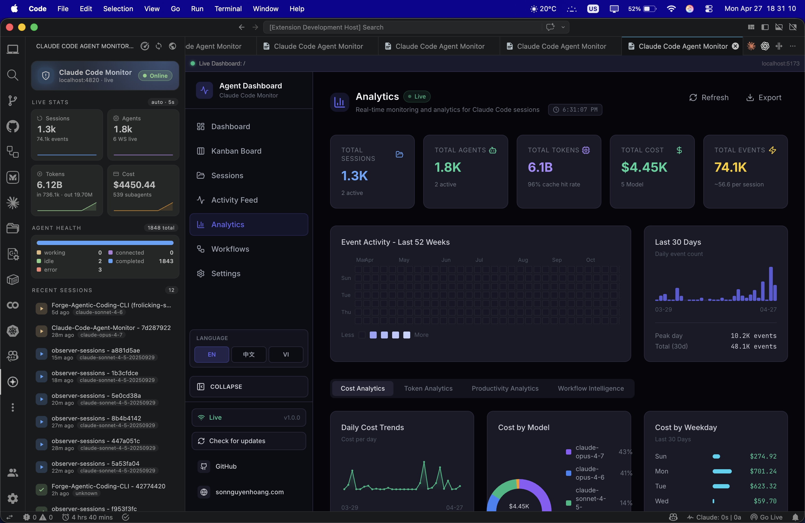

# Claude Code Agent Monitor for VS Code

**Claude Code Agent Monitor** brings a high-fidelity, real-time dashboard for your Claude Code AI sessions directly into your VS Code workspace. Monitor token usage, track agent health, and view deep analytics without switching windows.



---

## 🚀 Key Features

### 📊 Integrated Dashboard
Open the full agent monitoring dashboard in a dedicated VS Code tab. Supports real-time updates via WebSockets and local-first data storage.

### 🩺 Live Agent Health
Track all 5 agent states in your sidebar with color-coded status indicators:
- **Working**: Active subagents currently processing tasks.
- **Connected**: Agents initialized and ready.
- **Idle**: Standby agents.
- **Completed**: Successfully finished tasks.
- **Error/Failed**: Instantly spot where things went wrong.

### 📈 Usage & Analytics
- **Token Tracking**: Real-time display of Billions (B) or Millions (M) of tokens consumed.
- **Cost Calculation**: Live estimate of total USD cost based on current model pricing.
- **Event Frequency**: High-signal stats on events per session and subagent spawning.

### 🧭 Deep Navigation
Jump directly to specific views from the sidebar:
- **Main Dashboard**: Global overview.
- **Analytics Hub**: Deep dives into model performance.
- **Agent Board**: Kanban-style view of subagent progress.
- **Recent Sessions**: One-click access to your last 10 Claude sessions.

---

## 🛠️ Getting Started

### 1. Requirements
Ensure you have the Claude Code Agent Monitor server running locally:
```bash
npm install
npm run dev
```

When the server uses a subpath, export the same `DASHBOARD_BASE_URL` in the
environment that starts VS Code. The extension host does not read the server's
`.env` file. For example:

```bash
DASHBOARD_BASE_URL=/dashboard code .
```

Fully restart any existing VS Code instance so the extension host inherits the
updated environment.

### 2. Installation
- Search for **"Claude Code Agent Monitor"** in the VS Code Marketplace.
- Click **Install**.

### 3. Usage
- Click the **Radar/Dashboard icon** in the Activity Bar.
- The extension automatically detects your local server on ports **5173** (dev) or **4820** (prod).
- Use the **Refresh** button in the sidebar to manually force an update.

---

## 📦 Publishing & Development

To generate a `.vsix` file for manual installation or marketplace upload:

1. Install `vsce` globally:
   ```bash
   npm install -g @vscode/vsce
   ```
2. Navigate to the extension folder:
   ```bash
   cd vscode-extension
   ```
3. Run the package command:
   ```bash
   vsce package
   ```
   *This will generate `claude-code-agent-monitor-1.0.0.vsix`.*

---

## 📜 License
This extension is licensed under the [MIT License](LICENSE).

Developed with ❤️ for the AI Engineer community.
